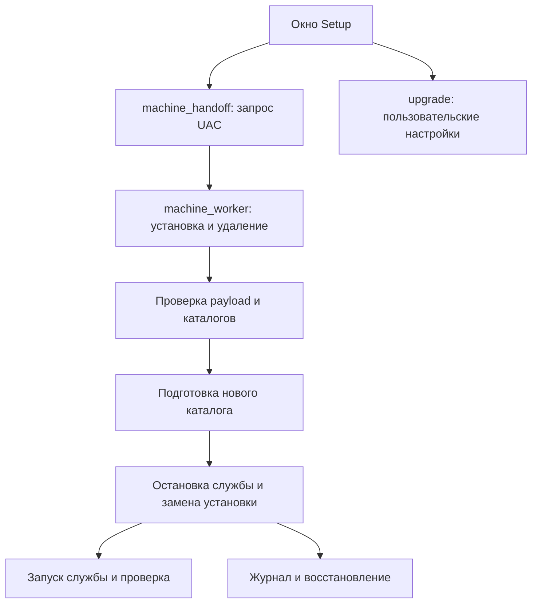

# Установщик: установка, обновление и откат

[Все пакеты](README.md) · [Снимок исходников](https://github.com/AcediaWhy/Obsession/tree/111889a8144070b8f2259252e1c905370b39d13b)

**Obsession 1.2.0 · исходники от 2026-10-13 · коммит `111889a8144070b8f2259252e1c905370b39d13b`.**

Здесь собран путь от окна Setup до привилегированного Windows-worker. Основной интерес — замена приложения и службы с журналом состояния, проверкой файлов и восстановлением после прерывания.

Ключевые файлы приведены целиком, включая комментарии и тесты. Код взят из указанного Git-коммита; пояснения и схемы добавлены для чтения. Все ссылки на исходники закреплены на тот же коммит.

## Схема



## Порядок чтения

1. Начни с installer/src-tauri/src/lib.rs: там видна развилка release/debug и точки вызова worker.
2. Затем прочитай machine_handoff.rs и machine_worker.rs: повышение прав, владение файлами, фазы установки и обновления.
3. upgrade.rs также содержит прежний transactional flow для debug-симуляции. В release основной machine install/update выполняется через native worker; пользовательские настройки и миграции по-прежнему используют функции upgrade.rs.
4. payload_compression.rs и build-setup.mjs связывают упаковку при сборке с проверкой и распаковкой при установке.

## Карта файлов

| Файл | Назначение | Строк |
|---|---|---:|
| [ObsessionTauri/installer/src-tauri/src/lib.rs](#source-01) | Команды Setup, release/debug-ветки и пользовательская часть установки. | 869 |
| [ObsessionTauri/installer/src-tauri/src/machine_handoff.rs](#source-02) | Передача операции native worker через UAC и ожидание результата. | 428 |
| [ObsessionTauri/installer/src-tauri/src/machine_worker.rs](#source-03) | Machine install/update/uninstall, payload, журнал, каталоги и служба. | 4057 |
| [ObsessionTauri/installer/src-tauri/src/installed_app.rs](#source-04) | Поиск и проверка работающего установленного приложения. | 303 |
| [ObsessionTauri/installer/src-tauri/src/payload_compression.rs](#source-05) | Распаковка ограниченного по размеру payload и проверка хеша. | 107 |
| [ObsessionTauri/installer/src-tauri/src/upgrade.rs](#source-06) | Планирование, пользовательские настройки, миграции и debug-транзакции. | 2499 |
| [ObsessionTauri/scripts/build-setup.mjs](#source-07) | Сборка приложения, ресурсов, Setup и подписанного обновления. | 241 |

## На что обратить внимание

- Какая фаза записана в журнале до изменения файлов и как выбирается действие при следующем запуске.
- Что происходит при отмене UAC, занятых файлах, ошибке запуска службы или неполной записи журнала.
- Как проверяются права каталогов, reparse points, идентичность Setup и принадлежность удаляемых файлов.

## Исходники

Блоки можно раскрыть по одному. В Raw-версии документа содержимое всех блоков доступно сразу.

<a id="source-01"></a>

### ObsessionTauri/installer/src-tauri/src/lib.rs

Команды Setup, release/debug-ветки и пользовательская часть установки.

[Открыть файл на GitHub](https://github.com/AcediaWhy/Obsession/blob/111889a8144070b8f2259252e1c905370b39d13b/ObsessionTauri/installer/src-tauri/src/lib.rs) · [Исходный текст](https://raw.githubusercontent.com/AcediaWhy/Obsession/111889a8144070b8f2259252e1c905370b39d13b/ObsessionTauri/installer/src-tauri/src/lib.rs)

869 строк · 31,352 байт · SHA-256: `28c4d14264bdbcee1bf27492da0776b392000370faf851fa86e651c3d7d0ddd3`

<details>
<summary>Показать полный код lib.rs</summary>

```rust
// Оболочка «Obsession Setup»: medium-integrity UI и native per-machine worker.
// Release никогда не извлекает и не запускает вложенный current-user NSIS.
// Старый transactional flow остаётся только debug simulation до завершения
// native update/uninstall transaction.

mod machine_handoff;
mod installed_app;
mod payload_compression;
pub mod machine_worker;
mod upgrade;
mod uninstall;
mod user_cleanup;
mod webview_bootstrap;

use std::ffi::OsString;
use std::fs;
use std::os::windows::ffi::OsStrExt;
use std::os::windows::fs::MetadataExt;
use std::path::{Path, PathBuf};
use std::process::Command;
use std::sync::atomic::{AtomicBool, AtomicU32, Ordering};

use tauri::{AppHandle, Emitter, Manager, WindowEvent};
use windows_sys::Win32::Foundation::{
    CloseHandle, GetLastError, SetLastError, ERROR_ALREADY_EXISTS, HANDLE,
};
use windows_sys::Win32::System::Threading::CreateMutexW;
use windows_sys::Win32::UI::WindowsAndMessaging::{
    MessageBoxW, MB_ICONERROR, MB_ICONINFORMATION, MB_OK,
};

// Debug simulation сохраняет прежний интерфейс run_install, но не запускает
// никакой внешний payload.
static PAYLOAD: &[u8] = &[];

// Пока NSIS работает, прервать установку безопасно нельзя: блокируем закрытие
// окна (фронт дополнительно прячет ✕).
static INSTALLING: AtomicBool = AtomicBool::new(false);
static PROGRESS_SEQUENCE: AtomicU32 = AtomicU32::new(0);

const SETUP_INSTANCE_MUTEX: &str = "Local\\com.vlarpsu.obsession.setup.instance.v1";
const INSTALL_OPERATION_MUTEX: &str = "Local\\com.vlarpsu.obsession.setup.install.v1";
pub const UNINSTALL_SWITCH: &str = "--uninstall";
const OWNER_MARKER: &str = ".obsession-install-owner";
const OWNER_ID: &str = "com.vlarpsu.obsession";
const FILE_ATTRIBUTE_REPARSE_POINT: u32 = 0x0000_0400;
const MAX_INSTALL_PATH_UTF16: usize = 240;

const CREATE_NO_WINDOW: u32 = 0x0800_0000;

#[derive(Clone, serde::Serialize)]
struct Progress {
    sequence: u32,
    pct: u32,
    stage: &'static str,
}

#[derive(Clone, Copy, Debug, PartialEq, Eq, serde::Serialize)]
#[serde(rename_all = "SCREAMING_SNAKE_CASE")]
enum InstallerErrorCode {
    Busy,
    UacCancelled,
    DowngradeBlocked,
    PreflightFailed,
    InstallFailed,
    RollbackRestored,
    RollbackIncomplete,
    LaunchFailed,
}

#[derive(Debug, serde::Serialize)]
#[serde(rename_all = "camelCase")]
struct InstallerFailure {
    code: InstallerErrorCode,
    retryable: bool,
    message_code: &'static str,
    log_path: Option<String>,
}

#[derive(Clone, Copy, Debug, serde::Serialize)]
#[serde(rename_all = "lowercase")]
enum InstallerOutcomeMode {
    Install,
    Update,
    Repair,
}

#[derive(Debug, serde::Serialize)]
struct InstallerOutcome {
    dir: String,
    mode: InstallerOutcomeMode,
    version: String,
}

struct NamedMutexGuard {
    handle: HANDLE,
}

// Windows kernel handles are process-wide rather than thread-affine. Moving
// sole ownership of this handle into Tauri's async command future is safe.
unsafe impl Send for NamedMutexGuard {}

impl NamedMutexGuard {
    fn acquire(name: &str) -> Result<Self, String> {
        let mut wide: Vec<u16> = name.encode_utf16().collect();
        wide.push(0);

        // SAFETY: Win32 documents the thread-local last-error slot. Clearing it
        // prevents an unrelated earlier ERROR_ALREADY_EXISTS from being reused
        // when CreateMutexW creates a brand-new object.
        unsafe { SetLastError(0) };
        // SAFETY: `wide` is a live, null-terminated UTF-16 buffer. A non-null
        // handle is owned by this guard and closed in Drop.
        let handle = unsafe { CreateMutexW(std::ptr::null(), 0, wide.as_ptr()) };
        if handle.is_null() {
            return Err(format!(
                "Не удалось создать системную блокировку инсталлера: {}",
                std::io::Error::last_os_error()
            ));
        }

        // GetLastError must be read immediately after CreateMutexW.
        let already_exists = unsafe { GetLastError() } == ERROR_ALREADY_EXISTS;
        if already_exists {
            // SAFETY: CreateMutexW returned a valid handle even when the named
            // object already existed.
            unsafe { CloseHandle(handle) };
            return Err("Установка Obsession уже запущена.".into());
        }

        Ok(Self { handle })
    }
}

impl Drop for NamedMutexGuard {
    fn drop(&mut self) {
        // SAFETY: this guard is the sole owner of the handle.
        unsafe { CloseHandle(self.handle) };
    }
}

struct InstallingGuard;

impl InstallingGuard {
    fn acquire() -> Result<Self, String> {
        INSTALLING
            .compare_exchange(false, true, Ordering::SeqCst, Ordering::SeqCst)
            .map_err(|_| "Установка Obsession уже выполняется.".to_string())?;
        Ok(Self)
    }
}

impl Drop for InstallingGuard {
    fn drop(&mut self) {
        INSTALLING.store(false, Ordering::SeqCst);
    }
}

fn emit_progress(app: &AppHandle, pct: u32, stage: &'static str) {
    let sequence = PROGRESS_SEQUENCE.fetch_add(1, Ordering::SeqCst) + 1;
    let _ = app.emit(
        "setup-progress",
        Progress {
            sequence,
            pct,
            stage,
        },
    );
}

fn installer_failure(error: String, preferred: InstallerErrorCode) -> InstallerFailure {
    let normalized = error.to_lowercase();
    let (code, retryable, message_code) = if normalized.contains("отменён пользователем")
        || normalized.contains("operation was canceled by the user")
    {
        (
            InstallerErrorCode::UacCancelled,
            true,
            "installer.error.uac_cancelled",
        )
    } else if normalized.contains("более новая версия")
        || normalized.contains("понижен") && normalized.contains("заблокирован")
    {
        (
            InstallerErrorCode::DowngradeBlocked,
            false,
            "installer.error.downgrade_blocked",
        )
    } else if normalized.contains("recovery")
        || normalized.contains("rollback remains pending")
        || normalized.contains("rollback также завершился ошибкой")
        || normalized.contains("восстановление не завершено")
        || normalized.contains("возврат backup также не удался")
    {
        (
            InstallerErrorCode::RollbackIncomplete,
            false,
            "installer.error.rollback_incomplete",
        )
    } else if normalized.contains("предыдущая версия восстановлена") {
        (
            InstallerErrorCode::RollbackRestored,
            true,
            "installer.error.rollback_restored",
        )
    } else if normalized.contains("уже запущена")
        || normalized.contains("уже выполняется")
        || normalized.contains("already running")
    {
        (InstallerErrorCode::Busy, true, "installer.error.busy")
    } else {
        match preferred {
            InstallerErrorCode::PreflightFailed => (
                InstallerErrorCode::PreflightFailed,
                true,
                "installer.error.preflight_failed",
            ),
            InstallerErrorCode::LaunchFailed => (
                InstallerErrorCode::LaunchFailed,
                true,
                "installer.error.launch_failed",
            ),
            _ => (
                InstallerErrorCode::InstallFailed,
                true,
                "installer.error.install_failed",
            ),
        }
    };

    let _ = upgrade::record_preflight_error(error);
    InstallerFailure {
        code,
        retryable,
        message_code,
        log_path: Some(
            upgrade::persistent_log_path()
                .to_string_lossy()
                .into_owned(),
        ),
    }
}

fn outcome_mode(mode: upgrade::InstallMode) -> Result<InstallerOutcomeMode, InstallerFailure> {
    match mode {
        upgrade::InstallMode::Install => Ok(InstallerOutcomeMode::Install),
        upgrade::InstallMode::Update => Ok(InstallerOutcomeMode::Update),
        upgrade::InstallMode::Repair => Ok(InstallerOutcomeMode::Repair),
        upgrade::InstallMode::Blocked => Err(installer_failure(
            "Понижение до версии этого setup заблокировано более новой установкой.".into(),
            InstallerErrorCode::DowngradeBlocked,
        )),
    }
}

fn show_fallback_error(error: String) {
    let _ = upgrade::record_preflight_error(error);
    let message = format!(
        "Не удалось завершить безопасную установку. Технические подробности сохранены в локальном журнале:\n{}",
        upgrade::persistent_log_path().display()
    );
    let mut text: Vec<u16> = message.encode_utf16().collect();
    text.push(0);
    let mut title: Vec<u16> = "Obsession Setup".encode_utf16().collect();
    title.push(0);
    // SAFETY: оба буфера живы, завершаются NUL и не изменяются во время вызова.
    unsafe {
        MessageBoxW(
            std::ptr::null_mut(),
            text.as_ptr(),
            title.as_ptr(),
            MB_OK | MB_ICONERROR,
        )
    };
}

fn show_fallback_info(message: &str) {
    let mut text: Vec<u16> = message.encode_utf16().collect();
    text.push(0);
    let mut title: Vec<u16> = "Obsession Setup".encode_utf16().collect();
    title.push(0);
    // SAFETY: both buffers are NUL-terminated and live for the call.
    unsafe {
        MessageBoxW(
            std::ptr::null_mut(),
            text.as_ptr(),
            title.as_ptr(),
            MB_OK | MB_ICONINFORMATION,
        )
    };
}

fn path_key(path: &Path) -> String {
    let mut value = path.to_string_lossy().replace('/', "\\");
    if let Some(stripped) = value.strip_prefix(r"\\?\") {
        value = stripped.to_string();
    }
    while value.len() > 3 && value.ends_with('\\') {
        value.pop();
    }
    value.to_lowercase()
}

fn path_is_same_or_child(candidate: &str, root: &str) -> bool {
    candidate == root
        || candidate
            .strip_prefix(root)
            .is_some_and(|tail| tail.starts_with('\\'))
}

fn resolve_existing_prefix(path: &Path) -> Result<PathBuf, String> {
    let mut existing = path.to_path_buf();
    let mut missing = Vec::<OsString>::new();

    while !existing.exists() {
        let name = existing.file_name().ok_or_else(|| {
            "Не удалось определить существующий родитель каталога установки.".to_string()
        })?;
        missing.push(name.to_os_string());
        if !existing.pop() {
            return Err("Не удалось определить каталог установки.".into());
        }
    }

    let mut resolved = fs::canonicalize(&existing)
        .map_err(|e| format!("Не удалось проверить путь установки: {e}"))?;
    for component in missing.into_iter().rev() {
        resolved.push(component);
    }
    Ok(resolved)
}

fn reject_reparse_points(path: &Path) -> Result<(), String> {
    let mut current = PathBuf::new();
    for component in path.components() {
        current.push(component.as_os_str());
        if !current.exists() {
            continue;
        }
        let metadata = fs::symlink_metadata(&current)
            .map_err(|e| format!("Не удалось проверить {}: {e}", current.display()))?;
        if metadata.file_attributes() & FILE_ATTRIBUTE_REPARSE_POINT != 0 {
            return Err(format!(
                "Путь установки проходит через ссылку или junction: {}",
                current.display()
            ));
        }
    }
    Ok(())
}

fn has_invalid_windows_component(path: &Path) -> bool {
    path.components().any(|component| {
        let std::path::Component::Normal(value) = component else {
            return false;
        };
        let value = value.to_string_lossy();
        if value.is_empty()
            || value.ends_with([' ', '.'])
            || value
                .chars()
                .any(|c| c < ' ' || matches!(c, '<' | '>' | ':' | '"' | '|' | '?' | '*'))
        {
            return true;
        }

        let stem = value
            .split('.')
            .next()
            .unwrap_or_default()
            .to_ascii_uppercase();
        matches!(stem.as_str(), "CON" | "PRN" | "AUX" | "NUL")
            || stem
                .strip_prefix("COM")
                .or_else(|| stem.strip_prefix("LPT"))
                .is_some_and(|n| matches!(n, "1" | "2" | "3" | "4" | "5" | "6" | "7" | "8" | "9"))
    })
}

fn reject_protected_path(path: &Path) -> Result<(), String> {
    let candidate = path_key(path);

    let forbidden_trees = [
        "WINDIR",
        "ProgramFiles",
        "ProgramFiles(x86)",
        "ProgramData",
        "TEMP",
        "TMP",
    ];
    for variable in forbidden_trees {
        let Some(root) = std::env::var_os(variable) else {
            continue;
        };
        let resolved =
            resolve_existing_prefix(Path::new(&root)).unwrap_or_else(|_| PathBuf::from(root));
        let root = path_key(&resolved);
        if path_is_same_or_child(&candidate, &root) {
            return Err(format!(
                "Нельзя устанавливать Obsession в защищённый системный каталог: {}",
                path.display()
            ));
        }
    }

    // Descendants of these locations are valid (the default lives below
    // LOCALAPPDATA), but the profile/data roots themselves and their ancestors
    // are far too broad to be an application directory.
    for variable in ["USERPROFILE", "APPDATA", "LOCALAPPDATA"] {
        let Some(root) = std::env::var_os(variable) else {
            continue;
        };
        let resolved =
            resolve_existing_prefix(Path::new(&root)).unwrap_or_else(|_| PathBuf::from(root));
        let root = path_key(&resolved);
        if candidate == root || path_is_same_or_child(&root, &candidate) {
            return Err(format!(
                "Выбран слишком широкий каталог установки: {}",
                path.display()
            ));
        }
    }
    Ok(())
}

fn validate_directory_ownership(path: &Path) -> Result<(), String> {
    if !path.exists() {
        return Ok(());
    }
    if !path.is_dir() {
        return Err("Путь установки указывает не на каталог.".into());
    }

    let mut entries =
        fs::read_dir(path).map_err(|e| format!("Не удалось прочитать каталог установки: {e}"))?;
    if entries.next().is_none() {
        return Ok(());
    }

    let owned =
        fs::read_to_string(path.join(OWNER_MARKER)).is_ok_and(|value| value.trim() == OWNER_ID);
    let legacy_install =
        path.join("Obsession.exe").is_file() && path.join("uninstall.exe").is_file();
    if owned || legacy_install {
        return Ok(());
    }

    Err(format!(
        "Каталог {} не пуст и не принадлежит Obsession. Выберите пустую папку, чтобы не перезаписать чужие файлы.",
        path.display()
    ))
}

fn validate_install_dir(raw: &str) -> Result<PathBuf, String> {
    let raw = raw.trim();
    if raw.is_empty() || raw.chars().any(|c| c == '\0' || c == '\r' || c == '\n') {
        return Err("Укажите корректный путь установки.".into());
    }

    let path = PathBuf::from(raw);
    let mut prefix = path.components();
    let local_drive = matches!(
        prefix.next(),
        Some(std::path::Component::Prefix(value))
            if matches!(value.kind(), std::path::Prefix::Disk(_))
    ) && matches!(prefix.next(), Some(std::path::Component::RootDir));
    if !path.is_absolute()
        || !local_drive
        || path.components().any(|component| {
            matches!(
                component,
                std::path::Component::CurDir | std::path::Component::ParentDir
            )
        })
    {
        return Err(
            "Путь установки должен находиться на локальном диске и не содержать . или ...".into(),
        );
    }
    if has_invalid_windows_component(&path) {
        return Err("Путь установки содержит недопустимое имя или символ.".into());
    }
    if path.as_os_str().encode_wide().count() > MAX_INSTALL_PATH_UTF16 {
        return Err("Путь установки слишком длинный.".into());
    }

    let resolved = resolve_existing_prefix(&path)?;
    let root = resolved
        .ancestors()
        .last()
        .ok_or_else(|| "Не удалось определить корень пути установки.".to_string())?;
    if path_key(&resolved) == path_key(root) {
        return Err("Нельзя устанавливать Obsession в корень диска.".into());
    }

    reject_reparse_points(&path)?;
    reject_protected_path(&resolved)?;
    validate_directory_ownership(&path)?;
    Ok(path)
}

#[tauri::command]
fn installer_snapshot(app: AppHandle) -> Result<upgrade::InstallerSnapshot, InstallerFailure> {
    let mut snapshot = upgrade::installer_snapshot(&app.package_info().version.to_string())
        .map_err(|error| installer_failure(error, InstallerErrorCode::PreflightFailed))?;
    let install_root = machine_worker::machine_install_root()
        .map_err(|error| installer_failure(error, InstallerErrorCode::PreflightFailed))?;
    if install_root.exists() && snapshot.mode == upgrade::InstallMode::Install {
        snapshot.mode = upgrade::InstallMode::Repair;
    }
    snapshot.dir = install_root.to_string_lossy().into_owned();
    Ok(snapshot)
}

#[tauri::command]
async fn install(
    app: AppHandle,
    dir: String,
    desktop: bool,
    start_menu: bool,
) -> Result<InstallerOutcome, InstallerFailure> {
    let _installing = InstallingGuard::acquire()
        .map_err(|error| installer_failure(error, InstallerErrorCode::Busy))?;
    let _operation_lock = NamedMutexGuard::acquire(INSTALL_OPERATION_MUTEX)
        .map_err(|error| installer_failure(error, InstallerErrorCode::Busy))?;
    let current_version = app.package_info().version.to_string();
    if !cfg!(debug_assertions) {
        let install_root = machine_worker::machine_install_root()
            .map_err(|error| installer_failure(error, InstallerErrorCode::PreflightFailed))?;
        if path_key(Path::new(&dir)) != path_key(&install_root) {
            return Err(installer_failure(
                "Путь установки устарел: Obsession устанавливается только в Program Files.".into(),
                InstallerErrorCode::PreflightFailed,
            ));
        }
        let snapshot = upgrade::installer_snapshot(&current_version)
            .map_err(|error| installer_failure(error, InstallerErrorCode::PreflightFailed))?;
        let mode = outcome_mode(snapshot.mode)?;
        let result_dir = install_root.to_string_lossy().into_owned();
        let installed_version = current_version.clone();
        tauri::async_runtime::spawn_blocking(move || {
            emit_progress(&app, 2, "prepare");
            machine_handoff::provision_machine_runtime(desktop, start_menu, |pct, stage| {
                emit_progress(&app, pct, stage);
            })?;
            emit_progress(&app, 94, "shortcuts");
            upgrade::finalize_machine_user_state(&install_root, &installed_version)?;
            emit_progress(&app, 100, "finish");
            Ok(())
        })
        .await
        .map_err(|error| {
            installer_failure(
                format!("Внутренняя ошибка защищённой установки: {error}"),
                InstallerErrorCode::InstallFailed,
            )
        })?
        .map_err(|error| installer_failure(error, InstallerErrorCode::InstallFailed))?;
        return Ok(InstallerOutcome {
            dir: result_dir,
            mode,
            version: current_version,
        });
    }
    let plan = upgrade::prepare_plan(&dir, &current_version)
        .map_err(|error| installer_failure(error, InstallerErrorCode::PreflightFailed))?;
    let mode = outcome_mode(plan.mode)?;
    // Блокирующая работа (fs, ожидание ребёнка) — строго через
    // tauri::async_runtime (см. историю с паникой tokio::spawn в этом репо).
    tauri::async_runtime::spawn_blocking(move || {
        upgrade::run_install(&app, plan, desktop, start_menu, PAYLOAD)
    })
    .await
    .map_err(|error| {
        installer_failure(
            format!("Внутренняя ошибка инсталлера: {error}"),
            InstallerErrorCode::InstallFailed,
        )
    })?
    .map_err(|error| installer_failure(error, InstallerErrorCode::InstallFailed))?;
    Ok(InstallerOutcome {
        dir,
        mode,
        version: current_version,
    })
}

#[tauri::command]
fn launch_app(app: AppHandle, dir: String) -> Result<(), InstallerFailure> {
    let exe = Path::new(&dir).join("Obsession.exe");
    if !exe.exists() {
        return Err(installer_failure(
            format!("Не найден {}", exe.display()),
            InstallerErrorCode::LaunchFailed,
        ));
    }
    // The UI must always launch at the caller's medium integrity. Do not turn
    // ERROR_ELEVATION_REQUIRED into a UAC prompt for an executable selected
    // from an install path: privileged work belongs to the future service.
    Command::new(&exe)
        .current_dir(&dir)
        .spawn()
        .map_err(|error| {
            installer_failure(
                format!("Не удалось запустить Obsession: {error}"),
                InstallerErrorCode::LaunchFailed,
            )
        })?;
    app.exit(0);
    Ok(())
}

#[tauri::command]
fn close_setup(app: AppHandle) {
    if !INSTALLING.load(Ordering::SeqCst) {
        app.exit(0);
    }
}

#[tauri::command]
fn minimize_setup(app: AppHandle) {
    if let Some(w) = app.get_webview_window("main") {
        let _ = w.minimize();
    }
}

/// Есть ли WebView2 Runtime (по реестру EdgeUpdate). Без него наше окно не
/// отрисуется — уходим в run_fallback(). Форс для теста ветки:
/// OBSESSION_SETUP_FORCE_FALLBACK=1.
pub fn webview2_present() -> bool {
    if std::env::var("OBSESSION_SETUP_FORCE_FALLBACK").is_ok_and(|v| v == "1") {
        return false;
    }
    use winreg::enums::{HKEY_CURRENT_USER, HKEY_LOCAL_MACHINE};
    use winreg::RegKey;
    const GUID: &str = "{F3017226-FE2A-4295-8BDF-00C3A9A7E4C5}";
    let candidates = [
        (
            HKEY_LOCAL_MACHINE,
            format!(r"SOFTWARE\WOW6432Node\Microsoft\EdgeUpdate\Clients\{GUID}"),
        ),
        (
            HKEY_LOCAL_MACHINE,
            format!(r"SOFTWARE\Microsoft\EdgeUpdate\Clients\{GUID}"),
        ),
        (
            HKEY_CURRENT_USER,
            format!(r"SOFTWARE\Microsoft\EdgeUpdate\Clients\{GUID}"),
        ),
    ];
    for (hive, path) in candidates {
        if let Ok(key) = RegKey::predef(hive).open_subkey(&path) {
            if let Ok(pv) = key.get_value::<String, _>("pv") {
                if !pv.is_empty() && pv != "0.0.0.0" {
                    return true;
                }
            }
        }
    }
    false
}

/// Provision WebView2 before any Obsession installation. On success main opens
/// the normal setup UI; on failure/cancellation no app payload was installed.
pub fn run_fallback() -> bool {
    let _self_image_lock = match machine_handoff::lock_current_setup_image() {
        Ok(lock) => lock,
        Err(error) => {
            show_fallback_error(error);
            return false;
        }
    };
    let _instance_guard = match NamedMutexGuard::acquire(SETUP_INSTANCE_MUTEX) {
        Ok(guard) => guard,
        Err(error) => {
            show_fallback_error(error);
            return false;
        }
    };
    if let Err(error) = webview_bootstrap::install() {
        show_fallback_error(error);
        return false;
    }
    true
}

pub fn run_uninstall() -> bool {
    let Some(options) = uninstall::fallback_choices() else { return true; };
    let _operation = match NamedMutexGuard::acquire(INSTALL_OPERATION_MUTEX) {
        Ok(guard) => guard,
        Err(error) => { show_fallback_error(error); return false; }
    };
    let cleanup = match user_cleanup::plan(options) {
        Ok(plan) => plan,
        Err(error) => { show_fallback_error(error); return false; }
    };
    let _self_image_lock = match machine_handoff::lock_current_setup_image() {
        Ok(lock) => lock,
        Err(error) => {
            show_fallback_error(error);
            return false;
        }
    };
    if cfg!(debug_assertions) {
        show_fallback_error(
            "Native machine uninstall is available only in a release build.".into(),
        );
        return false;
    }
    let install_root = match machine_worker::machine_install_root() {
        Ok(path) => path,
        Err(error) => {
            show_fallback_error(error);
            return false;
        }
    };
    if let Err(error) = upgrade::prepare_graphical_uninstall(&install_root) {
        show_fallback_error(error);
        return false;
    }
    if let Err(error) = machine_handoff::uninstall_machine_runtime(|_, _| {}) {
        show_fallback_error(error);
        return false;
    }
    if let Err(error) = upgrade::cleanup_machine_user_state(&install_root) {
        show_fallback_error(format!(
            "Obsession removed its machine components, but current-user cleanup failed: {error}"
        ));
        return false;
    }
    let leftovers = user_cleanup::execute(cleanup);
    if !leftovers.is_empty() {
        show_fallback_error(format!("Программа удалена, но часть данных осталась:\n{}", leftovers.join("\n")));
        return false;
    }
    show_fallback_info("Obsession удалена. Заблокированные файлы будут окончательно удалены Windows после следующей перезагрузки.");
    true
}

pub fn run() {
    let _self_image_lock = match machine_handoff::lock_current_setup_image() {
        Ok(lock) => lock,
        Err(error) => {
            eprintln!("obsession-setup: {error}");
            return;
        }
    };
    let _instance_guard = match NamedMutexGuard::acquire(SETUP_INSTANCE_MUTEX) {
        Ok(guard) => guard,
        Err(error) => {
            eprintln!("obsession-setup: {error}");
            return;
        }
    };

    let application = tauri::Builder::default()
        .on_window_event(|_window, event| {
            if let WindowEvent::CloseRequested { api, .. } = event {
                if INSTALLING.load(Ordering::SeqCst) {
                    api.prevent_close();
                }
            }
        })
        .invoke_handler(tauri::generate_handler![
            uninstall::uninstall_mode,
            uninstall::uninstall_preview,
            uninstall::uninstall_execute,
            installer_snapshot,
            install,
            launch_app,
            close_setup,
            minimize_setup
        ])
        .build(tauri::generate_context!())
        .expect("ошибка запуска Obsession Setup");
    // Обычный run завершает процесс сразу. run_return освобождает WebView,
    // после чего нативная очистка может удалить профиль закрытого окна.
    application.run_return(|_, _| {});
    uninstall::finish_after_window();
}

#[cfg(test)]
mod tests {
    use super::*;
    use std::sync::atomic::{AtomicU64, Ordering};

    static TEST_ID: AtomicU64 = AtomicU64::new(0);

    struct TestDir(PathBuf);

    impl TestDir {
        fn new(label: &str) -> Self {
            let id = TEST_ID.fetch_add(1, Ordering::Relaxed);
            let path = std::env::current_dir()
                .expect("current dir")
                .join("target")
                .join("installer-safety-tests")
                .join(format!("{label}-{}-{id}", std::process::id()));
            fs::create_dir_all(&path).expect("create test directory");
            Self(path)
        }
    }

    impl Drop for TestDir {
        fn drop(&mut self) {
            let _ = fs::remove_dir_all(&self.0);
        }
    }

    #[test]
    fn accepts_empty_absolute_directory() {
        let dir = TestDir::new("empty");
        assert_eq!(
            validate_install_dir(dir.0.to_str().unwrap()).unwrap(),
            dir.0
        );
    }

    #[test]
    fn rejects_non_empty_foreign_directory() {
        let dir = TestDir::new("foreign");
        fs::write(dir.0.join("notes.txt"), "user data").unwrap();
        let error = validate_install_dir(dir.0.to_str().unwrap()).unwrap_err();
        assert!(error.contains("не принадлежит Obsession"));
    }

    #[test]
    fn accepts_owned_and_legacy_installations() {
        let owned = TestDir::new("owned");
        fs::write(owned.0.join(OWNER_MARKER), format!("{OWNER_ID}\n")).unwrap();
        fs::write(owned.0.join("resource.dat"), "old").unwrap();
        assert!(validate_install_dir(owned.0.to_str().unwrap()).is_ok());

        let legacy = TestDir::new("legacy");
        fs::write(legacy.0.join("Obsession.exe"), "stub").unwrap();
        fs::write(legacy.0.join("uninstall.exe"), "stub").unwrap();
        assert!(validate_install_dir(legacy.0.to_str().unwrap()).is_ok());
    }

    #[test]
    fn rejects_forged_owner_marker() {
        let dir = TestDir::new("forged-marker");
        fs::write(dir.0.join(OWNER_MARKER), "another.product").unwrap();
        assert!(validate_install_dir(dir.0.to_str().unwrap()).is_err());
    }

    #[test]
    fn rejects_relative_root_and_reserved_paths() {
        assert!(validate_install_dir("relative\\Obsession").is_err());
        assert!(validate_install_dir(r"C:\").is_err());
        assert!(validate_install_dir(r"C:\\safe\\CON\\Obsession").is_err());
        assert!(validate_install_dir(r"C:\\safe\\..\\Obsession").is_err());
        assert!(validate_install_dir(r"\\server\share\Obsession").is_err());
    }

    #[test]
    fn named_mutex_rejects_a_second_owner() {
        let id = TEST_ID.fetch_add(1, Ordering::Relaxed);
        let name = format!(
            "Local\\com.vlarpsu.obsession.setup.test.{}.{}",
            std::process::id(),
            id
        );
        let first = NamedMutexGuard::acquire(&name).unwrap();
        assert!(NamedMutexGuard::acquire(&name).is_err());
        drop(first);
        assert!(NamedMutexGuard::acquire(&name).is_ok());
    }
}
```

</details>

<a id="source-02"></a>

### ObsessionTauri/installer/src-tauri/src/machine_handoff.rs

Передача операции native worker через UAC и ожидание результата.

[Открыть файл на GitHub](https://github.com/AcediaWhy/Obsession/blob/111889a8144070b8f2259252e1c905370b39d13b/ObsessionTauri/installer/src-tauri/src/machine_handoff.rs) · [Исходный текст](https://raw.githubusercontent.com/AcediaWhy/Obsession/111889a8144070b8f2259252e1c905370b39d13b/ObsessionTauri/installer/src-tauri/src/machine_handoff.rs)

428 строк · 15,628 байт · SHA-256: `8e16910cf845727f60fc6813c979598802a585e54f69d29c932f53a6e467bcf7`

<details>
<summary>Показать полный код machine_handoff.rs</summary>

```rust
//! Medium-integrity launcher for the fixed native machine worker.
//!
//! The graphical setup never elevates itself in-place. It keeps its own image
//! open without write/delete sharing, then asks ShellExecuteEx to start the
//! exact same image with the worker's fixed argv and waits for a bounded result.

use std::fs::{self, File, OpenOptions};
use std::io::Read;
use std::mem::size_of;
use std::os::windows::ffi::OsStrExt;
use std::os::windows::fs::{MetadataExt, OpenOptionsExt};
use std::path::Path;
use std::sync::atomic::{AtomicU64, Ordering};
use std::time::{Duration, Instant, SystemTime, UNIX_EPOCH};

use serde::Deserialize;
use sha2::{Digest, Sha256};
use windows::core::{w, HRESULT, PCWSTR};
use windows::Win32::Foundation::{
    CloseHandle, ERROR_CANCELLED, HANDLE, WAIT_OBJECT_0, WAIT_TIMEOUT,
};
use windows::Win32::Storage::FileSystem::{FILE_ATTRIBUTE_REPARSE_POINT, FILE_SHARE_READ};
use windows::Win32::System::Threading::{
    GetExitCodeProcess, TerminateProcess, WaitForSingleObject,
};
use windows::Win32::UI::Shell::{
    ShellExecuteExW, SEE_MASK_FLAG_NO_UI, SEE_MASK_NOASYNC, SEE_MASK_NOCLOSEPROCESS,
    SHELLEXECUTEINFOW,
};

use crate::machine_worker::{
    machine_result_path, INTERNAL_SWITCH, PROVISION_ACTION, UNINSTALL_ACTION,
};

const MACHINE_WORKER_TIMEOUT: Duration = Duration::from_secs(10 * 60);
const MACHINE_REPORT_POLL: Duration = Duration::from_millis(100);
const MAX_MACHINE_REPORT_BYTES: u64 = 16 * 1024;

static REQUEST_COUNTER: AtomicU64 = AtomicU64::new(0);

struct ProcessHandle(HANDLE);

impl Drop for ProcessHandle {
    fn drop(&mut self) {
        if !self.0.is_invalid() {
            // SAFETY: this guard owns the process handle returned by
            // ShellExecuteExW and closes it exactly once.
            unsafe {
                let _ = CloseHandle(self.0);
            }
        }
    }
}

fn wide_path(path: &Path) -> Result<Vec<u16>, String> {
    let mut value: Vec<u16> = path.as_os_str().encode_wide().collect();
    if value.is_empty() || value.contains(&0) {
        return Err("setup executable path is empty or contains NUL".into());
    }
    value.push(0);
    Ok(value)
}

fn machine_request_id() -> String {
    let sequence = REQUEST_COUNTER.fetch_add(1, Ordering::Relaxed);
    let timestamp = SystemTime::now()
        .duration_since(UNIX_EPOCH)
        .unwrap_or_default()
        .as_nanos();
    let mut hasher = Sha256::new();
    hasher.update(std::process::id().to_le_bytes());
    hasher.update(sequence.to_le_bytes());
    hasher.update(timestamp.to_le_bytes());
    let digest = hasher.finalize();
    digest[..16]
        .iter()
        .map(|byte| format!("{byte:02x}"))
        .collect()
}

fn worker_parameters(
    action: &str,
    request_id: &str,
    shortcut_options: Option<(bool, bool)>,
) -> String {
    match shortcut_options {
        Some((desktop, start_menu)) => format!(
            "{INTERNAL_SWITCH} {action} {request_id} {} {}",
            u8::from(desktop),
            u8::from(start_menu)
        ),
        None => format!("{INTERNAL_SWITCH} {action} {request_id}"),
    }
}

fn lock_setup_image(path: &Path) -> Result<File, String> {
    let metadata = fs::symlink_metadata(path)
        .map_err(|error| format!("could not inspect setup executable: {error}"))?;
    if !metadata.is_file() || metadata.file_attributes() & FILE_ATTRIBUTE_REPARSE_POINT.0 != 0 {
        return Err("setup executable is missing, not a file, or a reparse point".into());
    }
    OpenOptions::new()
        .read(true)
        .share_mode(FILE_SHARE_READ.0)
        .open(path)
        .map_err(|error| format!("could not lock setup executable against replacement: {error}"))
}

pub(crate) fn lock_current_setup_image() -> Result<File, String> {
    let executable = std::env::current_exe()
        .map_err(|error| format!("could not resolve setup image: {error}"))?;
    lock_setup_image(&executable)
}

#[derive(Debug, Deserialize, PartialEq, Eq)]
#[serde(rename_all = "snake_case")]
enum MachineReportState {
    Running,
    Succeeded,
    Failed,
}

#[derive(Debug, Deserialize)]
#[serde(deny_unknown_fields)]
struct MachineWorkerReport {
    schema_version: u32,
    request_id: String,
    sequence: u32,
    pct: u32,
    stage: String,
    state: MachineReportState,
    error: Option<String>,
}

fn canonical_stage(stage: &str) -> Option<&'static str> {
    match stage {
        "prepare" => Some("prepare"),
        "stop" => Some("stop"),
        "install" => Some("install"),
        "verify" => Some("verify"),
        "finish" => Some("finish"),
        _ => None,
    }
}

fn read_machine_report(
    path: &Path,
    request_id: &str,
    final_read: bool,
) -> Result<Option<MachineWorkerReport>, String> {
    let metadata = match fs::metadata(path) {
        Ok(metadata) => metadata,
        Err(error) if error.kind() == std::io::ErrorKind::NotFound => return Ok(None),
        Err(error) => {
            return Err(format!(
                "Не удалось прочитать статус install worker: {error}"
            ))
        }
    };
    if !metadata.is_file() || metadata.len() == 0 || metadata.len() > MAX_MACHINE_REPORT_BYTES {
        if final_read {
            return Err("Install worker оставил некорректный result-файл.".into());
        }
        return Ok(None);
    }
    let mut bytes = Vec::with_capacity(metadata.len() as usize);
    File::open(path)
        .and_then(|mut file| file.read_to_end(&mut bytes))
        .map_err(|error| format!("Не удалось прочитать результат install worker: {error}"))?;
    let report: MachineWorkerReport = match serde_json::from_slice(&bytes) {
        Ok(report) => report,
        Err(_) if !final_read => return Ok(None),
        Err(error) => {
            return Err(format!(
                "Install worker оставил повреждённый result-файл: {error}"
            ))
        }
    };
    if report.schema_version != 1
        || report.request_id != request_id
        || report.sequence == 0
        || report.pct > 100
        || canonical_stage(&report.stage).is_none()
        || report
            .error
            .as_ref()
            .is_some_and(|error| error.len() > 4096)
    {
        return Err("Install worker вернул результат с неверной идентичностью или схемой.".into());
    }
    Ok(Some(report))
}

pub(crate) fn provision_machine_runtime(
    desktop: bool,
    start_menu: bool,
    progress: impl FnMut(u32, &'static str),
) -> Result<(), String> {
    run_machine_worker(PROVISION_ACTION, Some((desktop, start_menu)), progress)
}

pub(crate) fn uninstall_machine_runtime(
    progress: impl FnMut(u32, &'static str),
) -> Result<(), String> {
    run_machine_worker(UNINSTALL_ACTION, None, progress)
}

fn run_machine_worker(
    action: &str,
    shortcut_options: Option<(bool, bool)>,
    mut progress: impl FnMut(u32, &'static str),
) -> Result<(), String> {
    if cfg!(debug_assertions) {
        return Err("machine operations are available only in a release setup build".into());
    }
    if action != PROVISION_ACTION && action != UNINSTALL_ACTION {
        return Err("unsupported fixed machine worker action".into());
    }
    if (action == PROVISION_ACTION) != shortcut_options.is_some() {
        return Err("invalid fixed machine worker shortcut options".into());
    }

    let request_id = machine_request_id();
    let result_path = machine_result_path(&request_id)?;
    if result_path.exists() {
        return Err("machine worker request id unexpectedly collided".into());
    }
    let executable = std::env::current_exe()
        .map_err(|error| format!("could not resolve setup image: {error}"))?;
    let _image_lock = lock_setup_image(&executable)?;
    let executable_wide = wide_path(&executable)?;
    let mut parameters_wide: Vec<u16> = worker_parameters(action, &request_id, shortcut_options)
        .encode_utf16()
        .collect();
    parameters_wide.push(0);
    let mut execution = SHELLEXECUTEINFOW {
        cbSize: size_of::<SHELLEXECUTEINFOW>() as u32,
        fMask: SEE_MASK_NOCLOSEPROCESS | SEE_MASK_NOASYNC | SEE_MASK_FLAG_NO_UI,
        lpVerb: w!("runas"),
        lpFile: PCWSTR(executable_wide.as_ptr()),
        lpParameters: PCWSTR(parameters_wide.as_ptr()),
        nShow: 0,
        ..Default::default()
    };

    // SAFETY: all UTF-16 buffers remain live for the call and the structure is
    // initialized with the documented size and flags.
    if let Err(error) = unsafe { ShellExecuteExW(&mut execution) } {
        if error.code() == HRESULT::from_win32(ERROR_CANCELLED.0) {
            return Err("Запрос прав администратора был отменён пользователем.".into());
        }
        return Err(format!(
            "Не удалось запустить защищённый install worker: {error}"
        ));
    }
    if execution.hProcess.is_invalid() {
        return Err("Windows did not return a machine worker process handle".into());
    }
    let process = ProcessHandle(execution.hProcess);
    let started = Instant::now();
    let mut latest_sequence = 0u32;
    loop {
        let poll = u32::try_from(MACHINE_REPORT_POLL.as_millis()).unwrap_or(100);
        // SAFETY: the ShellExecuteEx process handle remains owned by `process`.
        let wait = unsafe { WaitForSingleObject(process.0, poll) };
        if let Some(report) = read_machine_report(&result_path, &request_id, false)? {
            if report.sequence > latest_sequence {
                latest_sequence = report.sequence;
                if let Some(stage) = canonical_stage(&report.stage) {
                    progress(report.pct, stage);
                }
            }
        }
        if wait == WAIT_OBJECT_0 {
            break;
        }
        if wait != WAIT_TIMEOUT {
            return Err(format!(
                "Не удалось дождаться install worker: {}",
                std::io::Error::last_os_error()
            ));
        }
        if started.elapsed() >= MACHINE_WORKER_TIMEOUT {
            // SAFETY: a timed-out worker must not continue mutating machine
            // state after the medium setup reports failure.
            let _ = unsafe { TerminateProcess(process.0, 1) };
            let _ = unsafe { WaitForSingleObject(process.0, 30_000) };
            return Err("Защищённый install worker не завершился за 10 минут.".into());
        }
    }

    let mut exit_code = 0u32;
    // SAFETY: the process is signaled and the output pointer is valid.
    unsafe { GetExitCodeProcess(process.0, &mut exit_code) }
        .map_err(|error| format!("Не удалось прочитать результат install worker: {error}"))?;
    let final_report = read_machine_report(&result_path, &request_id, true)?;
    if exit_code != 0 {
        if let Some(report) = final_report {
            if report.state == MachineReportState::Failed {
                if let Some(error) = report.error {
                    return Err(error);
                }
            }
        }
        return Err(format!(
            "Защищённый install worker завершился с кодом {exit_code}."
        ));
    }
    let Some(report) = final_report else {
        return Err("Install worker завершился без защищённого result-файла.".into());
    };
    if report.state != MachineReportState::Succeeded {
        return Err("Install worker не подтвердил успешное завершение операции.".into());
    }
    Ok(())
}

#[cfg(test)]
mod tests {
    use super::*;

    #[test]
    fn machine_report_accepts_worker_stop_stage_and_preserves_failure() {
        let request_id = machine_request_id();
        let path = std::env::current_dir()
            .unwrap()
            .join("target")
            .join(format!("machine-report-{request_id}.json"));
        fs::create_dir_all(path.parent().unwrap()).unwrap();
        let mut report = serde_json::json!({
            "schema_version": 1,
            "request_id": request_id,
            "sequence": 2,
            "pct": 18,
            "stage": "stop",
            "state": "running",
            "error": null,
        });
        fs::write(&path, serde_json::to_vec(&report).unwrap()).unwrap();
        let running = read_machine_report(&path, &request_id, false)
            .unwrap()
            .unwrap();
        assert_eq!(running.stage, "stop");
        assert_eq!(running.state, MachineReportState::Running);

        report["sequence"] = 4.into();
        report["pct"] = 100.into();
        report["stage"] = "finish".into();
        report["state"] = "failed".into();
        report["error"] = "machine update rolled back safely".into();
        fs::write(&path, serde_json::to_vec(&report).unwrap()).unwrap();
        let failed = read_machine_report(&path, &request_id, true)
            .unwrap()
            .unwrap();
        assert_eq!(failed.state, MachineReportState::Failed);
        assert_eq!(
            failed.error.as_deref(),
            Some("machine update rolled back safely")
        );

        report["stage"] = "unknown".into();
        fs::write(&path, serde_json::to_vec(&report).unwrap()).unwrap();
        assert!(read_machine_report(&path, &request_id, true).is_err());
        fs::remove_file(path).unwrap();
    }

    #[test]
    fn machine_worker_command_line_is_fixed() {
        let request_id = "a".repeat(32);
        assert_eq!(
            worker_parameters(PROVISION_ACTION, &request_id, Some((true, false))),
            format!("--obsession-machine-worker-v1 provision {request_id} 1 0")
        );
        assert_eq!(
            worker_parameters(UNINSTALL_ACTION, &request_id, None),
            format!("--obsession-machine-worker-v1 uninstall {request_id}")
        );
    }

    #[test]
    fn machine_request_ids_are_bounded_lowercase_hex_and_unique() {
        let first = machine_request_id();
        let second = machine_request_id();
        assert_eq!(first.len(), 32);
        assert!(first
            .bytes()
            .all(|byte| byte.is_ascii_digit() || matches!(byte, b'a'..=b'f')));
        assert_ne!(first, second);
    }

    #[test]
    fn machine_report_parser_rejects_partial_and_wrong_identity_reports() {
        let request_id = "b".repeat(32);
        let path = std::env::current_dir()
            .unwrap()
            .join("target")
            .join(format!("machine-report-{}.json", machine_request_id()));
        fs::create_dir_all(path.parent().unwrap()).unwrap();
        fs::write(&path, b"{").unwrap();
        assert!(read_machine_report(&path, &request_id, false)
            .unwrap()
            .is_none());
        assert!(read_machine_report(&path, &request_id, true).is_err());

        fs::write(
            &path,
            serde_json::to_vec(&serde_json::json!({
                "schema_version": 1,
                "request_id": "c".repeat(32),
                "sequence": 1,
                "pct": 25,
                "stage": "install",
                "state": "running",
                "error": null,
            }))
            .unwrap(),
        )
        .unwrap();
        assert!(read_machine_report(&path, &request_id, true).is_err());
        let _ = fs::remove_file(path);
    }

    #[test]
    fn current_test_image_can_be_locked_read_only() {
        let lock = lock_current_setup_image().unwrap();
        assert!(lock.metadata().unwrap().is_file());
    }
}
```

</details>

<a id="source-03"></a>

### ObsessionTauri/installer/src-tauri/src/machine_worker.rs

Machine install/update/uninstall, payload, журнал, каталоги и служба.

[Открыть файл на GitHub](https://github.com/AcediaWhy/Obsession/blob/111889a8144070b8f2259252e1c905370b39d13b/ObsessionTauri/installer/src-tauri/src/machine_worker.rs) · [Исходный текст](https://raw.githubusercontent.com/AcediaWhy/Obsession/111889a8144070b8f2259252e1c905370b39d13b/ObsessionTauri/installer/src-tauri/src/machine_worker.rs)

4057 строк · 157,246 байт · SHA-256: `77fe10c9e6e695e76bf52e967b7af0b2805b726df795de66ac4647ab874ad2e6`

<details>
<summary>Показать полный код machine_worker.rs</summary>

```rust
//! Native, narrowly-scoped per-machine setup worker.
//!
//! This mode is dispatched before WebView/Tauri startup. It accepts no caller
//! paths, service names or command text: every machine-wide target is derived
//! from Windows Known Folders and fixed product constants in this module.

use std::borrow::Cow;
use std::collections::{BTreeMap, BTreeSet};
use std::ffi::{OsStr, OsString};
use std::fs::{self, File, OpenOptions};
use std::io::{BufReader, Read, Seek, SeekFrom, Write};
use std::mem::size_of;
use std::os::windows::ffi::{OsStrExt, OsStringExt};
use std::os::windows::fs::MetadataExt;
use std::path::{Component, Path, PathBuf};
use std::time::{Duration, Instant, SystemTime, UNIX_EPOCH};

use obsession_runtime_service::dpi_materializer::ProtectedDataLayout;
use obsession_runtime_service::protected_layout::ProtectedLayout;
use semver::Version;
use serde::{Deserialize, Serialize};
use sha2::{Digest, Sha256};
use windows::core::{w, Interface, PCWSTR};
use windows::Win32::Foundation::{
    CloseHandle, GetLastError, SetLastError, ERROR_ALREADY_EXISTS, ERROR_INSUFFICIENT_BUFFER,
    ERROR_NOT_ALL_ASSIGNED, ERROR_SERVICE_ALREADY_RUNNING, ERROR_SERVICE_DOES_NOT_EXIST,
    ERROR_SERVICE_NOT_ACTIVE, ERROR_SUCCESS, HANDLE, HLOCAL, LUID, S_FALSE, S_OK,
};
use windows::Win32::Security::Authorization::{
    ConvertStringSecurityDescriptorToSecurityDescriptorW, SetSecurityInfo, SDDL_REVISION_1,
    SE_FILE_OBJECT,
};
use windows::Win32::Security::{
    AdjustTokenPrivileges, GetSecurityDescriptorDacl, GetSecurityDescriptorOwner,
    GetTokenInformation, LookupPrivilegeValueW, TokenElevation, DACL_SECURITY_INFORMATION,
    LUID_AND_ATTRIBUTES, OWNER_SECURITY_INFORMATION, PROTECTED_DACL_SECURITY_INFORMATION,
    PSECURITY_DESCRIPTOR, PSID, SECURITY_ATTRIBUTES, SE_PRIVILEGE_ENABLED, SE_RESTORE_NAME,
    SE_TAKE_OWNERSHIP_NAME, TOKEN_ADJUST_PRIVILEGES, TOKEN_ELEVATION, TOKEN_PRIVILEGES,
    TOKEN_QUERY,
};
use windows::Win32::Storage::FileSystem::{
    CreateDirectoryW, CreateFileW, GetFileInformationByHandle, MoveFileExW,
    BY_HANDLE_FILE_INFORMATION, DELETE, FILE_ATTRIBUTE_DIRECTORY, FILE_ATTRIBUTE_REPARSE_POINT,
    FILE_FLAG_BACKUP_SEMANTICS, FILE_FLAG_OPEN_REPARSE_POINT, FILE_SHARE_READ, FILE_SHARE_WRITE,
    MOVEFILE_DELAY_UNTIL_REBOOT, MOVEFILE_REPLACE_EXISTING, MOVEFILE_WRITE_THROUGH, OPEN_EXISTING,
    READ_CONTROL, WRITE_DAC, WRITE_OWNER,
};
use windows::Win32::System::Com::{
    CoCreateInstance, CoInitializeEx, CoTaskMemFree, CoUninitialize, IPersistFile,
    CLSCTX_INPROC_SERVER, COINIT_APARTMENTTHREADED, STGM_READ,
};
use windows::Win32::System::Services::{
    ChangeServiceConfigW, CloseServiceHandle, ControlService, CreateServiceW, DeleteService,
    OpenSCManagerW, OpenServiceW, QueryServiceConfigW, QueryServiceStatusEx, StartServiceW,
    QUERY_SERVICE_CONFIGW, SC_HANDLE, SC_MANAGER_CONNECT, SC_MANAGER_CREATE_SERVICE,
    SC_STATUS_PROCESS_INFO, SERVICE_AUTO_START, SERVICE_CHANGE_CONFIG, SERVICE_CONTROL_STOP,
    SERVICE_ERROR_NORMAL, SERVICE_KERNEL_DRIVER, SERVICE_QUERY_CONFIG, SERVICE_QUERY_STATUS,
    SERVICE_RUNNING, SERVICE_START, SERVICE_START_PENDING, SERVICE_STATUS,
    SERVICE_STATUS_CURRENT_STATE, SERVICE_STATUS_PROCESS, SERVICE_STOP, SERVICE_STOPPED,
    SERVICE_STOP_PENDING, SERVICE_WIN32_OWN_PROCESS,
};
use windows::Win32::System::Threading::{
    CreateMutexW, GetCurrentProcess, OpenProcessToken, ReleaseMutex,
};
use windows::Win32::UI::Shell::{
    FOLDERID_CommonPrograms, FOLDERID_ProgramData, FOLDERID_ProgramFiles, FOLDERID_PublicDesktop,
    IShellLinkW, SHGetKnownFolderPath, ShellLink, KF_FLAG_DEFAULT, SLGP_RAWPATH,
};
use winreg::enums::{HKEY_LOCAL_MACHINE, KEY_READ, KEY_WOW64_64KEY, KEY_WRITE};
use winreg::RegKey;

pub(crate) const INTERNAL_SWITCH: &str = "--obsession-machine-worker-v1";
pub(crate) const PROVISION_ACTION: &str = "provision";
pub(crate) const UNINSTALL_ACTION: &str = "uninstall";
const PRODUCT_DIRECTORY: &str = "Obsession";
const RUNTIME_DIRECTORY: &str = "Runtime";
const SERVICE_DIRECTORY: &str = "runtime";
const SERVICE_FILE_NAME: &str = "Obsession.Runtime.exe";
const MANIFEST_FILE_NAME: &str = "runtime-manifest.json";
const SERVICE_MANIFEST_PATH: &str = "runtime/Obsession.Runtime.exe";
const SERVICE_NAME: PCWSTR = w!("ObsessionRuntime");
const SERVICE_DISPLAY_NAME: PCWSTR = w!("Obsession Runtime");
const LOCAL_SYSTEM_ACCOUNT: PCWSTR = w!("LocalSystem");
const WINDIVERT_SERVICE_NAME: PCWSTR = w!("WinDivert");
const WINDIVERT_DRIVER_RELATIVE_PATH: &str = "bin/WinDivert64.sys";
const STATE_DIRECTORY_SDDL: PCWSTR =
    w!("O:SYD:P(A;OICI;FA;;;SY)(A;OICI;FA;;;BA)(A;OICI;GRGX;;;BU)");

const MACHINE_PAYLOAD_MAGIC: &[u8; 8] = b"OBSMACH1";
const MACHINE_PAYLOAD_PRODUCT_ID: &str = "com.vlarpsu.obsession";
const MACHINE_MAIN_BINARY: &str = "obsession.exe";
const MACHINE_UNINSTALL_BINARY: &str = "uninstall.exe";
const MACHINE_RUNTIME_MANIFEST: &str = "runtime/runtime-manifest.json";
const MACHINE_RESULT_PREFIX: &str = "setup-result-";
const MACHINE_UPDATE_JOURNAL_FILES: [&str; 2] = ["machine-update-a.json", "machine-update-b.json"];
const MACHINE_UPDATE_STAGE_PREFIX: &str = ".Obsession.updating-";
const MACHINE_UPDATE_BACKUP_PREFIX: &str = ".Obsession.backup-";
const MACHINE_OPERATION_MUTEX_NAME: PCWSTR = w!("Global\\ObsessionMachineProvisionV1");
const MACHINE_SHORTCUT_NAME: &str = "Obsession.lnk";
const MACHINE_SHORTCUT_DESCRIPTION: PCWSTR = w!("Obsession");
const MAX_SHORTCUT_TARGET_UTF16: usize = 32_768;
const MACHINE_UNINSTALL_KEY: &str =
    r"Software\Microsoft\Windows\CurrentVersion\Uninstall\Obsession";
const MACHINE_PAYLOAD_HEADER_BYTES: usize = 16;
const MAX_MACHINE_PAYLOAD_BYTES: usize = 512 * 1024 * 1024;
const MAX_MACHINE_PAYLOAD_FILES: usize = 4096;
const MAX_MACHINE_PAYLOAD_MANIFEST_BYTES: usize = 1024 * 1024;
const MAX_MACHINE_PAYLOAD_FILE_BYTES: u64 = 256 * 1024 * 1024;
const MAX_MANIFEST_BYTES: u64 = 1024 * 1024;
const MAX_SERVICE_BYTES: u64 = 256 * 1024 * 1024;
const MAX_MACHINE_JOURNAL_BYTES: u64 = 16 * 1024;
const MAX_MACHINE_RESULT_SCAN: usize = 4096;
const MAX_RETAINED_MACHINE_RESULTS: usize = 32;
const MAX_MACHINE_RESULT_AGE: Duration = Duration::from_secs(14 * 24 * 60 * 60);
const SERVICE_TRANSITION_TIMEOUT: Duration = Duration::from_secs(30);
const MACHINE_UPDATE_RENAME_TIMEOUT: Duration = Duration::from_secs(10);
const MACHINE_UPDATE_RENAME_RETRY_INTERVAL: Duration = Duration::from_millis(100);
const MACHINE_UPDATE_CLEANUP_TIMEOUT: Duration = Duration::from_secs(10);
const MACHINE_UPDATE_CLEANUP_RETRY_INTERVAL: Duration = Duration::from_millis(100);

#[cfg(not(debug_assertions))]
static MACHINE_PAYLOAD: &[u8] = include_bytes!(concat!(
    env!("CARGO_MANIFEST_DIR"),
    "/payload/machine-payload.bin"
));

#[cfg(debug_assertions)]
static MACHINE_PAYLOAD: &[u8] = &[];

/// Returns `None` for a normal setup launch. Once the exact internal switch is
/// present in argv[1], malformed worker arguments fail closed instead of
/// falling through to the graphical installer.
pub fn dispatch_from_environment() -> Option<Result<(), String>> {
    let arguments: Vec<OsString> = std::env::args_os().collect();
    dispatch_arguments(&arguments)
}

fn dispatch_arguments(arguments: &[OsString]) -> Option<Result<(), String>> {
    if arguments.get(1).map(OsString::as_os_str) != Some(OsStr::new(INTERNAL_SWITCH)) {
        return None;
    }
    if arguments.len() < 4 {
        return Some(Err(
            "invalid internal worker arguments; expected a fixed action and request id".into(),
        ));
    }
    let Some(request_id) = arguments.get(3).and_then(|value| value.to_str()) else {
        return Some(Err("invalid machine worker request id".into()));
    };
    if !valid_machine_request_id(request_id) {
        return Some(Err("invalid machine worker request id".into()));
    }
    match arguments.get(2).map(OsString::as_os_str) {
        Some(action) if action == OsStr::new(PROVISION_ACTION) && arguments.len() == 6 => {
            let options = match MachineShortcutOptions::parse(&arguments[4], &arguments[5]) {
                Ok(options) => options,
                Err(error) => return Some(Err(error)),
            };
            Some(provision_machine_runtime(request_id, options))
        }
        Some(action) if action == OsStr::new(UNINSTALL_ACTION) && arguments.len() == 4 => {
            Some(uninstall_machine_runtime(request_id))
        }
        _ => Some(Err(
            "invalid internal worker arguments; expected a fixed action and bounded shortcut flags"
                .into(),
        )),
    }
}

#[derive(Clone, Copy, Debug, PartialEq, Eq)]
struct MachineShortcutOptions {
    desktop: bool,
    start_menu: bool,
}

impl MachineShortcutOptions {
    fn parse(desktop: &OsStr, start_menu: &OsStr) -> Result<Self, String> {
        fn flag(value: &OsStr) -> Option<bool> {
            match value.to_str() {
                Some("0") => Some(false),
                Some("1") => Some(true),
                _ => None,
            }
        }

        Ok(Self {
            desktop: flag(desktop).ok_or_else(|| {
                "invalid machine worker desktop shortcut flag; expected 0 or 1".to_string()
            })?,
            start_menu: flag(start_menu).ok_or_else(|| {
                "invalid machine worker Start Menu shortcut flag; expected 0 or 1".to_string()
            })?,
        })
    }
}

#[derive(Clone, Debug, PartialEq, Eq)]
struct MachinePaths {
    program_files: PathBuf,
    install_root: PathBuf,
    service_binary: PathBuf,
    manifest: PathBuf,
    program_data: PathBuf,
    product_data: PathBuf,
    runtime_data: PathBuf,
}

impl MachinePaths {
    fn discover() -> Result<Self, String> {
        let program_files = known_folder(&FOLDERID_ProgramFiles, "Program Files")?;
        let program_data = known_folder(&FOLDERID_ProgramData, "ProgramData")?;
        Ok(Self::from_roots(program_files, program_data))
    }

    fn from_roots(program_files: PathBuf, program_data: PathBuf) -> Self {
        let install_root = program_files.join(PRODUCT_DIRECTORY);
        let service_root = install_root.join(SERVICE_DIRECTORY);
        let product_data = program_data.join(PRODUCT_DIRECTORY);
        let runtime_data = product_data.join(RUNTIME_DIRECTORY);
        Self {
            program_files,
            install_root,
            service_binary: service_root.join(SERVICE_FILE_NAME),
            manifest: service_root.join(MANIFEST_FILE_NAME),
            program_data,
            product_data,
            runtime_data,
        }
    }
}

pub(crate) fn machine_install_root() -> Result<PathBuf, String> {
    Ok(MachinePaths::discover()?.install_root)
}

pub(crate) fn machine_result_path(request_id: &str) -> Result<PathBuf, String> {
    if !valid_machine_request_id(request_id) {
        return Err("invalid machine worker request id".into());
    }
    Ok(MachinePaths::discover()?
        .runtime_data
        .join(format!("{MACHINE_RESULT_PREFIX}{request_id}.json")))
}

fn valid_machine_request_id(value: &str) -> bool {
    value.len() == 32
        && value
            .as_bytes()
            .iter()
            .all(|byte| byte.is_ascii_digit() || matches!(byte, b'a'..=b'f'))
}

fn cleanup_stale_machine_results(runtime_data: &Path, keep_request_id: &str) -> Result<(), String> {
    let mut candidates = Vec::new();
    let mut scanned = 0usize;
    for entry in fs::read_dir(runtime_data)
        .map_err(|error| format!("could not inspect machine result directory: {error}"))?
    {
        scanned = scanned
            .checked_add(1)
            .ok_or_else(|| "machine result scan overflowed".to_string())?;
        if scanned > MAX_MACHINE_RESULT_SCAN {
            return Err("machine result directory exceeds its bounded scan limit".into());
        }
        let entry = entry.map_err(|error| format!("could not inspect machine result: {error}"))?;
        let name = entry.file_name();
        let Some(name) = name.to_str() else {
            continue;
        };
        let Some(request_id) = name
            .strip_prefix(MACHINE_RESULT_PREFIX)
            .and_then(|value| value.strip_suffix(".json"))
        else {
            continue;
        };
        if !valid_machine_request_id(request_id) || request_id == keep_request_id {
            continue;
        }
        let path = entry.path();
        let metadata = fs::symlink_metadata(&path)
            .map_err(|error| format!("could not inspect {}: {error}", path.display()))?;
        if metadata.file_attributes() & FILE_ATTRIBUTE_REPARSE_POINT.0 != 0 || !metadata.is_file() {
            return Err(format!(
                "machine result cleanup found an unsafe entry: {}",
                path.display()
            ));
        }
        candidates.push((
            metadata.modified().unwrap_or(UNIX_EPOCH),
            name.to_owned(),
            path,
        ));
    }

    candidates.sort_by(|left, right| right.0.cmp(&left.0).then_with(|| right.1.cmp(&left.1)));
    let now = SystemTime::now();
    for (index, (modified, _, path)) in candidates.into_iter().enumerate() {
        let expired = now
            .duration_since(modified)
            .is_ok_and(|age| age >= MAX_MACHINE_RESULT_AGE);
        if index < MAX_RETAINED_MACHINE_RESULTS && !expired {
            continue;
        }
        fs::remove_file(&path).map_err(|error| {
            format!("could not remove stale result {}: {error}", path.display())
        })?;
    }
    Ok(())
}

#[derive(Clone, Copy, Debug, Deserialize, PartialEq, Eq, Serialize)]
#[serde(rename_all = "snake_case")]
enum MachineUpdatePhase {
    Prepared,
    Committing,
    Swapped,
    Committed,
}

#[derive(Clone, Debug, Deserialize, Serialize)]
#[serde(deny_unknown_fields)]
struct MachineUpdateJournal {
    schema_version: u32,
    sequence: u64,
    transaction_id: String,
    phase: MachineUpdatePhase,
    service_existed: bool,
    #[serde(default)]
    was_uninstalled_shell: bool,
}

impl MachineUpdateJournal {
    fn new(transaction_id: &str, service_existed: bool) -> Self {
        Self {
            schema_version: 1,
            sequence: 0,
            transaction_id: transaction_id.to_owned(),
            phase: MachineUpdatePhase::Prepared,
            service_existed,
            was_uninstalled_shell: false,
        }
    }

    fn write_phase(
        &mut self,
        paths: &MachinePaths,
        phase: MachineUpdatePhase,
    ) -> Result<(), String> {
        let mut next = self.clone();
        next.sequence = next
            .sequence
            .checked_add(1)
            .ok_or_else(|| "machine update journal sequence overflowed".to_string())?;
        next.phase = phase;
        let slots = machine_update_journal_paths(paths);
        let slot = next.sequence as usize % slots.len();
        if slots[slot].exists() {
            reject_reparse_point(&slots[slot])?;
        }
        let bytes = serde_json::to_vec(&next)
            .map_err(|error| format!("could not serialize machine update journal: {error}"))?;
        let mut file = OpenOptions::new()
            .write(true)
            .create(true)
            .truncate(true)
            .open(&slots[slot])
            .map_err(|error| format!("could not open machine update journal: {error}"))?;
        file.write_all(&bytes)
            .and_then(|()| file.sync_all())
            .map_err(|error| format!("could not persist machine update journal: {error}"))?;
        *self = next;
        Ok(())
    }

    fn clear(&self, paths: &MachinePaths) -> Result<(), String> {
        for path in machine_update_journal_paths(paths) {
            if path.exists() {
                reject_reparse_point(&path)?;
            }
            match fs::remove_file(&path) {
                Ok(()) => {}
                Err(error) if error.kind() == std::io::ErrorKind::NotFound => {}
                Err(error) => {
                    return Err(format!(
                        "could not remove machine update journal {}: {error}",
                        path.display()
                    ));
                }
            }
        }
        Ok(())
    }
}

#[derive(Clone, Copy, Debug, PartialEq, Eq)]
enum MachineUpdateCheckpoint {
    Prepared,
    ServiceStopped,
    TargetBackedUp,
    TargetSwapped,
    SwappedJournaled,
    PayloadVerified,
    ServiceActivated,
    Committed,
}

trait MachineUpdateService {
    fn stop_before_swap(&mut self) -> Result<(), String>;
    fn activate_new(&mut self) -> Result<(), String>;
    fn stop_before_rollback(&mut self) -> Result<(), String>;
    fn restore_after_rollback(&mut self) -> Result<(), String>;
}

struct NativeMachineUpdateService<'a> {
    paths: &'a MachinePaths,
    service_existed: bool,
}

impl MachineUpdateService for NativeMachineUpdateService<'_> {
    fn stop_before_swap(&mut self) -> Result<(), String> {
        // Повторная проверка нужна, если приложение открыли во время распаковки.
        super::installed_app::stop_installed_application(
            &self.paths.install_root.join(MACHINE_MAIN_BINARY),
        )?;
        stop_runtime_service_if_present()?;
        stop_owned_windivert_driver(&machine_windivert_driver_path(self.paths))
    }

    fn activate_new(&mut self) -> Result<(), String> {
        configure_runtime_service(&self.paths.service_binary)
    }

    fn stop_before_rollback(&mut self) -> Result<(), String> {
        super::installed_app::stop_installed_application(
            &self.paths.install_root.join(MACHINE_MAIN_BINARY),
        )?;
        stop_runtime_service_if_present()?;
        stop_owned_windivert_driver(&machine_windivert_driver_path(self.paths))
    }

    fn restore_after_rollback(&mut self) -> Result<(), String> {
        if self.service_existed {
            configure_runtime_service(&self.paths.service_binary)
        } else {
            delete_runtime_service_if_present()
        }
    }
}

#[derive(Serialize)]
#[serde(rename_all = "snake_case")]
enum MachineReportState {
    Running,
    Succeeded,
    Failed,
}

#[derive(Serialize)]
struct MachineWorkerReport<'a> {
    schema_version: u32,
    request_id: &'a str,
    sequence: u32,
    pct: u32,
    stage: &'a str,
    state: MachineReportState,
    error: Option<String>,
}

struct MachineResultWriter<'a> {
    request_id: &'a str,
    sequence: u32,
    file: File,
}

impl<'a> MachineResultWriter<'a> {
    fn create(path: &Path, request_id: &'a str) -> Result<Self, String> {
        if path.exists() {
            reject_reparse_point(path)?;
        }
        let file = OpenOptions::new()
            .read(true)
            .write(true)
            .create_new(true)
            .open(path)
            .map_err(|error| format!("could not create machine worker result: {error}"))?;
        Ok(Self {
            request_id,
            sequence: 0,
            file,
        })
    }

    fn write(
        &mut self,
        pct: u32,
        stage: &str,
        state: MachineReportState,
        error: Option<&str>,
    ) -> Result<(), String> {
        self.sequence = self
            .sequence
            .checked_add(1)
            .ok_or_else(|| "machine worker result sequence overflowed".to_string())?;
        let error = error.map(|value| value.chars().take(2048).collect());
        let bytes = serde_json::to_vec(&MachineWorkerReport {
            schema_version: 1,
            request_id: self.request_id,
            sequence: self.sequence,
            pct,
            stage,
            state,
            error,
        })
        .map_err(|error| format!("could not serialize machine worker result: {error}"))?;
        self.file
            .set_len(0)
            .and_then(|()| self.file.seek(SeekFrom::Start(0)).map(|_| ()))
            .and_then(|()| self.file.write_all(&bytes))
            .and_then(|()| self.file.sync_data())
            .map_err(|error| format!("could not persist machine worker result: {error}"))
    }

    fn running(&mut self, pct: u32, stage: &str) -> Result<(), String> {
        self.write(pct, stage, MachineReportState::Running, None)
    }

    fn succeeded(&mut self) -> Result<(), String> {
        self.write(90, "verify", MachineReportState::Succeeded, None)
    }

    fn failed(&mut self, error: &str) -> Result<(), String> {
        self.write(100, "finish", MachineReportState::Failed, Some(error))
    }
}

fn provision_machine_runtime(
    request_id: &str,
    shortcut_options: MachineShortcutOptions,
) -> Result<(), String> {
    ensure_elevated()?;
    let _machine_operation = MachineOperationMutex::acquire()?;
    enable_privilege(SE_TAKE_OWNERSHIP_NAME, "SeTakeOwnershipPrivilege")?;
    enable_privilege(SE_RESTORE_NAME, "SeRestorePrivilege")?;

    let paths = MachinePaths::discover()?;
    let _state_directories = provision_state_layout(&paths)?;
    let result_path = paths
        .runtime_data
        .join(format!("{MACHINE_RESULT_PREFIX}{request_id}.json"));
    let mut report = MachineResultWriter::create(&result_path, request_id)?;
    report.running(10, "prepare")?;
    let result: Result<(), String> = (|| {
        let setup_image = current_setup_image_identity()?;
        cleanup_stale_machine_results(&paths.runtime_data, request_id)?;
        report.running(18, "stop")?;
        if paths.install_root.exists() {
            reject_reparse_point(&paths.install_root)?;
        }
        // Восстановление незавершённой транзакции тоже может переименовывать каталог.
        super::installed_app::stop_installed_application(
            &paths.install_root.join(MACHINE_MAIN_BINARY),
        )?;
        recover_pending_machine_update(&paths)?;
        report.running(25, "install")?;
        install_machine_payload_if_missing(
            &paths,
            MACHINE_PAYLOAD,
            request_id,
            Some(&setup_image),
        )?;
        report.running(70, "verify")?;
        verify_install_layout(&paths)?;
        report.running(88, "install")?;
        configure_runtime_service(&paths.service_binary)?;
        register_machine_uninstall(&paths, expected_machine_payload_version())?;
        sync_machine_shortcuts(&paths, shortcut_options, request_id)
    })();
    match result {
        Ok(()) => {
            report.succeeded()?;
            Ok(())
        }
        Err(error) => {
            if let Err(report_error) = report.failed(&error) {
                return Err(format!("{error}; additionally, {report_error}"));
            }
            Err(error)
        }
    }
}

fn uninstall_machine_runtime(request_id: &str) -> Result<(), String> {
    ensure_elevated()?;
    let _machine_operation = MachineOperationMutex::acquire()?;
    enable_privilege(SE_TAKE_OWNERSHIP_NAME, "SeTakeOwnershipPrivilege")?;
    enable_privilege(SE_RESTORE_NAME, "SeRestorePrivilege")?;

    let paths = MachinePaths::discover()?;
    let setup_image = current_setup_image_identity()?;
    verify_running_machine_uninstaller(&paths, &setup_image)?;
    let _state_directories = provision_state_layout(&paths)?;
    let result_path = paths
        .runtime_data
        .join(format!("{MACHINE_RESULT_PREFIX}{request_id}.json"));
    let mut report = MachineResultWriter::create(&result_path, request_id)?;
    report.running(10, "prepare")?;
    let result: Result<(), String> = (|| {
        cleanup_stale_machine_results(&paths.runtime_data, request_id)?;
        recover_pending_machine_update(&paths)?;
        let payload = parse_machine_payload(MACHINE_PAYLOAD)?;
        verify_exact_machine_install(&payload, &paths.install_root, Some(&setup_image))?;
        report.running(35, "install")?;
        delete_runtime_service_if_present()?;
        stop_owned_windivert_driver(&machine_windivert_driver_path(&paths))?;
        report.running(60, "verify")?;
        sync_machine_shortcuts(
            &paths,
            MachineShortcutOptions {
                desktop: false,
                start_menu: false,
            },
            request_id,
        )?;
        unregister_machine_uninstall()?;
        remove_machine_installation(&paths, &result_path)?;
        report.running(88, "finish")?;
        Ok(())
    })();
    match result {
        Ok(()) => {
            report.succeeded()?;
            Ok(())
        }
        Err(error) => {
            if let Err(report_error) = report.failed(&error) {
                return Err(format!("{error}; additionally, {report_error}"));
            }
            Err(error)
        }
    }
}

fn verify_running_machine_uninstaller(
    paths: &MachinePaths,
    image: &SetupImageIdentity,
) -> Result<(), String> {
    let expected = paths.install_root.join(MACHINE_UNINSTALL_BINARY);
    let actual = fs::canonicalize(&image.path)
        .map_err(|error| format!("could not canonicalize running uninstaller: {error}"))?;
    let expected = fs::canonicalize(&expected)
        .map_err(|error| format!("could not canonicalize protected uninstaller: {error}"))?;
    if path_key(&actual) != path_key(&expected) {
        return Err(
            "machine uninstall is allowed only from the protected installed uninstaller".into(),
        );
    }
    verify_machine_uninstaller(&paths.install_root, image)
}

fn remove_machine_installation(paths: &MachinePaths, result_path: &Path) -> Result<(), String> {
    let program_files_preserve = [
        MACHINE_MAIN_BINARY.to_owned(),
        MACHINE_UNINSTALL_BINARY.to_owned(),
    ];
    remove_owned_machine_tree(
        &paths.install_root,
        &paths.install_root,
        &program_files_preserve,
    )?;
    let result_relative = result_path
        .strip_prefix(&paths.product_data)
        .map_err(|_| "machine result escaped the protected product data root".to_string())?;
    let product_data_preserve = [payload_path_key(result_relative)];
    remove_owned_machine_tree(
        &paths.product_data,
        &paths.product_data,
        &product_data_preserve,
    )
}

#[derive(Debug, Default, PartialEq, Eq)]
struct MachineTreeRemovalPlan {
    delete_now: Vec<PathBuf>,
    delete_after_reboot: Vec<PathBuf>,
    directories_after_reboot: Vec<PathBuf>,
}

fn plan_owned_machine_tree_removal(
    root: &Path,
    expected_root: &Path,
    preserve_until_reboot: &[String],
) -> Result<MachineTreeRemovalPlan, String> {
    if path_key(root) != path_key(expected_root) {
        return Err("refusing to remove an unexpected machine-owned root".into());
    }
    if !root.exists() {
        return Ok(MachineTreeRemovalPlan::default());
    }
    reject_reparse_tree(root)?;

    let mut plan = MachineTreeRemovalPlan::default();
    let mut pending = vec![root.to_path_buf()];
    while let Some(directory) = pending.pop() {
        plan.directories_after_reboot.push(directory.clone());
        for entry in fs::read_dir(&directory)
            .map_err(|error| format!("could not inspect {}: {error}", directory.display()))?
        {
            let entry =
                entry.map_err(|error| format!("could not inspect uninstall entry: {error}"))?;
            let path = entry.path();
            reject_reparse_point(&path)?;
            if entry
                .file_type()
                .map_err(|error| format!("could not inspect {}: {error}", path.display()))?
                .is_dir()
            {
                pending.push(path);
            } else {
                let relative = path
                    .strip_prefix(root)
                    .map_err(|_| "uninstall entry escaped its machine-owned root".to_string())?;
                if preserve_until_reboot
                    .iter()
                    .any(|candidate| payload_path_key(relative) == candidate.as_str())
                {
                    plan.delete_after_reboot.push(path);
                } else {
                    plan.delete_now.push(path);
                }
            }
            if plan.delete_now.len()
                + plan.delete_after_reboot.len()
                + plan.directories_after_reboot.len()
                > MAX_MACHINE_PAYLOAD_FILES * 32
            {
                return Err("machine-owned uninstall tree exceeds its bounded entry limit".into());
            }
        }
    }

    plan.delete_now.sort_by_key(|path| path_key(path));
    plan.delete_after_reboot.sort_by_key(|path| path_key(path));
    plan.directories_after_reboot.sort_by(|left, right| {
        right
            .components()
            .count()
            .cmp(&left.components().count())
            .then_with(|| path_key(left).cmp(&path_key(right)))
    });
    Ok(plan)
}

fn remove_owned_machine_tree(
    root: &Path,
    expected_root: &Path,
    preserve_until_reboot: &[String],
) -> Result<(), String> {
    let plan = plan_owned_machine_tree_removal(root, expected_root, preserve_until_reboot)?;
    for file in plan.delete_now {
        if let Err(error) = fs::remove_file(&file) {
            if error.kind() == std::io::ErrorKind::NotFound {
                continue;
            }
            schedule_delete_after_reboot(&file)?;
        }
    }
    for file in plan.delete_after_reboot {
        schedule_delete_after_reboot(&file)?;
    }
    for directory in plan.directories_after_reboot {
        match fs::remove_dir(&directory) {
            Ok(()) => {}
            Err(error) if error.kind() == std::io::ErrorKind::NotFound => {}
            Err(_) => schedule_delete_after_reboot(&directory)?,
        }
    }
    Ok(())
}

fn schedule_delete_after_reboot(path: &Path) -> Result<(), String> {
    let wide = wide_path(path)?;
    // SAFETY: the source is a live NUL-terminated path. A null destination with
    // DELAY_UNTIL_REBOOT is the documented native self-delete mechanism.
    unsafe {
        MoveFileExW(
            PCWSTR(wide.as_ptr()),
            PCWSTR::null(),
            MOVEFILE_DELAY_UNTIL_REBOOT,
        )
    }
    .map_err(|error| {
        format!(
            "could not schedule {} for reboot cleanup: {error}",
            path.display()
        )
    })
}

fn known_folder(folder: *const windows::core::GUID, label: &str) -> Result<PathBuf, String> {
    // SAFETY: `folder` points to a process-lifetime Windows KNOWNFOLDERID.
    let raw = unsafe { SHGetKnownFolderPath(folder, KF_FLAG_DEFAULT, None) }
        .map_err(|error| format!("could not resolve {label}: {error}"))?;
    // SAFETY: SHGetKnownFolderPath returned a NUL-terminated CoTaskMem string.
    let decoded = unsafe { raw.to_string() };
    // SAFETY: the buffer belongs to the COM task allocator regardless of UTF-16
    // decoding success and must be released exactly once.
    unsafe { CoTaskMemFree(Some(raw.0.cast())) };
    let decoded = decoded.map_err(|error| format!("invalid {label} path: {error}"))?;
    if decoded.is_empty() {
        return Err(format!("Windows returned an empty {label} path"));
    }
    Ok(PathBuf::from(decoded))
}

struct ComApartment;

impl ComApartment {
    fn initialize() -> Result<Self, String> {
        let status = unsafe { CoInitializeEx(None, COINIT_APARTMENTTHREADED) };
        if status == S_OK || status == S_FALSE {
            Ok(Self)
        } else {
            Err(format!(
                "could not initialize COM for machine shortcuts: {}",
                windows::core::Error::from_hresult(status)
            ))
        }
    }
}

impl Drop for ComApartment {
    fn drop(&mut self) {
        unsafe { CoUninitialize() };
    }
}

fn validate_machine_shortcut_directory(path: &Path, label: &str) -> Result<(), String> {
    let metadata = fs::symlink_metadata(path)
        .map_err(|error| format!("could not inspect {label}: {error}"))?;
    if !metadata.is_dir() || metadata.file_attributes() & FILE_ATTRIBUTE_REPARSE_POINT.0 != 0 {
        return Err(format!(
            "{label} is missing, not a directory, or a reparse point: {}",
            path.display()
        ));
    }
    Ok(())
}

fn shortcut_target(path: &Path) -> Result<PathBuf, String> {
    let metadata = fs::symlink_metadata(path)
        .map_err(|error| format!("could not inspect shortcut {}: {error}", path.display()))?;
    if !metadata.is_file() || metadata.file_attributes() & FILE_ATTRIBUTE_REPARSE_POINT.0 != 0 {
        return Err(format!(
            "shortcut is not a regular non-reparse file: {}",
            path.display()
        ));
    }

    let shortcut_wide = wide_path(path)?;
    let link: IShellLinkW = unsafe { CoCreateInstance(&ShellLink, None, CLSCTX_INPROC_SERVER) }
        .map_err(|error| format!("could not create shortcut reader: {error}"))?;
    let persistent: IPersistFile = link
        .cast()
        .map_err(|error| format!("could not access shortcut persistence: {error}"))?;
    unsafe { persistent.Load(PCWSTR(shortcut_wide.as_ptr()), STGM_READ) }
        .map_err(|error| format!("could not load shortcut {}: {error}", path.display()))?;

    let mut target = vec![0u16; MAX_SHORTCUT_TARGET_UTF16];
    unsafe { link.GetPath(&mut target, std::ptr::null_mut(), SLGP_RAWPATH.0 as u32) }
        .map_err(|error| format!("could not read shortcut target {}: {error}", path.display()))?;
    let length = target
        .iter()
        .position(|unit| *unit == 0)
        .ok_or_else(|| format!("shortcut target is not NUL terminated: {}", path.display()))?;
    if length == 0 {
        return Err(format!("shortcut has no target: {}", path.display()));
    }
    Ok(PathBuf::from(OsString::from_wide(&target[..length])))
}

fn preflight_enabled_machine_shortcut(path: &Path, target: &Path) -> Result<(), String> {
    match fs::symlink_metadata(path) {
        Ok(_) => {
            let existing = shortcut_target(path)?;
            if path_key(&existing) != path_key(target) {
                return Err(format!(
                    "refusing to overwrite an unowned shortcut: {}",
                    path.display()
                ));
            }
            Ok(())
        }
        Err(error) if error.kind() == std::io::ErrorKind::NotFound => Ok(()),
        Err(error) => Err(format!(
            "could not inspect shortcut slot {}: {error}",
            path.display()
        )),
    }
}

fn create_owned_machine_shortcut(
    path: &Path,
    target: &Path,
    working_directory: &Path,
    request_id: &str,
) -> Result<(), String> {
    preflight_enabled_machine_shortcut(path, target)?;
    let temporary = path.with_file_name(format!(".Obsession-{request_id}.tmp.lnk"));
    match fs::symlink_metadata(&temporary) {
        Ok(_) => {
            return Err(format!(
                "machine shortcut temporary path already exists: {}",
                temporary.display()
            ))
        }
        Err(error) if error.kind() == std::io::ErrorKind::NotFound => {}
        Err(error) => {
            return Err(format!(
                "could not inspect machine shortcut temporary path: {error}"
            ))
        }
    }

    let result = (|| {
        let target_wide = wide_path(target)?;
        let working_wide = wide_path(working_directory)?;
        let temporary_wide = wide_path(&temporary)?;
        {
            let link: IShellLinkW =
                unsafe { CoCreateInstance(&ShellLink, None, CLSCTX_INPROC_SERVER) }
                    .map_err(|error| format!("could not create machine shortcut: {error}"))?;
            unsafe { link.SetPath(PCWSTR(target_wide.as_ptr())) }
                .map_err(|error| format!("could not set machine shortcut target: {error}"))?;
            unsafe { link.SetWorkingDirectory(PCWSTR(working_wide.as_ptr())) }.map_err(
                |error| format!("could not set machine shortcut working directory: {error}"),
            )?;
            unsafe { link.SetIconLocation(PCWSTR(target_wide.as_ptr()), 0) }
                .map_err(|error| format!("could not set machine shortcut icon: {error}"))?;
            unsafe { link.SetDescription(MACHINE_SHORTCUT_DESCRIPTION) }
                .map_err(|error| format!("could not mark machine shortcut ownership: {error}"))?;
            let persistent: IPersistFile = link.cast().map_err(|error| {
                format!("could not access machine shortcut persistence: {error}")
            })?;
            unsafe { persistent.Save(PCWSTR(temporary_wide.as_ptr()), true) }
                .map_err(|error| format!("could not save machine shortcut: {error}"))?;
        }

        OpenOptions::new()
            .read(true)
            .write(true)
            .open(&temporary)
            .and_then(|file| file.sync_all())
            .map_err(|error| format!("could not flush machine shortcut: {error}"))?;
        let staged_target = shortcut_target(&temporary)?;
        if path_key(&staged_target) != path_key(target) {
            return Err("machine shortcut readback target did not match".into());
        }

        let destination_wide = wide_path(path)?;
        unsafe {
            MoveFileExW(
                PCWSTR(temporary_wide.as_ptr()),
                PCWSTR(destination_wide.as_ptr()),
                MOVEFILE_REPLACE_EXISTING | MOVEFILE_WRITE_THROUGH,
            )
        }
        .map_err(|error| format!("could not commit machine shortcut: {error}"))?;
        let committed_target = shortcut_target(path)?;
        if path_key(&committed_target) != path_key(target) {
            return Err("committed machine shortcut readback target did not match".into());
        }
        Ok(())
    })();

    if result.is_err() {
        let _ = fs::remove_file(&temporary);
    }
    result
}

fn remove_owned_machine_shortcut(path: &Path, target: &Path) -> Result<(), String> {
    match fs::symlink_metadata(path) {
        Err(error) if error.kind() == std::io::ErrorKind::NotFound => return Ok(()),
        Err(error) => {
            return Err(format!(
                "could not inspect machine shortcut {}: {error}",
                path.display()
            ))
        }
        Ok(_) => {}
    }

    let Ok(existing_target) = shortcut_target(path) else {
        // An unreadable, malformed, non-file or reparse-backed entry cannot be
        // proven to belong to Obsession and must be preserved.
        return Ok(());
    };
    if path_key(&existing_target) != path_key(target) {
        return Ok(());
    }
    fs::remove_file(path).map_err(|error| {
        format!(
            "could not remove owned shortcut {}: {error}",
            path.display()
        )
    })
}

fn sync_machine_shortcut_state(
    path: &Path,
    target: &Path,
    working_directory: &Path,
    enabled: bool,
    request_id: &str,
) -> Result<(), String> {
    if enabled {
        create_owned_machine_shortcut(path, target, working_directory, request_id)
    } else {
        remove_owned_machine_shortcut(path, target)
    }
}

fn sync_machine_shortcuts(
    paths: &MachinePaths,
    options: MachineShortcutOptions,
    request_id: &str,
) -> Result<(), String> {
    let target = paths.install_root.join(MACHINE_MAIN_BINARY);
    reject_reparse_point(&paths.install_root)?;
    reject_reparse_point(&target)?;

    let common_programs = known_folder(&FOLDERID_CommonPrograms, "Common Programs")?;
    let public_desktop = known_folder(&FOLDERID_PublicDesktop, "Public Desktop")?;
    validate_machine_shortcut_directory(&common_programs, "Common Programs")?;
    validate_machine_shortcut_directory(&public_desktop, "Public Desktop")?;

    let start_menu = common_programs.join(MACHINE_SHORTCUT_NAME);
    let desktop = public_desktop.join(MACHINE_SHORTCUT_NAME);
    let _com = ComApartment::initialize()?;
    if options.start_menu {
        preflight_enabled_machine_shortcut(&start_menu, &target)?;
    }
    if options.desktop {
        preflight_enabled_machine_shortcut(&desktop, &target)?;
    }

    sync_machine_shortcut_state(
        &start_menu,
        &target,
        &paths.install_root,
        options.start_menu,
        request_id,
    )?;
    sync_machine_shortcut_state(
        &desktop,
        &target,
        &paths.install_root,
        options.desktop,
        request_id,
    )
}

struct KernelHandle(HANDLE);

impl Drop for KernelHandle {
    fn drop(&mut self) {
        if !self.0.is_invalid() {
            // SAFETY: this guard is the sole owner of the kernel handle.
            unsafe {
                let _ = CloseHandle(self.0);
            }
        }
    }
}

struct MachineOperationMutex(HANDLE);

impl MachineOperationMutex {
    fn acquire() -> Result<Self, String> {
        unsafe { SetLastError(ERROR_SUCCESS) };
        // SAFETY: the name is a fixed process-lifetime UTF-16 string and the
        // newly-created mutex is requested with initial ownership.
        let handle = unsafe { CreateMutexW(None, true, MACHINE_OPERATION_MUTEX_NAME) }
            .map_err(|error| format!("could not create machine operation mutex: {error}"))?;
        if unsafe { GetLastError() } == ERROR_ALREADY_EXISTS {
            // SAFETY: this handle was returned by CreateMutexW and is not owned
            // by this process when the named object already existed.
            unsafe {
                let _ = CloseHandle(handle);
            }
            return Err("another elevated Obsession machine operation is already running".into());
        }
        Ok(Self(handle))
    }
}

impl Drop for MachineOperationMutex {
    fn drop(&mut self) {
        // SAFETY: this guard owns the mutex and releases ownership before
        // closing the kernel handle.
        unsafe {
            let _ = ReleaseMutex(self.0);
            let _ = CloseHandle(self.0);
        }
    }
}

fn process_token(
    access: windows::Win32::Security::TOKEN_ACCESS_MASK,
) -> Result<KernelHandle, String> {
    let mut token = HANDLE::default();
    // SAFETY: the pseudo process handle is valid and `token` is writable.
    unsafe { OpenProcessToken(GetCurrentProcess(), access, &mut token) }
        .map_err(|error| format!("could not open the setup process token: {error}"))?;
    Ok(KernelHandle(token))
}

fn ensure_elevated() -> Result<(), String> {
    let token = process_token(TOKEN_QUERY)?;
    let mut elevation = TOKEN_ELEVATION::default();
    let mut returned = 0u32;
    // SAFETY: the output buffer is correctly sized for TokenElevation and
    // remains live for the duration of the call.
    unsafe {
        GetTokenInformation(
            token.0,
            TokenElevation,
            Some((&mut elevation as *mut TOKEN_ELEVATION).cast()),
            size_of::<TOKEN_ELEVATION>() as u32,
            &mut returned,
        )
    }
    .map_err(|error| format!("could not query setup elevation: {error}"))?;
    if returned < size_of::<TOKEN_ELEVATION>() as u32 || elevation.TokenIsElevated == 0 {
        return Err("machine worker requires an elevated administrator token".into());
    }
    Ok(())
}

fn enable_privilege(name: PCWSTR, label: &str) -> Result<(), String> {
    let token = process_token(TOKEN_QUERY | TOKEN_ADJUST_PRIVILEGES)?;
    let mut luid = LUID::default();
    // SAFETY: `name` is a fixed NUL-terminated privilege name and `luid` is
    // writable.
    unsafe { LookupPrivilegeValueW(PCWSTR::null(), name, &mut luid) }
        .map_err(|error| format!("could not resolve {label}: {error}"))?;
    let privileges = TOKEN_PRIVILEGES {
        PrivilegeCount: 1,
        Privileges: [LUID_AND_ATTRIBUTES {
            Luid: luid,
            Attributes: SE_PRIVILEGE_ENABLED,
        }],
    };
    // AdjustTokenPrivileges reports partial assignment through last-error even
    // when its BOOL result is successful, so start from a known value.
    unsafe { SetLastError(ERROR_SUCCESS) };
    // SAFETY: the fixed-size TOKEN_PRIVILEGES buffer is valid for this call.
    unsafe { AdjustTokenPrivileges(token.0, false, Some(&privileges), 0, None, None) }
        .map_err(|error| format!("could not enable {label}: {error}"))?;
    if unsafe { GetLastError() } == ERROR_NOT_ALL_ASSIGNED {
        return Err(format!("the elevated token does not contain {label}"));
    }
    Ok(())
}

#[derive(Debug, Deserialize)]
#[serde(deny_unknown_fields)]
struct MachinePayloadManifest {
    schema_version: u32,
    product_id: String,
    version: String,
    files: Vec<MachinePayloadRecord>,
}

#[derive(Debug, Deserialize)]
#[serde(deny_unknown_fields)]
struct MachinePayloadRecord {
    path: String,
    size: u64,
    sha256: String,
}

struct ParsedMachinePayload<'a> {
    files: Vec<ParsedMachineFile<'a>>,
}

struct ParsedMachineFile<'a> {
    relative: PathBuf,
    bytes: Cow<'a, [u8]>,
    sha256: String,
}

#[derive(Clone, Debug)]
struct SetupImageIdentity {
    path: PathBuf,
    size: u64,
    sha256: String,
}

fn setup_image_identity(path: &Path) -> Result<SetupImageIdentity, String> {
    reject_reparse_point(path)?;
    let metadata =
        fs::metadata(path).map_err(|error| format!("could not inspect setup image: {error}"))?;
    if !metadata.is_file() || metadata.len() == 0 || metadata.len() > MAX_MACHINE_PAYLOAD_FILE_BYTES
    {
        return Err("setup image is missing or outside its size bound".into());
    }
    Ok(SetupImageIdentity {
        path: path.to_path_buf(),
        size: metadata.len(),
        sha256: sha256_file(path, MAX_MACHINE_PAYLOAD_FILE_BYTES)?,
    })
}

fn current_setup_image_identity() -> Result<SetupImageIdentity, String> {
    let path = std::env::current_exe()
        .map_err(|error| format!("could not resolve current setup image: {error}"))?;
    setup_image_identity(&path)
}

fn materialize_machine_uninstaller(root: &Path, image: &SetupImageIdentity) -> Result<(), String> {
    let destination = root.join(MACHINE_UNINSTALL_BINARY);
    let mut source = File::open(&image.path)
        .map_err(|error| format!("could not open setup image for uninstall copy: {error}"))?;
    let mut output = OpenOptions::new()
        .write(true)
        .create_new(true)
        .open(&destination)
        .map_err(|error| format!("could not create protected uninstaller: {error}"))?;
    let copied = std::io::copy(&mut source, &mut output)
        .and_then(|bytes| output.sync_all().map(|()| bytes))
        .map_err(|error| format!("could not persist protected uninstaller: {error}"))?;
    if copied != image.size {
        return Err("protected uninstaller copy changed size during materialization".into());
    }
    verify_machine_uninstaller(root, image)
}

fn verify_machine_uninstaller(root: &Path, image: &SetupImageIdentity) -> Result<(), String> {
    let path = root.join(MACHINE_UNINSTALL_BINARY);
    reject_reparse_point(&path)?;
    let metadata = fs::metadata(&path)
        .map_err(|error| format!("could not inspect protected uninstaller: {error}"))?;
    if !metadata.is_file()
        || metadata.len() != image.size
        || sha256_file(&path, MAX_MACHINE_PAYLOAD_FILE_BYTES)? != image.sha256
    {
        return Err("protected uninstaller does not match the running setup image".into());
    }
    Ok(())
}

fn expected_machine_payload_version() -> &'static str {
    option_env!("OBSESSION_MACHINE_PAYLOAD_VERSION").unwrap_or(env!("CARGO_PKG_VERSION"))
}

fn parse_machine_payload(bytes: &[u8]) -> Result<ParsedMachinePayload<'_>, String> {
    if bytes.starts_with(crate::payload_compression::MAGIC) {
        let raw = crate::payload_compression::decode(bytes, MAX_MACHINE_PAYLOAD_BYTES)?;
        let parsed = parse_machine_payload(&raw)?;
        return Ok(ParsedMachinePayload {
            files: parsed.files.into_iter().map(|file| ParsedMachineFile {
                relative: file.relative,
                bytes: Cow::Owned(file.bytes.into_owned()),
                sha256: file.sha256,
            }).collect(),
        });
    }
    if bytes.len() < MACHINE_PAYLOAD_HEADER_BYTES || bytes.len() > MAX_MACHINE_PAYLOAD_BYTES {
        return Err("machine payload is missing or outside its size bound".into());
    }
    if &bytes[..MACHINE_PAYLOAD_MAGIC.len()] != MACHINE_PAYLOAD_MAGIC {
        return Err("machine payload has an invalid magic value".into());
    }
    let manifest_length = u32::from_le_bytes(bytes[8..12].try_into().unwrap()) as usize;
    let header_file_count = u32::from_le_bytes(bytes[12..16].try_into().unwrap()) as usize;
    if manifest_length == 0
        || manifest_length > MAX_MACHINE_PAYLOAD_MANIFEST_BYTES
        || header_file_count == 0
        || header_file_count > MAX_MACHINE_PAYLOAD_FILES
    {
        return Err("machine payload header exceeds its bounds".into());
    }
    let manifest_end = MACHINE_PAYLOAD_HEADER_BYTES
        .checked_add(manifest_length)
        .filter(|end| *end <= bytes.len())
        .ok_or_else(|| "machine payload manifest is truncated".to_string())?;
    let manifest: MachinePayloadManifest =
        serde_json::from_slice(&bytes[MACHINE_PAYLOAD_HEADER_BYTES..manifest_end])
            .map_err(|error| format!("could not parse machine payload manifest: {error}"))?;
    if manifest.schema_version != 1
        || manifest.product_id != MACHINE_PAYLOAD_PRODUCT_ID
        || manifest.version != expected_machine_payload_version()
        || manifest.files.len() != header_file_count
    {
        return Err("machine payload identity does not match this setup binary".into());
    }

    let mut cursor = manifest_end;
    let mut seen = BTreeSet::new();
    let mut parsed = Vec::with_capacity(manifest.files.len());
    for record in manifest.files {
        let relative = safe_machine_relative(&record.path)
            .ok_or_else(|| format!("unsafe machine payload path: {}", record.path))?;
        let key = payload_path_key(&relative);
        if !seen.insert(key) {
            return Err(format!("duplicate machine payload path: {}", record.path));
        }
        if record.size > MAX_MACHINE_PAYLOAD_FILE_BYTES
            || record.sha256.len() != 64
            || !record.sha256.as_bytes().iter().all(u8::is_ascii_hexdigit)
        {
            return Err(format!("invalid machine payload record: {}", record.path));
        }
        let size = usize::try_from(record.size)
            .map_err(|_| format!("machine payload file is too large: {}", record.path))?;
        let end = cursor
            .checked_add(size)
            .filter(|end| *end <= bytes.len())
            .ok_or_else(|| format!("truncated machine payload file: {}", record.path))?;
        let file_bytes = &bytes[cursor..end];
        let actual = sha256_bytes(file_bytes);
        if !actual.eq_ignore_ascii_case(&record.sha256) {
            return Err(format!("machine payload hash mismatch: {}", record.path));
        }
        parsed.push(ParsedMachineFile {
            relative,
            bytes: Cow::Borrowed(file_bytes),
            sha256: record.sha256.to_ascii_lowercase(),
        });
        cursor = end;
    }
    if cursor != bytes.len() {
        return Err("machine payload contains unauthenticated trailing bytes".into());
    }
    for required in [
        MACHINE_MAIN_BINARY,
        SERVICE_MANIFEST_PATH,
        MACHINE_RUNTIME_MANIFEST,
    ] {
        if !seen.contains(&required.to_ascii_lowercase()) {
            return Err(format!(
                "machine payload is missing required file: {required}"
            ));
        }
    }
    Ok(ParsedMachinePayload { files: parsed })
}

fn safe_machine_relative(value: &str) -> Option<PathBuf> {
    if value.is_empty()
        || value.len() > 240
        || !value.is_ascii()
        || value.contains(['\\', '\0', ':'])
        || value.starts_with('/')
        || value.ends_with('/')
        || value.bytes().any(|byte| byte < 0x20)
    {
        return None;
    }
    let path = PathBuf::from(value);
    if !path
        .components()
        .all(|component| matches!(component, Component::Normal(_)))
        || path.components().any(|component| {
            let Component::Normal(value) = component else {
                return true;
            };
            let value = value.to_string_lossy();
            if value.is_empty()
                || value.ends_with([' ', '.'])
                || value
                    .chars()
                    .any(|character| matches!(character, '<' | '>' | '"' | '|' | '?' | '*'))
            {
                return true;
            }
            let stem = value
                .split('.')
                .next()
                .unwrap_or_default()
                .to_ascii_uppercase();
            matches!(stem.as_str(), "CON" | "PRN" | "AUX" | "NUL")
                || stem
                    .strip_prefix("COM")
                    .or_else(|| stem.strip_prefix("LPT"))
                    .is_some_and(|number| {
                        matches!(number, "1" | "2" | "3" | "4" | "5" | "6" | "7" | "8" | "9")
                    })
        })
    {
        return None;
    }
    Some(path)
}

fn payload_path_key(path: &Path) -> String {
    path.to_string_lossy()
        .replace('\\', "/")
        .to_ascii_lowercase()
}

fn sha256_bytes(bytes: &[u8]) -> String {
    Sha256::digest(bytes)
        .iter()
        .map(|byte| format!("{byte:02x}"))
        .collect()
}

fn install_machine_payload_if_missing(
    paths: &MachinePaths,
    payload_bytes: &[u8],
    transaction_id: &str,
    uninstaller: Option<&SetupImageIdentity>,
) -> Result<(), String> {
    let payload = parse_machine_payload(payload_bytes)?;
    if paths.install_root.exists() {
        if uninstaller.is_some() {
            reject_registered_machine_downgrade(expected_machine_payload_version())?;
        }
        if verify_exact_machine_install(&payload, &paths.install_root, uninstaller).is_ok() {
            return Ok(());
        }
        reject_reparse_tree(&paths.install_root)?;
        let was_uninstalled_shell = match verify_install_layout(paths) {
            Ok(()) => false,
            Err(layout_error) => {
                verify_uninstalled_shell(paths).map_err(|shell_error| {
                    format!(
                        "existing protected installation is not safe to update transactionally: \
                         {layout_error}; incomplete uninstall recovery rejected: {shell_error}"
                    )
                })?;
                true
            }
        };
        let service_existed = verify_runtime_service_before_update(&paths.service_binary)?;
        if was_uninstalled_shell && service_existed {
            return Err("incomplete uninstall cannot be recovered while ObsessionRuntime is registered".into());
        }
        let mut service = NativeMachineUpdateService {
            paths,
            service_existed,
        };
        return transactional_update_machine_payload(
            paths,
            &payload,
            transaction_id,
            service_existed,
            was_uninstalled_shell,
            uninstaller,
            &mut service,
            |_| Ok(()),
        );
    }

    install_fresh_machine_payload(paths, &payload, uninstaller)
}

fn install_fresh_machine_payload(
    paths: &MachinePaths,
    payload: &ParsedMachinePayload<'_>,
    uninstaller: Option<&SetupImageIdentity>,
) -> Result<(), String> {
    let nonce = SystemTime::now()
        .duration_since(UNIX_EPOCH)
        .unwrap_or_default()
        .as_nanos();
    let stage = paths.program_files.join(format!(
        ".Obsession.installing-{}-{nonce:x}",
        std::process::id()
    ));
    let descriptor = LocalSecurityDescriptor::state_directory()?;
    let stage_handle = create_new_protected_directory(&stage, &descriptor)?;
    let prepare_result = (|| {
        materialize_machine_payload(payload, &stage)?;
        if let Some(image) = uninstaller {
            materialize_machine_uninstaller(&stage, image)?;
        }
        verify_exact_machine_install(payload, &stage, uninstaller)?;
        verify_service_manifest_entry(
            &stage.join(SERVICE_DIRECTORY).join(MANIFEST_FILE_NAME),
            &stage.join(SERVICE_DIRECTORY).join(SERVICE_FILE_NAME),
        )
    })();
    if let Err(error) = prepare_result {
        drop(stage_handle);
        cleanup_failed_machine_directory(&paths.program_files, &stage);
        return Err(error);
    }
    drop(stage_handle);
    fs::rename(&stage, &paths.install_root).map_err(|error| {
        cleanup_failed_machine_directory(&paths.program_files, &stage);
        format!(
            "could not commit machine installation {} -> {}: {error}",
            stage.display(),
            paths.install_root.display()
        )
    })?;
    if let Err(error) = verify_exact_machine_install(payload, &paths.install_root, uninstaller) {
        cleanup_failed_machine_directory(&paths.program_files, &paths.install_root);
        return Err(format!(
            "committed machine payload failed verification: {error}"
        ));
    }
    Ok(())
}

fn transactional_update_machine_payload<S, F>(
    paths: &MachinePaths,
    payload: &ParsedMachinePayload<'_>,
    transaction_id: &str,
    service_existed: bool,
    was_uninstalled_shell: bool,
    uninstaller: Option<&SetupImageIdentity>,
    service: &mut S,
    mut checkpoint: F,
) -> Result<(), String>
where
    S: MachineUpdateService,
    F: FnMut(MachineUpdateCheckpoint) -> Result<(), String>,
{
    if !valid_machine_request_id(transaction_id) {
        return Err("invalid machine update transaction id".into());
    }
    let (stage, backup) = machine_update_paths(paths, transaction_id);
    if stage.exists() || backup.exists() {
        return Err("machine update staging paths unexpectedly already exist".into());
    }

    let descriptor = LocalSecurityDescriptor::state_directory()?;
    let stage_handle = create_machine_update_stage(&stage, &descriptor)?;
    let prepare_result = (|| {
        materialize_machine_payload(payload, &stage)?;
        if let Some(image) = uninstaller {
            materialize_machine_uninstaller(&stage, image)?;
        }
        verify_exact_machine_install(payload, &stage, uninstaller)?;
        verify_service_manifest_entry(
            &stage.join(SERVICE_DIRECTORY).join(MANIFEST_FILE_NAME),
            &stage.join(SERVICE_DIRECTORY).join(SERVICE_FILE_NAME),
        )
    })();
    drop(stage_handle);
    if let Err(error) = prepare_result {
        let _ = cleanup_machine_update_directory(paths, &stage, transaction_id, true);
        return Err(error);
    }

    let mut journal = MachineUpdateJournal::new(transaction_id, service_existed);
    journal.was_uninstalled_shell = was_uninstalled_shell;
    if let Err(error) = journal.write_phase(paths, MachineUpdatePhase::Prepared) {
        let _ = cleanup_machine_update_directory(paths, &stage, transaction_id, true);
        return Err(error);
    }

    let operation = (|| {
        checkpoint(MachineUpdateCheckpoint::Prepared)?;
        service.stop_before_swap()?;
        checkpoint(MachineUpdateCheckpoint::ServiceStopped)?;
        journal.write_phase(paths, MachineUpdatePhase::Committing)?;
        durable_rename(&paths.install_root, &backup)?;
        checkpoint(MachineUpdateCheckpoint::TargetBackedUp)?;
        durable_rename(&stage, &paths.install_root)?;
        checkpoint(MachineUpdateCheckpoint::TargetSwapped)?;
        journal.write_phase(paths, MachineUpdatePhase::Swapped)?;
        checkpoint(MachineUpdateCheckpoint::SwappedJournaled)?;
        verify_exact_machine_install(payload, &paths.install_root, uninstaller)?;
        verify_install_layout(paths)?;
        checkpoint(MachineUpdateCheckpoint::PayloadVerified)?;
        service.activate_new()?;
        checkpoint(MachineUpdateCheckpoint::ServiceActivated)?;
        journal.write_phase(paths, MachineUpdatePhase::Committed)?;
        checkpoint(MachineUpdateCheckpoint::Committed)
    })();

    if let Err(error) = operation {
        if journal.phase == MachineUpdatePhase::Committed {
            return Err(format!(
                "machine update committed, but finalization was interrupted: {error}"
            ));
        }
        return match rollback_machine_update(paths, &journal, service) {
            Ok(()) => Err(format!("machine update rolled back safely: {error}")),
            Err(rollback_error) => Err(format!(
                "machine update failed: {error}; rollback remains pending: {rollback_error}"
            )),
        };
    }

    cleanup_machine_update_directory(paths, &backup, transaction_id, false).map_err(|error| {
        format!("machine update committed, but backup cleanup remains pending: {error}")
    })?;
    journal.clear(paths).map_err(|error| {
        format!("machine update committed, but journal cleanup remains pending: {error}")
    })
}

fn rollback_machine_update<S: MachineUpdateService>(
    paths: &MachinePaths,
    journal: &MachineUpdateJournal,
    service: &mut S,
) -> Result<(), String> {
    validate_machine_update_journal(journal)?;
    service.stop_before_rollback()?;
    let (stage, backup) = machine_update_paths(paths, &journal.transaction_id);
    let target_exists = paths.install_root.exists();
    let stage_exists = stage.exists();
    let backup_exists = backup.exists();

    if backup_exists {
        if target_exists {
            if stage_exists {
                cleanup_machine_update_directory(paths, &stage, &journal.transaction_id, true)?;
            }
            durable_rename(&paths.install_root, &stage)?;
        }
        durable_rename(&backup, &paths.install_root)?;
        cleanup_machine_update_directory(paths, &stage, &journal.transaction_id, true)?;
    } else {
        if journal.phase == MachineUpdatePhase::Swapped && !stage_exists {
            return Err("machine update backup is missing after the target swap".into());
        }
        if !target_exists {
            return Err("machine update lost both the target and its backup".into());
        }
        if stage_exists {
            cleanup_machine_update_directory(paths, &stage, &journal.transaction_id, true)?;
        }
    }

    if journal.was_uninstalled_shell {
        verify_uninstalled_shell(paths)
            .map_err(|error| format!("restored incomplete uninstall failed verification: {error}"))?;
    } else {
        verify_install_layout(paths)
            .map_err(|error| format!("restored machine installation failed verification: {error}"))?;
    }
    service.restore_after_rollback()?;
    journal.clear(paths)
}

fn recover_pending_machine_update(paths: &MachinePaths) -> Result<(), String> {
    let Some(journal) = load_machine_update_journal(paths)? else {
        return Ok(());
    };
    let mut service = NativeMachineUpdateService {
        paths,
        service_existed: journal.service_existed,
    };
    recover_machine_update_with_service(paths, &journal, &mut service)
}

fn recover_machine_update_with_service<S: MachineUpdateService>(
    paths: &MachinePaths,
    journal: &MachineUpdateJournal,
    service: &mut S,
) -> Result<(), String> {
    validate_machine_update_journal(journal)?;
    let (stage, backup) = machine_update_paths(paths, &journal.transaction_id);
    if journal.phase == MachineUpdatePhase::Committed {
        verify_install_layout(paths).map_err(|error| {
            format!("committed machine update failed recovery verification: {error}")
        })?;
        // A WinDivert kernel image can outlive every user-mode DPI process and
        // keep the old driver file mapped after the install root was renamed to
        // the transaction backup. Quiesce the protected runtime and its owned
        // driver before retrying committed cleanup, then restore the new service
        // even when cleanup still reports an unrelated lock.
        service.stop_before_swap()?;
        let cleanup_result = (|| {
            cleanup_machine_update_directory(paths, &stage, &journal.transaction_id, true)?;
            cleanup_machine_update_directory(paths, &backup, &journal.transaction_id, false)
        })();
        let activation_result = service.activate_new();
        match (cleanup_result, activation_result) {
            (Err(cleanup_error), Err(activation_error)) => {
                return Err(format!(
                    "{cleanup_error}; additionally, could not restore ObsessionRuntime: {activation_error}"
                ));
            }
            (Err(cleanup_error), Ok(())) => return Err(cleanup_error),
            (Ok(()), Err(activation_error)) => return Err(activation_error),
            (Ok(()), Ok(())) => {}
        }
        return journal.clear(paths);
    }
    rollback_machine_update(paths, journal, service)
}

fn machine_update_journal_paths(paths: &MachinePaths) -> [PathBuf; 2] {
    MACHINE_UPDATE_JOURNAL_FILES.map(|name| paths.runtime_data.join(name))
}

fn load_machine_update_journal(
    paths: &MachinePaths,
) -> Result<Option<MachineUpdateJournal>, String> {
    let mut valid = Vec::new();
    let mut invalid = Vec::new();
    for (index, path) in machine_update_journal_paths(paths).into_iter().enumerate() {
        let metadata = match fs::symlink_metadata(&path) {
            Ok(metadata) => metadata,
            Err(error) if error.kind() == std::io::ErrorKind::NotFound => continue,
            Err(error) => {
                invalid.push(format!("{}: {error}", path.display()));
                continue;
            }
        };
        if metadata.file_attributes() & FILE_ATTRIBUTE_REPARSE_POINT.0 != 0
            || !metadata.is_file()
            || metadata.len() == 0
            || metadata.len() > MAX_MACHINE_JOURNAL_BYTES
        {
            invalid.push(format!("{}: invalid journal file", path.display()));
            continue;
        }
        let bytes = match fs::read(&path) {
            Ok(bytes) => bytes,
            Err(error) => {
                invalid.push(format!("{}: {error}", path.display()));
                continue;
            }
        };
        match serde_json::from_slice::<MachineUpdateJournal>(&bytes) {
            Ok(journal) if validate_machine_update_journal(&journal).is_ok() => {
                valid.push((index, journal));
            }
            Ok(_) => invalid.push(format!("{}: invalid journal identity", path.display())),
            Err(error) => invalid.push(format!("{}: {error}", path.display())),
        }
    }

    if valid.is_empty() {
        return if invalid.is_empty() {
            Ok(None)
        } else {
            Err(format!(
                "machine update journal is corrupted: {}",
                invalid.join("; ")
            ))
        };
    }
    if valid.len() == 2 {
        let (_, first) = &valid[0];
        let (_, second) = &valid[1];
        if first.transaction_id != second.transaction_id || first.sequence == second.sequence {
            return Err("machine update journal slots conflict".into());
        }
    }
    valid.sort_by_key(|(_, journal)| journal.sequence);
    Ok(valid.pop().map(|(_, journal)| journal))
}

fn validate_machine_update_journal(journal: &MachineUpdateJournal) -> Result<(), String> {
    if journal.schema_version != 1
        || journal.sequence == 0
        || !valid_machine_request_id(&journal.transaction_id)
        || (journal.was_uninstalled_shell && journal.service_existed)
    {
        return Err("machine update journal has an invalid identity or schema".into());
    }
    Ok(())
}

fn machine_update_paths(paths: &MachinePaths, transaction_id: &str) -> (PathBuf, PathBuf) {
    (
        paths
            .program_files
            .join(format!("{MACHINE_UPDATE_STAGE_PREFIX}{transaction_id}")),
        paths
            .program_files
            .join(format!("{MACHINE_UPDATE_BACKUP_PREFIX}{transaction_id}")),
    )
}

fn durable_rename(source: &Path, destination: &Path) -> Result<(), String> {
    let source_wide = wide_path(source)?;
    let destination_wide = wide_path(destination)?;
    durable_rename_with_retry(
        source,
        destination,
        MACHINE_UPDATE_RENAME_TIMEOUT,
        MACHINE_UPDATE_RENAME_RETRY_INTERVAL,
        || {
            // SAFETY: both paths are live NUL-terminated buffers. The helper
            // revalidates the source tree and absent destination immediately
            // before every attempt. WRITE_THROUGH asks Windows to flush the
            // rename before success is reported.
            match unsafe {
                MoveFileExW(
                    PCWSTR(source_wide.as_ptr()),
                    PCWSTR(destination_wide.as_ptr()),
                    MOVEFILE_WRITE_THROUGH,
                )
            } {
                Ok(()) => Ok(()),
                Err(error) => Err((win32_code_from_hresult(error.code().0), error.to_string())),
            }
        },
    )
}

fn win32_code_from_hresult(code: i32) -> Option<u32> {
    let code = code as u32;
    (code & 0xffff_0000 == 0x8007_0000).then_some(code & 0x0000_ffff)
}

fn durable_rename_with_retry<F>(
    source: &Path,
    destination: &Path,
    timeout: Duration,
    retry_interval: Duration,
    mut rename: F,
) -> Result<(), String>
where
    F: FnMut() -> Result<(), (Option<u32>, String)>,
{
    let deadline = Instant::now() + timeout;
    loop {
        if !source.exists() || destination.exists() {
            return Err(format!(
                "unsafe machine directory rename state: {} -> {}",
                source.display(),
                destination.display()
            ));
        }
        // Do not trade path safety for availability: a delayed rename must
        // still reject any reparse point introduced between attempts.
        reject_reparse_tree(source)?;
        match rename() {
            Ok(()) => return Ok(()),
            Err((code, _))
                if code.is_some_and(retryable_machine_rename_code) && Instant::now() < deadline =>
            {
                std::thread::sleep(retry_interval);
            }
            Err((_, error)) => {
                return Err(format!(
                    "could not durably rename {} -> {}: {error}",
                    source.display(),
                    destination.display()
                ));
            }
        }
    }
}

fn retryable_machine_rename_code(code: u32) -> bool {
    // SCM can publish SERVICE_STOPPED just before the service executable and
    // its driver image sections are fully released. These are the bounded,
    // transient Windows lock errors that are safe to retry after revalidation.
    matches!(code, 5 | 32 | 33)
}

fn cleanup_machine_update_directory(
    paths: &MachinePaths,
    candidate: &Path,
    transaction_id: &str,
    stage: bool,
) -> Result<(), String> {
    let (expected_stage, expected_backup) = machine_update_paths(paths, transaction_id);
    let expected = if stage {
        &expected_stage
    } else {
        &expected_backup
    };
    if path_key(candidate) != path_key(expected) {
        return Err("refusing to clean an unexpected machine update directory".into());
    }
    if !candidate.exists() {
        return Ok(());
    }
    let deadline = Instant::now() + MACHINE_UPDATE_CLEANUP_TIMEOUT;
    loop {
        // Keep the original fail-closed reparse validation on every attempt:
        // retries must never turn a transient file lock into path traversal.
        reject_reparse_tree(candidate)?;
        match fs::remove_dir_all(candidate) {
            Ok(()) => return Ok(()),
            Err(error) if error.kind() == std::io::ErrorKind::NotFound => return Ok(()),
            Err(error) if retryable_machine_cleanup_error(&error) && Instant::now() < deadline => {
                std::thread::sleep(MACHINE_UPDATE_CLEANUP_RETRY_INTERVAL);
            }
            Err(error) if should_defer_machine_backup_cleanup(stage, &error) => {
                // The new payload is already committed and verified. A kernel
                // image can remain mapped until reboot even after SCM reports
                // SERVICE_STOPPED, so a locked *backup* is post-commit hygiene,
                // not grounds to report the installation as rolled back. Reuse
                // the bounded uninstall planner to remove everything possible
                // now and schedule only the remaining owned paths for reboot.
                remove_owned_machine_tree(candidate, candidate, &[]).map_err(|defer_error| {
                    format!(
                        "could not clean machine update directory {}: {error}; \
                         additionally, reboot cleanup could not be scheduled: {defer_error}",
                        candidate.display()
                    )
                })?;
                return Ok(());
            }
            Err(error) => {
                return Err(format!(
                    "could not clean machine update directory {}: {error}",
                    candidate.display()
                ));
            }
        }
    }
}

fn retryable_machine_cleanup_error(error: &std::io::Error) -> bool {
    // Windows can report a still-mapped executable or kernel image as access
    // denied, sharing violation, lock violation, or directory-not-empty while
    // the Service Control Manager finishes releasing the image section.
    matches!(error.raw_os_error(), Some(5 | 32 | 33 | 145))
        || matches!(
            error.kind(),
            std::io::ErrorKind::PermissionDenied | std::io::ErrorKind::WouldBlock
        )
}

fn should_defer_machine_backup_cleanup(stage: bool, error: &std::io::Error) -> bool {
    !stage && retryable_machine_cleanup_error(error)
}

fn create_machine_update_stage(
    path: &Path,
    descriptor: &LocalSecurityDescriptor,
) -> Result<KernelHandle, String> {
    #[cfg(test)]
    {
        let _ = descriptor;
        fs::create_dir(path)
            .map_err(|error| format!("could not create test machine staging directory: {error}"))?;
        Ok(KernelHandle(HANDLE::default()))
    }
    #[cfg(not(test))]
    {
        create_new_protected_directory(path, descriptor)
    }
}

fn create_new_protected_directory(
    path: &Path,
    descriptor: &LocalSecurityDescriptor,
) -> Result<KernelHandle, String> {
    let wide = wide_path(path)?;
    let attributes = descriptor.attributes();
    // SAFETY: the path and descriptor-backed security attributes remain live.
    unsafe { CreateDirectoryW(PCWSTR(wide.as_ptr()), Some(&attributes)) }
        .map_err(|error| format!("could not create machine staging directory: {error}"))?;
    ensure_protected_directory(path, descriptor)
}

fn materialize_machine_payload(
    payload: &ParsedMachinePayload<'_>,
    root: &Path,
) -> Result<(), String> {
    if !root.is_dir()
        || fs::read_dir(root)
            .map_err(|error| format!("could not inspect machine staging directory: {error}"))?
            .next()
            .is_some()
    {
        return Err("machine staging directory is missing or not empty".into());
    }
    for file in &payload.files {
        ensure_payload_parent(root, &file.relative)?;
        let destination = root.join(&file.relative);
        let mut output = OpenOptions::new()
            .write(true)
            .create_new(true)
            .open(&destination)
            .map_err(|error| format!("could not create {}: {error}", destination.display()))?;
        output
            .write_all(file.bytes.as_ref())
            .and_then(|()| output.sync_all())
            .map_err(|error| format!("could not write {}: {error}", destination.display()))?;
    }
    Ok(())
}

fn ensure_payload_parent(root: &Path, relative: &Path) -> Result<(), String> {
    let mut current = root.to_path_buf();
    let Some(parent) = relative.parent() else {
        return Ok(());
    };
    for component in parent.components() {
        let Component::Normal(component) = component else {
            return Err("machine payload contains an invalid parent component".into());
        };
        current.push(component);
        match fs::create_dir(&current) {
            Ok(()) => {}
            Err(error) if error.kind() == std::io::ErrorKind::AlreadyExists => {}
            Err(error) => return Err(format!("could not create {}: {error}", current.display())),
        }
        reject_reparse_directory(&current)?;
    }
    Ok(())
}

fn verify_materialized_machine_payload(
    payload: &ParsedMachinePayload<'_>,
    root: &Path,
) -> Result<(), String> {
    for file in &payload.files {
        let path = root.join(&file.relative);
        reject_reparse_point(&path)?;
        let metadata = fs::metadata(&path)
            .map_err(|error| format!("could not inspect {}: {error}", path.display()))?;
        if !metadata.is_file() || metadata.len() != file.bytes.len() as u64 {
            return Err(format!(
                "machine payload file size mismatch: {}",
                path.display()
            ));
        }
        let actual = sha256_file(&path, MAX_MACHINE_PAYLOAD_FILE_BYTES)?;
        if actual != file.sha256 {
            return Err(format!(
                "machine payload file hash mismatch: {}",
                path.display()
            ));
        }
    }
    Ok(())
}

#[cfg(test)]
fn verify_exact_machine_payload(
    payload: &ParsedMachinePayload<'_>,
    root: &Path,
) -> Result<(), String> {
    verify_exact_machine_install(payload, root, None)
}

fn verify_exact_machine_install(
    payload: &ParsedMachinePayload<'_>,
    root: &Path,
    uninstaller: Option<&SetupImageIdentity>,
) -> Result<(), String> {
    verify_materialized_machine_payload(payload, root)?;
    if let Some(image) = uninstaller {
        verify_machine_uninstaller(root, image)?;
    }
    reject_reparse_tree(root)?;

    let mut expected = BTreeMap::new();
    for file in &payload.files {
        expected.insert(payload_path_key(&file.relative), false);
        let mut parent = file.relative.parent();
        while let Some(relative) = parent {
            if relative.as_os_str().is_empty() {
                break;
            }
            expected.insert(payload_path_key(relative), true);
            parent = relative.parent();
        }
    }
    if uninstaller.is_some() {
        expected.insert(MACHINE_UNINSTALL_BINARY.to_owned(), false);
    }

    let max_entries = MAX_MACHINE_PAYLOAD_FILES
        .checked_mul(16)
        .ok_or_else(|| "machine payload entry bound overflowed".to_string())?;
    let mut actual = BTreeMap::new();
    let mut pending = vec![root.to_path_buf()];
    while let Some(directory) = pending.pop() {
        for entry in fs::read_dir(&directory)
            .map_err(|error| format!("could not inspect {}: {error}", directory.display()))?
        {
            let entry = entry
                .map_err(|error| format!("could not inspect machine payload entry: {error}"))?;
            let path = entry.path();
            reject_reparse_point(&path)?;
            let relative = path
                .strip_prefix(root)
                .map_err(|_| "machine payload entry escaped its root".to_string())?;
            let is_directory = entry
                .file_type()
                .map_err(|error| format!("could not inspect {}: {error}", path.display()))?
                .is_dir();
            let key = payload_path_key(relative);
            if expected.get(&key) != Some(&is_directory) {
                return Err(format!(
                    "machine payload contains an unexpected entry: {}",
                    path.display()
                ));
            }
            if actual.insert(key, is_directory).is_some() || actual.len() > max_entries {
                return Err("machine payload tree exceeds its authenticated bounds".into());
            }
            if is_directory {
                pending.push(path);
            }
        }
    }
    if actual != expected {
        return Err("machine payload tree is incomplete".into());
    }
    Ok(())
}

fn cleanup_failed_machine_directory(program_files: &Path, candidate: &Path) {
    let exact_target = candidate == program_files.join(PRODUCT_DIRECTORY);
    let exact_stage = candidate.parent() == Some(program_files)
        && candidate
            .file_name()
            .and_then(|name| name.to_str())
            .is_some_and(|name| name.starts_with(".Obsession.installing-"));
    if (exact_target || exact_stage) && reject_reparse_tree(candidate).is_ok() {
        let _ = fs::remove_dir_all(candidate);
    }
}

fn reject_reparse_tree(root: &Path) -> Result<(), String> {
    if !root.exists() {
        return Ok(());
    }
    reject_reparse_directory(root)?;
    let mut pending = vec![root.to_path_buf()];
    while let Some(directory) = pending.pop() {
        for entry in fs::read_dir(&directory)
            .map_err(|error| format!("could not inspect {}: {error}", directory.display()))?
        {
            let entry =
                entry.map_err(|error| format!("could not inspect directory entry: {error}"))?;
            let path = entry.path();
            reject_reparse_point(&path)?;
            if entry
                .file_type()
                .map_err(|error| format!("could not inspect {}: {error}", path.display()))?
                .is_dir()
            {
                pending.push(path);
            }
        }
    }
    Ok(())
}

fn verify_install_layout(paths: &MachinePaths) -> Result<(), String> {
    let layout = ProtectedLayout::from_program_files(&paths.program_files)
        .map_err(|error| format!("invalid protected installation layout: {error}"))?;
    let expected_root = fs::canonicalize(&paths.install_root)
        .map_err(|error| format!("could not canonicalize protected installation root: {error}"))?;
    if path_key(layout.root()) != path_key(&expected_root) {
        return Err("protected installation resolved to an unexpected directory".into());
    }
    layout
        .load_verified_catalog()
        .map_err(|error| format!("runtime manifest preflight failed: {error}"))?;
    verify_service_manifest_entry(&paths.manifest, &paths.service_binary)
}

fn verify_uninstalled_shell(paths: &MachinePaths) -> Result<(), String> {
    reject_reparse_tree(&paths.install_root)?;
    let mut found = BTreeSet::new();
    for entry in fs::read_dir(&paths.install_root)
        .map_err(|error| format!("could not inspect incomplete uninstall: {error}"))?
    {
        let entry = entry.map_err(|error| format!("could not inspect leftover entry: {error}"))?;
        let name = entry
            .file_name()
            .to_str()
            .map(str::to_ascii_lowercase)
            .ok_or_else(|| "incomplete uninstall has a non-Unicode entry".to_string())?;
        if name != MACHINE_MAIN_BINARY && name != MACHINE_UNINSTALL_BINARY {
            return Err(format!("incomplete uninstall contains an unexpected entry: {name}"));
        }
        let metadata = fs::symlink_metadata(entry.path())
            .map_err(|error| format!("could not inspect leftover {name}: {error}"))?;
        if metadata.file_attributes() & FILE_ATTRIBUTE_REPARSE_POINT.0 != 0
            || !metadata.is_file()
            || metadata.len() == 0
            || metadata.len() > MAX_MACHINE_PAYLOAD_FILE_BYTES
        {
            return Err(format!("incomplete uninstall contains an invalid file: {name}"));
        }
        if !found.insert(name) {
            return Err("incomplete uninstall contains duplicate file names".into());
        }
    }
    if found.len() != 2 {
        return Err("incomplete uninstall does not contain exactly the two expected executables".into());
    }
    Ok(())
}

#[derive(Debug, Deserialize)]
#[serde(deny_unknown_fields)]
struct ManifestIndex {
    schema_version: u32,
    engines: Vec<EngineIndex>,
}

#[derive(Debug, Deserialize)]
#[serde(deny_unknown_fields)]
struct EngineIndex {
    engine: serde_json::Value,
    executable: String,
    files: Vec<ResourceIndex>,
    strategies: serde_json::Value,
}

#[derive(Clone, Debug, Deserialize, PartialEq, Eq)]
#[serde(deny_unknown_fields)]
struct ResourceIndex {
    path: String,
    size: u64,
    sha256: String,
}

fn verify_service_manifest_entry(
    manifest_path: &Path,
    service_binary: &Path,
) -> Result<(), String> {
    reject_reparse_point(manifest_path)?;
    reject_reparse_point(service_binary)?;
    let manifest_metadata = fs::metadata(manifest_path)
        .map_err(|error| format!("could not inspect {}: {error}", manifest_path.display()))?;
    if !manifest_metadata.is_file()
        || manifest_metadata.len() == 0
        || manifest_metadata.len() > MAX_MANIFEST_BYTES
    {
        return Err("runtime manifest is missing, empty, or oversized".into());
    }
    let mut manifest_bytes = Vec::with_capacity(manifest_metadata.len() as usize);
    File::open(manifest_path)
        .and_then(|file| {
            file.take(MAX_MANIFEST_BYTES + 1)
                .read_to_end(&mut manifest_bytes)
        })
        .map_err(|error| format!("could not read {}: {error}", manifest_path.display()))?;
    if manifest_bytes.len() as u64 > MAX_MANIFEST_BYTES {
        return Err("runtime manifest grew beyond its size limit".into());
    }
    let manifest: ManifestIndex = serde_json::from_slice(&manifest_bytes)
        .map_err(|error| format!("could not parse runtime manifest index: {error}"))?;
    if manifest.schema_version != 1 {
        return Err("unsupported runtime manifest schema".into());
    }

    let mut service_records = manifest
        .engines
        .iter()
        .flat_map(|engine| {
            let _ = (&engine.engine, &engine.executable, &engine.strategies);
            engine.files.iter()
        })
        .filter(|entry| entry.path.eq_ignore_ascii_case(SERVICE_MANIFEST_PATH));
    let record = service_records.next().ok_or_else(|| {
        "runtime manifest does not authenticate the service executable".to_string()
    })?;
    if service_records.next().is_some() {
        return Err("runtime manifest authenticates the service executable more than once".into());
    }
    if record.size == 0
        || record.size > MAX_SERVICE_BYTES
        || record.sha256.len() != 64
        || !record.sha256.as_bytes().iter().all(u8::is_ascii_hexdigit)
    {
        return Err("runtime manifest contains an invalid service record".into());
    }

    let service_metadata = fs::metadata(service_binary)
        .map_err(|error| format!("could not inspect {}: {error}", service_binary.display()))?;
    if !service_metadata.is_file() || service_metadata.len() != record.size {
        return Err("service executable size does not match the runtime manifest".into());
    }
    let actual = sha256_file(service_binary, MAX_SERVICE_BYTES)?;
    if !actual.eq_ignore_ascii_case(&record.sha256) {
        return Err("service executable hash does not match the runtime manifest".into());
    }
    Ok(())
}

fn sha256_file(path: &Path, limit: u64) -> Result<String, String> {
    let file =
        File::open(path).map_err(|error| format!("could not open {}: {error}", path.display()))?;
    let mut reader = BufReader::new(file.take(limit + 1));
    let mut digest = Sha256::new();
    let mut total = 0u64;
    let mut buffer = [0u8; 64 * 1024];
    loop {
        let read = reader
            .read(&mut buffer)
            .map_err(|error| format!("could not hash {}: {error}", path.display()))?;
        if read == 0 {
            break;
        }
        total = total.saturating_add(read as u64);
        if total > limit {
            return Err(format!("{} exceeds the hashing limit", path.display()));
        }
        digest.update(&buffer[..read]);
    }
    Ok(digest
        .finalize()
        .iter()
        .map(|byte| format!("{byte:02x}"))
        .collect())
}

struct LocalSecurityDescriptor(PSECURITY_DESCRIPTOR);

impl LocalSecurityDescriptor {
    fn state_directory() -> Result<Self, String> {
        let mut descriptor = PSECURITY_DESCRIPTOR::default();
        // SAFETY: STATE_DIRECTORY_SDDL is a fixed, NUL-terminated SDDL string
        // and `descriptor` receives LocalAlloc-owned storage.
        unsafe {
            ConvertStringSecurityDescriptorToSecurityDescriptorW(
                STATE_DIRECTORY_SDDL,
                SDDL_REVISION_1,
                &mut descriptor,
                None,
            )
        }
        .map_err(|error| format!("could not build the protected state ACL: {error}"))?;
        if descriptor.is_invalid() {
            return Err("Windows returned an invalid state security descriptor".into());
        }
        Ok(Self(descriptor))
    }

    fn owner_and_dacl(&self) -> Result<(PSID, *mut windows::Win32::Security::ACL), String> {
        let mut owner = PSID::default();
        let mut owner_defaulted = false.into();
        let mut dacl_present = false.into();
        let mut dacl_defaulted = false.into();
        let mut dacl = std::ptr::null_mut();
        // SAFETY: the self-relative descriptor remains live and the output
        // pointers refer into it.
        unsafe { GetSecurityDescriptorOwner(self.0, &mut owner, &mut owner_defaulted) }
            .map_err(|error| format!("protected state ACL has no valid owner: {error}"))?;
        // SAFETY: same descriptor lifetime and valid output pointers as above.
        unsafe {
            GetSecurityDescriptorDacl(self.0, &mut dacl_present, &mut dacl, &mut dacl_defaulted)
        }
        .map_err(|error| format!("protected state ACL has no valid DACL: {error}"))?;
        if owner.is_invalid() || !dacl_present.as_bool() || dacl.is_null() {
            return Err("protected state security descriptor is incomplete".into());
        }
        Ok((owner, dacl))
    }

    fn attributes(&self) -> SECURITY_ATTRIBUTES {
        SECURITY_ATTRIBUTES {
            nLength: size_of::<SECURITY_ATTRIBUTES>() as u32,
            lpSecurityDescriptor: self.0 .0,
            bInheritHandle: false.into(),
        }
    }
}

impl Drop for LocalSecurityDescriptor {
    fn drop(&mut self) {
        if !self.0.is_invalid() {
            // SAFETY: ConvertStringSecurityDescriptor... allocated this buffer
            // with LocalAlloc and this guard owns it exactly once.
            unsafe {
                let _ = windows::Win32::Foundation::LocalFree(Some(HLOCAL(self.0 .0)));
            }
        }
    }
}

struct ProtectedDirectoryHandles {
    _product: KernelHandle,
    _runtime: KernelHandle,
}

fn provision_state_layout(paths: &MachinePaths) -> Result<ProtectedDirectoryHandles, String> {
    let descriptor = LocalSecurityDescriptor::state_directory()?;
    let product = ensure_protected_directory(&paths.product_data, &descriptor)?;
    let runtime = ensure_protected_directory(&paths.runtime_data, &descriptor)?;
    ProtectedDataLayout::from_program_data(&paths.program_data)
        .map_err(|error| format!("protected ProgramData preflight failed: {error}"))?;
    Ok(ProtectedDirectoryHandles {
        _product: product,
        _runtime: runtime,
    })
}

fn ensure_protected_directory(
    path: &Path,
    descriptor: &LocalSecurityDescriptor,
) -> Result<KernelHandle, String> {
    let wide = wide_path(path)?;
    let attributes = descriptor.attributes();
    // SAFETY: `wide` and `attributes` remain live; the descriptor referenced by
    // the attributes outlives the call.
    if let Err(error) = unsafe { CreateDirectoryW(PCWSTR(wide.as_ptr()), Some(&attributes)) } {
        let code = unsafe { GetLastError() };
        if code != ERROR_ALREADY_EXISTS {
            return Err(format!("could not create {}: {error}", path.display()));
        }
    }
    let directory = open_directory_for_security(path)?;
    reject_reparse_directory_handle(path, &directory)?;

    let (owner, dacl) = descriptor.owner_and_dacl()?;
    // SAFETY: owner/DACL point into the live descriptor. The handle names the
    // already-opened non-reparse directory and is held without delete sharing,
    // so a path swap cannot redirect this security operation.
    let status = unsafe {
        SetSecurityInfo(
            directory.0,
            SE_FILE_OBJECT,
            OWNER_SECURITY_INFORMATION
                | DACL_SECURITY_INFORMATION
                | PROTECTED_DACL_SECURITY_INFORMATION,
            Some(owner),
            None,
            Some(dacl),
            None,
        )
    };
    if status.0 != 0 {
        return Err(format!(
            "could not secure {}: Win32 error {}",
            path.display(),
            status.0
        ));
    }
    reject_reparse_directory(path)?;
    reject_reparse_directory_handle(path, &directory)?;
    Ok(directory)
}

fn open_directory_for_security(path: &Path) -> Result<KernelHandle, String> {
    let wide = wide_path(path)?;
    // No FILE_SHARE_DELETE: once opened, the directory cannot be renamed or
    // replaced until service startup and post-ACL preflight have completed.
    // OPEN_REPARSE_POINT makes a junction itself visible to the handle check.
    let handle = unsafe {
        CreateFileW(
            PCWSTR(wide.as_ptr()),
            (READ_CONTROL | WRITE_DAC | WRITE_OWNER).0,
            FILE_SHARE_READ | FILE_SHARE_WRITE,
            None,
            OPEN_EXISTING,
            FILE_FLAG_BACKUP_SEMANTICS | FILE_FLAG_OPEN_REPARSE_POINT,
            None,
        )
    }
    .map_err(|error| {
        format!(
            "could not open protected directory {}: {error}",
            path.display()
        )
    })?;
    Ok(KernelHandle(handle))
}

fn reject_reparse_directory_handle(path: &Path, handle: &KernelHandle) -> Result<(), String> {
    let mut information = BY_HANDLE_FILE_INFORMATION::default();
    // SAFETY: the handle remains live and the output structure is writable.
    unsafe { GetFileInformationByHandle(handle.0, &mut information) }.map_err(|error| {
        format!(
            "could not inspect directory handle {}: {error}",
            path.display()
        )
    })?;
    if information.dwFileAttributes & FILE_ATTRIBUTE_DIRECTORY.0 == 0
        || information.dwFileAttributes & FILE_ATTRIBUTE_REPARSE_POINT.0 != 0
    {
        return Err(format!(
            "protected state handle is not a plain directory: {}",
            path.display()
        ));
    }
    Ok(())
}

fn reject_reparse_directory(path: &Path) -> Result<(), String> {
    let metadata = fs::symlink_metadata(path)
        .map_err(|error| format!("could not inspect {}: {error}", path.display()))?;
    if !metadata.is_dir() || metadata.file_attributes() & FILE_ATTRIBUTE_REPARSE_POINT.0 != 0 {
        return Err(format!(
            "protected state path is not a plain directory: {}",
            path.display()
        ));
    }
    Ok(())
}

fn reject_reparse_point(path: &Path) -> Result<(), String> {
    let metadata = fs::symlink_metadata(path)
        .map_err(|error| format!("could not inspect {}: {error}", path.display()))?;
    if metadata.file_attributes() & FILE_ATTRIBUTE_REPARSE_POINT.0 != 0 {
        return Err(format!(
            "protected path contains a reparse point: {}",
            path.display()
        ));
    }
    Ok(())
}

fn wide_path(path: &Path) -> Result<Vec<u16>, String> {
    let mut wide: Vec<u16> = path.as_os_str().encode_wide().collect();
    if wide.is_empty() || wide.contains(&0) {
        return Err(format!("invalid Windows path: {}", path.display()));
    }
    wide.push(0);
    Ok(wide)
}

fn path_key(path: &Path) -> String {
    path.to_string_lossy()
        .trim_end_matches(['\\', '/'])
        .to_ascii_lowercase()
}

struct ServiceHandle(SC_HANDLE);

impl Drop for ServiceHandle {
    fn drop(&mut self) {
        if !self.0.is_invalid() {
            // SAFETY: this guard is the sole owner of the SCM handle.
            unsafe {
                let _ = CloseServiceHandle(self.0);
            }
        }
    }
}

fn machine_uninstall_command(paths: &MachinePaths) -> Result<String, String> {
    let path = paths.install_root.join(MACHINE_UNINSTALL_BINARY);
    let value = path
        .to_str()
        .ok_or_else(|| "uninstaller path is not valid Unicode".to_string())?;
    if value.is_empty() || value.contains(['\0', '"', '\r', '\n']) {
        return Err("uninstaller path contains an unsafe command-line character".into());
    }
    Ok(format!("\"{value}\" --uninstall"))
}

fn register_machine_uninstall(paths: &MachinePaths, version: &str) -> Result<(), String> {
    let uninstaller = paths.install_root.join(MACHINE_UNINSTALL_BINARY);
    reject_reparse_point(&uninstaller)?;
    let command = machine_uninstall_command(paths)?;
    let display_icon = format!(
        "\"{}\",0",
        paths.install_root.join(MACHINE_MAIN_BINARY).display()
    );
    let machine = RegKey::predef(HKEY_LOCAL_MACHINE);
    let (key, _) = machine
        .create_subkey_with_flags(MACHINE_UNINSTALL_KEY, KEY_WRITE | KEY_WOW64_64KEY)
        .map_err(|error| format!("could not create HKLM uninstall registration: {error}"))?;
    key.set_value("DisplayName", &"Obsession")
        .and_then(|()| key.set_value("DisplayVersion", &version))
        .and_then(|()| key.set_value("Publisher", &"AcediaWhy"))
        .and_then(|()| {
            key.set_value(
                "InstallLocation",
                &paths.install_root.to_string_lossy().as_ref(),
            )
        })
        .and_then(|()| key.set_value("DisplayIcon", &display_icon))
        .and_then(|()| key.set_value("UninstallString", &command))
        .and_then(|()| key.set_value("NoModify", &1u32))
        .and_then(|()| key.set_value("NoRepair", &1u32))
        .map_err(|error| format!("could not persist HKLM uninstall registration: {error}"))
}

fn reject_registered_machine_downgrade(current: &str) -> Result<(), String> {
    let machine = RegKey::predef(HKEY_LOCAL_MACHINE);
    let key =
        match machine.open_subkey_with_flags(MACHINE_UNINSTALL_KEY, KEY_READ | KEY_WOW64_64KEY) {
            Ok(key) => key,
            Err(error) if error.kind() == std::io::ErrorKind::NotFound => return Ok(()),
            Err(error) => return Err(format!("could not inspect HKLM installed version: {error}")),
        };
    let installed: String = key
        .get_value("DisplayVersion")
        .map_err(|error| format!("HKLM uninstall registration has no valid version: {error}"))?;
    let installed = Version::parse(&installed)
        .map_err(|error| format!("HKLM installed version is invalid: {error}"))?;
    let current = Version::parse(current)
        .map_err(|error| format!("setup machine payload version is invalid: {error}"))?;
    if installed > current {
        return Err(format!(
            "a newer protected Obsession version ({installed}) is already installed; downgrade to {current} is blocked"
        ));
    }
    Ok(())
}

fn unregister_machine_uninstall() -> Result<(), String> {
    let machine = RegKey::predef(HKEY_LOCAL_MACHINE);
    match machine.delete_subkey_all(MACHINE_UNINSTALL_KEY) {
        Ok(()) => Ok(()),
        Err(error) if error.kind() == std::io::ErrorKind::NotFound => Ok(()),
        Err(error) => Err(format!(
            "could not remove HKLM uninstall registration: {error}"
        )),
    }
}

fn verify_runtime_service_before_update(service_binary: &Path) -> Result<bool, String> {
    let expected_binary = service_binary_command(service_binary)?;
    // SAFETY: null machine/database names select the local active SCM database.
    let manager = unsafe { OpenSCManagerW(PCWSTR::null(), PCWSTR::null(), SC_MANAGER_CONNECT) }
        .map(ServiceHandle)
        .map_err(|error| format!("could not open the Service Control Manager: {error}"))?;
    // SAFETY: the fixed service name remains valid for this call.
    match unsafe {
        OpenServiceW(
            manager.0,
            SERVICE_NAME,
            SERVICE_QUERY_CONFIG | SERVICE_QUERY_STATUS | SERVICE_START | SERVICE_STOP,
        )
    } {
        Ok(handle) => {
            let service = ServiceHandle(handle);
            verify_service_configuration(&service, &expected_binary)?;
            Ok(true)
        }
        Err(_) if unsafe { GetLastError() } == ERROR_SERVICE_DOES_NOT_EXIST => Ok(false),
        Err(error) => Err(format!(
            "could not preflight ObsessionRuntime before update: {error}"
        )),
    }
}

fn stop_runtime_service_if_present() -> Result<bool, String> {
    // SAFETY: null machine/database names select the local active SCM database.
    let manager = unsafe { OpenSCManagerW(PCWSTR::null(), PCWSTR::null(), SC_MANAGER_CONNECT) }
        .map(ServiceHandle)
        .map_err(|error| format!("could not open the Service Control Manager: {error}"))?;
    // SAFETY: the fixed service name remains valid for this call.
    match unsafe { OpenServiceW(manager.0, SERVICE_NAME, SERVICE_QUERY_STATUS | SERVICE_STOP) } {
        Ok(handle) => {
            let service = ServiceHandle(handle);
            stop_service(&service)?;
            Ok(true)
        }
        Err(_) if unsafe { GetLastError() } == ERROR_SERVICE_DOES_NOT_EXIST => Ok(false),
        Err(error) => Err(format!("could not open ObsessionRuntime for stop: {error}")),
    }
}

fn machine_windivert_driver_path(paths: &MachinePaths) -> PathBuf {
    paths.install_root.join(WINDIVERT_DRIVER_RELATIVE_PATH)
}

fn stop_owned_windivert_driver(expected_driver: &Path) -> Result<(), String> {
    if !expected_driver.exists() {
        return Ok(());
    }
    reject_reparse_point(expected_driver)?;

    // SAFETY: null machine/database names select the local active SCM database.
    let manager = unsafe { OpenSCManagerW(PCWSTR::null(), PCWSTR::null(), SC_MANAGER_CONNECT) }
        .map(ServiceHandle)
        .map_err(|error| format!("could not open SCM for WinDivert cleanup: {error}"))?;
    // SAFETY: the fixed service name remains valid for this call.
    let service = match unsafe {
        OpenServiceW(
            manager.0,
            WINDIVERT_SERVICE_NAME,
            SERVICE_QUERY_CONFIG | SERVICE_QUERY_STATUS | SERVICE_STOP,
        )
    } {
        Ok(handle) => ServiceHandle(handle),
        Err(_) if unsafe { GetLastError() } == ERROR_SERVICE_DOES_NOT_EXIST => return Ok(()),
        Err(error) => {
            return Err(format!(
                "could not inspect WinDivert before cleanup: {error}"
            ))
        }
    };

    let (service_type, binary) = query_service_type_and_binary(&service)?;
    if !registered_windivert_driver_matches(service_type, &binary, expected_driver) {
        // The generic WinDivert service name may belong to unrelated software.
        // A path mismatch is therefore a strict no-op, never authority to stop it.
        return Ok(());
    }
    stop_service(&service)
        .map_err(|error| format!("could not stop the owned WinDivert driver: {error}"))
}

fn query_service_type_and_binary(service: &ServiceHandle) -> Result<(u32, String), String> {
    let mut needed = 0u32;
    // SAFETY: the zero-length probe requests the required buffer size.
    let probe = unsafe { QueryServiceConfigW(service.0, None, 0, &mut needed) };
    let probe_code = unsafe { GetLastError() };
    if probe.is_ok() || probe_code != ERROR_INSUFFICIENT_BUFFER || needed == 0 {
        return Err("SCM did not return a valid WinDivert configuration size".into());
    }
    let words = (needed as usize).div_ceil(size_of::<usize>());
    let mut storage = vec![0usize; words];
    // SAFETY: usize-backed storage is aligned and large enough for the SCM result.
    unsafe {
        QueryServiceConfigW(
            service.0,
            Some(storage.as_mut_ptr().cast::<QUERY_SERVICE_CONFIGW>()),
            needed,
            &mut needed,
        )
    }
    .map_err(|error| format!("could not query WinDivert configuration: {error}"))?;
    // SAFETY: the successful SCM call initialized the structure in live storage.
    let config = unsafe { &*storage.as_ptr().cast::<QUERY_SERVICE_CONFIGW>() };
    if config.lpBinaryPathName.is_null() {
        return Err("SCM returned WinDivert without a binary path".into());
    }
    let binary = unsafe { config.lpBinaryPathName.to_string() }
        .map_err(|error| format!("SCM returned an invalid WinDivert binary path: {error}"))?;
    Ok((config.dwServiceType.0, binary))
}

fn registered_windivert_driver_matches(
    service_type: u32,
    binary: &str,
    expected_driver: &Path,
) -> bool {
    if service_type != SERVICE_KERNEL_DRIVER.0 || binary.contains(['\0', '"', '\r', '\n']) {
        return false;
    }
    let Some(binary) = binary
        .strip_prefix(r"\??\")
        .or_else(|| binary.strip_prefix(r"\\?\"))
    else {
        return false;
    };
    path_key(Path::new(binary)) == path_key(expected_driver)
}

fn delete_runtime_service_if_present() -> Result<(), String> {
    // SAFETY: null machine/database names select the local active SCM database.
    let manager = unsafe { OpenSCManagerW(PCWSTR::null(), PCWSTR::null(), SC_MANAGER_CONNECT) }
        .map(ServiceHandle)
        .map_err(|error| format!("could not open the Service Control Manager: {error}"))?;
    // SAFETY: the fixed service name remains valid for this call.
    match unsafe {
        OpenServiceW(
            manager.0,
            SERVICE_NAME,
            SERVICE_QUERY_STATUS | SERVICE_STOP | DELETE.0,
        )
    } {
        Ok(handle) => {
            let service = ServiceHandle(handle);
            stop_service(&service)?;
            // SAFETY: the service handle was opened with DELETE access.
            unsafe { DeleteService(service.0) }
                .map_err(|error| format!("could not delete rolled-back ObsessionRuntime: {error}"))
        }
        Err(_) if unsafe { GetLastError() } == ERROR_SERVICE_DOES_NOT_EXIST => Ok(()),
        Err(error) => Err(format!(
            "could not open ObsessionRuntime for rollback deletion: {error}"
        )),
    }
}

fn configure_runtime_service(service_binary: &Path) -> Result<(), String> {
    let binary_command = service_binary_command(service_binary)?;
    let binary_wide = wide_string(&binary_command)?;
    // ChangeServiceConfig interprets a null dependencies pointer as "leave the
    // old value unchanged". A double-NUL MULTI_SZ explicitly clears it, so an
    // existing service cannot retain an unrelated privileged dependency.
    let empty_dependencies = [0u16, 0u16];
    let empty_dependencies = PCWSTR(empty_dependencies.as_ptr());
    let desired_access = SERVICE_QUERY_CONFIG
        | SERVICE_CHANGE_CONFIG
        | SERVICE_QUERY_STATUS
        | SERVICE_START
        | SERVICE_STOP;
    // SAFETY: null machine/database names select the local active SCM database.
    let manager = unsafe {
        OpenSCManagerW(
            PCWSTR::null(),
            PCWSTR::null(),
            SC_MANAGER_CONNECT | SC_MANAGER_CREATE_SERVICE,
        )
    }
    .map(ServiceHandle)
    .map_err(|error| format!("could not open the Service Control Manager: {error}"))?;

    // SAFETY: fixed NUL-terminated service name and live SCM handle.
    let existing = unsafe { OpenServiceW(manager.0, SERVICE_NAME, desired_access) };
    let service = match existing {
        Ok(handle) => {
            let service = ServiceHandle(handle);
            stop_service(&service)?;
            // SAFETY: every pointer is either a fixed string, a live fixed
            // binary command, or null for an unchanged/empty field.
            unsafe {
                ChangeServiceConfigW(
                    service.0,
                    SERVICE_WIN32_OWN_PROCESS,
                    SERVICE_AUTO_START,
                    SERVICE_ERROR_NORMAL,
                    PCWSTR(binary_wide.as_ptr()),
                    w!(""),
                    None,
                    empty_dependencies,
                    LOCAL_SYSTEM_ACCOUNT,
                    PCWSTR::null(),
                    SERVICE_DISPLAY_NAME,
                )
            }
            .map_err(|error| format!("could not update ObsessionRuntime: {error}"))?;
            service
        }
        Err(error) => {
            let code = unsafe { GetLastError() };
            if code != ERROR_SERVICE_DOES_NOT_EXIST {
                return Err(format!("could not open ObsessionRuntime: {error}"));
            }
            // SAFETY: fixed service identity/configuration and live buffers.
            let handle = unsafe {
                CreateServiceW(
                    manager.0,
                    SERVICE_NAME,
                    SERVICE_DISPLAY_NAME,
                    desired_access,
                    SERVICE_WIN32_OWN_PROCESS,
                    SERVICE_AUTO_START,
                    SERVICE_ERROR_NORMAL,
                    PCWSTR(binary_wide.as_ptr()),
                    w!(""),
                    None,
                    empty_dependencies,
                    PCWSTR::null(),
                    PCWSTR::null(),
                )
            }
            .map_err(|create_error| {
                format!("could not create ObsessionRuntime after {error}: {create_error}")
            })?;
            ServiceHandle(handle)
        }
    };

    verify_service_configuration(&service, &binary_command)?;
    // SAFETY: the service takes no caller-controlled argv.
    if let Err(error) = unsafe { StartServiceW(service.0, None) } {
        let code = unsafe { GetLastError() };
        if code != ERROR_SERVICE_ALREADY_RUNNING {
            return Err(format!("could not start ObsessionRuntime: {error}"));
        }
    }
    wait_for_state(&service, SERVICE_RUNNING, SERVICE_TRANSITION_TIMEOUT)
}

fn service_binary_command(path: &Path) -> Result<String, String> {
    let value = path
        .to_str()
        .ok_or_else(|| "service path is not valid Unicode".to_string())?;
    if value.is_empty() || value.contains(['\0', '"', '\r', '\n']) {
        return Err("service path contains an unsafe command-line character".into());
    }
    Ok(format!("\"{value}\""))
}

fn wide_string(value: &str) -> Result<Vec<u16>, String> {
    let mut wide: Vec<u16> = value.encode_utf16().collect();
    if wide.contains(&0) {
        return Err("Windows string contains an embedded NUL".into());
    }
    wide.push(0);
    Ok(wide)
}

fn service_stop_control_code() -> u32 {
    SERVICE_CONTROL_STOP
}

fn stop_service(service: &ServiceHandle) -> Result<(), String> {
    let mut status = query_service_status(service)?;
    if status.dwCurrentState == SERVICE_STOPPED {
        return Ok(());
    }
    if status.dwCurrentState == SERVICE_START_PENDING {
        status =
            wait_until_not_pending(service, SERVICE_START_PENDING, SERVICE_TRANSITION_TIMEOUT)?;
        if status.dwCurrentState == SERVICE_STOPPED {
            return Ok(());
        }
    }
    if status.dwCurrentState == SERVICE_STOP_PENDING {
        return wait_for_state(service, SERVICE_STOPPED, SERVICE_TRANSITION_TIMEOUT);
    }

    let mut legacy_status = SERVICE_STATUS::default();
    // SAFETY: service was opened with SERVICE_STOP and the output is writable.
    if let Err(error) =
        unsafe { ControlService(service.0, service_stop_control_code(), &mut legacy_status) }
    {
        let code = unsafe { GetLastError() };
        if code != ERROR_SERVICE_NOT_ACTIVE {
            return Err(format!(
                "could not stop the existing ObsessionRuntime: {error}"
            ));
        }
    }
    wait_for_state(service, SERVICE_STOPPED, SERVICE_TRANSITION_TIMEOUT)
}

fn wait_until_not_pending(
    service: &ServiceHandle,
    pending: SERVICE_STATUS_CURRENT_STATE,
    timeout: Duration,
) -> Result<SERVICE_STATUS_PROCESS, String> {
    let deadline = Instant::now() + timeout;
    loop {
        let status = query_service_status(service)?;
        if status.dwCurrentState != pending {
            return Ok(status);
        }
        if Instant::now() >= deadline {
            return Err("ObsessionRuntime did not leave its pending state in time".into());
        }
        std::thread::sleep(status_poll_interval(&status));
    }
}

fn wait_for_state(
    service: &ServiceHandle,
    expected: SERVICE_STATUS_CURRENT_STATE,
    timeout: Duration,
) -> Result<(), String> {
    let deadline = Instant::now() + timeout;
    loop {
        let status = query_service_status(service)?;
        if status.dwCurrentState == expected {
            return Ok(());
        }
        if expected == SERVICE_RUNNING && status.dwCurrentState == SERVICE_STOPPED {
            return Err(format!(
                "ObsessionRuntime stopped during startup (Win32 {}, service {})",
                status.dwWin32ExitCode, status.dwServiceSpecificExitCode
            ));
        }
        if Instant::now() >= deadline {
            return Err(format!(
                "ObsessionRuntime did not reach state {} in time (current {})",
                expected.0, status.dwCurrentState.0
            ));
        }
        std::thread::sleep(status_poll_interval(&status));
    }
}

fn status_poll_interval(status: &SERVICE_STATUS_PROCESS) -> Duration {
    Duration::from_millis(u64::from((status.dwWaitHint / 10).clamp(100, 500)))
}

fn query_service_status(service: &ServiceHandle) -> Result<SERVICE_STATUS_PROCESS, String> {
    let mut status = SERVICE_STATUS_PROCESS::default();
    let mut needed = 0u32;
    // SAFETY: the byte slice exactly covers the writable status structure.
    let buffer = unsafe {
        std::slice::from_raw_parts_mut(
            (&mut status as *mut SERVICE_STATUS_PROCESS).cast::<u8>(),
            size_of::<SERVICE_STATUS_PROCESS>(),
        )
    };
    unsafe { QueryServiceStatusEx(service.0, SC_STATUS_PROCESS_INFO, Some(buffer), &mut needed) }
        .map_err(|error| format!("could not query ObsessionRuntime status: {error}"))?;
    if needed as usize > size_of::<SERVICE_STATUS_PROCESS>() {
        return Err("SCM returned an oversized service status".into());
    }
    Ok(status)
}

fn verify_service_configuration(
    service: &ServiceHandle,
    expected_binary: &str,
) -> Result<(), String> {
    let mut needed = 0u32;
    // SAFETY: the zero-length probe requests the required buffer size.
    let probe = unsafe { QueryServiceConfigW(service.0, None, 0, &mut needed) };
    let probe_code = unsafe { GetLastError() };
    if probe.is_ok() || probe_code != ERROR_INSUFFICIENT_BUFFER || needed == 0 {
        return Err("SCM did not return a valid service configuration size".into());
    }
    let words = (needed as usize).div_ceil(size_of::<usize>());
    let mut storage = vec![0usize; words];
    // SAFETY: usize-backed storage is suitably aligned and at least `needed`
    // bytes long. SCM writes a QUERY_SERVICE_CONFIGW and internal strings.
    unsafe {
        QueryServiceConfigW(
            service.0,
            Some(storage.as_mut_ptr().cast::<QUERY_SERVICE_CONFIGW>()),
            needed,
            &mut needed,
        )
    }
    .map_err(|error| format!("could not verify ObsessionRuntime configuration: {error}"))?;
    // SAFETY: the successful SCM call initialized the structure at the start
    // of the aligned storage, which remains live during string decoding.
    let config = unsafe { &*storage.as_ptr().cast::<QUERY_SERVICE_CONFIGW>() };
    let binary = unsafe { config.lpBinaryPathName.to_string() }
        .map_err(|error| format!("SCM returned an invalid service binary path: {error}"))?;
    let account = unsafe { config.lpServiceStartName.to_string() }
        .map_err(|error| format!("SCM returned an invalid service account: {error}"))?;
    let load_order_group = if config.lpLoadOrderGroup.is_null() {
        String::new()
    } else {
        unsafe { config.lpLoadOrderGroup.to_string() }
            .map_err(|error| format!("SCM returned an invalid load-order group: {error}"))?
    };
    let has_dependencies = !config.lpDependencies.is_null()
        && unsafe {
            // SAFETY: SCM initialized this MULTI_SZ pointer inside the live
            // query buffer. An empty dependency set begins with NUL.
            *config.lpDependencies.0 != 0
        };
    if config.dwServiceType != SERVICE_WIN32_OWN_PROCESS
        || config.dwStartType != SERVICE_AUTO_START
        || config.dwErrorControl != SERVICE_ERROR_NORMAL
        || !binary.eq_ignore_ascii_case(expected_binary)
        || !account.eq_ignore_ascii_case("LocalSystem")
        || !load_order_group.is_empty()
        || has_dependencies
    {
        return Err("SCM retained an unexpected ObsessionRuntime configuration".into());
    }
    Ok(())
}

#[cfg(test)]
mod tests {
    use super::*;
    use std::os::windows::fs::OpenOptionsExt;
    use std::sync::atomic::{AtomicU64, Ordering};

    static TEST_ID: AtomicU64 = AtomicU64::new(0);

    struct TestDirectory(PathBuf);

    impl TestDirectory {
        fn new() -> Self {
            let id = TEST_ID.fetch_add(1, Ordering::Relaxed);
            let path = std::env::current_dir()
                .unwrap()
                .join("target")
                .join("machine-worker-tests")
                .join(format!("{}-{id}", std::process::id()));
            fs::create_dir_all(&path).unwrap();
            Self(path)
        }
    }

    impl Drop for TestDirectory {
        fn drop(&mut self) {
            let _ = fs::remove_dir_all(&self.0);
        }
    }

    #[derive(Default)]
    struct TestMachineUpdateService;

    impl MachineUpdateService for TestMachineUpdateService {
        fn stop_before_swap(&mut self) -> Result<(), String> {
            Ok(())
        }

        fn activate_new(&mut self) -> Result<(), String> {
            Ok(())
        }

        fn stop_before_rollback(&mut self) -> Result<(), String> {
            Ok(())
        }

        fn restore_after_rollback(&mut self) -> Result<(), String> {
            Ok(())
        }
    }

    fn args(values: &[&str]) -> Vec<OsString> {
        values.iter().map(OsString::from).collect()
    }

    #[test]
    fn windivert_cleanup_requires_the_exact_protected_kernel_driver() {
        let expected = Path::new(r"C:\Program Files\Obsession\bin\WinDivert64.sys");
        let registered = r"\??\C:\Program Files\Obsession\bin\WinDivert64.sys";
        assert!(registered_windivert_driver_matches(
            SERVICE_KERNEL_DRIVER.0,
            registered,
            expected
        ));
        assert!(!registered_windivert_driver_matches(
            SERVICE_WIN32_OWN_PROCESS.0,
            registered,
            expected
        ));
        for untrusted in [
            r"C:\Program Files\Obsession\bin\WinDivert64.sys",
            r"\??\C:\Program Files\Other VPN\WinDivert64.sys",
            r"\??\C:\Program Files\Obsession-Evil\bin\WinDivert64.sys",
            r#""\??\C:\Program Files\Obsession\bin\WinDivert64.sys""#,
        ] {
            assert!(!registered_windivert_driver_matches(
                SERVICE_KERNEL_DRIVER.0,
                untrusted,
                expected
            ));
        }
    }

    #[test]
    fn machine_update_cleanup_waits_for_a_transient_windows_file_lock() {
        let test = TestDirectory::new();
        let program_files = test.0.join("Program Files");
        let program_data = test.0.join("ProgramData");
        fs::create_dir_all(&program_files).unwrap();
        fs::create_dir_all(&program_data).unwrap();
        let paths = MachinePaths::from_roots(program_files, program_data);
        let transaction_id = "c".repeat(32);
        let backup = machine_update_paths(&paths, &transaction_id).1;
        fs::create_dir(&backup).unwrap();
        let locked_path = backup.join("WinDivert64.sys");
        fs::write(&locked_path, b"driver").unwrap();
        let locked = OpenOptions::new()
            .read(true)
            .share_mode(0)
            .open(&locked_path)
            .unwrap();
        let release = std::thread::spawn(move || {
            std::thread::sleep(Duration::from_millis(250));
            drop(locked);
        });

        cleanup_machine_update_directory(&paths, &backup, &transaction_id, false).unwrap();
        release.join().unwrap();
        assert!(!backup.exists());
        drop(test);
    }

    #[test]
    fn only_a_locked_committed_backup_can_be_deferred_until_reboot() {
        let access_denied = std::io::Error::from_raw_os_error(5);
        let invalid_path = std::io::Error::from_raw_os_error(123);
        assert!(should_defer_machine_backup_cleanup(false, &access_denied));
        assert!(!should_defer_machine_backup_cleanup(true, &access_denied));
        assert!(!should_defer_machine_backup_cleanup(false, &invalid_path));
    }

    fn authenticated_test_payload(app: &[u8], service: &[u8]) -> Vec<u8> {
        let manifest = serde_json::to_vec(&serde_json::json!({
            "schema_version": 1,
            "engines": [{
                "engine": "legacy",
                "executable": SERVICE_MANIFEST_PATH,
                "files": [{
                    "path": SERVICE_MANIFEST_PATH,
                    "size": service.len(),
                    "sha256": sha256_bytes(service),
                }],
                "strategies": [{
                    "id": "discord_1.conf",
                    "category": "discord",
                    "artifact": SERVICE_MANIFEST_PATH,
                    "dependencies": [],
                }],
            }],
        }))
        .unwrap();
        test_payload(&[
            (MACHINE_MAIN_BINARY, app),
            (SERVICE_MANIFEST_PATH, service),
            (MACHINE_RUNTIME_MANIFEST, &manifest),
        ])
    }

    fn update_test_fixture() -> (TestDirectory, MachinePaths, Vec<u8>, Vec<u8>) {
        let test = TestDirectory::new();
        let program_files = test.0.join("Program Files");
        let program_data = test.0.join("ProgramData");
        fs::create_dir_all(&program_files).unwrap();
        fs::create_dir_all(&program_data).unwrap();
        let paths = MachinePaths::from_roots(program_files, program_data);
        fs::create_dir_all(&paths.runtime_data).unwrap();
        fs::create_dir(&paths.install_root).unwrap();
        let old = authenticated_test_payload(b"old app", b"old service");
        let new = authenticated_test_payload(b"new app", b"new service");
        let old_payload = parse_machine_payload(&old).unwrap();
        materialize_machine_payload(&old_payload, &paths.install_root).unwrap();
        verify_install_layout(&paths).unwrap();
        (test, paths, old, new)
    }

    fn uninstalled_shell_fixture() -> (TestDirectory, MachinePaths, Vec<u8>) {
        let test = TestDirectory::new();
        let program_files = test.0.join("Program Files");
        let program_data = test.0.join("ProgramData");
        fs::create_dir_all(&program_files).unwrap();
        fs::create_dir_all(&program_data).unwrap();
        let paths = MachinePaths::from_roots(program_files, program_data);
        fs::create_dir_all(&paths.runtime_data).unwrap();
        fs::create_dir(&paths.install_root).unwrap();
        fs::write(paths.install_root.join(MACHINE_MAIN_BINARY), b"old app").unwrap();
        fs::write(paths.install_root.join(MACHINE_UNINSTALL_BINARY), b"old setup").unwrap();
        (test, paths, authenticated_test_payload(b"new app", b"new service"))
    }

    #[test]
    fn incomplete_uninstall_recovery_requires_exactly_two_regular_executables() {
        let (_test, paths, _) = uninstalled_shell_fixture();
        verify_uninstalled_shell(&paths).unwrap();
        fs::write(paths.install_root.join("notes.txt"), b"keep").unwrap();
        assert!(verify_uninstalled_shell(&paths).is_err());
        fs::remove_file(paths.install_root.join("notes.txt")).unwrap();
        fs::remove_file(paths.install_root.join(MACHINE_UNINSTALL_BINARY)).unwrap();
        assert!(verify_uninstalled_shell(&paths).is_err());
    }

    #[test]
    fn incomplete_uninstall_recovery_rolls_back_without_losing_leftovers() {
        for checkpoint_to_fail in [
            MachineUpdateCheckpoint::Prepared,
            MachineUpdateCheckpoint::ServiceStopped,
            MachineUpdateCheckpoint::TargetBackedUp,
            MachineUpdateCheckpoint::TargetSwapped,
            MachineUpdateCheckpoint::SwappedJournaled,
            MachineUpdateCheckpoint::PayloadVerified,
            MachineUpdateCheckpoint::ServiceActivated,
        ] {
            let (_test, paths, new) = uninstalled_shell_fixture();
            let payload = parse_machine_payload(&new).unwrap();
            let mut service = TestMachineUpdateService;
            let result = transactional_update_machine_payload(
                &paths,
                &payload,
                &format!("{:032x}", checkpoint_to_fail as u8 + 20),
                false,
                true,
                None,
                &mut service,
                |checkpoint| {
                    if checkpoint == checkpoint_to_fail {
                        Err("simulated interruption".into())
                    } else {
                        Ok(())
                    }
                },
            );
            assert!(result.unwrap_err().contains("rolled back safely"));
            verify_uninstalled_shell(&paths).unwrap();
            assert_eq!(fs::read(paths.install_root.join(MACHINE_MAIN_BINARY)).unwrap(), b"old app");
            assert_eq!(fs::read(paths.install_root.join(MACHINE_UNINSTALL_BINARY)).unwrap(), b"old setup");
            assert!(load_machine_update_journal(&paths).unwrap().is_none());
        }
    }

    #[test]
    fn incomplete_uninstall_recovery_commits_new_payload() {
        let (_test, paths, new) = uninstalled_shell_fixture();
        let payload = parse_machine_payload(&new).unwrap();
        let mut service = TestMachineUpdateService;
        transactional_update_machine_payload(
            &paths, &payload, &"a".repeat(32), false, true, None, &mut service, |_| Ok(()),
        )
        .unwrap();
        verify_install_layout(&paths).unwrap();
        assert_eq!(fs::read(paths.install_root.join(MACHINE_MAIN_BINARY)).unwrap(), b"new app");
        assert!(!paths.install_root.join(MACHINE_UNINSTALL_BINARY).exists());
        assert!(load_machine_update_journal(&paths).unwrap().is_none());
    }

    #[test]
    fn incomplete_uninstall_recovery_resumes_from_persisted_journal() {
        let (_test, paths, new) = uninstalled_shell_fixture();
        let payload = parse_machine_payload(&new).unwrap();
        let transaction_id = "b".repeat(32);
        let (stage, backup) = machine_update_paths(&paths, &transaction_id);
        fs::create_dir(&stage).unwrap();
        materialize_machine_payload(&payload, &stage).unwrap();
        let mut journal = MachineUpdateJournal::new(&transaction_id, false);
        journal.was_uninstalled_shell = true;
        journal.write_phase(&paths, MachineUpdatePhase::Prepared).unwrap();
        journal.write_phase(&paths, MachineUpdatePhase::Committing).unwrap();
        durable_rename(&paths.install_root, &backup).unwrap();
        durable_rename(&stage, &paths.install_root).unwrap();
        journal.write_phase(&paths, MachineUpdatePhase::Swapped).unwrap();

        let persisted = load_machine_update_journal(&paths).unwrap().unwrap();
        assert!(persisted.was_uninstalled_shell);
        let mut service = TestMachineUpdateService;
        recover_machine_update_with_service(&paths, &persisted, &mut service).unwrap();
        verify_uninstalled_shell(&paths).unwrap();
        assert_eq!(fs::read(paths.install_root.join(MACHINE_MAIN_BINARY)).unwrap(), b"old app");
        assert!(load_machine_update_journal(&paths).unwrap().is_none());
    }

    #[test]
    fn machine_update_rolls_back_at_every_precommit_fault_checkpoint() {
        let checkpoints = [
            MachineUpdateCheckpoint::Prepared,
            MachineUpdateCheckpoint::ServiceStopped,
            MachineUpdateCheckpoint::TargetBackedUp,
            MachineUpdateCheckpoint::TargetSwapped,
            MachineUpdateCheckpoint::SwappedJournaled,
            MachineUpdateCheckpoint::PayloadVerified,
            MachineUpdateCheckpoint::ServiceActivated,
        ];
        for checkpoint_to_fail in checkpoints {
            let (test, paths, old, new) = update_test_fixture();
            let new_payload = parse_machine_payload(&new).unwrap();
            let mut service = TestMachineUpdateService;
            let result = transactional_update_machine_payload(
                &paths,
                &new_payload,
                &format!("{:032x}", checkpoint_to_fail as u8 + 1),
                true,
                false,
                None,
                &mut service,
                |checkpoint| {
                    if checkpoint == checkpoint_to_fail {
                        Err(format!("fault at {checkpoint:?}"))
                    } else {
                        Ok(())
                    }
                },
            );
            assert!(result.is_err());
            assert_eq!(
                fs::read(paths.install_root.join(MACHINE_MAIN_BINARY)).unwrap(),
                b"old app"
            );
            assert!(!machine_update_paths(
                &paths,
                &format!("{:032x}", checkpoint_to_fail as u8 + 1)
            )
            .0
            .exists());
            assert!(!machine_update_paths(
                &paths,
                &format!("{:032x}", checkpoint_to_fail as u8 + 1)
            )
            .1
            .exists());
            assert!(load_machine_update_journal(&paths).unwrap().is_none());
            drop(test);
            let _ = old;
        }
    }

    #[test]
    fn machine_update_commit_recovery_keeps_new_payload_and_cleans_backup() {
        let (test, paths, _, new) = update_test_fixture();
        let new_payload = parse_machine_payload(&new).unwrap();
        let transaction_id = "e".repeat(32);
        let mut service = TestMachineUpdateService;
        let result = transactional_update_machine_payload(
            &paths,
            &new_payload,
            &transaction_id,
            true,
            false,
            None,
            &mut service,
            |checkpoint| {
                if checkpoint == MachineUpdateCheckpoint::Committed {
                    Err("simulated crash after durable commit".into())
                } else {
                    Ok(())
                }
            },
        );
        assert!(result.unwrap_err().contains("committed"));
        assert_eq!(
            load_machine_update_journal(&paths).unwrap().unwrap().phase,
            MachineUpdatePhase::Committed
        );
        let journal = load_machine_update_journal(&paths).unwrap().unwrap();
        recover_machine_update_with_service(&paths, &journal, &mut service).unwrap();
        assert_eq!(
            fs::read(paths.install_root.join(MACHINE_MAIN_BINARY)).unwrap(),
            b"new app"
        );
        assert!(load_machine_update_journal(&paths).unwrap().is_none());
        assert!(!machine_update_paths(&paths, &transaction_id).1.exists());
        drop(test);
    }

    #[test]
    fn machine_update_recovery_finishes_a_partially_completed_rollback() {
        let (test, paths, _, new) = update_test_fixture();
        let new_payload = parse_machine_payload(&new).unwrap();
        let transaction_id = "d".repeat(32);
        let (stage, backup) = machine_update_paths(&paths, &transaction_id);
        fs::create_dir(&stage).unwrap();
        materialize_machine_payload(&new_payload, &stage).unwrap();
        let mut journal = MachineUpdateJournal::new(&transaction_id, true);
        journal
            .write_phase(&paths, MachineUpdatePhase::Prepared)
            .unwrap();
        journal
            .write_phase(&paths, MachineUpdatePhase::Committing)
            .unwrap();
        durable_rename(&paths.install_root, &backup).unwrap();
        durable_rename(&stage, &paths.install_root).unwrap();
        journal
            .write_phase(&paths, MachineUpdatePhase::Swapped)
            .unwrap();

        durable_rename(&paths.install_root, &stage).unwrap();
        durable_rename(&backup, &paths.install_root).unwrap();
        let mut service = TestMachineUpdateService;
        recover_machine_update_with_service(&paths, &journal, &mut service).unwrap();

        assert_eq!(
            fs::read(paths.install_root.join(MACHINE_MAIN_BINARY)).unwrap(),
            b"old app"
        );
        assert!(!stage.exists());
        assert!(load_machine_update_journal(&paths).unwrap().is_none());
        drop(test);
    }

    #[test]
    fn durable_rename_retries_transient_windows_locks() {
        let test = TestDirectory::new();
        let source = test.0.join("source");
        let destination = test.0.join("destination");
        fs::create_dir(&source).unwrap();
        fs::write(source.join("payload.bin"), b"payload").unwrap();
        let mut attempts = 0usize;

        durable_rename_with_retry(
            &source,
            &destination,
            Duration::from_secs(1),
            Duration::ZERO,
            || {
                attempts += 1;
                if attempts < 3 {
                    return Err((Some(32), "simulated sharing violation".into()));
                }
                fs::rename(&source, &destination).map_err(|error| {
                    (
                        error.raw_os_error().map(|code| code as u32),
                        error.to_string(),
                    )
                })
            },
        )
        .unwrap();

        assert_eq!(attempts, 3);
        assert!(!source.exists());
        assert_eq!(
            fs::read(destination.join("payload.bin")).unwrap(),
            b"payload"
        );
    }

    #[test]
    fn rename_retry_decodes_only_win32_hresult_values() {
        assert_eq!(win32_code_from_hresult(0x8007_0020u32 as i32), Some(32));
        assert_eq!(win32_code_from_hresult(0x8007_0005u32 as i32), Some(5));
        assert_eq!(win32_code_from_hresult(0x8000_4005u32 as i32), None);
    }

    #[test]
    fn persistent_target_lock_keeps_old_payload_and_rolls_back_safely() {
        let (test, paths, _, new) = update_test_fixture();
        let transaction_id = "c".repeat(32);
        let (stage, backup) = machine_update_paths(&paths, &transaction_id);
        fs::create_dir(&stage).unwrap();
        let new_payload = parse_machine_payload(&new).unwrap();
        materialize_machine_payload(&new_payload, &stage).unwrap();
        let mut journal = MachineUpdateJournal::new(&transaction_id, true);
        journal
            .write_phase(&paths, MachineUpdatePhase::Prepared)
            .unwrap();
        journal
            .write_phase(&paths, MachineUpdatePhase::Committing)
            .unwrap();

        let rename_error = durable_rename_with_retry(
            &paths.install_root,
            &backup,
            Duration::ZERO,
            Duration::ZERO,
            || Err((Some(32), "persistent sharing violation".into())),
        )
        .unwrap_err();
        assert!(rename_error.contains("persistent sharing violation"));

        let mut service = TestMachineUpdateService;
        rollback_machine_update(&paths, &journal, &mut service).unwrap();
        assert_eq!(
            fs::read(paths.install_root.join(MACHINE_MAIN_BINARY)).unwrap(),
            b"old app"
        );
        assert!(!stage.exists());
        assert!(!backup.exists());
        assert!(load_machine_update_journal(&paths).unwrap().is_none());
        drop(test);
    }

    #[test]
    fn machine_update_journal_falls_back_to_previous_slot_after_partial_write() {
        let test = TestDirectory::new();
        let paths =
            MachinePaths::from_roots(test.0.join("Program Files"), test.0.join("ProgramData"));
        fs::create_dir_all(&paths.runtime_data).unwrap();
        let transaction_id = "f".repeat(32);
        let mut journal = MachineUpdateJournal::new(&transaction_id, true);
        journal
            .write_phase(&paths, MachineUpdatePhase::Prepared)
            .unwrap();
        journal
            .write_phase(&paths, MachineUpdatePhase::Committing)
            .unwrap();
        let slots = machine_update_journal_paths(&paths);
        fs::write(&slots[journal.sequence as usize % slots.len()], b"{").unwrap();
        assert_eq!(
            load_machine_update_journal(&paths).unwrap().unwrap().phase,
            MachineUpdatePhase::Prepared
        );
        drop(test);
    }

    #[test]
    fn stale_machine_results_are_bounded_and_keep_the_current_request() {
        let test = TestDirectory::new();
        let runtime_data = test.0.join("Runtime");
        fs::create_dir_all(&runtime_data).unwrap();
        let keep = "a".repeat(32);
        fs::write(
            runtime_data.join(format!("{MACHINE_RESULT_PREFIX}{keep}.json")),
            b"current",
        )
        .unwrap();
        for index in 0..40u8 {
            let id = format!("{index:02x}").repeat(16);
            fs::write(
                runtime_data.join(format!("{MACHINE_RESULT_PREFIX}{id}.json")),
                b"old",
            )
            .unwrap();
        }
        cleanup_stale_machine_results(&runtime_data, &keep).unwrap();
        let remaining = fs::read_dir(&runtime_data).unwrap().count();
        assert_eq!(remaining, MAX_RETAINED_MACHINE_RESULTS + 1);
        assert!(runtime_data
            .join(format!("{MACHINE_RESULT_PREFIX}{keep}.json"))
            .exists());
        drop(test);
    }

    fn test_payload(files: &[(&str, &[u8])]) -> Vec<u8> {
        let records: Vec<_> = files
            .iter()
            .map(|(path, bytes)| {
                serde_json::json!({
                    "path": path,
                    "size": bytes.len(),
                    "sha256": sha256_bytes(bytes),
                })
            })
            .collect();
        let manifest = serde_json::to_vec(&serde_json::json!({
            "schema_version": 1,
            "product_id": MACHINE_PAYLOAD_PRODUCT_ID,
            "version": expected_machine_payload_version(),
            "files": records,
        }))
        .unwrap();
        let mut payload = Vec::with_capacity(
            MACHINE_PAYLOAD_HEADER_BYTES
                + manifest.len()
                + files.iter().map(|(_, bytes)| bytes.len()).sum::<usize>(),
        );
        payload.extend_from_slice(MACHINE_PAYLOAD_MAGIC);
        payload.extend_from_slice(&(manifest.len() as u32).to_le_bytes());
        payload.extend_from_slice(&(files.len() as u32).to_le_bytes());
        payload.extend_from_slice(&manifest);
        for (_, bytes) in files {
            payload.extend_from_slice(bytes);
        }
        payload
    }

    fn required_test_files() -> [(&'static str, &'static [u8]); 3] {
        [
            (MACHINE_MAIN_BINARY, b"app fixture"),
            (SERVICE_MANIFEST_PATH, b"service fixture"),
            (MACHINE_RUNTIME_MANIFEST, b"manifest fixture"),
        ]
    }

    #[test]
    fn normal_launch_does_not_enter_internal_mode() {
        assert!(dispatch_arguments(&args(&["setup.exe"])).is_none());
        assert!(dispatch_arguments(&args(&["setup.exe", "--help"])).is_none());
    }

    #[test]
    fn malformed_internal_mode_fails_closed_without_running_worker() {
        let missing = dispatch_arguments(&args(&["setup.exe", INTERNAL_SWITCH])).unwrap();
        assert!(missing
            .unwrap_err()
            .contains("invalid internal worker arguments"));
        let extra = dispatch_arguments(&args(&[
            "setup.exe",
            INTERNAL_SWITCH,
            PROVISION_ACTION,
            r"C:\attacker",
        ]))
        .unwrap();
        assert!(extra
            .unwrap_err()
            .contains("invalid machine worker request id"));
        assert!(valid_machine_request_id(&"a".repeat(32)));
        assert!(!valid_machine_request_id(&"A".repeat(32)));
        assert!(!valid_machine_request_id("../result.json"));
    }

    #[test]
    fn machine_shortcut_flags_accept_only_canonical_boolean_tokens() {
        assert_eq!(
            MachineShortcutOptions::parse(OsStr::new("1"), OsStr::new("0")).unwrap(),
            MachineShortcutOptions {
                desktop: true,
                start_menu: false,
            }
        );
        for invalid in ["", "true", "01", "2", "-1"] {
            assert!(MachineShortcutOptions::parse(OsStr::new(invalid), OsStr::new("1")).is_err());
            assert!(MachineShortcutOptions::parse(OsStr::new("1"), OsStr::new(invalid)).is_err());
        }
    }

    #[test]
    fn native_machine_shortcuts_are_verified_and_removed_only_when_owned() {
        let _com = ComApartment::initialize().unwrap();
        let test = TestDirectory::new();
        let install = test.0.join("install");
        fs::create_dir(&install).unwrap();
        let target = install.join(MACHINE_MAIN_BINARY);
        let foreign_target = install.join("foreign.exe");
        fs::write(&target, b"app").unwrap();
        fs::write(&foreign_target, b"foreign").unwrap();
        let shortcut = test.0.join(MACHINE_SHORTCUT_NAME);
        let request_id = "a".repeat(32);

        create_owned_machine_shortcut(&shortcut, &target, &install, &request_id).unwrap();
        assert_eq!(
            path_key(&shortcut_target(&shortcut).unwrap()),
            path_key(&target)
        );
        remove_owned_machine_shortcut(&shortcut, &foreign_target).unwrap();
        assert!(shortcut.is_file());
        remove_owned_machine_shortcut(&shortcut, &target).unwrap();
        assert!(!shortcut.exists());

        create_owned_machine_shortcut(&shortcut, &foreign_target, &install, &request_id).unwrap();
        assert!(
            create_owned_machine_shortcut(&shortcut, &target, &install, &request_id)
                .unwrap_err()
                .contains("unowned")
        );
        remove_owned_machine_shortcut(&shortcut, &target).unwrap();
        assert!(shortcut.is_file());
    }

    #[test]
    fn machine_result_writer_uses_create_new_and_monotonic_reports() {
        let test = TestDirectory::new();
        let request_id = "d".repeat(32);
        let path = test.0.join("result.json");
        let mut writer = MachineResultWriter::create(&path, &request_id).unwrap();
        writer.running(25, "install").unwrap();
        let first: serde_json::Value = serde_json::from_slice(&fs::read(&path).unwrap()).unwrap();
        assert_eq!(first["sequence"], 1);
        assert_eq!(first["state"], "running");

        writer.failed("fixture failure").unwrap();
        let second: serde_json::Value = serde_json::from_slice(&fs::read(&path).unwrap()).unwrap();
        assert_eq!(second["sequence"], 2);
        assert_eq!(second["state"], "failed");
        assert_eq!(second["error"], "fixture failure");
        assert!(MachineResultWriter::create(&path, &request_id).is_err());
    }

    #[test]
    fn valid_machine_payload_is_parsed_and_authenticated() {
        let bytes = test_payload(&required_test_files());
        let payload = parse_machine_payload(&bytes).unwrap();
        assert_eq!(payload.files.len(), 3);
        assert_eq!(
            payload.files[0].relative,
            PathBuf::from(MACHINE_MAIN_BINARY)
        );
        assert_eq!(payload.files[0].bytes.as_ref(), b"app fixture");
    }

    #[test]
    fn compressed_machine_payload_preserves_files_and_inner_checks() {
        let raw = test_payload(&required_test_files());
        let packed = crate::payload_compression::pack_fixture(&raw);
        let parsed = parse_machine_payload(&packed).unwrap();
        let original = parse_machine_payload(&raw).unwrap();
        for (file, expected) in parsed.files.iter().zip(original.files.iter()) {
            assert_eq!(file.relative, expected.relative);
            assert_eq!(file.bytes, expected.bytes);
            assert_eq!(file.sha256, expected.sha256);
        }
        let mut corrupt = raw.clone();
        *corrupt.last_mut().unwrap() ^= 1;
        let packed = crate::payload_compression::pack_fixture(&corrupt);
        assert!(parse_machine_payload(&packed).err().unwrap().contains("hash mismatch"));
        let unsafe_raw = test_payload(&[("../outside.exe", b"bad")]);
        let packed = crate::payload_compression::pack_fixture(&unsafe_raw);
        assert!(parse_machine_payload(&packed).err().unwrap().contains("unsafe machine payload path"));
    }

    #[test]
    fn compressed_machine_payload_materializes_identically() {
        let test = TestDirectory::new();
        let raw = test_payload(&required_test_files());
        let packed = crate::payload_compression::pack_fixture(&raw);
        let parsed = parse_machine_payload(&packed).unwrap();
        materialize_machine_payload(&parsed, &test.0).unwrap();
        for (relative, expected) in required_test_files() {
            assert_eq!(fs::read(test.0.join(relative)).unwrap(), expected);
        }
    }

    #[test]
    #[ignore = "run after build-setup has generated the real compressed package"]
    fn built_compressed_machine_payload_is_authenticated() {
        let bytes = fs::read(Path::new(env!("CARGO_MANIFEST_DIR")).join("payload/machine-payload.bin")).unwrap();
        assert!(bytes.starts_with(crate::payload_compression::MAGIC));
        let parsed = parse_machine_payload(&bytes).unwrap();
        assert!(parsed.files.len() >= 3);
        eprintln!("Authenticated {} files from the Node-generated gzip package", parsed.files.len());
    }

    #[test]
    fn compressed_machine_payload_update_and_rollback() {
        for fail_after_swap in [false, true] {
            let (_test, paths, _, new) = update_test_fixture();
            let packed = crate::payload_compression::pack_fixture(&new);
            let payload = parse_machine_payload(&packed).unwrap();
            let mut service = TestMachineUpdateService;
            let result = transactional_update_machine_payload(
                &paths, &payload, &"c".repeat(32), true, false, None, &mut service,
                |checkpoint| {
                    if fail_after_swap && checkpoint == MachineUpdateCheckpoint::TargetSwapped {
                        Err("compressed package rollback fixture".into())
                    } else { Ok(()) }
                },
            );
            assert_eq!(result.is_err(), fail_after_swap);
            assert_eq!(fs::read(paths.install_root.join(MACHINE_MAIN_BINARY)).unwrap(),
                if fail_after_swap { b"old app" } else { b"new app" });
            assert!(load_machine_update_journal(&paths).unwrap().is_none());
        }
    }

    #[test]
    fn machine_payload_rejects_traversal_and_case_insensitive_duplicates() {
        let traversal = test_payload(&[
            ("../obsession.exe", b"app"),
            (SERVICE_MANIFEST_PATH, b"service"),
            (MACHINE_RUNTIME_MANIFEST, b"manifest"),
        ]);
        assert!(parse_machine_payload(&traversal)
            .err()
            .unwrap()
            .contains("unsafe machine payload path"));

        let duplicate = test_payload(&[
            (MACHINE_MAIN_BINARY, b"app"),
            (SERVICE_MANIFEST_PATH, b"service"),
            (MACHINE_RUNTIME_MANIFEST, b"manifest"),
            ("assets/File.bin", b"first"),
            ("ASSETS/file.bin", b"second"),
        ]);
        assert!(parse_machine_payload(&duplicate)
            .err()
            .unwrap()
            .contains("duplicate machine payload path"));
    }

    #[test]
    fn machine_payload_rejects_corruption_trailing_bytes_and_missing_required_files() {
        let mut corrupt = test_payload(&required_test_files());
        *corrupt.last_mut().unwrap() ^= 0xff;
        assert!(parse_machine_payload(&corrupt)
            .err()
            .unwrap()
            .contains("machine payload hash mismatch"));

        let mut trailing = test_payload(&required_test_files());
        trailing.push(0);
        assert!(parse_machine_payload(&trailing)
            .err()
            .unwrap()
            .contains("unauthenticated trailing bytes"));

        let missing = test_payload(&[
            (MACHINE_MAIN_BINARY, b"app"),
            (SERVICE_MANIFEST_PATH, b"service"),
        ]);
        assert!(parse_machine_payload(&missing)
            .err()
            .unwrap()
            .contains("missing required file"));
    }

    #[test]
    fn machine_payload_materialization_requires_an_empty_root() {
        let test = TestDirectory::new();
        let bytes = test_payload(&required_test_files());
        let payload = parse_machine_payload(&bytes).unwrap();
        materialize_machine_payload(&payload, &test.0).unwrap();
        verify_materialized_machine_payload(&payload, &test.0).unwrap();
        assert_eq!(
            fs::read(test.0.join(MACHINE_MAIN_BINARY)).unwrap(),
            b"app fixture"
        );
        assert_eq!(
            fs::read(test.0.join(SERVICE_MANIFEST_PATH)).unwrap(),
            b"service fixture"
        );

        assert!(materialize_machine_payload(&payload, &test.0)
            .unwrap_err()
            .contains("not empty"));
    }

    #[test]
    fn existing_machine_install_must_match_the_embedded_payload_exactly() {
        let test = TestDirectory::new();
        let paths = MachinePaths::from_roots(test.0.clone(), test.0.join("ProgramData"));
        fs::create_dir(&paths.install_root).unwrap();
        let bytes = test_payload(&required_test_files());
        let payload = parse_machine_payload(&bytes).unwrap();
        materialize_machine_payload(&payload, &paths.install_root).unwrap();
        assert!(install_machine_payload_if_missing(&paths, &bytes, &"a".repeat(32), None).is_ok());

        fs::write(paths.install_root.join(MACHINE_MAIN_BINARY), b"corrupt").unwrap();
        assert!(verify_exact_machine_payload(&payload, &paths.install_root).is_err());
        fs::write(paths.install_root.join(MACHINE_MAIN_BINARY), b"app fixture").unwrap();
        fs::write(paths.install_root.join("unexpected.bin"), b"extra").unwrap();
        assert!(verify_exact_machine_payload(&payload, &paths.install_root)
            .unwrap_err()
            .contains("unexpected entry"));
    }

    #[test]
    fn protected_uninstaller_is_an_exact_copy_of_the_setup_image() {
        let test = TestDirectory::new();
        let source = test.0.join("setup.exe");
        let install = test.0.join("install");
        fs::write(&source, b"signed setup fixture").unwrap();
        fs::create_dir(&install).unwrap();
        let identity = setup_image_identity(&source).unwrap();
        materialize_machine_uninstaller(&install, &identity).unwrap();
        verify_machine_uninstaller(&install, &identity).unwrap();

        fs::write(install.join(MACHINE_UNINSTALL_BINARY), b"tampered").unwrap();
        assert!(verify_machine_uninstaller(&install, &identity).is_err());
    }

    #[test]
    fn uninstall_planner_only_defers_the_two_executables_and_active_result() {
        let test = TestDirectory::new();
        let root = test.0.join("owned-tree");
        let runtime = root.join(RUNTIME_DIRECTORY);
        fs::create_dir_all(&runtime).unwrap();
        fs::write(root.join(MACHINE_MAIN_BINARY), b"app").unwrap();
        fs::write(root.join("UNINSTALL.EXE"), b"uninstaller").unwrap();
        fs::write(root.join("ordinary.dll"), b"payload").unwrap();
        fs::write(runtime.join("engine.exe"), b"service").unwrap();
        let active_result = format!("{MACHINE_RESULT_PREFIX}{}.json", "a".repeat(32));
        let stale_result = format!("{MACHINE_RESULT_PREFIX}{}.json", "b".repeat(32));
        fs::write(runtime.join(&active_result), b"active").unwrap();
        fs::write(runtime.join(&stale_result), b"stale").unwrap();

        let preserve = [
            MACHINE_MAIN_BINARY.to_owned(),
            MACHINE_UNINSTALL_BINARY.to_owned(),
            payload_path_key(&Path::new(RUNTIME_DIRECTORY).join(&active_result)),
        ];
        let plan = plan_owned_machine_tree_removal(&root, &root, &preserve).unwrap();
        let relative_keys = |paths: &[PathBuf]| {
            paths
                .iter()
                .map(|path| payload_path_key(path.strip_prefix(&root).unwrap()))
                .collect::<BTreeSet<_>>()
        };

        assert_eq!(
            relative_keys(&plan.delete_after_reboot),
            BTreeSet::from([
                MACHINE_MAIN_BINARY.to_owned(),
                MACHINE_UNINSTALL_BINARY.to_owned(),
                format!(
                    "{}/{}",
                    RUNTIME_DIRECTORY.to_ascii_lowercase(),
                    active_result
                ),
            ])
        );
        assert_eq!(
            relative_keys(&plan.delete_now),
            BTreeSet::from([
                "ordinary.dll".to_owned(),
                format!("{}/engine.exe", RUNTIME_DIRECTORY.to_ascii_lowercase()),
                format!(
                    "{}/{}",
                    RUNTIME_DIRECTORY.to_ascii_lowercase(),
                    stale_result
                ),
            ])
        );
        assert_eq!(
            plan.directories_after_reboot,
            vec![runtime.clone(), root.clone()]
        );
        assert!(root.join(MACHINE_MAIN_BINARY).is_file());
        assert!(root.join("UNINSTALL.EXE").is_file());
        assert!(runtime.join(active_result).is_file());
        assert!(plan_owned_machine_tree_removal(&root, &test.0, &preserve).is_err());
    }

    #[test]
    fn hklm_uninstall_command_uses_only_the_fixed_protected_binary() {
        let paths = MachinePaths::from_roots(
            PathBuf::from(r"C:\Program Files"),
            PathBuf::from(r"C:\ProgramData"),
        );
        assert_eq!(
            machine_uninstall_command(&paths).unwrap(),
            r#""C:\Program Files\Obsession\uninstall.exe" --uninstall"#
        );
    }

    #[test]
    fn machine_paths_are_fixed_below_known_roots() {
        let paths = MachinePaths::from_roots(
            PathBuf::from(r"C:\Program Files"),
            PathBuf::from(r"C:\ProgramData"),
        );
        assert_eq!(
            paths.service_binary,
            PathBuf::from(r"C:\Program Files\Obsession\runtime\Obsession.Runtime.exe")
        );
        assert_eq!(
            paths.runtime_data,
            PathBuf::from(r"C:\ProgramData\Obsession\Runtime")
        );
    }

    #[test]
    fn service_command_is_quoted_and_rejects_command_line_injection() {
        assert_eq!(
            service_binary_command(Path::new(
                r"C:\Program Files\Obsession\runtime\Obsession.Runtime.exe"
            ))
            .unwrap(),
            r#""C:\Program Files\Obsession\runtime\Obsession.Runtime.exe""#
        );
        assert!(service_binary_command(Path::new("C:\\bad\" -arg")).is_err());
    }

    #[test]
    fn service_stop_uses_control_code_not_handle_access_right() {
        assert_eq!(service_stop_control_code(), SERVICE_CONTROL_STOP);
        assert_eq!(service_stop_control_code(), 1);
        assert_ne!(service_stop_control_code(), SERVICE_STOP);
    }

    #[test]
    fn service_manifest_record_is_hashed_unique_and_mandatory() {
        let test = TestDirectory::new();
        let service = test.0.join(SERVICE_FILE_NAME);
        let manifest = test.0.join(MANIFEST_FILE_NAME);
        let service_bytes = b"service fixture";
        fs::write(&service, service_bytes).unwrap();
        let hash: String = Sha256::digest(service_bytes)
            .iter()
            .map(|byte| format!("{byte:02x}"))
            .collect();
        let record = serde_json::json!({
            "path": SERVICE_MANIFEST_PATH,
            "size": service_bytes.len(),
            "sha256": hash,
        });
        let write_manifest = |records: Vec<serde_json::Value>| {
            fs::write(
                &manifest,
                serde_json::to_vec(&serde_json::json!({
                    "schema_version": 1,
                    "engines": [{
                        "engine": "legacy",
                        "executable": "bin/winws.exe",
                        "files": records,
                        "strategies": [],
                    }],
                }))
                .unwrap(),
            )
            .unwrap();
        };

        write_manifest(vec![record.clone()]);
        assert!(verify_service_manifest_entry(&manifest, &service).is_ok());

        write_manifest(vec![record.clone(), record.clone()]);
        assert!(verify_service_manifest_entry(&manifest, &service)
            .unwrap_err()
            .contains("more than once"));

        write_manifest(vec![]);
        assert!(verify_service_manifest_entry(&manifest, &service)
            .unwrap_err()
            .contains("does not authenticate"));

        let mut corrupt = record;
        corrupt["sha256"] = serde_json::Value::String("0".repeat(64));
        write_manifest(vec![corrupt]);
        assert!(verify_service_manifest_entry(&manifest, &service)
            .unwrap_err()
            .contains("hash does not match"));
    }

    #[test]
    fn state_descriptor_is_native_and_non_null() {
        let descriptor = LocalSecurityDescriptor::state_directory().unwrap();
        let (owner, dacl) = descriptor.owner_and_dacl().unwrap();
        assert!(!owner.is_invalid());
        assert!(!dacl.is_null());
    }

    #[test]
    fn polling_interval_is_bounded() {
        let immediate = SERVICE_STATUS_PROCESS {
            dwWaitHint: 0,
            ..Default::default()
        };
        assert_eq!(status_poll_interval(&immediate), Duration::from_millis(100));
        let slow = SERVICE_STATUS_PROCESS {
            dwWaitHint: 60_000,
            ..Default::default()
        };
        assert_eq!(status_poll_interval(&slow), Duration::from_millis(500));
    }
}
```

</details>

<a id="source-04"></a>

### ObsessionTauri/installer/src-tauri/src/installed_app.rs

Поиск и проверка работающего установленного приложения.

[Открыть файл на GitHub](https://github.com/AcediaWhy/Obsession/blob/111889a8144070b8f2259252e1c905370b39d13b/ObsessionTauri/installer/src-tauri/src/installed_app.rs) · [Исходный текст](https://raw.githubusercontent.com/AcediaWhy/Obsession/111889a8144070b8f2259252e1c905370b39d13b/ObsessionTauri/installer/src-tauri/src/installed_app.rs)

303 строк · 11,864 байт · SHA-256: `c49cbb87d112ec785b2fd28911261631cd58736926c224de45f9e29fa689a7b0`

<details>
<summary>Показать полный код installed_app.rs</summary>

```rust
//! Завершение приложения и его прокси только из заменяемой папки установки.

use std::ffi::OsString;
use std::mem::size_of;
use std::os::windows::ffi::OsStringExt;
use std::path::{Path, PathBuf};

use windows::core::{HRESULT, PWSTR};
use windows::Win32::Foundation::{
    CloseHandle, ERROR_INVALID_PARAMETER, ERROR_NO_MORE_FILES, HANDLE, WAIT_OBJECT_0,
};
use windows::Win32::System::Diagnostics::ToolHelp::{
    CreateToolhelp32Snapshot, Process32FirstW, Process32NextW, PROCESSENTRY32W, TH32CS_SNAPPROCESS,
};
use windows::Win32::System::Threading::{
    OpenProcess, QueryFullProcessImageNameW, TerminateProcess, WaitForSingleObject,
    PROCESS_ACCESS_RIGHTS, PROCESS_NAME_WIN32, PROCESS_QUERY_LIMITED_INFORMATION,
    PROCESS_SYNCHRONIZE, PROCESS_TERMINATE,
};

const STOP_TIMEOUT_MS: u32 = 10_000;

struct OwnedHandle(HANDLE);

impl Drop for OwnedHandle {
    fn drop(&mut self) {
        // Дескриптор получен успешным Win32-вызовом и закрывается один раз.
        let _ = unsafe { CloseHandle(self.0) };
    }
}

fn image_key(path: &Path) -> String {
    path.to_string_lossy()
        .strip_prefix(r"\\?\")
        .unwrap_or(&path.to_string_lossy())
        .to_lowercase()
}

fn open_process(pid: u32, access: PROCESS_ACCESS_RIGHTS) -> Result<Option<OwnedHandle>, String> {
    // PID взят из снимка; исчезнувший процесс уже не мешает обновлению.
    match unsafe { OpenProcess(access, false, pid) } {
        Ok(handle) => Ok(Some(OwnedHandle(handle))),
        Err(error) if error.code() == HRESULT::from_win32(ERROR_INVALID_PARAMETER.0) => Ok(None),
        Err(error) => Err(format!(
            "could not inspect running Obsession process {pid}: {error}"
        )),
    }
}

fn process_image(process: &OwnedHandle, pid: u32) -> Result<Option<PathBuf>, String> {
    let mut buffer = vec![0u16; 32_768];
    let mut length = buffer.len() as u32;
    // Буфер принадлежит этому вызову; length содержит его размер в UTF-16 символах.
    let result = unsafe {
        QueryFullProcessImageNameW(
            process.0,
            PROCESS_NAME_WIN32,
            PWSTR(buffer.as_mut_ptr()),
            &mut length,
        )
    };
    match result {
        Ok(()) => Ok(Some(PathBuf::from(OsString::from_wide(
            &buffer[..length as usize],
        )))),
        Err(_) if unsafe { WaitForSingleObject(process.0, 0) } == WAIT_OBJECT_0 => Ok(None),
        Err(error) => Err(format!(
            "could not verify running Obsession process {pid}: {error}"
        )),
    }
}

fn application_pids() -> Result<Vec<u32>, String> {
    // Снимок ограничивает перечисление состоянием процессов на момент вызова.
    let snapshot = OwnedHandle(
        unsafe { CreateToolhelp32Snapshot(TH32CS_SNAPPROCESS, 0) }
            .map_err(|error| format!("could not enumerate application processes: {error}"))?,
    );
    let mut entry = PROCESSENTRY32W {
        dwSize: size_of::<PROCESSENTRY32W>() as u32,
        ..Default::default()
    };
    let mut next = unsafe { Process32FirstW(snapshot.0, &mut entry) };
    let mut pids = Vec::new();
    loop {
        match next {
            Ok(()) => {
                let end = entry
                    .szExeFile
                    .iter()
                    .position(|value| *value == 0)
                    .unwrap_or(entry.szExeFile.len());
                let name = String::from_utf16_lossy(&entry.szExeFile[..end]);
                if name.eq_ignore_ascii_case("obsession.exe")
                    || name.eq_ignore_ascii_case("obsession-tg-proxy.exe")
                {
                    pids.push(entry.th32ProcessID);
                }
            }
            Err(error) if error.code() == HRESULT::from_win32(ERROR_NO_MORE_FILES.0) => break,
            Err(error) => {
                return Err(format!(
                    "could not enumerate application processes: {error}"
                ))
            }
        }
        next = unsafe { Process32NextW(snapshot.0, &mut entry) };
    }
    Ok(pids)
}

pub(crate) fn stop_installed_application(expected: &Path) -> Result<usize, String> {
    if !expected.is_absolute()
        || !expected
            .file_name()
            .is_some_and(|name| name.to_string_lossy().eq_ignore_ascii_case("obsession.exe"))
    {
        return Err("invalid installed application path".into());
    }
    let expected_key = image_key(expected);
    let proxy_key = image_key(
        &expected
            .parent()
            .ok_or("missing installation directory")?
            .join("bin")
            .join("obsession-tg-proxy.exe"),
    );
    let is_owned = |path: &Path| {
        let actual_key = image_key(path);
        actual_key == expected_key || actual_key == proxy_key
    };
    let mut stopped = 0;
    for pid in application_pids()? {
        // Для чужой копии даже право завершения не запрашивается.
        let access = PROCESS_QUERY_LIMITED_INFORMATION | PROCESS_SYNCHRONIZE;
        let Some(inspect) = open_process(pid, access)? else {
            continue;
        };
        let Some(actual) = process_image(&inspect, pid)? else {
            continue;
        };
        if !is_owned(&actual) {
            continue;
        }
        let Some(process) = open_process(pid, access | PROCESS_TERMINATE)? else {
            continue;
        };
        // Проверка и завершение используют один дескриптор: повторное использование
        // PID между открытиями не даёт права завершить другой процесс.
        let Some(actual) = process_image(&process, pid)? else {
            continue;
        };
        if !is_owned(&actual) {
            continue;
        }
        // WM_CLOSE может скрыть окно в трей. TerminateProcess не завершает
        // дочерний прокси, поэтому его точный путь проверяется отдельно,
        // в том числе когда основное приложение уже завершилось.
        if let Err(error) = unsafe { TerminateProcess(process.0, 0) } {
            if unsafe { WaitForSingleObject(process.0, 0) } != WAIT_OBJECT_0 {
                return Err(format!(
                    "could not stop installed Obsession process {pid}: {error}"
                ));
            }
        }
        if unsafe { WaitForSingleObject(process.0, STOP_TIMEOUT_MS) } != WAIT_OBJECT_0 {
            return Err(format!(
                "installed Obsession process {pid} did not exit before file replacement"
            ));
        }
        stopped += 1;
    }
    Ok(stopped)
}

#[cfg(test)]
mod tests {
    use super::*;
    use std::fs;
    use std::os::windows::process::CommandExt;
    use std::process::{Child, Command, Stdio};
    use std::time::{Duration, SystemTime, UNIX_EPOCH};

    struct Fixture {
        child: Child,
        executable: PathBuf,
    }

    impl Fixture {
        fn spawn_proxy_in(root: &Path) -> Self {
            let bin = root.join("bin");
            fs::create_dir(&bin).unwrap();
            let executable = bin.join("obsession-tg-proxy.exe");
            fs::copy(std::env::current_exe().unwrap(), &executable).unwrap();
            let child = Command::new(&executable)
                .args([
                    "--ignored",
                    "--exact",
                    "installed_app::tests::process_fixture",
                ])
                .creation_flags(0x08000000)
                .stdin(Stdio::null())
                .stdout(Stdio::null())
                .stderr(Stdio::null())
                .spawn()
                .unwrap();
            Self { child, executable }
        }

        fn spawn(label: &str) -> Self {
            let nonce = SystemTime::now()
                .duration_since(UNIX_EPOCH)
                .unwrap()
                .as_nanos();
            let dir = std::env::temp_dir().join(format!(
                "obsession-stop-test-{}-{label}-{nonce}",
                std::process::id()
            ));
            fs::create_dir(&dir).unwrap();
            let executable = dir.join("obsession.exe");
            fs::copy(std::env::current_exe().unwrap(), &executable).unwrap();
            let child = Command::new(&executable)
                .args([
                    "--ignored",
                    "--exact",
                    "installed_app::tests::process_fixture",
                ])
                .creation_flags(0x08000000)
                .stdin(Stdio::null())
                .stdout(Stdio::null())
                .stderr(Stdio::null())
                .spawn()
                .unwrap();
            Self { child, executable }
        }
    }

    impl Drop for Fixture {
        fn drop(&mut self) {
            let _ = self.child.kill();
            let _ = self.child.wait();
            let _ = fs::remove_file(&self.executable);
            let _ = fs::remove_file(self.executable.with_extension("retired"));
            let _ = fs::remove_dir(self.executable.parent().unwrap());
        }
    }

    #[test]
    #[ignore = "Дочерний процесс для проверки остановки; запускается только родительским тестом"]
    fn process_fixture() {
        std::thread::sleep(Duration::from_secs(60));
    }

    #[test]
    fn stops_owned_process_releases_image_and_preserves_other_copy() {
        let mut owned = Fixture::spawn("owned");
        let mut other = Fixture::spawn("other");
        assert!(owned.child.try_wait().unwrap().is_none());
        assert!(other.child.try_wait().unwrap().is_none());
        assert_eq!(stop_installed_application(&owned.executable).unwrap(), 1);
        assert!(owned.child.try_wait().unwrap().is_some());
        assert!(other.child.try_wait().unwrap().is_none());
        fs::rename(
            &owned.executable,
            owned.executable.with_extension("retired"),
        )
        .unwrap();
        assert_eq!(stop_installed_application(&owned.executable).unwrap(), 0);
    }

    #[test]
    fn windows_prefix_and_case_match_but_other_directories_do_not() {
        assert_eq!(
            image_key(Path::new(r"\\?\C:\Program Files\Obsession\obsession.exe")),
            image_key(Path::new(r"C:\PROGRAM FILES\Obsession\Obsession.exe"))
        );
        assert_ne!(
            image_key(Path::new(r"C:\Program Files\Obsession\obsession.exe")),
            image_key(Path::new(r"C:\Other\Obsession\obsession.exe"))
        );
        assert!(stop_installed_application(Path::new("obsession.exe")).is_err());
    }

    #[test]
    fn stops_orphaned_installed_proxy_and_preserves_other_installation() {
        let mut owned = Fixture::spawn("proxy-owner");
        let other = Fixture::spawn("other-proxy-owner");
        let mut other_proxy = Fixture::spawn_proxy_in(other.executable.parent().unwrap());
        let mut owned_proxy = Fixture::spawn_proxy_in(owned.executable.parent().unwrap());
        owned.child.kill().unwrap();
        owned.child.wait().unwrap();

        assert_eq!(stop_installed_application(&owned.executable).unwrap(), 1);
        assert!(owned_proxy.child.try_wait().unwrap().is_some());
        assert!(other_proxy.child.try_wait().unwrap().is_none());
        fs::rename(
            &owned_proxy.executable,
            owned_proxy.executable.with_extension("retired"),
        )
        .unwrap();
        assert_eq!(stop_installed_application(&owned.executable).unwrap(), 0);
    }
}
```

</details>

<a id="source-05"></a>

### ObsessionTauri/installer/src-tauri/src/payload_compression.rs

Распаковка ограниченного по размеру payload и проверка хеша.

[Открыть файл на GitHub](https://github.com/AcediaWhy/Obsession/blob/111889a8144070b8f2259252e1c905370b39d13b/ObsessionTauri/installer/src-tauri/src/payload_compression.rs) · [Исходный текст](https://raw.githubusercontent.com/AcediaWhy/Obsession/111889a8144070b8f2259252e1c905370b39d13b/ObsessionTauri/installer/src-tauri/src/payload_compression.rs)

107 строк · 3,786 байт · SHA-256: `c77d4f5b94a51502255041e7896e4c9c0bbec165c3b2fd5b72ce9683886c31b3`

<details>
<summary>Показать полный код payload_compression.rs</summary>

```rust
use flate2::bufread::GzDecoder;
use sha2::{Digest, Sha256};
use std::io::Read;

pub(crate) const MAGIC: &[u8; 8] = b"OBSGZIP1";
const HEADER_BYTES: usize = 48;

/// Decode one bounded gzip member. No writes or install side effects.
pub(crate) fn decode(bytes: &[u8], limit: usize) -> Result<Vec<u8>, String> {
    if bytes.len() < HEADER_BYTES || bytes.len() > limit || &bytes[..8] != MAGIC {
        return Err("compressed payload header or size is invalid".into());
    }
    let expected = u64::from_le_bytes(bytes[8..16].try_into().unwrap());
    if expected < 16 || expected > limit as u64 {
        return Err("compressed payload expanded size exceeds its bound".into());
    }
    let mut decoder = GzDecoder::new(&bytes[HEADER_BYTES..]);
    let mut raw = Vec::new();
    // Read one extra byte to detect oversized output; never trust gzip ISIZE.
    decoder
        .by_ref()
        .take(expected + 1)
        .read_to_end(&mut raw)
        .map_err(|e| format!("compressed payload is corrupt: {e}"))?;
    if raw.len() as u64 != expected {
        return Err("compressed payload expanded size mismatch".into());
    }
    if !decoder.get_ref().is_empty() {
        return Err("compressed payload contains trailing data".into());
    }
    if Sha256::digest(&raw)[..] != bytes[16..48] {
        return Err("compressed payload hash mismatch".into());
    }
    // Reject nesting before the caller invokes the existing inner parser.
    if &raw[..8] != b"OBSMACH1" {
        return Err("compressed payload must contain an OBSMACH1 package".into());
    }
    Ok(raw)
}

#[cfg(test)]
pub(crate) fn pack_fixture(raw: &[u8]) -> Vec<u8> {
    use std::io::Write;
    let mut result = MAGIC.to_vec();
    result.extend_from_slice(&(raw.len() as u64).to_le_bytes());
    result.extend_from_slice(&Sha256::digest(raw));
    let mut gzip = flate2::write::GzEncoder::new(Vec::new(), flate2::Compression::best());
    gzip.write_all(raw).unwrap();
    result.extend_from_slice(&gzip.finish().unwrap());
    result
}

#[cfg(test)]
mod tests {
    use super::*;
    const RAW: &[u8] = b"OBSMACH1test payload contents repeated repeated repeated";
    #[test]
    fn round_trip() {
        assert_eq!(decode(&pack_fixture(RAW), 1024).unwrap(), RAW);
    }
    #[test]
    fn rejects_bad_hash_crc_and_truncation() {
        let packed = pack_fixture(RAW);
        for index in [16, packed.len() - 8] {
            let mut bad = packed.clone();
            bad[index] ^= 1;
            assert!(decode(&bad, 1024).is_err());
        }
        for end in 0..packed.len() {
            assert!(decode(&packed[..end], 1024).is_err());
        }
    }
    #[test]
    fn rejects_trailing_bytes_and_multiple_members() {
        let mut packed = pack_fixture(RAW);
        packed.push(0);
        assert!(decode(&packed, 1024).is_err());
        let mut packed = pack_fixture(RAW);
        packed.extend_from_slice(&pack_fixture(RAW)[HEADER_BYTES..]);
        assert!(decode(&packed, 1024).is_err());
    }
    #[test]
    fn rejects_size_lies_and_bombs() {
        for declared in [
            0u64,
            15,
            16,
            RAW.len() as u64 - 1,
            RAW.len() as u64 + 1,
            1025,
            u64::MAX,
        ] {
            let mut packed = pack_fixture(RAW);
            packed[8..16].copy_from_slice(&declared.to_le_bytes());
            assert!(decode(&packed, 1024).is_err());
        }
        let mut raw = b"OBSMACH1".to_vec();
        raw.resize(100_000, 0);
        let mut packed = pack_fixture(&raw);
        packed[8..16].copy_from_slice(&32u64.to_le_bytes());
        assert!(decode(&packed, 1024).is_err());
    }
    #[test]
    fn rejects_nested_packages() {
        assert!(decode(&pack_fixture(&pack_fixture(RAW)), 1024).is_err());
    }
}
```

</details>

<a id="source-06"></a>

### ObsessionTauri/installer/src-tauri/src/upgrade.rs

Планирование, пользовательские настройки, миграции и debug-транзакции.

[Открыть файл на GitHub](https://github.com/AcediaWhy/Obsession/blob/111889a8144070b8f2259252e1c905370b39d13b/ObsessionTauri/installer/src-tauri/src/upgrade.rs) · [Исходный текст](https://raw.githubusercontent.com/AcediaWhy/Obsession/111889a8144070b8f2259252e1c905370b39d13b/ObsessionTauri/installer/src-tauri/src/upgrade.rs)

2499 строк · 89,514 байт · SHA-256: `9f951e024e65790ae02ed0bc02ce8c7dd2d1850d9d3d7287a3868d65096d4dda`

<details>
<summary>Показать полный код upgrade.rs</summary>

```rust
use std::collections::HashSet;
use std::fs::{self, File, OpenOptions};
use std::io::{self, Read, Write};
use std::os::windows::process::CommandExt;
use std::path::{Path, PathBuf};
use std::process::{Child, Command, ExitStatus, Stdio};
use std::time::{Duration, Instant, SystemTime, UNIX_EPOCH};

use obsession_runtime_client::RuntimeClient;
use obsession_runtime_protocol::{Request as RuntimeRequest, Response as RuntimeResponse};
use semver::Version;
use tauri::AppHandle;
use winreg::enums::{
    RegType, HKEY_CURRENT_USER, KEY_READ, KEY_WRITE, REG_BINARY, REG_DWORD, REG_DWORD_BIG_ENDIAN,
    REG_EXPAND_SZ, REG_FULL_RESOURCE_DESCRIPTOR, REG_LINK, REG_MULTI_SZ, REG_NONE, REG_QWORD,
    REG_RESOURCE_LIST, REG_RESOURCE_REQUIREMENTS_LIST, REG_SZ,
};
use winreg::{RegKey, RegValue};

use super::{
    emit_progress, path_key, reject_reparse_points, validate_directory_ownership,
    validate_install_dir, CREATE_NO_WINDOW,
};

const UNINSTALL_KEY: &str = r"Software\Microsoft\Windows\CurrentVersion\Uninstall\Obsession";
const PRODUCT_KEY: &str = r"Software\vlarpsu\Obsession";
const RUN_KEY: &str = r"Software\Microsoft\Windows\CurrentVersion\Run";
const RUN_VALUE: &str = "Obsession";
const CHILD_TIMEOUT: Duration = Duration::from_secs(10 * 60);
const CHILD_POLL_INTERVAL: Duration = Duration::from_millis(250);
const LOG_ROTATE_BYTES: u64 = 2 * 1024 * 1024;
const TRANSACTION_JOURNAL_SCHEMA: u32 = 1;
const TRANSACTION_JOURNAL_FILES: [&str; 2] = [
    "installer-transaction-a.json",
    "installer-transaction-b.json",
];
const LEGACY_USER_DATA_DIRECTORY: &str = "Obsession";
const USER_DATA_VENDOR_DIRECTORY: &str = "vlarpsu";
const USER_DATA_DIRECTORY: &str = "Obsession";
const MAX_MIGRATED_SETTINGS_BYTES: u64 = 1024 * 1024;
const MAX_MIGRATED_PROFILES_BYTES: u64 = 4 * 1024 * 1024;

static SAFETY_HELPER: &[u8] = include_bytes!(concat!(
    env!("CARGO_MANIFEST_DIR"),
    "/../../src-tauri/nsis/installer-safety.ps1"
));

#[derive(Clone, Copy, Debug, PartialEq, Eq, serde::Serialize)]
#[serde(rename_all = "lowercase")]
pub(crate) enum InstallMode {
    Install,
    Update,
    Repair,
    Blocked,
}

#[derive(Debug, serde::Serialize)]
#[serde(rename_all = "camelCase")]
pub(crate) struct InstallerSnapshot {
    pub dir: String,
    pub mode: InstallMode,
    pub installed_version: Option<String>,
    pub log_path: String,
}

#[derive(Clone, Debug)]
struct ExistingInstallation {
    dir: PathBuf,
    version: Option<String>,
}

#[derive(Debug)]
pub(crate) struct InstallPlan {
    pub mode: InstallMode,
    pub target: PathBuf,
    installed_version: Option<String>,
}

#[derive(Debug)]
struct RawRegistryValue {
    name: String,
    value: RegValue,
}

#[derive(Debug)]
struct RegistryKeySnapshot {
    path: &'static str,
    existed: bool,
    values: Vec<RawRegistryValue>,
}

#[derive(Debug)]
struct RegistrySnapshot {
    keys: Vec<RegistryKeySnapshot>,
}

#[derive(Clone, Debug, serde::Serialize, serde::Deserialize)]
#[serde(rename_all = "camelCase")]
struct DurableRawRegistryValue {
    name: String,
    value_type: String,
    bytes: Vec<u8>,
}

#[derive(Clone, Debug, serde::Serialize, serde::Deserialize)]
#[serde(rename_all = "camelCase")]
struct DurableRegistryKeySnapshot {
    path: String,
    existed: bool,
    values: Vec<DurableRawRegistryValue>,
}

#[derive(Clone, Debug, serde::Serialize, serde::Deserialize)]
#[serde(rename_all = "camelCase")]
struct DurableRegistrySnapshot {
    keys: Vec<DurableRegistryKeySnapshot>,
}

#[derive(Clone, Copy, Debug, PartialEq, Eq, serde::Serialize, serde::Deserialize)]
#[serde(rename_all = "snake_case")]
enum TransactionPhase {
    Prepared,
    Committing,
    Swapped,
    Committed,
}

#[derive(Clone, Debug, serde::Serialize, serde::Deserialize)]
#[serde(rename_all = "camelCase")]
struct TransactionJournal {
    schema_version: u32,
    sequence: u64,
    transaction_id: String,
    phase: TransactionPhase,
    target: PathBuf,
    stage: PathBuf,
    backup: PathBuf,
    target_existed: bool,
    old_registry: DurableRegistrySnapshot,
}

struct InstallerLog {
    path: PathBuf,
    file: File,
}

struct TempArtifacts {
    paths: Vec<PathBuf>,
}

impl TempArtifacts {
    fn new() -> Self {
        Self { paths: Vec::new() }
    }

    fn write(&mut self, prefix: &str, extension: &str, bytes: &[u8]) -> Result<PathBuf, String> {
        let nonce = SystemTime::now()
            .duration_since(UNIX_EPOCH)
            .unwrap_or_default()
            .as_nanos();
        for attempt in 0..32u32 {
            let path = std::env::temp_dir().join(format!(
                "{prefix}-{}-{nonce:x}-{attempt}.{extension}",
                std::process::id()
            ));
            match OpenOptions::new().write(true).create_new(true).open(&path) {
                Ok(mut file) => {
                    file.write_all(bytes)
                        .and_then(|_| file.sync_all())
                        .map_err(|e| format!("Не удалось подготовить {}: {e}", path.display()))?;
                    self.paths.push(path.clone());
                    return Ok(path);
                }
                Err(error) if error.kind() == io::ErrorKind::AlreadyExists => continue,
                Err(error) => {
                    return Err(format!(
                        "Не удалось создать временный файл {}: {error}",
                        path.display()
                    ));
                }
            }
        }
        Err("Не удалось подобрать уникальное имя временного файла.".into())
    }
}

impl Drop for TempArtifacts {
    fn drop(&mut self) {
        for path in &self.paths {
            let _ = fs::remove_file(path);
        }
    }
}

impl InstallerLog {
    fn open() -> Result<Self, String> {
        let path = persistent_log_path();
        if let Some(parent) = path.parent() {
            fs::create_dir_all(parent)
                .map_err(|e| format!("Не удалось создать каталог журнала: {e}"))?;
        }
        if fs::metadata(&path).is_ok_and(|metadata| metadata.len() > LOG_ROTATE_BYTES) {
            let old = path.with_extension("old.log");
            let _ = fs::remove_file(&old);
            let _ = fs::rename(&path, old);
        }
        let file = OpenOptions::new()
            .create(true)
            .append(true)
            .open(&path)
            .map_err(|e| format!("Не удалось открыть журнал инсталлера: {e}"))?;
        Ok(Self { path, file })
    }

    fn write(&mut self, level: &str, message: impl AsRef<str>) {
        let timestamp = SystemTime::now()
            .duration_since(UNIX_EPOCH)
            .unwrap_or_default()
            .as_secs();
        let _ = writeln!(
            self.file,
            "[{timestamp}] {level}: {}",
            message.as_ref().replace(['\r', '\n'], " ")
        );
        let _ = self.file.flush();
    }
}

impl RegistrySnapshot {
    fn capture() -> Result<Self, String> {
        Ok(Self {
            keys: vec![
                capture_registry_key(UNINSTALL_KEY)?,
                capture_registry_key(PRODUCT_KEY)?,
            ],
        })
    }

    fn restore(&self) -> Result<(), String> {
        let hkcu = RegKey::predef(HKEY_CURRENT_USER);
        for snapshot in &self.keys {
            match hkcu.delete_subkey_all(snapshot.path) {
                Ok(()) => {}
                Err(error) if error.kind() == io::ErrorKind::NotFound => {}
                Err(error) => {
                    return Err(format!(
                        "Не удалось очистить ключ реестра {}: {error}",
                        snapshot.path
                    ));
                }
            }
            if !snapshot.existed {
                continue;
            }
            let (key, _) = hkcu
                .create_subkey(snapshot.path)
                .map_err(|e| format!("Не удалось восстановить {}: {e}", snapshot.path))?;
            for entry in &snapshot.values {
                key.set_raw_value(&entry.name, &entry.value).map_err(|e| {
                    format!(
                        "Не удалось восстановить значение {}\\{}: {e}",
                        snapshot.path, entry.name
                    )
                })?;
            }
        }
        Ok(())
    }
}

fn registry_type_name(value_type: &RegType) -> &'static str {
    match value_type {
        REG_NONE => "none",
        REG_SZ => "sz",
        REG_EXPAND_SZ => "expand_sz",
        REG_BINARY => "binary",
        REG_DWORD => "dword",
        REG_DWORD_BIG_ENDIAN => "dword_big_endian",
        REG_LINK => "link",
        REG_MULTI_SZ => "multi_sz",
        REG_RESOURCE_LIST => "resource_list",
        REG_FULL_RESOURCE_DESCRIPTOR => "full_resource_descriptor",
        REG_RESOURCE_REQUIREMENTS_LIST => "resource_requirements_list",
        REG_QWORD => "qword",
    }
}

fn registry_type_from_name(value_type: &str) -> Result<RegType, String> {
    match value_type {
        "none" => Ok(REG_NONE),
        "sz" => Ok(REG_SZ),
        "expand_sz" => Ok(REG_EXPAND_SZ),
        "binary" => Ok(REG_BINARY),
        "dword" => Ok(REG_DWORD),
        "dword_big_endian" => Ok(REG_DWORD_BIG_ENDIAN),
        "link" => Ok(REG_LINK),
        "multi_sz" => Ok(REG_MULTI_SZ),
        "resource_list" => Ok(REG_RESOURCE_LIST),
        "full_resource_descriptor" => Ok(REG_FULL_RESOURCE_DESCRIPTOR),
        "resource_requirements_list" => Ok(REG_RESOURCE_REQUIREMENTS_LIST),
        "qword" => Ok(REG_QWORD),
        other => Err(format!(
            "Журнал установки содержит неизвестный тип значения реестра: {other}"
        )),
    }
}

impl DurableRegistrySnapshot {
    fn from_runtime(snapshot: &RegistrySnapshot) -> Self {
        Self {
            keys: snapshot
                .keys
                .iter()
                .map(|key| DurableRegistryKeySnapshot {
                    path: key.path.to_string(),
                    existed: key.existed,
                    values: key
                        .values
                        .iter()
                        .map(|entry| DurableRawRegistryValue {
                            name: entry.name.clone(),
                            value_type: registry_type_name(&entry.value.vtype).to_string(),
                            bytes: entry.value.bytes.clone(),
                        })
                        .collect(),
                })
                .collect(),
        }
    }

    fn into_runtime(self) -> Result<RegistrySnapshot, String> {
        let mut paths = HashSet::new();
        let mut keys = Vec::with_capacity(self.keys.len());
        for key in self.keys {
            let path = match key.path.as_str() {
                UNINSTALL_KEY => UNINSTALL_KEY,
                PRODUCT_KEY => PRODUCT_KEY,
                other => {
                    return Err(format!(
                        "Журнал установки содержит неожиданный ключ реестра: {other}"
                    ));
                }
            };
            if !paths.insert(path) {
                return Err(format!(
                    "Журнал установки содержит повторный ключ реестра: {path}"
                ));
            }

            let mut names = HashSet::new();
            let mut values = Vec::with_capacity(key.values.len());
            for entry in key.values {
                if !names.insert(entry.name.to_lowercase()) {
                    return Err(format!(
                        "Журнал установки содержит повторное значение {path}\\{}",
                        entry.name
                    ));
                }
                values.push(RawRegistryValue {
                    name: entry.name,
                    value: RegValue {
                        bytes: entry.bytes,
                        vtype: registry_type_from_name(&entry.value_type)?,
                    },
                });
            }
            keys.push(RegistryKeySnapshot {
                path,
                existed: key.existed,
                values,
            });
        }
        if paths.len() != 2 || !paths.contains(UNINSTALL_KEY) || !paths.contains(PRODUCT_KEY) {
            return Err("Журнал установки не содержит полный снимок реестра Obsession.".into());
        }
        Ok(RegistrySnapshot { keys })
    }
}

fn capture_registry_key(path: &'static str) -> Result<RegistryKeySnapshot, String> {
    let hkcu = RegKey::predef(HKEY_CURRENT_USER);
    let key = match hkcu.open_subkey_with_flags(path, KEY_READ) {
        Ok(key) => key,
        Err(error) if error.kind() == io::ErrorKind::NotFound => {
            return Ok(RegistryKeySnapshot {
                path,
                existed: false,
                values: Vec::new(),
            });
        }
        Err(error) => return Err(format!("Не удалось прочитать {path}: {error}")),
    };

    let values = key
        .enum_values()
        .map(|entry| {
            entry
                .map(|(name, value)| RawRegistryValue { name, value })
                .map_err(|e| format!("Не удалось прочитать значение {path}: {e}"))
        })
        .collect::<Result<Vec<_>, _>>()?;
    Ok(RegistryKeySnapshot {
        path,
        existed: true,
        values,
    })
}

fn persistent_state_dir() -> PathBuf {
    std::env::var_os("LOCALAPPDATA")
        .map(PathBuf::from)
        .unwrap_or_else(std::env::temp_dir)
        .join("vlarpsu")
        .join("Obsession")
}

fn transaction_journal_paths(state_dir: &Path) -> [PathBuf; 2] {
    TRANSACTION_JOURNAL_FILES.map(|name| state_dir.join(name))
}

fn load_transaction_journal_from(state_dir: &Path) -> Result<Option<TransactionJournal>, String> {
    let mut valid = Vec::new();
    let mut invalid = Vec::new();
    for (index, path) in transaction_journal_paths(state_dir).into_iter().enumerate() {
        let bytes = match fs::read(&path) {
            Ok(bytes) => bytes,
            Err(error) if error.kind() == io::ErrorKind::NotFound => continue,
            Err(error) => {
                invalid.push(format!("{}: {error}", path.display()));
                continue;
            }
        };
        match serde_json::from_slice::<TransactionJournal>(&bytes) {
            Ok(journal)
                if journal.schema_version == TRANSACTION_JOURNAL_SCHEMA && journal.sequence > 0 =>
            {
                valid.push((index, journal));
            }
            Ok(journal) => invalid.push(format!(
                "{}: неподдерживаемая схема {} или sequence=0",
                path.display(),
                journal.schema_version
            )),
            Err(error) => invalid.push(format!("{}: {error}", path.display())),
        }
    }

    if valid.is_empty() {
        return if invalid.is_empty() {
            Ok(None)
        } else {
            Err(format!(
                "Журнал предыдущей установки повреждён: {}",
                invalid.join("; ")
            ))
        };
    }
    if valid.len() == 2 {
        let (_, first) = &valid[0];
        let (_, second) = &valid[1];
        if first.transaction_id != second.transaction_id || first.sequence == second.sequence {
            return Err("Обнаружены конфликтующие журналы предыдущей установки.".into());
        }
    }
    valid.sort_by_key(|(_, journal)| journal.sequence);
    Ok(valid.pop().map(|(_, journal)| journal))
}

impl TransactionJournal {
    fn new(
        transaction_id: String,
        target: PathBuf,
        stage: PathBuf,
        backup: PathBuf,
        target_existed: bool,
        old_registry: &RegistrySnapshot,
    ) -> Self {
        Self {
            schema_version: TRANSACTION_JOURNAL_SCHEMA,
            sequence: 0,
            transaction_id,
            phase: TransactionPhase::Prepared,
            target,
            stage,
            backup,
            target_existed,
            old_registry: DurableRegistrySnapshot::from_runtime(old_registry),
        }
    }

    fn write_phase_to(&mut self, state_dir: &Path, phase: TransactionPhase) -> Result<(), String> {
        let mut next = self.clone();
        next.sequence = next
            .sequence
            .checked_add(1)
            .ok_or_else(|| "Переполнен счётчик журнала установки.".to_string())?;
        next.phase = phase;
        fs::create_dir_all(state_dir)
            .map_err(|e| format!("Не удалось создать каталог журнала установки: {e}"))?;
        reject_reparse_points(state_dir)?;

        let paths = transaction_journal_paths(state_dir);
        let slot = next.sequence as usize % paths.len();
        let bytes = serde_json::to_vec(&next)
            .map_err(|e| format!("Не удалось сериализовать журнал установки: {e}"))?;
        let mut file = OpenOptions::new()
            .create(true)
            .write(true)
            .truncate(true)
            .open(&paths[slot])
            .map_err(|e| format!("Не удалось открыть журнал установки: {e}"))?;
        file.write_all(&bytes)
            .and_then(|_| file.sync_all())
            .map_err(|e| format!("Не удалось зафиксировать журнал установки: {e}"))?;
        *self = next;
        Ok(())
    }

    fn write_phase(&mut self, phase: TransactionPhase) -> Result<(), String> {
        self.write_phase_to(&persistent_state_dir(), phase)
    }

    fn clear_from(&self, state_dir: &Path) -> Result<(), String> {
        let paths = transaction_journal_paths(state_dir);
        let newest = self.sequence as usize % paths.len();
        for index in [1 - newest, newest] {
            match fs::remove_file(&paths[index]) {
                Ok(()) => {}
                Err(error) if error.kind() == io::ErrorKind::NotFound => {}
                Err(error) => {
                    return Err(format!(
                        "Не удалось очистить журнал установки {}: {error}",
                        paths[index].display()
                    ));
                }
            }
        }
        Ok(())
    }

    fn clear(&self) -> Result<(), String> {
        self.clear_from(&persistent_state_dir())
    }
}

fn validate_transaction_journal(journal: &TransactionJournal) -> Result<(), String> {
    if journal.schema_version != TRANSACTION_JOURNAL_SCHEMA
        || journal.transaction_id.len() < 3
        || journal.transaction_id.len() > 80
        || !journal
            .transaction_id
            .chars()
            .all(|c| c.is_ascii_hexdigit() || c == '-')
    {
        return Err("Журнал установки содержит некорректный идентификатор транзакции.".into());
    }
    validate_install_dir(journal.target.to_string_lossy().as_ref())?;
    let parent = journal
        .target
        .parent()
        .ok_or_else(|| "Целевой каталог из журнала не имеет родителя.".to_string())?;
    let expected_stage = parent.join(format!(".obsession-stage-{}", journal.transaction_id));
    let expected_backup = parent.join(format!(".obsession-backup-{}", journal.transaction_id));
    if path_key(&journal.stage) != path_key(&expected_stage)
        || path_key(&journal.backup) != path_key(&expected_backup)
    {
        return Err("Журнал установки содержит неподтверждённые staging/backup пути.".into());
    }
    Ok(())
}

fn validate_owned_recovery_directory(path: &Path, label: &str) -> Result<(), String> {
    if !path.exists() {
        return Ok(());
    }
    reject_reparse_points(path)?;
    validate_directory_ownership(path)
        .map_err(|error| format!("Небезопасный {label}-каталог {}: {error}", path.display()))
}

fn recover_transaction_files(
    journal: &TransactionJournal,
    log: &mut InstallerLog,
) -> Result<(), String> {
    validate_owned_recovery_directory(&journal.target, "target")?;
    validate_owned_recovery_directory(&journal.backup, "backup")?;

    if journal.phase == TransactionPhase::Committed {
        if !journal.target.exists() {
            return Err(format!(
                "Зафиксированная установка отсутствует: {}",
                journal.target.display()
            ));
        }
        cleanup_controlled_directory(&journal.stage, log)?;
        cleanup_controlled_directory(&journal.backup, log)?;
        return Ok(());
    }

    let target_exists = journal.target.exists();
    let stage_exists = journal.stage.exists();
    let backup_exists = journal.backup.exists();
    if journal.target_existed {
        match (target_exists, stage_exists, backup_exists) {
            (true, true, true) => {
                Err("Recovery остановлен: одновременно существуют target, staging и backup.".into())
            }
            (_, _, true) => {
                rollback_directory_swap(&journal.target, &journal.stage, &journal.backup, true)
            }
            (true, true, false) => cleanup_controlled_directory(&journal.stage, log),
            (true, false, false) => Ok(()),
            (false, _, false) => Err(format!(
                "Recovery не нашёл предыдущую установку или backup для {}",
                journal.target.display()
            )),
        }
    } else {
        if backup_exists {
            return Err("Recovery обнаружил неожиданный backup свежей установки.".into());
        }
        cleanup_controlled_directory(&journal.target, log)?;
        cleanup_controlled_directory(&journal.stage, log)
    }
}

pub(crate) fn recover_pending_transaction(expected_target: Option<&Path>) -> Result<(), String> {
    let Some(journal) = load_transaction_journal_from(&persistent_state_dir())? else {
        return Ok(());
    };
    validate_transaction_journal(&journal)?;
    if expected_target.is_some_and(|target| path_key(target) != path_key(&journal.target)) {
        return Err(format!(
            "Сначала требуется восстановить предыдущую установку в {}.",
            journal.target.display()
        ));
    }
    let old_registry = journal.old_registry.clone().into_runtime()?;
    let mut log = InstallerLog::open()?;
    log.write(
        "WARN",
        format!(
            "recovering transaction id={} phase={:?}",
            journal.transaction_id, journal.phase
        ),
    );
    recover_transaction_files(&journal, &mut log)?;
    if journal.phase != TransactionPhase::Committed {
        old_registry.restore()?;
    }
    journal.clear()?;
    log.write("INFO", "pending installer transaction recovered");
    Ok(())
}

pub(crate) fn persistent_log_path() -> PathBuf {
    persistent_state_dir().join("installer.log")
}

fn default_install_dir() -> PathBuf {
    std::env::var_os("LOCALAPPDATA")
        .map(PathBuf::from)
        .unwrap_or_else(|| PathBuf::from(r"C:\"))
        .join("Obsession")
}

fn trim_registry_path(value: String) -> Option<PathBuf> {
    let value = value.trim().trim_matches('"').trim();
    if value.is_empty() {
        None
    } else {
        Some(PathBuf::from(value))
    }
}

fn discover_existing_installation() -> Result<Option<ExistingInstallation>, String> {
    let hkcu = RegKey::predef(HKEY_CURRENT_USER);
    let uninstall = match hkcu.open_subkey_with_flags(UNINSTALL_KEY, KEY_READ) {
        Ok(key) => Some(key),
        Err(error) if error.kind() == io::ErrorKind::NotFound => None,
        Err(error) => {
            return Err(format!(
                "Не удалось прочитать сведения об установке: {error}"
            ))
        }
    };
    let product = match hkcu.open_subkey_with_flags(PRODUCT_KEY, KEY_READ) {
        Ok(key) => Some(key),
        Err(error) if error.kind() == io::ErrorKind::NotFound => None,
        Err(error) => return Err(format!("Не удалось прочитать путь установки: {error}")),
    };

    let version = uninstall
        .as_ref()
        .and_then(|key| key.get_value::<String, _>("DisplayVersion").ok())
        .filter(|value| !value.trim().is_empty());
    let dir = uninstall
        .as_ref()
        .and_then(|key| key.get_value::<String, _>("InstallLocation").ok())
        .and_then(trim_registry_path)
        .or_else(|| {
            product
                .as_ref()
                .and_then(|key| key.get_value::<String, _>("").ok())
                .and_then(trim_registry_path)
        })
        .or_else(|| {
            uninstall
                .as_ref()
                .and_then(|key| key.get_value::<String, _>("UninstallString").ok())
                .and_then(trim_registry_path)
                .and_then(|path| path.parent().map(Path::to_path_buf))
        });

    match dir {
        Some(dir) => Ok(Some(ExistingInstallation { dir, version })),
        None if uninstall.is_some() || product.is_some() => {
            Err("В реестре найдена повреждённая запись Obsession без каталога установки.".into())
        }
        None => Ok(None),
    }
}

fn planned_mode(installed: Option<&str>, current: &str) -> Result<InstallMode, String> {
    let Some(installed) = installed else {
        return Ok(InstallMode::Repair);
    };
    let current = Version::parse(current)
        .map_err(|e| format!("Некорректная версия текущего инсталлера: {e}"))?;
    let Ok(installed) = Version::parse(installed) else {
        return Ok(InstallMode::Repair);
    };
    Ok(match installed.cmp(&current) {
        std::cmp::Ordering::Less => InstallMode::Update,
        std::cmp::Ordering::Equal => InstallMode::Repair,
        std::cmp::Ordering::Greater => InstallMode::Blocked,
    })
}

pub(crate) fn installer_snapshot(current_version: &str) -> Result<InstallerSnapshot, String> {
    recover_pending_transaction(None)?;
    let existing = discover_existing_installation()?;
    let (dir, mode, installed_version) = match existing {
        Some(existing) => {
            let mode = planned_mode(existing.version.as_deref(), current_version)?;
            (existing.dir, mode, existing.version)
        }
        None => (default_install_dir(), InstallMode::Install, None),
    };
    Ok(InstallerSnapshot {
        dir: dir.to_string_lossy().into_owned(),
        mode,
        installed_version,
        log_path: persistent_log_path().to_string_lossy().into_owned(),
    })
}

pub(crate) fn record_preflight_error(error: String) -> String {
    match InstallerLog::open() {
        Ok(mut log) => {
            log.write("ERROR", format!("preflight: {error}"));
            format!("{error}\nЖурнал: {}", log.path.display())
        }
        Err(log_error) => format!("{error}\nДополнительно: {log_error}"),
    }
}

pub(crate) fn prepare_plan(raw_dir: &str, current_version: &str) -> Result<InstallPlan, String> {
    let target = validate_install_dir(raw_dir)?;
    recover_pending_transaction(Some(&target))?;
    let existing = discover_existing_installation()?;
    let (mode, installed_version) = match existing {
        Some(existing) => {
            if path_key(&existing.dir) != path_key(&target) {
                return Err(format!(
                    "Obsession уже установлен в {}. Обновление и восстановление выполняются только в существующем каталоге.",
                    existing.dir.display()
                ));
            }
            (
                planned_mode(existing.version.as_deref(), current_version)?,
                existing.version,
            )
        }
        None => {
            let non_empty_owned = target.is_dir()
                && fs::read_dir(&target)
                    .map(|mut entries| entries.next().is_some())
                    .unwrap_or(false);
            if non_empty_owned {
                (InstallMode::Repair, None)
            } else {
                (InstallMode::Install, None)
            }
        }
    };
    if mode == InstallMode::Blocked {
        return Err(format!(
            "Установлена более новая версия Obsession ({}). Понижение до {current_version} заблокировано.",
            installed_version.as_deref().unwrap_or("неизвестно")
        ));
    }
    Ok(InstallPlan {
        mode,
        target,
        installed_version,
    })
}

fn transaction_paths(target: &Path) -> Result<(String, PathBuf, PathBuf), String> {
    let parent = target
        .parent()
        .ok_or_else(|| "У каталога установки нет родительской директории.".to_string())?;
    let nonce = SystemTime::now()
        .duration_since(UNIX_EPOCH)
        .unwrap_or_default()
        .as_nanos();
    let suffix = format!("{}-{nonce:x}", std::process::id());
    let stage = parent.join(format!(".obsession-stage-{suffix}"));
    let backup = parent.join(format!(".obsession-backup-{suffix}"));
    if stage.exists() || backup.exists() {
        return Err("Не удалось создать уникальный staging-каталог.".into());
    }
    Ok((suffix, stage, backup))
}

fn repair_registry_paths(target: &Path) -> Result<(), String> {
    let hkcu = RegKey::predef(HKEY_CURRENT_USER);
    let (product, _) = hkcu
        .create_subkey(PRODUCT_KEY)
        .map_err(|e| format!("Не удалось обновить путь продукта: {e}"))?;
    product
        .set_value("", &target.to_string_lossy().as_ref())
        .map_err(|e| format!("Не удалось записать путь продукта: {e}"))?;

    let (uninstall, _) = hkcu
        .create_subkey(UNINSTALL_KEY)
        .map_err(|e| format!("Не удалось обновить uninstall-запись: {e}"))?;
    let exe = target.join("obsession.exe");
    let uninstaller = target.join("uninstall.exe");
    uninstall
        .set_value("DisplayIcon", &format!("\"{}\"", exe.display()))
        .and_then(|_| uninstall.set_value("InstallLocation", &format!("\"{}\"", target.display())))
        .and_then(|_| {
            uninstall.set_value("UninstallString", &format!("\"{}\"", uninstaller.display()))
        })
        .map_err(|e| format!("Не удалось зафиксировать новый путь установки: {e}"))?;
    Ok(())
}

fn capture_autostart_value() -> Result<Option<RegValue>, String> {
    let hkcu = RegKey::predef(HKEY_CURRENT_USER);
    let key = match hkcu.open_subkey_with_flags(RUN_KEY, KEY_READ) {
        Ok(key) => key,
        Err(error) if error.kind() == io::ErrorKind::NotFound => return Ok(None),
        Err(error) => {
            return Err(format!(
                "Не удалось прочитать автозапуск Obsession: {error}"
            ))
        }
    };
    match key.get_raw_value(RUN_VALUE) {
        Ok(value) => Ok(Some(value)),
        Err(error) if error.kind() == io::ErrorKind::NotFound => Ok(None),
        Err(error) => Err(format!(
            "Не удалось прочитать автозапуск Obsession: {error}"
        )),
    }
}

fn restore_autostart_value(value: Option<&RegValue>) -> Result<(), String> {
    let hkcu = RegKey::predef(HKEY_CURRENT_USER);
    match value {
        Some(value) => {
            let (key, _) = hkcu
                .create_subkey(RUN_KEY)
                .map_err(|error| format!("Не удалось восстановить ключ автозапуска: {error}"))?;
            key.set_raw_value(RUN_VALUE, value)
                .map_err(|error| format!("Не удалось восстановить автозапуск: {error}"))
        }
        // If the value was absent, machine finalization never creates it.
        None => Ok(()),
    }
}

fn apply_machine_user_registry(
    target: &Path,
    current_version: &str,
    autostart_was_enabled: bool,
) -> Result<(), String> {
    let executable = target.join("obsession.exe");
    if !executable.is_file() {
        return Err(format!(
            "Не найден защищённый executable: {}",
            executable.display()
        ));
    }
    let hkcu = RegKey::predef(HKEY_CURRENT_USER);
    let (product, _) = hkcu
        .create_subkey(PRODUCT_KEY)
        .map_err(|error| format!("Не удалось обновить путь Obsession: {error}"))?;
    product
        .set_value("", &target.to_string_lossy().as_ref())
        .and_then(|()| product.set_value("Version", &current_version))
        .map_err(|error| format!("Не удалось сохранить путь Obsession: {error}"))?;

    match hkcu.delete_subkey_all(UNINSTALL_KEY) {
        Ok(()) => {}
        Err(error) if error.kind() == io::ErrorKind::NotFound => {}
        Err(error) => {
            return Err(format!(
                "Не удалось удалить устаревшую пользовательскую uninstall-запись: {error}"
            ))
        }
    }

    if autostart_was_enabled {
        let (run, _) = hkcu
            .create_subkey(RUN_KEY)
            .map_err(|error| format!("Не удалось открыть автозапуск: {error}"))?;
        run.set_value(RUN_VALUE, &format!("\"{}\"", executable.display()))
            .map_err(|error| format!("Не удалось перенести автозапуск: {error}"))?;
    }
    Ok(())
}

#[derive(Clone, Copy)]
enum MigratedJsonShape {
    Object,
    Array,
}

fn read_bounded_migration_json(
    path: &Path,
    max_bytes: u64,
    shape: MigratedJsonShape,
) -> Result<Vec<u8>, String> {
    reject_reparse_points(path)?;
    let metadata = fs::symlink_metadata(path).map_err(|error| {
        format!(
            "Could not inspect legacy user data {}: {error}",
            path.display()
        )
    })?;
    if !metadata.is_file() {
        return Err(format!(
            "Legacy user data is not a regular file: {}",
            path.display()
        ));
    }
    if metadata.len() > max_bytes {
        return Err(format!(
            "Legacy user data exceeds its {} byte migration limit: {}",
            max_bytes,
            path.display()
        ));
    }

    let mut bytes = Vec::with_capacity(metadata.len() as usize);
    File::open(path)
        .map_err(|error| {
            format!(
                "Could not open legacy user data {}: {error}",
                path.display()
            )
        })?
        .take(max_bytes + 1)
        .read_to_end(&mut bytes)
        .map_err(|error| {
            format!(
                "Could not read legacy user data {}: {error}",
                path.display()
            )
        })?;
    if bytes.len() as u64 > max_bytes {
        return Err(format!(
            "Legacy user data grew beyond its migration limit: {}",
            path.display()
        ));
    }
    let value: serde_json::Value = serde_json::from_slice(&bytes).map_err(|error| {
        format!(
            "Legacy user data is not valid JSON ({}): {error}",
            path.display()
        )
    })?;
    let valid_shape = match shape {
        MigratedJsonShape::Object => value.is_object(),
        MigratedJsonShape::Array => value.is_array(),
    };
    if !valid_shape {
        return Err(format!(
            "Legacy user data has an unexpected JSON shape: {}",
            path.display()
        ));
    }
    Ok(bytes)
}

fn write_migrated_user_data_create_new(path: &Path, bytes: &[u8]) -> Result<bool, String> {
    if path.exists() {
        return Ok(false);
    }
    let nonce = SystemTime::now()
        .duration_since(UNIX_EPOCH)
        .unwrap_or_default()
        .as_nanos();
    let file_name = path
        .file_name()
        .and_then(|value| value.to_str())
        .ok_or_else(|| "Migration destination has no valid file name".to_string())?;
    for attempt in 0..32u32 {
        let temporary = path.with_file_name(format!(
            ".{file_name}.migration.{}.{nonce:x}.{attempt}.tmp",
            std::process::id()
        ));
        let mut file = match OpenOptions::new()
            .write(true)
            .create_new(true)
            .open(&temporary)
        {
            Ok(file) => file,
            Err(error) if error.kind() == io::ErrorKind::AlreadyExists => continue,
            Err(error) => {
                return Err(format!(
                    "Could not create migration file {}: {error}",
                    temporary.display()
                ))
            }
        };
        if let Err(error) = file.write_all(bytes).and_then(|()| file.sync_all()) {
            drop(file);
            let _ = fs::remove_file(&temporary);
            return Err(format!(
                "Could not persist migrated user data {}: {error}",
                temporary.display()
            ));
        }
        drop(file);
        match fs::rename(&temporary, path) {
            Ok(()) => return Ok(true),
            Err(_) if path.exists() => {
                reject_reparse_points(path)?;
                let metadata = fs::symlink_metadata(path).map_err(|error| {
                    format!(
                        "Could not inspect concurrent migration destination {}: {error}",
                        path.display()
                    )
                })?;
                let _ = fs::remove_file(&temporary);
                if metadata.is_file() {
                    return Ok(false);
                }
                return Err(format!(
                    "Concurrent migration destination is not a regular file: {}",
                    path.display()
                ));
            }
            Err(error) => {
                let _ = fs::remove_file(&temporary);
                return Err(format!(
                    "Could not commit migrated user data {}: {error}",
                    path.display()
                ));
            }
        }
    }
    Err("Could not allocate a unique migration file name".into())
}

fn migrate_allowlisted_user_data(source: &Path, target: &Path) -> Result<usize, String> {
    if path_key(source) == path_key(target) {
        return Err("Legacy and destination user data directories unexpectedly match".into());
    }
    if !source.exists() {
        return Ok(0);
    }
    reject_reparse_points(source)?;
    reject_reparse_points(target)?;
    fs::create_dir_all(target).map_err(|error| {
        format!(
            "Could not create user data directory {}: {error}",
            target.display()
        )
    })?;
    reject_reparse_points(target)?;

    let allowlist = [
        (
            "settings.json",
            MAX_MIGRATED_SETTINGS_BYTES,
            MigratedJsonShape::Object,
        ),
        (
            "profiles.json",
            MAX_MIGRATED_PROFILES_BYTES,
            MigratedJsonShape::Array,
        ),
    ];
    let mut migrated = 0usize;
    for (name, max_bytes, shape) in allowlist {
        let source_file = source.join(name);
        if !source_file.exists() {
            continue;
        }
        let target_file = target.join(name);
        if target_file.exists() {
            read_bounded_migration_json(&target_file, max_bytes, shape)?;
            continue;
        }
        let bytes = read_bounded_migration_json(&source_file, max_bytes, shape)?;
        if write_migrated_user_data_create_new(&target_file, &bytes)? {
            migrated += 1;
        }
    }
    Ok(migrated)
}

fn migrate_current_user_data(log: &mut InstallerLog) -> Result<(), String> {
    let roaming = std::env::var_os("APPDATA")
        .map(PathBuf::from)
        .ok_or_else(|| "Windows did not provide APPDATA for user-data migration".to_string())?;
    let local = std::env::var_os("LOCALAPPDATA")
        .map(PathBuf::from)
        .ok_or_else(|| {
            "Windows did not provide LOCALAPPDATA for user-data migration".to_string()
        })?;
    if !roaming.is_absolute() || !local.is_absolute() {
        return Err("Windows returned a non-absolute AppData path".into());
    }
    let source = roaming.join(LEGACY_USER_DATA_DIRECTORY);
    let target = local
        .join(USER_DATA_VENDOR_DIRECTORY)
        .join(USER_DATA_DIRECTORY);
    let migrated = migrate_allowlisted_user_data(&source, &target)?;
    log.write(
        "INFO",
        format!(
            "allowlisted user data migration source={} target={} copied={migrated}",
            source.display(),
            target.display()
        ),
    );
    Ok(())
}

fn cleanup_legacy_user_install(log: &mut InstallerLog) -> Result<(), String> {
    let client = RuntimeClient::new(Duration::from_secs(15))
        .map_err(|error| format!("could not initialize protected legacy cleanup: {error}"))?;
    let response = client
        .call("setup-legacy-cleanup", RuntimeRequest::LegacyCleanup)
        .map_err(|error| format!("protected legacy cleanup request failed: {error}"))?;
    match response.response {
        RuntimeResponse::LegacyCleanupCompleted => {
            log.write("INFO", "protected legacy per-user cleanup completed");
            Ok(())
        }
        RuntimeResponse::Error(error) => Err(format!(
            "protected legacy cleanup was rejected by the runtime service: {:?}",
            error.code
        )),
        other => Err(format!(
            "runtime service returned an unexpected legacy cleanup response: {other:?}"
        )),
    }
}

fn record_legacy_cleanup_result(log: &mut InstallerLog, result: Result<(), String>) -> bool {
    match result {
        Ok(()) => true,
        Err(error) => {
            // The protected machine payload and every current-user launch
            // pointer are already committed at this point. Legacy cleanup is
            // post-commit hygiene: keep the successful installation usable and
            // retry cleanup on a later repair instead of presenting a false
            // full-install failure.
            log.write(
                "WARN",
                format!("protected legacy cleanup deferred: {error}"),
            );
            false
        }
    }
}

pub(crate) fn finalize_machine_user_state(
    target: &Path,
    current_version: &str,
) -> Result<(), String> {
    let expected = super::machine_worker::machine_install_root()?;
    if path_key(target) != path_key(&expected) {
        return Err("Medium setup получил неожиданный machine install path.".into());
    }
    reject_reparse_points(target)?;

    let mut log = InstallerLog::open()?;
    let old_registry = RegistrySnapshot::capture()?;
    let old_autostart = capture_autostart_value()?;
    let result = (|| {
        migrate_current_user_data(&mut log)?;
        let mut artifacts = TempArtifacts::new();
        let helper = artifacts.write("obsession-installer-safety", "ps1", SAFETY_HELPER)?;
        run_safety_helper(
            &helper,
            "CleanupMachineUserShortcuts",
            target,
            None,
            None,
            &mut log,
        )?;
        apply_machine_user_registry(target, current_version, old_autostart.is_some())
    })();

    if let Err(error) = result {
        let registry_restore = old_registry.restore().err();
        let autostart_restore = restore_autostart_value(old_autostart.as_ref()).err();
        log.write(
            "ERROR",
            format!("machine user finalization failed: {error}"),
        );
        if registry_restore.is_some() || autostart_restore.is_some() {
            return Err(format!(
                "{error}; rollback HKCU также завершился ошибкой: registry={registry_restore:?}, autostart={autostart_restore:?}"
            ));
        }
        return Err(error);
    }
    // Do not roll HKCU/shortcuts back to the obsolete AppData executable after
    // cleanup begins. At this point every user-facing pointer already targets
    // the protected Program Files installation; a cleanup failure is retryable
    // without restoring the vulnerable legacy launch path.
    let legacy_cleanup = cleanup_legacy_user_install(&mut log);
    let legacy_cleanup_complete = record_legacy_cleanup_result(&mut log, legacy_cleanup);
    log.write(
        "INFO",
        format!(
            "machine user state finalized target={} legacy_cleanup={}",
            target.display(),
            if legacy_cleanup_complete {
                "complete"
            } else {
                "deferred"
            }
        ),
    );
    Ok(())
}

/// Stop only the installed application before asking its service to restore hosts.
pub(crate) fn prepare_graphical_uninstall(target: &Path) -> Result<(), String> {
    if path_key(target) != path_key(&super::machine_worker::machine_install_root()?) {
        return Err("Unexpected uninstall root".into());
    }
    reject_reparse_points(target)?;
    let mut log = InstallerLog::open()?;
    let mut artifacts = TempArtifacts::new();
    let helper = artifacts.write("obsession-installer-safety", "ps1", SAFETY_HELPER)?;
    run_safety_helper(&helper, "StopOwnedApplication", target, None, None, &mut log)?;
    let client = RuntimeClient::new(Duration::from_secs(15)).map_err(|e| e.to_string())?;
    let capabilities = client.call("uninstall-dns-capabilities", RuntimeRequest::GetCapabilities)
        .map_err(|e| format!("Не удалось проверить службу перед восстановлением DNS: {e}"))?;
    match capabilities.response {
        RuntimeResponse::Capabilities(capabilities) => {
            if capabilities.features.iter().any(|feature| matches!(feature, obsession_runtime_protocol::Feature::SystemDnsRestore | obsession_runtime_protocol::Feature::SystemDnsRecovery)) {
                let response = client.call("uninstall-dns", RuntimeRequest::RestoreSystemDns)
                    .map_err(|e| format!("Не удалось вернуть исходный DNS перед удалением: {e}"))?;
                if !matches!(response.response, RuntimeResponse::SystemDns(ref status) if !status.restore_available) {
                    return Err(format!("Служба не подтвердила восстановление DNS: {:?}. Восстановите DNS в Настройках Obsession.", response.response));
                }
            }
        }
        other => return Err(format!("Не удалось проверить восстановление DNS: {other:?}")),
    }
    let snapshot = client.call("uninstall-snapshot", RuntimeRequest::GetRuntimeSnapshot)
        .map_err(|e| format!("Не удалось проверить службу перед удалением: {e}"))?;
    match snapshot.response {
        RuntimeResponse::RuntimeSnapshot(snapshot) => {
            let hosts = snapshot.hosts.ok_or("Служба не сообщила состояние hosts")?;
            if !hosts.installed && !hosts.externally_modified { return Ok(()); }
        }
        other => return Err(format!("Не удалось проверить hosts: {other:?}")),
    }
    let response = client.call("uninstall-hosts", RuntimeRequest::HostsUninstall)
        .map_err(|e| format!("Не удалось вернуть hosts перед удалением: {e}. Попробуйте восстановить установку.") )?;
    match response.response {
        RuntimeResponse::Accepted(_) => Ok(()),
        other => Err(format!("Служба не подтвердила восстановление hosts: {other:?}")),
    }
}

pub(crate) fn cleanup_machine_user_state(target: &Path) -> Result<(), String> {
    let expected = super::machine_worker::machine_install_root()?;
    if path_key(target) != path_key(&expected) {
        return Err("Medium uninstaller received an unexpected machine install path.".into());
    }
    reject_reparse_points(target)?;

    let mut log = InstallerLog::open()?;
    let mut artifacts = TempArtifacts::new();
    let helper = artifacts.write("obsession-installer-safety", "ps1", SAFETY_HELPER)?;
    run_safety_helper(
        &helper,
        "CleanupMachineUserShortcuts",
        target,
        None,
        None,
        &mut log,
    )?;

    let executable = target.join("obsession.exe");
    let hkcu = RegKey::predef(HKEY_CURRENT_USER);
    if let Ok(run) = hkcu.open_subkey_with_flags(RUN_KEY, KEY_READ | KEY_WRITE) {
        let owned = run
            .get_value::<String, _>(RUN_VALUE)
            .ok()
            .and_then(trim_registry_path)
            .is_some_and(|path| path_key(&path) == path_key(&executable));
        if owned {
            run.delete_value(RUN_VALUE)
                .map_err(|error| format!("could not remove current-user autostart: {error}"))?;
        }
    }

    delete_hkcu_install_key_if_owned(&hkcu, PRODUCT_KEY, "", target)?;
    delete_hkcu_install_key_if_owned(&hkcu, UNINSTALL_KEY, "InstallLocation", target)?;
    log.write(
        "INFO",
        format!(
            "machine current-user state removed target={}",
            target.display()
        ),
    );
    Ok(())
}

fn delete_hkcu_install_key_if_owned(
    hkcu: &RegKey,
    key_path: &str,
    value_name: &str,
    expected: &Path,
) -> Result<(), String> {
    let owned = match hkcu.open_subkey_with_flags(key_path, KEY_READ) {
        Ok(key) => key
            .get_value::<String, _>(value_name)
            .ok()
            .and_then(trim_registry_path)
            .is_some_and(|path| path_key(&path) == path_key(expected)),
        Err(error) if error.kind() == io::ErrorKind::NotFound => false,
        Err(error) => return Err(format!("could not inspect HKCU {key_path}: {error}")),
    };
    if !owned {
        return Ok(());
    }
    match hkcu.delete_subkey_all(key_path) {
        Ok(()) => Ok(()),
        Err(error) if error.kind() == io::ErrorKind::NotFound => Ok(()),
        Err(error) => Err(format!("could not remove HKCU {key_path}: {error}")),
    }
}

fn kill_child_tree(child: &mut Child, log: &mut InstallerLog) {
    let pid = child.id().to_string();
    log.write("WARN", format!("terminating hung NSIS tree pid={pid}"));
    let _ = Command::new("taskkill")
        .args(["/PID", &pid, "/T", "/F"])
        .creation_flags(CREATE_NO_WINDOW)
        .stdout(Stdio::null())
        .stderr(Stdio::null())
        .status();
    let _ = child.wait();
}

fn wait_for_child_with_timeout(
    child: &mut Child,
    log: &mut InstallerLog,
    timeout: Duration,
) -> Result<ExitStatus, String> {
    let started = Instant::now();
    let mut next_heartbeat = Duration::from_secs(30);
    loop {
        match child.try_wait() {
            Ok(Some(status)) => return Ok(status),
            Ok(None) if started.elapsed() >= timeout => {
                kill_child_tree(child, log);
                let duration = if timeout.as_secs() >= 60 {
                    format!("{} минут", timeout.as_secs() / 60)
                } else {
                    format!("{} секунд", timeout.as_secs())
                };
                return Err(format!(
                    "Внутренний установщик не завершился за {duration} и был остановлен."
                ));
            }
            Ok(None) => {
                if started.elapsed() >= next_heartbeat {
                    log.write(
                        "INFO",
                        format!("NSIS still running after {}s", started.elapsed().as_secs()),
                    );
                    next_heartbeat += Duration::from_secs(30);
                }
                std::thread::sleep(CHILD_POLL_INTERVAL);
            }
            Err(error) => {
                kill_child_tree(child, log);
                return Err(format!("Ошибка ожидания внутреннего установщика: {error}"));
            }
        }
    }
}

fn wait_for_child(child: &mut Child, log: &mut InstallerLog) -> Result<ExitStatus, String> {
    wait_for_child_with_timeout(child, log, CHILD_TIMEOUT)
}

fn run_payload(
    payload: &Path,
    target: &Path,
    staged_update: bool,
    log: &mut InstallerLog,
) -> Result<(), String> {
    let mut command = Command::new(payload);
    command.raw_arg("/S");
    if staged_update {
        command.raw_arg("/UPDATE").raw_arg("/NS");
    }
    command
        .raw_arg(format!("/D={}", target.display()))
        .creation_flags(CREATE_NO_WINDOW);
    let mut child = command
        .spawn()
        .map_err(|e| format!("Не удалось запустить внутренний установщик: {e}"))?;
    log.write(
        "INFO",
        format!(
            "spawned NSIS pid={} target={} staged={staged_update}",
            child.id(),
            target.display()
        ),
    );
    let status = wait_for_child(&mut child, log)?;
    log.write("INFO", format!("NSIS exit status={status}"));
    if !status.success() {
        return Err(format!(
            "Внутренний установщик завершился с кодом {}.",
            status.code().unwrap_or(-1)
        ));
    }
    Ok(())
}

fn run_safety_helper(
    helper: &Path,
    action: &str,
    target: &Path,
    desktop: Option<bool>,
    start_menu: Option<bool>,
    log: &mut InstallerLog,
) -> Result<(), String> {
    let mut command = Command::new("powershell.exe");
    command
        .args([
            "-NoLogo",
            "-NoProfile",
            "-NonInteractive",
            "-ExecutionPolicy",
            "Bypass",
            "-File",
        ])
        .arg(helper)
        .env("OBSESSION_INSTALL_DIR", target)
        .env("OBSESSION_SETUP_ACTION", action)
        .creation_flags(CREATE_NO_WINDOW);
    if let Some(desktop) = desktop {
        command.env(
            "OBSESSION_SHORTCUT_DESKTOP",
            if desktop { "1" } else { "0" },
        );
    }
    if let Some(start_menu) = start_menu {
        command.env(
            "OBSESSION_SHORTCUT_START_MENU",
            if start_menu { "1" } else { "0" },
        );
    }
    let output = command
        .output()
        .map_err(|e| format!("Не удалось запустить safety helper: {e}"))?;
    if output.status.success() {
        return Ok(());
    }
    let stderr = String::from_utf8_lossy(&output.stderr).trim().to_string();
    let stdout = String::from_utf8_lossy(&output.stdout).trim().to_string();
    let detail = if stderr.is_empty() { stdout } else { stderr };
    log.write("ERROR", format!("safety action {action} failed: {detail}"));
    Err(if detail.is_empty() {
        format!("Safety helper завершился с кодом {}.", output.status)
    } else {
        detail
    })
}

fn cleanup_controlled_directory(path: &Path, log: &mut InstallerLog) -> Result<(), String> {
    if !path.exists() {
        return Ok(());
    }
    if let Err(error) = reject_reparse_points(path) {
        log.write("ERROR", &error);
        return Err(error);
    }
    fs::remove_dir_all(path).map_err(|e| {
        let message = format!("Не удалось удалить {}: {e}", path.display());
        log.write("ERROR", &message);
        message
    })
}

fn commit_directory_swap(target: &Path, stage: &Path, backup: &Path) -> Result<bool, String> {
    let old_moved = if target.exists() {
        fs::rename(target, backup)
            .map_err(|e| format!("Не удалось создать резервную копию установленной версии: {e}"))?;
        true
    } else {
        false
    };

    if let Err(error) = fs::rename(stage, target) {
        let restore = if old_moved {
            fs::rename(backup, target).err()
        } else {
            None
        };
        return Err(match restore {
            Some(restore) => format!(
                "Не удалось зафиксировать новую версию: {error}. Возврат backup также не удался: {restore}"
            ),
            None => format!("Не удалось зафиксировать новую версию: {error}"),
        });
    }
    Ok(old_moved)
}

fn rollback_directory_swap(
    target: &Path,
    stage: &Path,
    backup: &Path,
    old_moved: bool,
) -> Result<(), String> {
    let mut errors = Vec::new();
    if target.exists() {
        if stage.exists() {
            if let Err(error) = reject_reparse_points(stage).and_then(|_| {
                fs::remove_dir_all(stage)
                    .map_err(|e| format!("Не удалось удалить {}: {e}", stage.display()))
            }) {
                errors.push(format!("не удалось очистить staging: {error}"));
            }
        }
        if let Err(error) = fs::rename(target, stage) {
            errors.push(format!("не удалось убрать новую версию: {error}"));
        }
    }
    if old_moved {
        if backup.exists() {
            if let Err(error) = fs::rename(backup, target) {
                errors.push(format!("не удалось вернуть резервную копию: {error}"));
            }
        } else {
            errors.push(format!("резервная копия отсутствует: {}", backup.display()));
        }
    }
    if stage.exists() {
        if let Err(error) = reject_reparse_points(stage).and_then(|_| {
            fs::remove_dir_all(stage)
                .map_err(|e| format!("Не удалось удалить {}: {e}", stage.display()))
        }) {
            errors.push(format!(
                "не удалось удалить неудачную новую версию: {error}"
            ));
        }
    }
    if errors.is_empty() {
        Ok(())
    } else {
        Err(errors.join("; "))
    }
}

fn rollback_committed_swap(
    target: &Path,
    stage: &Path,
    backup: &Path,
    old_moved: bool,
    old_registry: &RegistrySnapshot,
    log: &mut InstallerLog,
) -> Result<(), String> {
    log.write("WARN", "rolling back committed directory swap");
    let mut errors = Vec::new();
    if let Err(error) = rollback_directory_swap(target, stage, backup, old_moved) {
        errors.push(error);
    }
    if let Err(error) = old_registry.restore() {
        errors.push(error);
    }
    if errors.is_empty() {
        Ok(())
    } else {
        Err(errors.join("; "))
    }
}

fn rollback_precommit_failure(
    error: String,
    journal: &TransactionJournal,
    old_registry: &RegistrySnapshot,
    stage: &Path,
    log: &mut InstallerLog,
) -> String {
    let mut recovery_errors = Vec::new();
    if let Err(restore) = old_registry.restore() {
        recovery_errors.push(format!("не удалось восстановить реестр: {restore}"));
    }
    if let Err(cleanup) = cleanup_controlled_directory(stage, log) {
        recovery_errors.push(format!("не удалось очистить staging: {cleanup}"));
    }
    if recovery_errors.is_empty() {
        if let Err(clear) = journal.clear() {
            log.write(
                "WARN",
                format!("precommit rollback completed but journal remains: {clear}"),
            );
        }
        error
    } else {
        format!(
            "{error} Автоматическое восстановление не завершено: {}. Повторный запуск setup продолжит recovery.",
            recovery_errors.join("; ")
        )
    }
}

fn rollback_swapped_failure(
    error: String,
    journal: &TransactionJournal,
    old_moved: bool,
    old_registry: &RegistrySnapshot,
    log: &mut InstallerLog,
) -> String {
    match rollback_committed_swap(
        &journal.target,
        &journal.stage,
        &journal.backup,
        old_moved,
        old_registry,
        log,
    ) {
        Ok(()) => {
            if let Err(clear) = journal.clear() {
                log.write(
                    "WARN",
                    format!("rollback completed but transaction journal remains: {clear}"),
                );
            }
            format!("{error} Предыдущая версия восстановлена.")
        }
        Err(rollback) => format!(
            "{error} Автоматический rollback также завершился ошибкой: {rollback}. Резервная копия: {}. Повторный запуск setup продолжит recovery.",
            journal.backup.display()
        ),
    }
}

fn run_fresh_install(
    app: &AppHandle,
    plan: &InstallPlan,
    payload: &Path,
    helper: &Path,
    desktop: bool,
    start_menu: bool,
    log: &mut InstallerLog,
) -> Result<(), String> {
    let target_preexisted = plan.target.exists();
    let old_registry = RegistrySnapshot::capture()?;
    emit_progress(app, 20, "install");
    if let Err(error) = run_payload(payload, &plan.target, false, log) {
        let _ = old_registry.restore();
        if validate_directory_ownership(&plan.target).is_ok() {
            let _ = cleanup_controlled_directory(&plan.target, log);
            if target_preexisted {
                let _ = fs::create_dir_all(&plan.target);
            }
        }
        return Err(error);
    }

    emit_progress(app, 90, "shortcuts");
    if let Err(error) = run_safety_helper(
        helper,
        "SyncShortcuts",
        &plan.target,
        Some(desktop),
        Some(start_menu),
        log,
    ) {
        if let Err(cleanup_error) = run_safety_helper(
            helper,
            "SyncShortcuts",
            &plan.target,
            Some(false),
            Some(false),
            log,
        ) {
            log.write(
                "WARN",
                format!("failed to remove shortcuts during rollback: {cleanup_error}"),
            );
        }
        let _ = old_registry.restore();
        let _ = cleanup_controlled_directory(&plan.target, log);
        if target_preexisted {
            let _ = fs::create_dir_all(&plan.target);
        }
        return Err(format!("Не удалось применить параметры ярлыков: {error}"));
    }
    Ok(())
}

fn run_transactional_update(
    app: &AppHandle,
    plan: &InstallPlan,
    payload: &Path,
    helper: &Path,
    desktop: bool,
    start_menu: bool,
    log: &mut InstallerLog,
) -> Result<(), String> {
    emit_progress(app, 8, "stop");
    run_safety_helper(
        helper,
        "StopOwnedApplication",
        &plan.target,
        None,
        None,
        log,
    )
    .map_err(|e| format!("Не удалось остановить установленный Obsession: {e}"))?;

    // winws/Obsession Telegram Proxy живут в %APPDATA%\Obsession\bin и переживают падение
    // приложения, поэтому StopOwnedApplication их не видит. Нефатально: они
    // лежат вне каталога установки и подмену каталога не блокируют, но
    // осиротевший winws продолжит фильтровать трафик — фиксируем в журнале.
    if let Err(error) = run_safety_helper(helper, "StopOwnedRuntime", &plan.target, None, None, log)
    {
        log.write("WARN", format!("stop owned runtime processes: {error}"));
    }

    run_safety_helper(helper, "CleanupFirewall", &plan.target, None, None, log)
        .map_err(|e| format!("Не удалось очистить правила брандмауэра Obsession: {e}"))?;

    let old_registry = RegistrySnapshot::capture()?;
    let target_existed = plan.target.exists();
    let (transaction_id, stage, backup) = transaction_paths(&plan.target)?;
    let mut journal = TransactionJournal::new(
        transaction_id,
        plan.target.clone(),
        stage.clone(),
        backup.clone(),
        target_existed,
        &old_registry,
    );
    journal.write_phase(TransactionPhase::Prepared)?;
    if let Err(error) = fs::create_dir(&stage) {
        if let Err(clear) = journal.clear() {
            log.write(
                "WARN",
                format!("staging creation failed and journal remains: {clear}"),
            );
        }
        return Err(format!(
            "Не удалось создать staging-каталог {}: {error}",
            stage.display()
        ));
    }
    log.write(
        "INFO",
        format!(
            "transaction id={} stage={} backup={}",
            journal.transaction_id,
            stage.display(),
            backup.display()
        ),
    );

    emit_progress(app, 18, "stage");
    emit_progress(app, 32, "install");
    if let Err(error) = run_payload(payload, &stage, true, log) {
        return Err(rollback_precommit_failure(
            error,
            &journal,
            &old_registry,
            &stage,
            log,
        ));
    }

    emit_progress(app, 65, "verify");
    let validation = validate_directory_ownership(&stage).and_then(|_| {
        if stage.join("obsession.exe").is_file() && stage.join("uninstall.exe").is_file() {
            Ok(())
        } else {
            Err("Staging-каталог не содержит полный комплект Obsession.".into())
        }
    });
    if let Err(error) = validation {
        return Err(rollback_precommit_failure(
            error,
            &journal,
            &old_registry,
            &stage,
            log,
        ));
    }

    let new_registry = match RegistrySnapshot::capture() {
        Ok(snapshot) => snapshot,
        Err(error) => {
            return Err(rollback_precommit_failure(
                format!("Не удалось зафиксировать новый снимок реестра: {error}"),
                &journal,
                &old_registry,
                &stage,
                log,
            ));
        }
    };
    if let Err(error) = old_registry.restore() {
        return Err(rollback_precommit_failure(
            format!("Не удалось вернуть старый registry перед атомарной заменой: {error}"),
            &journal,
            &old_registry,
            &stage,
            log,
        ));
    }

    emit_progress(app, 76, "commit");
    if let Err(error) = journal.write_phase(TransactionPhase::Committing) {
        return Err(rollback_precommit_failure(
            error,
            &journal,
            &old_registry,
            &stage,
            log,
        ));
    }
    let old_moved = match commit_directory_swap(&plan.target, &stage, &backup) {
        Ok(old_moved) => old_moved,
        Err(error) => {
            return Err(rollback_precommit_failure(
                error,
                &journal,
                &old_registry,
                &stage,
                log,
            ));
        }
    };
    if let Err(error) = journal.write_phase(TransactionPhase::Swapped) {
        return Err(rollback_swapped_failure(
            error,
            &journal,
            old_moved,
            &old_registry,
            log,
        ));
    }

    emit_progress(app, 84, "registry");
    let commit_result = new_registry
        .restore()
        .and_then(|_| repair_registry_paths(&plan.target))
        .and_then(|_| {
            run_safety_helper(
                helper,
                "SyncShortcuts",
                &plan.target,
                Some(desktop),
                Some(start_menu),
                log,
            )
            .map_err(|e| format!("Не удалось применить параметры ярлыков: {e}"))
        });

    if let Err(error) = commit_result {
        emit_progress(app, 86, "rollback");
        return Err(rollback_swapped_failure(
            error,
            &journal,
            old_moved,
            &old_registry,
            log,
        ));
    }

    if let Err(error) = journal.write_phase(TransactionPhase::Committed) {
        emit_progress(app, 86, "rollback");
        return Err(rollback_swapped_failure(
            error,
            &journal,
            old_moved,
            &old_registry,
            log,
        ));
    }

    emit_progress(app, 96, "cleanup");
    let mut cleanup_complete = true;
    if old_moved {
        if let Err(error) = cleanup_controlled_directory(&backup, log) {
            cleanup_complete = false;
            log.write(
                "WARN",
                format!("update committed but backup cleanup failed: {error}"),
            );
        }
    }
    if cleanup_complete {
        if let Err(error) = journal.clear() {
            log.write(
                "WARN",
                format!("update committed but journal cleanup failed: {error}"),
            );
        }
    }
    Ok(())
}

pub(crate) fn run_install(
    app: &AppHandle,
    plan: InstallPlan,
    desktop: bool,
    start_menu: bool,
    payload_bytes: &[u8],
) -> Result<(), String> {
    let mut log = InstallerLog::open()?;
    log.write(
        "INFO",
        format!(
            "start mode={:?} target={} installed_version={:?}",
            plan.mode,
            plan.target.display(),
            plan.installed_version
        ),
    );
    emit_progress(app, 2, "prepare");

    if cfg!(debug_assertions) {
        for (pct, stage) in [
            (8, "stop"),
            (18, "stage"),
            (45, "install"),
            (65, "verify"),
            (76, "commit"),
            (84, "registry"),
            (92, "shortcuts"),
            (96, "cleanup"),
        ] {
            if plan.mode == InstallMode::Install
                && matches!(stage, "stop" | "stage" | "verify" | "commit" | "registry")
            {
                continue;
            }
            std::thread::sleep(Duration::from_millis(120));
            emit_progress(app, pct, stage);
        }
        emit_progress(app, 100, "finish");
        log.write("INFO", "debug install simulation completed");
        return Ok(());
    }

    let result = (|| {
        let mut artifacts = TempArtifacts::new();
        let payload = artifacts.write("obsession-setup-payload", "exe", payload_bytes)?;
        let helper = artifacts.write("obsession-installer-safety", "ps1", SAFETY_HELPER)?;

        match plan.mode {
            InstallMode::Install => {
                run_fresh_install(app, &plan, &payload, &helper, desktop, start_menu, &mut log)
            }
            InstallMode::Update | InstallMode::Repair => run_transactional_update(
                app, &plan, &payload, &helper, desktop, start_menu, &mut log,
            ),
            InstallMode::Blocked => Err("Понижение версии заблокировано.".into()),
        }
    })();

    match result {
        Ok(()) => {
            emit_progress(app, 100, "finish");
            log.write("INFO", "installation completed successfully");
            Ok(())
        }
        Err(error) => {
            log.write("ERROR", &error);
            Err(format!("{error}\nЖурнал: {}", log.path.display()))
        }
    }
}

#[cfg(test)]
mod tests {
    use super::*;
    use std::sync::atomic::{AtomicU64, Ordering};

    static TEST_ID: AtomicU64 = AtomicU64::new(0);

    struct TestRoot(PathBuf);

    impl TestRoot {
        fn new() -> Self {
            let id = TEST_ID.fetch_add(1, Ordering::Relaxed);
            let path = std::env::current_dir()
                .unwrap()
                .join("target")
                .join("installer-upgrade-tests")
                .join(format!("{}-{id}", std::process::id()));
            fs::create_dir_all(&path).unwrap();
            Self(path)
        }
    }

    impl Drop for TestRoot {
        fn drop(&mut self) {
            let _ = fs::remove_dir_all(&self.0);
        }
    }

    fn test_log(root: &TestRoot) -> InstallerLog {
        let path = root.0.join("test.log");
        let file = OpenOptions::new()
            .create(true)
            .append(true)
            .open(&path)
            .unwrap();
        InstallerLog { path, file }
    }

    #[test]
    fn rejected_legacy_cleanup_is_logged_as_deferred_and_nonfatal() {
        let root = TestRoot::new();
        let mut log = test_log(&root);
        assert!(!record_legacy_cleanup_result(
            &mut log,
            Err("ProtectedResourceInvalid".into())
        ));
        drop(log);

        let contents = fs::read_to_string(root.0.join("test.log")).unwrap();
        assert!(contents.contains("WARN"));
        assert!(contents.contains("protected legacy cleanup deferred"));
        assert!(contents.contains("ProtectedResourceInvalid"));
    }

    fn mark_owned(path: &Path, version: &str) {
        fs::create_dir_all(path).unwrap();
        fs::write(
            path.join(super::super::OWNER_MARKER),
            super::super::OWNER_ID,
        )
        .unwrap();
        fs::write(path.join("version.txt"), version).unwrap();
    }

    fn empty_registry_snapshot() -> RegistrySnapshot {
        RegistrySnapshot {
            keys: vec![
                RegistryKeySnapshot {
                    path: UNINSTALL_KEY,
                    existed: false,
                    values: Vec::new(),
                },
                RegistryKeySnapshot {
                    path: PRODUCT_KEY,
                    existed: false,
                    values: Vec::new(),
                },
            ],
        }
    }

    #[test]
    fn user_data_migration_copies_only_settings_and_profiles_without_overwrite() {
        let root = TestRoot::new();
        let source = root.0.join("legacy-roaming");
        let target = root.0.join("new-local");
        fs::create_dir_all(source.join("bin")).unwrap();
        fs::create_dir_all(source.join("configs")).unwrap();
        fs::create_dir_all(&target).unwrap();
        fs::write(source.join("settings.json"), br#"{"reduce_motion":true}"#).unwrap();
        fs::write(source.join("profiles.json"), br#"[{"id":"legacy"}]"#).unwrap();
        fs::write(source.join("bin/winws.exe"), b"must not migrate").unwrap();
        fs::write(source.join("configs/legacy.conf"), b"--unsafe").unwrap();
        fs::write(source.join("manifest.json"), br#"{"files":[]}"#).unwrap();
        fs::write(source.join("cache.json"), br#"{"stale":true}"#).unwrap();
        fs::write(target.join("profiles.json"), br#"[{"id":"new"}]"#).unwrap();

        assert_eq!(migrate_allowlisted_user_data(&source, &target).unwrap(), 1);
        assert_eq!(
            fs::read(target.join("settings.json")).unwrap(),
            br#"{"reduce_motion":true}"#
        );
        assert_eq!(
            fs::read(target.join("profiles.json")).unwrap(),
            br#"[{"id":"new"}]"#
        );
        assert!(!target.join("bin").exists());
        assert!(!target.join("configs").exists());
        assert!(!target.join("manifest.json").exists());
        assert!(!target.join("cache.json").exists());
        assert!(source.join("bin/winws.exe").is_file());
        assert_eq!(migrate_allowlisted_user_data(&source, &target).unwrap(), 0);
    }

    #[test]
    fn user_data_migration_rejects_invalid_shapes_and_oversized_files() {
        let root = TestRoot::new();
        let source = root.0.join("legacy-roaming");
        let target = root.0.join("new-local");
        fs::create_dir_all(&source).unwrap();
        fs::write(source.join("settings.json"), b"[]").unwrap();
        assert!(migrate_allowlisted_user_data(&source, &target)
            .unwrap_err()
            .contains("unexpected JSON shape"));

        fs::write(source.join("settings.json"), b"{}").unwrap();
        let profiles = File::create(source.join("profiles.json")).unwrap();
        profiles.set_len(MAX_MIGRATED_PROFILES_BYTES + 1).unwrap();
        assert!(migrate_allowlisted_user_data(&source, &target)
            .unwrap_err()
            .contains("migration limit"));
    }

    fn test_journal(
        root: &TestRoot,
        phase: TransactionPhase,
        target_existed: bool,
    ) -> TransactionJournal {
        let transaction_id = "123-abc".to_string();
        TransactionJournal {
            schema_version: TRANSACTION_JOURNAL_SCHEMA,
            sequence: 3,
            transaction_id: transaction_id.clone(),
            phase,
            target: root.0.join("Obsession"),
            stage: root.0.join(format!(".obsession-stage-{transaction_id}")),
            backup: root.0.join(format!(".obsession-backup-{transaction_id}")),
            target_existed,
            old_registry: DurableRegistrySnapshot::from_runtime(&empty_registry_snapshot()),
        }
    }

    #[test]
    fn mode_planner_distinguishes_update_repair_and_blocked_downgrade() {
        assert_eq!(
            planned_mode(Some("1.0.0"), "1.1.0").unwrap(),
            InstallMode::Update
        );
        assert_eq!(
            planned_mode(Some("1.1.0"), "1.1.0").unwrap(),
            InstallMode::Repair
        );
        assert_eq!(
            planned_mode(Some("1.2.0"), "1.1.0").unwrap(),
            InstallMode::Blocked
        );
        assert_eq!(
            planned_mode(Some("legacy"), "1.1.0").unwrap(),
            InstallMode::Repair
        );
    }

    #[test]
    fn transaction_paths_are_siblings_and_unique() {
        let target = Path::new(r"C:\Users\tester\AppData\Local\Obsession");
        let (transaction_id, stage, backup) = transaction_paths(target).unwrap();
        assert_eq!(stage.parent(), target.parent());
        assert_eq!(backup.parent(), target.parent());
        assert_ne!(stage, backup);
        assert!(transaction_id
            .chars()
            .all(|c| c.is_ascii_hexdigit() || c == '-'));
        assert!(stage
            .file_name()
            .unwrap()
            .to_string_lossy()
            .starts_with(".obsession-stage-"));
        assert!(backup
            .file_name()
            .unwrap()
            .to_string_lossy()
            .starts_with(".obsession-backup-"));
    }

    #[test]
    fn two_slot_journal_falls_back_to_the_previous_valid_phase() {
        let root = TestRoot::new();
        let registry = empty_registry_snapshot();
        let target = root.0.join("Obsession");
        let mut journal = TransactionJournal::new(
            "123-abc".into(),
            target.clone(),
            root.0.join(".obsession-stage-123-abc"),
            root.0.join(".obsession-backup-123-abc"),
            true,
            &registry,
        );
        journal
            .write_phase_to(&root.0, TransactionPhase::Prepared)
            .unwrap();
        journal
            .write_phase_to(&root.0, TransactionPhase::Committing)
            .unwrap();

        let latest = transaction_journal_paths(&root.0)[journal.sequence as usize % 2].clone();
        fs::write(latest, b"{broken").unwrap();
        let recovered = load_transaction_journal_from(&root.0).unwrap().unwrap();
        assert_eq!(recovered.phase, TransactionPhase::Prepared);
        assert_eq!(recovered.sequence, 1);
    }

    #[test]
    fn failed_journal_write_does_not_advance_the_in_memory_phase() {
        let root = TestRoot::new();
        let blocked_state_dir = root.0.join("not-a-directory");
        fs::write(&blocked_state_dir, "blocked").unwrap();
        let registry = empty_registry_snapshot();
        let mut journal = TransactionJournal::new(
            "123-abc".into(),
            root.0.join("Obsession"),
            root.0.join(".obsession-stage-123-abc"),
            root.0.join(".obsession-backup-123-abc"),
            true,
            &registry,
        );

        assert!(journal
            .write_phase_to(&blocked_state_dir, TransactionPhase::Committing)
            .is_err());
        assert_eq!(journal.sequence, 0);
        assert_eq!(journal.phase, TransactionPhase::Prepared);
    }

    #[test]
    fn durable_registry_snapshot_roundtrips_raw_values() {
        let snapshot = RegistrySnapshot {
            keys: vec![
                RegistryKeySnapshot {
                    path: UNINSTALL_KEY,
                    existed: true,
                    values: vec![RawRegistryValue {
                        name: "DisplayName".into(),
                        value: RegValue {
                            bytes: vec![79, 0, 98, 0, 115, 0, 0, 0],
                            vtype: REG_SZ,
                        },
                    }],
                },
                RegistryKeySnapshot {
                    path: PRODUCT_KEY,
                    existed: true,
                    values: vec![RawRegistryValue {
                        name: String::new(),
                        value: RegValue {
                            bytes: vec![1, 2, 3, 4],
                            vtype: REG_BINARY,
                        },
                    }],
                },
            ],
        };
        let restored = DurableRegistrySnapshot::from_runtime(&snapshot)
            .into_runtime()
            .unwrap();
        assert_eq!(restored.keys.len(), 2);
        assert_eq!(
            restored.keys[0].values[0].value,
            snapshot.keys[0].values[0].value
        );
        assert_eq!(
            restored.keys[1].values[0].value,
            snapshot.keys[1].values[0].value
        );
    }

    #[test]
    fn recovery_cleans_prepared_stage_and_keeps_old_target() {
        let root = TestRoot::new();
        let journal = test_journal(&root, TransactionPhase::Prepared, true);
        mark_owned(&journal.target, "old");
        fs::create_dir_all(&journal.stage).unwrap();
        fs::write(journal.stage.join("partial.tmp"), "partial").unwrap();

        recover_transaction_files(&journal, &mut test_log(&root)).unwrap();
        assert_eq!(
            fs::read_to_string(journal.target.join("version.txt")).unwrap(),
            "old"
        );
        assert!(!journal.stage.exists());
    }

    #[test]
    fn recovery_restores_backup_from_the_middle_of_swap() {
        let root = TestRoot::new();
        let journal = test_journal(&root, TransactionPhase::Committing, true);
        mark_owned(&journal.backup, "old");
        mark_owned(&journal.stage, "new");

        recover_transaction_files(&journal, &mut test_log(&root)).unwrap();
        assert_eq!(
            fs::read_to_string(journal.target.join("version.txt")).unwrap(),
            "old"
        );
        assert!(!journal.stage.exists());
        assert!(!journal.backup.exists());
    }

    #[test]
    fn recovery_rolls_back_a_swapped_directory() {
        let root = TestRoot::new();
        let journal = test_journal(&root, TransactionPhase::Swapped, true);
        mark_owned(&journal.target, "new");
        mark_owned(&journal.backup, "old");

        recover_transaction_files(&journal, &mut test_log(&root)).unwrap();
        assert_eq!(
            fs::read_to_string(journal.target.join("version.txt")).unwrap(),
            "old"
        );
        assert!(!journal.stage.exists());
        assert!(!journal.backup.exists());
    }

    #[test]
    fn recovery_finalizes_a_committed_directory() {
        let root = TestRoot::new();
        let journal = test_journal(&root, TransactionPhase::Committed, true);
        mark_owned(&journal.target, "new");
        mark_owned(&journal.backup, "old");

        recover_transaction_files(&journal, &mut test_log(&root)).unwrap();
        assert_eq!(
            fs::read_to_string(journal.target.join("version.txt")).unwrap(),
            "new"
        );
        assert!(!journal.backup.exists());
    }

    #[test]
    fn registry_path_trimming_handles_tauri_quotes() {
        assert_eq!(
            trim_registry_path(r#""C:\Apps\Obsession""#.to_string()).unwrap(),
            PathBuf::from(r"C:\Apps\Obsession")
        );
        assert!(trim_registry_path("   ".to_string()).is_none());
    }

    #[test]
    fn owner_marker_name_matches_nsis_contract() {
        assert_eq!(super::super::OWNER_MARKER, ".obsession-install-owner");
    }

    /// Каждое действие, которое мы просим у хелпера, должно быть в его switch.
    /// Строки действий компилятор не проверяет, а хелпер встроен через
    /// include_bytes! — без этого теста опечатка или переименование в .ps1
    /// проявились бы только на живой установке, в рантайме.
    #[test]
    fn every_requested_safety_action_exists_in_the_embedded_helper() {
        let helper = std::str::from_utf8(SAFETY_HELPER).expect("helper must be valid UTF-8");
        for action in [
            "ValidateInstallDir",
            "StopOwnedApplication",
            "StopOwnedRuntime",
            "CleanupFirewall",
            "SyncShortcuts",
            "CleanupMachineUserShortcuts",
        ] {
            assert!(
                helper.contains(&format!("'{action}'")),
                "action {action} is not dispatched by installer-safety.ps1"
            );
        }
    }

    #[test]
    fn embedded_helper_never_self_elevates() {
        let helper = std::str::from_utf8(SAFETY_HELPER).expect("helper must be valid UTF-8");
        let helper = helper.to_ascii_lowercase();

        assert!(
            !helper.contains("-verb runas"),
            "installer-safety.ps1 must not elevate a temporary helper through UAC"
        );
        assert!(
            !helper.contains("start-process -filepath 'powershell.exe'"),
            "installer-safety.ps1 must not start an elevated PowerShell process"
        );
    }

    /// Хелпер читается Windows PowerShell 5.1 как ANSI (BOM у файла нет), поэтому
    /// любой не-ASCII литерал в нём ломает парсер ещё до выполнения.
    #[test]
    fn embedded_helper_is_ascii_only() {
        let offender = SAFETY_HELPER.iter().position(|byte| !byte.is_ascii());
        assert!(
            offender.is_none(),
            "installer-safety.ps1 must stay ASCII-only; first non-ASCII byte at offset {:?}",
            offender
        );
    }

    #[test]
    fn directory_swap_can_commit_and_restore_the_previous_version() {
        let root = TestRoot::new();
        let target = root.0.join("Obsession");
        let stage = root.0.join("stage");
        let backup = root.0.join("backup");
        fs::create_dir_all(&target).unwrap();
        fs::create_dir_all(&stage).unwrap();
        fs::write(target.join("version.txt"), "old").unwrap();
        fs::write(stage.join("version.txt"), "new").unwrap();

        let old_moved = commit_directory_swap(&target, &stage, &backup).unwrap();
        assert!(old_moved);
        assert_eq!(
            fs::read_to_string(target.join("version.txt")).unwrap(),
            "new"
        );
        assert_eq!(
            fs::read_to_string(backup.join("version.txt")).unwrap(),
            "old"
        );

        rollback_directory_swap(&target, &stage, &backup, old_moved).unwrap();
        assert_eq!(
            fs::read_to_string(target.join("version.txt")).unwrap(),
            "old"
        );
        assert!(!stage.exists());
        assert!(!backup.exists());
    }

    #[test]
    fn fresh_directory_swap_rolls_back_to_no_target() {
        let root = TestRoot::new();
        let target = root.0.join("Obsession");
        let stage = root.0.join("stage");
        let backup = root.0.join("backup");
        fs::create_dir_all(&stage).unwrap();
        fs::write(stage.join("version.txt"), "new").unwrap();

        let old_moved = commit_directory_swap(&target, &stage, &backup).unwrap();
        assert!(!old_moved);
        assert!(target.exists());
        rollback_directory_swap(&target, &stage, &backup, old_moved).unwrap();
        assert!(!target.exists());
        assert!(!stage.exists());
    }

    #[test]
    fn hung_child_is_terminated_after_bounded_timeout() {
        let root = TestRoot::new();
        let log_path = root.0.join("timeout.log");
        let file = OpenOptions::new()
            .create(true)
            .append(true)
            .open(&log_path)
            .unwrap();
        let mut log = InstallerLog {
            path: log_path,
            file,
        };
        let mut child = Command::new("powershell.exe")
            .args([
                "-NoLogo",
                "-NoProfile",
                "-NonInteractive",
                "-Command",
                "Start-Sleep -Seconds 5",
            ])
            .creation_flags(CREATE_NO_WINDOW)
            .spawn()
            .unwrap();

        let error = wait_for_child_with_timeout(&mut child, &mut log, Duration::from_millis(50))
            .unwrap_err();
        assert!(error.contains("был остановлен"));
        assert!(child.try_wait().unwrap().is_some());
    }
}
```

</details>

<a id="source-07"></a>

### ObsessionTauri/scripts/build-setup.mjs

Сборка приложения, ресурсов, Setup и подписанного обновления.

[Открыть файл на GitHub](https://github.com/AcediaWhy/Obsession/blob/111889a8144070b8f2259252e1c905370b39d13b/ObsessionTauri/scripts/build-setup.mjs) · [Исходный текст](https://raw.githubusercontent.com/AcediaWhy/Obsession/111889a8144070b8f2259252e1c905370b39d13b/ObsessionTauri/scripts/build-setup.mjs)

241 строк · 10,375 байт · SHA-256: `82cba1aae8fc5c416dafca524d7df71d7b9887ae4227ddb0f8bf7051d91727fc`

<details>
<summary>Показать полный код build-setup.mjs</summary>

```javascript
#!/usr/bin/env node
// Сборка фирменного инсталлера «Obsession Setup» (одинокий exe):
//   1) основное приложение собирается без current-user bundle;
//   2) exact release-layout упаковывается в authenticated machine payload;
//   3) medium UI + native UAC worker собираются в один exe → dist-release/.
// Флаг --skip-app: не перелинковывать основной exe. Authenticated resources
// всегда берутся из актуального src-tauri/resources, а не из старого target.

import { spawnSync } from "node:child_process";
import crypto from "node:crypto";
import fs from "node:fs";
import path from "node:path";
import { fileURLToPath } from "node:url";
import { compressMachinePayload } from "./payload-compression.mjs";

const root = path.resolve(path.dirname(fileURLToPath(import.meta.url)), "..");
const installerDir = path.join(root, "installer");
const args = new Set(process.argv.slice(2));
const mb = (bytes) => (bytes / 1024 / 1024).toFixed(1) + " МБ";
const MACHINE_PAYLOAD_MAGIC = Buffer.from("OBSMACH1", "ascii");
const MAX_MACHINE_PAYLOAD_FILES = 4096;
const MAX_MACHINE_PAYLOAD_FILE_BYTES = 256 * 1024 * 1024;
const MAX_MACHINE_PAYLOAD_MANIFEST_BYTES = 1024 * 1024;

function run(cmd, cwd, extraEnv = {}) {
  console.log(`\n> ${cmd}   (cwd: ${path.relative(root, cwd) || "."})`);
  const r = spawnSync(cmd, {
    cwd,
    stdio: "inherit",
    shell: true,
    env: { ...process.env, ...extraEnv },
  });
  if (r.status !== 0) {
    console.error(`\n✖ Команда упала (код ${r.status}): ${cmd}`);
    process.exit(r.status ?? 1);
  }
}

function safeMachinePath(value) {
  const normalized = value.split(path.sep).join("/");
  if (
    !normalized ||
    Buffer.byteLength(normalized, "utf8") > 240 ||
    !/^[\x20-\x7e]+$/.test(normalized) ||
    normalized.includes("\\") ||
    normalized.includes(":") ||
    normalized.startsWith("/") ||
    normalized.endsWith("/")
  ) {
    throw new Error(`Недопустимый machine payload path: ${JSON.stringify(value)}`);
  }
  const components = normalized.split("/");
  if (components.some((component) => !component || component === "." || component === "..")) {
    throw new Error(`Небезопасный machine payload path: ${normalized}`);
  }
  for (const component of components) {
    if (component.endsWith(" ") || component.endsWith(".")) {
      throw new Error(`Недопустимое Windows-имя в machine payload: ${normalized}`);
    }
    const stem = component.split(".", 1)[0].toUpperCase();
    if (
      ["CON", "PRN", "AUX", "NUL"].includes(stem) ||
      /^(COM|LPT)[1-9]$/.test(stem)
    ) {
      throw new Error(`Зарезервированное Windows-имя в machine payload: ${normalized}`);
    }
  }
  return normalized;
}

function collectMachineFiles(source, destination, output) {
  const metadata = fs.lstatSync(source);
  if (metadata.isSymbolicLink()) {
    throw new Error(`Machine payload не может содержать symlink/junction: ${source}`);
  }
  if (metadata.isDirectory()) {
    for (const entry of fs.readdirSync(source, { withFileTypes: true }).sort((left, right) =>
      left.name.localeCompare(right.name, "en"),
    )) {
      collectMachineFiles(
        path.join(source, entry.name),
        destination ? `${destination}/${entry.name}` : entry.name,
        output,
      );
    }
    return;
  }
  if (!metadata.isFile() || metadata.size > MAX_MACHINE_PAYLOAD_FILE_BYTES) {
    throw new Error(`Недопустимый machine payload file: ${source}`);
  }
  output.push({ source, path: safeMachinePath(destination), size: metadata.size });
}

function prepareMachinePayload(conf, version) {
  const releaseDir = path.join(root, "src-tauri", "target", "release");
  const files = [];
  collectMachineFiles(path.join(releaseDir, "obsession.exe"), "obsession.exe", files);
  const resourceMappings = Object.entries(conf.bundle?.resources ?? {});
  if (resourceMappings.length === 0) {
    throw new Error("Tauri bundle не содержит machine resources");
  }
  for (const [source, destination] of resourceMappings) {
    const sourceRelative = safeMachinePath(source);
    const relative = safeMachinePath(destination);
    collectMachineFiles(
      path.join(root, "src-tauri", ...sourceRelative.split("/")),
      relative,
      files,
    );
  }
  files.sort((left, right) => left.path.localeCompare(right.path, "en"));
  if (files.length === 0 || files.length > MAX_MACHINE_PAYLOAD_FILES) {
    throw new Error(`Недопустимое число machine payload files: ${files.length}`);
  }
  const seen = new Set();
  const payloadBuffers = [];
  const records = files.map((file) => {
    const key = file.path.toLowerCase();
    if (seen.has(key)) throw new Error(`Дублирующий machine payload path: ${file.path}`);
    seen.add(key);
    const bytes = fs.readFileSync(file.source);
    if (bytes.length !== file.size) {
      throw new Error(`Machine payload file изменился во время чтения: ${file.source}`);
    }
    payloadBuffers.push(bytes);
    return {
      path: file.path,
      size: bytes.length,
      sha256: crypto.createHash("sha256").update(bytes).digest("hex"),
    };
  });
  for (const required of [
    "obsession.exe",
    "runtime/Obsession.Runtime.exe",
    "runtime/runtime-manifest.json",
  ]) {
    if (!seen.has(required.toLowerCase())) {
      throw new Error(`Machine payload не содержит обязательный файл: ${required}`);
    }
  }
  const manifest = Buffer.from(
    `${JSON.stringify({
      schema_version: 1,
      product_id: "com.vlarpsu.obsession",
      version,
      files: records,
    })}\n`,
    "utf8",
  );
  if (manifest.length === 0 || manifest.length > MAX_MACHINE_PAYLOAD_MANIFEST_BYTES) {
    throw new Error(`Machine payload manifest слишком велик: ${manifest.length}`);
  }
  const header = Buffer.alloc(16);
  MACHINE_PAYLOAD_MAGIC.copy(header, 0);
  header.writeUInt32LE(manifest.length, 8);
  header.writeUInt32LE(records.length, 12);
  const output = path.join(installerDir, "src-tauri", "payload", "machine-payload.bin");
  const raw = Buffer.concat([header, manifest, ...payloadBuffers]);
  fs.writeFileSync(output, compressMachinePayload(raw));
  console.log(
    `machine payload: ${path.relative(root, output)} ` +
      `(${records.length} файлов, ${mb(raw.length)} → ${mb(fs.statSync(output).size)})`,
  );
}

function writeSha256File(file) {
  const digest = crypto.createHash("sha256").update(fs.readFileSync(file)).digest("hex");
  const checksumFile = `${file}.sha256`;
  fs.writeFileSync(checksumFile, `${digest}  ${path.basename(file)}\n`, "utf8");
  return checksumFile;
}

// Версия — единственный источник: корневой tauri.conf.json.
const conf = JSON.parse(fs.readFileSync(path.join(root, "src-tauri", "tauri.conf.json"), "utf8"));
const version = conf.version;
const packageVersion = JSON.parse(fs.readFileSync(path.join(root, "package.json"), "utf8")).version;
const cargoVersion = fs.readFileSync(path.join(root, "src-tauri", "Cargo.toml"), "utf8")
  .match(/^version\s*=\s*"([^"]+)"/m)?.[1];
if (version !== packageVersion || version !== cargoVersion) {
  throw new Error(`Release versions disagree: tauri.conf=${version}, package.json=${packageVersion}, Cargo.toml=${cargoVersion}`);
}
const appExe = path.join(root, "src-tauri", "target", "release", "obsession.exe");
const signingKey = process.env.OBSESSION_UPDATE_SIGNING_KEY || path.join(root, ".secrets", "update-private.pem");
if (!fs.existsSync(signingKey)) {
  throw new Error("Update signing key is missing. Set OBSESSION_UPDATE_SIGNING_KEY or create .secrets/update-private.pem before building Setup.");
}

// 1. Main application and its exact release resource layout, without a
// current-user NSIS bundle.
if (!args.has("--skip-app") || !fs.existsSync(appExe)) {
  run("npm run tauri build -- --no-bundle", root);
}
if (!fs.existsSync(appExe)) {
  console.error(`✖ Не найден release binary: ${appExe}`);
  process.exit(1);
}

// 2. Authenticated per-machine payload embedded directly into the wrapper.
fs.mkdirSync(path.join(installerDir, "src-tauri", "payload"), { recursive: true });
prepareMachinePayload(conf, version);

// 3. Оболочка: зависимости, синхронизация версии (merge-конфигом, файлы в гите
//    не трогаем), сборка без бандла.
if (!fs.existsSync(path.join(installerDir, "node_modules"))) {
  run("npm install", installerDir);
}
const genConf = path.join(installerDir, "src-tauri", "gen-version.conf.json");
fs.writeFileSync(genConf, JSON.stringify({ version }) + "\n");
if (version !== JSON.parse(fs.readFileSync(path.join(installerDir, "src-tauri", "tauri.conf.json"), "utf8")).version) {
  console.warn(`⚠ Версия оболочки в installer/src-tauri/tauri.conf.json отстала от ${version} — на сборку не влияет (merge-конфиг), но стоит синхронизировать в гите.`);
}
run(
  "npx tauri build --no-bundle --config src-tauri/gen-version.conf.json",
  installerDir,
  {
    VITE_APP_VERSION: version,
    OBSESSION_MACHINE_PAYLOAD_VERSION: version,
  }
);

// 4. Итоговый артефакт.
const built = path.join(installerDir, "src-tauri", "target", "release", "obsession-setup.exe");
if (!fs.existsSync(built)) {
  console.error(`✖ Не найден собранный бинарь оболочки: ${built}`);
  process.exit(1);
}
const outDir = path.join(root, "dist-release");
fs.mkdirSync(outDir, { recursive: true });
const out = path.join(outDir, `Obsession-Setup_${version}_x64.exe`);
fs.copyFileSync(built, out);
const checksum = writeSha256File(out);
const signed = spawnSync(process.execPath, [path.join(root, "scripts", "sign-update.mjs"), out, version], {
  cwd: root,
  stdio: "inherit",
  env: process.env,
});
if (signed.status !== 0) {
  throw new Error(`Failed to sign update manifest (exit ${signed.status ?? "unknown"})`);
}
console.log(`\n✔ Готово: ${path.relative(root, out)} (${mb(fs.statSync(out).size)})`);
console.log(`✔ SHA-256: ${path.relative(root, checksum)}`);
```

</details>

## Связанные модули

| Файл | Зачем открывать |
|---|---|
| [ObsessionTauri/installer/src-tauri/src/user_cleanup.rs](https://github.com/AcediaWhy/Obsession/blob/111889a8144070b8f2259252e1c905370b39d13b/ObsessionTauri/installer/src-tauri/src/user_cleanup.rs) | Очистка пользовательских данных. |
| [ObsessionTauri/installer/src-tauri/src/uninstall.rs](https://github.com/AcediaWhy/Obsession/blob/111889a8144070b8f2259252e1c905370b39d13b/ObsessionTauri/installer/src-tauri/src/uninstall.rs) | Пользовательская часть удаления. |
| [ObsessionTauri/installer/src-tauri/src/webview_bootstrap.rs](https://github.com/AcediaWhy/Obsession/blob/111889a8144070b8f2259252e1c905370b39d13b/ObsessionTauri/installer/src-tauri/src/webview_bootstrap.rs) | Проверка и установка WebView2. |
| [ObsessionTauri/runtime-service/src/protected_layout.rs](https://github.com/AcediaWhy/Obsession/blob/111889a8144070b8f2259252e1c905370b39d13b/ObsessionTauri/runtime-service/src/protected_layout.rs) | Защищённые каталоги и проверка владения. |
| [ObsessionTauri/installer/PAYLOAD_COMPRESSION.md](https://github.com/AcediaWhy/Obsession/blob/111889a8144070b8f2259252e1c905370b39d13b/ObsessionTauri/installer/PAYLOAD_COMPRESSION.md) | Описание формата пакета. |
| [ObsessionTauri/installer/UNINSTALL.md](https://github.com/AcediaWhy/Obsession/blob/111889a8144070b8f2259252e1c905370b39d13b/ObsessionTauri/installer/UNINSTALL.md) | Границы удаления. |
| [ObsessionTauri/installer/src-tauri/Cargo.toml](https://github.com/AcediaWhy/Obsession/blob/111889a8144070b8f2259252e1c905370b39d13b/ObsessionTauri/installer/src-tauri/Cargo.toml) | Зависимости установщика. |

## Лицензии

Собственный код проекта распространяется по [MPL-2.0](https://github.com/AcediaWhy/Obsession/blob/111889a8144070b8f2259252e1c905370b39d13b/LICENSE). Для сторонних компонентов действуют их лицензии и указания авторов: [источники Zapret2](https://github.com/AcediaWhy/Obsession/blob/111889a8144070b8f2259252e1c905370b39d13b/ObsessionTauri/third-party/zapret2/README.md), [лицензии поставки](https://github.com/AcediaWhy/Obsession/tree/111889a8144070b8f2259252e1c905370b39d13b/ObsessionTauri/src-tauri/resources/licenses).
