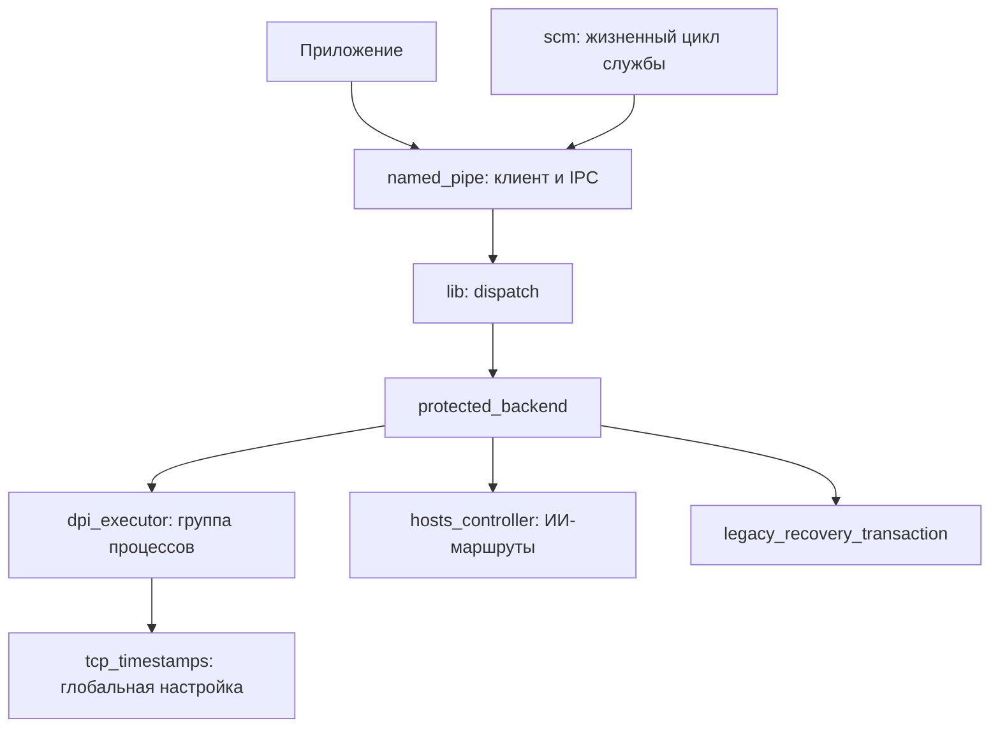

# Runtime: служба, процессы и восстановление

[Все пакеты](README.md) · [Снимок исходников](https://github.com/AcediaWhy/Obsession/tree/111889a8144070b8f2259252e1c905370b39d13b)

**Obsession 1.2.0 · исходники от 2026-10-13 · коммит `111889a8144070b8f2259252e1c905370b39d13b`.**

Этот пакет показывает, как запрос приложения проходит через защищённый named pipe к Windows-службе и превращается в операции с процессами, TCP-настройками или hosts. Здесь важны владение ресурсами, согласованность состояния и длительность операций.

Ключевые файлы приведены целиком, включая комментарии и тесты. Код взят из указанного Git-коммита; пояснения и схемы добавлены для чтения. Все ссылки на исходники закреплены на тот же коммит.

## Схема



## Порядок чтения

1. Начни с runtime-service/src/lib.rs: запросы, ответы, ошибки и интерфейс backend. Полный IPC-контракт доступен по ссылке на runtime-protocol ниже.
2. scm.rs и named_pipe.rs показывают запуск службы, проверку клиента и порядок обработки запросов.
3. protected_backend.rs связывает компоненты; dpi_executor.rs управляет процессами и Windows Job Objects.
4. tcp_timestamps.rs, hosts_controller.rs и legacy_recovery_transaction.rs позволяют отдельно изучить восстановление глобальной настройки, запись hosts и выполнение recovery-операций.

## Карта файлов

| Файл | Назначение | Строк |
|---|---|---:|
| [ObsessionTauri/runtime-service/src/lib.rs](#source-01) | Dispatch, типы ошибок и контракт backend. | 730 |
| [ObsessionTauri/runtime-service/src/scm.rs](#source-02) | Запуск, остановка и транспорт Windows-службы. | 202 |
| [ObsessionTauri/runtime-service/src/named_pipe.rs](#source-03) | Аутентификация клиента, чтение IPC-фреймов и обработка запросов. | 896 |
| [ObsessionTauri/runtime-service/src/protected_backend.rs](#source-04) | Связь службы с процессами, hosts и recovery. | 1874 |
| [ObsessionTauri/runtime-service/src/dpi_executor.rs](#source-05) | Запуск, идентичность, Job Objects и завершение процессов. | 1067 |
| [ObsessionTauri/runtime-service/src/tcp_timestamps.rs](#source-06) | Журнал и временное изменение TCP timestamps для Legacy. | 516 |
| [ObsessionTauri/runtime-service/src/hosts_controller.rs](#source-07) | Получение ИИ-маршрутов, проверки, запись hosts и откат. | 3735 |
| [ObsessionTauri/runtime-service/src/legacy_recovery_transaction.rs](#source-08) | Переходы recovery-транзакции и передача preflight. | 497 |

## На что обратить внимание

- Какие проверки относятся к целостности и владению, а какие — к доступности сети.
- Где выполняются блокирующие операции, как ограничено ожидание и могут ли в это время обслуживаться другие запросы.
- Что остаётся после ошибки: процесс, каталог, журнал, hosts и состояние клиента.

## Исходники

Блоки можно раскрыть по одному. В Raw-версии документа содержимое всех блоков доступно сразу.

<a id="source-01"></a>

### ObsessionTauri/runtime-service/src/lib.rs

Dispatch, типы ошибок и контракт backend.

[Открыть файл на GitHub](https://github.com/AcediaWhy/Obsession/blob/111889a8144070b8f2259252e1c905370b39d13b/ObsessionTauri/runtime-service/src/lib.rs) · [Исходный текст](https://raw.githubusercontent.com/AcediaWhy/Obsession/111889a8144070b8f2259252e1c905370b39d13b/ObsessionTauri/runtime-service/src/lib.rs)

730 строк · 26,790 байт · SHA-256: `3dd4f502102ec219c3c45f23ecb8e3cdc548862d6a2526355ef293cade55d1a8`

<details>
<summary>Показать полный код lib.rs</summary>

```rust
//! Platform-neutral dispatch core for the privileged Obsession runtime.
//!
//! Windows named-pipe authentication and the SCM entry point wrap this crate.
//! The service exposes only preflighted protected DPI engines (Legacy and the
//! bundled Zapret2 Strategy Pack); any initialization failure selects a locked
//! backend with no privileged capabilities.

pub mod dpi_materializer;
#[cfg(windows)]
mod dpi_output;
mod legacy_pack;
#[cfg(windows)]
mod hosts_controller;
#[cfg(windows)]
mod legacy_confirmation;
#[cfg(windows)]
mod legacy_recovery_effects;
#[cfg(windows)]
mod legacy_recovery_preflight;
#[cfg(windows)]
mod legacy_recovery_transaction;
#[cfg(windows)]
mod legacy_reliability;
#[cfg(windows)]
mod packet_observer;
#[cfg(windows)]
mod network_identity;
pub mod protected_backend;
pub mod protected_layout;
#[cfg(windows)]
mod proxy_lan_firewall;
#[cfg(windows)]
mod zapret2_pack;

#[cfg(windows)]
mod legacy_access_activity;
#[cfg(windows)]
mod legacy_cleanup;

#[cfg(windows)]
pub mod dpi_executor;

#[cfg(windows)]
mod tcp_timestamps;
#[cfg(windows)]
mod dns_recovery;

#[cfg(windows)]
pub mod named_pipe;

#[cfg(windows)]
pub mod scm;

use obsession_runtime_protocol::{
    Capabilities, DpiDiagnostics, DpiReplaceRequest, DpiStartRequest, DpiStopRequest, FirewallOpenProxyLanRequest,
    HostsCheckRequest, HostsHealthSnapshot, HostsMutationRequest, LegacyRecoveryApprovalRequest,
    LegacyRecoveryControlsRequest, OperationAccepted, Request, RequestEnvelope, Response,
    ResponseEnvelope, RuntimeSnapshot, RuntimeStarted, ServiceError, ServiceErrorCode,
    SystemDnsRequest, SystemDnsStatus, PROTOCOL_VERSION,
};

#[derive(Clone, Copy, Debug, PartialEq, Eq)]
pub enum ClientIntegrity {
    Medium,
    High,
    System,
    Service,
    Anonymous,
}

#[derive(Clone, Debug, PartialEq, Eq)]
pub struct ClientIdentity {
    pub is_local: bool,
    pub session_id: u32,
    pub user_sid: String,
    pub integrity: ClientIntegrity,
}

impl ClientIdentity {
    fn is_allowed(&self) -> bool {
        self.is_local
            && self.session_id != 0
            && valid_user_sid_text(&self.user_sid)
            && matches!(
                self.integrity,
                ClientIntegrity::Medium | ClientIntegrity::High
            )
    }
}

fn valid_user_sid_text(value: &str) -> bool {
    if value.len() > 184 {
        return false;
    }
    let mut parts = value.split('-');
    if parts.next() != Some("S") || parts.next() != Some("1") {
        return false;
    }
    let numeric: Vec<_> = parts.collect();
    numeric.len() >= 2
        && numeric
            .iter()
            .all(|part| !part.is_empty() && part.bytes().all(|byte| byte.is_ascii_digit()))
}

#[derive(Clone, Debug, PartialEq, Eq)]
pub enum BackendError {
    Busy,
    Conflict,
    InvalidRequest,
    ProtectedResourceInvalid,
    ProtectedMaterializationFailed(obsession_runtime_protocol::RuntimeFailureDetail),
    RuntimeFailed,
    RuntimeProcessFailed(obsession_runtime_protocol::RuntimeFailureDetail),
    ReplacementRolledBack {
        code: ServiceErrorCode,
        detail: Option<obsession_runtime_protocol::RuntimeFailureDetail>,
        generation: u64,
    },
    ServiceUnavailable,
    Internal,
}

impl BackendError {
    fn wire_code(&self) -> ServiceErrorCode {
        match self {
            Self::Busy => ServiceErrorCode::Busy,
            Self::Conflict => ServiceErrorCode::Conflict,
            Self::InvalidRequest => ServiceErrorCode::InvalidRequest,
            Self::ProtectedResourceInvalid | Self::ProtectedMaterializationFailed(_) => ServiceErrorCode::ProtectedResourceInvalid,
            Self::RuntimeFailed | Self::RuntimeProcessFailed(_) => ServiceErrorCode::RuntimeFailed,
            Self::ReplacementRolledBack { code, .. } => *code,
            Self::ServiceUnavailable => ServiceErrorCode::ServiceUnavailable,
            Self::Internal => ServiceErrorCode::Internal,
        }
    }
}

pub trait RuntimeBackend {
    /// Bounded service-owned maintenance while the authenticated pipe is idle.
    /// Implementations must never wait for caller input or detach work past
    /// their own deadline.
    fn poll_background(&mut self) -> Result<(), BackendError> {
        Ok(())
    }

    fn capabilities(&self) -> Result<Capabilities, BackendError>;
    fn runtime_snapshot(&self) -> Result<RuntimeSnapshot, BackendError>;
    fn set_legacy_recovery_controls(
        &mut self,
        _request: LegacyRecoveryControlsRequest,
    ) -> Result<OperationAccepted, BackendError> {
        Err(BackendError::ServiceUnavailable)
    }
    fn approve_legacy_recovery(
        &mut self,
        _request: LegacyRecoveryApprovalRequest,
    ) -> Result<OperationAccepted, BackendError> {
        Err(BackendError::ServiceUnavailable)
    }
    fn dpi_start(&mut self, request: DpiStartRequest) -> Result<RuntimeStarted, BackendError>;
    fn dpi_replace(&mut self, _request: DpiReplaceRequest) -> Result<RuntimeStarted, BackendError> {
        Err(BackendError::ServiceUnavailable)
    }
    fn dpi_stop(&mut self, request: DpiStopRequest) -> Result<(), BackendError>;
    fn dpi_diagnostics(&self, _request: DpiStopRequest) -> Result<DpiDiagnostics, BackendError> {
        Err(BackendError::ServiceUnavailable)
    }
    fn flush_system_dns(&mut self, _request: SystemDnsRequest) -> Result<SystemDnsStatus, BackendError> {
        Err(BackendError::ServiceUnavailable)
    }
    fn repair_system_dns(&mut self, _request: SystemDnsRequest) -> Result<SystemDnsStatus, BackendError> {
        Err(BackendError::ServiceUnavailable)
    }
    fn restore_system_dns(&mut self) -> Result<SystemDnsStatus, BackendError> {
        Err(BackendError::ServiceUnavailable)
    }
    fn system_dns_status(&self) -> Result<SystemDnsStatus, BackendError> {
        Err(BackendError::ServiceUnavailable)
    }
    fn hosts_install(
        &mut self,
        request: HostsMutationRequest,
    ) -> Result<OperationAccepted, BackendError>;
    fn hosts_check(
        &mut self,
        _request: HostsCheckRequest,
    ) -> Result<HostsHealthSnapshot, BackendError> {
        Err(BackendError::ServiceUnavailable)
    }
    fn hosts_uninstall(&mut self) -> Result<OperationAccepted, BackendError>;
    fn hosts_refresh_gemini(&mut self, _preference: obsession_runtime_protocol::GeminiRoutePreference) -> Result<OperationAccepted, BackendError> {
        Err(BackendError::ServiceUnavailable)
    }
    fn hosts_restore(
        &mut self,
        request: HostsMutationRequest,
    ) -> Result<OperationAccepted, BackendError>;
    fn firewall_open_proxy_lan(
        &mut self,
        request: FirewallOpenProxyLanRequest,
    ) -> Result<OperationAccepted, BackendError>;
    fn firewall_close_proxy_lan(&mut self) -> Result<(), BackendError>;
    fn subscribe_events(&mut self) -> Result<OperationAccepted, BackendError>;

    /// Removes the authenticated caller's fixed legacy per-user roots. The
    /// default remains available even when DPI preflight selected LockedBackend,
    /// because cleanup does not consume any mutable application resource.
    fn legacy_cleanup(&mut self, user_sid: &str) -> Result<(), BackendError> {
        #[cfg(windows)]
        {
            crate::legacy_cleanup::cleanup_authenticated_user(user_sid)
                .map_err(|error| error.backend_error())
        }
        #[cfg(not(windows))]
        {
            let _ = user_sid;
            Err(BackendError::ServiceUnavailable)
        }
    }
}

/// Fail-closed fallback used when production startup preflight cannot establish
/// a protected runtime. It remains queryable but exposes no privileged feature.
#[derive(Default)]
pub struct LockedBackend;

impl RuntimeBackend for LockedBackend {
    fn capabilities(&self) -> Result<Capabilities, BackendError> {
        Ok(Capabilities {
            service_version: env!("CARGO_PKG_VERSION").into(),
            features: Vec::new(),
        })
    }

    fn runtime_snapshot(&self) -> Result<RuntimeSnapshot, BackendError> {
        Ok(RuntimeSnapshot {
            dpi: None,
            legacy_reliability: None,
            legacy_access_activity: None,
            hosts: None,
            hosts_provider: None,
            proxy_lan: None,
        })
    }

    fn dpi_start(&mut self, _request: DpiStartRequest) -> Result<RuntimeStarted, BackendError> {
        Err(BackendError::ServiceUnavailable)
    }

    fn dpi_stop(&mut self, _request: DpiStopRequest) -> Result<(), BackendError> {
        Err(BackendError::ServiceUnavailable)
    }

    fn hosts_install(
        &mut self,
        _request: HostsMutationRequest,
    ) -> Result<OperationAccepted, BackendError> {
        Err(BackendError::ServiceUnavailable)
    }

    fn hosts_check(
        &mut self,
        _request: HostsCheckRequest,
    ) -> Result<HostsHealthSnapshot, BackendError> {
        Err(BackendError::ServiceUnavailable)
    }

    fn hosts_uninstall(&mut self) -> Result<OperationAccepted, BackendError> {
        Err(BackendError::ServiceUnavailable)
    }

    fn hosts_restore(
        &mut self,
        _request: HostsMutationRequest,
    ) -> Result<OperationAccepted, BackendError> {
        Err(BackendError::ServiceUnavailable)
    }

    fn firewall_open_proxy_lan(
        &mut self,
        _request: FirewallOpenProxyLanRequest,
    ) -> Result<OperationAccepted, BackendError> {
        Err(BackendError::ServiceUnavailable)
    }

    fn firewall_close_proxy_lan(&mut self) -> Result<(), BackendError> {
        Err(BackendError::ServiceUnavailable)
    }

    fn subscribe_events(&mut self) -> Result<OperationAccepted, BackendError> {
        Err(BackendError::ServiceUnavailable)
    }
}

pub struct ServiceCore<B> {
    backend: B,
}

impl<B: RuntimeBackend> ServiceCore<B> {
    pub fn new(backend: B) -> Self {
        Self { backend }
    }

    pub fn handle(
        &mut self,
        client: &ClientIdentity,
        request: RequestEnvelope,
    ) -> ResponseEnvelope {
        let request_id = request.request_id.clone();
        let response = if request.validate().is_err() {
            error_response(ServiceErrorCode::InvalidRequest)
        } else if !client.is_allowed() {
            error_response(ServiceErrorCode::AccessDenied)
        } else {
            self.dispatch(client, request.request)
        };
        ResponseEnvelope {
            protocol_version: PROTOCOL_VERSION,
            request_id,
            response,
        }
    }

    pub(crate) fn poll_background(&mut self) {
        // Background recovery failure is reflected in backend-owned status;
        // it must not tear down the authenticated transport or SCM process.
        let _ = self.backend.poll_background();
    }

    fn dispatch(&mut self, client: &ClientIdentity, request: Request) -> Response {
        let result = match request {
            Request::GetCapabilities => self.backend.capabilities().map(Response::Capabilities),
            Request::GetRuntimeSnapshot => self
                .backend
                .runtime_snapshot()
                .map(Response::RuntimeSnapshot),
            Request::LegacyCleanup => self
                .backend
                .legacy_cleanup(&client.user_sid)
                .map(|()| Response::LegacyCleanupCompleted),
            Request::SetLegacyRecoveryControls(request) => self
                .backend
                .set_legacy_recovery_controls(request)
                .map(Response::Accepted),
            Request::ApproveLegacyRecovery(request) => self
                .backend
                .approve_legacy_recovery(request)
                .map(Response::Accepted),
            Request::DpiStart(request) => self.backend.dpi_start(request).map(Response::Started),
            Request::DpiReplace(request) => {
                self.backend.dpi_replace(request).map(Response::Started)
            }
            Request::DpiStop(request) => self.backend.dpi_stop(request).map(|()| Response::Stopped),
            Request::GetDpiDiagnostics(request) => self.backend.dpi_diagnostics(request).map(Response::DpiDiagnostics),
            // Keep old wire variants parseable, but deny even authenticated old
            // clients. Automatic DNS mutations are no longer supported.
            Request::FlushSystemDns(_) | Request::RepairSystemDns(_) => Err(BackendError::ServiceUnavailable),
            Request::RestoreSystemDns => self.backend.restore_system_dns().map(Response::SystemDns),
            Request::GetSystemDns => self.backend.system_dns_status().map(Response::SystemDns),
            Request::HostsInstall(request) => {
                self.backend.hosts_install(request).map(Response::Accepted)
            }
            Request::HostsCheck(request) => {
                self.backend.hosts_check(request).map(Response::HostsHealth)
            }
            Request::HostsUninstall => self.backend.hosts_uninstall().map(Response::Accepted),
            Request::HostsRefreshGemini(preference) => self.backend.hosts_refresh_gemini(preference).map(Response::Accepted),
            Request::HostsRestoreLastKnownGood(request) => {
                self.backend.hosts_restore(request).map(Response::Accepted)
            }
            Request::FirewallOpenProxyLan(request) => self
                .backend
                .firewall_open_proxy_lan(request)
                .map(Response::Accepted),
            Request::FirewallCloseProxyLan => self
                .backend
                .firewall_close_proxy_lan()
                .map(|()| Response::Stopped),
            Request::SubscribeEvents => self.backend.subscribe_events().map(Response::Accepted),
        };
        result.unwrap_or_else(|error| Response::Error(ServiceError {
            code: error.wire_code(),
            runtime_detail: match &error {
                BackendError::RuntimeProcessFailed(detail) | BackendError::ProtectedMaterializationFailed(detail) => Some(detail.clone()),
                BackendError::ReplacementRolledBack { detail, .. } => detail.clone(),
                _ => None,
            },
            restored_generation: match error { BackendError::ReplacementRolledBack { generation, .. } => Some(generation), _ => None },
        }))
    }
}

fn error_response(code: ServiceErrorCode) -> Response {
    Response::Error(ServiceError { code, runtime_detail: None, restored_generation: None })
}

#[cfg(test)]
mod tests {
    use super::*;
    use obsession_runtime_protocol::{
        DpiCategory, DpiEngine, DpiRuntimeOptions, DpiSelection, Feature, HostsProvider,
    };

    fn allowed_client() -> ClientIdentity {
        ClientIdentity {
            is_local: true,
            session_id: 1,
            user_sid: "S-1-5-21-1000".into(),
            integrity: ClientIntegrity::Medium,
        }
    }

    fn start_request() -> RequestEnvelope {
        RequestEnvelope::new(
            "start-1",
            Request::DpiStart(DpiStartRequest {
                engine: DpiEngine::Legacy,
                selections: vec![DpiSelection {
                    category: DpiCategory::Discord,
                    strategy_id: "discord_1".into(),
                }],
                options: DpiRuntimeOptions {
                    zapret2_level: 0, zapret2_clienthello: false, zapret2_profiles: Vec::new(),
                    legacy_reliability: true,
                    zapret2_overrides: Vec::new(),
                    zapret2_diagnostics: false,
                },
            }),
        )
    }

    #[test]
    fn locked_service_exposes_status_but_no_privileged_features() {
        let mut service = ServiceCore::new(LockedBackend);
        let response = service.handle(
            &allowed_client(),
            RequestEnvelope::new("cap-1", Request::GetCapabilities),
        );
        assert_eq!(
            response.response,
            Response::Capabilities(Capabilities {
                service_version: "0.1.0".into(),
                features: vec![],
            })
        );

        let response = service.handle(&allowed_client(), start_request());
        assert_eq!(
            response.response,
            Response::Error(ServiceError {
                code: ServiceErrorCode::ServiceUnavailable,
                runtime_detail: None,
                restored_generation: None,
            })
        );
    }

    #[test]
    fn remote_session_zero_and_service_clients_are_denied_before_dispatch() {
        let denied = [
            ClientIdentity {
                is_local: false,
                ..allowed_client()
            },
            ClientIdentity {
                session_id: 0,
                ..allowed_client()
            },
            ClientIdentity {
                integrity: ClientIntegrity::System,
                ..allowed_client()
            },
            ClientIdentity {
                user_sid: "invalid".into(),
                ..allowed_client()
            },
        ];
        for client in denied {
            let mut service = ServiceCore::new(LockedBackend);
            let response = service.handle(
                &client,
                RequestEnvelope::new("cap-1", Request::GetCapabilities),
            );
            assert_eq!(
                response.response,
                Response::Error(ServiceError {
                    code: ServiceErrorCode::AccessDenied,
                    runtime_detail: None,
                    restored_generation: None,
                })
            );
        }
    }

    #[derive(Default)]
    struct RecordingBackend {
        starts: Vec<DpiStartRequest>,
        replace_error: Option<BackendError>,
        controls: Vec<LegacyRecoveryControlsRequest>,
        approvals: Vec<LegacyRecoveryApprovalRequest>,
        hosts: Vec<HostsMutationRequest>,
        cleanup_sids: Vec<String>,
        dns_generations: Vec<u64>,
    }

    impl RuntimeBackend for RecordingBackend {
        fn repair_system_dns(&mut self, request: SystemDnsRequest) -> Result<SystemDnsStatus, BackendError> {
            self.dns_generations.push(request.generation);
            Ok(SystemDnsStatus::default())
        }
        fn capabilities(&self) -> Result<Capabilities, BackendError> {
            Ok(Capabilities {
                service_version: "1.0.0".into(),
                features: vec![Feature::Dpi, Feature::Hosts],
            })
        }

        fn runtime_snapshot(&self) -> Result<RuntimeSnapshot, BackendError> {
            Ok(RuntimeSnapshot {
                dpi: None,
                legacy_reliability: None,
                legacy_access_activity: None,
                hosts: None,
                hosts_provider: None,
                proxy_lan: None,
            })
        }

        fn set_legacy_recovery_controls(
            &mut self,
            request: LegacyRecoveryControlsRequest,
        ) -> Result<OperationAccepted, BackendError> {
            self.controls.push(request);
            Ok(OperationAccepted { operation_id: 7 })
        }

        fn approve_legacy_recovery(
            &mut self,
            request: LegacyRecoveryApprovalRequest,
        ) -> Result<OperationAccepted, BackendError> {
            self.approvals.push(request);
            Ok(OperationAccepted { operation_id: 11 })
        }

        fn dpi_start(&mut self, request: DpiStartRequest) -> Result<RuntimeStarted, BackendError> {
            self.starts.push(request);
            Ok(RuntimeStarted { generation: 1, materialized_fingerprint: None, initialization_retries: 0 })
        }

        fn dpi_stop(&mut self, _request: DpiStopRequest) -> Result<(), BackendError> {
            Ok(())
        }

        fn dpi_replace(&mut self, _request: DpiReplaceRequest) -> Result<RuntimeStarted, BackendError> {
            Err(self.replace_error.clone().unwrap_or(BackendError::ServiceUnavailable))
        }

        fn hosts_install(
            &mut self,
            request: HostsMutationRequest,
        ) -> Result<OperationAccepted, BackendError> {
            self.hosts.push(request);
            Ok(OperationAccepted { operation_id: 1 })
        }

        fn hosts_uninstall(&mut self) -> Result<OperationAccepted, BackendError> {
            Ok(OperationAccepted { operation_id: 2 })
        }

        fn hosts_restore(
            &mut self,
            request: HostsMutationRequest,
        ) -> Result<OperationAccepted, BackendError> {
            self.hosts.push(request);
            Ok(OperationAccepted { operation_id: 3 })
        }

        fn firewall_open_proxy_lan(
            &mut self,
            _request: FirewallOpenProxyLanRequest,
        ) -> Result<OperationAccepted, BackendError> {
            Ok(OperationAccepted { operation_id: 4 })
        }

        fn firewall_close_proxy_lan(&mut self) -> Result<(), BackendError> {
            Ok(())
        }

        fn subscribe_events(&mut self) -> Result<OperationAccepted, BackendError> {
            Ok(OperationAccepted { operation_id: 5 })
        }

        fn legacy_cleanup(&mut self, user_sid: &str) -> Result<(), BackendError> {
            self.cleanup_sids.push(user_sid.to_owned());
            Ok(())
        }
    }

    #[test]
    fn dispatcher_preserves_the_failed_replace_receipt_and_native_detail() {
        let detail = obsession_runtime_protocol::RuntimeFailureDetail::StartupFailed { exit_code: 87,
            diagnostics: obsession_runtime_protocol::DpiProcessDiagnostics {
                pid: 42, exit_code: Some(87), trace_enabled: true, stream_closed: true,
                observed_bytes: 40, discarded_lines: 0, truncated: false,
                lines: vec!["LUA ERROR: startup fixture".into()],
            } };
        let mut service = ServiceCore::new(RecordingBackend {
            replace_error: Some(BackendError::ReplacementRolledBack {
                code: ServiceErrorCode::RuntimeFailed, detail: Some(detail.clone()), generation: 5,
            }),
            ..Default::default()
        });
        let Request::DpiStart(mut runtime) = start_request().request else { unreachable!() };
        runtime.engine = DpiEngine::Zapret2;
        runtime.options.legacy_reliability = false;
        runtime.selections[0].strategy_id = "builtin-discord".into();
        let response = service.handle(&allowed_client(), RequestEnvelope::new(
            "replace-1", Request::DpiReplace(DpiReplaceRequest { expected_generation: 3, runtime }),
        ));
        assert_eq!(response.response, Response::Error(ServiceError {
            code: ServiceErrorCode::RuntimeFailed, runtime_detail: Some(detail), restored_generation: Some(5),
        }));
        response.validate().unwrap();
    }

    #[test]
    fn dispatcher_can_only_forward_typed_allowlisted_operations() {
        let mut service = ServiceCore::new(RecordingBackend::default());
        let response = service.handle(&allowed_client(), start_request());
        assert_eq!(
            response.response,
            Response::Started(RuntimeStarted { generation: 1, materialized_fingerprint: None, initialization_retries: 0 })
        );
        assert_eq!(service.backend.starts.len(), 1);
        assert_eq!(
            service.backend.starts[0].selections[0].strategy_id,
            "discord_1"
        );

        let controls = LegacyRecoveryControlsRequest {
            mode: obsession_runtime_protocol::LegacyRecoveryMode::Automatic,
            automatic_paused: false,
            frozen_categories: vec![DpiCategory::Discord],
        };
        let response = service.handle(
            &allowed_client(),
            RequestEnvelope::new(
                "legacy-controls-1",
                Request::SetLegacyRecoveryControls(controls.clone()),
            ),
        );
        assert_eq!(
            response.response,
            Response::Accepted(OperationAccepted { operation_id: 7 })
        );
        assert_eq!(service.backend.controls, [controls]);

        let approval = LegacyRecoveryApprovalRequest {
            proposal_id: 11,
            attempt_id: 13,
        };
        let response = service.handle(
            &allowed_client(),
            RequestEnvelope::new(
                "legacy-approval-1",
                Request::ApproveLegacyRecovery(approval),
            ),
        );
        assert_eq!(
            response.response,
            Response::Accepted(OperationAccepted { operation_id: 11 })
        );
        assert_eq!(service.backend.approvals, [approval]);

        let response = service.handle(
            &allowed_client(),
            RequestEnvelope::new(
                "hosts-1",
                Request::HostsInstall(HostsMutationRequest {
                    provider: HostsProvider::Malw,
                }),
            ),
        );
        assert_eq!(
            response.response,
            Response::Accepted(OperationAccepted { operation_id: 1 })
        );
        assert_eq!(service.backend.hosts.len(), 1);

        let response = service.handle(
            &allowed_client(),
            RequestEnvelope::new("cleanup-1", Request::LegacyCleanup),
        );
        assert_eq!(response.response, Response::LegacyCleanupCompleted);
        assert_eq!(service.backend.cleanup_sids, ["S-1-5-21-1000"]);
    }

    #[test]
    fn client_sid_text_cannot_inject_a_profile_registry_subkey() {
        for sid in [
            r"S-1-5-21-1000\\..\\S-1-5-18",
            "S-1-5/21/1000",
            "S-1--5",
            "S-2-5-21-1000",
            "S-1-",
        ] {
            assert!(!valid_user_sid_text(sid), "must reject {sid:?}");
        }
        assert!(valid_user_sid_text("S-1-5-21-1000"));
    }

    #[test]
    fn old_dns_mutations_are_denied_without_reaching_the_backend() {
        let mut service = ServiceCore::new(RecordingBackend::default());
        for (client, generation, expected) in [
            (ClientIdentity { is_local: false, ..allowed_client() }, 7, ServiceErrorCode::AccessDenied),
            (allowed_client(), 0, ServiceErrorCode::InvalidRequest),
        ] {
            let response = service.handle(&client, RequestEnvelope::new("dns-auth", Request::RepairSystemDns(SystemDnsRequest { generation })));
            assert!(matches!(response.response, Response::Error(ref error) if error.code == expected));
            assert!(service.backend.dns_generations.is_empty());
        }
        for request in [Request::RepairSystemDns(SystemDnsRequest { generation: 7 }), Request::FlushSystemDns(SystemDnsRequest { generation: 7 })] {
            let response = service.handle(&allowed_client(), RequestEnvelope::new("dns-valid", request));
            assert!(matches!(response.response, Response::Error(ref error) if error.code == ServiceErrorCode::ServiceUnavailable));
            assert!(service.backend.dns_generations.is_empty());
        }
    }
}
```

</details>

<a id="source-02"></a>

### ObsessionTauri/runtime-service/src/scm.rs

Запуск, остановка и транспорт Windows-службы.

[Открыть файл на GitHub](https://github.com/AcediaWhy/Obsession/blob/111889a8144070b8f2259252e1c905370b39d13b/ObsessionTauri/runtime-service/src/scm.rs) · [Исходный текст](https://raw.githubusercontent.com/AcediaWhy/Obsession/111889a8144070b8f2259252e1c905370b39d13b/ObsessionTauri/runtime-service/src/scm.rs)

202 строк · 7,448 байт · SHA-256: `e8851ce9cacf97caec23e80191bbd103ba062859a03eca60cc3aaf1e53a06047`

<details>
<summary>Показать полный код scm.rs</summary>

```rust
//! Windows Service Control Manager host for the protected runtime.
//!
//! A complete startup preflight is performed before the service reports
//! `RUNNING`. Failure leaves a queryable locked backend for this service
//! lifetime; it never retries into a privileged capability behind the client's
//! back. The machine installer still does not register or start this service.

use std::sync::atomic::{AtomicBool, AtomicUsize, Ordering};
use std::thread;
use std::time::Duration;

use windows::core::{w, Error as WindowsError, PCWSTR, PWSTR};
use windows::Win32::Foundation::{
    ERROR_CALL_NOT_IMPLEMENTED, ERROR_SERVICE_SPECIFIC_ERROR, NO_ERROR,
};
use windows::Win32::System::Services::{
    RegisterServiceCtrlHandlerExW, SetServiceStatus, StartServiceCtrlDispatcherW,
    SERVICE_ACCEPT_SHUTDOWN, SERVICE_ACCEPT_STOP, SERVICE_CONTROL_INTERROGATE,
    SERVICE_CONTROL_SHUTDOWN, SERVICE_CONTROL_STOP, SERVICE_RUNNING, SERVICE_START_PENDING,
    SERVICE_STATUS, SERVICE_STATUS_CURRENT_STATE, SERVICE_STATUS_HANDLE, SERVICE_STOPPED,
    SERVICE_STOP_PENDING, SERVICE_TABLE_ENTRYW, SERVICE_WIN32_OWN_PROCESS,
};

use crate::dpi_executor::WindowsJobLauncher;
use crate::named_pipe::SecureNamedPipeServer;
use crate::protected_backend::{BackendInitializationError, ProtectedDpiBackend};
use crate::{LockedBackend, RuntimeBackend};

pub const SERVICE_NAME: &str = "ObsessionRuntime";

const SERVICE_NAME_WIDE: PCWSTR = w!("ObsessionRuntime");
const START_WAIT_HINT_MS: u32 = 5_000;
const STOP_WAIT_HINT_MS: u32 = 6_000;
const CLIENT_FAILURE_BACKOFF: Duration = Duration::from_millis(100);

static STOP_REQUESTED: AtomicBool = AtomicBool::new(false);
// windows::SERVICE_STATUS_HANDLE contains a raw pointer and is not Sync. SCM
// owns the handle for the service lifetime; callbacks exchange only its stable
// numeric value and never close it.
static STATUS_HANDLE_VALUE: AtomicUsize = AtomicUsize::new(0);

/// Blocks in the Windows SCM dispatcher. Running the executable directly does
/// not invoke `service_main`; Windows returns
/// `ERROR_FAILED_SERVICE_CONTROLLER_CONNECT` instead.
pub fn run_dispatcher() -> Result<(), WindowsError> {
    let entries = [
        SERVICE_TABLE_ENTRYW {
            lpServiceName: PWSTR(SERVICE_NAME_WIDE.0 as *mut u16),
            lpServiceProc: Some(service_main),
        },
        SERVICE_TABLE_ENTRYW::default(),
    ];
    unsafe { StartServiceCtrlDispatcherW(entries.as_ptr()) }
}

unsafe extern "system" fn service_main(_argument_count: u32, _argument_vectors: *mut PWSTR) {
    STOP_REQUESTED.store(false, Ordering::Release);

    let status_handle = match unsafe {
        RegisterServiceCtrlHandlerExW(SERVICE_NAME_WIDE, Some(control_handler), None)
    } {
        Ok(handle) => handle,
        Err(_) => return,
    };
    STATUS_HANDLE_VALUE.store(status_handle.0 as usize, Ordering::Release);

    if report_status(SERVICE_START_PENDING, NO_ERROR.0, 1, START_WAIT_HINT_MS).is_err() {
        STATUS_HANDLE_VALUE.store(0, Ordering::Release);
        return;
    }
    if STOP_REQUESTED.load(Ordering::Acquire) {
        let _ = report_status(SERVICE_STOPPED, NO_ERROR.0, 0, 0);
        STATUS_HANDLE_VALUE.store(0, Ordering::Release);
        return;
    }
    let backend = ProtectedDpiBackend::discover();
    if STOP_REQUESTED.load(Ordering::Acquire) {
        let _ = report_status(SERVICE_STOPPED, NO_ERROR.0, 0, 0);
        STATUS_HANDLE_VALUE.store(0, Ordering::Release);
        return;
    }
    if report_status(SERVICE_RUNNING, NO_ERROR.0, 0, 0).is_err() {
        let _ = report_status(SERVICE_STOPPED, ERROR_SERVICE_SPECIFIC_ERROR.0, 0, 0);
        STATUS_HANDLE_VALUE.store(0, Ordering::Release);
        return;
    }

    run_protected_transport_until_stopped(backend);

    let _ = report_status(SERVICE_STOPPED, NO_ERROR.0, 0, 0);
    STATUS_HANDLE_VALUE.store(0, Ordering::Release);
}

unsafe extern "system" fn control_handler(
    control: u32,
    _event_type: u32,
    _event_data: *mut std::ffi::c_void,
    _context: *mut std::ffi::c_void,
) -> u32 {
    match control {
        SERVICE_CONTROL_STOP | SERVICE_CONTROL_SHUTDOWN => {
            if !STOP_REQUESTED.swap(true, Ordering::AcqRel) {
                let _ = report_status(SERVICE_STOP_PENDING, NO_ERROR.0, 1, STOP_WAIT_HINT_MS);
            }
            NO_ERROR.0
        }
        SERVICE_CONTROL_INTERROGATE => NO_ERROR.0,
        _ => ERROR_CALL_NOT_IMPLEMENTED.0,
    }
}

fn run_protected_transport_until_stopped(
    backend: Result<ProtectedDpiBackend<WindowsJobLauncher>, BackendInitializationError>,
) {
    match backend {
        Ok(backend) => serve_until_stopped(backend),
        Err(_error) => serve_until_stopped(LockedBackend),
    }
}

fn serve_until_stopped<B: RuntimeBackend + Send>(backend: B) {
    let server = SecureNamedPipeServer::new(backend);
    while !STOP_REQUESTED.load(Ordering::Acquire) {
        match server.serve_one_until_stopped(&STOP_REQUESTED) {
            Ok(true) => {}
            Ok(false) => break,
            Err(_) if STOP_REQUESTED.load(Ordering::Acquire) => break,
            // A malformed/disconnecting client must not kill the LocalSystem
            // process or cause a hot failure loop. When startup preflight
            // failed, LockedBackend still exposes no privileged operation.
            Err(_) => thread::sleep(CLIENT_FAILURE_BACKOFF),
        }
    }
}

fn report_status(
    state: SERVICE_STATUS_CURRENT_STATE,
    exit_code: u32,
    checkpoint: u32,
    wait_hint: u32,
) -> Result<(), WindowsError> {
    let handle_value = STATUS_HANDLE_VALUE.load(Ordering::Acquire);
    if handle_value == 0 {
        return Err(WindowsError::from_win32());
    }
    let handle = SERVICE_STATUS_HANDLE(handle_value as *mut std::ffi::c_void);
    let status = build_status(state, exit_code, checkpoint, wait_hint);
    unsafe { SetServiceStatus(handle, &status) }
}

fn build_status(
    state: SERVICE_STATUS_CURRENT_STATE,
    exit_code: u32,
    checkpoint: u32,
    wait_hint: u32,
) -> SERVICE_STATUS {
    let accepts = if state == SERVICE_RUNNING {
        SERVICE_ACCEPT_STOP | SERVICE_ACCEPT_SHUTDOWN
    } else {
        0
    };
    SERVICE_STATUS {
        dwServiceType: SERVICE_WIN32_OWN_PROCESS,
        dwCurrentState: state,
        dwControlsAccepted: accepts,
        dwWin32ExitCode: exit_code,
        dwServiceSpecificExitCode: 0,
        dwCheckPoint: checkpoint,
        dwWaitHint: wait_hint,
    }
}

#[cfg(test)]
mod tests {
    use super::*;

    #[test]
    fn service_identity_is_fixed_and_not_client_controlled() {
        assert_eq!(SERVICE_NAME, "ObsessionRuntime");
        assert_eq!(SERVICE_NAME_WIDE, w!("ObsessionRuntime"));
    }

    #[test]
    fn only_running_state_accepts_stop_and_shutdown_controls() {
        let starting = build_status(SERVICE_START_PENDING, 0, 1, START_WAIT_HINT_MS);
        assert_eq!(starting.dwControlsAccepted, 0);
        assert_eq!(starting.dwCheckPoint, 1);

        let running = build_status(SERVICE_RUNNING, 0, 0, 0);
        assert_eq!(
            running.dwControlsAccepted,
            SERVICE_ACCEPT_STOP | SERVICE_ACCEPT_SHUTDOWN
        );

        let stopping = build_status(SERVICE_STOP_PENDING, 0, 1, STOP_WAIT_HINT_MS);
        assert_eq!(stopping.dwControlsAccepted, 0);
        assert_eq!(stopping.dwWaitHint, STOP_WAIT_HINT_MS);

        let stopped = build_status(SERVICE_STOPPED, 0, 0, 0);
        assert_eq!(stopped.dwControlsAccepted, 0);
    }
}
```

</details>

<a id="source-03"></a>

### ObsessionTauri/runtime-service/src/named_pipe.rs

Аутентификация клиента, чтение IPC-фреймов и обработка запросов.

[Открыть файл на GitHub](https://github.com/AcediaWhy/Obsession/blob/111889a8144070b8f2259252e1c905370b39d13b/ObsessionTauri/runtime-service/src/named_pipe.rs) · [Исходный текст](https://raw.githubusercontent.com/AcediaWhy/Obsession/111889a8144070b8f2259252e1c905370b39d13b/ObsessionTauri/runtime-service/src/named_pipe.rs)

896 строк · 32,848 байт · SHA-256: `a2ac0d3f0feb2b6c4ce661c4291d519f628b32daab26286bfb2b49e7ff88fb6d`

<details>
<summary>Показать полный код named_pipe.rs</summary>

```rust
//! Windows named-pipe transport for the privileged runtime service.
//!
//! This module is deliberately separate from the service host. It authenticates
//! the connecting process before dispatch and carries only the bounded frames
//! defined by `obsession-runtime-protocol`; it never accepts a path, command or
//! DLL name from the client. The host remains disabled until the installer and
//! protected backend are ready.

use std::fmt;
use std::mem::size_of;
use std::slice;
use std::sync::atomic::{AtomicBool, Ordering};
use std::sync::{mpsc, Mutex};
use std::thread;
use std::time::{Duration, Instant};

use obsession_runtime_protocol::{
    decode_request_frame, encode_response_frame, ProtocolError, RequestEnvelope, MAX_FRAME_BYTES,
    RUNTIME_PIPE_NAME,
};
use windows::core::{w, Error as WindowsError, HRESULT, PCWSTR, PWSTR};
use windows::Win32::Foundation::{
    CloseHandle, LocalFree, BOOL, ERROR_NOT_FOUND, ERROR_PIPE_CONNECTED, ERROR_PIPE_LISTENING,
    HANDLE, HLOCAL,
};
use windows::Win32::Security::Authorization::{
    ConvertSidToStringSidW, ConvertStringSecurityDescriptorToSecurityDescriptorW,
};
use windows::Win32::Security::{
    GetSidSubAuthority, GetSidSubAuthorityCount, GetTokenInformation, RevertToSelf,
    TokenIntegrityLevel, TokenUser, PSECURITY_DESCRIPTOR, SECURITY_ATTRIBUTES,
    TOKEN_MANDATORY_LABEL, TOKEN_QUERY, TOKEN_USER,
};
use windows::Win32::Storage::FileSystem::{
    FlushFileBuffers, ReadFile, WriteFile, FILE_FLAG_FIRST_PIPE_INSTANCE, PIPE_ACCESS_DUPLEX,
};
use windows::Win32::System::Pipes::{
    ConnectNamedPipe, CreateNamedPipeW, DisconnectNamedPipe, GetNamedPipeClientProcessId,
    GetNamedPipeClientSessionId, ImpersonateNamedPipeClient, SetNamedPipeHandleState,
    NAMED_PIPE_MODE, PIPE_NOWAIT, PIPE_READMODE_BYTE, PIPE_REJECT_REMOTE_CLIENTS, PIPE_TYPE_BYTE,
    PIPE_WAIT,
};
use windows::Win32::System::SystemServices::{
    SECURITY_DESCRIPTOR_REVISION, SECURITY_MANDATORY_HIGH_RID, SECURITY_MANDATORY_MEDIUM_RID,
    SECURITY_MANDATORY_SYSTEM_RID,
};
use windows::Win32::System::Threading::{
    GetCurrentThread, GetCurrentThreadId, OpenThread, OpenThreadToken, THREAD_TERMINATE,
};
use windows::Win32::System::IO::CancelSynchronousIo;

use crate::{ClientIdentity, ClientIntegrity, RuntimeBackend, ServiceCore};

const PIPE_BUFFER_BYTES: u32 = (MAX_FRAME_BYTES + 4) as u32;
const DEFAULT_CLIENT_IO_TIMEOUT: Duration = Duration::from_secs(5);
const LISTENER_POLL_INTERVAL: Duration = Duration::from_millis(20);
const BACKGROUND_POLL_INTERVAL: Duration = Duration::from_millis(250);

// Only SYSTEM, Administrators and locally interactive users may open the pipe.
// `P` protects this DACL from inheritance. Remote clients are also rejected at
// the pipe protocol level below.
const PIPE_SECURITY_DESCRIPTOR: windows::core::PCWSTR =
    w!("D:P(A;;GA;;;SY)(A;;GA;;;BA)(A;;GRGW;;;IU)");

#[derive(Debug)]
pub enum NamedPipeError {
    Windows(WindowsError),
    Protocol(ProtocolError),
    InvalidClientIdentity,
    UnexpectedEndOfStream,
    PoisonedDispatcher,
    InvalidTimeout,
    ClientIoTimedOut,
    WorkerFailed,
}

impl fmt::Display for NamedPipeError {
    fn fmt(&self, formatter: &mut fmt::Formatter<'_>) -> fmt::Result {
        match self {
            Self::Windows(error) => write!(formatter, "Windows named-pipe error: {error}"),
            Self::Protocol(error) => write!(formatter, "runtime protocol error: {error}"),
            Self::InvalidClientIdentity => {
                formatter.write_str("invalid named-pipe client identity")
            }
            Self::UnexpectedEndOfStream => {
                formatter.write_str("named-pipe client closed the stream")
            }
            Self::PoisonedDispatcher => formatter.write_str("runtime dispatcher lock is poisoned"),
            Self::InvalidTimeout => formatter.write_str("named-pipe timeout must be non-zero"),
            Self::ClientIoTimedOut => {
                formatter.write_str("named-pipe client exceeded its I/O deadline")
            }
            Self::WorkerFailed => formatter.write_str("named-pipe worker failed unexpectedly"),
        }
    }
}

impl std::error::Error for NamedPipeError {}

impl From<WindowsError> for NamedPipeError {
    fn from(value: WindowsError) -> Self {
        Self::Windows(value)
    }
}

impl From<ProtocolError> for NamedPipeError {
    fn from(value: ProtocolError) -> Self {
        Self::Protocol(value)
    }
}

/// One request/one response server boundary. It deliberately has no run loop
/// yet: SCM lifecycle, stop cancellation and instance scheduling are added with
/// the actual service host, before this can be installed as LocalSystem.
pub struct SecureNamedPipeServer<B> {
    core: Mutex<ServiceCore<B>>,
}

impl<B: RuntimeBackend + Send> SecureNamedPipeServer<B> {
    pub fn new(backend: B) -> Self {
        Self {
            core: Mutex::new(ServiceCore::new(backend)),
        }
    }

    /// Creates exactly one protected pipe instance, serves exactly one request
    /// and then closes it. A future SCM host will own instance scheduling.
    pub fn serve_one(&self) -> Result<(), NamedPipeError> {
        self.serve_one_with_timeout(DEFAULT_CLIENT_IO_TIMEOUT)
    }

    /// Applies the deadline independently to request input and response output.
    /// Authenticated backend work runs between those two client-I/O windows and
    /// owns its own operation-specific bounds. A slow protected operation must
    /// not be mistaken for a client that is holding the pipe open.
    pub fn serve_one_with_timeout(&self, timeout: Duration) -> Result<(), NamedPipeError> {
        if timeout.is_zero() {
            return Err(NamedPipeError::InvalidTimeout);
        }
        let descriptor = LocalSecurityDescriptor::new()?;
        let pipe = create_pipe(&descriptor)?;
        let pipe = OwnedHandle(pipe);

        accept_client(pipe.0)?;
        let result = self.serve_connected_client_bounded(pipe.0, timeout);
        // A disconnect failure is immaterial after a client closes the pipe;
        // the handle is still deterministically closed by `OwnedHandle`.
        unsafe {
            let _ = DisconnectNamedPipe(pipe.0);
        }
        result
    }

    /// Serves one request for an SCM loop, but polls the idle listener so a
    /// stop request cannot lose a race immediately before `ConnectNamedPipe`.
    /// `Ok(false)` means no client was dispatched because shutdown was asked.
    pub fn serve_one_until_stopped(&self, stop: &AtomicBool) -> Result<bool, NamedPipeError> {
        if stop.load(Ordering::Acquire) {
            return Ok(false);
        }
        let descriptor = LocalSecurityDescriptor::new()?;
        let pipe = create_stoppable_pipe(&descriptor)?;
        let pipe = OwnedHandle(pipe);

        let connected = accept_client_until_stopped(pipe.0, stop, || {
            self.core
                .lock()
                .map_err(|_| NamedPipeError::PoisonedDispatcher)?
                .poll_background();
            Ok(())
        })?;
        if !connected {
            unsafe {
                let _ = DisconnectNamedPipe(pipe.0);
            }
            return Ok(false);
        }

        let result = self.serve_connected_client_bounded(pipe.0, DEFAULT_CLIENT_IO_TIMEOUT);
        unsafe {
            let _ = DisconnectNamedPipe(pipe.0);
        }
        result.map(|()| true)
    }

    fn serve_connected_client_bounded(
        &self,
        pipe: HANDLE,
        timeout: Duration,
    ) -> Result<(), NamedPipeError> {
        let pipe_value = pipe.0 as usize;
        let (request, client) = run_bounded_pipe_io(timeout, move || {
            let pipe = HANDLE(pipe_value as *mut std::ffi::c_void);
            // Windows permits impersonation only after the server has consumed
            // client data. The strict size-capped frame is parsed first, but it
            // cannot reach dispatch until the captured token is accepted.
            let request = read_request(pipe)?;
            let client = client_identity(pipe)?;
            Ok((request, client))
        })?;

        let response = self
            .core
            .lock()
            .map_err(|_| NamedPipeError::PoisonedDispatcher)?
            .handle(&client, request);

        let pipe_value = pipe.0 as usize;
        run_bounded_pipe_io(timeout, move || {
            let pipe = HANDLE(pipe_value as *mut std::ffi::c_void);
            write_response(pipe, &response)
        })
    }
}

fn run_bounded_pipe_io<T, F>(timeout: Duration, operation: F) -> Result<T, NamedPipeError>
where
    T: Send,
    F: FnOnce() -> Result<T, NamedPipeError> + Send,
{
    if timeout.is_zero() {
        return Err(NamedPipeError::InvalidTimeout);
    }
    let (ready_sender, ready_receiver) = mpsc::sync_channel(1);
    let (result_sender, result_receiver) = mpsc::sync_channel(1);

    thread::scope(|scope| {
        let worker = scope.spawn(move || {
            let thread_id = unsafe { GetCurrentThreadId() };
            if ready_sender.send(thread_id).is_err() {
                return;
            }
            let _ = result_sender.send(operation());
        });

        let thread_id = ready_receiver
            .recv()
            .map_err(|_| NamedPipeError::WorkerFailed)?;
        let result = match result_receiver.recv_timeout(timeout) {
            Ok(result) => result,
            Err(mpsc::RecvTimeoutError::Timeout) => {
                cancel_synchronous_worker_io(thread_id)?;
                // Cancellation converts the active synchronous pipe call into
                // an error and lets the scoped worker unwind before its pipe
                // reference can leave scope.
                let _cancelled_result = result_receiver
                    .recv()
                    .map_err(|_| NamedPipeError::WorkerFailed)?;
                Err(NamedPipeError::ClientIoTimedOut)
            }
            Err(mpsc::RecvTimeoutError::Disconnected) => Err(NamedPipeError::WorkerFailed),
        };

        worker.join().map_err(|_| NamedPipeError::WorkerFailed)?;
        result
    })
}

struct OwnedHandle(HANDLE);

impl Drop for OwnedHandle {
    fn drop(&mut self) {
        if !self.0.is_invalid() {
            unsafe {
                let _ = CloseHandle(self.0);
            }
        }
    }
}

struct LocalSecurityDescriptor(PSECURITY_DESCRIPTOR);

impl LocalSecurityDescriptor {
    fn new() -> Result<Self, NamedPipeError> {
        let mut descriptor = PSECURITY_DESCRIPTOR::default();
        unsafe {
            ConvertStringSecurityDescriptorToSecurityDescriptorW(
                PIPE_SECURITY_DESCRIPTOR,
                SECURITY_DESCRIPTOR_REVISION,
                &mut descriptor,
                None,
            )?;
        }
        if descriptor.is_invalid() {
            return Err(NamedPipeError::Windows(WindowsError::from_win32()));
        }
        Ok(Self(descriptor))
    }

    fn as_attributes(&self) -> SECURITY_ATTRIBUTES {
        SECURITY_ATTRIBUTES {
            nLength: size_of::<SECURITY_ATTRIBUTES>() as u32,
            lpSecurityDescriptor: self.0 .0,
            bInheritHandle: BOOL(0),
        }
    }
}

impl Drop for LocalSecurityDescriptor {
    fn drop(&mut self) {
        if !self.0.is_invalid() {
            unsafe {
                let _ = LocalFree(HLOCAL(self.0 .0));
            }
        }
    }
}

fn create_pipe(descriptor: &LocalSecurityDescriptor) -> Result<HANDLE, NamedPipeError> {
    create_pipe_with_wait_mode(descriptor, PIPE_WAIT)
}

fn create_stoppable_pipe(descriptor: &LocalSecurityDescriptor) -> Result<HANDLE, NamedPipeError> {
    create_pipe_with_wait_mode(descriptor, PIPE_NOWAIT)
}

fn create_pipe_with_wait_mode(
    descriptor: &LocalSecurityDescriptor,
    wait_mode: NAMED_PIPE_MODE,
) -> Result<HANDLE, NamedPipeError> {
    let attributes = descriptor.as_attributes();
    let pipe_name = runtime_pipe_name_wide();
    let pipe = unsafe {
        CreateNamedPipeW(
            PCWSTR(pipe_name.as_ptr()),
            // Do not share the well-known endpoint with a prior server. If an
            // unprivileged process squats on this name before service startup,
            // CreateNamedPipeW fails and the caller remains fail-closed.
            PIPE_ACCESS_DUPLEX | FILE_FLAG_FIRST_PIPE_INSTANCE,
            PIPE_TYPE_BYTE | PIPE_READMODE_BYTE | wait_mode | PIPE_REJECT_REMOTE_CLIENTS,
            1,
            PIPE_BUFFER_BYTES,
            PIPE_BUFFER_BYTES,
            0,
            Some(&attributes),
        )
    };
    if pipe.is_invalid() {
        Err(NamedPipeError::Windows(WindowsError::from_win32()))
    } else {
        Ok(pipe)
    }
}

fn runtime_pipe_name_wide() -> Vec<u16> {
    #[cfg(test)]
    let pipe_name = format!(r"\\.\pipe\ObsessionRuntime.test.{}", std::process::id());
    #[cfg(not(test))]
    let pipe_name = RUNTIME_PIPE_NAME.to_owned();

    let mut value: Vec<u16> = pipe_name.encode_utf16().collect();
    value.push(0);
    value
}

fn accept_client(pipe: HANDLE) -> Result<(), NamedPipeError> {
    match unsafe { ConnectNamedPipe(pipe, None) } {
        Ok(()) => Ok(()),
        // A client can connect in the narrow window between CreateNamedPipeW
        // and ConnectNamedPipe. Windows reports that race as an error even
        // though the pipe is successfully connected.
        Err(error) if error.code() == HRESULT::from_win32(ERROR_PIPE_CONNECTED.0) => Ok(()),
        Err(error) => Err(NamedPipeError::Windows(error)),
    }
}

fn accept_client_until_stopped<F>(
    pipe: HANDLE,
    stop: &AtomicBool,
    mut poll_background: F,
) -> Result<bool, NamedPipeError>
where
    F: FnMut() -> Result<(), NamedPipeError>,
{
    let mut next_background_poll = Instant::now();
    loop {
        if stop.load(Ordering::Acquire) {
            return Ok(false);
        }

        let connected = match unsafe { ConnectNamedPipe(pipe, None) } {
            Ok(()) => true,
            Err(error) if error.code() == HRESULT::from_win32(ERROR_PIPE_CONNECTED.0) => true,
            Err(error) if error.code() == HRESULT::from_win32(ERROR_PIPE_LISTENING.0) => false,
            Err(error) => return Err(NamedPipeError::Windows(error)),
        };
        if connected {
            // Client traffic must return to blocking mode before the bounded
            // worker starts strict frame reads.
            let wait_mode = PIPE_WAIT;
            unsafe {
                SetNamedPipeHandleState(pipe, Some(&wait_mode), None, None)?;
            }
            return Ok(!stop.load(Ordering::Acquire));
        }
        let now = Instant::now();
        if now >= next_background_poll {
            poll_background()?;
            next_background_poll = now + BACKGROUND_POLL_INTERVAL;
        }
        thread::sleep(LISTENER_POLL_INTERVAL);
    }
}

fn cancel_synchronous_worker_io(thread_id: u32) -> Result<(), NamedPipeError> {
    let thread = unsafe { OpenThread(THREAD_TERMINATE, false, thread_id)? };
    let thread = OwnedHandle(thread);
    match unsafe { CancelSynchronousIo(thread.0) } {
        Ok(()) => Ok(()),
        // The operation can finish in the narrow race between recv_timeout and
        // cancellation. In that case there is nothing left to cancel and the
        // result channel below will already be ready.
        Err(error) if error.code() == HRESULT::from_win32(ERROR_NOT_FOUND.0) => Ok(()),
        Err(error) => Err(NamedPipeError::Windows(error)),
    }
}

fn client_identity(pipe: HANDLE) -> Result<ClientIdentity, NamedPipeError> {
    let mut process_id = 0;
    let mut session_id = 0;
    unsafe {
        GetNamedPipeClientProcessId(pipe, &mut process_id)?;
        GetNamedPipeClientSessionId(pipe, &mut session_id)?;
    }
    if process_id == 0 {
        return Err(NamedPipeError::InvalidClientIdentity);
    }

    unsafe {
        ImpersonateNamedPipeClient(pipe)?;
    }
    let identity_result = (|| {
        let token = open_impersonated_token()?;
        let user_sid = token_user_sid(token.0)?;
        let integrity = token_integrity(token.0)?;
        Ok(ClientIdentity {
            is_local: true,
            session_id,
            user_sid,
            integrity,
        })
    })();
    let revert_result = unsafe { RevertToSelf() };

    match (identity_result, revert_result) {
        (Err(error), _) => Err(error),
        (_, Err(error)) => Err(NamedPipeError::Windows(error)),
        (Ok(identity), Ok(())) => Ok(identity),
    }
}

fn open_impersonated_token() -> Result<OwnedHandle, NamedPipeError> {
    let mut token = HANDLE::default();
    unsafe {
        OpenThreadToken(GetCurrentThread(), TOKEN_QUERY, true, &mut token)?;
    }
    if token.is_invalid() {
        return Err(NamedPipeError::Windows(WindowsError::from_win32()));
    }
    Ok(OwnedHandle(token))
}

fn token_user_sid(token: HANDLE) -> Result<String, NamedPipeError> {
    let buffer = token_information(token, TokenUser)?;
    let user = unsafe { &*(buffer.as_ptr().cast::<TOKEN_USER>()) };
    sid_to_string(user.User.Sid)
}

fn token_integrity(token: HANDLE) -> Result<ClientIntegrity, NamedPipeError> {
    let buffer = token_information(token, TokenIntegrityLevel)?;
    let label = unsafe { &*(buffer.as_ptr().cast::<TOKEN_MANDATORY_LABEL>()) };
    let count = unsafe { *GetSidSubAuthorityCount(label.Label.Sid) };
    if count == 0 {
        return Err(NamedPipeError::InvalidClientIdentity);
    }
    let rid = unsafe { *GetSidSubAuthority(label.Label.Sid, (count - 1).into()) };
    Ok(classify_integrity_rid(rid))
}

fn token_information(
    token: HANDLE,
    information_class: windows::Win32::Security::TOKEN_INFORMATION_CLASS,
) -> Result<Vec<u8>, NamedPipeError> {
    let mut size = 0;
    unsafe {
        let _ = GetTokenInformation(token, information_class, None, 0, &mut size);
    }
    if size == 0 {
        return Err(NamedPipeError::Windows(WindowsError::from_win32()));
    }
    let mut buffer = vec![0u8; size as usize];
    unsafe {
        GetTokenInformation(
            token,
            information_class,
            Some(buffer.as_mut_ptr().cast()),
            size,
            &mut size,
        )?;
    }
    Ok(buffer)
}

fn sid_to_string(sid: windows::Win32::Security::PSID) -> Result<String, NamedPipeError> {
    if sid.is_invalid() {
        return Err(NamedPipeError::InvalidClientIdentity);
    }
    let mut string_sid = PWSTR::null();
    unsafe {
        ConvertSidToStringSidW(sid, &mut string_sid)?;
    }
    if string_sid.is_null() {
        return Err(NamedPipeError::Windows(WindowsError::from_win32()));
    }

    let result = unsafe {
        let mut length = 0usize;
        while *string_sid.0.add(length) != 0 {
            // A valid SID string is far shorter than this. The bound avoids a
            // malformed pointer turning into an unbounded scan in service code.
            if length > 184 {
                break;
            }
            length += 1;
        }
        if length > 184 {
            Err(NamedPipeError::InvalidClientIdentity)
        } else {
            String::from_utf16(slice::from_raw_parts(string_sid.0, length))
                .map_err(|_| NamedPipeError::InvalidClientIdentity)
        }
    };
    unsafe {
        let _ = LocalFree(HLOCAL(string_sid.0.cast()));
    }
    result
}

fn classify_integrity_rid(rid: u32) -> ClientIntegrity {
    if rid >= SECURITY_MANDATORY_SYSTEM_RID as u32 {
        ClientIntegrity::System
    } else if rid >= SECURITY_MANDATORY_HIGH_RID as u32 {
        ClientIntegrity::High
    } else if rid >= SECURITY_MANDATORY_MEDIUM_RID as u32 {
        ClientIntegrity::Medium
    } else {
        ClientIntegrity::Anonymous
    }
}

fn read_request(pipe: HANDLE) -> Result<RequestEnvelope, NamedPipeError> {
    let frame = read_frame(pipe)?;
    Ok(decode_request_frame(&frame)?)
}

fn write_response(
    pipe: HANDLE,
    response: &obsession_runtime_protocol::ResponseEnvelope,
) -> Result<(), NamedPipeError> {
    let frame = encode_response_frame(response)?;
    write_all(pipe, &frame)?;
    // DisconnectNamedPipe discards any unread server-to-client bytes. Flush
    // therefore completes the one request/one response transaction before the
    // owning handle is disconnected. Client-controlled I/O, including this
    // potentially blocking acknowledgement, runs inside the bounded worker.
    unsafe {
        FlushFileBuffers(pipe)?;
    }
    Ok(())
}

fn read_frame(pipe: HANDLE) -> Result<Vec<u8>, NamedPipeError> {
    let mut prefix = [0u8; 4];
    read_exact(pipe, &mut prefix)?;
    let payload_length = u32::from_le_bytes(prefix) as usize;
    if payload_length > MAX_FRAME_BYTES {
        return Err(NamedPipeError::Protocol(ProtocolError::FrameTooLarge));
    }

    let mut frame = Vec::with_capacity(payload_length + prefix.len());
    frame.extend_from_slice(&prefix);
    frame.resize(payload_length + prefix.len(), 0);
    read_exact(pipe, &mut frame[prefix.len()..])?;
    Ok(frame)
}

fn read_exact(pipe: HANDLE, mut buffer: &mut [u8]) -> Result<(), NamedPipeError> {
    while !buffer.is_empty() {
        let mut read = 0;
        unsafe {
            ReadFile(pipe, Some(buffer), Some(&mut read), None)?;
        }
        if read == 0 {
            return Err(NamedPipeError::UnexpectedEndOfStream);
        }
        let read = read as usize;
        if read > buffer.len() {
            return Err(NamedPipeError::UnexpectedEndOfStream);
        }
        buffer = &mut buffer[read..];
    }
    Ok(())
}

fn write_all(pipe: HANDLE, mut buffer: &[u8]) -> Result<(), NamedPipeError> {
    while !buffer.is_empty() {
        let mut written = 0;
        unsafe {
            WriteFile(pipe, Some(buffer), Some(&mut written), None)?;
        }
        if written == 0 {
            return Err(NamedPipeError::UnexpectedEndOfStream);
        }
        let written = written as usize;
        if written > buffer.len() {
            return Err(NamedPipeError::UnexpectedEndOfStream);
        }
        buffer = &buffer[written..];
    }
    Ok(())
}

#[cfg(test)]
mod tests {
    use super::*;
    use std::sync::Arc;
    use std::thread;
    use std::time::{Duration, Instant};

    use obsession_runtime_protocol::{
        decode_response_frame, encode_request_frame, Capabilities, DpiStartRequest, DpiStopRequest,
        FirewallOpenProxyLanRequest, HostsMutationRequest, OperationAccepted, Request, Response,
        RuntimeSnapshot, RuntimeStarted, ServiceErrorCode,
    };
    use windows::Win32::Foundation::{GENERIC_READ, GENERIC_WRITE};
    use windows::Win32::Storage::FileSystem::{
        CreateFileW, FILE_ATTRIBUTE_NORMAL, FILE_SHARE_NONE, OPEN_EXISTING,
        SECURITY_IDENTIFICATION, SECURITY_SQOS_PRESENT,
    };
    use windows::Win32::System::Pipes::WaitNamedPipeW;

    use crate::LockedBackend;

    static PIPE_TEST_LOCK: Mutex<()> = Mutex::new(());

    struct SlowCapabilitiesBackend;

    impl RuntimeBackend for SlowCapabilitiesBackend {
        fn capabilities(&self) -> Result<Capabilities, crate::BackendError> {
            thread::sleep(Duration::from_millis(250));
            RuntimeBackend::capabilities(&LockedBackend)
        }

        fn runtime_snapshot(&self) -> Result<RuntimeSnapshot, crate::BackendError> {
            RuntimeBackend::runtime_snapshot(&LockedBackend)
        }

        fn dpi_start(
            &mut self,
            request: DpiStartRequest,
        ) -> Result<RuntimeStarted, crate::BackendError> {
            RuntimeBackend::dpi_start(&mut LockedBackend, request)
        }

        fn dpi_stop(&mut self, request: DpiStopRequest) -> Result<(), crate::BackendError> {
            RuntimeBackend::dpi_stop(&mut LockedBackend, request)
        }

        fn hosts_install(
            &mut self,
            request: HostsMutationRequest,
        ) -> Result<OperationAccepted, crate::BackendError> {
            RuntimeBackend::hosts_install(&mut LockedBackend, request)
        }

        fn hosts_uninstall(&mut self) -> Result<OperationAccepted, crate::BackendError> {
            RuntimeBackend::hosts_uninstall(&mut LockedBackend)
        }

        fn hosts_restore(
            &mut self,
            request: HostsMutationRequest,
        ) -> Result<OperationAccepted, crate::BackendError> {
            RuntimeBackend::hosts_restore(&mut LockedBackend, request)
        }

        fn firewall_open_proxy_lan(
            &mut self,
            request: FirewallOpenProxyLanRequest,
        ) -> Result<OperationAccepted, crate::BackendError> {
            RuntimeBackend::firewall_open_proxy_lan(&mut LockedBackend, request)
        }

        fn firewall_close_proxy_lan(&mut self) -> Result<(), crate::BackendError> {
            RuntimeBackend::firewall_close_proxy_lan(&mut LockedBackend)
        }

        fn subscribe_events(&mut self) -> Result<OperationAccepted, crate::BackendError> {
            RuntimeBackend::subscribe_events(&mut LockedBackend)
        }
    }

    #[test]
    fn integrity_classification_only_accepts_medium_and_high_user_tokens() {
        assert_eq!(
            classify_integrity_rid(SECURITY_MANDATORY_MEDIUM_RID as u32),
            ClientIntegrity::Medium
        );
        assert_eq!(
            classify_integrity_rid(SECURITY_MANDATORY_HIGH_RID as u32),
            ClientIntegrity::High
        );
        assert_eq!(
            classify_integrity_rid(SECURITY_MANDATORY_SYSTEM_RID as u32),
            ClientIntegrity::System
        );
        assert_eq!(classify_integrity_rid(0), ClientIntegrity::Anonymous);
    }

    #[test]
    fn pipe_security_contract_is_local_and_interactive_only() {
        assert_eq!(RUNTIME_PIPE_NAME, r"\\.\pipe\ObsessionRuntime.v1");
        // This string is deliberately checked rather than regenerated at run
        // time: accidental broadening to Everyone/Anonymous is a regression.
        let descriptor = "D:P(A;;GA;;;SY)(A;;GA;;;BA)(A;;GRGW;;;IU)";
        assert!(descriptor.contains(";;;IU)"));
        assert!(!descriptor.contains(";;;WD)"));
        assert!(!descriptor.contains(";;;AN)"));
    }

    #[test]
    fn zero_client_io_timeout_is_rejected_before_creating_a_pipe() {
        let server = SecureNamedPipeServer::new(LockedBackend);
        assert!(matches!(
            server.serve_one_with_timeout(Duration::ZERO),
            Err(NamedPipeError::InvalidTimeout)
        ));
    }

    #[test]
    fn idle_listener_observes_stop_without_waiting_for_a_client() {
        let _pipe_test = PIPE_TEST_LOCK
            .lock()
            .unwrap_or_else(|poisoned| poisoned.into_inner());
        let server = Arc::new(SecureNamedPipeServer::new(LockedBackend));
        let stop = Arc::new(AtomicBool::new(false));
        let worker = {
            let server = Arc::clone(&server);
            let stop = Arc::clone(&stop);
            thread::spawn(move || server.serve_one_until_stopped(&stop))
        };

        thread::sleep(Duration::from_millis(60));
        stop.store(true, Ordering::Release);

        assert!(!worker
            .join()
            .expect("listener worker must not panic")
            .expect("listener stop must not fail"));
    }

    #[test]
    fn client_that_never_reads_the_response_is_cancelled_at_the_deadline() {
        let _pipe_test = PIPE_TEST_LOCK
            .lock()
            .unwrap_or_else(|poisoned| poisoned.into_inner());
        let server = Arc::new(SecureNamedPipeServer::new(LockedBackend));
        let (done_sender, done_receiver) = std::sync::mpsc::sync_channel(1);
        let worker = {
            let server = Arc::clone(&server);
            thread::spawn(move || {
                let result = server.serve_one_with_timeout(Duration::from_millis(100));
                let _ = done_sender.send(result);
            })
        };

        let pipe = connect_test_client().expect("test client must connect");
        let pipe = OwnedHandle(pipe);
        let request = RequestEnvelope::new("never-read-1", Request::GetCapabilities);
        write_all(pipe.0, &encode_request_frame(&request).unwrap())
            .expect("request write must complete");

        let result = match done_receiver.recv_timeout(Duration::from_secs(2)) {
            Ok(result) => result,
            Err(error) => {
                drop(pipe);
                let _ = worker.join();
                panic!("server did not enforce its client I/O deadline: {error}");
            }
        };
        assert!(matches!(result, Err(NamedPipeError::ClientIoTimedOut)));
        drop(pipe);
        worker.join().expect("server worker must not panic");
    }

    #[test]
    fn backend_work_can_outlive_the_client_io_deadline_without_poisoning_the_pipe() {
        let _pipe_test = PIPE_TEST_LOCK
            .lock()
            .unwrap_or_else(|poisoned| poisoned.into_inner());
        let server = Arc::new(SecureNamedPipeServer::new(SlowCapabilitiesBackend));
        let worker = {
            let server = Arc::clone(&server);
            thread::spawn(move || server.serve_one_with_timeout(Duration::from_millis(100)))
        };

        let pipe = connect_test_client().expect("test client must connect");
        let pipe = OwnedHandle(pipe);
        let request = RequestEnvelope::new("slow-capabilities-1", Request::GetCapabilities);
        write_all(pipe.0, &encode_request_frame(&request).unwrap())
            .expect("request write must complete");
        let response = decode_response_frame(&read_frame(pipe.0).unwrap()).unwrap();

        assert_eq!(response.request_id, "slow-capabilities-1");
        assert!(matches!(response.response, Response::Capabilities(_)));
        worker
            .join()
            .expect("server worker must not panic")
            .expect("backend duration must not consume the client I/O deadline");
    }

    #[test]
    fn local_interactive_client_can_exchange_exactly_one_bounded_request() {
        let _pipe_test = PIPE_TEST_LOCK
            .lock()
            .unwrap_or_else(|poisoned| poisoned.into_inner());
        let server = Arc::new(SecureNamedPipeServer::new(LockedBackend));
        let worker = {
            let server = Arc::clone(&server);
            thread::spawn(move || server.serve_one())
        };

        let pipe = match connect_test_client() {
            Ok(pipe) => pipe,
            Err(error) => {
                let worker_result = worker.join().expect("pipe worker must not panic");
                panic!(
                    "current interactive user must open pipe: {error}; server result: {worker_result:?}"
                );
            }
        };
        let pipe = OwnedHandle(pipe);
        let request = RequestEnvelope::new("capabilities-1", Request::GetCapabilities);
        if let Err(error) = write_all(pipe.0, &encode_request_frame(&request).unwrap()) {
            drop(pipe);
            let worker_result = worker.join().expect("pipe worker must not panic");
            panic!("pipe client write failed: {error}; server result: {worker_result:?}");
        }
        let response_frame = match read_frame(pipe.0) {
            Ok(frame) => frame,
            Err(error) => {
                drop(pipe);
                let worker_result = worker.join().expect("pipe worker must not panic");
                panic!("pipe client read failed: {error}; server result: {worker_result:?}");
            }
        };
        let response = decode_response_frame(&response_frame).unwrap();

        assert_eq!(response.request_id, "capabilities-1");
        assert!(matches!(response.response, Response::Capabilities(_)));
        assert_ne!(
            response.response,
            Response::Error(obsession_runtime_protocol::ServiceError {
                code: ServiceErrorCode::AccessDenied,
                runtime_detail: None,
                restored_generation: None,
            })
        );
        worker
            .join()
            .expect("pipe worker must not panic")
            .expect("pipe worker must finish the request");
    }

    fn connect_test_client() -> Result<HANDLE, NamedPipeError> {
        let deadline = Instant::now() + Duration::from_secs(2);
        let pipe_name = runtime_pipe_name_wide();
        while Instant::now() < deadline {
            if unsafe { WaitNamedPipeW(PCWSTR(pipe_name.as_ptr()), 50).as_bool() } {
                let pipe = unsafe {
                    CreateFileW(
                        PCWSTR(pipe_name.as_ptr()),
                        GENERIC_READ.0 | GENERIC_WRITE.0,
                        FILE_SHARE_NONE,
                        None,
                        OPEN_EXISTING,
                        FILE_ATTRIBUTE_NORMAL | SECURITY_SQOS_PRESENT | SECURITY_IDENTIFICATION,
                        None,
                    )?
                };
                return Ok(pipe);
            }
        }
        Err(NamedPipeError::Windows(WindowsError::from_win32()))
    }
}
```

</details>

<a id="source-04"></a>

### ObsessionTauri/runtime-service/src/protected_backend.rs

Связь службы с процессами, hosts и recovery.

[Открыть файл на GitHub](https://github.com/AcediaWhy/Obsession/blob/111889a8144070b8f2259252e1c905370b39d13b/ObsessionTauri/runtime-service/src/protected_backend.rs) · [Исходный текст](https://raw.githubusercontent.com/AcediaWhy/Obsession/111889a8144070b8f2259252e1c905370b39d13b/ObsessionTauri/runtime-service/src/protected_backend.rs)

1874 строк · 80,320 байт · SHA-256: `0d919ee4cba64f50dc6a9d922c4316351488cf4cd306e4a65175fa17533b299a`

<details>
<summary>Показать полный код protected_backend.rs</summary>

```rust
//! Production bridge between the typed wire dispatcher and the protected DPI
//! executor.
//!
//! Construction is the capability boundary: callers cannot obtain a backend
//! that advertises DPI until the immutable manifest and the service-owned state
//! root have both completed their fail-closed startup preflight.

#![cfg(windows)]

use std::collections::BTreeSet;
use std::sync::Mutex;

use obsession_runtime_protocol::{
    Capabilities, DpiCategory, DpiEngine, DpiReplaceRequest, DpiRuntimeSnapshot, DpiStartRequest,
    DpiStopRequest, Feature, FirewallOpenProxyLanRequest, HostsCheckRequest, HostsHealthSnapshot,
    HostsMutationRequest, LegacyRecoveryApprovalRequest, LegacyRecoveryControlsRequest,
    LegacyRecoveryMode, OperationAccepted, RuntimeSnapshot, RuntimeStarted,
};
use obsession_runtime_reliability::legacy_reliability::contracts::{
    IntentFence, ProcessOwner, ProcessStartIdentity,
};
use obsession_runtime_reliability::legacy_reliability::recovery::{
    ApprovalError, AssistedApproval, RecoveryAction,
};

use crate::dpi_executor::{
    DpiExecutor, ExecutorError, ProcessIdentity, RuntimeProcessLauncher, WindowsJobLauncher,
};
use crate::dpi_materializer::{MaterializationError, ProtectedDataLayout};
use crate::hosts_controller::HostsController;
use crate::dns_recovery::DnsRecovery;
use crate::legacy_access_activity::LegacyAccessTracker;
use crate::legacy_recovery_effects::{
    MachineLegacyRecoveryProbes, MachineNetwork, ProtectedLegacyRecoveryEffectState,
    ProtectedLegacyRecoveryEffects,
};
use crate::legacy_recovery_preflight::{
    preflight_key, prepare_legacy_recovery, PreparedLegacyRecovery,
};
use crate::legacy_recovery_transaction::{
    LegacyRecoveryTransaction, LegacyRecoveryTransactionProgress,
};
use crate::legacy_reliability::{
    LegacyObserverRuntime, LegacyObserverRuntimeError, LegacyRecoveryInput, LegacyRecoveryRuntime,
    LegacyRecoveryScan,
};
use crate::protected_layout::{LayoutError, ProtectedLayout, VerifiedRuntimeCatalog};
use crate::proxy_lan_firewall::ProxyLanFirewall;
use crate::{BackendError, RuntimeBackend};

pub struct ProtectedDpiBackend<L: RuntimeProcessLauncher> {
    catalog: VerifiedRuntimeCatalog,
    observer: Option<LegacyObserverRuntime>,
    packet_observer: crate::packet_observer::PacketObserver,
    recovery: LegacyRecoveryRuntime,
    recovery_preflight: Option<PreparedLegacyRecovery>,
    recovery_transaction: Option<LegacyRecoveryTransaction>,
    recovery_pending_preflight: Option<RecoveryAction>,
    recovery_effect_state: ProtectedLegacyRecoveryEffectState,
    recovery_network: MachineNetwork,
    recovery_probes: Option<MachineLegacyRecoveryProbes>,
    executor: DpiExecutor<L>,
    active_request: Option<DpiStartRequest>,
    access_tracker: Mutex<LegacyAccessTracker>,
    hosts: Option<HostsController>,
    dns_recovery: Option<DnsRecovery>,
    proxy_lan_firewall: Option<ProxyLanFirewall>,
}

impl<L: RuntimeProcessLauncher> ProtectedDpiBackend<L> {
    pub fn from_preflight(
        install_layout: &ProtectedLayout,
        state_layout: ProtectedDataLayout,
        launcher: L,
    ) -> Result<Self, BackendInitializationError> {
        let catalog = install_layout.load_verified_catalog()?;
        Self::from_verified_catalog(catalog, state_layout, launcher)
    }

    fn from_verified_catalog(
        catalog: VerifiedRuntimeCatalog,
        state_layout: ProtectedDataLayout,
        launcher: L,
    ) -> Result<Self, BackendInitializationError> {
        if catalog.engine(DpiEngine::Legacy).is_none() {
            return Err(BackendInitializationError::LegacyEngineUnavailable);
        }
        let observer = LegacyObserverRuntime::from_catalog(&catalog).ok();
        let packet_observer = crate::packet_observer::PacketObserver::from_catalog(&catalog);
        let hosts = HostsController::discover(&state_layout).ok();
        let dns_recovery = DnsRecovery::discover(&state_layout).ok();
        let proxy_lan_firewall = ProxyLanFirewall::discover(&state_layout).ok();
        Ok(Self {
            catalog,
            observer,
            packet_observer,
            recovery: LegacyRecoveryRuntime::new(),
            recovery_preflight: None,
            recovery_transaction: None,
            recovery_pending_preflight: None,
            recovery_effect_state: ProtectedLegacyRecoveryEffectState::default(),
            recovery_network: MachineNetwork,
            recovery_probes: MachineLegacyRecoveryProbes::new().ok(),
            executor: DpiExecutor::new(state_layout, launcher),
            active_request: None,
            access_tracker: Mutex::new(LegacyAccessTracker::new()),
            hosts,
            dns_recovery,
            proxy_lan_firewall,
        })
    }

    /// Replaces one exact Legacy generation with a service-selected candidate
    /// and restores the previous verified plan if either candidate launch or
    /// observer startup fails. This is an internal recovery primitive; it is
    /// intentionally not exposed as a caller-controlled wire operation.
    #[allow(dead_code)]
    pub(crate) fn replace_legacy_generation(
        &mut self,
        expected_generation: u64,
        selections: Vec<obsession_runtime_protocol::DpiSelection>,
    ) -> Result<RuntimeStarted, BackendError> {
        let previous = self.executor.snapshot().ok_or(BackendError::Conflict)?;
        if previous.engine != DpiEngine::Legacy || previous.generation != expected_generation {
            return Err(BackendError::Conflict);
        }
        if selections.is_empty()
            || selections.len() != previous.selections.len()
            || selections
                .iter()
                .map(|selection| selection.category)
                .collect::<BTreeSet<_>>()
                != previous
                    .selections
                    .iter()
                    .map(|selection| selection.category)
                    .collect::<BTreeSet<_>>()
        {
            return Err(BackendError::InvalidRequest);
        }

        let observer_active = self
            .observer
            .as_ref()
            .is_some_and(|observer| observer.snapshot().is_some());
        let previous_request = DpiStartRequest {
            engine: DpiEngine::Legacy,
            selections: previous.selections.clone(),
            options: obsession_runtime_protocol::DpiRuntimeOptions {
                zapret2_level: 0, zapret2_clienthello: false, zapret2_profiles: Vec::new(),
                legacy_reliability: observer_active,
                zapret2_overrides: Vec::new(),
                zapret2_diagnostics: false,
            },
        };
        let candidate_request = DpiStartRequest {
            engine: DpiEngine::Legacy,
            selections: selections.clone(),
            options: obsession_runtime_protocol::DpiRuntimeOptions {
                zapret2_level: 0, zapret2_clienthello: false, zapret2_profiles: Vec::new(),
                legacy_reliability: observer_active,
                zapret2_overrides: Vec::new(),
                zapret2_diagnostics: false,
            },
        };
        let previous_plan = self
            .catalog
            .resolve_dpi_plan(&previous_request)
            .map_err(|_| BackendError::ProtectedResourceInvalid)?;
        let candidate_plan = self
            .catalog
            .resolve_dpi_plan(&candidate_request)
            .map_err(|_| BackendError::ProtectedResourceInvalid)?;

        if observer_active {
            self.observer
                .as_mut()
                .ok_or(BackendError::ServiceUnavailable)?
                .stop(expected_generation)
                .map_err(map_observer_error)?;
        }
        if let Err(error) = self.executor.stop(expected_generation) {
            let _ = self.restore_legacy_plan(&previous_plan, &previous.selections, observer_active);
            return Err(map_executor_error(error));
        }

        let candidate_started = match self.executor.start(&candidate_plan) {
            Ok(started) => started,
            Err(error) => {
                let _ =
                    self.restore_legacy_plan(&previous_plan, &previous.selections, observer_active);
                return Err(map_executor_error(error));
            }
        };
        if observer_active {
            let observer = self
                .observer
                .as_mut()
                .ok_or(BackendError::ServiceUnavailable)?;
            if observer
                .start(candidate_started.generation, &selections)
                .is_err()
            {
                let _ = self.executor.stop(candidate_started.generation);
                let _ =
                    self.restore_legacy_plan(&previous_plan, &previous.selections, observer_active);
                return Err(BackendError::RuntimeFailed);
            }
        }
        self.active_request = Some(candidate_request);
        Ok(candidate_started)
    }

    #[allow(dead_code)]
    fn restore_legacy_plan(
        &mut self,
        plan: &crate::protected_layout::VerifiedDpiPlan,
        selections: &[obsession_runtime_protocol::DpiSelection],
        observer_active: bool,
    ) -> Result<RuntimeStarted, BackendError> {
        let started = self.executor.start(plan).map_err(map_executor_error)?;
        if observer_active {
            self.observer
                .as_mut()
                .ok_or(BackendError::ServiceUnavailable)?
                .start(started.generation, selections)
                .map_err(map_observer_error)?;
        }
        Ok(started)
    }

    fn prepare_recovery_action(
        &self,
        live_scan: &LegacyRecoveryScan,
        action: &RecoveryAction,
    ) -> Result<PreparedLegacyRecovery, BackendError> {
        let RecoveryAction::Preflight {
            envelope,
            previous_owner,
            candidate,
            ..
        } = action
        else {
            return Err(BackendError::Internal);
        };
        let observer = self.observer.as_ref().ok_or(BackendError::Internal)?;
        if !preflight_action_matches_live_fence(
            action,
            observer.current_fence(&envelope.category).as_ref(),
        ) {
            return Err(BackendError::Internal);
        }
        let action_scan = self
            .recovery
            .preflight_scan_for_action(live_scan, action)
            .ok_or(BackendError::Internal)?;
        let runtime = self.executor.snapshot().ok_or(BackendError::Internal)?;
        if exact_recovery_owner(
            Some(&runtime),
            self.executor.active_processes(),
            &action_scan,
        )
        .as_ref()
            != Some(previous_owner)
        {
            return Err(BackendError::Internal);
        }
        let candidate_context = observer
            .recovery_candidate_context(&action_scan, candidate)
            .ok_or(BackendError::Internal)?;
        prepare_legacy_recovery(
            &self.catalog,
            &runtime,
            &action_scan,
            previous_owner,
            candidate,
            &candidate_context,
            &crate::network_identity::snapshot(),
        )
        .map_err(|_| BackendError::Internal)
    }

    fn queue_recovery_action(
        &mut self,
        live_scan: &LegacyRecoveryScan,
        action: RecoveryAction,
    ) -> Result<(), BackendError> {
        if self.recovery_transaction.is_some()
            || !self.recovery_effect_state.is_idle()
            || self.recovery_probes.is_none()
        {
            return Err(BackendError::Internal);
        }
        let prepared = self.prepare_recovery_action(live_scan, &action)?;
        let transaction =
            LegacyRecoveryTransaction::new(action).map_err(|_| BackendError::Internal)?;
        self.recovery_preflight = Some(prepared);
        self.recovery_transaction = Some(transaction);
        Ok(())
    }

    fn drive_recovery_transaction(&mut self) -> Result<(), BackendError> {
        let Some(mut transaction) = self.recovery_transaction.take() else {
            return Ok(());
        };
        if self.recovery_preflight.is_none()
            || self.observer.is_none()
            || self.recovery_probes.is_none()
        {
            self.recovery_transaction = Some(transaction);
            return Err(BackendError::Internal);
        }
        let now_ms = self.recovery.monotonic_now_ms();
        let state = std::mem::take(&mut self.recovery_effect_state);
        let (progress, state) = {
            let prepared = self.recovery_preflight.as_ref().expect("checked preflight");
            let observer = self.observer.as_mut().expect("checked observer");
            let probes = self.recovery_probes.as_mut().expect("checked probes");
            let mut effects = ProtectedLegacyRecoveryEffects::from_state(
                prepared,
                observer,
                &mut self.executor,
                &mut self.recovery_network,
                probes,
                state,
            );
            let progress = transaction.advance(&mut self.recovery, &mut effects, now_ms);
            if progress.is_err() {
                let _ = effects.emergency_rollback();
            }
            (progress, effects.into_state())
        };
        self.recovery_effect_state = state;
        let progress = match progress {
            Ok(progress) => progress,
            Err(_) => {
                // Preserve the exact failed transaction but remove its
                // capability to execute. Future polls hit the missing
                // preflight guard and cannot repeat a partially applied
                // action; recovery remains terminally blocked until explicit
                // service-owned controls are added.
                self.recovery_transaction = Some(transaction);
                self.recovery_preflight = None;
                self.recovery_pending_preflight = None;
                let _ = self.recovery.force_manual_failure(now_ms);
                debug_assert!(self.recovery_effect_state.is_idle());
                return Err(BackendError::Internal);
            }
        };
        match progress {
            LegacyRecoveryTransactionProgress::Pending => {
                self.recovery_transaction = Some(transaction);
            }
            LegacyRecoveryTransactionProgress::PreflightRequired(action) => {
                if !self.recovery_effect_state.is_idle() {
                    self.recovery_transaction = Some(transaction);
                    return Err(BackendError::Internal);
                }
                self.recovery_preflight = None;
                self.recovery_pending_preflight = Some(action);
            }
            LegacyRecoveryTransactionProgress::Complete(_) => {
                if !self.recovery_effect_state.is_idle() {
                    self.recovery_transaction = Some(transaction);
                    return Err(BackendError::Internal);
                }
                self.recovery_preflight = None;
            }
        }
        Ok(())
    }
}

impl ProtectedDpiBackend<WindowsJobLauncher> {
    pub fn discover() -> Result<Self, BackendInitializationError> {
        let install_layout = ProtectedLayout::discover()?;
        let state_layout = ProtectedDataLayout::discover()?;
        let launcher = WindowsJobLauncher::new(state_layout.clone()).map_err(|source| {
            MaterializationError::Io {
                operation: "recover TCP timestamps",
                path: state_layout.root().to_path_buf(),
                source,
            }
        })?;
        Self::from_preflight(&install_layout, state_layout, launcher)
    }
}

impl<L: RuntimeProcessLauncher> RuntimeBackend for ProtectedDpiBackend<L> {
    fn capabilities(&self) -> Result<Capabilities, BackendError> {
        let mut features = vec![Feature::Dpi];
        if self.catalog.engine(DpiEngine::Zapret2).is_some() {
            features.push(Feature::DpiZapret2);
        }
        if self.observer.is_some() {
            features.push(Feature::EyesEvents);
            features.push(Feature::LegacyReliabilityControls);
            if self.recovery_probes.is_some() {
                features.push(Feature::LegacyReliability);
            }
        }
        if self.packet_observer.available() {
            features.push(Feature::DpiZapret2PacketDiagnostics);
        }
        if self.hosts.is_some() {
            features.push(Feature::Hosts);
            features.push(Feature::HostsHealthV2);
        }
        if self.dns_recovery.is_some() {
            features.push(Feature::SystemDnsRestore);
        }
        if self.proxy_lan_firewall.is_some() {
            features.push(Feature::ProxyLanFirewall);
        }
        Ok(Capabilities {
            service_version: env!("CARGO_PKG_VERSION").into(),
            features,
        })
    }

    fn runtime_snapshot(&self) -> Result<RuntimeSnapshot, BackendError> {
        let access_snapshot = self
            .access_tracker
            .lock()
            .unwrap_or_else(std::sync::PoisonError::into_inner)
            .public_snapshot();
        let mut legacy_reliability = self
            .observer
            .as_ref()
            .map(LegacyObserverRuntime::public_snapshot)
            .transpose()
            .map_err(|_| BackendError::Internal)?
            .flatten();
        if let Some(snapshot) = legacy_reliability.as_mut() {
            snapshot.recovery = self.recovery.public_snapshot(true);
        }
        let hosts = self.hosts.as_ref().and_then(HostsController::snapshot);
        let hosts_provider = hosts.as_ref().map(|snapshot| snapshot.provider);
        Ok(RuntimeSnapshot {
            dpi: self.executor.snapshot(),
            legacy_reliability,
            legacy_access_activity: Some(access_snapshot),
            hosts,
            hosts_provider,
            proxy_lan: self
                .proxy_lan_firewall
                .as_ref()
                .and_then(ProxyLanFirewall::snapshot),
        })
    }

    fn set_legacy_recovery_controls(
        &mut self,
        request: LegacyRecoveryControlsRequest,
    ) -> Result<OperationAccepted, BackendError> {
        if self.observer.is_none() {
            return Err(BackendError::ServiceUnavailable);
        }
        if request.mode != LegacyRecoveryMode::ObserveOnly && self.recovery_probes.is_none() {
            return Err(BackendError::ServiceUnavailable);
        }
        let operation_id = self
            .recovery
            .set_controls(request)
            .map_err(|()| BackendError::InvalidRequest)?;
        Ok(OperationAccepted { operation_id })
    }

    fn approve_legacy_recovery(
        &mut self,
        request: LegacyRecoveryApprovalRequest,
    ) -> Result<OperationAccepted, BackendError> {
        if self.recovery_transaction.is_some()
            || self.recovery_pending_preflight.is_some()
            || !self.recovery_effect_state.is_idle()
        {
            return Err(BackendError::Busy);
        }
        let proposal = self
            .recovery
            .public_snapshot(self.observer.is_some())
            .proposal
            .ok_or(BackendError::Conflict)?;
        if proposal.proposal_id != request.proposal_id || proposal.attempt_id != request.attempt_id
        {
            return Err(BackendError::Conflict);
        }
        let observer = self
            .observer
            .as_ref()
            .ok_or(BackendError::ServiceUnavailable)?;
        let live_scan = observer.recovery_scan().ok_or(BackendError::Conflict)?;
        let current_fence = observer
            .current_fence(recovery_category_name(proposal.category))
            .ok_or(BackendError::Conflict)?;
        let approval = AssistedApproval::new(request.proposal_id, request.attempt_id)
            .ok_or(BackendError::InvalidRequest)?;
        let action = self
            .recovery
            .approve(approval, &current_fence)
            .map_err(map_approval_error)?;
        if let Err(error) = self.queue_recovery_action(&live_scan, action) {
            let now_ms = self.recovery.monotonic_now_ms();
            let _ = self.recovery.force_manual_failure(now_ms);
            return Err(error);
        }
        Ok(OperationAccepted {
            operation_id: request.attempt_id,
        })
    }

    fn dpi_start(&mut self, request: DpiStartRequest) -> Result<RuntimeStarted, BackendError> {
        if self.catalog.engine(request.engine).is_none() {
            return Err(BackendError::ServiceUnavailable);
        }
        if request.engine == DpiEngine::Zapret2 && request.options.legacy_reliability {
            return Err(BackendError::InvalidRequest);
        }
        let plan = self
            .catalog
            .resolve_dpi_plan(&request)
            .map_err(|_| BackendError::ProtectedResourceInvalid)?;
        if let Some(observer) = self.observer.as_mut() {
            observer.prepare_start().map_err(map_observer_error)?;
        } else if plan.legacy_reliability() {
            return Err(BackendError::ServiceUnavailable);
        }
        let started = self.executor.start(&plan).map_err(map_executor_error)?;
        if plan.legacy_reliability() {
            let observer = self
                .observer
                .as_mut()
                .ok_or(BackendError::ServiceUnavailable)?;
            if let Err(error) = observer.start(started.generation, &request.selections) {
                let _ = self.executor.stop(started.generation);
                return Err(map_observer_error(error));
            }
        }
        self.active_request = Some(request);
        self.packet_observer.start(started.generation, plan.engine() == DpiEngine::Zapret2 && plan.zapret2_diagnostics());
        Ok(started)
    }

    fn dpi_replace(&mut self, request: DpiReplaceRequest) -> Result<RuntimeStarted, BackendError> {
        let current = self.executor.snapshot().ok_or(BackendError::Conflict)?;
        let previous_request = self.active_request.clone().ok_or(BackendError::Conflict)?;
        if current.generation != request.expected_generation
            || current.engine != DpiEngine::Zapret2
            || previous_request.engine != DpiEngine::Zapret2
            || request.runtime.engine != DpiEngine::Zapret2
            || previous_request.selections != current.selections
            || request.runtime.selections != current.selections
            || request.runtime.options.legacy_reliability
        {
            return Err(BackendError::Conflict);
        }

        let previous_plan = self
            .catalog
            .resolve_dpi_plan(&previous_request)
            .map_err(|_| BackendError::ProtectedResourceInvalid)?;
        let replacement_plan = self
            .catalog
            .resolve_dpi_plan(&request.runtime)
            .map_err(|_| BackendError::ProtectedResourceInvalid)?;
        let stop_result = self.executor.stop(request.expected_generation);
        self.packet_observer.stop(request.expected_generation);
        stop_result.map_err(map_executor_error)?;

        match self.executor.start(&replacement_plan) {
            Ok(started) => {
                self.packet_observer.start(started.generation, replacement_plan.zapret2_diagnostics());
                self.active_request = Some(request.runtime);
                Ok(started)
            }
            Err(error) => {
                self.active_request = None;
                let failure = map_executor_error(error);
                if let Ok(restored) = self.executor.start(&previous_plan) {
                    self.packet_observer.start(restored.generation, previous_plan.zapret2_diagnostics());
                    self.active_request = Some(previous_request);
                    return Err(BackendError::ReplacementRolledBack {
                        code: failure.wire_code(),
                        detail: match failure {
                            BackendError::RuntimeProcessFailed(detail) | BackendError::ProtectedMaterializationFailed(detail) => Some(detail),
                            _ => None,
                        },
                        generation: restored.generation,
                    });
                }
                Err(failure)
            }
        }
    }

    fn dpi_diagnostics(&self, request: DpiStopRequest) -> Result<obsession_runtime_protocol::DpiDiagnostics, BackendError> {
        let mut diagnostics = self.executor.diagnostics(request.generation).map_err(map_executor_error)?;
        diagnostics.packet_capture = self.packet_observer.snapshot(request.generation);
        Ok(diagnostics)
    }

    fn dpi_stop(&mut self, request: DpiStopRequest) -> Result<(), BackendError> {
        if !self
            .executor
            .snapshot()
            .is_some_and(|runtime| runtime.generation == request.generation)
        {
            return Err(BackendError::Conflict);
        }
        let observer_result = self
            .observer
            .as_mut()
            .map(|observer| observer.stop(request.generation));
        let stop_result = self.executor.stop(request.generation);
        self.packet_observer.stop(request.generation);
        stop_result.map_err(map_executor_error)?;
        self.active_request = None;
        if let Some(result) = observer_result {
            result.map_err(map_observer_error)?;
        }
        Ok(())
    }

    fn restore_system_dns(&mut self) -> Result<obsession_runtime_protocol::SystemDnsStatus, BackendError> {
        self.dns_recovery.as_mut().ok_or(BackendError::ServiceUnavailable)?.restore()
    }

    fn system_dns_status(&self) -> Result<obsession_runtime_protocol::SystemDnsStatus, BackendError> {
        self.dns_recovery.as_ref().ok_or(BackendError::ServiceUnavailable)?.status()
    }

    fn hosts_install(
        &mut self,
        request: HostsMutationRequest,
    ) -> Result<OperationAccepted, BackendError> {
        self.hosts
            .as_mut()
            .ok_or(BackendError::ServiceUnavailable)?
            .install(request)
    }

    fn hosts_check(
        &mut self,
        request: HostsCheckRequest,
    ) -> Result<HostsHealthSnapshot, BackendError> {
        self.hosts
            .as_mut()
            .ok_or(BackendError::ServiceUnavailable)?
            .check(request.max_age_seconds)
    }

    fn hosts_uninstall(&mut self) -> Result<OperationAccepted, BackendError> {
        self.hosts
            .as_mut()
            .ok_or(BackendError::ServiceUnavailable)?
            .uninstall()
    }

    fn hosts_refresh_gemini(&mut self, preference: obsession_runtime_protocol::GeminiRoutePreference) -> Result<OperationAccepted, BackendError> {
        self.hosts.as_mut().ok_or(BackendError::ServiceUnavailable)?.refresh_gemini(preference)
    }

    fn hosts_restore(
        &mut self,
        request: HostsMutationRequest,
    ) -> Result<OperationAccepted, BackendError> {
        self.hosts
            .as_mut()
            .ok_or(BackendError::ServiceUnavailable)?
            .restore(request)
    }

    fn firewall_open_proxy_lan(
        &mut self,
        request: FirewallOpenProxyLanRequest,
    ) -> Result<OperationAccepted, BackendError> {
        self.proxy_lan_firewall
            .as_mut()
            .ok_or(BackendError::ServiceUnavailable)?
            .open(request)
    }

    fn firewall_close_proxy_lan(&mut self) -> Result<(), BackendError> {
        self.proxy_lan_firewall
            .as_mut()
            .ok_or(BackendError::ServiceUnavailable)?
            .close()
    }

    fn subscribe_events(&mut self) -> Result<OperationAccepted, BackendError> {
        Err(BackendError::ServiceUnavailable)
    }

    fn poll_background(&mut self) -> Result<(), BackendError> {
        let engine_exited = self.executor.snapshot().is_none_or(|runtime|
            self.executor.diagnostics(runtime.generation).is_ok_and(|diagnostics|
                diagnostics.processes.iter().any(|process| process.exit_code.is_some())));
        self.packet_observer.poll(engine_exited);
        let access_poll = self
            .access_tracker
            .lock()
            .unwrap_or_else(std::sync::PoisonError::into_inner)
            .poll();
        if let (Some(observer), Some(access_poll)) = (self.observer.as_ref(), access_poll.as_ref())
        {
            observer.apply_access_poll(access_poll);
        }
        if let Some(firewall) = self.proxy_lan_firewall.as_mut() {
            // Expired leases remain pending and are retried on every poll, but
            // a transient Firewall COM failure must not starve DPI recovery.
            let _ = firewall.poll_expired();
        }
        if self.recovery_transaction.is_some() {
            return self.drive_recovery_transaction();
        }
        let Some(scan) = self
            .observer
            .as_ref()
            .and_then(LegacyObserverRuntime::recovery_scan)
        else {
            if self.recovery_pending_preflight.is_none() {
                self.recovery.reset();
                self.recovery_preflight = None;
            }
            return Ok(());
        };
        if let Some(action) = self.recovery_pending_preflight.take() {
            if let Err(error) = self.queue_recovery_action(&scan, action.clone()) {
                self.recovery_pending_preflight = Some(action);
                return Err(error);
            }
            return Ok(());
        }
        let runtime = self.executor.snapshot();
        let previous_owner =
            exact_recovery_owner(runtime.as_ref(), self.executor.active_processes(), &scan);
        let action = match self.recovery.poll(scan.clone(), previous_owner.clone()) {
            Ok(action) => action,
            Err(_) => {
                self.recovery_preflight = None;
                return Err(BackendError::Internal);
            }
        };
        if let Some(action) = action {
            if let Err(error) = self.queue_recovery_action(&scan, action) {
                let now_ms = self.recovery.monotonic_now_ms();
                let _ = self.recovery.force_manual_failure(now_ms);
                return Err(error);
            }
            return Ok(());
        }
        let Some((runtime, previous_owner, candidate)) = runtime
            .as_ref()
            .zip(previous_owner)
            .zip(
                scan.input
                    .as_ref()
                    .and_then(|input| input.candidates.first()),
            )
            .map(|((runtime, owner), candidate)| (runtime, owner, candidate))
        else {
            self.recovery_preflight = None;
            return Ok(());
        };
        let Some(candidate_context) = self
            .observer
            .as_ref()
            .and_then(|observer| observer.recovery_candidate_context(&scan, candidate))
        else {
            self.recovery_preflight = None;
            return Err(BackendError::Internal);
        };
        let Some(key) = preflight_key(&scan, &previous_owner, candidate, &candidate_context) else {
            self.recovery_preflight = None;
            return Err(BackendError::Internal);
        };
        if self
            .recovery_preflight
            .as_ref()
            .is_some_and(|prepared| prepared.key() == &key)
        {
            return Ok(());
        }
        let network = crate::network_identity::snapshot();
        self.recovery_preflight = Some(
            prepare_legacy_recovery(
                &self.catalog,
                runtime,
                &scan,
                &previous_owner,
                candidate,
                &candidate_context,
                &network,
            )
            .map_err(|_| BackendError::Internal)?,
        );
        Ok(())
    }
}

fn exact_recovery_owner(
    runtime: Option<&DpiRuntimeSnapshot>,
    processes: &[ProcessIdentity],
    scan: &LegacyRecoveryScan,
) -> Option<ProcessOwner> {
    let input: &LegacyRecoveryInput = scan.input.as_ref()?;
    let runtime = runtime?;
    if runtime.engine != DpiEngine::Legacy
        || runtime.generation != scan.generation
        || processes.len() != 1
    {
        return None;
    }
    let category = recovery_category(&input.fence.category)?;
    runtime.selections.iter().find(|selection| {
        selection.category == category && selection.strategy_id == input.previous.config_id()
    })?;
    let process = processes.first()?;
    if process.pid == 0 || process.creation_time_100ns == 0 {
        return None;
    }
    Some(ProcessOwner {
        pid: process.pid,
        process_start_identity: ProcessStartIdentity::new(process.creation_time_100ns),
        config_fingerprint: input.previous.fingerprint().clone(),
        lane_generation: input.fence.lane_generation,
    })
}

fn preflight_action_matches_live_fence(
    action: &RecoveryAction,
    live_fence: Option<&IntentFence>,
) -> bool {
    let RecoveryAction::Preflight { envelope, .. } = action else {
        return false;
    };
    live_fence
        == Some(&IntentFence {
            session_id: envelope.session_id,
            category: envelope.category.clone(),
            lane_generation: envelope.expected_lane_generation,
            sensor_generation: envelope.expected_sensor_generation,
            registry_version: envelope.expected_registry_version,
            network_fingerprint: envelope.expected_network_fingerprint.clone(),
        })
}

fn recovery_category(category: &str) -> Option<DpiCategory> {
    match category {
        "discord" => Some(DpiCategory::Discord),
        "youtube_twitch" => Some(DpiCategory::YoutubeTwitch),
        "gaming" => Some(DpiCategory::Gaming),
        "atrisk" | "at_risk" => Some(DpiCategory::AtRisk),
        "universal" => Some(DpiCategory::Universal),
        _ => None,
    }
}

const fn recovery_category_name(category: DpiCategory) -> &'static str {
    match category {
        DpiCategory::Discord => "discord",
        DpiCategory::YoutubeTwitch => "youtube_twitch",
        DpiCategory::Gaming => "gaming",
        DpiCategory::AtRisk => "atrisk",
        DpiCategory::Universal => "universal",
    }
}

const fn map_approval_error(error: ApprovalError) -> BackendError {
    match error {
        ApprovalError::Busy => BackendError::Busy,
        ApprovalError::ObserveOnly => BackendError::ServiceUnavailable,
        ApprovalError::UnknownProposal
        | ApprovalError::ProposalMismatch
        | ApprovalError::Expired
        | ApprovalError::Duplicate
        | ApprovalError::Cancelled
        | ApprovalError::FenceChanged
        | ApprovalError::ClockMovedBack => BackendError::Conflict,
    }
}

fn map_executor_error(error: ExecutorError) -> BackendError {
    match error {
        ExecutorError::Busy => BackendError::Busy,
        ExecutorError::Conflict => BackendError::Conflict,
        ExecutorError::Materialization(error) => BackendError::ProtectedMaterializationFailed(
            materialization_failure_detail(&error)),
        ExecutorError::InvalidOwnership => BackendError::RuntimeProcessFailed(
            obsession_runtime_protocol::RuntimeFailureDetail::OwnershipMismatch),
        ExecutorError::Process(error) => {
            use crate::dpi_executor::ProcessError;
            use obsession_runtime_protocol::RuntimeFailureDetail as Detail;
            BackendError::RuntimeProcessFailed(match error {
                ProcessError::ExitedBeforeReady { exit_code, .. } => Detail::ExitedBeforeReady { exit_code },
                ProcessError::StartupFailed { exit_code, diagnostics, .. } => Detail::StartupFailed { exit_code, diagnostics },
                ProcessError::Windows(error) => Detail::Windows { hresult: error.code().0 },
                ProcessError::InvalidLaunchPath => Detail::InvalidLaunchPath,
                ProcessError::NoLaunches => Detail::NoLaunches,
                ProcessError::ResumeFailed => Detail::ResumeFailed,
                ProcessError::StopTimedOut => Detail::StopTimedOut,
                ProcessError::UnexpectedWaitResult(result) => Detail::UnexpectedWait { result },
            })
        },
    }
}

fn materialization_failure_detail(error: &MaterializationError) -> obsession_runtime_protocol::RuntimeFailureDetail {
    use obsession_runtime_protocol::{RuntimeFailureDetail, RuntimeMaterializationStage as Stage};
    let materialization_stage = match error {
        MaterializationError::InvalidGeneration
        | MaterializationError::GenerationAlreadyExists(_)
        | MaterializationError::GenerationExhausted
        | MaterializationError::InvalidGenerationState => Stage::GenerationReservation,
        MaterializationError::Layout(_) => Stage::ResourceVerification,
        MaterializationError::UndeclaredConfigPath(_) => Stage::ConfigCompilation,
        MaterializationError::InvalidAutoHostlist => Stage::ConfigVerification,
        MaterializationError::InvalidConfig(reason) if reason.starts_with("materialized") => Stage::ConfigVerification,
        MaterializationError::InvalidConfig(_) => Stage::ConfigCompilation,
        MaterializationError::Io { operation, .. } if operation.contains("generation sequence")
            || operation.contains("generation number") || *operation == "create generation directory" => Stage::GenerationReservation,
        MaterializationError::Io { operation: "create service-owned file" | "write service-owned file", .. } => Stage::ConfigWrite,
        MaterializationError::Io { operation: "remove exact materialized generation", .. } => Stage::Cleanup,
        _ => Stage::StateLayout,
    };
    let windows_error = match error {
        MaterializationError::AclQueryFailed { code, .. } => Some(*code),
        MaterializationError::Canonicalize { source, .. } | MaterializationError::Io { source, .. } => source.raw_os_error().map(|code| code as u32),
        MaterializationError::Layout(LayoutError::Canonicalize { source, .. } | LayoutError::Read { source, .. }) => source.raw_os_error().map(|code| code as u32),
        _ => None,
    };
    RuntimeFailureDetail::Materialization { materialization_stage, windows_error }
}

fn map_observer_error(error: LegacyObserverRuntimeError) -> BackendError {
    match error {
        LegacyObserverRuntimeError::Busy => BackendError::Busy,
        LegacyObserverRuntimeError::Conflict => BackendError::Conflict,
        LegacyObserverRuntimeError::StartFailed | LegacyObserverRuntimeError::StopUnresolved => {
            BackendError::RuntimeFailed
        }
    }
}

#[derive(Debug)]
pub enum BackendInitializationError {
    Layout(LayoutError),
    Materialization(MaterializationError),
    LegacyEngineUnavailable,
}

impl std::fmt::Display for BackendInitializationError {
    fn fmt(&self, formatter: &mut std::fmt::Formatter<'_>) -> std::fmt::Result {
        match self {
            Self::Layout(error) => write!(formatter, "protected install preflight failed: {error}"),
            Self::Materialization(error) => {
                write!(formatter, "protected state preflight failed: {error}")
            }
            Self::LegacyEngineUnavailable => {
                formatter.write_str("verified catalog has no supported Legacy DPI engine")
            }
        }
    }
}

impl std::error::Error for BackendInitializationError {
    fn source(&self) -> Option<&(dyn std::error::Error + 'static)> {
        match self {
            Self::Layout(source) => Some(source),
            Self::Materialization(source) => Some(source),
            Self::LegacyEngineUnavailable => None,
        }
    }
}

impl From<LayoutError> for BackendInitializationError {
    fn from(value: LayoutError) -> Self {
        Self::Layout(value)
    }
}

impl From<MaterializationError> for BackendInitializationError {
    fn from(value: MaterializationError) -> Self {
        Self::Materialization(value)
    }
}

#[cfg(test)]
mod tests {
    use super::*;
    use crate::dpi_executor::{
        ProcessError, ProcessIdentity, RuntimeProcessGroup, RuntimeProcessLauncher,
    };
    use crate::dpi_materializer::{MaterializedLaunch, RUNTIME_STATE_RELATIVE};
    use crate::protected_layout::RESOURCE_MANIFEST;
    use obsession_runtime_protocol::{
        DpiCategory, DpiRuntimeOptions, DpiSelection, HostsProvider,
    };
    use obsession_runtime_reliability::legacy_reliability::assessment::AssessmentClassification;
    use obsession_runtime_reliability::legacy_reliability::contracts::{
        AttemptId, ConfigFingerprint, IntentEnvelope, IntentFence, LaneGeneration,
        NetworkFingerprint, RegistryVersion, SensorGeneration, SessionId,
    };
    use obsession_runtime_reliability::legacy_reliability::recovery::{
        RecoveryConfig, RecoveryOrigin,
    };
    use obsession_runtime_reliability::legacy_reliability::recovery_runtime::IncidentObservation;
    use sha2::{Digest, Sha256};
    use std::fs;
    use std::path::{Path, PathBuf};
    use std::sync::{Arc, Mutex};
    use std::time::{Duration, SystemTime, UNIX_EPOCH};

    struct TestRoot(PathBuf);

    impl TestRoot {
        fn new() -> Self {
            let nonce = SystemTime::now()
                .duration_since(UNIX_EPOCH)
                .unwrap()
                .as_nanos();
            let path = std::env::temp_dir().join(format!("obsession-backend-test-{nonce}"));
            fs::create_dir_all(&path).unwrap();
            Self(path)
        }
    }

    impl Drop for TestRoot {
        fn drop(&mut self) {
            let _ = fs::remove_dir_all(&self.0);
        }
    }

    fn resource(root: &Path, relative: &str, bytes: &[u8]) -> serde_json::Value {
        let path = root.join(relative);
        fs::create_dir_all(path.parent().unwrap()).unwrap();
        fs::write(path, bytes).unwrap();
        let sha256: String = Sha256::digest(bytes)
            .iter()
            .map(|byte| format!("{byte:02x}"))
            .collect();
        serde_json::json!({
            "path": relative,
            "size": bytes.len(),
            "sha256": sha256,
        })
    }

    struct Fixture {
        _root: TestRoot,
        install_layout: ProtectedLayout,
        state_layout: ProtectedDataLayout,
        executable: PathBuf,
    }

    fn sha256(bytes: &[u8]) -> String {
        Sha256::digest(bytes)
            .iter()
            .map(|byte| format!("{byte:02x}"))
            .collect()
    }

    fn setup_fixture_with_zapret2(include_zapret2: bool) -> Fixture {
        let test = TestRoot::new();
        let program_files = test.0.join("Program Files");
        let install_root = program_files.join("Obsession");
        let program_data = test.0.join("ProgramData");
        let state_root = program_data.join(RUNTIME_STATE_RELATIVE);
        fs::create_dir_all(&program_files).unwrap();
        fs::create_dir_all(&state_root).unwrap();

        let executable_relative = "runtime/legacy/winws.exe";
        let windivert_relative = "runtime/legacy/WinDivert.dll";
        let config_relative = "runtime/configs/discord.conf";
        let hostlist_relative = "lists/discord.txt";
        let files = vec![
            resource(&install_root, executable_relative, b"protected-engine"),
            resource(&install_root, windivert_relative, b"protected-windivert"),
            resource(
                &install_root,
                config_relative,
                b"--wf-tcp=80,443 --hostlist=lists\\discord.txt --new\n",
            ),
            resource(&install_root, hostlist_relative, b"discord.com\n"),
        ];
        let mut engines = vec![serde_json::json!({
            "engine": "legacy",
            "executable": executable_relative,
            "files": files,
            "strategies": [{
                "id": "discord_1.conf",
                "category": "discord",
                "artifact": config_relative,
                "dependencies": [windivert_relative, hostlist_relative]
            }]
        })];
        if include_zapret2 {
            let zapret2_executable = "runtime/zapret2/winws2.exe";
            let pack_manifest = "strategy-packs/builtin/manifest.json";
            let lua_lib = "strategy-packs/builtin/lua/zapret-lib.lua";
            let lua_antidpi = "strategy-packs/builtin/lua/zapret-antidpi.lua";
            let lua_diagnostic = "strategy-packs/builtin/lua/obsession-diagnostic.lua";
            let lua_clienthello = "strategy-packs/builtin/lua/obsession-clienthello.lua";
            let lua_lib_bytes = b"-- protected lua runtime\n";
            let lua_antidpi_bytes = b"-- protected adaptive functions\n";
            let lua_diagnostic_bytes = b"-- protected diagnostic observer\n";
            let lua_clienthello_bytes = b"-- protected ClientHello experiment\n";
            let pack = serde_json::to_vec(&serde_json::json!({
                "schema_version": 1,
                "pack_id": "builtin",
                "pack_version": "1.0.0",
                "engine": { "winws2_min": ">=1.0.2", "lua_api": 6 },
                "categories": ["discord"],
                "protocols": ["tcp", "tls", "udp", "quic"],
                "files": [
                    { "path": "lua/zapret-lib.lua", "sha256": sha256(lua_lib_bytes) },
                    { "path": "lua/zapret-antidpi.lua", "sha256": sha256(lua_antidpi_bytes) },
                    { "path": "lua/obsession-diagnostic.lua", "sha256": sha256(lua_diagnostic_bytes) },
                    { "path": "lua/obsession-clienthello.lua", "sha256": sha256(lua_clienthello_bytes) }
                ],
                "experiments": [{
                    "id": "discord_tls_clienthello_clone", "category": "discord", "aggressiveness": 1,
                    "lua": "lua/obsession-clienthello.lua", "desync": ["obsession_clienthello"],
                    "transports": ["tcp", "tls"], "filter_tcp": "443,2053,2083,2087,2096,8443",
                    "filter_l7": ["tls"], "payload": ["tls_client_hello"], "out_range": "-d10"
                }],
                "presets": [{
                    "id": "classic_discord_tls_split_sni", "category": "discord", "aggressiveness": 1,
                    "lua": "lua/zapret-antidpi.lua", "desync": ["multisplit:pos=midsld"],
                    "transports": ["tcp", "tls"], "filter_l7": ["tls"], "payload": ["tls_client_hello"], "out_range": "-d10"
                }],
                "strategies": [{
                    "id": "discord_tls_text",
                    "category": "discord",
                    "aggressiveness": 1,
                    "lua": "lua/zapret-antidpi.lua",
                    "desync": ["multidisorder_legacy:pos=1,midsld"],
                    "transports": ["tcp", "tls"],
                    "filter_l7": ["tls"],
                    "payload": ["tls_client_hello"],
                    "out_range": "-d10"
                }, {
                    "id": "discord_quic_level_1", "category": "discord", "aggressiveness": 1,
                    "lua": "lua/zapret-antidpi.lua", "desync": ["fake:blob=fake_default_quic:repeats=1"],
                    "transports": ["udp", "quic"], "filter_udp": "443", "filter_l7": ["quic"], "payload": ["quic_initial"]
                }]
            }))
            .unwrap();
            let zapret2_files = vec![
                resource(&install_root, zapret2_executable, b"protected-zapret2"),
                resource(&install_root, lua_lib, lua_lib_bytes),
                resource(&install_root, lua_antidpi, lua_antidpi_bytes),
                resource(&install_root, lua_diagnostic, lua_diagnostic_bytes),
                resource(&install_root, lua_clienthello, lua_clienthello_bytes),
                resource(&install_root, hostlist_relative, b"discord.com\n"),
                resource(&install_root, pack_manifest, &pack),
            ];
            engines.push(serde_json::json!({
                "engine": "zapret2",
                "executable": zapret2_executable,
                "files": zapret2_files,
                "strategies": [{
                    "id": "builtin-discord",
                    "category": "discord",
                    "artifact": pack_manifest,
                    "dependencies": [lua_lib, lua_antidpi, lua_diagnostic, lua_clienthello, hostlist_relative]
                }]
            }));
        }

        let manifest = install_root.join(RESOURCE_MANIFEST);
        fs::create_dir_all(manifest.parent().unwrap()).unwrap();
        fs::write(
            &manifest,
            serde_json::to_vec(&serde_json::json!({
                "schema_version": 1,
                "engines": engines
            }))
            .unwrap(),
        )
        .unwrap();

        Fixture {
            install_layout: ProtectedLayout::inspect(&program_files, &install_root).unwrap(),
            state_layout: ProtectedDataLayout::inspect(&program_data, &state_root).unwrap(),
            executable: install_root.join(executable_relative),
            _root: test,
        }
    }

    fn setup_fixture() -> Fixture {
        setup_fixture_with_zapret2(false)
    }

    #[derive(Default)]
    struct FakeState {
        launches: usize,
        stops: usize,
        fail_launch: bool,
        fail_on_launch: Option<usize>,
        corrupt_identity: bool,
    }

    #[derive(Clone)]
    struct FakeLauncher(Arc<Mutex<FakeState>>);

    struct FakeGroup {
        state: Arc<Mutex<FakeState>>,
        identities: Vec<ProcessIdentity>,
    }

    impl RuntimeProcessLauncher for FakeLauncher {
        type Group = FakeGroup;

        fn launch_group(
            &self,
            launches: &[MaterializedLaunch],
            _readiness_timeout: Duration,
        ) -> Result<Self::Group, ProcessError> {
            let mut state = self.0.lock().unwrap();
            state.launches += 1;
            if state.fail_on_launch == Some(state.launches) {
                return Err(ProcessError::ExitedBeforeReady { pid: 100, exit_code: 87 });
            }
            if state.fail_launch {
                return Err(ProcessError::InvalidLaunchPath);
            }
            let identities = launches
                .iter()
                .enumerate()
                .map(|(index, launch)| ProcessIdentity {
                    pid: 100 + index as u32,
                    creation_time_100ns: 500 + index as u64,
                    executable_sha256: if state.corrupt_identity {
                        "0".repeat(64)
                    } else {
                        launch.executable_sha256().to_owned()
                    },
                })
                .collect();
            drop(state);
            Ok(FakeGroup {
                state: self.0.clone(),
                identities,
            })
        }
    }

    impl RuntimeProcessGroup for FakeGroup {
        fn identities(&self) -> &[ProcessIdentity] {
            &self.identities
        }

        fn stop(&mut self, _timeout: Duration) -> Result<(), ProcessError> {
            self.state.lock().unwrap().stops += 1;
            Ok(())
        }
    }

    fn request(engine: DpiEngine) -> DpiStartRequest {
        DpiStartRequest {
            engine,
            selections: vec![DpiSelection {
                category: DpiCategory::Discord,
                strategy_id: "discord_1.conf".into(),
            }],
            options: DpiRuntimeOptions {
                zapret2_level: 0, zapret2_clienthello: false, zapret2_profiles: Vec::new(),
                legacy_reliability: false,
                zapret2_overrides: Vec::new(),
                zapret2_diagnostics: false,
            },
        }
    }

    fn backend(
        fixture: &Fixture,
        state: Arc<Mutex<FakeState>>,
    ) -> ProtectedDpiBackend<FakeLauncher> {
        let mut backend = ProtectedDpiBackend::from_preflight(
            &fixture.install_layout,
            fixture.state_layout.clone(),
            FakeLauncher(state),
        )
        .unwrap();
        // These tests exercise DPI/reliability only. Never dispatch native
        // machine DNS operations from a fixture.
        backend.dns_recovery = None;
        backend
    }

    #[test]
    fn capability_exists_only_after_full_constructor_preflight() {
        let fixture = setup_fixture();
        fs::write(&fixture.executable, b"tampered-before-startup").unwrap();
        let state = Arc::new(Mutex::new(FakeState::default()));
        assert!(matches!(
            ProtectedDpiBackend::from_preflight(
                &fixture.install_layout,
                fixture.state_layout.clone(),
                FakeLauncher(state)
            ),
            Err(BackendInitializationError::Layout(_))
        ));
    }

    #[test]
    fn automatic_dns_mutations_are_disabled_for_every_dpi_generation() {
        let fixture = setup_fixture();
        let state = Arc::new(Mutex::new(FakeState::default()));
        let mut backend = backend(&fixture, state);
        let dns_request = |generation| obsession_runtime_protocol::SystemDnsRequest { generation };
        assert_eq!(backend.repair_system_dns(dns_request(1)), Err(BackendError::ServiceUnavailable));
        assert_eq!(backend.flush_system_dns(dns_request(1)), Err(BackendError::ServiceUnavailable));
        let started = backend.dpi_start(request(DpiEngine::Legacy)).unwrap();
        assert_eq!(backend.repair_system_dns(dns_request(started.generation + 1)), Err(BackendError::ServiceUnavailable));
        assert_eq!(backend.flush_system_dns(dns_request(started.generation + 1)), Err(BackendError::ServiceUnavailable));
        assert_eq!(backend.repair_system_dns(dns_request(started.generation)), Err(BackendError::ServiceUnavailable));
        assert_eq!(backend.flush_system_dns(dns_request(started.generation)), Err(BackendError::ServiceUnavailable));
        assert!(!backend.capabilities().unwrap().features.contains(&Feature::SystemDnsRecovery));
    }

    #[test]
    fn mutation_capability_is_hidden_without_confirmation_probes() {
        let fixture = setup_fixture();
        let state = Arc::new(Mutex::new(FakeState::default()));
        let mut backend = backend(&fixture, state);
        backend.recovery_probes = None;

        let features = backend.capabilities().unwrap().features;
        assert!(features.contains(&Feature::EyesEvents));
        assert!(features.contains(&Feature::LegacyReliabilityControls));
        assert!(!features.contains(&Feature::LegacyReliability));
        assert_eq!(
            backend.set_legacy_recovery_controls(LegacyRecoveryControlsRequest {
                mode: LegacyRecoveryMode::Automatic,
                automatic_paused: false,
                frozen_categories: Vec::new(),
            }),
            Err(BackendError::ServiceUnavailable)
        );
        assert!(backend
            .set_legacy_recovery_controls(LegacyRecoveryControlsRequest {
                mode: LegacyRecoveryMode::ObserveOnly,
                automatic_paused: true,
                frozen_categories: Vec::new(),
            })
            .is_ok());
    }

    #[test]
    fn legacy_start_snapshot_and_exact_stop_are_exposed() {
        let fixture = setup_fixture();
        let state = Arc::new(Mutex::new(FakeState::default()));
        let mut backend = backend(&fixture, state.clone());
        assert_eq!(
            backend.capabilities().unwrap().features,
            vec![
                Feature::Dpi,
                Feature::EyesEvents,
                Feature::LegacyReliabilityControls,
                Feature::LegacyReliability,
            ]
        );
        assert_eq!(backend.runtime_snapshot().unwrap().dpi, None);

        let started = backend.dpi_start(request(DpiEngine::Legacy)).unwrap();
        assert_eq!(
            backend.runtime_snapshot().unwrap().dpi.unwrap().generation,
            started.generation
        );
        assert_eq!(
            backend.dpi_stop(DpiStopRequest {
                generation: started.generation + 1,
            }),
            Err(BackendError::Conflict)
        );
        backend
            .dpi_stop(DpiStopRequest {
                generation: started.generation,
            })
            .unwrap();
        assert_eq!(backend.runtime_snapshot().unwrap().dpi, None);
        let state = state.lock().unwrap();
        assert_eq!(state.launches, 1);
        assert_eq!(state.stops, 1);
    }

    #[test]
    fn legacy_controls_have_a_service_owned_generation_and_mutation_capability() {
        let fixture = setup_fixture();
        let state = Arc::new(Mutex::new(FakeState::default()));
        let mut backend = backend(&fixture, state);
        assert!(backend
            .capabilities()
            .unwrap()
            .features
            .contains(&Feature::LegacyReliability));

        let request = LegacyRecoveryControlsRequest {
            mode: LegacyRecoveryMode::Automatic,
            automatic_paused: false,
            frozen_categories: vec![DpiCategory::Discord],
        };
        let accepted = backend
            .set_legacy_recovery_controls(request.clone())
            .unwrap();
        assert_eq!(accepted.operation_id, 2);
        assert_eq!(
            backend
                .set_legacy_recovery_controls(request)
                .unwrap()
                .operation_id,
            accepted.operation_id
        );
        let controls = backend.recovery.public_snapshot(true).controls;
        assert_eq!(controls.control_generation, accepted.operation_id);
        assert_eq!(controls.mode, LegacyRecoveryMode::Automatic);
        assert!(!controls.automatic_paused);
        assert_eq!(controls.frozen_categories, [DpiCategory::Discord]);

        assert_eq!(
            backend.set_legacy_recovery_controls(LegacyRecoveryControlsRequest {
                mode: LegacyRecoveryMode::Assisted,
                automatic_paused: false,
                frozen_categories: Vec::new(),
            }),
            Err(BackendError::InvalidRequest)
        );
    }

    #[test]
    fn legacy_replace_requires_exact_generation_and_restores_selection_shape() {
        let fixture = setup_fixture();
        let state = Arc::new(Mutex::new(FakeState::default()));
        let mut backend = backend(&fixture, state.clone());
        let started = backend.dpi_start(request(DpiEngine::Legacy)).unwrap();

        assert_eq!(
            backend.replace_legacy_generation(
                started.generation + 1,
                vec![DpiSelection {
                    category: DpiCategory::Discord,
                    strategy_id: "discord_1.conf".into(),
                }],
            ),
            Err(BackendError::Conflict)
        );
        let replaced = backend
            .replace_legacy_generation(
                started.generation,
                vec![DpiSelection {
                    category: DpiCategory::Discord,
                    strategy_id: "discord_1.conf".into(),
                }],
            )
            .unwrap();
        assert_ne!(replaced.generation, started.generation);
        assert_eq!(
            backend.runtime_snapshot().unwrap().dpi.unwrap().generation,
            replaced.generation
        );
        assert_eq!(state.lock().unwrap().launches, 2);
        assert_eq!(state.lock().unwrap().stops, 1);
    }


    #[test]
    fn diagnostic_sensor_is_explicit_and_does_not_start_legacy_recovery() {
        use obsession_runtime_protocol::DpiPacketCaptureState;
        let fixture = setup_fixture_with_zapret2(true);
        let state = Arc::new(Mutex::new(FakeState::default()));
        let mut backend = backend(&fixture, state);
        let diagnostic = DpiStartRequest {
            engine: DpiEngine::Zapret2,
            selections: vec![DpiSelection { category: DpiCategory::Discord, strategy_id: "builtin-discord".into() }],
            options: DpiRuntimeOptions { zapret2_level: 1, zapret2_clienthello: false, zapret2_profiles: Vec::new(), legacy_reliability: false,
                zapret2_overrides: vec![], zapret2_diagnostics: true },
        };
        let started = backend.dpi_start(diagnostic.clone()).unwrap();
        let capture = backend.dpi_diagnostics(DpiStopRequest { generation: started.generation }).unwrap().packet_capture.unwrap();
        assert_eq!(capture.generation, started.generation);
        // The fixture deliberately has no real driver DLL. Missing observation
        // must be explicit, and must not turn a fake-launcher test into capture.
        assert_eq!(capture.state, DpiPacketCaptureState::Unavailable);
        assert!(backend.runtime_snapshot().unwrap().legacy_reliability.is_none());
        let replaced = backend.dpi_replace(DpiReplaceRequest { expected_generation: started.generation, runtime: diagnostic.clone() }).unwrap();
        assert_eq!(backend.dpi_diagnostics(DpiStopRequest { generation: started.generation }), Err(BackendError::Conflict));
        assert_eq!(backend.dpi_diagnostics(DpiStopRequest { generation: replaced.generation }).unwrap().packet_capture.unwrap().generation, replaced.generation);
        let normal = DpiStartRequest { options: DpiRuntimeOptions { zapret2_diagnostics: false, ..diagnostic.options }, ..diagnostic };
        let normal = backend.dpi_replace(DpiReplaceRequest { expected_generation: replaced.generation, runtime: normal }).unwrap();
        assert!(backend.dpi_diagnostics(DpiStopRequest { generation: normal.generation }).unwrap().packet_capture.is_none());
        backend.dpi_stop(DpiStopRequest { generation: normal.generation }).unwrap();
    }

    #[test]
    fn diagnostic_observer_preserves_strategy_arguments_and_requires_verified_resource() {
        let fixture = setup_fixture_with_zapret2(true);
        let catalog = fixture.install_layout.load_verified_catalog().unwrap();
        let mut request = DpiStartRequest { engine: DpiEngine::Zapret2,
            selections: vec![DpiSelection { category: DpiCategory::Discord, strategy_id: "builtin-discord".into() }],
            options: DpiRuntimeOptions { zapret2_level: 1, zapret2_clienthello: false, zapret2_profiles: Vec::new(), legacy_reliability: false,
                zapret2_overrides: vec![], zapret2_diagnostics: false } };
        let normal_plan = catalog.resolve_dpi_plan(&request).unwrap();
        let normal = fixture.state_layout.materialize(&normal_plan, 10).unwrap();
        request.options.zapret2_diagnostics = true;
        let observed_plan = catalog.resolve_dpi_plan(&request).unwrap();
        assert_ne!(normal_plan.fingerprint(), observed_plan.fingerprint());
        let observed = fixture.state_layout.materialize(&observed_plan, 11).unwrap();
        let arguments = observed.launches()[0].arguments();
        assert_eq!(&arguments[arguments.len()-3..], ["--new", "--name=obsession_unmatched", "--lua-desync=obsession_trace:profile=unmatched:routing"]);
        let original_arguments = arguments[..arguments.len()-3].iter().filter(|arg|
            !arg.ends_with("obsession-diagnostic.lua")
                && !arg.starts_with("--lua-desync=obsession_trace:"))
            .cloned().collect::<Vec<_>>();
        assert_eq!(original_arguments, normal.launches()[0].arguments());
        // Loading diagnostic helpers must not take over ordinary builtin profiles.
        assert!(!arguments.iter().any(|arg| arg.starts_with("--lua-desync=obsession_execute:")));
        let lua = fixture.install_layout.root().join("strategy-packs/builtin/lua/obsession-diagnostic.lua");
        fs::write(lua, b"modified observer").unwrap();
        assert!(observed_plan.reverify().is_err());
    }


    #[test]
    fn failed_replace_attests_the_restarted_previous_request_and_native_error() {
        let fixture = setup_fixture_with_zapret2(true);
        let state = Arc::new(Mutex::new(FakeState {
            fail_on_launch: Some(2), ..Default::default()
        }));
        let mut backend = backend(&fixture, state.clone());
        let previous = DpiStartRequest {
            engine: DpiEngine::Zapret2,
            selections: vec![DpiSelection {
                category: DpiCategory::Discord, strategy_id: "builtin-discord".into(),
            }],
            options: DpiRuntimeOptions {
                zapret2_level: 1, zapret2_clienthello: false, zapret2_profiles: Vec::new(), legacy_reliability: false, zapret2_overrides: vec![],
                zapret2_diagnostics: false,
            },
        };
        let started = backend.dpi_start(previous.clone()).unwrap();
        let replacement = DpiStartRequest {
            options: DpiRuntimeOptions { zapret2_level: 2, ..previous.options.clone() },
            ..previous.clone()
        };
        let error = backend.dpi_replace(DpiReplaceRequest {
            expected_generation: started.generation, runtime: replacement,
        }).unwrap_err();
        let restored = backend.runtime_snapshot().unwrap().dpi.unwrap();
        assert!(restored.generation > started.generation);
        assert_eq!(error, BackendError::ReplacementRolledBack {
            code: obsession_runtime_protocol::ServiceErrorCode::RuntimeFailed,
            detail: Some(obsession_runtime_protocol::RuntimeFailureDetail::ExitedBeforeReady { exit_code: 87 }),
            generation: restored.generation,
        });
        assert_eq!(backend.active_request.as_ref(), Some(&previous));
        let state = state.lock().unwrap();
        assert_eq!(state.launches, 3);
        assert_eq!(state.stops, 1);
    }

    #[test]
    fn retired_override_cannot_replace_a_running_manual_configuration() {
        let fixture = setup_fixture_with_zapret2(true);
        let state = Arc::new(Mutex::new(FakeState::default()));
        let mut backend = backend(&fixture, state.clone());
        assert!(!backend.capabilities().unwrap().features.contains(&Feature::DpiZapret2Adaptive));
        let original = DpiStartRequest {
            engine: DpiEngine::Zapret2,
            selections: vec![DpiSelection {
                category: DpiCategory::Discord,
                strategy_id: "builtin-discord".into(),
            }],
            options: DpiRuntimeOptions {
                zapret2_level: 1, zapret2_clienthello: false, zapret2_profiles: Vec::new(),
                legacy_reliability: false,
                zapret2_overrides: Vec::new(),
                zapret2_diagnostics: false,
            },
        };
        let started = backend.dpi_start(original.clone()).unwrap();
        let mut retired = original.clone();
        retired.options.zapret2_overrides = vec![serde_json::json!({
            "category": "discord", "steps": []
        })];
        assert!(backend.dpi_replace(DpiReplaceRequest {
            expected_generation: started.generation,
            runtime: retired,
        }).is_err());
        assert_eq!(backend.runtime_snapshot().unwrap().dpi.unwrap().generation, started.generation);
        assert_eq!(backend.active_request.as_ref(), Some(&original));
        let state = state.lock().unwrap();
        assert_eq!(state.launches, 1);
        assert_eq!(state.stops, 0);
    }

    #[test]
    fn invalid_named_profile_is_rejected_before_stopping_active_generation() {
        use obsession_runtime_protocol::Zapret2ProfileSelection;
        let fixture = setup_fixture_with_zapret2(true);
        let state = Arc::new(Mutex::new(FakeState::default()));
        let mut backend = backend(&fixture, state.clone());
        let mut original = request(DpiEngine::Zapret2);
        original.selections[0].strategy_id = "builtin-discord".into();
        let started = backend.dpi_start(original.clone()).unwrap();
        for (transport, id) in [("tls", "unknown_profile"), ("tls", "discord_quic_level_1"), ("quic", "discord_tls_text")] {
            let mut replacement = original.clone();
            replacement.options.zapret2_profiles = vec![Zapret2ProfileSelection { category: "discord".into(), transport: transport.into(), profile_id: id.into() }];
            assert!(backend.dpi_replace(DpiReplaceRequest { expected_generation: started.generation, runtime: replacement }).is_err());
            assert_eq!(backend.runtime_snapshot().unwrap().dpi.unwrap().generation, started.generation);
            assert_eq!(backend.active_request.as_ref(), Some(&original));
        }
        let state = state.lock().unwrap();
        assert_eq!(state.launches, 1);
        assert_eq!(state.stops, 0);
    }

    #[test]
    fn named_profiles_use_canonical_plan_identity_and_verified_native_resources() {
        use obsession_runtime_protocol::Zapret2ProfileSelection;
        let fixture = setup_fixture_with_zapret2(true);
        let catalog = fixture.install_layout.load_verified_catalog().unwrap();
        let mut request = request(DpiEngine::Zapret2);
        request.selections[0].strategy_id = "builtin-discord".into();
        let original = catalog.resolve_dpi_plan(&request).unwrap();
        request.options.zapret2_profiles = vec![
            Zapret2ProfileSelection { category: "discord".into(), transport: "tls".into(), profile_id: "classic_discord_tls_split_sni".into() },
            Zapret2ProfileSelection { category: "discord".into(), transport: "quic".into(), profile_id: "discord_quic_level_1".into() },
        ];
        let explicit = catalog.resolve_dpi_plan(&request).unwrap();
        assert_ne!(explicit.fingerprint(), original.fingerprint());
        request.options.zapret2_profiles.reverse();
        let reversed = catalog.resolve_dpi_plan(&request).unwrap();
        assert_eq!(explicit, reversed);
        let materialized = fixture.state_layout.materialize(&explicit, 200).unwrap();
        let arguments = materialized.launches()[0].arguments();
        assert!(arguments.iter().any(|argument| argument == "--name=classic_discord_tls_split_sni"));
        assert!(arguments.iter().any(|argument| argument == "--lua-desync=multisplit:pos=midsld"));
        assert!(arguments.iter().any(|argument| argument == "--name=discord_quic_level_1"));
        assert!(!arguments.iter().any(|argument| argument.contains("obsession_execute")));
        fs::write(fixture.install_layout.root().join("strategy-packs/builtin/lua/zapret-antidpi.lua"), b"tampered").unwrap();
        assert!(catalog.resolve_dpi_plan(&request).is_err());
    }

    #[test]
    fn clienthello_uses_only_verified_experiment_and_changes_plan_identity() {
        let fixture = setup_fixture_with_zapret2(true);
        let catalog = fixture.install_layout.load_verified_catalog().unwrap();
        let mut runtime = request(DpiEngine::Zapret2);
        runtime.selections[0].strategy_id = "builtin-discord".into();
        let normal = catalog.resolve_dpi_plan(&runtime).unwrap();
        let original = fixture.state_layout.materialize(&normal, 1).unwrap();
        runtime.options.zapret2_clienthello = true;
        let experiment = catalog.resolve_dpi_plan(&runtime).unwrap();
        assert_ne!(normal.fingerprint(), experiment.fingerprint());
        let experimental = fixture.state_layout.materialize(&experiment, 2).unwrap();
        let arguments = experimental.launches()[0].arguments();
        assert!(arguments.iter().any(|arg| arg == "--lua-desync=obsession_clienthello"));
        assert!(arguments.iter().any(|arg| arg.ends_with("obsession-clienthello.lua")));
        assert!(!arguments.iter().any(|arg| arg.starts_with("--lua-desync=multidisorder_legacy:")));
        assert!(original.launches()[0].arguments().iter().any(|arg| arg.starts_with("--lua-desync=multidisorder_legacy:")));
        fs::write(fixture.install_layout.root().join("strategy-packs/builtin/lua/obsession-clienthello.lua"), b"tampered experiment").unwrap();
        assert!(experiment.reverify().is_err());
    }


    #[test]
    fn recovery_owner_is_joined_by_exact_generation_category_and_selection() {
        let fingerprint = ConfigFingerprint::new("config-fingerprint");
        let scan = LegacyRecoveryScan {
            generation: 7,
            revision: 3,
            session_id: SessionId::new(7),
            input: Some(LegacyRecoveryInput {
                observation: IncidentObservation {
                    session_id: SessionId::new(7),
                    sensor_generation: SensorGeneration::new(11),
                    category: "discord".into(),
                    lane_generation: LaneGeneration::new(13),
                    evidence_epoch: 17,
                    classification: AssessmentClassification::DpiSuspected,
                },
                fence: IntentFence {
                    session_id: SessionId::new(7),
                    category: "discord".into(),
                    lane_generation: LaneGeneration::new(13),
                    sensor_generation: SensorGeneration::new(11),
                    registry_version: RegistryVersion::new(19),
                    network_fingerprint: NetworkFingerprint::Stable {
                        key: "network".into(),
                    },
                },
                previous: RecoveryConfig::new("discord_1.conf", fingerprint.clone()),
                candidates: vec![RecoveryConfig::new("discord_2.conf", "candidate")],
            }),
        };
        let runtime = DpiRuntimeSnapshot {
            generation: 7,
            engine: DpiEngine::Legacy,
            selections: vec![DpiSelection {
                category: DpiCategory::Discord,
                strategy_id: "discord_1.conf".into(),
            }],
        };
        let processes = [ProcessIdentity {
            pid: 23,
            creation_time_100ns: 29,
            executable_sha256: "a".repeat(64),
        }];

        let owner = exact_recovery_owner(Some(&runtime), &processes, &scan).unwrap();
        assert_eq!(owner.pid, 23);
        assert_eq!(owner.process_start_identity, ProcessStartIdentity::new(29));
        assert_eq!(owner.config_fingerprint, fingerprint);
        assert_eq!(owner.lane_generation, LaneGeneration::new(13));

        let mut combined = runtime.clone();
        combined.selections.insert(
            0,
            DpiSelection {
                category: DpiCategory::YoutubeTwitch,
                strategy_id: "youtube_twitch_11.conf".into(),
            },
        );
        assert_eq!(
            exact_recovery_owner(Some(&combined), &processes, &scan),
            Some(owner)
        );
        assert!(exact_recovery_owner(Some(&combined), &[], &scan).is_none());
        assert!(exact_recovery_owner(
            Some(&combined),
            &[processes[0].clone(), processes[0].clone()],
            &scan
        )
        .is_none());
        combined.selections[1].strategy_id = "discord_other.conf".into();
        assert!(exact_recovery_owner(Some(&combined), &processes, &scan).is_none());

        let mut stale = runtime;
        stale.generation = 8;
        assert!(exact_recovery_owner(Some(&stale), &processes, &scan).is_none());
    }

    #[test]
    fn stale_live_observer_fence_cannot_reach_retry_preflight() {
        let fence = IntentFence {
            session_id: SessionId::new(7),
            category: "discord".into(),
            lane_generation: LaneGeneration::new(11),
            sensor_generation: SensorGeneration::new(13),
            registry_version: RegistryVersion::new(17),
            network_fingerprint: NetworkFingerprint::Stable {
                key: "network".into(),
            },
        };
        let previous = RecoveryConfig::new("discord_1.conf", "previous");
        let action = RecoveryAction::Preflight {
            envelope: IntentEnvelope::from_fence(AttemptId::new(19), &fence),
            previous: previous.clone(),
            previous_owner: ProcessOwner {
                pid: 23,
                process_start_identity: ProcessStartIdentity::new(29),
                config_fingerprint: previous.fingerprint().clone(),
                lane_generation: fence.lane_generation,
            },
            candidate: RecoveryConfig::new("discord_2.conf", "candidate"),
            origin: RecoveryOrigin::Automatic {
                control_generation: 31,
            },
        };

        assert!(preflight_action_matches_live_fence(&action, Some(&fence)));
        let stale = IntentFence {
            sensor_generation: SensorGeneration::new(37),
            ..fence
        };
        assert!(!preflight_action_matches_live_fence(&action, Some(&stale)));
        assert!(!preflight_action_matches_live_fence(&action, None));
    }

    #[test]
    fn zapret2_hosts_and_firewall_stay_closed() {
        let fixture = setup_fixture();
        let state = Arc::new(Mutex::new(FakeState::default()));
        let mut backend = backend(&fixture, state.clone());
        assert_eq!(
            backend.dpi_start(request(DpiEngine::Zapret2)),
            Err(BackendError::ServiceUnavailable)
        );
        assert_eq!(
            backend.hosts_install(HostsMutationRequest {
                provider: HostsProvider::Malw,
            }),
            Err(BackendError::ServiceUnavailable)
        );
        assert_eq!(
            backend.firewall_close_proxy_lan(),
            Err(BackendError::ServiceUnavailable)
        );
        assert_eq!(state.lock().unwrap().launches, 0);
    }

    #[test]
    fn runtime_and_integrity_failures_map_to_stable_wire_errors() {
        let fixture = setup_fixture();
        let process_state = Arc::new(Mutex::new(FakeState {
            fail_launch: true,
            ..FakeState::default()
        }));
        let mut process_backend = backend(&fixture, process_state);
        assert_eq!(
            process_backend.dpi_start(request(DpiEngine::Legacy)),
            Err(BackendError::RuntimeProcessFailed(obsession_runtime_protocol::RuntimeFailureDetail::InvalidLaunchPath))
        );

        let fixture = setup_fixture();
        let integrity_state = Arc::new(Mutex::new(FakeState::default()));
        let mut integrity_backend = backend(&fixture, integrity_state.clone());
        fs::write(&fixture.executable, b"tampered-after-startup").unwrap();
        assert_eq!(
            integrity_backend.dpi_start(request(DpiEngine::Legacy)),
            Err(BackendError::ProtectedMaterializationFailed(
                obsession_runtime_protocol::RuntimeFailureDetail::Materialization {
                    materialization_stage: obsession_runtime_protocol::RuntimeMaterializationStage::ResourceVerification,
                    windows_error: None,
                }
            ))
        );
        assert_eq!(integrity_state.lock().unwrap().launches, 0);
    }

    #[test]
    fn invalid_process_identity_is_stopped_and_reported_as_runtime_failure() {
        let fixture = setup_fixture();
        let state = Arc::new(Mutex::new(FakeState {
            corrupt_identity: true,
            ..FakeState::default()
        }));
        let mut backend = backend(&fixture, state.clone());
        assert_eq!(
            backend.dpi_start(request(DpiEngine::Legacy)),
            Err(BackendError::RuntimeProcessFailed(obsession_runtime_protocol::RuntimeFailureDetail::OwnershipMismatch))
        );
        let state = state.lock().unwrap();
        assert_eq!(state.launches, 1);
        assert_eq!(state.stops, 1);
    }
    #[test]
    fn process_exit_detail_survives_backend_mapping() {
        let mapped = map_executor_error(ExecutorError::Process(
            crate::dpi_executor::ProcessError::ExitedBeforeReady { pid: 123, exit_code: 87 }));
        assert_eq!(mapped, BackendError::RuntimeProcessFailed(
            obsession_runtime_protocol::RuntimeFailureDetail::ExitedBeforeReady { exit_code: 87 }));
        assert_eq!(mapped.wire_code(), obsession_runtime_protocol::ServiceErrorCode::RuntimeFailed);
    }

    #[test]
    fn generation_reservation_detail_keeps_native_error_and_resource_wire_code() {
        let mapped = map_executor_error(ExecutorError::Materialization(MaterializationError::Io {
            operation: "create generation directory",
            path: PathBuf::from("never-sent-private-path"),
            source: std::io::Error::from_raw_os_error(183),
        }));
        assert_eq!(mapped, BackendError::ProtectedMaterializationFailed(
            obsession_runtime_protocol::RuntimeFailureDetail::Materialization {
                materialization_stage: obsession_runtime_protocol::RuntimeMaterializationStage::GenerationReservation,
                windows_error: Some(183),
            }
        ));
        assert_eq!(mapped.wire_code(), obsession_runtime_protocol::ServiceErrorCode::ProtectedResourceInvalid);
    }

}
```

</details>

<a id="source-05"></a>

### ObsessionTauri/runtime-service/src/dpi_executor.rs

Запуск, идентичность, Job Objects и завершение процессов.

[Открыть файл на GitHub](https://github.com/AcediaWhy/Obsession/blob/111889a8144070b8f2259252e1c905370b39d13b/ObsessionTauri/runtime-service/src/dpi_executor.rs) · [Исходный текст](https://raw.githubusercontent.com/AcediaWhy/Obsession/111889a8144070b8f2259252e1c905370b39d13b/ObsessionTauri/runtime-service/src/dpi_executor.rs)

1067 строк · 40,611 байт · SHA-256: `75c9593d38ebb9448a93c4d11a1c97109b1028707b0a3e8cc25d1aa08fe24b59`

<details>
<summary>Показать полный код dpi_executor.rs</summary>

```rust
//! Exact Windows ownership for protected DPI processes.
//!
//! The executor launches a fixed verified image suspended, assigns it to a
//! kill-on-close Job Object, captures its creation identity, and only then
//! resumes it. Readiness and teardown are bounded. No global image-name kill or
//! caller-provided argv exists in this boundary.

use std::ffi::OsStr;
use std::mem::size_of;
use std::os::windows::ffi::OsStrExt;
use std::path::Path;
use std::sync::atomic::{AtomicU64, Ordering};
use std::thread;
use std::time::{Duration, Instant};

use obsession_runtime_protocol::{DpiDiagnostics, DpiProcessDiagnostics, DpiEngine, DpiRuntimeSnapshot, DpiSelection, RuntimeStarted};
use windows::core::{Error as WindowsError, PCWSTR, PWSTR};
use windows::Win32::Foundation::{
    CloseHandle, FILETIME, HANDLE, WAIT_FAILED, WAIT_OBJECT_0, WAIT_TIMEOUT,
};
use windows::Win32::System::JobObjects::{
    AssignProcessToJobObject, CreateJobObjectW, JobObjectExtendedLimitInformation,
    SetInformationJobObject, TerminateJobObject, JOBOBJECT_EXTENDED_LIMIT_INFORMATION,
    JOB_OBJECT_LIMIT_ACTIVE_PROCESS, JOB_OBJECT_LIMIT_KILL_ON_JOB_CLOSE,
};
use windows::Win32::System::Threading::{
    CreateProcessW, GetExitCodeProcess, GetProcessTimes, ResumeThread, TerminateProcess,
    WaitForSingleObject, CREATE_NO_WINDOW, CREATE_SUSPENDED, EXTENDED_STARTUPINFO_PRESENT, PROCESS_INFORMATION, STARTUPINFOW,
};

use crate::dpi_materializer::{
    MaterializationError, MaterializedGeneration, MaterializedLaunch, ProtectedDataLayout,
};
use crate::protected_layout::VerifiedDpiPlan;

const READINESS_TIMEOUT: Duration = Duration::from_millis(750);
const STOP_TIMEOUT: Duration = Duration::from_secs(3);
const WAIT_POLL_INTERVAL: Duration = Duration::from_millis(10);
const RUNTIME_TERMINATION_EXIT_CODE: u32 = 0xE000_0001;

#[derive(Clone, Debug, PartialEq, Eq)]
pub struct ProcessIdentity {
    pub pid: u32,
    pub creation_time_100ns: u64,
    pub executable_sha256: String,
}

pub trait RuntimeProcessGroup: Send {
    fn identities(&self) -> &[ProcessIdentity];
    fn initialization_retries(&self) -> u8 { 0 }
    fn diagnostics(&self) -> Vec<DpiProcessDiagnostics> { Vec::new() }
    fn stop(&mut self, timeout: Duration) -> Result<(), ProcessError>;
}

pub trait RuntimeProcessLauncher: Send {
    type Group: RuntimeProcessGroup;

    fn launch_group(
        &self,
        launches: &[MaterializedLaunch],
        readiness_timeout: Duration,
    ) -> Result<Self::Group, ProcessError>;
}

pub struct DpiExecutor<L: RuntimeProcessLauncher> {
    state_layout: ProtectedDataLayout,
    launcher: L,
    next_generation: AtomicU64,
    active: Option<ActiveRuntime<L::Group>>,
}

impl<L: RuntimeProcessLauncher> DpiExecutor<L> {
    pub fn new(state_layout: ProtectedDataLayout, launcher: L) -> Self {
        Self {
            state_layout,
            launcher,
            next_generation: AtomicU64::new(1),
            active: None,
        }
    }

    pub fn start(&mut self, plan: &VerifiedDpiPlan) -> Result<RuntimeStarted, ExecutorError> {
        if self.active.is_some() {
            return Err(ExecutorError::Busy);
        }
        let materialized = loop {
            let generation = self.allocate_generation()?;
            match self.state_layout.materialize(plan, generation) {
                Ok(materialized) => break materialized,
                // Another writer may reserve the number after our scan.
                // Never clean up or adopt a generation we did not create.
                Err(MaterializationError::GenerationAlreadyExists(_)) => continue,
                Err(error) => return Err(error.into()),
            }
        };
        let generation = materialized.generation();

        // This is deliberately repeated after materialization and immediately
        // before CreateProcessW. A catalog loaded at service startup is not an
        // integrity lease for later launches.
        if let Err(error) = plan.reverify() {
            let _ = self.state_layout.cleanup_generation(&materialized);
            return Err(ExecutorError::Materialization(error.into()));
        }
        if let Err(error) = materialized.reverify() {
            let _ = self.state_layout.cleanup_generation(&materialized);
            return Err(ExecutorError::Materialization(error));
        }

        let mut group = match self
            .launcher
            .launch_group(materialized.launches(), READINESS_TIMEOUT)
        {
            Ok(group) => group,
            Err(error) => {
                let _ = self.state_layout.cleanup_generation(&materialized);
                return Err(ExecutorError::Process(error));
            }
        };
        if !identities_match(group.identities(), materialized.launches()) {
            let _ = group.stop(STOP_TIMEOUT);
            let _ = self.state_layout.cleanup_generation(&materialized);
            return Err(ExecutorError::InvalidOwnership);
        }

        let selections = plan
            .strategies()
            .iter()
            .map(|strategy| DpiSelection {
                category: strategy.category(),
                strategy_id: strategy.strategy_id().to_owned(),
            })
            .collect();
        let initialization_retries = group.initialization_retries();
        self.active = Some(ActiveRuntime {
            generation,
            engine: plan.engine(),
            selections,
            fingerprint: materialized.fingerprint().to_owned(),
            materialized,
            group,
        });
        Ok(RuntimeStarted { generation, materialized_fingerprint: self.active_fingerprint().map(str::to_owned), initialization_retries })
    }

    pub fn stop(&mut self, generation: u64) -> Result<(), ExecutorError> {
        let Some(active) = self.active.as_ref() else {
            return Err(ExecutorError::Conflict);
        };
        if generation == 0 || active.generation != generation {
            return Err(ExecutorError::Conflict);
        }
        let mut active = self.active.take().expect("checked active runtime");
        let stop_result = active
            .group
            .stop(STOP_TIMEOUT)
            .map_err(ExecutorError::Process);
        let cleanup_result = self
            .state_layout
            .cleanup_generation(&active.materialized)
            .map_err(ExecutorError::Materialization);
        stop_result.and(cleanup_result)
    }

    pub fn snapshot(&self) -> Option<DpiRuntimeSnapshot> {
        self.active.as_ref().map(|active| DpiRuntimeSnapshot {
            generation: active.generation,
            engine: active.engine,
            selections: active.selections.clone(),
        })
    }

    pub fn active_fingerprint(&self) -> Option<&str> {
        self.active
            .as_ref()
            .map(|active| active.fingerprint.as_str())
    }

    pub fn diagnostics(&self, generation: u64) -> Result<DpiDiagnostics, ExecutorError> {
        let active = self.active.as_ref().filter(|active| generation != 0 && active.generation == generation)
            .ok_or(ExecutorError::Conflict)?;
        Ok(DpiDiagnostics { packet_capture: None, generation, processes: active.group.diagnostics() })
    }

    pub fn active_processes(&self) -> &[ProcessIdentity] {
        self.active
            .as_ref()
            .map(|active| active.group.identities())
            .unwrap_or(&[])
    }

    fn allocate_generation(&self) -> Result<u64, MaterializationError> {
        let generation = self.state_layout.reserve_generation_at_least(
            self.next_generation.load(Ordering::Relaxed),
        )?;
        self.next_generation.store(
            generation.checked_add(1).unwrap_or(0),
            Ordering::Relaxed,
        );
        Ok(generation)
    }
}

impl<L: RuntimeProcessLauncher> Drop for DpiExecutor<L> {
    fn drop(&mut self) {
        if let Some(mut active) = self.active.take() {
            let _ = active.group.stop(STOP_TIMEOUT);
            let _ = self.state_layout.cleanup_generation(&active.materialized);
        }
    }
}

struct ActiveRuntime<G> {
    generation: u64,
    engine: DpiEngine,
    selections: Vec<DpiSelection>,
    fingerprint: String,
    materialized: MaterializedGeneration,
    group: G,
}

fn identities_match(identities: &[ProcessIdentity], launches: &[MaterializedLaunch]) -> bool {
    identities.len() == launches.len()
        && identities.iter().zip(launches).all(|(identity, launch)| {
            identity.pid != 0
                && identity.creation_time_100ns != 0
                && identity
                    .executable_sha256
                    .eq_ignore_ascii_case(launch.executable_sha256())
        })
}

#[derive(Debug)]
pub enum ExecutorError {
    Busy,
    Conflict,
    InvalidOwnership,
    Materialization(MaterializationError),
    Process(ProcessError),
}

impl std::fmt::Display for ExecutorError {
    fn fmt(&self, formatter: &mut std::fmt::Formatter<'_>) -> std::fmt::Result {
        match self {
            Self::Busy => formatter.write_str("a machine-wide DPI runtime is already active"),
            Self::Conflict => formatter.write_str("runtime generation does not match the owner"),
            Self::InvalidOwnership => {
                formatter.write_str("launched process group returned incomplete ownership identity")
            }
            Self::Materialization(error) => {
                write!(formatter, "DPI materialization failed: {error}")
            }
            Self::Process(error) => write!(formatter, "DPI process operation failed: {error}"),
        }
    }
}

impl std::error::Error for ExecutorError {
    fn source(&self) -> Option<&(dyn std::error::Error + 'static)> {
        match self {
            Self::Materialization(source) => Some(source),
            Self::Process(source) => Some(source),
            _ => None,
        }
    }
}

impl From<MaterializationError> for ExecutorError {
    fn from(value: MaterializationError) -> Self {
        Self::Materialization(value)
    }
}

#[derive(Debug)]
pub enum ProcessError {
    Windows(WindowsError),
    InvalidLaunchPath,
    NoLaunches,
    ResumeFailed,
    ExitedBeforeReady { pid: u32, exit_code: u32 },
    StartupFailed { pid: u32, exit_code: u32, diagnostics: DpiProcessDiagnostics },
    StopTimedOut,
    UnexpectedWaitResult(u32),
}

impl std::fmt::Display for ProcessError {
    fn fmt(&self, formatter: &mut std::fmt::Formatter<'_>) -> std::fmt::Result {
        match self {
            Self::Windows(error) => write!(formatter, "Windows error: {error}"),
            Self::InvalidLaunchPath => formatter.write_str("launch path contains invalid data"),
            Self::NoLaunches => formatter.write_str("process group contains no launches"),
            Self::ResumeFailed => formatter.write_str("could not resume assigned DPI process"),
            Self::ExitedBeforeReady { pid, exit_code } | Self::StartupFailed { pid, exit_code, .. } => {
                write!(
                    formatter,
                    "DPI process {pid} exited before readiness with code {exit_code}"
                )
            }
            Self::StopTimedOut => {
                formatter.write_str("DPI Job Object did not stop before deadline")
            }
            Self::UnexpectedWaitResult(result) => {
                write!(formatter, "unexpected Windows wait result {result}")
            }
        }
    }
}

impl std::error::Error for ProcessError {
    fn source(&self) -> Option<&(dyn std::error::Error + 'static)> {
        match self {
            Self::Windows(source) => Some(source),
            _ => None,
        }
    }
}

impl From<WindowsError> for ProcessError {
    fn from(value: WindowsError) -> Self {
        Self::Windows(value)
    }
}

pub struct WindowsJobLauncher {
    timestamps: crate::tcp_timestamps::TimestampController,
}

impl WindowsJobLauncher {
    pub fn new(layout: ProtectedDataLayout) -> std::io::Result<Self> {
        Ok(Self { timestamps: crate::tcp_timestamps::TimestampController::new(layout)? })
    }
}

fn timestamp_process_error(error: std::io::Error) -> ProcessError {
    ProcessError::Windows(WindowsError::new(
        windows::Win32::Foundation::E_FAIL,
        format!("TCP timestamps: {error}"),
    ))
}

impl RuntimeProcessLauncher for WindowsJobLauncher {
    type Group = WindowsJobGroup;

    fn launch_group(
        &self,
        launches: &[MaterializedLaunch],
        readiness_timeout: Duration,
    ) -> Result<Self::Group, ProcessError> {
        if launches.is_empty() {
            return Err(ProcessError::NoLaunches);
        }
        let (mut group, retries) = retry_process_initialization(|| {
        // Declared before the job: on launch failure the kill-on-close job is
        // destroyed before the lease restores the global setting.
        let timestamps = self.timestamps.acquire(launches).map_err(timestamp_process_error)?;
        let job = create_kill_on_close_job(launches.len() as u32)?;
        let mut processes = Vec::with_capacity(launches.len());
        for launch in launches {
            processes.push(spawn_assigned_suspended(&job, launch)?);
        }
        wait_for_bounded_readiness(&processes, readiness_timeout)?;
        let identities = processes
            .iter()
            .map(|process| process.identity.clone())
            .collect();
        Ok(WindowsJobGroup {
            job,
            processes,
            identities,
            terminated: false,
            timestamps,
            initialization_retries: 0,
        })
        })?;
        group.initialization_retries = retries;
        Ok(group)
    }
}

// Retry only a loader initialization failure, after the failed attempt's job
// and processes have been dropped. Never retry a running or unresponsive group.
fn retry_process_initialization<T>(mut launch: impl FnMut() -> Result<T, ProcessError>) -> Result<(T, u8), ProcessError> {
    match launch() {
        Ok(group) => Ok((group, 0)),
        Err(ProcessError::ExitedBeforeReady { exit_code: 0xC0000142, .. } | ProcessError::StartupFailed { exit_code: 0xC0000142, .. }) => {
            std::thread::sleep(Duration::from_millis(150));
            launch().map(|group| (group, 1))
        }
        Err(error) => Err(error),
    }
}

pub struct WindowsJobGroup {
    job: OwnedHandle,
    processes: Vec<OwnedProcess>,
    identities: Vec<ProcessIdentity>,
    terminated: bool,
    timestamps: crate::tcp_timestamps::TimestampLease,
    initialization_retries: u8,
}

impl RuntimeProcessGroup for WindowsJobGroup {
    fn diagnostics(&self) -> Vec<DpiProcessDiagnostics> {
        self.processes.iter().map(|process| {
            let mut code = 0;
            let exit_code = if unsafe { WaitForSingleObject(process.handle.raw(), 0) } == WAIT_OBJECT_0
                && unsafe { GetExitCodeProcess(process.handle.raw(), &mut code) }.is_ok() { Some(code) } else { None };
            match &process.output {
                Some(output) => output.snapshot(process.identity.pid, exit_code),
                None => DpiProcessDiagnostics { pid: process.identity.pid, exit_code, trace_enabled: false,
                    stream_closed: false, observed_bytes: 0, discarded_lines: 0, truncated: false, lines: Vec::new() },
            }
        }).collect()
    }
    fn initialization_retries(&self) -> u8 { self.initialization_retries }
    fn identities(&self) -> &[ProcessIdentity] {
        &self.identities
    }

    fn stop(&mut self, timeout: Duration) -> Result<(), ProcessError> {
        if !self.terminated {
            unsafe { TerminateJobObject(self.job.raw(), RUNTIME_TERMINATION_EXIT_CODE)? };
            self.terminated = true;
        }
        wait_for_all_stopped(&self.processes, timeout)?;
        self.timestamps.release().map_err(timestamp_process_error)
    }
}

impl Drop for WindowsJobGroup {
    fn drop(&mut self) {
        if !self.terminated {
            let _ = unsafe { TerminateJobObject(self.job.raw(), RUNTIME_TERMINATION_EXIT_CODE) };
            self.terminated = true;
        }
        let _ = wait_for_all_stopped(&self.processes, STOP_TIMEOUT);
        // Fields drop in declaration order, closing the job before the lease.
    }
}

struct OwnedProcess {
    handle: OwnedHandle,
    identity: ProcessIdentity,
    output: Option<crate::dpi_output::OutputCapture>,
}

pub(crate) struct OwnedHandle(HANDLE);

unsafe impl Send for OwnedHandle {}

impl OwnedHandle {
    pub(crate) fn new(handle: HANDLE) -> Result<Self, ProcessError> {
        if handle.is_invalid() {
            Err(ProcessError::Windows(WindowsError::from_win32()))
        } else {
            Ok(Self(handle))
        }
    }

    pub(crate) fn raw(&self) -> HANDLE {
        self.0
    }
}

impl Drop for OwnedHandle {
    fn drop(&mut self) {
        if !self.0.is_invalid() {
            let _ = unsafe { CloseHandle(self.0) };
        }
    }
}

fn create_kill_on_close_job(max_processes: u32) -> Result<OwnedHandle, ProcessError> {
    if max_processes == 0 {
        return Err(ProcessError::NoLaunches);
    }
    let handle = unsafe { CreateJobObjectW(None, PCWSTR::null())? };
    let handle = OwnedHandle::new(handle)?;
    let mut limits = JOBOBJECT_EXTENDED_LIMIT_INFORMATION::default();
    limits.BasicLimitInformation.ActiveProcessLimit = max_processes;
    limits.BasicLimitInformation.LimitFlags =
        JOB_OBJECT_LIMIT_KILL_ON_JOB_CLOSE | JOB_OBJECT_LIMIT_ACTIVE_PROCESS;
    unsafe {
        SetInformationJobObject(
            handle.raw(),
            JobObjectExtendedLimitInformation,
            (&limits as *const JOBOBJECT_EXTENDED_LIMIT_INFORMATION).cast(),
            size_of::<JOBOBJECT_EXTENDED_LIMIT_INFORMATION>() as u32,
        )?;
    }
    Ok(handle)
}

fn spawn_assigned_suspended(
    job: &OwnedHandle,
    launch: &MaterializedLaunch,
) -> Result<OwnedProcess, ProcessError> {
    let executable = wide_path(launch.executable())?;
    let current_directory = wide_path(launch.working_directory())?;
    let command_line = build_command_line(launch)?;
    let mut command_line = wide_string(&command_line)?;
    let startup = STARTUPINFOW {
        cb: size_of::<STARTUPINFOW>() as u32,
        ..Default::default()
    };
    let diagnostics_enabled = launch.engine() == DpiEngine::Zapret2
        && launch.arguments().iter().any(|arg| arg.starts_with("--lua-init=@") && arg.ends_with("obsession-diagnostic.lua"));
    let mut diagnostic_startup = if diagnostics_enabled { Some(crate::dpi_output::DiagnosticStartup::new()?) } else { None };
    let (startup, flags) = match &diagnostic_startup {
        Some(diagnostic) => (&diagnostic.startup.StartupInfo, CREATE_SUSPENDED | CREATE_NO_WINDOW | EXTENDED_STARTUPINFO_PRESENT),
        None => (&startup, CREATE_SUSPENDED | CREATE_NO_WINDOW),
    };
    let mut information = PROCESS_INFORMATION::default();
    unsafe {
        CreateProcessW(
            PCWSTR(executable.as_ptr()),
            PWSTR(command_line.as_mut_ptr()),
            None,
            None,
            diagnostics_enabled,
            flags,
            None,
            PCWSTR(current_directory.as_ptr()),
            startup,
            &mut information,
        )?;
    }
    let process = OwnedHandle::new(information.hProcess)?;
    let thread_handle = match OwnedHandle::new(information.hThread) {
        Ok(handle) => handle,
        Err(error) => {
            let _ = unsafe { TerminateProcess(process.raw(), RUNTIME_TERMINATION_EXIT_CODE) };
            return Err(error);
        }
    };

    let creation_time_100ns = match process_creation_time(process.raw()) {
        Ok(value) => value,
        Err(error) => {
            let _ = unsafe { TerminateProcess(process.raw(), RUNTIME_TERMINATION_EXIT_CODE) };
            return Err(error);
        }
    };
    if let Err(error) = unsafe { AssignProcessToJobObject(job.raw(), process.raw()) } {
        let _ = unsafe { TerminateProcess(process.raw(), RUNTIME_TERMINATION_EXIT_CODE) };
        let _ = unsafe { WaitForSingleObject(process.raw(), 250) };
        return Err(error.into());
    }
    let previous_suspend_count = unsafe { ResumeThread(thread_handle.raw()) };
    if previous_suspend_count == u32::MAX {
        let _ = unsafe { TerminateProcess(process.raw(), RUNTIME_TERMINATION_EXIT_CODE) };
        let _ = unsafe { WaitForSingleObject(process.raw(), 250) };
        return Err(ProcessError::ResumeFailed);
    }
    drop(thread_handle);
    Ok(OwnedProcess {
        handle: process,
        output: diagnostic_startup.as_mut().and_then(|startup| startup.capture.take()),
        identity: ProcessIdentity {
            pid: information.dwProcessId,
            creation_time_100ns,
            executable_sha256: launch.executable_sha256().to_owned(),
        },
    })
}

fn process_creation_time(handle: HANDLE) -> Result<u64, ProcessError> {
    let mut creation = FILETIME::default();
    let mut exit = FILETIME::default();
    let mut kernel = FILETIME::default();
    let mut user = FILETIME::default();
    unsafe { GetProcessTimes(handle, &mut creation, &mut exit, &mut kernel, &mut user)? };
    let value = (u64::from(creation.dwHighDateTime) << 32) | u64::from(creation.dwLowDateTime);
    if value == 0 {
        Err(ProcessError::InvalidLaunchPath)
    } else {
        Ok(value)
    }
}

fn wait_for_bounded_readiness(
    processes: &[OwnedProcess],
    timeout: Duration,
) -> Result<(), ProcessError> {
    if timeout.is_zero() {
        return Err(ProcessError::StopTimedOut);
    }
    let deadline = Instant::now() + timeout;
    loop {
        for process in processes {
            match unsafe { WaitForSingleObject(process.handle.raw(), 0) } {
                WAIT_OBJECT_0 => {
                    let mut exit_code = 0;
                    unsafe { GetExitCodeProcess(process.handle.raw(), &mut exit_code)? };
                    if let Some(output) = &process.output {
                        return Err(ProcessError::StartupFailed {
                            pid: process.identity.pid, exit_code,
                            diagnostics: output.completed_snapshot(process.identity.pid, exit_code),
                        });
                    }
                    return Err(ProcessError::ExitedBeforeReady {
                        pid: process.identity.pid,
                        exit_code,
                    });
                }
                WAIT_TIMEOUT => {}
                WAIT_FAILED => return Err(ProcessError::Windows(WindowsError::from_win32())),
                result => return Err(ProcessError::UnexpectedWaitResult(result.0)),
            }
        }
        if Instant::now() >= deadline {
            return Ok(());
        }
        thread::sleep(WAIT_POLL_INTERVAL.min(deadline.saturating_duration_since(Instant::now())));
    }
}

fn wait_for_all_stopped(processes: &[OwnedProcess], timeout: Duration) -> Result<(), ProcessError> {
    let deadline = Instant::now() + timeout;
    for process in processes {
        let remaining = deadline.saturating_duration_since(Instant::now());
        let wait_ms = remaining.as_millis().min(u128::from(u32::MAX)) as u32;
        match unsafe { WaitForSingleObject(process.handle.raw(), wait_ms) } {
            WAIT_OBJECT_0 => {}
            WAIT_TIMEOUT => return Err(ProcessError::StopTimedOut),
            WAIT_FAILED => return Err(ProcessError::Windows(WindowsError::from_win32())),
            result => return Err(ProcessError::UnexpectedWaitResult(result.0)),
        }
    }
    Ok(())
}

fn wide_path(path: &Path) -> Result<Vec<u16>, ProcessError> {
    if !path.is_absolute() {
        return Err(ProcessError::InvalidLaunchPath);
    }
    wide_os_string(path.as_os_str())
}

fn wide_string(value: &str) -> Result<Vec<u16>, ProcessError> {
    wide_os_string(OsStr::new(value))
}

fn wide_os_string(value: &OsStr) -> Result<Vec<u16>, ProcessError> {
    let mut wide = value.encode_wide().collect::<Vec<_>>();
    if wide.is_empty() || wide.contains(&0) {
        return Err(ProcessError::InvalidLaunchPath);
    }
    wide.push(0);
    Ok(wide)
}

fn quote_windows_argument(value: &str) -> String {
    if !value.is_empty()
        && !value
            .chars()
            .any(|character| character.is_whitespace() || character == '"')
    {
        return value.to_owned();
    }
    let mut output = String::from("\"");
    let mut backslashes = 0;
    for character in value.chars() {
        match character {
            '\\' => backslashes += 1,
            '"' => {
                output.extend(std::iter::repeat_n('\\', backslashes * 2 + 1));
                output.push('"');
                backslashes = 0;
            }
            other => {
                output.extend(std::iter::repeat_n('\\', backslashes));
                output.push(other);
                backslashes = 0;
            }
        }
    }
    output.extend(std::iter::repeat_n('\\', backslashes * 2));
    output.push('"');
    output
}

fn build_command_line(launch: &MaterializedLaunch) -> Result<String, ProcessError> {
    let mut values = Vec::with_capacity(launch.arguments().len() + 1);
    values.push(quote_windows_argument(
        &launch.executable().to_string_lossy(),
    ));
    values.extend(
        launch
            .arguments()
            .iter()
            .map(|argument| quote_windows_argument(argument)),
    );
    let command_line = values.join(" ");
    // CreateProcessW's mutable command line is limited to 32,767 UTF-16 code
    // units including the trailing NUL.
    if command_line.encode_utf16().count() >= 32_767 {
        return Err(ProcessError::InvalidLaunchPath);
    }
    Ok(command_line)
}

#[cfg(test)]
mod tests {
    use super::*;
    use crate::dpi_materializer::RUNTIME_STATE_RELATIVE;
    use crate::protected_layout::{ProtectedLayout, RESOURCE_MANIFEST};
    use obsession_runtime_protocol::{
        DpiCategory, DpiRuntimeOptions, DpiSelection, DpiStartRequest,
    };
    use sha2::{Digest, Sha256};
    use std::fs;
    use std::path::PathBuf;
    use std::sync::{Arc, Mutex};
    use std::time::{SystemTime, UNIX_EPOCH};

    struct TestRoot(PathBuf);

    impl TestRoot {
        fn new() -> Self {
            let nonce = SystemTime::now()
                .duration_since(UNIX_EPOCH)
                .unwrap()
                .as_nanos();
            let path = std::env::temp_dir().join(format!("obsession-executor-test-{nonce}"));
            fs::create_dir_all(&path).unwrap();
            Self(path)
        }
    }

    impl Drop for TestRoot {
        fn drop(&mut self) {
            let _ = fs::remove_dir_all(&self.0);
        }
    }

    fn sha(bytes: &[u8]) -> String {
        Sha256::digest(bytes)
            .iter()
            .map(|byte| format!("{byte:02x}"))
            .collect()
    }

    fn setup_plan() -> (TestRoot, VerifiedDpiPlan, ProtectedDataLayout) {
        let test = TestRoot::new();
        let program_files = test.0.join("Program Files");
        let install_root = program_files.join("Obsession");
        let program_data = test.0.join("ProgramData");
        let state_root = program_data.join(RUNTIME_STATE_RELATIVE);
        fs::create_dir_all(&state_root).unwrap();

        let executable_relative = "runtime/legacy/winws.exe";
        let config_relative = "runtime/configs/discord.conf";
        let executable = b"fixed-engine";
        let config = b"--wf-tcp=80,443\n--new\n";
        for (relative, bytes) in [
            (executable_relative, executable.as_slice()),
            (config_relative, config.as_slice()),
        ] {
            let path = install_root.join(relative);
            fs::create_dir_all(path.parent().unwrap()).unwrap();
            fs::write(path, bytes).unwrap();
        }
        let manifest = install_root.join(RESOURCE_MANIFEST);
        fs::create_dir_all(manifest.parent().unwrap()).unwrap();
        fs::write(
            manifest,
            serde_json::to_vec(&serde_json::json!({
                "schema_version": 1,
                "engines": [{
                    "engine": "legacy",
                    "executable": executable_relative,
                    "files": [
                        {"path": executable_relative, "size": executable.len(), "sha256": sha(executable)},
                        {"path": config_relative, "size": config.len(), "sha256": sha(config)}
                    ],
                    "strategies": [{
                        "id": "discord_1.conf",
                        "category": "discord",
                        "artifact": config_relative,
                        "dependencies": []
                    }]
                }]
            }))
            .unwrap(),
        )
        .unwrap();

        let layout = ProtectedLayout::inspect(&program_files, &install_root).unwrap();
        let plan = layout
            .load_verified_catalog()
            .unwrap()
            .resolve_dpi_plan(&DpiStartRequest {
                engine: DpiEngine::Legacy,
                selections: vec![DpiSelection {
                    category: DpiCategory::Discord,
                    strategy_id: "discord_1.conf".into(),
                }],
                options: DpiRuntimeOptions {
                    zapret2_level: 0, zapret2_clienthello: false, zapret2_profiles: Vec::new(),
                    legacy_reliability: true,
                    zapret2_overrides: Vec::new(),
                    zapret2_diagnostics: false,
                },
            })
            .unwrap();
        let state = ProtectedDataLayout::inspect(&program_data, &state_root).unwrap();
        (test, plan, state)
    }

    #[derive(Default)]
    struct FakeState {
        launches: usize,
        stopped: usize,
        corrupt_identity: bool,
        stop_times_out: bool,
    }

    #[derive(Clone)]
    struct FakeLauncher(Arc<Mutex<FakeState>>);

    struct FakeGroup {
        state: Arc<Mutex<FakeState>>,
        identities: Vec<ProcessIdentity>,
    }

    impl RuntimeProcessLauncher for FakeLauncher {
        type Group = FakeGroup;

        fn launch_group(
            &self,
            launches: &[MaterializedLaunch],
            readiness_timeout: Duration,
        ) -> Result<Self::Group, ProcessError> {
            assert_eq!(readiness_timeout, READINESS_TIMEOUT);
            let mut state = self.0.lock().unwrap();
            state.launches += 1;
            let identities = launches
                .iter()
                .enumerate()
                .map(|(index, launch)| ProcessIdentity {
                    pid: index as u32 + 100,
                    creation_time_100ns: index as u64 + 500,
                    executable_sha256: if state.corrupt_identity {
                        "0".repeat(64)
                    } else {
                        launch.executable_sha256().to_owned()
                    },
                })
                .collect();
            drop(state);
            Ok(FakeGroup {
                state: self.0.clone(),
                identities,
            })
        }
    }

    impl RuntimeProcessGroup for FakeGroup {
        fn identities(&self) -> &[ProcessIdentity] {
            &self.identities
        }

        fn stop(&mut self, timeout: Duration) -> Result<(), ProcessError> {
            assert_eq!(timeout, STOP_TIMEOUT);
            let mut state = self.state.lock().unwrap();
            state.stopped += 1;
            if state.stop_times_out {
                Err(ProcessError::StopTimedOut)
            } else {
                Ok(())
            }
        }
    }

    #[test]
    fn new_executor_never_starts_or_restores_dpi_while_reading_status() {
        let (_test, plan, layout) = setup_plan();
        // Stale materialized files are not authority to resume an old session.
        let _stale = layout.materialize(&plan, 77).unwrap();
        let state = Arc::new(Mutex::new(FakeState::default()));
        let executor = DpiExecutor::new(layout, FakeLauncher(state.clone()));
        for _ in 0..3 {
            assert!(executor.snapshot().is_none());
            assert!(executor.active_processes().is_empty());
        }
        assert_eq!(state.lock().unwrap().launches, 0);
    }

    #[test]
    fn windows_quoting_preserves_response_file_paths() {
        assert_eq!(quote_windows_argument("plain"), "plain");
        assert_eq!(
            quote_windows_argument(r"@C:\Program Data\Obsession\effective.conf"),
            r#""@C:\Program Data\Obsession\effective.conf""#
        );
        assert_eq!(quote_windows_argument(r#"a\"b"#), r#""a\\\"b""#);
    }

    #[test]
    #[ignore = "bundled parser-only engine; run with process-scoped RunAsInvoker"]
    fn diagnostic_child_inherits_only_its_output_and_closes_the_stream() {
        let root = Path::new(env!("CARGO_MANIFEST_DIR")).parent().unwrap();
        let engine = root.join("src-tauri/resources/bin/zapret2/winws2.exe");
        let observer = root.join("src-tauri/resources/strategy-packs/builtin/lua/obsession-diagnostic.lua");
        let launch = MaterializedLaunch::parser_only_diagnostic_fixture(engine, &observer);
        let job = create_kill_on_close_job(1).unwrap();
        let process = spawn_assigned_suspended(&job, &launch).unwrap();
        assert_eq!(unsafe { WaitForSingleObject(process.handle.raw(), 5000) }, WAIT_OBJECT_0);
        let mut code = 1;
        unsafe { GetExitCodeProcess(process.handle.raw(), &mut code).unwrap(); }
        assert_eq!(code, 0);
        // Even an exit code of zero fails readiness. Its output must be copied
        // before the process/generation drops, just like a Lua init error.
        let error = wait_for_bounded_readiness(&[process], Duration::from_millis(100)).unwrap_err();
        let ProcessError::StartupFailed { exit_code, diagnostics, .. } = error else { panic!("lost startup evidence") };
        assert_eq!(exit_code, 0);
        assert!(diagnostics.stream_closed);
        assert!(diagnostics.observed_bytes > 0);
        assert_eq!(diagnostics.exit_code, Some(0));
    }

    #[test]
    fn executor_owns_exact_generation_fingerprint_and_process_identity() {
        let (_test, plan, state_layout) = setup_plan();
        let fake_state = Arc::new(Mutex::new(FakeState::default()));
        let mut executor = DpiExecutor::new(state_layout.clone(), FakeLauncher(fake_state.clone()));

        let started = executor.start(&plan).unwrap();
        assert_ne!(started.generation, 0);
        assert_eq!(executor.diagnostics(started.generation).unwrap().generation, started.generation);
        assert!(matches!(executor.diagnostics(0), Err(ExecutorError::Conflict)));
        assert!(matches!(executor.diagnostics(started.generation + 1), Err(ExecutorError::Conflict)));
        assert_eq!(executor.snapshot().unwrap().generation, started.generation);
        assert_eq!(executor.active_fingerprint().unwrap().len(), 64);
        assert_eq!(started.materialized_fingerprint.as_deref(), executor.active_fingerprint());
        assert_eq!(executor.active_processes().len(), 1);
        assert!(matches!(executor.start(&plan), Err(ExecutorError::Busy)));
        assert!(matches!(
            executor.stop(started.generation + 1),
            Err(ExecutorError::Conflict)
        ));
        assert!(executor.snapshot().is_some());

        let generation_dir = state_layout
            .root()
            .join("dpi/generations")
            .join(started.generation.to_string());
        assert!(generation_dir.is_dir());
        executor.stop(started.generation).unwrap();
        assert!(executor.snapshot().is_none());
        assert!(!generation_dir.exists());
        let state = fake_state.lock().unwrap();
        assert_eq!(state.launches, 1);
        assert_eq!(state.stopped, 1);
    }

    #[test]
    fn incomplete_identity_is_killed_and_materialization_is_rolled_back() {
        let (_test, plan, state_layout) = setup_plan();
        let fake_state = Arc::new(Mutex::new(FakeState {
            corrupt_identity: true,
            ..FakeState::default()
        }));
        let mut executor = DpiExecutor::new(state_layout.clone(), FakeLauncher(fake_state.clone()));
        assert!(matches!(
            executor.start(&plan),
            Err(ExecutorError::InvalidOwnership)
        ));
        assert!(executor.snapshot().is_none());
        assert_eq!(fake_state.lock().unwrap().stopped, 1);
        let generations = state_layout.root().join("dpi/generations");
        assert_eq!(fs::read_dir(generations).unwrap().count(), 0);
    }

    #[test]
    fn protected_resource_tamper_fails_before_process_launch() {
        let (_test, plan, state_layout) = setup_plan();
        fs::write(plan.executable(), b"tampered-engine").unwrap();
        let fake_state = Arc::new(Mutex::new(FakeState::default()));
        let mut executor = DpiExecutor::new(state_layout, FakeLauncher(fake_state.clone()));
        assert!(matches!(
            executor.start(&plan),
            Err(ExecutorError::Materialization(
                MaterializationError::Layout(_)
            ))
        ));
        assert_eq!(fake_state.lock().unwrap().launches, 0);
    }

    #[test]
    fn clean_service_restart_never_reuses_an_old_generation_fence() {
        let (_test, plan, layout) = setup_plan();
        let state = Arc::new(Mutex::new(FakeState::default()));
        let mut first = DpiExecutor::new(layout.clone(), FakeLauncher(state.clone()));
        let old = first.start(&plan).unwrap().generation;
        first.stop(old).unwrap();
        drop(first);
        assert_eq!(fs::read_dir(layout.root().join("dpi/generations")).unwrap().count(), 0);

        let mut restarted = DpiExecutor::new(layout, FakeLauncher(state.clone()));
        let current = restarted.start(&plan).unwrap().generation;
        assert!(current > old);
        assert!(matches!(restarted.stop(old), Err(ExecutorError::Conflict)));
        assert_eq!(restarted.snapshot().unwrap().generation, current);
        assert_eq!(state.lock().unwrap().stopped, 1);
    }

    #[test]
    fn corrupt_or_exhausted_generation_sequence_prevents_launch() {
        for (bytes, exhausted) in [(b"corrupt\n".as_slice(), false), (b"18446744073709551615\n".as_slice(), true)] {
            let (_test, plan, layout) = setup_plan();
            fs::create_dir_all(layout.root().join("dpi")).unwrap();
            fs::write(layout.root().join("dpi/generation.sequence"), bytes).unwrap();
            let state = Arc::new(Mutex::new(FakeState::default()));
            let mut executor = DpiExecutor::new(layout, FakeLauncher(state.clone()));
            match executor.start(&plan).unwrap_err() {
                ExecutorError::Materialization(MaterializationError::GenerationExhausted) if exhausted => {}
                ExecutorError::Materialization(MaterializationError::InvalidGenerationState) if !exhausted => {}
                other => panic!("unexpected reservation failure: {other}"),
            }
            assert_eq!(state.lock().unwrap().launches, 0);
        }
    }

    #[test]
    fn stop_timeout_is_reported_but_stale_generation_is_not_retained() {
        let (_test, plan, state_layout) = setup_plan();
        let fake_state = Arc::new(Mutex::new(FakeState {
            stop_times_out: true,
            ..FakeState::default()
        }));
        let mut executor = DpiExecutor::new(state_layout.clone(), FakeLauncher(fake_state));
        let generation = executor.start(&plan).unwrap().generation;
        assert!(matches!(
            executor.stop(generation),
            Err(ExecutorError::Process(ProcessError::StopTimedOut))
        ));
        assert!(executor.snapshot().is_none());
        assert!(!state_layout
            .root()
            .join("dpi/generations")
            .join(generation.to_string())
            .exists());
    }
    #[test]
    fn loader_initialization_retry_is_specific_and_bounded() {
        let mut attempts = 0;
        let result = retry_process_initialization(|| {
            attempts += 1;
            if attempts == 1 { Err(ProcessError::ExitedBeforeReady { pid: 1, exit_code: 0xC0000142 }) }
            else { Ok(42) }
        }).unwrap();
        assert_eq!(result, (42, 1));
        assert_eq!(attempts, 2);
        for (code, expected_attempts) in [(0xC0000142, 2), (87, 1)] {
            let mut attempts = 0;
            let result = retry_process_initialization::<()>(|| {
                attempts += 1;
                Err(ProcessError::ExitedBeforeReady { pid: 1, exit_code: code })
            });
            assert!(result.is_err());
            assert_eq!(attempts, expected_attempts);
        }
    }

}
```

</details>

<a id="source-06"></a>

### ObsessionTauri/runtime-service/src/tcp_timestamps.rs

Журнал и временное изменение TCP timestamps для Legacy.

[Открыть файл на GitHub](https://github.com/AcediaWhy/Obsession/blob/111889a8144070b8f2259252e1c905370b39d13b/ObsessionTauri/runtime-service/src/tcp_timestamps.rs) · [Исходный текст](https://raw.githubusercontent.com/AcediaWhy/Obsession/111889a8144070b8f2259252e1c905370b39d13b/ObsessionTauri/runtime-service/src/tcp_timestamps.rs)

516 строк · 17,621 байт · SHA-256: `b2b8ff1634a93a3ba9c94620093ca913bd32e7c9cfa661a03af2d5ed21e14ce1`

<details>
<summary>Показать полный код tcp_timestamps.rs</summary>

```rust
//! A durable, exclusive lease for Legacy's TCP timestamp fooling prerequisite.
//! Only this single global TCP option is touched. Recovery runs at service startup.

use std::fs::{self, File, OpenOptions};
use std::io::{self, Read, Write};
use std::os::windows::process::CommandExt;
use std::path::PathBuf;
use std::process::{Command, Stdio};
use std::sync::{Arc, Mutex};
use std::time::{Duration, Instant};

use obsession_runtime_protocol::DpiEngine;
use windows::Win32::System::SystemInformation::GetSystemDirectoryW;

use crate::dpi_materializer::{MaterializedLaunch, ProtectedDataLayout};

#[derive(Clone, Copy, Debug, PartialEq, Eq)]
enum Setting {
    Allowed,
    Enabled,
    Disabled,
}

impl Setting {
    fn parse(value: &str) -> io::Result<Self> {
        match value {
            "allowed" => Ok(Self::Allowed),
            "enabled" => Ok(Self::Enabled),
            "disabled" => Ok(Self::Disabled),
            _ => Err(io::Error::other("unknown TCP timestamps value")),
        }
    }
    fn as_str(self) -> &'static str {
        match self {
            Self::Allowed => "allowed",
            Self::Enabled => "enabled",
            Self::Disabled => "disabled",
        }
    }
}

fn parse_dump(text: &str) -> io::Result<Setting> {
    let mut values = text
        .lines()
        .filter(|line| line.trim_start().starts_with("set global "))
        .flat_map(str::split_whitespace)
        .filter_map(|part| part.strip_prefix("timestamps="));
    let value = values
        .next()
        .ok_or_else(|| io::Error::other("netsh dump omitted timestamps"))?;
    if values.next().is_some() {
        return Err(io::Error::other("ambiguous TCP timestamps dump"));
    }
    Setting::parse(value)
}

fn config_requires_timestamps(text: &str) -> bool {
    text.lines()
        .filter(|line| !line.trim_start().starts_with('#'))
        .any(|line| {
            line.split_whitespace().any(|token| {
                let token = token.trim_matches('"');
                ["--dpi-desync-fooling=", "--dup-fooling="]
                    .iter()
                    .any(|prefix| {
                        token.strip_prefix(prefix).is_some_and(|value| {
                            value.trim_matches('"').split(',').any(|item| item == "ts")
                        })
                    })
            })
        })
}

trait Machine: Send {
    fn read(&mut self) -> io::Result<Setting>;
    fn set(&mut self, value: Setting) -> io::Result<()>;
    fn saved(&mut self) -> io::Result<Option<Setting>>;
    fn save(&mut self, value: Setting) -> io::Result<()>;
    fn clear(&mut self) -> io::Result<()>;
}

struct Session<M: Machine> {
    machine: M,
    active: bool,
}

impl<M: Machine> Session<M> {
    fn recover(&mut self) -> io::Result<()> {
        if self.active {
            return Err(io::Error::other("TCP timestamp lease is still active"));
        }
        if let Some(previous) = self.machine.saved()? {
            // Preserve a distinguishable external administrator change.
            if self.machine.read()? == Setting::Enabled && previous != Setting::Enabled {
                self.machine.set(previous)?;
                if self.machine.read()? != previous {
                    return Err(io::Error::other(
                        "TCP timestamp restoration did not take effect",
                    ));
                }
            }
            self.machine.clear()?;
        }
        Ok(())
    }

    fn acquire(&mut self, required: bool) -> io::Result<()> {
        self.recover()?;
        if required {
            let previous = self.machine.read()?;
            if previous != Setting::Enabled {
                // Persist and sync BEFORE mutation, including commands that fail
                // after changing the setting or are interrupted by a crash.
                self.machine.save(previous)?;
                let enabled = self.machine.set(Setting::Enabled).and_then(|()| {
                    if self.machine.read()? == Setting::Enabled {
                        Ok(())
                    } else {
                        Err(io::Error::other("TCP timestamps could not be enabled"))
                    }
                });
                if let Err(error) = enabled {
                    return match self.recover() {
                        Ok(()) => Err(error),
                        Err(restore) => Err(io::Error::other(format!(
                            "{error}; recovery pending: {restore}"
                        ))),
                    };
                }
            }
        }
        self.active = true;
        Ok(())
    }

    fn release(&mut self) -> io::Result<()> {
        self.active = false;
        self.recover()
    }
}

pub(crate) struct TimestampController(Arc<Mutex<Session<WindowsMachine>>>);
pub(crate) struct TimestampLease {
    state: Arc<Mutex<Session<WindowsMachine>>>,
    released: bool,
}

impl TimestampController {
    pub(crate) fn new(layout: ProtectedDataLayout) -> io::Result<Self> {
        let mut state = Session {
            machine: WindowsMachine { layout },
            active: false,
        };
        state.recover()?;
        Ok(Self(Arc::new(Mutex::new(state))))
    }

    pub(crate) fn acquire(&self, launches: &[MaterializedLaunch]) -> io::Result<TimestampLease> {
        let mut required = false;
        for launch in launches
            .iter()
            .filter(|launch| launch.engine() == DpiEngine::Legacy)
        {
            if let Some(path) = launch.response_file() {
                let mut bytes = Vec::new();
                File::open(path)?
                    .take(1024 * 1024 + 1)
                    .read_to_end(&mut bytes)?;
                if bytes.len() > 1024 * 1024 {
                    return Err(io::Error::other("Legacy response file too large"));
                }
                let text = std::str::from_utf8(&bytes).map_err(io::Error::other)?;
                required |= config_requires_timestamps(text);
            }
            required |= config_requires_timestamps(&launch.arguments().join("\n"));
        }
        self.0
            .lock()
            .map_err(|_| io::Error::other("TCP timestamp lock poisoned"))?
            .acquire(required)?;
        Ok(TimestampLease {
            state: self.0.clone(),
            released: false,
        })
    }
}

impl TimestampLease {
    pub(crate) fn release(&mut self) -> io::Result<()> {
        if !self.released {
            self.state
                .lock()
                .map_err(|_| io::Error::other("TCP timestamp lock poisoned"))?
                .release()?;
            self.released = true;
        }
        Ok(())
    }
}

impl Drop for TimestampLease {
    fn drop(&mut self) {
        if let Err(error) = self.release() {
            eprintln!("TCP timestamp restoration pending until next start: {error}");
        }
    }
}

struct WindowsMachine {
    layout: ProtectedDataLayout,
}

impl WindowsMachine {
    fn journal(&self) -> io::Result<PathBuf> {
        self.layout
            .tcp_timestamp_journal()
            .map_err(io::Error::other)
    }
}

impl Machine for WindowsMachine {
    fn read(&mut self) -> io::Result<Setting> {
        parse_dump(&netsh(&["interface", "tcp", "dump"])?)
    }
    fn set(&mut self, value: Setting) -> io::Result<()> {
        netsh(&[
            "interface",
            "tcp",
            "set",
            "global",
            &format!("timestamps={}", value.as_str()),
        ])
        .map(|_| ())
    }
    fn saved(&mut self) -> io::Result<Option<Setting>> {
        let file = match File::open(self.journal()?) {
            Ok(file) => file,
            Err(error) if error.kind() == io::ErrorKind::NotFound => return Ok(None),
            Err(error) => return Err(error),
        };
        let mut value = String::new();
        file.take(32).read_to_string(&mut value)?;
        // Exact serialization also rejects truncated or unexpected journals.
        Setting::parse(&value).map(Some)
    }
    fn save(&mut self, value: Setting) -> io::Result<()> {
        let path = self.journal()?;
        let mut file = OpenOptions::new().write(true).create_new(true).open(path)?;
        file.write_all(value.as_str().as_bytes())?;
        file.sync_all()?;
        self.journal()?;
        Ok(())
    }
    fn clear(&mut self) -> io::Result<()> {
        fs::remove_file(self.journal()?)
    }
}

fn netsh(args: &[&str]) -> io::Result<String> {
    let mut buffer = [0u16; 32768];
    let count = unsafe { GetSystemDirectoryW(Some(&mut buffer)) } as usize;
    if count == 0 || count >= buffer.len() {
        return Err(io::Error::other("Windows system directory unavailable"));
    }
    let executable = PathBuf::from(String::from_utf16(&buffer[..count]).map_err(io::Error::other)?)
        .join("netsh.exe");
    let mut child = Command::new(executable)
        .args(args)
        .creation_flags(0x08000000)
        .stdin(Stdio::null())
        .stdout(Stdio::piped())
        .stderr(Stdio::null())
        .spawn()?;
    let stdout = child
        .stdout
        .take()
        .ok_or_else(|| io::Error::other("netsh output unavailable"))?;
    let reader = std::thread::spawn(move || {
        let mut bytes = Vec::new();
        stdout.take(65537).read_to_end(&mut bytes).map(|_| bytes)
    });
    let deadline = Instant::now() + Duration::from_secs(8);
    let status = loop {
        match child.try_wait() {
            Ok(Some(status)) => break Ok(status),
            Ok(None) if Instant::now() < deadline => std::thread::sleep(Duration::from_millis(25)),
            result => {
                let _ = child.kill();
                let _ = child.wait();
                break Err(match result {
                    Err(error) => error,
                    _ => io::Error::new(io::ErrorKind::TimedOut, "netsh timed out"),
                });
            }
        }
    };
    let output = reader
        .join()
        .map_err(|_| io::Error::other("netsh output reader failed"))??;
    if !status?.success() {
        return Err(io::Error::other("netsh TCP timestamps command failed"));
    }
    if output.len() > 65536 {
        return Err(io::Error::other("netsh output exceeded limit"));
    }
    // Dump command/enum tokens are ASCII even on a localized Windows installation.
    Ok(String::from_utf8_lossy(&output).into_owned())
}

#[cfg(test)]
mod tests {
    use super::*;

    #[test]
    fn durable_journal_roundtrip_rejects_corruption_and_overwrite() {
        let nonce = std::time::SystemTime::now()
            .duration_since(std::time::UNIX_EPOCH)
            .unwrap()
            .as_nanos();
        let base = std::env::temp_dir().join(format!(
            "obsession-timestamps-test-{}-{nonce}",
            std::process::id()
        ));
        let root = base.join(crate::dpi_materializer::RUNTIME_STATE_RELATIVE);
        fs::create_dir_all(&root).unwrap();
        let layout = ProtectedDataLayout::inspect(&base, &root).unwrap();
        let mut machine = WindowsMachine {
            layout: layout.clone(),
        };
        assert_eq!(machine.saved().unwrap(), None);
        machine.save(Setting::Allowed).unwrap();
        assert!(machine.save(Setting::Disabled).is_err());
        let mut restarted = WindowsMachine { layout };
        assert_eq!(restarted.saved().unwrap(), Some(Setting::Allowed));
        restarted.clear().unwrap();
        let path = restarted.journal().unwrap();
        fs::write(&path, b"allo").unwrap();
        assert!(restarted.saved().is_err());
        fs::remove_file(&path).unwrap();
        fs::create_dir(&path).unwrap();
        assert!(restarted.journal().is_err());
        // Only the uniquely-created test fixture is removed.
        fs::remove_dir_all(&base).unwrap();
    }

    struct Fake {
        value: Setting,
        journal: Option<Setting>,
        writes: Vec<Setting>,
        fail_save: bool,
        fail_set: bool,
        fail_after_set: bool,
    }
    impl Machine for Fake {
        fn read(&mut self) -> io::Result<Setting> {
            Ok(self.value)
        }
        fn set(&mut self, value: Setting) -> io::Result<()> {
            if self.fail_set {
                return Err(io::Error::other("denied"));
            }
            assert!(self.journal.is_some(), "mutation must have durable journal");
            self.writes.push(value);
            self.value = value;
            if std::mem::take(&mut self.fail_after_set) {
                return Err(io::Error::other("interrupted"));
            }
            Ok(())
        }
        fn saved(&mut self) -> io::Result<Option<Setting>> {
            Ok(self.journal)
        }
        fn save(&mut self, value: Setting) -> io::Result<()> {
            if self.fail_save {
                return Err(io::Error::other("disk full"));
            }
            assert!(self.journal.is_none());
            self.journal = Some(value);
            Ok(())
        }
        fn clear(&mut self) -> io::Result<()> {
            self.journal = None;
            Ok(())
        }
    }
    fn session(value: Setting) -> Session<Fake> {
        Session {
            active: false,
            machine: Fake {
                value,
                journal: None,
                writes: vec![],
                fail_save: false,
                fail_set: false,
                fail_after_set: false,
            },
        }
    }
    #[test]
    fn dump_parser_is_strict_and_ignores_comments() {
        assert_eq!(
            parse_dump("# timestamps=disabled\nset global rss=enabled timestamps=allowed\n")
                .unwrap(),
            Setting::Allowed
        );
        for input in [
            "",
            "set global timestamps=other",
            "set global timestamps=enabled timestamps=allowed",
        ] {
            assert!(parse_dump(input).is_err());
        }
    }
    #[test]
    fn detects_only_exact_ts_fooling() {
        for input in [
            "--dpi-desync-fooling=ts",
            "--dpi-desync-fooling=md5sig,ts",
            "--dup-fooling=ts",
        ] {
            assert!(config_requires_timestamps(input));
        }
        for input in [
            "--dpi-desync-ts-increment=-30000",
            "--dpi-desync-fooling=badseq",
            "# --dpi-desync-fooling=ts",
            "--dpi-desync-fooling=notts",
        ] {
            assert!(!config_requires_timestamps(input));
        }
        assert!(config_requires_timestamps(include_str!(
            "../../src-tauri/resources/configs/discord/discord_12.conf"
        )));
    }
    #[test]
    fn restores_original_allowed_and_disabled() {
        for previous in [Setting::Allowed, Setting::Disabled] {
            let mut s = session(previous);
            s.acquire(true).unwrap();
            assert_eq!(s.machine.value, Setting::Enabled);
            assert_eq!(s.machine.journal, Some(previous));
            s.release().unwrap();
            assert_eq!(s.machine.value, previous);
            assert_eq!(s.machine.journal, None);
            s.release().unwrap();
            assert_eq!(s.machine.writes.len(), 2);
        }
    }
    #[test]
    fn non_ts_and_already_enabled_do_not_mutate() {
        for (previous, required) in [(Setting::Allowed, false), (Setting::Enabled, true)] {
            let mut s = session(previous);
            s.acquire(required).unwrap();
            s.release().unwrap();
            assert_eq!(s.machine.value, previous);
            assert!(s.machine.writes.is_empty());
            assert!(s.machine.journal.is_none());
        }
    }
    #[test]
    fn startup_recovers_crash_journal() {
        let mut s = session(Setting::Enabled);
        s.machine.journal = Some(Setting::Allowed);
        s.recover().unwrap();
        assert_eq!(s.machine.value, Setting::Allowed);
        assert!(s.machine.journal.is_none());
    }
    #[test]
    fn journal_failure_prevents_mutation() {
        let mut s = session(Setting::Allowed);
        s.machine.fail_save = true;
        assert!(s.acquire(true).is_err());
        assert_eq!(s.machine.value, Setting::Allowed);
        assert!(s.machine.writes.is_empty());
    }
    #[test]
    fn failure_after_mutation_rolls_back() {
        let mut s = session(Setting::Allowed);
        s.machine.fail_after_set = true;
        assert!(s.acquire(true).is_err());
        assert_eq!(s.machine.value, Setting::Allowed);
        assert!(s.machine.journal.is_none());
        assert!(!s.active);
    }
    #[test]
    fn restore_failure_preserves_journal_for_retry() {
        let mut s = session(Setting::Disabled);
        s.acquire(true).unwrap();
        s.machine.fail_set = true;
        assert!(s.release().is_err());
        assert_eq!(s.machine.journal, Some(Setting::Disabled));
        assert!(s.acquire(false).is_err());
        s.machine.fail_set = false;
        s.recover().unwrap();
        assert_eq!(s.machine.value, Setting::Disabled);
    }
    #[test]
    fn external_change_is_preserved() {
        let mut s = session(Setting::Allowed);
        s.acquire(true).unwrap();
        s.machine.value = Setting::Disabled;
        s.release().unwrap();
        assert_eq!(s.machine.value, Setting::Disabled);
        assert!(s.machine.journal.is_none());
    }
    #[test]
    fn concurrent_acquisition_is_rejected_and_switch_restores() {
        let mut s = session(Setting::Allowed);
        s.acquire(true).unwrap();
        assert!(s.acquire(true).is_err());
        s.release().unwrap();
        s.acquire(false).unwrap();
        assert_eq!(s.machine.value, Setting::Allowed);
        s.release().unwrap();
    }
}
```

</details>

<a id="source-07"></a>

### ObsessionTauri/runtime-service/src/hosts_controller.rs

Получение ИИ-маршрутов, проверки, запись hosts и откат.

[Открыть файл на GitHub](https://github.com/AcediaWhy/Obsession/blob/111889a8144070b8f2259252e1c905370b39d13b/ObsessionTauri/runtime-service/src/hosts_controller.rs) · [Исходный текст](https://raw.githubusercontent.com/AcediaWhy/Obsession/111889a8144070b8f2259252e1c905370b39d13b/ObsessionTauri/runtime-service/src/hosts_controller.rs)

3735 строк · 148,173 байт · SHA-256: `7d5c47c65d01c464c4f85ddb6b22495fc1796424d4be68919c50d406c9a1b73e`

<details>
<summary>Показать полный код hosts_controller.rs</summary>

```rust
//! Protected, service-owned controller for the Windows system hosts file.
//!
//! IPC selects only an allowlisted provider. System paths, download URLs,
//! backup names and file contents are reconstructed inside LocalSystem.

#![cfg(windows)]

use std::collections::{BTreeMap, BTreeSet, VecDeque};
use std::fs::{self, File};
use std::io::{self, Read, Write};
use std::net::{IpAddr, Ipv4Addr, SocketAddr};
use std::os::windows::ffi::OsStrExt;
#[cfg(not(test))]
use std::os::windows::process::CommandExt;
use std::path::{Path, PathBuf};
#[cfg(not(test))]
use std::process::Command;
use std::sync::atomic::{AtomicU64, Ordering};
use std::sync::{Arc, Mutex};
use std::time::{Duration, Instant, SystemTime, UNIX_EPOCH};

use obsession_runtime_protocol::{
    AiRouteFailureReason, AiRouteHealth, AiRouteKind, AiService, AiServiceRouteHealth,
    GeminiRoutePreference, HostsHealthSnapshot, HostsMutationRequest, HostsProvider, HostsRuntimeSnapshot,
    OperationAccepted,
};
use serde::{Deserialize, Serialize};
use sha2::{Digest, Sha256};
use windows::core::PCWSTR;
use windows::Win32::Storage::FileSystem::{
    MoveFileExW, MOVEFILE_REPLACE_EXISTING, MOVEFILE_WRITE_THROUGH,
};
#[cfg(not(test))]
use windows::Win32::System::Threading::CREATE_NO_WINDOW;

use crate::dpi_materializer::{ProtectedDataLayout, RUNTIME_STATE_RELATIVE};
use crate::BackendError;

const STATE_SCHEMA_VERSION: u32 = 2;
const MAX_HOSTS_BYTES: usize = 10 * 1024 * 1024;
const MAX_VERSION_BYTES: usize = 128;
const MARKER_PREFIX: &str = "# obsession:ai-provider=";
const USER_BLOCK_BEGIN: &str = "# obsession:user-preserved-begin";
const USER_BLOCK_END: &str = "# obsession:user-preserved-end";
const HOSTS_STATE_DIRECTORY: &str = "hosts";
const HOSTS_STATE_FILE: &str = "hosts-state.json";
const HOSTS_BACKUPS_DIRECTORY: &str = "backups";
const DOWNLOAD_TIMEOUT: Duration = Duration::from_secs(30);
const COMSS_DOH_TIMEOUT: Duration = Duration::from_secs(4);
const COMSS_DOH_HOST: &str = "dns.comss.one";
const COMSS_DOH_PATH: &str = "/dns-query";
const COMSS_DOH_BOOTSTRAP: Ipv4Addr = Ipv4Addr::new(195, 133, 25, 16);
const MAX_DNS_RESPONSE_BYTES: usize = 64 * 1024;
const COMSS_GEMINI_DOMAINS: [&str; 9] = [
    "gemini.google.com",
    "gemini.google",
    "bard.google.com",
    "aistudio.google.com",
    "generativelanguage.googleapis.com",
    "aisandbox-pa.googleapis.com",
    "robinfrontend-pa.googleapis.com",
    "alkalimakersuite-pa.clients6.google.com",
    "webchannel-alkalimakersuite-pa.clients6.google.com",
];
const AI_DOH_DOMAINS: &[&str] = &[
    "chatgpt.com", "ab.chatgpt.com", "auth.openai.com", "auth0.openai.com",
    "api.openai.com", "platform.openai.com", "cdn.oaistatic.com",
    "files.oaiusercontent.com", "webrtc.chatgpt.com", "tcr9i.chat.openai.com",
    "claude.ai", "api.anthropic.com", "auth.anthropic.com", "console.anthropic.com",
    "a.claude.ai", "claudeusercontent.com",
    "gemini.google.com", "gemini.google", "bard.google.com", "aistudio.google.com",
    "generativelanguage.googleapis.com", "aisandbox-pa.googleapis.com",
    "robinfrontend-pa.googleapis.com", "alkalimakersuite-pa.clients6.google.com",
    "webchannel-alkalimakersuite-pa.clients6.google.com",
];
const PROBE_TIMEOUT: Duration = Duration::from_secs(5);
const PROBE_BUDGET: Duration = Duration::from_secs(25);
const MAX_PROBE_CANDIDATES_PER_DOMAIN: usize = 4;
const MAX_PARALLEL_PROBES: usize = 6;
const POST_WRITE_DNS_SETTLE_DELAY: Duration = Duration::from_secs(20);
const POST_WRITE_RETRY_DELAYS: [Duration; 2] = [Duration::from_secs(3), Duration::from_secs(8)];
const ATOMIC_WRITE_RETRY_DELAYS_MS: [u64; 3] = [40, 120, 360];
#[cfg(not(test))]
const CREATE_NO_WINDOW_FLAG: u32 = CREATE_NO_WINDOW.0;

static OPERATION_SEQUENCE: AtomicU64 = AtomicU64::new(0);
static DNS_QUERY_SEQUENCE: AtomicU64 = AtomicU64::new(1);

trait HostsDownloader: Send + Sync {
    fn download(&self, provider: HostsProvider) -> Result<Vec<u8>, BackendError>;
}

#[derive(Clone, Copy, Debug, PartialEq, Eq)]
struct ProbeOutcome {
    working: bool,
    reason: Option<AiRouteFailureReason>,
    elapsed_millis: u64,
}

trait HostsRouteProber: Send + Sync {
    fn probe(&self, host: &str, path: &str, address: Option<Ipv4Addr>) -> ProbeOutcome;
}

struct HttpHostsDownloader {
    client: reqwest::blocking::Client,
    comss_client: reqwest::blocking::Client,
}

// This resolver is queried only for the fixed Gemini allowlist, never as the
// system DNS. TLS verification remains enabled and redirects are forbidden.
fn download_xbox_gemini() -> Result<Vec<u8>, BackendError> {
    download_ai_doh("https://xbox-dns.ru/dns-query", "Xbox DNS", &COMSS_GEMINI_DOMAINS)
}

fn download_astracat_gemini() -> Result<Vec<u8>, BackendError> {
    download_ai_doh("https://dns.astracat.ru/dns-query", "Astracat DNS", &COMSS_GEMINI_DOMAINS)
}

fn download_ai_doh(url: &'static str, source: &'static str, domains: &[&str]) -> Result<Vec<u8>, BackendError> {
    let client = reqwest::blocking::Client::builder()
        .timeout(COMSS_DOH_TIMEOUT).no_proxy()
        .redirect(reqwest::redirect::Policy::none())
        .build().map_err(|_| BackendError::ServiceUnavailable)?;
    let resolved = Mutex::new(BTreeMap::new());
    std::thread::scope(|scope| {
        for &domain in domains {
            let client = &client;
            let resolved = &resolved;
            scope.spawn(move || {
                let result = (|| {
                    let id = DNS_QUERY_SEQUENCE.fetch_add(1, Ordering::Relaxed) as u16;
                    let response = client.post(url)
                        .header("Accept", "application/dns-message")
                        .header("Content-Type", "application/dns-message")
                        .body(build_dns_query(domain, id)?).send()
                        .and_then(|r| r.error_for_status()).map_err(|_| BackendError::RuntimeFailed)?;
                    let mut bytes = Vec::new();
                    response.take(MAX_DNS_RESPONSE_BYTES as u64 + 1).read_to_end(&mut bytes)
                        .map_err(|_| BackendError::RuntimeFailed)?;
                    if bytes.len() > MAX_DNS_RESPONSE_BYTES { return Err(BackendError::ProtectedResourceInvalid); }
                    parse_dns_a_response(&bytes, id, domain)
                })();
                if let Ok(addresses) = result {
                    resolved.lock().unwrap_or_else(std::sync::PoisonError::into_inner).insert(domain, addresses);
                }
            });
        }
    });
    let mut output = format!("# {source}: authenticated DoH, fixed AI domains\n");
    for (domain, addresses) in resolved.into_inner().unwrap_or_else(std::sync::PoisonError::into_inner) {
        for address in addresses { output.push_str(&format!("{address} {domain}\n")); }
    }
    Ok(output.into_bytes())
}

#[cfg(test)]
fn fresh_gemini_route(
    downloader: Arc<dyn HostsDownloader>, prober: Arc<dyn HostsRouteProber>,
) -> Result<(Vec<u8>, ServiceRoutePlan), BackendError> {
    resolve_gemini_route(downloader, prober, GeminiRoutePreference::Auto)
}

fn resolve_gemini_route(
    downloader: Arc<dyn HostsDownloader>, prober: Arc<dyn HostsRouteProber>,
    preference: GeminiRoutePreference,
) -> Result<(Vec<u8>, ServiceRoutePlan), BackendError> {
    // Independent downloads: an unavailable provider must not prevent fallback.
    // Manual selections are strict: a failed probe preserves the installed route.
    let providers: &[HostsProvider] = match preference {
        GeminiRoutePreference::Auto => &[HostsProvider::Bezmezhau, HostsProvider::Malw, HostsProvider::Geohide, HostsProvider::Comss],
        GeminiRoutePreference::Geohide => &[HostsProvider::Geohide],
        GeminiRoutePreference::Astracat => &[HostsProvider::Astracat],
        GeminiRoutePreference::Malw => &[HostsProvider::Malw],
        GeminiRoutePreference::Bezmezhau => &[HostsProvider::Bezmezhau],
        GeminiRoutePreference::Comss => &[HostsProvider::Comss],
    };
    for &provider in providers {
        let Ok(payload) = downloader.download(provider) else { continue };
        let Ok(feed) = prepare_payload(provider, &payload) else { continue };
        let jobs = COMSS_GEMINI_DOMAINS.iter().flat_map(|host| {
            feed.ipv4.get(*host).into_iter().flatten().copied()
                .filter(|ip| is_probeable_ipv4(*ip)).take(MAX_PROBE_CANDIDATES_PER_DOMAIN)
                .map(|ip| ProbeJob { key: ProbeKey { host: (*host).to_owned(), address: Some(ip) },
                    path: probe_targets(AiService::Gemini).iter().find(|target| target.host == *host).map_or("/", |target| target.path) })
        }).collect();
        let results = execute_probe_jobs(prober.clone(), jobs);
        let Some(mut selected) = viable_feed_candidates(&feed, AiService::Gemini, &results) else { continue };
        // Never install untested auxiliary addresses alongside a working main page.
        for host in COMSS_GEMINI_DOMAINS {
            if let Some((_, ip)) = feed.ipv4.get(host).into_iter().flatten().filter_map(|ip| {
                let outcome = results.get(&ProbeKey { host: host.to_owned(), address: Some(*ip) })?;
                outcome.working.then_some((outcome.elapsed_millis, *ip))
            }).min_by_key(|(elapsed, _)| *elapsed) { selected.insert(host.to_owned(), ip); }
        }
        let mut replacement = String::new();
        for (host, ip) in &selected { replacement.push_str(&format!("{ip} {host}\n")); }
        return Ok((replacement.into_bytes(), ServiceRoutePlan {
            service: AiService::Gemini,
            route: if provider == providers[0] { AiRouteKind::Preferred } else { AiRouteKind::Fallback },
            provider: Some(provider), selected_candidates: selected,
        }));
    }
    Err(BackendError::RuntimeFailed)
}

fn replace_gemini_entries(current: &[u8], replacement: &[u8]) -> Result<Vec<u8>, BackendError> {
    let text = std::str::from_utf8(current).map_err(|_| BackendError::ProtectedResourceInvalid)?;
    let mut output = Vec::with_capacity(current.len() + replacement.len());
    for line in text.split_inclusive('\n') {
        let content = line.split('#').next().unwrap_or("");
        let domains: Vec<_> = content.split_whitespace().skip(1).collect();
        if domains.iter().any(|d| service_for_domain(d) == Some(AiService::Gemini)) {
            // Mixed lines are ambiguous ownership: fail without altering anything.
            if domains.iter().any(|d| service_for_domain(d) != Some(AiService::Gemini)) {
                return Err(BackendError::Conflict);
            }
        } else { output.extend_from_slice(line.as_bytes()); }
    }
    if !output.ends_with(b"\n") { output.push(b'\n'); }
    output.extend_from_slice(replacement);
    Ok(output)
}

impl HttpHostsDownloader {
    fn new() -> Result<Self, BackendError> {
        let client = reqwest::blocking::Client::builder()
            .timeout(DOWNLOAD_TIMEOUT)
            .no_proxy()
            .user_agent("Obsession-Runtime/1.1")
            .build()
            .map_err(|_| BackendError::ServiceUnavailable)?;
        let comss_client = reqwest::blocking::Client::builder()
            .timeout(COMSS_DOH_TIMEOUT)
            .connect_timeout(COMSS_DOH_TIMEOUT)
            .redirect(reqwest::redirect::Policy::none())
            .no_proxy()
            .resolve(COMSS_DOH_HOST, SocketAddr::from((COMSS_DOH_BOOTSTRAP, 443)))
            .user_agent("Obsession-Runtime/1.1")
            .build()
            .map_err(|_| BackendError::ServiceUnavailable)?;
        Ok(Self {
            client,
            comss_client,
        })
    }

    fn download_comss_hosts(&self) -> Result<Vec<u8>, BackendError> {
        let resolved = Mutex::new(BTreeMap::<&'static str, Vec<Ipv4Addr>>::new());
        std::thread::scope(|scope| {
            for &domain in AI_DOH_DOMAINS {
                let resolved = &resolved;
                scope.spawn(move || {
                    if let Ok(addresses) = self.resolve_comss_ipv4(domain) {
                        if !addresses.is_empty() {
                            resolved
                                .lock()
                                .unwrap_or_else(std::sync::PoisonError::into_inner)
                                .insert(domain, addresses);
                        }
                    }
                });
            }
        });
        let resolved = resolved
            .into_inner()
            .unwrap_or_else(std::sync::PoisonError::into_inner);
        if resolved.is_empty() {
            return Err(BackendError::RuntimeFailed);
        }
        let mut hosts =
            String::from("# Comss.one DNS, resolved dynamically over authenticated DoH\n");
        for (domain, addresses) in resolved {
            for address in addresses {
                hosts.push_str(&format!("{address} {domain}\n"));
            }
        }
        Ok(hosts.into_bytes())
    }

    fn resolve_comss_ipv4(&self, domain: &str) -> Result<Vec<Ipv4Addr>, BackendError> {
        let transaction_id = DNS_QUERY_SEQUENCE.fetch_add(1, Ordering::Relaxed) as u16;
        let query = build_dns_query(domain, transaction_id)?;
        let response = self
            .comss_client
            .post(format!("https://{COMSS_DOH_HOST}{COMSS_DOH_PATH}"))
            .header(reqwest::header::ACCEPT, "application/dns-message")
            .header(reqwest::header::CONTENT_TYPE, "application/dns-message")
            .body(query)
            .send()
            .map_err(|_| BackendError::RuntimeFailed)?
            .error_for_status()
            .map_err(|_| BackendError::RuntimeFailed)?;
        if response
            .content_length()
            .is_some_and(|length| length > MAX_DNS_RESPONSE_BYTES as u64)
        {
            return Err(BackendError::ProtectedResourceInvalid);
        }
        let mut bytes = Vec::new();
        response
            .take(MAX_DNS_RESPONSE_BYTES as u64 + 1)
            .read_to_end(&mut bytes)
            .map_err(|_| BackendError::RuntimeFailed)?;
        if bytes.len() > MAX_DNS_RESPONSE_BYTES {
            return Err(BackendError::ProtectedResourceInvalid);
        }
        parse_dns_a_response(&bytes, transaction_id, domain)
    }
}

impl HostsDownloader for HttpHostsDownloader {
    fn download(&self, provider: HostsProvider) -> Result<Vec<u8>, BackendError> {
        if provider == HostsProvider::Bezmezhau {
            return download_ai_doh("https://dns.bezmezhau.com/dns-query", "Bezmezhau DNS", &COMSS_GEMINI_DOMAINS);
        }
        if provider == HostsProvider::Xbox {
            return download_xbox_gemini();
        }
        if provider == HostsProvider::Astracat {
            return download_astracat_gemini();
        }
        if provider == HostsProvider::Comss {
            return self.download_comss_hosts();
        }
        let response = self
            .client
            .get(provider_url(provider))
            .send()
            .map_err(|_| BackendError::RuntimeFailed)?
            .error_for_status()
            .map_err(|_| BackendError::RuntimeFailed)?;
        if response
            .content_length()
            .is_some_and(|length| length > MAX_HOSTS_BYTES as u64)
        {
            return Err(BackendError::ProtectedResourceInvalid);
        }
        let mut bytes = Vec::new();
        response
            .take(MAX_HOSTS_BYTES as u64 + 1)
            .read_to_end(&mut bytes)
            .map_err(|_| BackendError::RuntimeFailed)?;
        if bytes.len() > MAX_HOSTS_BYTES {
            return Err(BackendError::ProtectedResourceInvalid);
        }
        Ok(bytes)
    }
}

struct HttpsRouteProber;

impl HostsRouteProber for HttpsRouteProber {
    fn probe(&self, host: &str, path: &str, address: Option<Ipv4Addr>) -> ProbeOutcome {
        let started = Instant::now();
        let mut builder = reqwest::blocking::Client::builder()
            .timeout(PROBE_TIMEOUT)
            .connect_timeout(PROBE_TIMEOUT)
            .redirect(reqwest::redirect::Policy::none())
            .no_proxy()
            .user_agent("Obsession-Runtime/1.1");
        if let Some(address) = address {
            builder = builder.resolve(host, SocketAddr::from((address, 443)));
        }
        let client = match builder.build() {
            Ok(client) => client,
            Err(_) => {
                return ProbeOutcome {
                    working: false,
                    reason: Some(AiRouteFailureReason::Tls),
                    elapsed_millis: elapsed_millis(started),
                };
            }
        };
        let url = format!("https://{host}{path}");
        let mut last_reason = AiRouteFailureReason::Timeout;
        for _ in 0..2 {
            let request = if host == "api.anthropic.com" {
                client.post(&url).header("Content-Type", "application/json")
                    .header("anthropic-version", "2023-06-01").body("{}")
            } else { client.get(&url) };
            match request.send() {
                Ok(response) => {
                    let reason = route_response_reason(host, response).err();
                    return ProbeOutcome {
                        working: reason.is_none(), reason,
                        elapsed_millis: elapsed_millis(started),
                    };
                }
                Err(error) => {
                    last_reason = if error.is_timeout() {
                        AiRouteFailureReason::Timeout
                    } else if error.is_connect() {
                        AiRouteFailureReason::Tls
                    } else {
                        AiRouteFailureReason::Dns
                    };
                }
            }
        }
        ProbeOutcome {
            working: false,
            reason: Some(last_reason),
            elapsed_millis: elapsed_millis(started),
        }
    }
}

fn route_response_reason(host: &str, response: reqwest::blocking::Response) -> Result<(), AiRouteFailureReason> {
    let status = response.status().as_u16();
    let location = response.headers().get(reqwest::header::LOCATION).and_then(|v| v.to_str().ok()).unwrap_or("").to_owned();
    let mut bytes = Vec::new();
    if response.take(1024 * 1024 + 1).read_to_end(&mut bytes).is_err() { return Err(AiRouteFailureReason::HttpError); }
    classify_route_response(host, status, &location, &bytes)
}

fn classify_route_response(host: &str, status: u16, location: &str, bytes: &[u8]) -> Result<(), AiRouteFailureReason> {
    use AiRouteFailureReason as Reason;
    if bytes.len() > 1024 * 1024 { return Err(Reason::HttpError); }
    let text = String::from_utf8_lossy(bytes).to_ascii_lowercase();
    if location.contains("app-unavailable-in-region") || [
        "unsupported_country", "unsupported country", "not supported in your country",
        "not available in your country", "region is not supported",
    ].iter().any(|marker| text.contains(marker)) { return Err(Reason::RegionBlocked); }
    if google_sorry_location(host, location) || [
        "cf-chl-", "challenge-platform", "<title>just a moment", "verify you are human",
        "our systems have detected unusual traffic", "unusual traffic from your computer network",
    ].iter().any(|marker| text.contains(marker)) { return Err(Reason::Challenge); }
    if status == 429 { return Err(Reason::RateLimited); }
    if status >= 500 { return Err(Reason::HttpError); }
    if matches!(host, "api.anthropic.com" | "generativelanguage.googleapis.com" | "api.openai.com") {
        if (200..300).contains(&status) { return Ok(()); }
        let json = serde_json::from_slice::<serde_json::Value>(bytes).ok();
        let message = json.as_ref().and_then(|v| v.get("error")).map(|v| v.to_string().to_ascii_lowercase()).unwrap_or_default();
        return if matches!(status, 400 | 401 | 403 | 404 | 405) && [
            "api-key", "api key", "authentication", "unregistered callers", "credentials", "method not allowed",
        ].iter().any(|marker| message.contains(marker)) { Ok(()) } else { Err(Reason::HttpError) };
    }
    if host == "cdn.oaistatic.com" && status == 404 { return Ok(()); }
    if (300..400).contains(&status) {
        let url = reqwest::Url::parse(&format!("https://{host}/")).ok().and_then(|base| base.join(location).ok());
        return if url.is_some_and(|url| url.scheme() == "https" && url.host_str().is_some_and(|destination| {
            destination == host || matches!(destination, "auth.openai.com" | "accounts.google.com" | "claude.ai")
        })) { Ok(()) } else { Err(Reason::HttpError) };
    }
    if !(200..300).contains(&status) { return Err(Reason::HttpError); }
    let page_ok = match host {
        "gemini.google.com" => gemini_page_usable(bytes),
        "chatgpt.com" => text.split("<title>").nth(1).and_then(|v| v.split("</title>").next()).is_some_and(|title| title.contains("chatgpt")),
        "claude.ai" => text.split("<title>").nth(1).and_then(|v| v.split("</title>").next()).is_some_and(|title| title.contains("claude")),
        _ => true,
    };
    if page_ok { Ok(()) } else { Err(Reason::HttpError) }
}

fn selectable_probe(outcome: &ProbeOutcome) -> bool {
    // A challenge proves a TLS route, but never a working browser session.
    outcome.working || outcome.reason == Some(AiRouteFailureReason::Challenge)
}

fn gemini_page_usable(bytes: &[u8]) -> bool {
    if bytes.len() > 1024 * 1024 { return false; }
    let text = String::from_utf8_lossy(bytes).to_ascii_lowercase();
    let Some(title) = text.split("<title>").nth(1).and_then(|s| s.split("</title>").next()) else { return false; };
    title.contains("gemini") && !text.contains("our systems have detected unusual traffic")
        && !text.contains("unusual traffic from your computer network")
}

fn build_dns_query(domain: &str, transaction_id: u16) -> Result<Vec<u8>, BackendError> {
    let domain = domain.trim_end_matches('.');
    if !valid_domain(domain) || domain.len() > 253 {
        return Err(BackendError::ProtectedResourceInvalid);
    }
    let mut query = Vec::with_capacity(domain.len() + 18);
    query.extend_from_slice(&transaction_id.to_be_bytes());
    query.extend_from_slice(&0x0100u16.to_be_bytes());
    query.extend_from_slice(&1u16.to_be_bytes());
    query.extend_from_slice(&0u16.to_be_bytes());
    query.extend_from_slice(&0u16.to_be_bytes());
    query.extend_from_slice(&0u16.to_be_bytes());
    for label in domain.split('.') {
        let length =
            u8::try_from(label.len()).map_err(|_| BackendError::ProtectedResourceInvalid)?;
        if length == 0 || length > 63 {
            return Err(BackendError::ProtectedResourceInvalid);
        }
        query.push(length);
        query.extend_from_slice(label.as_bytes());
    }
    query.push(0);
    query.extend_from_slice(&1u16.to_be_bytes());
    query.extend_from_slice(&1u16.to_be_bytes());
    Ok(query)
}

fn parse_dns_a_response(
    message: &[u8],
    transaction_id: u16,
    expected_domain: &str,
) -> Result<Vec<Ipv4Addr>, BackendError> {
    if message.len() < 12
        || dns_u16(message, 0) != Some(transaction_id)
        || dns_u16(message, 2).is_none_or(|flags| flags & 0x8000 == 0 || flags & 0x000f != 0)
        || dns_u16(message, 4) != Some(1)
    {
        return Err(BackendError::ProtectedResourceInvalid);
    }
    let record_count = usize::from(dns_u16(message, 6).unwrap_or(0))
        + usize::from(dns_u16(message, 8).unwrap_or(0))
        + usize::from(dns_u16(message, 10).unwrap_or(0));
    if record_count > 512 {
        return Err(BackendError::ProtectedResourceInvalid);
    }
    let expected_domain = expected_domain.trim_end_matches('.').to_ascii_lowercase();
    let mut cursor = 12usize;
    let question =
        read_dns_name(message, &mut cursor).ok_or(BackendError::ProtectedResourceInvalid)?;
    if question != expected_domain
        || dns_u16(message, cursor) != Some(1)
        || dns_u16(message, cursor + 2) != Some(1)
    {
        return Err(BackendError::ProtectedResourceInvalid);
    }
    cursor += 4;

    let mut aliases = Vec::<(String, String)>::new();
    let mut addresses = Vec::<(String, Ipv4Addr)>::new();
    for _ in 0..record_count {
        let owner =
            read_dns_name(message, &mut cursor).ok_or(BackendError::ProtectedResourceInvalid)?;
        let record_type = dns_u16(message, cursor).ok_or(BackendError::ProtectedResourceInvalid)?;
        let class = dns_u16(message, cursor + 2).ok_or(BackendError::ProtectedResourceInvalid)?;
        let data_length = usize::from(
            dns_u16(message, cursor + 8).ok_or(BackendError::ProtectedResourceInvalid)?,
        );
        cursor = cursor
            .checked_add(10)
            .ok_or(BackendError::ProtectedResourceInvalid)?;
        let data_end = cursor
            .checked_add(data_length)
            .filter(|end| *end <= message.len())
            .ok_or(BackendError::ProtectedResourceInvalid)?;
        if class == 1 && record_type == 1 && data_length == 4 {
            addresses.push((
                owner,
                Ipv4Addr::new(
                    message[cursor],
                    message[cursor + 1],
                    message[cursor + 2],
                    message[cursor + 3],
                ),
            ));
        } else if class == 1 && record_type == 5 {
            let mut alias_cursor = cursor;
            let target = read_dns_name(message, &mut alias_cursor)
                .ok_or(BackendError::ProtectedResourceInvalid)?;
            if alias_cursor > data_end && message[cursor] & 0xc0 != 0xc0 {
                return Err(BackendError::ProtectedResourceInvalid);
            }
            aliases.push((owner, target));
        }
        cursor = data_end;
    }

    let mut allowed = BTreeSet::from([expected_domain]);
    for _ in 0..=aliases.len() {
        let mut changed = false;
        for (owner, target) in &aliases {
            if allowed.contains(owner) {
                changed |= allowed.insert(target.clone());
            }
        }
        if !changed {
            break;
        }
    }
    let mut result = Vec::new();
    for (owner, address) in addresses {
        if allowed.contains(&owner) && is_probeable_ipv4(address) && !result.contains(&address) {
            result.push(address);
        }
    }
    if result.is_empty() {
        Err(BackendError::RuntimeFailed)
    } else {
        Ok(result)
    }
}

fn dns_u16(message: &[u8], offset: usize) -> Option<u16> {
    Some(u16::from_be_bytes([
        *message.get(offset)?,
        *message.get(offset + 1)?,
    ]))
}

fn read_dns_name(message: &[u8], cursor: &mut usize) -> Option<String> {
    let mut position = *cursor;
    let mut jumped = false;
    let mut jumps = 0usize;
    let mut labels = Vec::new();
    loop {
        let length = *message.get(position)?;
        if length & 0xc0 == 0xc0 {
            let next = *message.get(position + 1)?;
            let pointer = (usize::from(length & 0x3f) << 8) | usize::from(next);
            if pointer >= message.len() || jumps >= 32 {
                return None;
            }
            if !jumped {
                *cursor = position + 2;
                jumped = true;
            }
            position = pointer;
            jumps += 1;
            continue;
        }
        if length & 0xc0 != 0 || length > 63 {
            return None;
        }
        position += 1;
        if length == 0 {
            if !jumped {
                *cursor = position;
            }
            return Some(labels.join("."));
        }
        let end = position.checked_add(usize::from(length))?;
        let label = std::str::from_utf8(message.get(position..end)?).ok()?;
        if label.is_empty() || !label.is_ascii() {
            return None;
        }
        labels.push(label.to_ascii_lowercase());
        position = end;
    }
}

fn google_sorry_location(request_host: &str, location: &str) -> bool {
    let relative_path = location.split(['?', '#']).next().unwrap_or(location);
    if relative_path == "/sorry" || relative_path.starts_with("/sorry/") {
        return is_google_hostname(request_host);
    }
    let absolute = if location.starts_with("//") {
        format!("https:{location}")
    } else {
        location.to_owned()
    };
    reqwest::Url::parse(&absolute).ok().is_some_and(|url| {
        url.host_str().is_some_and(is_google_hostname)
            && (url.path() == "/sorry" || url.path().starts_with("/sorry/"))
    })
}

fn is_google_hostname(host: &str) -> bool {
    let host = host.trim_end_matches('.').to_ascii_lowercase();
    host == "google.com" || host.ends_with(".google.com")
}

fn elapsed_millis(started: Instant) -> u64 {
    started.elapsed().as_millis().min(u128::from(u64::MAX)) as u64
}

#[derive(Clone, Debug, Serialize, Deserialize)]
struct SnapshotRef {
    file: String,
    sha256: String,
    size: u64,
}

#[derive(Clone, Debug, Default, Serialize, Deserialize)]
struct ProviderState {
    #[serde(default)]
    applied_sha256: Option<String>,
    #[serde(default)]
    applied_payload: Option<SnapshotRef>,
    #[serde(default)]
    verified_last_known_good: Option<SnapshotRef>,
    #[serde(default)]
    verified_health: Option<HostsHealthSnapshot>,
}

#[derive(Clone, Debug, Serialize, Deserialize)]
struct HostsManagedState {
    schema_version: u32,
    original: Option<SnapshotRef>,
    providers: BTreeMap<String, ProviderState>,
    active_provider: Option<HostsProvider>,
    preferred_provider: HostsProvider,
    #[serde(default)]
    gemini_preference: GeminiRoutePreference,
    #[serde(default)]
    health: Option<HostsHealthSnapshot>,
    /// A pre-operation snapshot persisted before every system-file write.
    /// Startup restores it when the service died between write and commit.
    pending_rollback: Option<SnapshotRef>,
}

impl Default for HostsManagedState {
    fn default() -> Self {
        Self {
            schema_version: STATE_SCHEMA_VERSION,
            original: None,
            providers: BTreeMap::new(),
            active_provider: None,
            preferred_provider: HostsProvider::Malw,
            gemini_preference: GeminiRoutePreference::Auto,
            health: None,
            pending_rollback: None,
        }
    }
}

#[derive(Clone, Debug, Default, Deserialize, Serialize)]
struct LegacyProviderState {
    applied_sha256: Option<String>,
    last_known_good: Option<SnapshotRef>,
}

#[derive(Clone, Debug, Deserialize, Serialize)]
struct LegacyHostsManagedState {
    schema_version: u32,
    original: Option<SnapshotRef>,
    providers: BTreeMap<String, LegacyProviderState>,
    active_provider: Option<HostsProvider>,
    pending_rollback: Option<SnapshotRef>,
}

pub(crate) struct HostsController {
    hosts_path: PathBuf,
    state_path: PathBuf,
    backups_dir: PathBuf,
    state: HostsManagedState,
    downloader: Arc<dyn HostsDownloader>,
    prober: Arc<dyn HostsRouteProber>,
    next_operation_id: u64,
}

#[derive(Clone, Copy)]
struct ProbeTarget {
    host: &'static str,
    path: &'static str,
}

const CONTROL_TARGETS: [ProbeTarget; 2] = [
    ProbeTarget {
        host: "www.gstatic.com",
        path: "/generate_204",
    },
    ProbeTarget {
        host: "www.msftconnecttest.com",
        path: "/connecttest.txt",
    },
];
const CHATGPT_TARGETS: [ProbeTarget; 3] = [
    ProbeTarget {
        host: "chatgpt.com",
        path: "/",
    },
    ProbeTarget {
        host: "auth.openai.com",
        path: "/",
    },
    ProbeTarget {
        host: "cdn.oaistatic.com",
        path: "/",
    },
];
const CLAUDE_TARGETS: [ProbeTarget; 2] = [
    ProbeTarget {
        host: "claude.ai",
        path: "/",
    },
    ProbeTarget {
        host: "api.anthropic.com",
        path: "/v1/messages",
    },
];
const GEMINI_TARGETS: [ProbeTarget; 3] = [
    ProbeTarget {
        host: "gemini.google.com",
        path: "/",
    },
    ProbeTarget {
        host: "aistudio.google.com",
        path: "/",
    },
    ProbeTarget {
        host: "generativelanguage.googleapis.com",
        path: "/v1beta/models",
    },
];

#[derive(Clone, Debug)]
struct PreparedFeed {
    provider: HostsProvider,
    normalized: String,
    ipv4: BTreeMap<String, Vec<Ipv4Addr>>,
}

#[derive(Clone, Debug)]
struct ServiceRoutePlan {
    service: AiService,
    route: AiRouteKind,
    provider: Option<HostsProvider>,
    selected_candidates: BTreeMap<String, Ipv4Addr>,
}

fn all_services() -> [AiService; 3] {
    [AiService::Chatgpt, AiService::Claude, AiService::Gemini]
}

fn probe_targets(service: AiService) -> &'static [ProbeTarget] {
    match service {
        AiService::Chatgpt => &CHATGPT_TARGETS,
        AiService::Claude => &CLAUDE_TARGETS,
        AiService::Gemini => &GEMINI_TARGETS,
    }
}

fn service_for_domain(domain: &str) -> Option<AiService> {
    let domain = domain.to_ascii_lowercase();
    let suffix = |value: &str| domain == value || domain.ends_with(&format!(".{value}"));
    if suffix("chatgpt.com")
        || suffix("openai.com")
        || suffix("oaistatic.com")
        || suffix("oaiusercontent.com")
    {
        return Some(AiService::Chatgpt);
    }
    if suffix("claude.ai") || suffix("claude.com") || suffix("anthropic.com") || suffix("claudeusercontent.com") {
        return Some(AiService::Claude);
    }
    if matches!(
        domain.as_str(),
        "gemini.google.com"
            | "gemini.google"
            | "bard.google.com"
            | "aistudio.google.com"
            | "generativelanguage.googleapis.com"
            | "aisandbox-pa.googleapis.com"
            | "robinfrontend-pa.googleapis.com"
            | "alkalimakersuite-pa.clients6.google.com"
            | "webchannel-alkalimakersuite-pa.clients6.google.com"
    ) {
        return Some(AiService::Gemini);
    }
    None
}

fn other_provider(provider: HostsProvider) -> HostsProvider {
    match provider {
        HostsProvider::Malw => HostsProvider::Geohide,
        HostsProvider::Geohide => HostsProvider::Malw,
        HostsProvider::Astracat | HostsProvider::Comss | HostsProvider::Xbox | HostsProvider::Bezmezhau => HostsProvider::Geohide,
    }
}

impl HostsController {
    pub(crate) fn discover(layout: &ProtectedDataLayout) -> Result<Self, BackendError> {
        let program_data = std::env::var_os("ProgramData")
            .map(PathBuf::from)
            .ok_or(BackendError::ServiceUnavailable)?;
        let canonical_program_data =
            fs::canonicalize(program_data).map_err(|_| BackendError::ServiceUnavailable)?;
        let canonical_layout =
            fs::canonicalize(layout.root()).map_err(|_| BackendError::ServiceUnavailable)?;
        if !path_eq(
            &canonical_layout,
            &canonical_program_data.join(RUNTIME_STATE_RELATIVE),
        ) {
            return Err(BackendError::ServiceUnavailable);
        }
        let system_root = std::env::var_os("SystemRoot")
            .map(PathBuf::from)
            .ok_or(BackendError::ServiceUnavailable)?;
        if !system_root.is_absolute() {
            return Err(BackendError::ServiceUnavailable);
        }
        let hosts_path = system_root.join("System32/drivers/etc/hosts");
        if !hosts_path.is_file() {
            return Err(BackendError::ServiceUnavailable);
        }
        let state_root = layout.root().join(HOSTS_STATE_DIRECTORY);
        fs::create_dir_all(&state_root).map_err(|_| BackendError::ServiceUnavailable)?;
        let canonical_parent =
            fs::canonicalize(layout.root()).map_err(|_| BackendError::ServiceUnavailable)?;
        let canonical_state =
            fs::canonicalize(&state_root).map_err(|_| BackendError::ServiceUnavailable)?;
        let expected = canonical_parent.join(HOSTS_STATE_DIRECTORY);
        if !path_eq(&canonical_state, &expected) {
            return Err(BackendError::ServiceUnavailable);
        }
        let backups_dir = state_root.join(HOSTS_BACKUPS_DIRECTORY);
        fs::create_dir_all(&backups_dir).map_err(|_| BackendError::ServiceUnavailable)?;
        Self::from_paths(
            hosts_path,
            state_root.join(HOSTS_STATE_FILE),
            backups_dir,
            Arc::new(HttpHostsDownloader::new()?),
            Arc::new(HttpsRouteProber),
        )
    }

    fn from_paths(
        hosts_path: PathBuf,
        state_path: PathBuf,
        backups_dir: PathBuf,
        downloader: Arc<dyn HostsDownloader>,
        prober: Arc<dyn HostsRouteProber>,
    ) -> Result<Self, BackendError> {
        fs::create_dir_all(&backups_dir).map_err(|_| BackendError::ServiceUnavailable)?;
        let mut controller = Self {
            state: load_state(&state_path),
            hosts_path,
            state_path,
            backups_dir,
            downloader,
            prober,
            next_operation_id: 0,
        };
        controller.recover_interrupted_transaction()?;
        Ok(controller)
    }

    pub(crate) fn snapshot(&self) -> Option<HostsRuntimeSnapshot> {
        let current = fs::read(&self.hosts_path).ok()?;
        let provider = self
            .state
            .active_provider
            .or_else(|| detect_managed_provider(&current))?;
        let provider_state = self.state.providers.get(provider_key(provider));
        let externally_modified = provider_state
            .and_then(|state| state.applied_sha256.as_deref())
            .is_some_and(|expected| sha256_hex(&current) != expected);
        Some(HostsRuntimeSnapshot {
            provider,
            installed: contains_marker(&current, provider),
            externally_modified,
            rollback_available: provider_state
                .and_then(|state| state.verified_last_known_good.as_ref())
                .is_some(),
            local_version: extract_version(&current),
        })
    }

    pub(crate) fn check(
        &mut self,
        max_age_seconds: u32,
    ) -> Result<HostsHealthSnapshot, BackendError> {
        let current = fs::read(&self.hosts_path).map_err(|_| BackendError::RuntimeFailed)?;
        let provider = self
            .state
            .active_provider
            .or_else(|| detect_managed_provider(&current));
        let preferred = provider.unwrap_or(self.state.preferred_provider);
        let installed = provider.is_some_and(|value| contains_marker(&current, value));
        let externally_modified = provider
            .and_then(|value| self.state.providers.get(provider_key(value)))
            .and_then(|state| state.applied_sha256.as_deref())
            .is_some_and(|expected| sha256_hex(&current) != expected);
        let plans = plans_from_cached_health(self.state.health.as_ref(), preferred);

        if !externally_modified && max_age_seconds > 0 {
            if let Some(cached) = self.state.health.as_ref().filter(|snapshot| {
                snapshot.installed == installed
                    && snapshot.checked_at_unix.is_some_and(|checked| {
                        unix_now().saturating_sub(checked) <= u64::from(max_age_seconds)
                    })
            }) {
                return Ok(cached.clone());
            }
        }

        let health = if externally_modified {
            uniform_health_for_plans(
                preferred,
                installed,
                &plans,
                AiRouteHealth::Inconclusive,
                Some(AiRouteFailureReason::ExternalChange),
                true,
            )
        } else if !installed {
            unchecked_health(preferred, false)
        } else if !controls_available(self.prober.clone()) {
            uniform_health_for_plans(
                preferred,
                true,
                &plans,
                AiRouteHealth::Inconclusive,
                Some(AiRouteFailureReason::Offline),
                false,
            )
        } else {
            stabilize_route_health(
                self.state.health.as_ref(),
                check_system_routes(self.prober.clone(), preferred, &plans),
            )
        };
        self.state.preferred_provider = preferred;
        self.state.health = Some(health.clone());
        self.save_state()?;
        Ok(health)
    }

    pub(crate) fn install(
        &mut self,
        request: HostsMutationRequest,
    ) -> Result<OperationAccepted, BackendError> {
        self.install_scoped(request, None)
    }

    pub(crate) fn refresh_gemini(&mut self, preference: GeminiRoutePreference) -> Result<OperationAccepted, BackendError> {
        let provider = self.state.active_provider.ok_or(BackendError::Conflict)?;
        self.install_scoped(HostsMutationRequest { provider }, Some(preference))
    }

    fn install_scoped(
        &mut self,
        request: HostsMutationRequest,
        gemini_selection: Option<GeminiRoutePreference>,
    ) -> Result<OperationAccepted, BackendError> {
        let gemini_only = gemini_selection.is_some();
        let gemini_preference = gemini_selection.unwrap_or(self.state.gemini_preference);
        let provider = request.provider;
        let current = fs::read(&self.hosts_path).map_err(|_| BackendError::RuntimeFailed)?;
        if gemini_only && (self.state.original.is_none()
            || self.state.providers.get(provider_key(provider))
                .and_then(|state| state.applied_sha256.as_deref()) != Some(sha256_hex(&current).as_str())) {
            return Err(BackendError::Conflict);
        }
        if self.state.original.is_none() {
            if detect_managed_provider(&current).is_some() {
                // An older per-user installation has no protected original.
                // Adopting it would make safe uninstall impossible.
                return Err(BackendError::Conflict);
            }
            let original = self.write_snapshot("original", &current)?;
            self.state.original = Some(original);
            self.save_state()?;
        }
        let previous_managed = self.active_managed_snapshot()?;
        if !controls_available(self.prober.clone()) {
            return Err(BackendError::RuntimeFailed);
        }

        let (managed_payload, prepared, plans) = if gemini_only {
            let (replacement, plan) = resolve_gemini_route(self.downloader.clone(), self.prober.clone(), gemini_preference)?;
            let managed = previous_managed.as_deref().ok_or(BackendError::Conflict)?;
            (replace_gemini_entries(managed, &replacement)?,
             replace_gemini_entries(&current, &replacement)?, vec![plan])
        } else {
        let fallback_provider = other_provider(provider);
        let fetch = |source| self.downloader.download(source)
            .and_then(|payload| prepare_payload(source, &payload));
        let (preferred_result, fallback_result, comss_feed) = std::thread::scope(|scope| {
            let preferred = scope.spawn(|| fetch(provider));
            let fallback = scope.spawn(|| fetch(fallback_provider));
            let comss = scope.spawn(|| fetch(HostsProvider::Comss));
            (preferred.join().unwrap(), fallback.join().unwrap(), comss.join().unwrap().ok())
        });
        if preferred_result.is_err() && fallback_result.is_err() && comss_feed.is_none() {
            return Err(preferred_result.err().unwrap());
        }
        let preferred_feed = preferred_result.ok();
        let fallback_feed = fallback_result.ok();
        let preferred_feed = preferred_feed.unwrap_or_else(|| PreparedFeed {
            provider,
            normalized: fallback_feed.as_ref().map(|feed| feed.normalized.clone()).unwrap_or_default(),
            ipv4: BTreeMap::new(),
        });
        let fallback_feed = fallback_feed.unwrap_or_else(|| PreparedFeed {
            provider: fallback_provider, normalized: String::new(), ipv4: BTreeMap::new(),
        });
        let mut plans = plan_service_routes(
            self.prober.clone(),
            provider,
            &preferred_feed,
            &fallback_feed,
            comss_feed.as_ref(),
        );
        plans.retain(|plan| plan.service != AiService::Gemini);
        let managed_payload = render_hybrid_payload(&preferred_feed, &fallback_feed, comss_feed.as_ref(), &plans)?;
        let (gemini_payload, gemini_plan) = match resolve_gemini_route(
            self.downloader.clone(), self.prober.clone(), gemini_preference,
        ) {
            Ok(route) => route,
            Err(error) if gemini_preference != GeminiRoutePreference::Auto => return Err(error),
            Err(_) => (Vec::new(), ServiceRoutePlan {
                service: AiService::Gemini, route: AiRouteKind::Direct,
                provider: None, selected_candidates: BTreeMap::new(),
            }),
        };
        let managed_payload = replace_gemini_entries(&managed_payload, &gemini_payload)?;
        plans.push(gemini_plan);
        // A failed selection must not silently erase an installed route.
        // Abort before beginning the transaction, preserving the exact file.
        let current_domains = collect_domains(&current, false);
        if plans.iter().any(|plan| plan.provider.is_none() && current_domains.iter()
            .any(|domain| service_for_domain(domain) == Some(plan.service)))
            || plans.iter().all(|plan| plan.provider.is_none()) {
            return Err(BackendError::RuntimeFailed);
        }
        let prepared = merge_preserving_user_entries(
            &managed_payload,
            &current,
            previous_managed.as_deref(),
            true,
        )?;
        (managed_payload, prepared, plans)
        };

        let before_commit = fs::read(&self.hosts_path).map_err(|_| BackendError::RuntimeFailed)?;
        if sha256_hex(&before_commit) != sha256_hex(&current) {
            return Err(BackendError::Conflict);
        }

        let operation_id = self.begin_transaction(&before_commit)?;
        let transaction_snapshot = self.pending_backup().clone();
        if let Err(error) = atomic_write(&self.hosts_path, &prepared) {
            let _ = self.rollback_pending();
            return Err(map_io(error));
        }
        let readback = fs::read(&self.hosts_path).map_err(map_io)?;
        if sha256_hex(&readback) != sha256_hex(&prepared) {
            let _ = self.rollback_pending();
            return Err(BackendError::RuntimeFailed);
        }
        flush_dns_best_effort();
        let mut health = verify_post_write_routes(self.prober.clone(), provider, &plans);
        if !post_write_health_is_valid(&plans, &health) {
            let _ = self.rollback_pending();
            flush_dns_best_effort();
            return Err(BackendError::RuntimeFailed);
        }

        if gemini_only {
            // Other routes were not tested or changed by this operation.
            let mut combined = self.state.health.clone().unwrap_or_else(|| unchecked_health(provider, true));
            for service in &mut combined.services {
                if service.service == AiService::Gemini {
                    if let Some(fresh) = health.services.first() { *service = fresh.clone(); }
                } else {
                    service.health = AiRouteHealth::Unchecked;
                    service.reason = None;
                }
            }
            combined.checked_at_unix = health.checked_at_unix;
            combined.repair_recommended = false;
            health = combined;
        }

        let applied =
            match self.write_snapshot(&format!("applied-{operation_id}"), &managed_payload) {
                Ok(applied) => applied,
                Err(error) => {
                    let _ = self.rollback_pending();
                    return Err(error);
                }
            };
        let all_working = health
            .services
            .iter()
            .all(|service| service.health == AiRouteHealth::Working);
        let verified = if all_working {
            match self.write_snapshot(&format!("lkg-{operation_id}"), &managed_payload) {
                Ok(snapshot) => Some(snapshot),
                Err(error) => {
                    let _ = self.rollback_pending();
                    remove_snapshot(&self.backups_dir, &applied);
                    return Err(error);
                }
            }
        } else {
            None
        };
        let state_before_commit = self.state.clone();
        let previous_applied = self
            .state
            .providers
            .get(provider_key(provider))
            .and_then(|state| state.applied_payload.clone());
        let previous_verified = self
            .state
            .providers
            .get(provider_key(provider))
            .and_then(|state| state.verified_last_known_good.clone());
        let provider_state = self
            .state
            .providers
            .entry(provider_key(provider).to_owned())
            .or_default();
        provider_state.applied_sha256 = Some(sha256_hex(&prepared));
        provider_state.applied_payload = Some(applied.clone());
        if let Some(verified) = verified.as_ref() {
            provider_state.verified_last_known_good = Some(verified.clone());
            provider_state.verified_health = Some(health.clone());
        }
        self.state.active_provider = Some(provider);
        self.state.preferred_provider = provider;
        self.state.gemini_preference = gemini_preference;
        self.state.health = Some(health);
        self.state.pending_rollback = None;
        if let Err(error) = self.save_state() {
            let _ = restore_snapshot(&self.hosts_path, &self.backups_dir, &transaction_snapshot);
            self.state = state_before_commit;
            let _ = self.rollback_pending();
            remove_snapshot(&self.backups_dir, &applied);
            if let Some(verified) = verified.as_ref() {
                remove_snapshot(&self.backups_dir, verified);
            }
            return Err(error);
        }
        if let Some(previous) = previous_applied.filter(|old| old.file != applied.file) {
            remove_snapshot(&self.backups_dir, &previous);
        }
        if let (Some(previous), Some(verified)) = (previous_verified, verified.as_ref()) {
            if previous.file != verified.file {
                remove_snapshot(&self.backups_dir, &previous);
            }
        }
        remove_snapshot(&self.backups_dir, &transaction_snapshot);
        Ok(OperationAccepted { operation_id })
    }

    pub(crate) fn uninstall(&mut self) -> Result<OperationAccepted, BackendError> {
        let current = fs::read(&self.hosts_path).map_err(|_| BackendError::RuntimeFailed)?;
        let previous_managed = self.active_managed_snapshot()?;
        let original = self
            .state
            .original
            .clone()
            .or_else(|| find_orphaned_original(&self.backups_dir))
            .ok_or(BackendError::Conflict)?;
        let original_bytes = read_snapshot(&self.backups_dir, &original).map_err(map_io)?;
        let prepared = merge_preserving_user_entries(
            &original_bytes,
            &current,
            previous_managed.as_deref(),
            false,
        )?;
        let before_commit = fs::read(&self.hosts_path).map_err(|_| BackendError::RuntimeFailed)?;
        if sha256_hex(&before_commit) != sha256_hex(&current) {
            return Err(BackendError::Conflict);
        }
        let operation_id = self.begin_transaction(&current)?;
        let transaction_snapshot = self.pending_backup().clone();
        if let Err(error) = atomic_write(&self.hosts_path, &prepared) {
            let _ = self.rollback_pending();
            return Err(map_io(error));
        }
        let readback = fs::read(&self.hosts_path).map_err(map_io)?;
        if sha256_hex(&readback) != sha256_hex(&prepared) {
            let _ = self.rollback_pending();
            return Err(BackendError::RuntimeFailed);
        }
        let state_before_commit = self.state.clone();
        let active_provider = self.state.active_provider;
        let previous_applied = active_provider
            .and_then(|provider| self.state.providers.get(provider_key(provider)))
            .and_then(|state| state.applied_payload.clone());
        for provider in self.state.providers.values_mut() {
            provider.applied_sha256 = None;
            provider.applied_payload = None;
        }
        self.state.active_provider = None;
        self.state.health = Some(unchecked_health(self.state.preferred_provider, false));
        self.state.pending_rollback = None;
        if let Err(error) = self.save_state() {
            let _ = restore_snapshot(&self.hosts_path, &self.backups_dir, &transaction_snapshot);
            self.state = state_before_commit;
            let _ = self.rollback_pending();
            return Err(error);
        }
        if let Some(previous) = previous_applied {
            remove_snapshot(&self.backups_dir, &previous);
        }
        remove_snapshot(&self.backups_dir, &transaction_snapshot);
        flush_dns_best_effort();
        Ok(OperationAccepted { operation_id })
    }

    pub(crate) fn restore(
        &mut self,
        request: HostsMutationRequest,
    ) -> Result<OperationAccepted, BackendError> {
        let provider = request.provider;
        let current = fs::read(&self.hosts_path).map_err(|_| BackendError::RuntimeFailed)?;
        let previous_managed = self.active_managed_snapshot()?;
        let (lkg, verified_health) = self
            .state
            .providers
            .get(provider_key(provider))
            .and_then(|state| {
                Some((
                    state.verified_last_known_good.clone()?,
                    state.verified_health.clone()?,
                ))
            })
            .ok_or(BackendError::Conflict)?;
        if !controls_available(self.prober.clone()) {
            return Err(BackendError::RuntimeFailed);
        }
        let lkg_bytes = read_snapshot(&self.backups_dir, &lkg).map_err(map_io)?;
        let prepared = merge_preserving_user_entries(
            managed_payload(&lkg_bytes),
            &current,
            previous_managed.as_deref(),
            true,
        )?;
        let before_commit = fs::read(&self.hosts_path).map_err(|_| BackendError::RuntimeFailed)?;
        if sha256_hex(&before_commit) != sha256_hex(&current) {
            return Err(BackendError::Conflict);
        }
        let operation_id = self.begin_transaction(&current)?;
        let transaction_snapshot = self.pending_backup().clone();
        if let Err(error) = atomic_write(&self.hosts_path, &prepared) {
            let _ = self.rollback_pending();
            return Err(map_io(error));
        }
        let readback = fs::read(&self.hosts_path).map_err(map_io)?;
        if sha256_hex(&readback) != sha256_hex(&prepared) {
            let _ = self.rollback_pending();
            return Err(BackendError::RuntimeFailed);
        }
        flush_dns_best_effort();
        let plans = plans_from_cached_health(Some(&verified_health), provider);
        let health = verify_post_write_routes(self.prober.clone(), provider, &plans);
        if !post_write_health_is_valid(&plans, &health)
            || health
                .services
                .iter()
                .any(|service| service.health != AiRouteHealth::Working)
        {
            let _ = self.rollback_pending();
            flush_dns_best_effort();
            return Err(BackendError::RuntimeFailed);
        }
        let applied = match self.write_snapshot(&format!("applied-{operation_id}"), &lkg_bytes) {
            Ok(snapshot) => snapshot,
            Err(error) => {
                let _ = self.rollback_pending();
                return Err(error);
            }
        };
        let state_before_commit = self.state.clone();
        let previous_applied = self
            .state
            .providers
            .get(provider_key(provider))
            .and_then(|state| state.applied_payload.clone());
        let provider_state = self
            .state
            .providers
            .entry(provider_key(provider).to_owned())
            .or_default();
        provider_state.applied_sha256 = Some(sha256_hex(&prepared));
        provider_state.applied_payload = Some(applied.clone());
        self.state.active_provider = Some(provider);
        self.state.preferred_provider = provider;
        self.state.health = Some(health);
        self.state.pending_rollback = None;
        if let Err(error) = self.save_state() {
            let _ = restore_snapshot(&self.hosts_path, &self.backups_dir, &transaction_snapshot);
            self.state = state_before_commit;
            let _ = self.rollback_pending();
            remove_snapshot(&self.backups_dir, &applied);
            return Err(error);
        }
        if let Some(previous) = previous_applied.filter(|old| old.file != applied.file) {
            remove_snapshot(&self.backups_dir, &previous);
        }
        remove_snapshot(&self.backups_dir, &transaction_snapshot);
        Ok(OperationAccepted { operation_id })
    }

    fn active_managed_snapshot(&self) -> Result<Option<Vec<u8>>, BackendError> {
        let Some(provider) = self.state.active_provider else {
            return Ok(None);
        };
        let snapshot = self
            .state
            .providers
            .get(provider_key(provider))
            .and_then(|state| state.applied_payload.as_ref())
            .ok_or(BackendError::ProtectedResourceInvalid)?;
        read_snapshot(&self.backups_dir, snapshot)
            .map(Some)
            .map_err(map_io)
    }

    fn begin_transaction(&mut self, current: &[u8]) -> Result<u64, BackendError> {
        let operation_id = self.next_operation_id();
        let snapshot = self.write_snapshot(&format!("preop-{operation_id}"), current)?;
        self.state.pending_rollback = Some(snapshot);
        self.save_state()?;
        Ok(operation_id)
    }

    fn recover_interrupted_transaction(&mut self) -> Result<(), BackendError> {
        if self.state.pending_rollback.is_none() {
            return Ok(());
        }
        self.rollback_pending()
    }

    fn rollback_pending(&mut self) -> Result<(), BackendError> {
        let snapshot = self
            .state
            .pending_rollback
            .clone()
            .ok_or(BackendError::Internal)?;
        restore_snapshot(&self.hosts_path, &self.backups_dir, &snapshot).map_err(map_io)?;
        self.state.pending_rollback = None;
        self.save_state()?;
        remove_snapshot(&self.backups_dir, &snapshot);
        Ok(())
    }

    fn pending_backup(&self) -> &SnapshotRef {
        self.state
            .pending_rollback
            .as_ref()
            .expect("pending rollback exists until transaction commit")
    }

    fn write_snapshot(&self, label: &str, bytes: &[u8]) -> Result<SnapshotRef, BackendError> {
        fs::create_dir_all(&self.backups_dir).map_err(map_io)?;
        let nonce = operation_nonce();
        let file = format!("hosts_snapshot_{label}-{}-{nonce}.bin", std::process::id());
        let path = self.backups_dir.join(&file);
        atomic_write(&path, bytes).map_err(map_io)?;
        Ok(SnapshotRef {
            file,
            sha256: sha256_hex(bytes),
            size: bytes.len() as u64,
        })
    }

    fn save_state(&self) -> Result<(), BackendError> {
        let bytes = serde_json::to_vec_pretty(&self.state).map_err(|_| BackendError::Internal)?;
        atomic_write(&self.state_path, &bytes).map_err(map_io)
    }

    fn next_operation_id(&mut self) -> u64 {
        self.next_operation_id = self.next_operation_id.wrapping_add(1).max(1);
        self.next_operation_id
    }
}

fn merge_preserving_user_entries(
    base: &[u8],
    current: &[u8],
    previous_managed: Option<&[u8]>,
    wrap_user_block: bool,
) -> Result<Vec<u8>, BackendError> {
    if current.len() > MAX_HOSTS_BYTES {
        return Err(BackendError::ProtectedResourceInvalid);
    }

    let base = managed_payload(base);
    let base_domains = collect_domains(base, false);
    let base_lines = collect_line_keys(base, false);
    let previous_domains = previous_managed
        .map(|bytes| collect_domains(bytes, true))
        .unwrap_or_default();
    let previous_lines = previous_managed
        .map(|bytes| collect_line_keys(bytes, true))
        .unwrap_or_default();
    let mut seen_domains = BTreeSet::new();
    let mut seen_lines = BTreeSet::new();
    let mut preserved = Vec::<Vec<u8>>::new();

    for raw_line in current.split(|byte| *byte == b'\n') {
        let line = trim_ascii_line(raw_line.strip_suffix(b"\r").unwrap_or(raw_line));
        if line.is_empty() || is_obsession_marker(line) || previous_lines.contains(line) {
            continue;
        }

        if line.starts_with(b"#") {
            if !base_lines.contains(line) && seen_lines.insert(line.to_vec()) {
                preserved.push(line.to_vec());
            }
            continue;
        }

        let Ok(text) = std::str::from_utf8(line) else {
            if !base_lines.contains(line) && seen_lines.insert(line.to_vec()) {
                preserved.push(line.to_vec());
            }
            continue;
        };
        let mut tokens = text.split_whitespace();
        let Some(address) = tokens.next() else {
            continue;
        };
        if address.parse::<IpAddr>().is_err() {
            if !base_lines.contains(line) && seen_lines.insert(line.to_vec()) {
                preserved.push(line.to_vec());
            }
            continue;
        }

        let mut domains = Vec::new();
        let mut malformed = false;
        for domain in tokens.take_while(|token| !token.starts_with('#')) {
            if !valid_domain(domain) {
                malformed = true;
                break;
            }
            let key = domain.to_ascii_lowercase();
            if previous_domains.contains(&key)
                || base_domains.contains(&key)
                || !seen_domains.insert(key)
            {
                continue;
            }
            domains.push(domain);
        }
        if malformed {
            if !base_lines.contains(line) && seen_lines.insert(line.to_vec()) {
                preserved.push(line.to_vec());
            }
        } else if !domains.is_empty() {
            preserved.push(format!("{address} {}", domains.join(" ")).into_bytes());
        }
    }

    if preserved.is_empty() {
        return Ok(base.to_vec());
    }

    let extra_len = preserved.iter().map(|line| line.len() + 1).sum::<usize>()
        + if wrap_user_block {
            USER_BLOCK_BEGIN.len() + USER_BLOCK_END.len() + 2
        } else {
            0
        };
    if base.len().saturating_add(extra_len).saturating_add(1) > MAX_HOSTS_BYTES {
        return Err(BackendError::ProtectedResourceInvalid);
    }

    let mut merged = Vec::with_capacity(base.len() + extra_len + 1);
    merged.extend_from_slice(base);
    if !merged.is_empty() && !merged.ends_with(b"\n") {
        merged.push(b'\n');
    }
    if wrap_user_block {
        merged.extend_from_slice(USER_BLOCK_BEGIN.as_bytes());
        merged.push(b'\n');
    }
    for line in preserved {
        merged.extend_from_slice(&line);
        merged.push(b'\n');
    }
    if wrap_user_block {
        merged.extend_from_slice(USER_BLOCK_END.as_bytes());
        merged.push(b'\n');
    }
    Ok(merged)
}

fn managed_payload(bytes: &[u8]) -> &[u8] {
    let marker = USER_BLOCK_BEGIN.as_bytes();
    let Some(position) = bytes
        .windows(marker.len())
        .position(|window| window == marker)
    else {
        return bytes;
    };
    let mut end = position;
    while end > 0 && matches!(bytes[end - 1], b'\r' | b'\n') {
        end -= 1;
    }
    &bytes[..end]
}

fn collect_domains(bytes: &[u8], stop_at_user_block: bool) -> BTreeSet<String> {
    let mut domains = BTreeSet::new();
    for raw_line in bytes.split(|byte| *byte == b'\n') {
        let line = trim_ascii_line(raw_line.strip_suffix(b"\r").unwrap_or(raw_line));
        if stop_at_user_block && line == USER_BLOCK_BEGIN.as_bytes() {
            break;
        }
        if line.is_empty() || line.starts_with(b"#") {
            continue;
        }
        let Ok(text) = std::str::from_utf8(line) else {
            continue;
        };
        let mut tokens = text.split_whitespace();
        if !tokens
            .next()
            .is_some_and(|address| address.parse::<IpAddr>().is_ok())
        {
            continue;
        }
        for domain in tokens.take_while(|token| !token.starts_with('#')) {
            if valid_domain(domain) {
                domains.insert(domain.to_ascii_lowercase());
            }
        }
    }
    domains
}

fn collect_line_keys(bytes: &[u8], stop_at_user_block: bool) -> BTreeSet<Vec<u8>> {
    let mut lines = BTreeSet::new();
    for raw_line in bytes.split(|byte| *byte == b'\n') {
        let line = trim_ascii_line(raw_line.strip_suffix(b"\r").unwrap_or(raw_line));
        if stop_at_user_block && line == USER_BLOCK_BEGIN.as_bytes() {
            break;
        }
        if !line.is_empty() {
            lines.insert(line.to_vec());
        }
    }
    lines
}

fn trim_ascii_line(mut line: &[u8]) -> &[u8] {
    while line.first().is_some_and(u8::is_ascii_whitespace) {
        line = &line[1..];
    }
    while line.last().is_some_and(u8::is_ascii_whitespace) {
        line = &line[..line.len() - 1];
    }
    line
}

fn is_obsession_marker(line: &[u8]) -> bool {
    line.starts_with(MARKER_PREFIX.as_bytes())
        || line == USER_BLOCK_BEGIN.as_bytes()
        || line == USER_BLOCK_END.as_bytes()
}

fn provider_url(provider: HostsProvider) -> &'static str {
    match provider {
        HostsProvider::Malw => {
            "https://raw.githubusercontent.com/ImMALWARE/dns.malw.link/refs/heads/master/hosts"
        }
        HostsProvider::Geohide => {
            "https://github.com/Internet-Helper/GeoHideDNS/raw/refs/heads/main/hosts/hosts"
        }
        HostsProvider::Comss => "https://dns.comss.one/dns-query",
        HostsProvider::Xbox => "https://xbox-dns.ru/dns-query",
        HostsProvider::Astracat => "https://dns.astracat.ru/dns-query",
        HostsProvider::Bezmezhau => "https://dns.bezmezhau.com/dns-query",
    }
}

fn provider_key(provider: HostsProvider) -> &'static str {
    match provider {
        HostsProvider::Malw => "malw",
        HostsProvider::Geohide => "geohide",
        HostsProvider::Comss => "comss",
        HostsProvider::Xbox => "xbox",
        HostsProvider::Astracat => "astracat",
        HostsProvider::Bezmezhau => "bezmezhau",
    }
}

fn marker(provider: HostsProvider) -> String {
    format!("{MARKER_PREFIX}{}", provider_key(provider))
}

fn contains_marker(bytes: &[u8], provider: HostsProvider) -> bool {
    std::str::from_utf8(bytes)
        .map(|content| content.contains(&marker(provider)))
        .unwrap_or(false)
}

fn detect_managed_provider(bytes: &[u8]) -> Option<HostsProvider> {
    [
        HostsProvider::Malw,
        HostsProvider::Geohide,
        HostsProvider::Comss,
        HostsProvider::Xbox,
        HostsProvider::Astracat,
        HostsProvider::Bezmezhau,
    ]
    .into_iter()
    .find(|provider| contains_marker(bytes, *provider))
}

fn prepare_payload(
    provider: HostsProvider,
    downloaded: &[u8],
) -> Result<PreparedFeed, BackendError> {
    if downloaded.is_empty() || downloaded.len() > MAX_HOSTS_BYTES || downloaded.contains(&0) {
        return Err(BackendError::ProtectedResourceInvalid);
    }
    let text =
        std::str::from_utf8(downloaded).map_err(|_| BackendError::ProtectedResourceInvalid)?;
    let text = text.strip_prefix('\u{feff}').unwrap_or(text);
    let normalized = text.replace("\r\n", "\n").replace('\r', "\n");
    let mut entries = 0usize;
    let mut ipv4 = BTreeMap::<String, Vec<Ipv4Addr>>::new();
    for line in normalized.lines() {
        let trimmed = line.trim();
        if trimmed.is_empty() {
            continue;
        }
        if trimmed.starts_with('#') {
            continue;
        }
        let mut tokens = trimmed.split_whitespace();
        let Some(address) = tokens.next().and_then(|token| token.parse::<IpAddr>().ok()) else {
            continue;
        };
        let mut domains_on_line = 0usize;
        for domain in tokens.take_while(|token| !token.starts_with('#')) {
            if !valid_domain(domain) {
                return Err(BackendError::ProtectedResourceInvalid);
            }
            domains_on_line += 1;
            let domain = domain.to_ascii_lowercase();
            if let IpAddr::V4(address) = address {
                let candidates = ipv4.entry(domain).or_default();
                if !candidates.contains(&address) {
                    candidates.push(address);
                }
            }
        }
        if domains_on_line == 0 {
            return Err(BackendError::ProtectedResourceInvalid);
        }
        entries += 1;
    }
    if entries == 0 {
        return Err(BackendError::ProtectedResourceInvalid);
    }
    if marker(provider).len() + normalized.len() + 2 > MAX_HOSTS_BYTES {
        return Err(BackendError::ProtectedResourceInvalid);
    }
    Ok(PreparedFeed {
        provider,
        normalized,
        ipv4,
    })
}

#[derive(Clone, Debug, PartialEq, Eq, PartialOrd, Ord)]
struct ProbeKey {
    host: String,
    address: Option<Ipv4Addr>,
}

#[derive(Clone)]
struct ProbeJob {
    key: ProbeKey,
    path: &'static str,
}

fn execute_probe_jobs(
    prober: Arc<dyn HostsRouteProber>,
    jobs: Vec<ProbeJob>,
) -> BTreeMap<ProbeKey, ProbeOutcome> {
    if jobs.is_empty() {
        return BTreeMap::new();
    }
    let started = Instant::now();
    let queue = Arc::new(Mutex::new(
        jobs.iter().cloned().enumerate().collect::<VecDeque<_>>(),
    ));
    let results = Arc::new(Mutex::new(vec![None; jobs.len()]));
    let workers = MAX_PARALLEL_PROBES.min(jobs.len());
    std::thread::scope(|scope| {
        for _ in 0..workers {
            let queue = queue.clone();
            let results = results.clone();
            let prober = prober.clone();
            scope.spawn(move || loop {
                if started.elapsed() >= PROBE_BUDGET {
                    break;
                }
                let Some((index, job)) = queue
                    .lock()
                    .unwrap_or_else(std::sync::PoisonError::into_inner)
                    .pop_front()
                else {
                    break;
                };
                let outcome = prober.probe(&job.key.host, job.path, job.key.address);
                results
                    .lock()
                    .unwrap_or_else(std::sync::PoisonError::into_inner)[index] = Some(outcome);
            });
        }
    });
    let results = results
        .lock()
        .unwrap_or_else(std::sync::PoisonError::into_inner);
    jobs.into_iter()
        .enumerate()
        .map(|(index, job)| {
            (
                job.key,
                results[index].unwrap_or(ProbeOutcome {
                    working: false,
                    reason: Some(AiRouteFailureReason::Timeout),
                    elapsed_millis: u64::MAX,
                }),
            )
        })
        .collect()
}

fn controls_available(prober: Arc<dyn HostsRouteProber>) -> bool {
    let jobs = CONTROL_TARGETS
        .iter()
        .map(|target| ProbeJob {
            key: ProbeKey {
                host: target.host.to_owned(),
                address: None,
            },
            path: target.path,
        })
        .collect();
    execute_probe_jobs(prober, jobs)
        .values()
        .any(|outcome| outcome.working)
}

fn plan_service_routes(
    prober: Arc<dyn HostsRouteProber>,
    preferred_provider: HostsProvider,
    preferred: &PreparedFeed,
    fallback: &PreparedFeed,
    comss: Option<&PreparedFeed>,
) -> Vec<ServiceRoutePlan> {
    let mut jobs = BTreeMap::<ProbeKey, ProbeJob>::new();
    for feed in [Some(preferred), Some(fallback), comss]
        .into_iter()
        .flatten()
    {
        for service in all_services() {
            for target in probe_targets(service) {
                if let Some(candidates) = feed.ipv4.get(target.host) {
                    for address in candidates
                        .iter()
                        .copied()
                        .filter(|address| is_probeable_ipv4(*address))
                        .take(MAX_PROBE_CANDIDATES_PER_DOMAIN)
                    {
                        let key = ProbeKey {
                            host: target.host.to_owned(),
                            address: Some(address),
                        };
                        jobs.entry(key.clone()).or_insert(ProbeJob {
                            key,
                            path: target.path,
                        });
                    }
                }
            }
        }
    }
    let results = execute_probe_jobs(prober, jobs.into_values().collect());
    all_services()
        .into_iter()
        .map(|service| {
            if service == AiService::Gemini {
                if let Some((feed, selected_candidates)) = comss.and_then(|feed| {
                    viable_feed_candidates(feed, service, &results).map(|selected| (feed, selected))
                }) {
                    return ServiceRoutePlan {
                        service,
                        route: AiRouteKind::Preferred,
                        provider: Some(feed.provider),
                        selected_candidates,
                    };
                }
                if let Some((feed, selected_candidates)) = [preferred, fallback]
                    .into_iter()
                    .find(|feed| feed.provider == HostsProvider::Geohide)
                    .and_then(|feed| {
                        viable_feed_candidates(feed, service, &results)
                            .map(|selected| (feed, selected))
                    })
                {
                    return ServiceRoutePlan {
                        service,
                        route: AiRouteKind::Fallback,
                        provider: Some(feed.provider),
                        selected_candidates,
                    };
                }
                return ServiceRoutePlan {
                    service,
                    route: AiRouteKind::Direct,
                    provider: None,
                    selected_candidates: BTreeMap::new(),
                };
            }
            let feeds = if service == AiService::Chatgpt {
                [comss, Some(preferred), Some(fallback)]
            } else { [Some(preferred), Some(fallback), comss] };
            // Prefer a real page over a faster challenge. Authentication challenges
            // remain selectable, but are shown as inconclusive after installation.
            let selected = feeds.into_iter().flatten().enumerate().filter_map(|(priority, feed)| {
                let candidates = viable_feed_candidates(feed, service, &results)?;
                let challenges = candidates.iter().filter(|(host, address)| {
                    results.get(&ProbeKey { host: (*host).clone(), address: Some(**address) })
                        .is_some_and(|outcome| !outcome.working)
                }).count();
                Some(((challenges, priority), feed, candidates))
            }).min_by_key(|(rank, _, _)| *rank);
            if let Some((_, feed, selected_candidates)) = selected {
                return ServiceRoutePlan {
                    service,
                    route: if feed.provider == preferred_provider { AiRouteKind::Preferred } else { AiRouteKind::Fallback },
                    provider: Some(feed.provider),
                    selected_candidates,
                };
            }
            ServiceRoutePlan {
                service,
                route: AiRouteKind::Direct,
                provider: None,
                selected_candidates: BTreeMap::new(),
            }
        })
        .collect()
}

fn viable_feed_candidates(
    feed: &PreparedFeed,
    service: AiService,
    results: &BTreeMap<ProbeKey, ProbeOutcome>,
) -> Option<BTreeMap<String, Ipv4Addr>> {
    let mut selected = BTreeMap::new();
    for target in probe_targets(service) {
        let address = feed
            .ipv4
            .get(target.host)?
            .iter()
            .copied()
            .filter(|address| is_probeable_ipv4(*address))
            .take(MAX_PROBE_CANDIDATES_PER_DOMAIN)
            .filter_map(|address| {
                let outcome = results.get(&ProbeKey {
                    host: target.host.to_owned(),
                    address: Some(address),
                })?;
                (selectable_probe(outcome) && (service != AiService::Gemini || outcome.working))
                    .then_some(((!outcome.working, outcome.elapsed_millis), address))
            })
            .min_by_key(|(elapsed_millis, _)| *elapsed_millis)?
            .1;
        selected.insert(target.host.to_owned(), address);
    }
    Some(selected)
}

fn render_hybrid_payload(
    preferred: &PreparedFeed,
    fallback: &PreparedFeed,
    comss: Option<&PreparedFeed>,
    plans: &[ServiceRoutePlan],
) -> Result<Vec<u8>, BackendError> {
    let mut output = String::with_capacity(preferred.normalized.len());
    output.push_str(&marker(preferred.provider));
    output.push('\n');
    if let Some(version) = extract_version(preferred.normalized.as_bytes()) {
        output.push_str(&format!("# update: {version}\n"));
    }
    output.push_str("# obsession:verified-ai-routes\n");
    for plan in plans {
        let Some(provider) = plan.provider else {
            continue;
        };
        let feed = [Some(preferred), Some(fallback), comss]
            .into_iter()
            .flatten()
            .find(|feed| feed.provider == provider)
            .ok_or(BackendError::ProtectedResourceInvalid)?;
        for (domain, candidates) in &feed.ipv4 {
            if service_for_domain(domain) != Some(plan.service) {
                continue;
            }
            let selected = plan
                .selected_candidates
                .get(domain)
                .copied()
                .or_else(|| {
                    candidates.iter().copied().find(|address| {
                        plan.selected_candidates
                            .values()
                            .any(|selected| selected == address && is_probeable_ipv4(*address))
                    })
                })
                .or_else(|| {
                    candidates
                        .iter()
                        .copied()
                        .find(|address| is_probeable_ipv4(*address))
                });
            if let Some(address) = selected {
                output.push_str(&format!("{address} {domain}\n"));
            }
        }
    }
    if output.len() > MAX_HOSTS_BYTES {
        return Err(BackendError::ProtectedResourceInvalid);
    }
    Ok(output.into_bytes())
}

fn plans_from_cached_health(
    health: Option<&HostsHealthSnapshot>,
    preferred_provider: HostsProvider,
) -> Vec<ServiceRoutePlan> {
    all_services()
        .into_iter()
        .map(|service| {
            let cached = health.and_then(|health| {
                health
                    .services
                    .iter()
                    .find(|entry| entry.service == service)
            });
            ServiceRoutePlan {
                service,
                route: cached.map_or(AiRouteKind::Preferred, |entry| entry.route),
                provider: cached
                    .and_then(|entry| entry.provider)
                    .or(Some(preferred_provider))
                    .filter(|_| !cached.is_some_and(|entry| entry.route == AiRouteKind::Direct)),
                selected_candidates: BTreeMap::new(),
            }
        })
        .collect()
}

fn check_system_routes(
    prober: Arc<dyn HostsRouteProber>,
    preferred_provider: HostsProvider,
    plans: &[ServiceRoutePlan],
) -> HostsHealthSnapshot {
    let mut jobs = Vec::new();
    for plan in plans.iter().filter(|plan| plan.provider.is_some()) {
        for target in probe_targets(plan.service) {
            jobs.push(ProbeJob {
                key: ProbeKey {
                    host: target.host.to_owned(),
                    address: None,
                },
                path: target.path,
            });
        }
    }
    let results = execute_probe_jobs(prober, jobs);
    let services = plans
        .iter()
        .map(|plan| {
            let Some(provider) = plan.provider else {
                return AiServiceRouteHealth {
                    service: plan.service,
                    health: AiRouteHealth::Unavailable,
                    route: AiRouteKind::Direct,
                    provider: None,
                    reason: Some(AiRouteFailureReason::RouteMissing),
                };
            };
            let failed = probe_targets(plan.service).iter().filter_map(|target| {
                results
                    .get(&ProbeKey {
                        host: target.host.to_owned(),
                        address: None,
                    })
                    .filter(|outcome| !outcome.working)
                    .copied()
            }).min_by_key(|outcome| outcome.reason == Some(AiRouteFailureReason::Challenge));
            AiServiceRouteHealth {
                service: plan.service,
                health: if failed.is_none() {
                    AiRouteHealth::Working
                } else if failed.is_some_and(|outcome| outcome.reason == Some(AiRouteFailureReason::Challenge)) {
                    AiRouteHealth::Inconclusive
                } else {
                    AiRouteHealth::Unavailable
                },
                route: plan.route,
                provider: Some(provider),
                reason: failed.and_then(|outcome| outcome.reason),
            }
        })
        .collect::<Vec<_>>();
    HostsHealthSnapshot {
        preferred_provider,
        installed: true,
        checked_at_unix: Some(unix_now()),
        repair_recommended: services
            .iter()
            .any(|service| service.health == AiRouteHealth::Unavailable),
        services,
    }
}

fn stabilize_route_health(
    previous: Option<&HostsHealthSnapshot>,
    mut fresh: HostsHealthSnapshot,
) -> HostsHealthSnapshot {
    let Some(previous) = previous.filter(|snapshot| {
        snapshot.installed == fresh.installed
            && snapshot.preferred_provider == fresh.preferred_provider
    }) else {
        return fresh;
    };

    for service in &mut fresh.services {
        if service.health != AiRouteHealth::Unavailable {
            continue;
        }
        let was_working = previous.services.iter().any(|entry| {
            entry.service == service.service
                && entry.health == AiRouteHealth::Working
                && entry.route == service.route
                && entry.provider == service.provider
        });
        if was_working {
            service.health = AiRouteHealth::Inconclusive;
        }
    }
    fresh.repair_recommended = fresh
        .services
        .iter()
        .any(|service| service.health == AiRouteHealth::Unavailable);
    fresh
}

fn post_write_health_is_valid(plans: &[ServiceRoutePlan], health: &HostsHealthSnapshot) -> bool {
    plans.iter().all(|plan| {
        plan.provider.is_none()
            || health.services.iter().any(|entry| {
                entry.service == plan.service && (entry.health == AiRouteHealth::Working
                    || (entry.health == AiRouteHealth::Inconclusive && entry.reason == Some(AiRouteFailureReason::Challenge)))
            })
    })
}

fn verify_post_write_routes(
    prober: Arc<dyn HostsRouteProber>,
    preferred_provider: HostsProvider,
    plans: &[ServiceRoutePlan],
) -> HostsHealthSnapshot {
    wait_for_dns_settle(POST_WRITE_DNS_SETTLE_DELAY);
    let mut health = check_system_routes(prober.clone(), preferred_provider, plans);
    for delay in POST_WRITE_RETRY_DELAYS {
        if post_write_health_is_valid(plans, &health) {
            return health;
        }
        // The Windows DNS Client reparses the entire hosts file after a flush.
        // Flushing again here restarts that work and can keep every lookup in
        // a permanent resolving timeout for large provider payloads.
        wait_for_dns_settle(delay);
        health = check_system_routes(prober.clone(), preferred_provider, plans);
    }
    health
}

fn wait_for_dns_settle(delay: Duration) {
    #[cfg(not(test))]
    std::thread::sleep(delay);

    #[cfg(test)]
    let _ = delay;
}

fn uniform_health(
    preferred_provider: HostsProvider,
    installed: bool,
    health: AiRouteHealth,
    reason: Option<AiRouteFailureReason>,
    repair_recommended: bool,
) -> HostsHealthSnapshot {
    HostsHealthSnapshot {
        preferred_provider,
        installed,
        checked_at_unix: Some(unix_now()),
        repair_recommended,
        services: all_services()
            .into_iter()
            .map(|service| AiServiceRouteHealth {
                service,
                health,
                route: if installed {
                    AiRouteKind::Preferred
                } else {
                    AiRouteKind::Direct
                },
                provider: installed.then_some(preferred_provider),
                reason,
            })
            .collect(),
    }
}

fn uniform_health_for_plans(
    preferred_provider: HostsProvider,
    installed: bool,
    plans: &[ServiceRoutePlan],
    health: AiRouteHealth,
    reason: Option<AiRouteFailureReason>,
    repair_recommended: bool,
) -> HostsHealthSnapshot {
    HostsHealthSnapshot {
        preferred_provider,
        installed,
        checked_at_unix: Some(unix_now()),
        repair_recommended,
        services: plans
            .iter()
            .map(|plan| AiServiceRouteHealth {
                service: plan.service,
                health,
                route: plan.route,
                provider: plan.provider,
                reason,
            })
            .collect(),
    }
}

fn unchecked_health(preferred_provider: HostsProvider, installed: bool) -> HostsHealthSnapshot {
    let mut snapshot = uniform_health(
        preferred_provider,
        installed,
        AiRouteHealth::Unchecked,
        None,
        false,
    );
    snapshot.checked_at_unix = None;
    snapshot
}

fn is_probeable_ipv4(address: Ipv4Addr) -> bool {
    let [a, b, c, _] = address.octets();
    !(address.is_unspecified()
        || address.is_loopback()
        || address.is_private()
        || address.is_link_local()
        || address.is_multicast()
        || address.is_broadcast()
        || a >= 224
        || (a == 100 && (64..=127).contains(&b))
        || (a == 192 && b == 0 && c == 0)
        || (a == 192 && b == 0 && c == 2)
        || (a == 198 && matches!(b, 18 | 19 | 51))
        || (a == 203 && b == 0 && c == 113))
}

fn unix_now() -> u64 {
    SystemTime::now()
        .duration_since(UNIX_EPOCH)
        .unwrap_or_default()
        .as_secs()
}

fn valid_domain(domain: &str) -> bool {
    !domain.is_empty()
        && domain.len() <= 253
        && !domain.starts_with('.')
        && !domain.starts_with('-')
        && !domain.ends_with('-')
        && domain
            .bytes()
            .all(|byte| byte.is_ascii_alphanumeric() || matches!(byte, b'.' | b'-' | b'_'))
}

fn extract_version(bytes: &[u8]) -> Option<String> {
    let text = std::str::from_utf8(bytes).ok()?;
    for line in text.lines().take(128) {
        let comment = line.trim().strip_prefix('#')?.trim();
        for prefix in ["update:", "Последнее обновление:"] {
            if let Some(value) = comment.strip_prefix(prefix).map(str::trim) {
                if !value.is_empty() && value.len() <= MAX_VERSION_BYTES {
                    return Some(value.to_owned());
                }
            }
        }
    }
    None
}

fn load_state(path: &Path) -> HostsManagedState {
    let Ok(bytes) = fs::read(path) else {
        return HostsManagedState::default();
    };
    if let Ok(state) = serde_json::from_slice::<HostsManagedState>(&bytes) {
        if state.schema_version == STATE_SCHEMA_VERSION {
            return state;
        }
    }
    let Ok(legacy) = serde_json::from_slice::<LegacyHostsManagedState>(&bytes) else {
        return HostsManagedState::default();
    };
    if legacy.schema_version != 1 {
        return HostsManagedState::default();
    }
    let preferred_provider = legacy.active_provider.unwrap_or(HostsProvider::Malw);
    let providers = legacy
        .providers
        .into_iter()
        .map(|(key, value)| {
            (
                key,
                ProviderState {
                    applied_sha256: value.applied_sha256,
                    applied_payload: value.last_known_good,
                    verified_last_known_good: None,
                    verified_health: None,
                },
            )
        })
        .collect();
    HostsManagedState {
        schema_version: STATE_SCHEMA_VERSION,
        original: legacy.original,
        providers,
        active_provider: legacy.active_provider,
        preferred_provider,
        gemini_preference: GeminiRoutePreference::Auto,
        health: None,
        pending_rollback: legacy.pending_rollback,
    }
}

fn read_snapshot(backups_dir: &Path, snapshot: &SnapshotRef) -> io::Result<Vec<u8>> {
    if !valid_snapshot_name(&snapshot.file) {
        return Err(io::Error::new(
            io::ErrorKind::InvalidData,
            "invalid hosts snapshot name",
        ));
    }
    let bytes = fs::read(backups_dir.join(&snapshot.file))?;
    if bytes.len() as u64 != snapshot.size || sha256_hex(&bytes) != snapshot.sha256 {
        return Err(io::Error::new(
            io::ErrorKind::InvalidData,
            "hosts snapshot integrity mismatch",
        ));
    }
    Ok(bytes)
}

fn restore_snapshot(
    hosts_path: &Path,
    backups_dir: &Path,
    snapshot: &SnapshotRef,
) -> io::Result<()> {
    let bytes = read_snapshot(backups_dir, snapshot)?;
    atomic_write(hosts_path, &bytes)?;
    let readback = fs::read(hosts_path)?;
    if sha256_hex(&readback) != snapshot.sha256 {
        return Err(io::Error::other("hosts restore verification failed"));
    }
    Ok(())
}

fn find_orphaned_original(backups_dir: &Path) -> Option<SnapshotRef> {
    let mut files = fs::read_dir(backups_dir)
        .ok()?
        .flatten()
        .filter_map(|entry| {
            let file = entry.file_name().to_str()?.to_owned();
            (file.starts_with("hosts_snapshot_original-") && valid_snapshot_name(&file))
                .then_some(file)
        })
        .collect::<Vec<_>>();
    files.sort();
    let file = files.into_iter().next()?;
    let bytes = fs::read(backups_dir.join(&file)).ok()?;
    Some(SnapshotRef {
        file,
        sha256: sha256_hex(&bytes),
        size: bytes.len() as u64,
    })
}

fn valid_snapshot_name(file: &str) -> bool {
    file.starts_with("hosts_snapshot_")
        && file.ends_with(".bin")
        && file.len() <= 160
        && file
            .bytes()
            .all(|byte| byte.is_ascii_alphanumeric() || matches!(byte, b'_' | b'-' | b'.'))
}

fn remove_snapshot(backups_dir: &Path, snapshot: &SnapshotRef) {
    if valid_snapshot_name(&snapshot.file) {
        let _ = fs::remove_file(backups_dir.join(&snapshot.file));
    }
}

fn atomic_write(path: &Path, bytes: &[u8]) -> io::Result<()> {
    let mut last_error = match atomic_write_once(path, bytes) {
        Ok(()) => return Ok(()),
        Err(error) => error,
    };
    for delay_ms in ATOMIC_WRITE_RETRY_DELAYS_MS {
        std::thread::sleep(Duration::from_millis(delay_ms));
        match atomic_write_once(path, bytes) {
            Ok(()) => return Ok(()),
            Err(error) => last_error = error,
        }
    }
    Err(last_error)
}

fn atomic_write_once(path: &Path, bytes: &[u8]) -> io::Result<()> {
    let parent = path
        .parent()
        .ok_or_else(|| io::Error::new(io::ErrorKind::InvalidInput, "path has no parent"))?;
    fs::create_dir_all(parent)?;
    let file_name = path
        .file_name()
        .and_then(|value| value.to_str())
        .ok_or_else(|| io::Error::new(io::ErrorKind::InvalidInput, "invalid filename"))?;
    let temp = parent.join(format!(".{file_name}.obsession-{}.tmp", operation_nonce()));
    let write_result = (|| -> io::Result<()> {
        let mut file = File::create(&temp)?;
        file.write_all(bytes)?;
        file.sync_all()?;
        Ok(())
    })();
    if let Err(error) = write_result {
        let _ = fs::remove_file(&temp);
        return Err(error);
    }
    let from = wide_path(&temp);
    let to = wide_path(path);
    let result = unsafe {
        MoveFileExW(
            PCWSTR(from.as_ptr()),
            PCWSTR(to.as_ptr()),
            MOVEFILE_REPLACE_EXISTING | MOVEFILE_WRITE_THROUGH,
        )
    };
    if let Err(error) = result {
        let _ = fs::remove_file(&temp);
        return Err(io::Error::other(error.to_string()));
    }
    let readback = fs::read(path)?;
    if readback != bytes {
        return Err(io::Error::other("atomic write verification failed"));
    }
    Ok(())
}

fn wide_path(path: &Path) -> Vec<u16> {
    path.as_os_str().encode_wide().chain(Some(0)).collect()
}

fn sha256_hex(bytes: &[u8]) -> String {
    Sha256::digest(bytes)
        .iter()
        .map(|byte| format!("{byte:02x}"))
        .collect()
}

fn operation_nonce() -> u64 {
    let millis = SystemTime::now()
        .duration_since(UNIX_EPOCH)
        .unwrap_or_default()
        .as_millis() as u64;
    millis
        .wrapping_mul(1_000)
        .wrapping_add(OPERATION_SEQUENCE.fetch_add(1, Ordering::Relaxed) % 1_000)
}

fn path_eq(left: &Path, right: &Path) -> bool {
    left.to_string_lossy()
        .eq_ignore_ascii_case(&right.to_string_lossy())
}

fn map_io(error: io::Error) -> BackendError {
    match error.kind() {
        io::ErrorKind::InvalidData | io::ErrorKind::InvalidInput => {
            BackendError::ProtectedResourceInvalid
        }
        io::ErrorKind::PermissionDenied => BackendError::ServiceUnavailable,
        _ => BackendError::RuntimeFailed,
    }
}

fn flush_dns_best_effort() {
    #[cfg(test)]
    return;

    #[cfg(not(test))]
    {
        let Some(system_root) = std::env::var_os("SystemRoot") else {
            return;
        };
        let _ = Command::new(PathBuf::from(system_root).join("System32/ipconfig.exe"))
            .arg("/flushdns")
            .creation_flags(CREATE_NO_WINDOW_FLAG)
            .status();
    }
}

#[cfg(test)]
mod tests {
    use super::*;

    struct StaticDownloader(Vec<u8>);

    impl HostsDownloader for StaticDownloader {
        fn download(&self, _provider: HostsProvider) -> Result<Vec<u8>, BackendError> {
            Ok(self.0.clone())
        }
    }

    struct MutatingDownloader {
        hosts_path: PathBuf,
        payload: Vec<u8>,
    }

    impl HostsDownloader for MutatingDownloader {
        fn download(&self, _provider: HostsProvider) -> Result<Vec<u8>, BackendError> {
            fs::write(&self.hosts_path, b"127.0.0.1 changed-during-download\n").unwrap();
            Ok(self.payload.clone())
        }
    }

    struct StaticProber;

    impl HostsRouteProber for StaticProber {
        fn probe(&self, _host: &str, _path: &str, _address: Option<Ipv4Addr>) -> ProbeOutcome {
            ProbeOutcome {
                working: true,
                reason: None,
                elapsed_millis: 1,
            }
        }
    }

    struct ProviderDownloader {
        malw: Vec<u8>,
        geohide: Vec<u8>,
    }

    impl HostsDownloader for ProviderDownloader {
        fn download(&self, provider: HostsProvider) -> Result<Vec<u8>, BackendError> {
            Ok(match provider {
                HostsProvider::Malw => self.malw.clone(),
                HostsProvider::Geohide => self.geohide.clone(),
                HostsProvider::Astracat | HostsProvider::Comss | HostsProvider::Xbox | HostsProvider::Bezmezhau => return Err(BackendError::RuntimeFailed),
            })
        }
    }

    struct ScriptedProber {
        controls_online: bool,
        working_addresses: BTreeSet<Ipv4Addr>,
        system_failures: BTreeSet<String>,
    }

    struct RankedProber(BTreeMap<Ipv4Addr, u64>);

    impl HostsRouteProber for RankedProber {
        fn probe(&self, _host: &str, _path: &str, address: Option<Ipv4Addr>) -> ProbeOutcome {
            let elapsed_millis = address
                .and_then(|address| self.0.get(&address).copied())
                .unwrap_or(1);
            ProbeOutcome {
                working: address.is_none() || self.0.contains_key(&address.unwrap()),
                reason: address
                    .filter(|address| !self.0.contains_key(address))
                    .map(|_| AiRouteFailureReason::Timeout),
                elapsed_millis,
            }
        }
    }

    struct TransientSystemProber {
        gemini_system_attempts: std::sync::atomic::AtomicUsize,
    }

    struct SwitchableSystemProber {
        fail_chatgpt: std::sync::atomic::AtomicBool,
    }

    impl HostsRouteProber for TransientSystemProber {
        fn probe(&self, host: &str, _path: &str, address: Option<Ipv4Addr>) -> ProbeOutcome {
            if CONTROL_TARGETS.iter().any(|target| target.host == host) || address.is_some() {
                return ProbeOutcome {
                    working: true,
                    reason: None,
                    elapsed_millis: 1,
                };
            }
            let transient_failure = host == "gemini.google.com"
                && self.gemini_system_attempts.fetch_add(1, Ordering::SeqCst) == 0;
            ProbeOutcome {
                working: !transient_failure,
                reason: transient_failure.then_some(AiRouteFailureReason::Timeout),
                elapsed_millis: 1,
            }
        }
    }

    impl HostsRouteProber for SwitchableSystemProber {
        fn probe(&self, host: &str, _path: &str, address: Option<Ipv4Addr>) -> ProbeOutcome {
            let working = CONTROL_TARGETS.iter().any(|target| target.host == host)
                || address.is_some()
                || host != "chatgpt.com"
                || !self.fail_chatgpt.load(Ordering::SeqCst);
            ProbeOutcome {
                working,
                reason: (!working).then_some(AiRouteFailureReason::Timeout),
                elapsed_millis: 1,
            }
        }
    }

    impl HostsRouteProber for ScriptedProber {
        fn probe(&self, host: &str, _path: &str, address: Option<Ipv4Addr>) -> ProbeOutcome {
            if CONTROL_TARGETS.iter().any(|target| target.host == host) {
                return ProbeOutcome {
                    working: self.controls_online,
                    reason: (!self.controls_online).then_some(AiRouteFailureReason::Timeout),
                    elapsed_millis: 1,
                };
            }
            let working = address.map_or_else(
                || !self.system_failures.contains(host),
                |address| self.working_addresses.contains(&address),
            );
            ProbeOutcome {
                working,
                reason: (!working).then_some(AiRouteFailureReason::Timeout),
                elapsed_millis: 1,
            }
        }
    }

    fn feed_for(chatgpt: Ipv4Addr, claude: Ipv4Addr, gemini: Ipv4Addr) -> Vec<u8> {
        format!(
            "{chatgpt} chatgpt.com\n{chatgpt} auth.openai.com\n{chatgpt} cdn.oaistatic.com\n\
             {claude} claude.ai\n{claude} api.anthropic.com\n\
             {gemini} gemini.google.com\n{gemini} aistudio.google.com\n\
             {gemini} generativelanguage.googleapis.com\n"
        )
        .into_bytes()
    }

    fn scripted_controller(
        root: &Path,
        malw: Vec<u8>,
        geohide: Vec<u8>,
        prober: ScriptedProber,
    ) -> HostsController {
        let hosts_path = root.join("hosts");
        fs::write(&hosts_path, b"127.0.0.1 localhost\n").unwrap();
        HostsController::from_paths(
            hosts_path,
            root.join("state/hosts-state.json"),
            root.join("state/backups"),
            Arc::new(ProviderDownloader { malw, geohide }),
            Arc::new(prober),
        )
        .unwrap()
    }

    fn temp_root(name: &str) -> PathBuf {
        let suffix = operation_nonce();
        let root = std::env::temp_dir().join(format!("obsession-service-hosts-{name}-{suffix}"));
        fs::create_dir_all(&root).unwrap();
        root
    }

    fn controller(root: &Path, payload: &[u8]) -> HostsController {
        let hosts_path = root.join("hosts");
        fs::write(&hosts_path, b"127.0.0.1 localhost\r\n").unwrap();
        let mut complete_payload = payload.to_vec();
        complete_payload.extend_from_slice(
            b"\n1.2.3.4 chatgpt.com\n1.2.3.4 auth.openai.com\n1.2.3.4 cdn.oaistatic.com\n\
              1.2.3.4 claude.ai\n1.2.3.4 api.anthropic.com\n1.2.3.4 gemini.google.com\n\
              1.2.3.4 aistudio.google.com\n1.2.3.4 generativelanguage.googleapis.com\n",
        );
        HostsController::from_paths(
            hosts_path,
            root.join("state/hosts-state.json"),
            root.join("state/backups"),
            Arc::new(StaticDownloader(complete_payload)),
            Arc::new(StaticProber),
        )
        .unwrap()
    }

    fn dns_a_response(domain: &str, transaction_id: u16, addresses: &[Ipv4Addr]) -> Vec<u8> {
        let mut response = build_dns_query(domain, transaction_id).unwrap();
        response[2..4].copy_from_slice(&0x8180u16.to_be_bytes());
        response[6..8].copy_from_slice(&(addresses.len() as u16).to_be_bytes());
        for address in addresses {
            response.extend_from_slice(&[0xc0, 0x0c]);
            response.extend_from_slice(&1u16.to_be_bytes());
            response.extend_from_slice(&1u16.to_be_bytes());
            response.extend_from_slice(&60u32.to_be_bytes());
            response.extend_from_slice(&4u16.to_be_bytes());
            response.extend_from_slice(&address.octets());
        }
        response
    }

    #[test]
    fn comss_dns_response_keeps_dynamic_public_candidates() {
        let first = Ipv4Addr::new(45, 88, 174, 254);
        let second = Ipv4Addr::new(45, 88, 175, 10);
        let private = Ipv4Addr::new(10, 0, 0, 7);
        let response = dns_a_response(
            "gemini.google.com",
            0x1234,
            &[first, second, first, private],
        );

        assert_eq!(
            parse_dns_a_response(&response, 0x1234, "gemini.google.com").unwrap(),
            vec![first, second]
        );
        assert_eq!(
            parse_dns_a_response(&response, 0x4321, "gemini.google.com"),
            Err(BackendError::ProtectedResourceInvalid)
        );
    }

    #[test]
    fn gemini_web_probe_requires_a_real_page_not_just_http_success() {
        assert!(gemini_page_usable(b"<html><title>Google Gemini</title></html>"));
        assert!(!gemini_page_usable(b"<html><title>Bad Gateway</title></html>"));
        assert!(!gemini_page_usable(b"<title>Gemini</title>Our systems have detected unusual traffic"));
        assert!(!gemini_page_usable(&vec![b'x'; 1024 * 1024 + 1]));
    }

    #[test]
    fn http_errors_challenges_and_region_blocks_are_not_working_routes() {
        let page = b"<html><title>ChatGPT</title></html>";
        assert_eq!(classify_route_response("chatgpt.com", 200, "", page), Ok(()));
        for (status, body, expected) in [
            (403, b"<title>Just a moment...</title>".as_slice(), AiRouteFailureReason::Challenge),
            (429, page.as_slice(), AiRouteFailureReason::RateLimited),
            (503, page.as_slice(), AiRouteFailureReason::HttpError),
            (403, b"Forbidden".as_slice(), AiRouteFailureReason::HttpError),
            (200, b"<title>Service maintenance</title>".as_slice(), AiRouteFailureReason::HttpError),
        ] {
            assert_eq!(classify_route_response("chatgpt.com", status, "", body), Err(expected));
        }
        assert_eq!(classify_route_response("claude.ai", 302, "https://claude.com/app-unavailable-in-region", b""), Err(AiRouteFailureReason::RegionBlocked));
        assert_eq!(classify_route_response("gemini.google.com", 302, "/sorry/index", b""), Err(AiRouteFailureReason::Challenge));
        assert_eq!(classify_route_response("aistudio.google.com", 302, "/welcome", b""), Ok(()));
        assert!(classify_route_response("chatgpt.com", 302, "https://example.com/login", b"").is_err());
    }

    #[test]
    fn api_authentication_is_distinct_from_forbidden_or_html_errors() {
        assert_eq!(classify_route_response("api.anthropic.com", 401, "", br#"{"error":{"type":"authentication_error","message":"x-api-key header is required"}}"#), Ok(()));
        assert_eq!(classify_route_response("generativelanguage.googleapis.com", 403, "", br#"{"error":{"message":"Method doesn't allow unregistered callers"}}"#), Ok(()));
        assert_eq!(classify_route_response("api.anthropic.com", 403, "", br#"{"error":{"message":"Request not allowed"}}"#), Err(AiRouteFailureReason::HttpError));
        assert_eq!(classify_route_response("api.openai.com", 403, "", br#"{"error":{"code":"unsupported_country_region_territory"}}"#), Err(AiRouteFailureReason::RegionBlocked));
        assert!(classify_route_response("api.openai.com", 401, "", b"<html>error</html>").is_err());
        assert_eq!(classify_route_response("cdn.oaistatic.com", 404, "", b"Not found"), Ok(()));
    }

    #[test]
    fn comss_can_repair_all_services_when_both_hosts_feeds_are_down() {
        struct ComssOnly;
        impl HostsDownloader for ComssOnly {
            fn download(&self, provider: HostsProvider) -> Result<Vec<u8>, BackendError> {
                if provider != HostsProvider::Comss { return Err(BackendError::RuntimeFailed); }
                Ok(feed_for(Ipv4Addr::new(1, 2, 3, 4), Ipv4Addr::new(1, 2, 3, 4), Ipv4Addr::new(1, 2, 3, 4)))
            }
        }
        let root = temp_root("comss-only");
        let mut c = controller(&root, b"# fixture\n");
        c.downloader = Arc::new(ComssOnly);
        c.install(HostsMutationRequest { provider: HostsProvider::Malw }).unwrap();
        assert!(c.state.health.as_ref().unwrap().services.iter().all(|route| route.provider == Some(HostsProvider::Comss)));
    }

    #[test]
    fn failed_reselection_preserves_existing_routes_and_cached_health() {
        let root = temp_root("preserve-old-ai");
        let mut c = controller(&root, b"# fixture\n");
        c.install(HostsMutationRequest { provider: HostsProvider::Malw }).unwrap();
        let before = fs::read(&c.hosts_path).unwrap();
        let health = c.state.health.clone();
        let good = Ipv4Addr::new(1, 2, 3, 4);
        let dead = Ipv4Addr::new(62, 133, 62, 97);
        c.downloader = Arc::new(ProviderDownloader { malw: feed_for(good, good, dead), geohide: feed_for(good, good, dead) });
        c.prober = Arc::new(ScriptedProber { controls_online:true, working_addresses:BTreeSet::from([good]), system_failures:BTreeSet::new() });
        assert!(c.install(HostsMutationRequest { provider: HostsProvider::Malw }).is_err());
        assert_eq!(fs::read(&c.hosts_path).unwrap(), before);
        assert_eq!(c.state.health, health);
        assert!(c.state.pending_rollback.is_none());
    }

    #[test]
    fn ai_install_does_not_import_other_services_or_ad_blocking_rules() {
        let root = temp_root("ai-only");
        let mut c = controller(&root, b"1.2.3.4 api.github.com\n0.0.0.0 ads.example.com\n1.2.3.4 game.example.com\n1.2.3.4 claudeusercontent.com\n");
        fs::write(&c.hosts_path, b"127.0.0.1 localhost\n9.9.9.9 user.example.com\n").unwrap();
        c.install(HostsMutationRequest { provider: HostsProvider::Malw }).unwrap();
        let installed = fs::read_to_string(&c.hosts_path).unwrap();
        assert!(!installed.contains("api.github.com"));
        assert!(!installed.contains("ads.example.com"));
        assert!(!installed.contains("game.example.com"));
        assert!(installed.contains("user.example.com"));
        assert!(installed.contains("claudeusercontent.com"));
    }

    struct ChallengeProber;
    impl HostsRouteProber for ChallengeProber {
        fn probe(&self, host: &str, _path: &str, _address: Option<Ipv4Addr>) -> ProbeOutcome {
            let challenge = host == "claude.ai";
            ProbeOutcome { working:!challenge, reason:challenge.then_some(AiRouteFailureReason::Challenge), elapsed_millis:1 }
        }
    }

    #[test]
    fn challenge_routes_can_be_installed_but_are_not_verified_last_known_good() {
        let root = temp_root("challenge-status");
        let mut c = controller(&root, b"# fixture\n");
        c.prober = Arc::new(ChallengeProber);
        c.install(HostsMutationRequest { provider: HostsProvider::Malw }).unwrap();
        let health = c.state.health.as_ref().unwrap();
        let claude = health.services.iter().find(|route| route.service == AiService::Claude).unwrap();
        assert_eq!(claude.health, AiRouteHealth::Inconclusive);
        assert_eq!(claude.reason, Some(AiRouteFailureReason::Challenge));
        assert!(!health.repair_recommended);
        assert!(!c.snapshot().unwrap().rollback_available);
    }

    #[test]
    fn a_hard_failure_is_not_hidden_by_an_authentication_challenge() {
        struct MixedProber;
        impl HostsRouteProber for MixedProber {
            fn probe(&self, host:&str, _path:&str, _address:Option<Ipv4Addr>) -> ProbeOutcome {
                let reason = match host { "auth.openai.com" => Some(AiRouteFailureReason::Challenge), "cdn.oaistatic.com" => Some(AiRouteFailureReason::Timeout), _ => None };
                ProbeOutcome { working:reason.is_none(), reason, elapsed_millis:1 }
            }
        }
        let plans = plans_from_cached_health(None, HostsProvider::Malw);
        let health = check_system_routes(Arc::new(MixedProber), HostsProvider::Malw, &plans);
        let chatgpt = health.services.iter().find(|route| route.service == AiService::Chatgpt).unwrap();
        assert_eq!(chatgpt.health, AiRouteHealth::Unavailable);
        assert_eq!(chatgpt.reason, Some(AiRouteFailureReason::Timeout));
        assert!(!post_write_health_is_valid(&plans, &health));
    }

    #[test]
    fn new_manual_gemini_sources_survive_service_reload() {
        for (preference, provider) in [(GeminiRoutePreference::Bezmezhau, HostsProvider::Bezmezhau), (GeminiRoutePreference::Malw, HostsProvider::Malw), (GeminiRoutePreference::Comss, HostsProvider::Comss)] {
            let root = temp_root("new-gemini-preference");
            let mut c = controller(&root, b"# fixture\n");
            c.install(HostsMutationRequest { provider: HostsProvider::Malw }).unwrap();
            c.refresh_gemini(preference).unwrap();
            let reloaded = HostsController::from_paths(c.hosts_path.clone(), c.state_path.clone(), c.backups_dir.clone(), c.downloader.clone(), c.prober.clone()).unwrap();
            assert_eq!(reloaded.state.gemini_preference, preference);
            assert_eq!(reloaded.state.health.as_ref().unwrap().services.iter().find(|route| route.service == AiService::Gemini).unwrap().provider, Some(provider));
        }
    }

    #[test]
    fn targeted_replacement_preserves_other_lines_byte_for_byte() {
        let before = b"# mine\r\n1.2.3.4 chatgpt.com\r\n5.6.7.8 gemini.google.com\r\n9.8.7.6 claude.ai # keep\r\n";
        assert_eq!(replace_gemini_entries(before, b"87.228.47.194 gemini.google.com\n").unwrap(),
            b"# mine\r\n1.2.3.4 chatgpt.com\r\n9.8.7.6 claude.ai # keep\r\n87.228.47.194 gemini.google.com\n");
        assert_eq!(replace_gemini_entries(b"1.2.3.4 gemini.google.com example.com\n", b""), Err(BackendError::Conflict));
    }

    #[test]
    fn manual_gemini_choice_survives_reload_and_reinstall() {
        let root = temp_root("gemini-persist");
        let mut c = controller(&root, b"# fixture\n");
        c.install(HostsMutationRequest { provider: HostsProvider::Malw }).unwrap();
        c.refresh_gemini(GeminiRoutePreference::Astracat).unwrap();
        let mut reloaded = HostsController::from_paths(
            c.hosts_path.clone(), c.state_path.clone(), c.backups_dir.clone(),
            c.downloader.clone(), c.prober.clone(),
        ).unwrap();
        assert_eq!(reloaded.state.gemini_preference, GeminiRoutePreference::Astracat);
        reloaded.install(HostsMutationRequest { provider: HostsProvider::Geohide }).unwrap();
        let health = reloaded.state.health.as_ref().unwrap();
        let gemini = health.services.iter().find(|entry| entry.service == AiService::Gemini).unwrap();
        assert_eq!(gemini.provider, Some(HostsProvider::Astracat));

        let before = fs::read(&reloaded.hosts_path).unwrap();
        reloaded.downloader = Arc::new(ProviderDownloader {
            malw: Vec::new(), geohide: Vec::new(),
        });
        assert!(reloaded.refresh_gemini(GeminiRoutePreference::Geohide).is_err());
        assert_eq!(reloaded.state.gemini_preference, GeminiRoutePreference::Astracat);
        assert_eq!(fs::read(&reloaded.hosts_path).unwrap(), before);
    }

    #[test]
    fn one_unavailable_feed_does_not_block_the_other() {
        for missing_preferred in [false, true] {
            let root = temp_root("single-feed");
            let mut c = controller(&root, b"# fixture\n");
            let ip = Ipv4Addr::new(1, 2, 3, 4);
            let feed = feed_for(ip, ip, ip);
            c.downloader = Arc::new(ProviderDownloader {
                malw: if missing_preferred { Vec::new() } else { feed.clone() },
                geohide: if missing_preferred { feed } else { Vec::new() },
            });
            c.install(HostsMutationRequest { provider: HostsProvider::Malw }).unwrap();
            let installed = fs::read_to_string(&c.hosts_path).unwrap();
            assert!(installed.contains("1.2.3.4 chatgpt.com"));
            assert!(installed.contains("1.2.3.4 claude.ai"));
            assert!(!c.snapshot().unwrap().externally_modified);
        }
    }

    #[test]
    fn targeted_refresh_is_transactional_and_leaves_other_routes_untouched() {
        let root = temp_root("gemini-only");
        let old = Ipv4Addr::new(95, 81, 98, 64);
        let next = Ipv4Addr::new(87, 228, 47, 194);
        let mut c = controller(&root, b"# fixture\n");
        c.install(HostsMutationRequest { provider: HostsProvider::Malw }).unwrap();
        let before = fs::read(&c.hosts_path).unwrap();
        c.downloader = Arc::new(ProviderDownloader {
            malw: feed_for(old, old, old), geohide: feed_for(next, next, next),
        });
        c.prober = Arc::new(ScriptedProber { controls_online:true,
            working_addresses:BTreeSet::from([next]), system_failures:BTreeSet::new() });
        c.refresh_gemini(GeminiRoutePreference::Auto).unwrap();
        let after = fs::read(&c.hosts_path).unwrap();
        assert_eq!(replace_gemini_entries(&before, b"").unwrap(), replace_gemini_entries(&after, b"").unwrap());
        assert!(String::from_utf8_lossy(&after).contains("87.228.47.194 gemini.google.com"));
        assert!(!c.snapshot().unwrap().externally_modified);

        // A fresh candidate responds, but the installed system route fails:
        // the original file must be restored and remain owned by the ledger.
        c.prober = Arc::new(ScriptedProber { controls_online: true,
            working_addresses: BTreeSet::from([next]),
            system_failures: BTreeSet::from(["gemini.google.com".to_owned()]) });
        assert!(c.refresh_gemini(GeminiRoutePreference::Auto).is_err());
        assert_eq!(fs::read(&c.hosts_path).unwrap(), after);
        assert!(!c.snapshot().unwrap().externally_modified);
    }

    #[test]
    fn targeted_refresh_refuses_external_changes_and_all_dead_candidates() {
        let root = temp_root("gemini-conflict");
        let mut c = controller(&root, b"# fixture\n");
        c.install(HostsMutationRequest { provider: HostsProvider::Malw }).unwrap();
        let before = fs::read(&c.hosts_path).unwrap();
        c.prober = Arc::new(ScriptedProber { controls_online: true,
            working_addresses: BTreeSet::new(), system_failures: BTreeSet::new() });
        assert!(c.refresh_gemini(GeminiRoutePreference::Auto).is_err());
        assert_eq!(fs::read(&c.hosts_path).unwrap(), before);
        let mut external = before;
        external.extend_from_slice(b"# user edit\n");
        fs::write(&c.hosts_path, &external).unwrap();
        assert_eq!(c.refresh_gemini(GeminiRoutePreference::Auto), Err(BackendError::Conflict));
        assert_eq!(fs::read(&c.hosts_path).unwrap(), external);
    }

    #[test]
    fn gemini_auto_skips_retired_xbox_even_if_its_feed_responds() {
        struct GeminiFeeds;
        impl HostsDownloader for GeminiFeeds {
            fn download(&self, provider: HostsProvider) -> Result<Vec<u8>, BackendError> {
                let ip = match provider {
                    HostsProvider::Xbox => Ipv4Addr::new(87, 228, 47, 194),
                    HostsProvider::Comss => Ipv4Addr::new(132, 243, 119, 73),
                    _ => return Err(BackendError::RuntimeFailed),
                };
                Ok(feed_for(ip, ip, ip))
            }
        }
        let xbox = Ipv4Addr::new(87, 228, 47, 194);
        let comss = Ipv4Addr::new(132, 243, 119, 73);
        for (working, expected) in [(vec![xbox, comss], HostsProvider::Comss), (vec![comss], HostsProvider::Comss)] {
            let (payload, plan) = fresh_gemini_route(Arc::new(GeminiFeeds), Arc::new(ScriptedProber {
                controls_online: true, working_addresses: working.into_iter().collect(), system_failures: BTreeSet::new(),
            })).unwrap();
            assert_eq!(plan.provider, Some(expected));
            let text = String::from_utf8(payload).unwrap();
            assert!(!text.contains("chatgpt"));
            assert!(!text.contains("claude"));
        }
    }

    #[test]
    fn explicit_gemini_refresh_prefers_geohide_over_other_working_sources() {
        struct GeminiFeeds;
        impl HostsDownloader for GeminiFeeds {
            fn download(&self, provider: HostsProvider) -> Result<Vec<u8>, BackendError> {
                let ip = match provider {
                    HostsProvider::Geohide => Ipv4Addr::new(193, 233, 112, 68),
                    HostsProvider::Astracat => Ipv4Addr::new(217, 60, 179, 6),
                    HostsProvider::Xbox => Ipv4Addr::new(87, 228, 47, 194),
                    HostsProvider::Comss => Ipv4Addr::new(45, 88, 174, 254),
                    HostsProvider::Malw | HostsProvider::Bezmezhau => return Err(BackendError::RuntimeFailed),
                };
                Ok(feed_for(ip, ip, ip))
            }
        }

        let (payload, plan) = fresh_gemini_route(
            Arc::new(GeminiFeeds),
            Arc::new(ScriptedProber {
                controls_online: true,
                working_addresses: BTreeSet::from([
                    Ipv4Addr::new(193, 233, 112, 68),
                    Ipv4Addr::new(217, 60, 179, 6),
                    Ipv4Addr::new(87, 228, 47, 194),
                    Ipv4Addr::new(45, 88, 174, 254),
                ]),
                system_failures: BTreeSet::new(),
            }),
        )
        .unwrap();

        assert_eq!(plan.provider, Some(HostsProvider::Geohide));
        assert_eq!(plan.route, AiRouteKind::Fallback);
        let text = String::from_utf8(payload).unwrap();
        assert!(text.contains("193.233.112.68 gemini.google.com"));
        assert!(!text.contains("chatgpt"));
        assert!(!text.contains("claude"));
    }

    #[test]
    fn explicit_gemini_refresh_uses_astracat_when_geohide_is_unavailable() {
        struct GeminiFeeds;
        impl HostsDownloader for GeminiFeeds {
            fn download(&self, provider: HostsProvider) -> Result<Vec<u8>, BackendError> {
                let ip = match provider {
                    HostsProvider::Geohide => Ipv4Addr::new(193, 233, 112, 68),
                    HostsProvider::Astracat => Ipv4Addr::new(217, 60, 179, 6),
                    HostsProvider::Xbox => Ipv4Addr::new(87, 228, 47, 194),
                    _ => return Err(BackendError::RuntimeFailed),
                };
                Ok(feed_for(ip, ip, ip))
            }
        }

        let (payload, plan) = resolve_gemini_route(
            Arc::new(GeminiFeeds),
            Arc::new(ScriptedProber {
                controls_online: true,
                working_addresses: BTreeSet::from([
                    Ipv4Addr::new(217, 60, 179, 6),
                    Ipv4Addr::new(87, 228, 47, 194),
                ]),
                system_failures: BTreeSet::new(),
            }), GeminiRoutePreference::Astracat,
        )
        .unwrap();

        assert_eq!(plan.provider, Some(HostsProvider::Astracat));
        assert_eq!(plan.route, AiRouteKind::Preferred);
        let text = String::from_utf8(payload).unwrap();
        assert!(text.contains("217.60.179.6 gemini.google.com"));
        assert!(!text.contains("chatgpt"));
        assert!(!text.contains("claude"));
    }

    #[test]
    #[ignore = "explicit read-only network check; no system mutation"]
    fn live_astracat_gemini_feed_without_hosts_changes() {
        let payload = download_astracat_gemini().unwrap();
        let feed = prepare_payload(HostsProvider::Astracat, &payload).unwrap();
        for domain in COMSS_GEMINI_DOMAINS {
            assert!(feed.ipv4.contains_key(domain), "Astracat has no {domain}");
        }
        println!("Astracat resolved {} Gemini domains", feed.ipv4.len());
    }

    #[test]
    #[ignore = "explicit read-only network check; no system mutation"]
    fn live_gemini_candidates_without_hosts_changes() {
        let downloader = HttpHostsDownloader::new().unwrap();
        let (payload, plan) = fresh_gemini_route(Arc::new(downloader), Arc::new(HttpsRouteProber)).unwrap();
        println!("provider={:?}\n{}", plan.provider, String::from_utf8(payload).unwrap());
    }

    #[test]
    #[ignore = "explicit read-only network check; no system mutation"]
    fn live_ai_candidates_without_hosts_changes() {
        let downloader = Arc::new(HttpHostsDownloader::new().unwrap());
        let fetch = |provider| downloader.download(provider).and_then(|payload| prepare_payload(provider, &payload));
        let preferred = fetch(HostsProvider::Malw).unwrap_or(PreparedFeed { provider:HostsProvider::Malw, normalized:String::new(), ipv4:BTreeMap::new() });
        let fallback = fetch(HostsProvider::Geohide).unwrap_or(PreparedFeed { provider:HostsProvider::Geohide, normalized:String::new(), ipv4:BTreeMap::new() });
        let comss = fetch(HostsProvider::Comss).ok();
        let prober = Arc::new(HttpsRouteProber);
        let plans = plan_service_routes(prober.clone(), HostsProvider::Malw, &preferred, &fallback, comss.as_ref());
        for plan in plans.iter().filter(|plan| plan.service != AiService::Gemini) {
            println!("service={:?} provider={:?}", plan.service, plan.provider);
            for target in probe_targets(plan.service) {
                let Some(ip) = plan.selected_candidates.get(target.host) else { continue };
                println!("  {} {} {:?}", target.host, ip, prober.probe(target.host, target.path, Some(*ip)));
            }
        }
        let (payload, gemini) = resolve_gemini_route(downloader, prober, GeminiRoutePreference::Auto).unwrap();
        println!("Gemini provider={:?}\n{}", gemini.provider, String::from_utf8(payload).unwrap());
        assert!(plans.iter().any(|plan| plan.service != AiService::Gemini && plan.provider.is_some()));
    }

    #[test]
    fn google_sorry_redirect_is_rejected_but_aistudio_welcome_is_allowed() {
        assert!(google_sorry_location(
            "gemini.google.com",
            "https://www.google.com/sorry/index?continue=gemini"
        ));
        assert!(google_sorry_location("aistudio.google.com", "/sorry/index"));
        assert!(!google_sorry_location(
            "aistudio.google.com",
            "https://aistudio.google.com/welcome"
        ));
        assert!(!google_sorry_location("chatgpt.com", "/sorry/index"));
    }

    #[test]
    fn gemini_prefers_comss_before_a_faster_geohide_route() {
        let malw = Ipv4Addr::new(62, 133, 62, 97);
        let geohide = Ipv4Addr::new(37, 230, 192, 51);
        let comss_address = Ipv4Addr::new(45, 88, 174, 254);
        let preferred = prepare_payload(HostsProvider::Malw, &feed_for(malw, malw, malw)).unwrap();
        let fallback =
            prepare_payload(HostsProvider::Geohide, &feed_for(geohide, geohide, geohide)).unwrap();
        let comss = prepare_payload(
            HostsProvider::Comss,
            &feed_for(comss_address, comss_address, comss_address),
        )
        .unwrap();

        let plans = plan_service_routes(
            Arc::new(RankedProber(BTreeMap::from([
                (malw, 100),
                (geohide, 200),
                (comss_address, 900),
            ]))),
            HostsProvider::Malw,
            &preferred,
            &fallback,
            Some(&comss),
        );
        let gemini = plans
            .iter()
            .find(|plan| plan.service == AiService::Gemini)
            .unwrap();

        assert_eq!(gemini.route, AiRouteKind::Preferred);
        assert_eq!(gemini.provider, Some(HostsProvider::Comss));
        assert!(gemini
            .selected_candidates
            .values()
            .all(|address| *address == comss_address));
        let rendered = String::from_utf8(
            render_hybrid_payload(&preferred, &fallback, Some(&comss), &plans).unwrap(),
        )
        .unwrap();
        assert!(rendered.contains("45.88.174.254 gemini.google.com"));
        assert!(!rendered.contains("37.230.192.51 gemini.google.com"));
    }

    #[test]
    fn gemini_falls_back_to_geohide_when_comss_is_unreachable() {
        let malw = Ipv4Addr::new(62, 133, 62, 97);
        let geohide = Ipv4Addr::new(37, 230, 192, 51);
        let comss_address = Ipv4Addr::new(45, 88, 174, 254);
        let preferred = prepare_payload(HostsProvider::Malw, &feed_for(malw, malw, malw)).unwrap();
        let fallback =
            prepare_payload(HostsProvider::Geohide, &feed_for(geohide, geohide, geohide)).unwrap();
        let comss = prepare_payload(
            HostsProvider::Comss,
            &feed_for(comss_address, comss_address, comss_address),
        )
        .unwrap();

        let plans = plan_service_routes(
            Arc::new(RankedProber(BTreeMap::from([(geohide, 400)]))),
            HostsProvider::Malw,
            &preferred,
            &fallback,
            Some(&comss),
        );
        let gemini = plans
            .iter()
            .find(|plan| plan.service == AiService::Gemini)
            .unwrap();

        assert_eq!(gemini.route, AiRouteKind::Fallback);
        assert_eq!(gemini.provider, Some(HostsProvider::Geohide));
    }

    #[test]
    fn atomic_write_retries_a_transient_replace_failure() {
        let root = temp_root("atomic-retry");
        let target = root.join("hosts");
        fs::create_dir(&target).unwrap();
        let blocked_target = target.clone();
        let unblock = std::thread::spawn(move || {
            std::thread::sleep(Duration::from_millis(80));
            fs::remove_dir(blocked_target).unwrap();
        });

        atomic_write(&target, b"127.0.0.1 localhost\n").unwrap();
        unblock.join().unwrap();
        assert_eq!(fs::read(target).unwrap(), b"127.0.0.1 localhost\n");
    }

    #[test]
    fn install_reconciles_external_entries_without_losing_them() {
        let root = temp_root("install");
        let mut controller = controller(&root, b"# update: 2026-08-04\n1.2.3.4 chatgpt.com\n");
        controller
            .install(HostsMutationRequest {
                provider: HostsProvider::Malw,
            })
            .unwrap();
        let snapshot = controller.snapshot().unwrap();
        assert!(snapshot.installed);
        assert_eq!(snapshot.local_version.as_deref(), Some("2026-08-04"));
        assert!(snapshot.rollback_available);

        fs::write(&controller.hosts_path, b"127.0.0.1 external-change\n").unwrap();
        controller
            .install(HostsMutationRequest {
                provider: HostsProvider::Malw,
            })
            .unwrap();
        let installed = fs::read_to_string(&controller.hosts_path).unwrap();
        assert!(installed.contains("1.2.3.4 chatgpt.com"));
        assert!(installed.contains("127.0.0.1 external-change"));
        assert!(installed.contains(USER_BLOCK_BEGIN));
        assert!(!controller.snapshot().unwrap().externally_modified);
    }

    #[test]
    fn install_replaces_managed_domains_but_keeps_unrelated_entries() {
        let root = temp_root("managed-replacement");
        let mut controller = controller(&root, b"1.2.3.4 chatgpt.com\n");
        controller
            .install(HostsMutationRequest {
                provider: HostsProvider::Malw,
            })
            .unwrap();
        fs::write(
            &controller.hosts_path,
            b"9.9.9.9 chatgpt.com\n127.0.0.1 custom.local\n",
        )
        .unwrap();

        controller
            .install(HostsMutationRequest {
                provider: HostsProvider::Malw,
            })
            .unwrap();
        let installed = fs::read_to_string(&controller.hosts_path).unwrap();
        assert!(installed.contains("1.2.3.4 chatgpt.com"));
        assert!(!installed.contains("9.9.9.9 chatgpt.com"));
        assert!(installed.contains("127.0.0.1 custom.local"));
    }

    #[test]
    fn install_still_fails_closed_when_hosts_changes_during_download() {
        let root = temp_root("concurrent-change");
        let hosts_path = root.join("hosts");
        fs::write(&hosts_path, b"127.0.0.1 localhost\n").unwrap();
        let mut controller = HostsController::from_paths(
            hosts_path.clone(),
            root.join("state/hosts-state.json"),
            root.join("state/backups"),
            Arc::new(MutatingDownloader {
                hosts_path,
                payload: b"1.2.3.4 chatgpt.com\n1.2.3.4 auth.openai.com\n1.2.3.4 cdn.oaistatic.com\n1.2.3.4 claude.ai\n1.2.3.4 api.anthropic.com\n1.2.3.4 gemini.google.com\n1.2.3.4 aistudio.google.com\n1.2.3.4 generativelanguage.googleapis.com\n".to_vec(),
            }),
            Arc::new(StaticProber),
        )
        .unwrap();

        assert_eq!(
            controller.install(HostsMutationRequest {
                provider: HostsProvider::Malw,
            }),
            Err(BackendError::Conflict)
        );
    }

    #[test]
    fn uninstall_restores_the_exact_original_and_lkg_can_be_reapplied() {
        let root = temp_root("rollback");
        let mut controller = controller(&root, b"1.2.3.4 claude.ai\n");
        let original = fs::read(&controller.hosts_path).unwrap();
        controller
            .install(HostsMutationRequest {
                provider: HostsProvider::Geohide,
            })
            .unwrap();
        controller.uninstall().unwrap();
        assert_eq!(fs::read(&controller.hosts_path).unwrap(), original);
        assert!(controller.snapshot().is_none());

        controller
            .restore(HostsMutationRequest {
                provider: HostsProvider::Geohide,
            })
            .unwrap();
        assert!(controller.snapshot().unwrap().installed);
    }

    #[test]
    fn uninstall_preserves_entries_added_after_install() {
        let root = temp_root("uninstall-overlay");
        let mut controller = controller(&root, b"1.2.3.4 claude.ai\n");
        controller
            .install(HostsMutationRequest {
                provider: HostsProvider::Geohide,
            })
            .unwrap();
        fs::write(
            &controller.hosts_path,
            b"1.2.3.4 claude.ai\n184.24.230.247 gamelogs.live.bhvrdbd.com\n",
        )
        .unwrap();

        controller.uninstall().unwrap();
        let restored = fs::read_to_string(&controller.hosts_path).unwrap();
        assert!(restored.contains("127.0.0.1 localhost"));
        assert!(restored.contains("184.24.230.247 gamelogs.live.bhvrdbd.com"));
        assert!(!restored.contains("claude.ai"));
        assert!(!restored.contains(USER_BLOCK_BEGIN));
    }

    #[test]
    fn restore_reapplies_managed_data_and_preserves_external_entries() {
        let root = temp_root("restore-overlay");
        let mut controller = controller(&root, b"1.2.3.4 claude.ai\n");
        controller
            .install(HostsMutationRequest {
                provider: HostsProvider::Geohide,
            })
            .unwrap();
        fs::write(
            &controller.hosts_path,
            b"184.24.230.247 gamelogs.live.bhvrdbd.com\n",
        )
        .unwrap();

        controller
            .restore(HostsMutationRequest {
                provider: HostsProvider::Geohide,
            })
            .unwrap();
        let restored = fs::read_to_string(&controller.hosts_path).unwrap();
        assert!(restored.contains("1.2.3.4 claude.ai"));
        assert!(restored.contains("184.24.230.247 gamelogs.live.bhvrdbd.com"));
        assert!(!controller.snapshot().unwrap().externally_modified);
    }

    #[test]
    fn startup_rolls_back_an_interrupted_system_file_write() {
        let root = temp_root("crash-recovery");
        let mut controller = controller(&root, b"1.2.3.4 gemini.google.com\n");
        let original = fs::read(&controller.hosts_path).unwrap();
        controller.begin_transaction(&original).unwrap();
        atomic_write(&controller.hosts_path, b"broken-partial-state\n").unwrap();

        let recovered = HostsController::from_paths(
            controller.hosts_path.clone(),
            controller.state_path.clone(),
            controller.backups_dir.clone(),
            Arc::new(StaticDownloader(Vec::new())),
            Arc::new(StaticProber),
        )
        .unwrap();
        assert_eq!(fs::read(&recovered.hosts_path).unwrap(), original);
        assert!(recovered.state.pending_rollback.is_none());
    }

    #[test]
    fn geohide_multi_ip_domains_are_preserved_as_ordered_candidates() {
        let feed = prepare_payload(
            HostsProvider::Geohide,
            b"45.155.204.190 gemini.google.com\n37.230.192.51 gemini.google.com\n",
        )
        .unwrap();
        assert_eq!(
            feed.ipv4.get("gemini.google.com").unwrap(),
            &vec![
                Ipv4Addr::new(45, 155, 204, 190),
                Ipv4Addr::new(37, 230, 192, 51),
            ]
        );
    }

    #[test]
    fn route_planner_prefers_the_fastest_stable_candidate_not_feed_order() {
        let dead = Ipv4Addr::new(62, 133, 62, 97);
        let slow = Ipv4Addr::new(45, 155, 204, 190);
        let fast = Ipv4Addr::new(37, 230, 192, 51);
        let preferred = prepare_payload(HostsProvider::Malw, &feed_for(dead, dead, dead)).unwrap();
        let mut fallback_bytes = feed_for(slow, slow, slow);
        fallback_bytes.extend_from_slice(
            format!(
                "{fast} gemini.google.com\n{fast} aistudio.google.com\n\
                 {fast} generativelanguage.googleapis.com\n"
            )
            .as_bytes(),
        );
        let fallback = prepare_payload(HostsProvider::Geohide, &fallback_bytes).unwrap();

        let plans = plan_service_routes(
            Arc::new(RankedProber(BTreeMap::from([(slow, 4_000), (fast, 900)]))),
            HostsProvider::Malw,
            &preferred,
            &fallback,
            None,
        );
        let gemini = plans
            .iter()
            .find(|plan| plan.service == AiService::Gemini)
            .unwrap();

        assert_eq!(gemini.route, AiRouteKind::Fallback);
        assert!(gemini
            .selected_candidates
            .values()
            .all(|address| *address == fast));
    }

    #[test]
    fn dead_preferred_gemini_uses_only_geohide_fallback() {
        let root = temp_root("hybrid-gemini");
        let malw_shared = Ipv4Addr::new(45, 155, 204, 190);
        let dead_gemini = Ipv4Addr::new(62, 133, 62, 97);
        let geohide = Ipv4Addr::new(37, 230, 192, 51);
        let unstable = Ipv4Addr::new(46, 1, 1, 1);
        let mut geohide_feed = feed_for(geohide, geohide, unstable);
        geohide_feed.extend_from_slice(
            format!(
                "{geohide} gemini.google.com\n{geohide} aistudio.google.com\n\
                 {geohide} generativelanguage.googleapis.com\n"
            )
            .as_bytes(),
        );
        let mut controller = scripted_controller(
            &root,
            feed_for(malw_shared, malw_shared, dead_gemini),
            geohide_feed,
            ScriptedProber {
                controls_online: true,
                working_addresses: BTreeSet::from([malw_shared, geohide]),
                system_failures: BTreeSet::new(),
            },
        );
        controller
            .install(HostsMutationRequest {
                provider: HostsProvider::Malw,
            })
            .unwrap();

        let installed = fs::read_to_string(&controller.hosts_path).unwrap();
        assert!(installed.contains("45.155.204.190 chatgpt.com"));
        assert!(installed.contains("45.155.204.190 claude.ai"));
        assert!(installed.contains("37.230.192.51 gemini.google.com"));
        assert!(!installed.contains("62.133.62.97"));
        let health = controller.check(0).unwrap();
        assert_eq!(health.services[0].route, AiRouteKind::Preferred);
        assert_eq!(health.services[1].route, AiRouteKind::Preferred);
        assert_eq!(health.services[2].route, AiRouteKind::Fallback);
        assert!(health
            .services
            .iter()
            .all(|service| service.health == AiRouteHealth::Working));
        assert!(controller.snapshot().unwrap().rollback_available);
    }

    #[test]
    fn both_dead_routes_remove_only_the_failed_service_group() {
        let root = temp_root("hybrid-partial");
        let preferred = Ipv4Addr::new(45, 155, 204, 190);
        let dead_gemini = Ipv4Addr::new(62, 133, 62, 97);
        let dead_fallback = Ipv4Addr::new(37, 230, 192, 51);
        let mut controller = scripted_controller(
            &root,
            feed_for(preferred, preferred, dead_gemini),
            feed_for(dead_fallback, dead_fallback, dead_fallback),
            ScriptedProber {
                controls_online: true,
                working_addresses: BTreeSet::from([preferred]),
                system_failures: BTreeSet::new(),
            },
        );
        controller
            .install(HostsMutationRequest {
                provider: HostsProvider::Malw,
            })
            .unwrap();

        let installed = fs::read_to_string(&controller.hosts_path).unwrap();
        assert!(installed.contains("chatgpt.com"));
        assert!(installed.contains("claude.ai"));
        assert!(!installed.contains("gemini.google.com"));
        let health = controller.state.health.as_ref().unwrap();
        let gemini = health
            .services
            .iter()
            .find(|service| service.service == AiService::Gemini)
            .unwrap();
        assert_eq!(gemini.route, AiRouteKind::Direct);
        assert_eq!(gemini.health, AiRouteHealth::Unavailable);
        assert!(!controller.snapshot().unwrap().rollback_available);
    }

    #[test]
    fn offline_control_failure_never_writes_hosts() {
        let root = temp_root("hybrid-offline");
        let address = Ipv4Addr::new(45, 155, 204, 190);
        let mut controller = scripted_controller(
            &root,
            feed_for(address, address, address),
            feed_for(address, address, address),
            ScriptedProber {
                controls_online: false,
                working_addresses: BTreeSet::from([address]),
                system_failures: BTreeSet::new(),
            },
        );
        let original = fs::read(&controller.hosts_path).unwrap();
        assert_eq!(
            controller.install(HostsMutationRequest {
                provider: HostsProvider::Malw,
            }),
            Err(BackendError::RuntimeFailed)
        );
        assert_eq!(fs::read(&controller.hosts_path).unwrap(), original);
    }

    #[test]
    fn post_write_route_failure_rolls_back_exact_previous_hosts() {
        let root = temp_root("hybrid-post-write");
        let address = Ipv4Addr::new(45, 155, 204, 190);
        let mut controller = scripted_controller(
            &root,
            feed_for(address, address, address),
            feed_for(address, address, address),
            ScriptedProber {
                controls_online: true,
                working_addresses: BTreeSet::from([address]),
                system_failures: BTreeSet::from(["gemini.google.com".to_owned()]),
            },
        );
        let original = fs::read(&controller.hosts_path).unwrap();
        assert_eq!(
            controller.install(HostsMutationRequest {
                provider: HostsProvider::Malw,
            }),
            Err(BackendError::RuntimeFailed)
        );
        assert_eq!(fs::read(&controller.hosts_path).unwrap(), original);
        assert!(controller.state.pending_rollback.is_none());
    }

    #[test]
    fn transient_post_write_failure_is_retried_before_commit() {
        let root = temp_root("hybrid-post-write-transient");
        let address = Ipv4Addr::new(45, 155, 204, 190);
        let hosts_path = root.join("hosts");
        fs::write(&hosts_path, b"127.0.0.1 localhost\n").unwrap();
        let feed = feed_for(address, address, address);
        let mut controller = HostsController::from_paths(
            hosts_path,
            root.join("state/hosts-state.json"),
            root.join("state/backups"),
            Arc::new(ProviderDownloader {
                malw: feed.clone(),
                geohide: feed,
            }),
            Arc::new(TransientSystemProber {
                gemini_system_attempts: std::sync::atomic::AtomicUsize::new(0),
            }),
        )
        .unwrap();

        controller
            .install(HostsMutationRequest {
                provider: HostsProvider::Malw,
            })
            .unwrap();

        let health = controller.state.health.as_ref().unwrap();
        assert!(health
            .services
            .iter()
            .all(|service| service.health == AiRouteHealth::Working));
        assert!(controller.state.pending_rollback.is_none());
    }

    #[test]
    fn a_single_failed_health_round_is_inconclusive_before_becoming_unavailable() {
        let root = temp_root("hybrid-health-confirmation");
        let address = Ipv4Addr::new(45, 155, 204, 190);
        let hosts_path = root.join("hosts");
        fs::write(&hosts_path, b"127.0.0.1 localhost\n").unwrap();
        let feed = feed_for(address, address, address);
        let prober = Arc::new(SwitchableSystemProber {
            fail_chatgpt: std::sync::atomic::AtomicBool::new(false),
        });
        let mut controller = HostsController::from_paths(
            hosts_path,
            root.join("state/hosts-state.json"),
            root.join("state/backups"),
            Arc::new(ProviderDownloader {
                malw: feed.clone(),
                geohide: feed,
            }),
            prober.clone(),
        )
        .unwrap();
        controller
            .install(HostsMutationRequest {
                provider: HostsProvider::Malw,
            })
            .unwrap();

        prober.fail_chatgpt.store(true, Ordering::SeqCst);
        let first = controller.check(0).unwrap();
        let chatgpt = first
            .services
            .iter()
            .find(|service| service.service == AiService::Chatgpt)
            .unwrap();
        assert_eq!(chatgpt.health, AiRouteHealth::Inconclusive);
        assert!(!first.repair_recommended);

        let second = controller.check(0).unwrap();
        let chatgpt = second
            .services
            .iter()
            .find(|service| service.service == AiService::Chatgpt)
            .unwrap();
        assert_eq!(chatgpt.health, AiRouteHealth::Unavailable);
        assert!(second.repair_recommended);
    }

    #[test]
    fn private_feed_candidates_are_never_selected_or_probed() {
        let root = temp_root("hybrid-private");
        let public = Ipv4Addr::new(45, 155, 204, 190);
        let private = Ipv4Addr::new(10, 0, 0, 7);
        let mut controller = scripted_controller(
            &root,
            feed_for(public, public, private),
            feed_for(public, public, private),
            ScriptedProber {
                controls_online: true,
                working_addresses: BTreeSet::from([public, private]),
                system_failures: BTreeSet::new(),
            },
        );
        controller
            .install(HostsMutationRequest {
                provider: HostsProvider::Malw,
            })
            .unwrap();
        let installed = fs::read_to_string(&controller.hosts_path).unwrap();
        assert!(!installed.contains("10.0.0.7"));
        assert!(!installed.contains("gemini.google.com"));
    }

    #[test]
    fn v1_state_migrates_lkg_to_unverified_applied_payload() {
        let root = temp_root("state-v1");
        let hosts_path = root.join("hosts");
        let state_path = root.join("state/hosts-state.json");
        let backups = root.join("state/backups");
        fs::create_dir_all(&backups).unwrap();
        let payload = b"# obsession:ai-provider=malw\n1.2.3.4 chatgpt.com\n";
        fs::write(&hosts_path, payload).unwrap();
        let snapshot = SnapshotRef {
            file: "hosts_snapshot_lkg-v1.bin".into(),
            sha256: sha256_hex(payload),
            size: payload.len() as u64,
        };
        fs::write(backups.join(&snapshot.file), payload).unwrap();
        let legacy = LegacyHostsManagedState {
            schema_version: 1,
            original: None,
            providers: BTreeMap::from([(
                "malw".into(),
                LegacyProviderState {
                    applied_sha256: Some(sha256_hex(payload)),
                    last_known_good: Some(snapshot),
                },
            )]),
            active_provider: Some(HostsProvider::Malw),
            pending_rollback: None,
        };
        fs::create_dir_all(state_path.parent().unwrap()).unwrap();
        fs::write(&state_path, serde_json::to_vec(&legacy).unwrap()).unwrap();

        let controller = HostsController::from_paths(
            hosts_path,
            state_path,
            backups,
            Arc::new(StaticDownloader(Vec::new())),
            Arc::new(StaticProber),
        )
        .unwrap();
        let migrated = controller.state.providers.get("malw").unwrap();
        assert!(migrated.applied_payload.is_some());
        assert!(migrated.verified_last_known_good.is_none());
        assert!(!controller.snapshot().unwrap().rollback_available);
    }

    #[test]
    fn invalid_or_unbounded_payload_never_touches_system_hosts() {
        let root = temp_root("invalid");
        let hosts_path = root.join("hosts");
        fs::write(&hosts_path, b"127.0.0.1 localhost\n").unwrap();
        let mut controller = HostsController::from_paths(
            hosts_path,
            root.join("state/hosts-state.json"),
            root.join("state/backups"),
            Arc::new(StaticDownloader(b"<html>error</html>\n".to_vec())),
            Arc::new(StaticProber),
        )
        .unwrap();
        let original = fs::read(&controller.hosts_path).unwrap();
        assert_eq!(
            controller.install(HostsMutationRequest {
                provider: HostsProvider::Malw,
            }),
            Err(BackendError::ProtectedResourceInvalid)
        );
        assert_eq!(fs::read(&controller.hosts_path).unwrap(), original);
    }
}
```

</details>

<a id="source-08"></a>

### ObsessionTauri/runtime-service/src/legacy_recovery_transaction.rs

Переходы recovery-транзакции и передача preflight.

[Открыть файл на GitHub](https://github.com/AcediaWhy/Obsession/blob/111889a8144070b8f2259252e1c905370b39d13b/ObsessionTauri/runtime-service/src/legacy_recovery_transaction.rs) · [Исходный текст](https://raw.githubusercontent.com/AcediaWhy/Obsession/111889a8144070b8f2259252e1c905370b39d13b/ObsessionTauri/runtime-service/src/legacy_recovery_transaction.rs)

497 строк · 18,951 байт · SHA-256: `d2134ed8540f735c8f6303160dd8bd2510d1913493fa646e275f72a56b2d632e`

<details>
<summary>Показать полный код legacy_recovery_transaction.rs</summary>

```rust
//! Bounded driver for coordinator-owned Legacy recovery actions.
//!
//! Windows effects are injected one stage at a time. Synchronous stages may
//! advance in one service tick, while confirmation returns `Pending` and is
//! resumed by a later background poll. Every result preserves the exact
//! coordinator envelope.

#![cfg(windows)]

use obsession_runtime_reliability::legacy_reliability::contracts::{
    ExecutorOutcome, ExecutorResult, IntentEnvelope,
};
use obsession_runtime_reliability::legacy_reliability::recovery::{
    RecoveryAction, TransitionError, MAX_AUTOMATIC_LADDER_CANDIDATES,
};

use crate::legacy_reliability::LegacyRecoveryRuntime;

const MAX_TRANSACTION_TRANSITIONS: usize = MAX_AUTOMATIC_LADDER_CANDIDATES * 6 + 2;

pub(crate) trait LegacyRecoveryCoordinatorPort {
    fn apply_executor_result(
        &mut self,
        result: ExecutorResult,
    ) -> Result<RecoveryAction, TransitionError>;
}

impl LegacyRecoveryCoordinatorPort for LegacyRecoveryRuntime {
    fn apply_executor_result(
        &mut self,
        result: ExecutorResult,
    ) -> Result<RecoveryAction, TransitionError> {
        LegacyRecoveryRuntime::apply_executor_result(self, result)
    }
}

pub(crate) trait LegacyRecoveryEffects {
    fn execute(
        &mut self,
        action: &RecoveryAction,
        now_ms: u64,
    ) -> Result<LegacyRecoveryStageEffect, LegacyRecoveryEffectError>;
}

#[derive(Clone, Debug, PartialEq, Eq)]
pub(crate) enum LegacyRecoveryStageEffect {
    Pending,
    Completed(ExecutorOutcome),
}

#[derive(Clone, Copy, Debug, PartialEq, Eq)]
pub(crate) enum LegacyRecoveryEffectError {
    InvalidAction,
    FenceChanged,
    OwnershipChanged,
    ProtectedResourceChanged,
    RuntimeFailure,
}

pub(crate) struct LegacyRecoveryTransaction {
    next: RecoveryAction,
    transitions: usize,
    preflight_handoff_required: bool,
}

#[derive(Clone, Debug, PartialEq, Eq)]
pub(crate) enum LegacyRecoveryTransactionProgress {
    Pending,
    PreflightRequired(RecoveryAction),
    Complete(RecoveryAction),
}

#[derive(Clone, Copy, Debug, PartialEq, Eq)]
pub(crate) enum LegacyRecoveryTransactionError {
    Effect(LegacyRecoveryEffectError),
    Coordinator(TransitionError),
    MissingEnvelope,
    TransitionLimit,
}

impl LegacyRecoveryTransaction {
    pub(crate) fn new(initial: RecoveryAction) -> Result<Self, LegacyRecoveryTransactionError> {
        if action_envelope(&initial).is_none() {
            return Err(LegacyRecoveryTransactionError::MissingEnvelope);
        }
        Ok(Self {
            next: initial,
            transitions: 0,
            preflight_handoff_required: false,
        })
    }

    pub(crate) fn advance<C, E>(
        &mut self,
        coordinator: &mut C,
        effects: &mut E,
        now_ms: u64,
    ) -> Result<LegacyRecoveryTransactionProgress, LegacyRecoveryTransactionError>
    where
        C: LegacyRecoveryCoordinatorPort,
        E: LegacyRecoveryEffects,
    {
        if self.preflight_handoff_required {
            return Ok(LegacyRecoveryTransactionProgress::PreflightRequired(
                self.next.clone(),
            ));
        }
        loop {
            if matches!(
                self.next,
                RecoveryAction::Complete { .. } | RecoveryAction::ManualIntervention { .. }
            ) {
                return Ok(LegacyRecoveryTransactionProgress::Complete(
                    self.next.clone(),
                ));
            }
            if self.transitions >= MAX_TRANSACTION_TRANSITIONS {
                return Err(LegacyRecoveryTransactionError::TransitionLimit);
            }
            let envelope = action_envelope(&self.next)
                .cloned()
                .ok_or(LegacyRecoveryTransactionError::MissingEnvelope)?;
            let outcome = match effects
                .execute(&self.next, now_ms)
                .map_err(LegacyRecoveryTransactionError::Effect)?
            {
                LegacyRecoveryStageEffect::Pending => {
                    return Ok(LegacyRecoveryTransactionProgress::Pending)
                }
                LegacyRecoveryStageEffect::Completed(outcome) => outcome,
            };
            self.transitions += 1;
            self.next = coordinator
                .apply_executor_result(ExecutorResult {
                    envelope,
                    outcome,
                    completed_at_monotonic_ms: now_ms,
                })
                .map_err(LegacyRecoveryTransactionError::Coordinator)?;
            if matches!(self.next, RecoveryAction::Preflight { .. }) {
                // A retry candidate needs a freshly resolved immutable
                // PreparedLegacyRecovery. Never let the effects instance for
                // the previous candidate consume this action in the same tick.
                self.preflight_handoff_required = true;
                return Ok(LegacyRecoveryTransactionProgress::PreflightRequired(
                    self.next.clone(),
                ));
            }
        }
    }
}

fn action_envelope(action: &RecoveryAction) -> Option<&IntentEnvelope> {
    match action {
        RecoveryAction::Preflight { envelope, .. }
        | RecoveryAction::StopPrevious { envelope, .. }
        | RecoveryAction::StartCandidate { envelope, .. }
        | RecoveryAction::ConfirmCandidate { envelope, .. }
        | RecoveryAction::CommitCandidate { envelope, .. }
        | RecoveryAction::RollbackPrevious { envelope, .. } => Some(envelope),
        RecoveryAction::Complete { .. } | RecoveryAction::ManualIntervention { .. } => None,
    }
}

#[cfg(test)]
mod tests {
    use super::*;
    use obsession_runtime_reliability::legacy_reliability::assessment::AssessmentClassification;
    use obsession_runtime_reliability::legacy_reliability::contracts::{
        AttemptId, ConfigFingerprint, IntentFence, LaneGeneration, NetworkFingerprint,
        ProcessOwner, ProcessStartIdentity, RegistryVersion, SensorGeneration, SessionId,
    };
    use obsession_runtime_reliability::legacy_reliability::recovery::{
        RecoveryConfig, RecoveryDecision, RecoveryMode,
    };
    use obsession_runtime_reliability::legacy_reliability::recovery_runtime::{
        IncidentObservation, LegacyRecoveryRuntime as CoordinatorRuntime,
    };

    impl LegacyRecoveryCoordinatorPort for CoordinatorRuntime {
        fn apply_executor_result(
            &mut self,
            result: ExecutorResult,
        ) -> Result<RecoveryAction, TransitionError> {
            CoordinatorRuntime::apply_result(self, result)
        }
    }

    struct FakeEffects {
        previous: ProcessOwner,
        candidate: ProcessOwner,
        refreshed_fence: obsession_runtime_reliability::legacy_reliability::contracts::IntentFence,
        confirmation_pending: bool,
        stages: Vec<&'static str>,
    }

    impl LegacyRecoveryEffects for FakeEffects {
        fn execute(
            &mut self,
            action: &RecoveryAction,
            _now_ms: u64,
        ) -> Result<LegacyRecoveryStageEffect, LegacyRecoveryEffectError> {
            let outcome = match action {
                RecoveryAction::Preflight { .. } => {
                    self.stages.push("preflight");
                    ExecutorOutcome::PreflightPassed {
                        refreshed_fence: self.refreshed_fence.clone(),
                    }
                }
                RecoveryAction::StopPrevious { .. } => {
                    self.stages.push("stop");
                    ExecutorOutcome::Stopped {
                        previous: self.previous.clone(),
                    }
                }
                RecoveryAction::StartCandidate { .. } => {
                    self.stages.push("start");
                    ExecutorOutcome::Ready {
                        candidate: self.candidate.clone(),
                    }
                }
                RecoveryAction::ConfirmCandidate { .. } if self.confirmation_pending => {
                    self.confirmation_pending = false;
                    self.stages.push("confirm_pending");
                    return Ok(LegacyRecoveryStageEffect::Pending);
                }
                RecoveryAction::ConfirmCandidate { .. } => {
                    self.stages.push("confirm");
                    ExecutorOutcome::ConfirmationSucceeded {
                        candidate: self.candidate.clone(),
                    }
                }
                RecoveryAction::CommitCandidate { .. } => {
                    self.stages.push("commit");
                    ExecutorOutcome::CandidateCommitted {
                        candidate: self.candidate.clone(),
                    }
                }
                RecoveryAction::RollbackPrevious { .. }
                | RecoveryAction::Complete { .. }
                | RecoveryAction::ManualIntervention { .. } => {
                    return Err(LegacyRecoveryEffectError::InvalidAction)
                }
            };
            Ok(LegacyRecoveryStageEffect::Completed(outcome))
        }
    }

    #[derive(Default)]
    struct AutomaticRetryEffects {
        stages: Vec<String>,
    }

    impl LegacyRecoveryEffects for AutomaticRetryEffects {
        fn execute(
            &mut self,
            action: &RecoveryAction,
            _now_ms: u64,
        ) -> Result<LegacyRecoveryStageEffect, LegacyRecoveryEffectError> {
            let outcome = match action {
                RecoveryAction::Preflight {
                    envelope,
                    candidate,
                    ..
                } => {
                    self.stages
                        .push(format!("preflight:{}", candidate.config_id()));
                    ExecutorOutcome::PreflightPassed {
                        refreshed_fence: refreshed_fence(
                            envelope,
                            LaneGeneration::new(
                                envelope.expected_lane_generation.get().saturating_add(1),
                            ),
                        ),
                    }
                }
                RecoveryAction::StopPrevious { previous_owner, .. } => {
                    self.stages.push("stop".into());
                    ExecutorOutcome::Stopped {
                        previous: previous_owner.clone(),
                    }
                }
                RecoveryAction::StartCandidate { candidate, .. } => {
                    self.stages.push(format!("start:{}", candidate.config_id()));
                    ExecutorOutcome::StartFailed {
                        candidate_fingerprint: candidate.fingerprint().clone(),
                    }
                }
                RecoveryAction::RollbackPrevious {
                    envelope,
                    previous,
                    previous_lane_generation,
                    retry_pending: true,
                } => {
                    self.stages.push("rollback".into());
                    ExecutorOutcome::RolledBackForRetry {
                        previous: ProcessOwner {
                            pid: 51,
                            process_start_identity: ProcessStartIdentity::new(151),
                            config_fingerprint: previous.fingerprint().clone(),
                            lane_generation: *previous_lane_generation,
                        },
                        refreshed_fence: refreshed_fence(envelope, *previous_lane_generation),
                    }
                }
                _ => return Err(LegacyRecoveryEffectError::InvalidAction),
            };
            Ok(LegacyRecoveryStageEffect::Completed(outcome))
        }
    }

    fn refreshed_fence(envelope: &IntentEnvelope, lane_generation: LaneGeneration) -> IntentFence {
        IntentFence {
            session_id: envelope.session_id,
            category: envelope.category.clone(),
            lane_generation,
            sensor_generation: SensorGeneration::new(
                envelope.expected_sensor_generation.get().saturating_add(1),
            ),
            registry_version: RegistryVersion::new(
                envelope.expected_registry_version.get().saturating_add(1),
            ),
            network_fingerprint: envelope.expected_network_fingerprint.clone(),
        }
    }

    fn owner(config: &str, generation: u64, pid: u32) -> ProcessOwner {
        ProcessOwner {
            pid,
            process_start_identity: ProcessStartIdentity::new(u64::from(pid) + 100),
            config_fingerprint: ConfigFingerprint::new(config),
            lane_generation: LaneGeneration::new(generation),
        }
    }

    #[test]
    fn transaction_drives_sync_stages_and_resumes_bounded_confirmation() {
        let network_fingerprint = NetworkFingerprint::Stable {
            key: "network".into(),
        };
        let fence = obsession_runtime_reliability::legacy_reliability::contracts::IntentFence {
            session_id: SessionId::new(7),
            category: "discord".into(),
            lane_generation: LaneGeneration::new(3),
            sensor_generation: SensorGeneration::new(5),
            registry_version: RegistryVersion::new(11),
            network_fingerprint: network_fingerprint.clone(),
        };
        let previous = RecoveryConfig::new("old", "old");
        let candidate = RecoveryConfig::new("new", "new");
        let previous_owner = owner("old", 3, 41);
        let mut coordinator = CoordinatorRuntime::new(RecoveryMode::Automatic);
        let decision = coordinator
            .consider(
                IncidentObservation {
                    session_id: fence.session_id,
                    sensor_generation: fence.sensor_generation,
                    category: fence.category.clone(),
                    lane_generation: fence.lane_generation,
                    evidence_epoch: 13,
                    classification: AssessmentClassification::DpiSuspected,
                },
                fence.clone(),
                previous,
                previous_owner.clone(),
                vec![candidate],
                100,
            )
            .unwrap();
        let RecoveryDecision::Automatic { action } = decision else {
            panic!("automatic coordinator must arm preflight");
        };
        let refreshed_fence =
            obsession_runtime_reliability::legacy_reliability::contracts::IntentFence {
                session_id: fence.session_id,
                category: fence.category,
                lane_generation: LaneGeneration::new(4),
                sensor_generation: SensorGeneration::new(6),
                registry_version: RegistryVersion::new(12),
                network_fingerprint,
            };
        let candidate_owner = owner("new", 4, 43);
        let mut effects = FakeEffects {
            previous: previous_owner,
            candidate: candidate_owner,
            refreshed_fence,
            confirmation_pending: true,
            stages: Vec::new(),
        };
        let mut transaction = LegacyRecoveryTransaction::new(action).unwrap();

        assert_eq!(
            transaction.advance(&mut coordinator, &mut effects, 110),
            Ok(LegacyRecoveryTransactionProgress::Pending)
        );
        assert_eq!(
            effects.stages,
            ["preflight", "stop", "start", "confirm_pending"]
        );
        let terminal = transaction
            .advance(&mut coordinator, &mut effects, 120)
            .unwrap();
        assert!(matches!(
            terminal,
            LegacyRecoveryTransactionProgress::Complete(RecoveryAction::Complete { .. })
        ));
        assert_eq!(
            effects.stages,
            [
                "preflight",
                "stop",
                "start",
                "confirm_pending",
                "confirm",
                "commit"
            ]
        );
    }

    #[test]
    fn automatic_retry_requires_a_new_preflight_transaction_between_candidates() {
        let network_fingerprint = NetworkFingerprint::Stable {
            key: "network".into(),
        };
        let fence = IntentFence {
            session_id: SessionId::new(7),
            category: "discord".into(),
            lane_generation: LaneGeneration::new(3),
            sensor_generation: SensorGeneration::new(5),
            registry_version: RegistryVersion::new(11),
            network_fingerprint,
        };
        let previous = RecoveryConfig::new("old", "old");
        let candidate_a = RecoveryConfig::new("candidate-a", "candidate-a");
        let candidate_b = RecoveryConfig::new("candidate-b", "candidate-b");
        let previous_owner = owner("old", 3, 41);
        let mut coordinator = CoordinatorRuntime::new(RecoveryMode::Automatic);
        let decision = coordinator
            .consider(
                IncidentObservation {
                    session_id: fence.session_id,
                    sensor_generation: fence.sensor_generation,
                    category: fence.category.clone(),
                    lane_generation: fence.lane_generation,
                    evidence_epoch: 13,
                    classification: AssessmentClassification::DpiSuspected,
                },
                fence,
                previous,
                previous_owner,
                vec![candidate_a, candidate_b.clone()],
                100,
            )
            .unwrap();
        let RecoveryDecision::Automatic { action } = decision else {
            panic!("automatic coordinator must arm the first preflight");
        };
        let mut transaction = LegacyRecoveryTransaction::new(action).unwrap();
        let mut effects = AutomaticRetryEffects::default();

        let progress = transaction
            .advance(&mut coordinator, &mut effects, 110)
            .unwrap();
        let LegacyRecoveryTransactionProgress::PreflightRequired(next_action) = progress else {
            panic!("the next candidate must cross an immutable preflight boundary");
        };
        let RecoveryAction::Preflight {
            candidate,
            envelope,
            ..
        } = &next_action
        else {
            panic!("preflight handoff must retain the exact next action");
        };
        assert_eq!(candidate, &candidate_b);
        assert_eq!(envelope.attempt_id, AttemptId::new(1));
        assert_eq!(
            effects.stages,
            [
                "preflight:candidate-a",
                "stop",
                "start:candidate-a",
                "rollback"
            ]
        );

        let repeated = transaction
            .advance(&mut coordinator, &mut effects, 120)
            .unwrap();
        assert_eq!(
            repeated,
            LegacyRecoveryTransactionProgress::PreflightRequired(next_action.clone())
        );
        assert_eq!(effects.stages.len(), 4);
        assert!(LegacyRecoveryTransaction::new(next_action).is_ok());
    }
}
```

</details>

## Связанные модули

| Файл | Зачем открывать |
|---|---|
| [ObsessionTauri/runtime-protocol/src/lib.rs](https://github.com/AcediaWhy/Obsession/blob/111889a8144070b8f2259252e1c905370b39d13b/ObsessionTauri/runtime-protocol/src/lib.rs) | Полный IPC-контракт и его валидация. |
| [ObsessionTauri/runtime-client/src/lib.rs](https://github.com/AcediaWhy/Obsession/blob/111889a8144070b8f2259252e1c905370b39d13b/ObsessionTauri/runtime-client/src/lib.rs) | Клиент службы. |
| [ObsessionTauri/runtime-service/src/dpi_materializer.rs](https://github.com/AcediaWhy/Obsession/blob/111889a8144070b8f2259252e1c905370b39d13b/ObsessionTauri/runtime-service/src/dpi_materializer.rs) | Подготовка каталога и файлов запуска. |
| [ObsessionTauri/runtime-service/src/legacy_recovery_effects.rs](https://github.com/AcediaWhy/Obsession/blob/111889a8144070b8f2259252e1c905370b39d13b/ObsessionTauri/runtime-service/src/legacy_recovery_effects.rs) | Применение конкретных recovery-действий. |
| [ObsessionTauri/src-tauri/src/legacy_reliability/executor.rs](https://github.com/AcediaWhy/Obsession/blob/111889a8144070b8f2259252e1c905370b39d13b/ObsessionTauri/src-tauri/src/legacy_reliability/executor.rs) | Проверки актуальности, подтверждение кандидатов и откат. |
| [ObsessionTauri/runtime-service/src/legacy_confirmation.rs](https://github.com/AcediaWhy/Obsession/blob/111889a8144070b8f2259252e1c905370b39d13b/ObsessionTauri/runtime-service/src/legacy_confirmation.rs) | Подтверждение восстановления Legacy. |
| [ObsessionTauri/runtime-service/src/dns_recovery.rs](https://github.com/AcediaWhy/Obsession/blob/111889a8144070b8f2259252e1c905370b39d13b/ObsessionTauri/runtime-service/src/dns_recovery.rs) | Управление старым журналом системного DNS. |
| [ObsessionTauri/runtime-service/Cargo.toml](https://github.com/AcediaWhy/Obsession/blob/111889a8144070b8f2259252e1c905370b39d13b/ObsessionTauri/runtime-service/Cargo.toml) | Зависимости службы. |
| [ObsessionTauri/docs/SECURE_RUNTIME_ARCHITECTURE.md](https://github.com/AcediaWhy/Obsession/blob/111889a8144070b8f2259252e1c905370b39d13b/ObsessionTauri/docs/SECURE_RUNTIME_ARCHITECTURE.md) | Описание архитектуры. |

## Лицензии

Собственный код проекта распространяется по [MPL-2.0](https://github.com/AcediaWhy/Obsession/blob/111889a8144070b8f2259252e1c905370b39d13b/LICENSE). Для сторонних компонентов действуют их лицензии и указания авторов: [источники Zapret2](https://github.com/AcediaWhy/Obsession/blob/111889a8144070b8f2259252e1c905370b39d13b/ObsessionTauri/third-party/zapret2/README.md), [лицензии поставки](https://github.com/AcediaWhy/Obsession/tree/111889a8144070b8f2259252e1c905370b39d13b/ObsessionTauri/src-tauri/resources/licenses).
