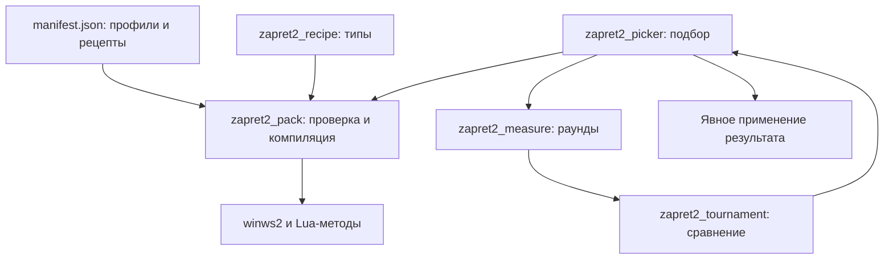

# Zapret2: профили, методы и подбор

[Все пакеты](README.md) · [Снимок исходников](https://github.com/AcediaWhy/Obsession/tree/111889a8144070b8f2259252e1c905370b39d13b)

**Obsession 1.2.0 · исходники от 2026-10-13 · коммит `111889a8144070b8f2259252e1c905370b39d13b`.**

Пакет соединяет встроенные профили, Lua-методы движка, подготовку команд и алгоритм подбора. Он позволяет проследить путь от выбора сервиса до измерений, сравнения кандидатов и применения результата.

Ключевые файлы приведены целиком, включая комментарии и тесты. Код взят из указанного Git-коммита; пояснения и схемы добавлены для чтения. Все ссылки на исходники закреплены на тот же коммит.

## Схема



## Порядок чтения

1. manifest.json содержит встроенные стратегии, аргументы и рецепты. Lua-файлы ниже содержат функции, которые использует движок.
2. zapret2_recipe.rs задаёт типы рецептов; zapret2_pack.rs проверяет пакет и формирует команды для службы.
3. В zapret2_picker.rs найди catalog, tournament_candidates, pick и apply_result: каталог, кандидаты, подбор и применение.
4. zapret2_measure.rs хранит результаты раундов и выполняет сетевые измерения; zapret2_tournament.rs сравнивает кандидатов и требует подтверждения результата.

## Карта файлов

| Файл | Назначение | Строк |
|---|---|---:|
| [ObsessionTauri/src-tauri/resources/strategy-packs/builtin/manifest.json](#source-01) | Все определения встроенного пака: стратегии, аргументы и рецепты. | 1512 |
| [ObsessionTauri/runtime-protocol/src/zapret2_recipe.rs](#source-02) | Типизированные рецепты и источники кандидатов. | 230 |
| [ObsessionTauri/runtime-service/src/zapret2_pack.rs](#source-03) | Проверка и компиляция профилей для службы. | 1180 |
| [ObsessionTauri/src-tauri/src/protected_runtime/zapret2_picker.rs](#source-04) | Каталог, подготовка кандидатов, подбор и применение. | 2424 |
| [ObsessionTauri/src-tauri/src/protected_runtime/zapret2_tournament.rs](#source-05) | Разнообразие кандидатов, подтверждения и выбор результата. | 698 |
| [ObsessionTauri/src-tauri/src/protected_runtime/zapret2_measure.rs](#source-06) | Измерения, сравнимость и доказательства по функциям. | 2106 |
| [ObsessionTauri/src-tauri/resources/strategy-packs/builtin/lua/zapret-antidpi.lua](#source-07) | Lua-функции обхода, поставляемые с движком. | 1250 |
| [ObsessionTauri/src-tauri/resources/strategy-packs/builtin/lua/zapret-lib.lua](#source-08) | Общие Lua-функции, используемые методами обхода. | 2719 |

## На что обратить внимание

- Чем отличаются доступный endpoint, обработанный движком сокет и работа видео или голосового сценария.
- Какие раунды допускаются к сравнению, как учитываются смена сети, отмена и неполные измерения.
- Как временная конфигурация возвращается после проверки и чем новая проверка отличается от сохранённого результата.

## Исходники

Блоки можно раскрыть по одному. В Raw-версии документа содержимое всех блоков доступно сразу.

<a id="source-01"></a>

### ObsessionTauri/src-tauri/resources/strategy-packs/builtin/manifest.json

Все определения встроенного пака: стратегии, аргументы и рецепты.

[Открыть файл на GitHub](https://github.com/AcediaWhy/Obsession/blob/111889a8144070b8f2259252e1c905370b39d13b/ObsessionTauri/src-tauri/resources/strategy-packs/builtin/manifest.json) · [Исходный текст](https://raw.githubusercontent.com/AcediaWhy/Obsession/111889a8144070b8f2259252e1c905370b39d13b/ObsessionTauri/src-tauri/resources/strategy-packs/builtin/manifest.json)

1512 строк · 36,447 байт · SHA-256: `e9d339de0e48a015f2ea05fdc09252a0b5f16f328c058057594fcff36520187d`

<details>
<summary>Показать полный код manifest.json</summary>

```json
{
  "schema_version": 2,
  "pack_id": "builtin.base",
  "pack_version": "0.12.0",
  "engine": {
    "winws2_min": ">=1.0.5.2",
    "lua_api": 6
  },
  "categories": [
    "discord",
    "youtube_twitch",
    "gaming"
  ],
  "protocols": [
    "tcp",
    "http",
    "tls",
    "udp",
    "quic"
  ],
  "files": [
    {
      "path": "lua/zapret-lib.lua",
      "sha256": "b67a470f23b00a8d6e732c4e5135a39b224511e0b71809d5f4616adf62674980"
    },
    {
      "path": "lua/zapret-antidpi.lua",
      "sha256": "31c9dd75b0bd55e98e5306293f2be81e9d2ecadcbbf9157394ff37dcff7dc85a"
    },
    {
      "path": "blobs/tls_clienthello_www_google_com.bin",
      "sha256": "936c2bee4cfb80aa3c426b2dcbcc834b3fbcd1adb17172959dc569c73a14275c"
    },
    {
      "path": "blobs/quic_initial_www_google_com.bin",
      "sha256": "f4589c57749f956bb30538197a521d7005f8b0a8723b4707e72405e51ddac50a"
    },
    {
      "path": "lua/obsession-diagnostic.lua",
      "sha256": "2d3d399b54fb422384ae7301ff485745bd488f068a8ad4922cc3bd8ca3d2e11f"
    },
    {
      "path": "lua/obsession-clienthello.lua",
      "sha256": "281d3b4e54b677a6d52b8c913050c1fe95b254fe056ee602560e4ae09b290c80"
    }
  ],
  "blobs": [
    {
      "name": "tls_google",
      "path": "blobs/tls_clienthello_www_google_com.bin"
    },
    {
      "name": "quic_google",
      "path": "blobs/quic_initial_www_google_com.bin"
    }
  ],
  "strategies": [
    {
      "id": "discord_tls_text",
      "category": "discord",
      "aggressiveness": 1,
      "lua": "lua/zapret-antidpi.lua",
      "transports": [
        "tcp",
        "tls"
      ],
      "filter_l7": [
        "tls"
      ],
      "payload": [
        "tls_client_hello"
      ],
      "out_range": "-d10",
      "desync": [
        "fake:blob=tls_google:tcp_ts=-30000:tcp_ts_up:repeats=4",
        "multisplit:pos=1"
      ],
      "filter_tcp": "443,2053,2083,2087,2096,8443"
    },
    {
      "id": "discord_quic_level_1",
      "category": "discord",
      "aggressiveness": 1,
      "lua": "lua/zapret-antidpi.lua",
      "transports": [
        "udp",
        "quic"
      ],
      "filter_l7": [
        "quic"
      ],
      "payload": [
        "quic_initial"
      ],
      "desync": [
        "fake:blob=quic_google:repeats=6"
      ],
      "out_range": "-d10"
    },
    {
      "id": "discord_voice_level_1",
      "category": "discord",
      "aggressiveness": 1,
      "lua": "lua/zapret-antidpi.lua",
      "transports": [
        "udp"
      ],
      "filter_udp": "3478-3480,19294-19344,50000-50100",
      "filter_l7": [
        "discord",
        "stun"
      ],
      "payload": [
        "discord_ip_discovery",
        "stun"
      ],
      "out_range": "-d5",
      "desync": [
        "fake:blob=0x00000000000000000000000000000000:repeats=6"
      ]
    },
    {
      "id": "discord_tls_fakedsplit",
      "category": "discord",
      "aggressiveness": 2,
      "lua": "lua/zapret-antidpi.lua",
      "transports": [
        "tcp",
        "tls"
      ],
      "filter_l7": [
        "tls"
      ],
      "payload": [
        "tls_client_hello"
      ],
      "out_range": "-d10",
      "desync": [
        "fakedsplit:pos=midsld:seqovl=2:tcp_md5:repeats=2"
      ],
      "filter_tcp": "443,2053,2083,2087,2096,8443"
    },
    {
      "id": "discord_quic_level_2",
      "category": "discord",
      "aggressiveness": 2,
      "lua": "lua/zapret-antidpi.lua",
      "transports": [
        "udp",
        "quic"
      ],
      "filter_l7": [
        "quic"
      ],
      "payload": [
        "quic_initial"
      ],
      "desync": [
        "fake:blob=quic_google:repeats=6"
      ],
      "out_range": "-d10"
    },
    {
      "id": "discord_voice_level_2",
      "category": "discord",
      "aggressiveness": 2,
      "lua": "lua/zapret-antidpi.lua",
      "transports": [
        "udp"
      ],
      "filter_udp": "3478-3480,19294-19344,50000-50100",
      "filter_l7": [
        "discord",
        "stun"
      ],
      "payload": [
        "discord_ip_discovery",
        "stun"
      ],
      "out_range": "-d5",
      "desync": [
        "send:ipfrag:ipfrag_pos_udp=8",
        "drop"
      ]
    },
    {
      "id": "discord_tls_fakeddisorder",
      "category": "discord",
      "aggressiveness": 3,
      "lua": "lua/zapret-antidpi.lua",
      "transports": [
        "tcp",
        "tls"
      ],
      "filter_l7": [
        "tls"
      ],
      "payload": [
        "tls_client_hello"
      ],
      "out_range": "-d10",
      "desync": [
        "fake:blob=fake_default_tls:tcp_md5:tcp_seq=-10000:tls_mod=rnd,rndsni,dupsid,padencap:repeats=2",
        "fakeddisorder:pos=midsld:seqovl=4:tcp_md5:repeats=2"
      ],
      "filter_tcp": "443,2053,2083,2087,2096,8443"
    },
    {
      "id": "discord_quic_level_3",
      "category": "discord",
      "aggressiveness": 3,
      "lua": "lua/zapret-antidpi.lua",
      "transports": [
        "udp",
        "quic"
      ],
      "filter_l7": [
        "quic"
      ],
      "payload": [
        "quic_initial"
      ],
      "desync": [
        "fake:blob=quic_google:repeats=6"
      ],
      "out_range": "-d10"
    },
    {
      "id": "discord_voice_level_3",
      "category": "discord",
      "aggressiveness": 3,
      "lua": "lua/zapret-antidpi.lua",
      "transports": [
        "udp"
      ],
      "filter_udp": "3478-3480,19294-19344,50000-50100",
      "filter_l7": [
        "discord",
        "stun"
      ],
      "payload": [
        "discord_ip_discovery",
        "stun"
      ],
      "out_range": "-d5",
      "desync": [
        "fake:blob=0x00000000000000000000000000000000:repeats=2",
        "send:ipfrag:ipfrag_pos_udp=8",
        "drop"
      ]
    },
    {
      "id": "discord_tls_multidisorder_alt",
      "category": "discord",
      "aggressiveness": 4,
      "lua": "lua/zapret-antidpi.lua",
      "transports": [
        "tcp",
        "tls"
      ],
      "filter_tcp": "443,2053,2083,2087,2096,8443",
      "filter_l7": [
        "tls"
      ],
      "payload": [
        "tls_client_hello"
      ],
      "out_range": "-d10",
      "desync": [
        "multidisorder:pos=1,2,midsld,sniext"
      ]
    },
    {
      "id": "discord_voice_level_4",
      "category": "discord",
      "aggressiveness": 4,
      "lua": "lua/zapret-antidpi.lua",
      "transports": [
        "udp"
      ],
      "filter_udp": "3478-3480,19294-19344,50000-50100",
      "filter_l7": [
        "discord",
        "stun"
      ],
      "payload": [
        "discord_ip_discovery",
        "stun"
      ],
      "out_range": "-d5",
      "desync": [
        "fake:blob=0x00000000000000000000000000000000:ip_ttl=5:ip6_ttl=5:repeats=2"
      ]
    },
    {
      "id": "discord_quic_alt",
      "category": "discord",
      "aggressiveness": 4,
      "lua": "lua/zapret-antidpi.lua",
      "transports": [
        "udp",
        "quic"
      ],
      "filter_l7": [
        "quic"
      ],
      "payload": [
        "quic_initial"
      ],
      "desync": [
        "fake:blob=quic_google:repeats=6"
      ],
      "out_range": "-d10"
    },
    {
      "id": "youtube_tls",
      "category": "youtube_twitch",
      "aggressiveness": 1,
      "lua": "lua/zapret-antidpi.lua",
      "transports": [
        "tcp",
        "tls"
      ],
      "filter_l7": [
        "tls"
      ],
      "payload": [
        "tls_client_hello"
      ],
      "out_range": "-d10",
      "desync": [
        "multidisorder_legacy:pos=midsld"
      ]
    },
    {
      "id": "youtube_quic",
      "category": "youtube_twitch",
      "aggressiveness": 1,
      "lua": "lua/zapret-antidpi.lua",
      "transports": [
        "udp",
        "quic"
      ],
      "filter_l7": [
        "quic"
      ],
      "payload": [
        "quic_initial"
      ],
      "desync": [
        "fake:blob=quic_google:repeats=6"
      ],
      "out_range": "-d10"
    },
    {
      "id": "gaming_control_tls",
      "category": "gaming",
      "aggressiveness": 1,
      "lua": "lua/zapret-antidpi.lua",
      "transports": [
        "tcp",
        "tls"
      ],
      "hostlist": "gaming-github.txt",
      "filter_tcp": "443",
      "filter_l7": [
        "tls"
      ],
      "payload": [
        "tls_client_hello"
      ],
      "out_range": "-d10",
      "desync": [
        "multidisorder_legacy:pos=midsld"
      ]
    },
    {
      "id": "gaming_control_quic",
      "category": "gaming",
      "aggressiveness": 1,
      "lua": "lua/zapret-antidpi.lua",
      "transports": [
        "udp",
        "quic"
      ],
      "hostlist": "gaming-github.txt",
      "filter_udp": "443",
      "filter_l7": [
        "quic"
      ],
      "payload": [
        "quic_initial"
      ],
      "desync": [
        "fake:blob=quic_google:repeats=6"
      ],
      "out_range": "-d10"
    },
    {
      "id": "gaming_ipset_http",
      "category": "gaming",
      "aggressiveness": 1,
      "lua": "lua/zapret-antidpi.lua",
      "transports": [
        "tcp",
        "http"
      ],
      "ipset": "ipset-gaming.txt",
      "filter_tcp": "80",
      "filter_l7": [
        "http"
      ],
      "payload": [
        "http_req"
      ],
      "out_range": "-d10",
      "desync": [
        "fake:blob=fake_default_http:repeats=6",
        "multisplit:pos=method,host"
      ]
    },
    {
      "id": "gaming_ipset_tls",
      "category": "gaming",
      "aggressiveness": 1,
      "lua": "lua/zapret-antidpi.lua",
      "transports": [
        "tcp",
        "tls"
      ],
      "ipset": "ipset-gaming.txt",
      "filter_tcp": "443",
      "filter_l7": [
        "tls"
      ],
      "payload": [
        "tls_client_hello"
      ],
      "out_range": "-d10",
      "desync": [
        "fake:blob=tls_google:tcp_ts=-30000:tcp_ts_up:repeats=6",
        "multisplit:pos=1"
      ]
    },
    {
      "id": "gaming_ipset_udp",
      "category": "gaming",
      "aggressiveness": 1,
      "lua": "lua/zapret-antidpi.lua",
      "transports": [
        "udp"
      ],
      "ipset": "ipset-gaming.txt",
      "filter_udp": "443,1024-65535",
      "out_range": "-d5",
      "desync": [
        "fake:blob=quic_google:repeats=8"
      ]
    }
  ],
  "probes": [
    "discord.com",
    "www.youtube.com",
    "github.com",
    "api.github.com",
    "www.roblox.com",
    "www.epicgames.com",
    "www.twitch.tv"
  ],
  "fallback": "discord_tls_text",
  "notes": {
    "scope": "Discord TLS, QUIC and recognized voice discovery/STUN at every level. Experimental voice variants: zero fake, IP fragmentation, fake plus fragmentation, TTL-limited fake. Voice usability requires separate live verification; TLS/QUIC availability does not confirm RTC. YouTube/Twitch and Gaming + GitHub control/data profiles.",
    "profile_grammar": "Profiles are serialized completely and separated by bare --new only between profiles."
  },
  "experiments": [
    {
      "id": "discord_tls_clienthello_clone",
      "category": "discord",
      "aggressiveness": 4,
      "lua": "lua/obsession-clienthello.lua",
      "transports": [
        "tcp",
        "tls"
      ],
      "filter_tcp": "443,2053,2083,2087,2096,8443",
      "filter_l7": [
        "tls"
      ],
      "payload": [
        "tls_client_hello"
      ],
      "out_range": "-d10",
      "desync": [
        "obsession_clienthello:payload=tls_client_hello"
      ]
    }
  ],
  "presets": [
    {
      "id": "classic_discord_tls_split_sni",
      "category": "discord",
      "aggressiveness": 1,
      "lua": "lua/zapret-antidpi.lua",
      "transports": [
        "tcp",
        "tls"
      ],
      "filter_tcp": "443,2053,2083,2087,2096,8443",
      "filter_l7": [
        "tls"
      ],
      "payload": [
        "tls_client_hello"
      ],
      "out_range": "-d10",
      "desync": [
        "multisplit:pos=midsld"
      ]
    },
    {
      "id": "classic_discord_tls_split_extension",
      "category": "discord",
      "aggressiveness": 1,
      "lua": "lua/zapret-antidpi.lua",
      "transports": [
        "tcp",
        "tls"
      ],
      "filter_tcp": "443,2053,2083,2087,2096,8443",
      "filter_l7": [
        "tls"
      ],
      "payload": [
        "tls_client_hello"
      ],
      "out_range": "-d10",
      "desync": [
        "multisplit:pos=sniext"
      ]
    },
    {
      "id": "classic_discord_tls_disorder_sni",
      "category": "discord",
      "aggressiveness": 1,
      "lua": "lua/zapret-antidpi.lua",
      "transports": [
        "tcp",
        "tls"
      ],
      "filter_tcp": "443,2053,2083,2087,2096,8443",
      "filter_l7": [
        "tls"
      ],
      "payload": [
        "tls_client_hello"
      ],
      "out_range": "-d10",
      "desync": [
        "multidisorder:pos=midsld"
      ]
    },
    {
      "id": "classic_discord_tls_disorder_extension",
      "category": "discord",
      "aggressiveness": 1,
      "lua": "lua/zapret-antidpi.lua",
      "transports": [
        "tcp",
        "tls"
      ],
      "filter_tcp": "443,2053,2083,2087,2096,8443",
      "filter_l7": [
        "tls"
      ],
      "payload": [
        "tls_client_hello"
      ],
      "out_range": "-d10",
      "desync": [
        "multidisorder:pos=sniext"
      ]
    },
    {
      "id": "classic_discord_tls_legacy_sni",
      "category": "discord",
      "aggressiveness": 1,
      "lua": "lua/zapret-antidpi.lua",
      "transports": [
        "tcp",
        "tls"
      ],
      "filter_tcp": "443,2053,2083,2087,2096,8443",
      "filter_l7": [
        "tls"
      ],
      "payload": [
        "tls_client_hello"
      ],
      "out_range": "-d10",
      "desync": [
        "multidisorder_legacy:pos=midsld"
      ]
    },
    {
      "id": "classic_discord_tls_legacy_sni_extension",
      "category": "discord",
      "aggressiveness": 1,
      "lua": "lua/zapret-antidpi.lua",
      "transports": [
        "tcp",
        "tls"
      ],
      "filter_tcp": "443,2053,2083,2087,2096,8443",
      "filter_l7": [
        "tls"
      ],
      "payload": [
        "tls_client_hello"
      ],
      "out_range": "-d10",
      "desync": [
        "multidisorder_legacy:pos=midsld,sniext"
      ]
    },
    {
      "id": "classic_discord_tls_fake_md5_disorder",
      "category": "discord",
      "aggressiveness": 1,
      "lua": "lua/zapret-antidpi.lua",
      "transports": [
        "tcp",
        "tls"
      ],
      "filter_tcp": "443,2053,2083,2087,2096,8443",
      "filter_l7": [
        "tls"
      ],
      "payload": [
        "tls_client_hello"
      ],
      "out_range": "-d10",
      "desync": [
        "fake:blob=fake_default_tls:tcp_md5:tcp_seq=-10000:repeats=2",
        "multidisorder:pos=midsld"
      ]
    },
    {
      "id": "classic_discord_tls_fake_seq_split",
      "category": "discord",
      "aggressiveness": 1,
      "lua": "lua/zapret-antidpi.lua",
      "transports": [
        "tcp",
        "tls"
      ],
      "filter_tcp": "443,2053,2083,2087,2096,8443",
      "filter_l7": [
        "tls"
      ],
      "payload": [
        "tls_client_hello"
      ],
      "out_range": "-d10",
      "desync": [
        "fake:blob=tls_google:tcp_seq=-10000:repeats=2",
        "multisplit:pos=midsld"
      ]
    },
    {
      "id": "classic_discord_quic_fake_default_once",
      "category": "discord",
      "aggressiveness": 1,
      "lua": "lua/zapret-antidpi.lua",
      "transports": [
        "udp",
        "quic"
      ],
      "filter_l7": [
        "quic"
      ],
      "payload": [
        "quic_initial"
      ],
      "desync": [
        "fake:blob=fake_default_quic:repeats=1"
      ]
    },
    {
      "id": "classic_discord_quic_fake_default_six",
      "category": "discord",
      "aggressiveness": 1,
      "lua": "lua/zapret-antidpi.lua",
      "transports": [
        "udp",
        "quic"
      ],
      "filter_l7": [
        "quic"
      ],
      "payload": [
        "quic_initial"
      ],
      "desync": [
        "fake:blob=fake_default_quic:repeats=6"
      ],
      "out_range": "-d10"
    },
    {
      "id": "classic_discord_quic_fake_google_twice",
      "category": "discord",
      "aggressiveness": 1,
      "lua": "lua/zapret-antidpi.lua",
      "transports": [
        "udp",
        "quic"
      ],
      "filter_l7": [
        "quic"
      ],
      "payload": [
        "quic_initial"
      ],
      "desync": [
        "fake:blob=quic_google:repeats=2"
      ],
      "out_range": "-d10"
    },
    {
      "id": "classic_youtube_twitch_tls_split_sni",
      "category": "youtube_twitch",
      "aggressiveness": 1,
      "lua": "lua/zapret-antidpi.lua",
      "transports": [
        "tcp",
        "tls"
      ],
      "filter_l7": [
        "tls"
      ],
      "payload": [
        "tls_client_hello"
      ],
      "out_range": "-d10",
      "desync": [
        "multisplit:pos=midsld"
      ]
    },
    {
      "id": "classic_youtube_twitch_tls_split_extension",
      "category": "youtube_twitch",
      "aggressiveness": 1,
      "lua": "lua/zapret-antidpi.lua",
      "transports": [
        "tcp",
        "tls"
      ],
      "filter_l7": [
        "tls"
      ],
      "payload": [
        "tls_client_hello"
      ],
      "out_range": "-d10",
      "desync": [
        "multisplit:pos=sniext"
      ]
    },
    {
      "id": "classic_youtube_twitch_tls_disorder_sni",
      "category": "youtube_twitch",
      "aggressiveness": 1,
      "lua": "lua/zapret-antidpi.lua",
      "transports": [
        "tcp",
        "tls"
      ],
      "filter_l7": [
        "tls"
      ],
      "payload": [
        "tls_client_hello"
      ],
      "out_range": "-d10",
      "desync": [
        "multidisorder:pos=midsld"
      ]
    },
    {
      "id": "classic_youtube_twitch_tls_saved_disorder",
      "category": "youtube_twitch",
      "aggressiveness": 1,
      "lua": "lua/zapret-antidpi.lua",
      "transports": [
        "tcp",
        "tls"
      ],
      "filter_l7": [
        "tls"
      ],
      "payload": [
        "tls_client_hello"
      ],
      "out_range": "-d10",
      "desync": [
        "multidisorder:pos=1,midsld"
      ]
    },
    {
      "id": "classic_youtube_twitch_tls_disorder_extension",
      "category": "youtube_twitch",
      "aggressiveness": 1,
      "lua": "lua/zapret-antidpi.lua",
      "transports": [
        "tcp",
        "tls"
      ],
      "filter_l7": [
        "tls"
      ],
      "payload": [
        "tls_client_hello"
      ],
      "out_range": "-d10",
      "desync": [
        "multidisorder:pos=sniext"
      ]
    },
    {
      "id": "classic_youtube_twitch_tls_legacy_sni_extension",
      "category": "youtube_twitch",
      "aggressiveness": 1,
      "lua": "lua/zapret-antidpi.lua",
      "transports": [
        "tcp",
        "tls"
      ],
      "filter_l7": [
        "tls"
      ],
      "payload": [
        "tls_client_hello"
      ],
      "out_range": "-d10",
      "desync": [
        "multidisorder_legacy:pos=midsld,sniext"
      ]
    },
    {
      "id": "classic_youtube_twitch_tls_fake_md5_disorder",
      "category": "youtube_twitch",
      "aggressiveness": 1,
      "lua": "lua/zapret-antidpi.lua",
      "transports": [
        "tcp",
        "tls"
      ],
      "filter_l7": [
        "tls"
      ],
      "payload": [
        "tls_client_hello"
      ],
      "out_range": "-d10",
      "desync": [
        "fake:blob=fake_default_tls:tcp_md5:tcp_seq=-10000:repeats=2",
        "multidisorder:pos=midsld"
      ]
    },
    {
      "id": "classic_youtube_twitch_tls_fake_seq_split",
      "category": "youtube_twitch",
      "aggressiveness": 1,
      "lua": "lua/zapret-antidpi.lua",
      "transports": [
        "tcp",
        "tls"
      ],
      "filter_l7": [
        "tls"
      ],
      "payload": [
        "tls_client_hello"
      ],
      "out_range": "-d10",
      "desync": [
        "fake:blob=tls_google:tcp_seq=-10000:repeats=2",
        "multisplit:pos=midsld"
      ]
    },
    {
      "id": "classic_youtube_twitch_quic_fake_default_once",
      "category": "youtube_twitch",
      "aggressiveness": 1,
      "lua": "lua/zapret-antidpi.lua",
      "transports": [
        "udp",
        "quic"
      ],
      "filter_l7": [
        "quic"
      ],
      "payload": [
        "quic_initial"
      ],
      "desync": [
        "fake:blob=fake_default_quic:repeats=1"
      ]
    },
    {
      "id": "classic_youtube_twitch_quic_fake_default_six",
      "category": "youtube_twitch",
      "aggressiveness": 1,
      "lua": "lua/zapret-antidpi.lua",
      "transports": [
        "udp",
        "quic"
      ],
      "filter_l7": [
        "quic"
      ],
      "payload": [
        "quic_initial"
      ],
      "desync": [
        "fake:blob=fake_default_quic:repeats=6"
      ],
      "out_range": "-d10"
    },
    {
      "id": "classic_youtube_twitch_quic_fake_google_twice",
      "category": "youtube_twitch",
      "aggressiveness": 1,
      "lua": "lua/zapret-antidpi.lua",
      "transports": [
        "udp",
        "quic"
      ],
      "filter_l7": [
        "quic"
      ],
      "payload": [
        "quic_initial"
      ],
      "desync": [
        "fake:blob=quic_google:repeats=2"
      ],
      "out_range": "-d10"
    },
    {
      "id": "classic_gaming_tls_split_sni",
      "category": "gaming",
      "aggressiveness": 1,
      "lua": "lua/zapret-antidpi.lua",
      "transports": [
        "tcp",
        "tls"
      ],
      "hostlist": "gaming-github.txt",
      "filter_tcp": "443",
      "filter_l7": [
        "tls"
      ],
      "payload": [
        "tls_client_hello"
      ],
      "out_range": "-d10",
      "desync": [
        "multisplit:pos=midsld"
      ]
    },
    {
      "id": "classic_gaming_tls_split_extension",
      "category": "gaming",
      "aggressiveness": 1,
      "lua": "lua/zapret-antidpi.lua",
      "transports": [
        "tcp",
        "tls"
      ],
      "hostlist": "gaming-github.txt",
      "filter_tcp": "443",
      "filter_l7": [
        "tls"
      ],
      "payload": [
        "tls_client_hello"
      ],
      "out_range": "-d10",
      "desync": [
        "multisplit:pos=sniext"
      ]
    },
    {
      "id": "classic_gaming_tls_disorder_sni",
      "category": "gaming",
      "aggressiveness": 1,
      "lua": "lua/zapret-antidpi.lua",
      "transports": [
        "tcp",
        "tls"
      ],
      "hostlist": "gaming-github.txt",
      "filter_tcp": "443",
      "filter_l7": [
        "tls"
      ],
      "payload": [
        "tls_client_hello"
      ],
      "out_range": "-d10",
      "desync": [
        "multidisorder:pos=midsld"
      ]
    },
    {
      "id": "classic_gaming_tls_disorder_extension",
      "category": "gaming",
      "aggressiveness": 1,
      "lua": "lua/zapret-antidpi.lua",
      "transports": [
        "tcp",
        "tls"
      ],
      "hostlist": "gaming-github.txt",
      "filter_tcp": "443",
      "filter_l7": [
        "tls"
      ],
      "payload": [
        "tls_client_hello"
      ],
      "out_range": "-d10",
      "desync": [
        "multidisorder:pos=sniext"
      ]
    },
    {
      "id": "classic_gaming_tls_legacy_sni_extension",
      "category": "gaming",
      "aggressiveness": 1,
      "lua": "lua/zapret-antidpi.lua",
      "transports": [
        "tcp",
        "tls"
      ],
      "hostlist": "gaming-github.txt",
      "filter_tcp": "443",
      "filter_l7": [
        "tls"
      ],
      "payload": [
        "tls_client_hello"
      ],
      "out_range": "-d10",
      "desync": [
        "multidisorder_legacy:pos=midsld,sniext"
      ]
    },
    {
      "id": "classic_gaming_tls_fake_md5_disorder",
      "category": "gaming",
      "aggressiveness": 1,
      "lua": "lua/zapret-antidpi.lua",
      "transports": [
        "tcp",
        "tls"
      ],
      "hostlist": "gaming-github.txt",
      "filter_tcp": "443",
      "filter_l7": [
        "tls"
      ],
      "payload": [
        "tls_client_hello"
      ],
      "out_range": "-d10",
      "desync": [
        "fake:blob=fake_default_tls:tcp_md5:tcp_seq=-10000:repeats=2",
        "multidisorder:pos=midsld"
      ]
    },
    {
      "id": "classic_gaming_tls_fake_seq_split",
      "category": "gaming",
      "aggressiveness": 1,
      "lua": "lua/zapret-antidpi.lua",
      "transports": [
        "tcp",
        "tls"
      ],
      "hostlist": "gaming-github.txt",
      "filter_tcp": "443",
      "filter_l7": [
        "tls"
      ],
      "payload": [
        "tls_client_hello"
      ],
      "out_range": "-d10",
      "desync": [
        "fake:blob=tls_google:tcp_seq=-10000:repeats=2",
        "multisplit:pos=midsld"
      ]
    },
    {
      "id": "classic_gaming_quic_fake_default_once",
      "category": "gaming",
      "aggressiveness": 1,
      "lua": "lua/zapret-antidpi.lua",
      "transports": [
        "udp",
        "quic"
      ],
      "hostlist": "gaming-github.txt",
      "filter_udp": "443",
      "filter_l7": [
        "quic"
      ],
      "payload": [
        "quic_initial"
      ],
      "desync": [
        "fake:blob=fake_default_quic:repeats=1"
      ]
    },
    {
      "id": "classic_gaming_quic_fake_default_six",
      "category": "gaming",
      "aggressiveness": 1,
      "lua": "lua/zapret-antidpi.lua",
      "transports": [
        "udp",
        "quic"
      ],
      "hostlist": "gaming-github.txt",
      "filter_udp": "443",
      "filter_l7": [
        "quic"
      ],
      "payload": [
        "quic_initial"
      ],
      "desync": [
        "fake:blob=fake_default_quic:repeats=6"
      ],
      "out_range": "-d10"
    },
    {
      "id": "classic_gaming_quic_fake_google_twice",
      "category": "gaming",
      "aggressiveness": 1,
      "lua": "lua/zapret-antidpi.lua",
      "transports": [
        "udp",
        "quic"
      ],
      "hostlist": "gaming-github.txt",
      "filter_udp": "443",
      "filter_l7": [
        "quic"
      ],
      "payload": [
        "quic_initial"
      ],
      "desync": [
        "fake:blob=quic_google:repeats=2"
      ],
      "out_range": "-d10"
    },
    {
      "id": "research_discord_tls_early_disorder",
      "category": "discord",
      "aggressiveness": 1,
      "lua": "lua/zapret-antidpi.lua",
      "transports": [
        "tcp",
        "tls"
      ],
      "filter_l7": [
        "tls"
      ],
      "payload": [
        "tls_client_hello"
      ],
      "candidate": {
        "label": "Ранняя перестановка · 2",
        "family": "reorder",
        "urls": [
          "https://github.com/bol-van/zapret2/discussions/208#discussioncomment-16808762"
        ],
        "evidence": "derived",
        "notes": "Контроль: вариант без изменения TCP window. Успех исходного рецепта не переносится на эту производную."
      },
      "filter_tcp": "443,2053,2083,2087,2096,8443",
      "desync": [
        "multidisorder:pos=2"
      ]
    },
    {
      "id": "research_discord_tls_window_disorder",
      "category": "discord",
      "aggressiveness": 1,
      "lua": "lua/zapret-antidpi.lua",
      "transports": [
        "tcp",
        "tls"
      ],
      "filter_l7": [
        "tls"
      ],
      "payload": [
        "tls_client_hello"
      ],
      "candidate": {
        "label": "TCP window + перестановка · 2",
        "family": "window_reorder",
        "urls": [
          "https://github.com/bol-van/zapret2/discussions/208#discussioncomment-16808762"
        ],
        "evidence": "author_report",
        "notes": "Автор сообщает успех YouTube в Windows. Фильтры сервиса и списки адаптированы; вклад изменения окна требует проверки."
      },
      "filter_tcp": "443,2053,2083,2087,2096,8443",
      "steps": [
        {
          "action": "wssize:wsize=1:scale=6",
          "payload": [
            "all"
          ]
        },
        {
          "action": "multidisorder:pos=2",
          "payload": [
            "tls_client_hello"
          ]
        }
      ]
    },
    {
      "id": "research_discord_tls_sni_ladder",
      "category": "discord",
      "aggressiveness": 1,
      "lua": "lua/zapret-antidpi.lua",
      "transports": [
        "tcp",
        "tls"
      ],
      "filter_l7": [
        "tls"
      ],
      "payload": [
        "tls_client_hello"
      ],
      "candidate": {
        "label": "Перестановка вокруг SNI",
        "family": "reorder",
        "urls": [
          "https://github.com/bol-van/zapret2/discussions/104"
        ],
        "evidence": "author_report",
        "notes": "В исходной Linux-сборке заявлен успех YouTube и отказ Discord. Отдельный вклад TLS не установлен. Списки и фильтры адаптированы."
      },
      "filter_tcp": "443,2053,2083,2087,2096,8443",
      "desync": [
        "multidisorder:pos=1,sniext+1,host+1,midsld-2,midsld,midsld+2,endhost-1"
      ]
    },
    {
      "id": "research_discord_tls_hostfake_ack",
      "category": "discord",
      "aggressiveness": 1,
      "lua": "lua/zapret-antidpi.lua",
      "transports": [
        "tcp",
        "tls"
      ],
      "filter_l7": [
        "tls"
      ],
      "payload": [
        "tls_client_hello"
      ],
      "candidate": {
        "label": "Hostfake + перестановка хвоста",
        "family": "hostfake",
        "urls": [
          "https://github.com/bol-van/zapret2/discussions/208"
        ],
        "evidence": "blockcheck_report",
        "notes": "Две успешные пробы rutracker TLS 1.2/IPv4. Работа Discord и YouTube не заявлена; списки и фильтры адаптированы."
      },
      "filter_tcp": "443,2053,2083,2087,2096,8443",
      "desync": [
        "hostfakesplit:disorder_after:nofake2:tcp_ack=-66000:tcp_ts_up:repeats=1"
      ]
    },
    {
      "id": "research_discord_tls_hostfake_md5",
      "category": "discord",
      "aggressiveness": 1,
      "lua": "lua/zapret-antidpi.lua",
      "transports": [
        "tcp",
        "tls"
      ],
      "filter_l7": [
        "tls"
      ],
      "payload": [
        "tls_client_hello"
      ],
      "candidate": {
        "label": "Hostfake + MD5",
        "family": "hostfake",
        "urls": [
          "https://github.com/bol-van/zapret2/discussions/154#discussioncomment-16273844"
        ],
        "evidence": "derived",
        "notes": "Выделено из резервной ветки circular. Независимый успех не подтверждён; оркестратор удалён, фильтры адаптированы."
      },
      "filter_tcp": "443,2053,2083,2087,2096,8443",
      "desync": [
        "hostfakesplit:nofake2:tcp_md5"
      ]
    },
    {
      "id": "research_youtube_twitch_tls_early_disorder",
      "category": "youtube_twitch",
      "aggressiveness": 1,
      "lua": "lua/zapret-antidpi.lua",
      "transports": [
        "tcp",
        "tls"
      ],
      "filter_l7": [
        "tls"
      ],
      "payload": [
        "tls_client_hello"
      ],
      "candidate": {
        "label": "Ранняя перестановка · 2",
        "family": "reorder",
        "urls": [
          "https://github.com/bol-van/zapret2/discussions/208#discussioncomment-16808762"
        ],
        "evidence": "derived",
        "notes": "Контроль: вариант без изменения TCP window. Успех исходного рецепта не переносится на эту производную."
      },
      "filter_tcp": "443",
      "desync": [
        "multidisorder:pos=2"
      ]
    },
    {
      "id": "research_youtube_twitch_tls_window_disorder",
      "category": "youtube_twitch",
      "aggressiveness": 1,
      "lua": "lua/zapret-antidpi.lua",
      "transports": [
        "tcp",
        "tls"
      ],
      "filter_l7": [
        "tls"
      ],
      "payload": [
        "tls_client_hello"
      ],
      "candidate": {
        "label": "TCP window + перестановка · 2",
        "family": "window_reorder",
        "urls": [
          "https://github.com/bol-van/zapret2/discussions/208#discussioncomment-16808762"
        ],
        "evidence": "author_report",
        "notes": "Автор сообщает успех YouTube в Windows. Фильтры сервиса и списки адаптированы; вклад изменения окна требует проверки."
      },
      "filter_tcp": "443",
      "steps": [
        {
          "action": "wssize:wsize=1:scale=6",
          "payload": [
            "all"
          ]
        },
        {
          "action": "multidisorder:pos=2",
          "payload": [
            "tls_client_hello"
          ]
        }
      ]
    },
    {
      "id": "research_youtube_twitch_tls_sni_ladder",
      "category": "youtube_twitch",
      "aggressiveness": 1,
      "lua": "lua/zapret-antidpi.lua",
      "transports": [
        "tcp",
        "tls"
      ],
      "filter_l7": [
        "tls"
      ],
      "payload": [
        "tls_client_hello"
      ],
      "candidate": {
        "label": "Перестановка вокруг SNI",
        "family": "reorder",
        "urls": [
          "https://github.com/bol-van/zapret2/discussions/104"
        ],
        "evidence": "author_report",
        "notes": "В исходной Linux-сборке заявлен успех YouTube и отказ Discord. Отдельный вклад TLS не установлен. Списки и фильтры адаптированы."
      },
      "filter_tcp": "443",
      "desync": [
        "multidisorder:pos=1,sniext+1,host+1,midsld-2,midsld,midsld+2,endhost-1"
      ]
    },
    {
      "id": "research_youtube_twitch_tls_hostfake_ack",
      "category": "youtube_twitch",
      "aggressiveness": 1,
      "lua": "lua/zapret-antidpi.lua",
      "transports": [
        "tcp",
        "tls"
      ],
      "filter_l7": [
        "tls"
      ],
      "payload": [
        "tls_client_hello"
      ],
      "candidate": {
        "label": "Hostfake + перестановка хвоста",
        "family": "hostfake",
        "urls": [
          "https://github.com/bol-van/zapret2/discussions/208"
        ],
        "evidence": "blockcheck_report",
        "notes": "Две успешные пробы rutracker TLS 1.2/IPv4. Работа Discord и YouTube не заявлена; списки и фильтры адаптированы."
      },
      "filter_tcp": "443",
      "desync": [
        "hostfakesplit:disorder_after:nofake2:tcp_ack=-66000:tcp_ts_up:repeats=1"
      ]
    },
    {
      "id": "research_youtube_twitch_tls_hostfake_md5",
      "category": "youtube_twitch",
      "aggressiveness": 1,
      "lua": "lua/zapret-antidpi.lua",
      "transports": [
        "tcp",
        "tls"
      ],
      "filter_l7": [
        "tls"
      ],
      "payload": [
        "tls_client_hello"
      ],
      "candidate": {
        "label": "Hostfake + MD5",
        "family": "hostfake",
        "urls": [
          "https://github.com/bol-van/zapret2/discussions/154#discussioncomment-16273844"
        ],
        "evidence": "derived",
        "notes": "Выделено из резервной ветки circular. Независимый успех не подтверждён; оркестратор удалён, фильтры адаптированы."
      },
      "filter_tcp": "443",
      "desync": [
        "hostfakesplit:nofake2:tcp_md5"
      ]
    },
    {
      "id": "research_youtube_twitch_quic_quic_four",
      "category": "youtube_twitch",
      "aggressiveness": 1,
      "lua": "lua/zapret-antidpi.lua",
      "transports": [
        "udp",
        "quic"
      ],
      "filter_l7": [
        "quic"
      ],
      "payload": [
        "quic_initial"
      ],
      "candidate": {
        "label": "QUIC Google · 4 повтора",
        "family": "quic_fake",
        "urls": [
          "https://github.com/bol-van/zapret2/discussions/104"
        ],
        "evidence": "author_report",
        "notes": "Часть исходной сборки YouTube. Её успех нельзя приписать QUIC; используется наш Google blob, фильтры адаптированы."
      },
      "filter_udp": "443",
      "desync": [
        "fake:blob=quic_google:repeats=4"
      ]
    }
  ]
}
```

</details>

<a id="source-02"></a>

### ObsessionTauri/runtime-protocol/src/zapret2_recipe.rs

Типизированные рецепты и источники кандидатов.

[Открыть файл на GitHub](https://github.com/AcediaWhy/Obsession/blob/111889a8144070b8f2259252e1c905370b39d13b/ObsessionTauri/runtime-protocol/src/zapret2_recipe.rs) · [Исходный текст](https://raw.githubusercontent.com/AcediaWhy/Obsession/111889a8144070b8f2259252e1c905370b39d13b/ObsessionTauri/runtime-protocol/src/zapret2_recipe.rs)

230 строк · 7,834 байт · SHA-256: `8fd2c17983946eb21e0f1915f69b5b39a68686512348e3e67760c38618a1dfa7`

<details>
<summary>Показать полный код zapret2_recipe.rs</summary>

```rust
//! Resource-only recipe types shared by the two pack compilers.
//! These types are never accepted as IPC launch parameters: launch requests
//! still select fixed IDs from the protected, verified pack.

use serde::{Deserialize, Serialize};

pub const PACK_SCHEMA_VERSION: u32 = 2;
pub const MAX_STEPS: usize = 16;

#[derive(Clone, Debug, PartialEq, Eq, Serialize, Deserialize)]
#[serde(deny_unknown_fields)]
pub struct DesyncStep {
    pub action: String,
    /// Explicit per-instance filter; `all` restores the native default.
    pub payload: Vec<String>,
    /// None inherits the profile range, never the preceding step's range.
    #[serde(default)]
    pub out_range: Option<String>,
    #[serde(default)]
    pub in_range: Option<String>,
}

#[derive(Clone, Debug, PartialEq, Eq, Serialize, Deserialize)]
#[serde(rename_all = "snake_case")]
pub enum SourceEvidence {
    AuthorReport,
    BlockcheckReport,
    Derived,
}

#[derive(Clone, Debug, PartialEq, Eq, Serialize, Deserialize)]
#[serde(deny_unknown_fields)]
pub struct CandidateSource {
    pub label: String,
    pub family: String,
    pub urls: Vec<String>,
    pub evidence: SourceEvidence,
    pub notes: String,
}

impl CandidateSource {
    pub fn valid(&self) -> bool {
        let text = |value: &str, limit| {
            !value.is_empty() && value.len() <= limit && !value.chars().any(char::is_control)
        };
        text(&self.label, 160)
            && text(&self.family, 64)
            && text(&self.notes, 2048)
            && !self.urls.is_empty()
            && self.urls.len() <= 4
            && self.urls.iter().all(|url| {
                url.starts_with("https://github.com/bol-van/")
                    && text(url, 512)
                    && !url.chars().any(char::is_whitespace)
            })
    }
}

pub fn valid_value(value: &str) -> bool {
    !value.is_empty()
        && value.len() <= 256
        && !value
            .bytes()
            .any(|byte| byte.is_ascii_control() || byte.is_ascii_whitespace())
}

/// Bounds and vocabulary are identical in the app and the privileged service.
pub fn validate_steps(desync: &[String], steps: &[DesyncStep]) -> Result<(), &'static str> {
    if steps.is_empty() {
        return Ok(());
    }
    if !desync.is_empty() || steps.len() > MAX_STEPS {
        return Err("recipe must contain either legacy desync or bounded steps");
    }
    let allowed = [
        "all",
        "known",
        "unknown",
        "empty",
        "http_req",
        "tls_client_hello",
        "quic_initial",
        "discord_ip_discovery",
        "stun",
        "wireguard_initiation",
        "wireguard_cookie",
    ];
    for step in steps {
        if !valid_value(&step.action)
            || step.action.starts_with("--")
            || step.payload.is_empty()
            || step.payload.len() > 8
            || step
                .payload
                .iter()
                .any(|value| !allowed.contains(&value.as_str()))
            || step
                .payload
                .iter()
                .enumerate()
                .any(|(index, value)| step.payload[..index].contains(value))
            || (step.payload.len() > 1
                && step
                    .payload
                    .iter()
                    .any(|v| matches!(v.as_str(), "all" | "known")))
            || step.out_range.as_deref().is_some_and(|v| !valid_value(v))
            || step.in_range.as_deref().is_some_and(|v| !valid_value(v))
        {
            return Err("invalid recipe step or execution scope");
        }
    }
    Ok(())
}

/// Preserve old argv byte-for-byte; scoped steps explicitly restore all three
/// filters each time, so the last step cannot leak its scope into the next one.
pub fn arguments(
    payload: &[String],
    out_range: Option<&str>,
    in_range: Option<&str>,
    desync: &[String],
    steps: &[DesyncStep],
) -> Vec<String> {
    let mut result = Vec::new();
    if steps.is_empty() {
        if !payload.is_empty() {
            result.push(format!("--payload={}", payload.join(",")));
        }
        result.extend(desync.iter().map(|action| format!("--lua-desync={action}")));
    } else {
        for step in steps {
            result.push(format!("--payload={}", step.payload.join(",")));
            result.push(format!(
                "--out-range={}",
                step.out_range.as_deref().or(out_range).unwrap_or("a0")
            ));
            result.push(format!(
                "--in-range={}",
                step.in_range.as_deref().or(in_range).unwrap_or("a0")
            ));
            result.push(format!("--lua-desync={}", step.action));
        }
    }
    result
}

#[cfg(test)]
mod tests {
    use super::*;
    fn step(action: &str, payload: &str) -> DesyncStep {
        DesyncStep {
            action: action.into(),
            payload: vec![payload.into()],
            out_range: None,
            in_range: None,
        }
    }
    #[test]
    fn window_action_precedes_clienthello_scope_and_next_step_resets_ranges() {
        let mut window = step("wssize:wsize=1:scale=6", "all");
        window.out_range = Some("<s1".into());
        let steps = [window, step("multidisorder:pos=2", "tls_client_hello")];
        assert!(validate_steps(&[], &steps).is_ok());
        assert_eq!(
            arguments(&[], Some("-d10"), None, &[], &steps),
            [
                "--payload=all",
                "--out-range=<s1",
                "--in-range=a0",
                "--lua-desync=wssize:wsize=1:scale=6",
                "--payload=tls_client_hello",
                "--out-range=-d10",
                "--in-range=a0",
                "--lua-desync=multidisorder:pos=2"
            ]
        );
    }
    #[test]
    fn legacy_arguments_keep_their_original_shape() {
        assert_eq!(
            arguments(
                &["tls_client_hello".into()],
                Some("-d10"),
                None,
                &["multidisorder:pos=midsld".into()],
                &[]
            ),
            [
                "--payload=tls_client_hello",
                "--lua-desync=multidisorder:pos=midsld"
            ]
        );
    }
    #[test]
    fn rejects_mixed_representations_unknown_scopes_and_unbounded_recipes() {
        assert!(validate_steps(&["fake".into()], &[step("fake", "all")]).is_err());
        assert!(validate_steps(&[], &[step("fake", "typo")]).is_err());
        assert!(validate_steps(&[], &[step("fake\n--new", "all")]).is_err());
        assert!(validate_steps(&[], &vec![step("fake", "all"); MAX_STEPS + 1]).is_err());
        let mut invalid = step("fake", "all");
        invalid.payload.push("empty".into());
        assert!(validate_steps(&[], &[invalid]).is_err());
    }

    #[test]
    fn resource_metadata_is_bounded_and_strict() {
        let mut source = CandidateSource {
            label: "Window + disorder".into(),
            family: "window_reorder".into(),
            urls: vec!["https://github.com/bol-van/zapret2/discussions/208".into()],
            evidence: SourceEvidence::AuthorReport,
            notes: "Source success is not a local result".into(),
        };
        assert!(source.valid());
        source.urls[0] = "https://github.com.evil.example/bol-van/recipe".into();
        assert!(!source.valid());
        source.urls[0] = "https://github.com/bol-van/zapret2/discussions/208".into();
        source.notes = "x".repeat(2049);
        assert!(!source.valid());
        assert!(serde_json::from_str::<DesyncStep>(
            r#"{"action":"fake","payload":["all"],"typo_range":"a0"}"#
        )
        .is_err());
        assert!(serde_json::from_str::<CandidateSource>(
            r#"{"label":"x","family":"x","urls":[],"evidence":"local_success","notes":"x"}"#
        )
        .is_err());
    }
}
```

</details>

<a id="source-03"></a>

### ObsessionTauri/runtime-service/src/zapret2_pack.rs

Проверка и компиляция профилей для службы.

[Открыть файл на GitHub](https://github.com/AcediaWhy/Obsession/blob/111889a8144070b8f2259252e1c905370b39d13b/ObsessionTauri/runtime-service/src/zapret2_pack.rs) · [Исходный текст](https://raw.githubusercontent.com/AcediaWhy/Obsession/111889a8144070b8f2259252e1c905370b39d13b/ObsessionTauri/runtime-service/src/zapret2_pack.rs)

1180 строк · 49,214 байт · SHA-256: `bec5c6a3826869708a4911df5629a66b7ce7183d823cfbc549f320e7872d6d06`

<details>
<summary>Показать полный код zapret2_pack.rs</summary>

```rust
//! Strict service-owned compiler for the bundled Zapret2 Strategy Pack.
//!
//! The IPC request selects only an allowlisted category group and aggression
//! level. Lua, blobs, lists, profile fields and the final argv are reconstructed
//! exclusively from hash-verified resources below Program Files.

#![cfg(windows)]

use std::collections::{BTreeMap, BTreeSet};
use std::fs;
use std::path::{Component, Path};

use obsession_runtime_protocol::{
    DpiCategory, DpiEngine, Zapret2ProfileSelection,
};
use serde::Deserialize;

use crate::protected_layout::{VerifiedDpiPlan, VerifiedResource};

const PACK_SCHEMA_VERSION: u32 = obsession_runtime_protocol::zapret2_recipe::PACK_SCHEMA_VERSION;
const WINWS2_VERSION: (u32, u32, u32, u32) = (1, 0, 5, 2);
const LUA_API: u32 = 6;
const LUA_LIB: &str = "lua/zapret-lib.lua";
const LUA_DIAGNOSTIC: &str = "lua/obsession-diagnostic.lua";
const CLIENTHELLO_EXPERIMENT_ID: &str = "discord_tls_clienthello_clone";
const MAX_PACK_BYTES: u64 = 1024 * 1024;
const MAX_PACK_FILES: usize = 256;
const MAX_PACK_BLOBS: usize = 64;
const MAX_PACK_STRATEGIES: usize = 512;
const MAX_PROFILE_VALUES: usize = 64;
/// Верхняя граница допустимого поля `aggressiveness` в стратегии пака.
const MAX_AGGRESSIVENESS: u8 = 8;
const MAX_VALUE_BYTES: usize = 512;
const MAX_ARGUMENTS: usize = 2048;
const MAX_ARGUMENT_BYTES: usize = 8 * 1024;

#[derive(Debug)]
pub(crate) struct Zapret2CompileError(&'static str);

impl std::fmt::Display for Zapret2CompileError {
    fn fmt(&self, formatter: &mut std::fmt::Formatter<'_>) -> std::fmt::Result {
        formatter.write_str(self.0)
    }
}

impl std::error::Error for Zapret2CompileError {}

#[derive(Debug, Deserialize)]
#[serde(deny_unknown_fields)]
struct StrategyPackManifest {
    schema_version: u32,
    pack_id: String,
    pack_version: String,
    engine: EngineCompat,
    categories: Vec<String>,
    protocols: Vec<String>,
    files: Vec<PackFile>,
    #[serde(default)]
    blobs: Vec<BlobDef>,
    strategies: Vec<StrategyDef>,
    #[serde(default)]
    presets: Vec<StrategyDef>,
    #[serde(default)]
    experiments: Vec<StrategyDef>,
    #[serde(default)]
    probes: Vec<String>,
    #[serde(default)]
    fallback: Option<String>,
    #[serde(default)]
    notes: Option<PackNotes>,
}

#[derive(Debug, Deserialize)]
#[serde(deny_unknown_fields)]
struct EngineCompat {
    winws2_min: String,
    lua_api: u32,
}

#[derive(Debug, Deserialize)]
#[serde(deny_unknown_fields)]
struct PackFile {
    path: String,
    sha256: String,
}

#[derive(Debug, Deserialize)]
#[serde(deny_unknown_fields)]
struct BlobDef {
    name: String,
    path: String,
}

#[derive(Clone, Debug, Deserialize)]
#[serde(deny_unknown_fields)]
struct StrategyDef {
    #[serde(skip)]
    composition_scope: Option<obsession_runtime_protocol::zapret2_composition::DiscordScope>,
    id: String,
    category: String,
    aggressiveness: u8,
    lua: String,
    #[serde(default)]
    desync: Vec<String>,
    #[serde(default)]
    steps: Vec<obsession_runtime_protocol::zapret2_recipe::DesyncStep>,
    #[serde(default)]
    candidate: Option<obsession_runtime_protocol::zapret2_recipe::CandidateSource>,
    #[serde(default)]
    transports: Vec<String>,
    #[serde(default)]
    hostlist: Option<String>,
    #[serde(default)]
    ipset: Option<String>,
    #[serde(default)]
    filter_tcp: Option<String>,
    #[serde(default)]
    filter_udp: Option<String>,
    #[serde(default)]
    filter_l7: Vec<String>,
    #[serde(default)]
    payload: Vec<String>,
    #[serde(default)]
    out_range: Option<String>,
    #[serde(default)]
    in_range: Option<String>,
}

#[derive(Debug, Deserialize)]
#[serde(deny_unknown_fields)]
struct PackNotes {
    scope: String,
    profile_grammar: String,
}

#[derive(Clone, Debug)]
struct Profile {
    composition_scope: Option<obsession_runtime_protocol::zapret2_composition::DiscordScope>,
    name: String,
    filter_tcp: Option<String>,
    filter_udp: Option<String>,
    filter_l7: Vec<String>,
    hostlist: Option<String>,
    ipset: Option<String>,
    payload: Vec<String>,
    out_range: Option<String>,
    in_range: Option<String>,
    desync: Vec<String>,
    steps: Vec<obsession_runtime_protocol::zapret2_recipe::DesyncStep>,
}

pub(crate) fn compile(plan: &VerifiedDpiPlan) -> Result<Vec<String>, Zapret2CompileError> {
    if plan.engine() != DpiEngine::Zapret2 || plan.strategies().is_empty() {
        return Err(Zapret2CompileError("invalid Zapret2 plan"));
    }
    let artifact = plan
        .strategies()
        .first()
        .ok_or(Zapret2CompileError("missing Strategy Pack"))?
        .artifact_resource();
    if plan
        .strategies()
        .iter()
        .any(|strategy| strategy.artifact_resource().relative_path() != artifact.relative_path())
    {
        return Err(Zapret2CompileError("mixed Strategy Packs are forbidden"));
    }

    let metadata = fs::metadata(artifact.path())
        .map_err(|_| Zapret2CompileError("could not inspect Strategy Pack"))?;
    if !metadata.is_file() || metadata.len() == 0 || metadata.len() > MAX_PACK_BYTES {
        return Err(Zapret2CompileError("invalid Strategy Pack size"));
    }
    let bytes = fs::read(artifact.path())
        .map_err(|_| Zapret2CompileError("could not read Strategy Pack"))?;
    if bytes.len() as u64 != metadata.len() {
        return Err(Zapret2CompileError("Strategy Pack changed while reading"));
    }
    let manifest: StrategyPackManifest = serde_json::from_slice(&bytes)
        .map_err(|_| Zapret2CompileError("invalid Strategy Pack schema"))?;
    let resources = resource_index(plan)?;
    let pack_root = artifact
        .relative_path()
        .parent()
        .ok_or(Zapret2CompileError("invalid Strategy Pack path"))?;
    validate_manifest(&manifest, pack_root, &resources)?;

    let mut profiles = Vec::new();
    let mut lua_files = vec![LUA_LIB.to_owned()];
    for selected in plan.strategies() {
        let category = category_name(selected.category());
        let selected_profiles = select_profiles_with_selections(&manifest, category, plan.zapret2_level(), plan.zapret2_clienthello(), plan.zapret2_profiles())?;
        for strategy in &selected_profiles {
            if !lua_files.contains(&strategy.lua) {
                lua_files.push(strategy.lua.clone());
            }
        }

        for strategy in selected_profiles {
            profiles.push(profile_from_strategy(&strategy, selected.category(), &resources)?);
        }
    }
    if profiles.is_empty() {
        return Err(Zapret2CompileError("Strategy Pack produced no profiles"));
    }

    if plan.zapret2_diagnostics() {
        // The observer is a fixed, hash-verified resource, loaded after all
        // native strategy functions. A final PASS profile exposes captured
        // traffic that did not match any selected host/protocol profile.
        lua_files.push(LUA_DIAGNOSTIC.to_owned());
    }

    let mut arguments = Vec::new();
    push_optional_capture(
        &mut arguments,
        "--wf-tcp-out",
        capture_ports(&profiles, true),
    )?;
    push_optional_capture(
        &mut arguments,
        "--wf-udp-out",
        capture_ports(&profiles, false),
    )?;
    for lua in lua_files {
        let path = pack_resource(pack_root, &lua, &resources)?;
        push_argument(
            &mut arguments,
            format!("--lua-init=@{}", argv_path(path.path())),
        )?;
    }
    for blob in &manifest.blobs {
        let path = pack_resource(pack_root, &blob.path, &resources)?;
        push_argument(
            &mut arguments,
            format!("--blob={}:@{}", blob.name, argv_path(path.path())),
        )?;
    }
    for (index, profile) in profiles.iter().enumerate() {
        push_argument(&mut arguments, format!("--name={}", profile.name))?;
        push_option(
            &mut arguments,
            "--filter-tcp",
            profile.filter_tcp.as_deref(),
        )?;
        push_option(
            &mut arguments,
            "--filter-udp",
            profile.filter_udp.as_deref(),
        )?;
        push_joined(&mut arguments, "--filter-l7", &profile.filter_l7)?;
        push_option(&mut arguments, "--hostlist", profile.hostlist.as_deref())?;
        if let Some(scope) = profile.composition_scope {
            for argument in scope.arguments() { push_argument(&mut arguments, argument)?; }
        }
        push_option(&mut arguments, "--ipset", profile.ipset.as_deref())?;
        push_option(&mut arguments, "--out-range", profile.out_range.as_deref())?;
        push_option(&mut arguments, "--in-range", profile.in_range.as_deref())?;
        if plan.zapret2_diagnostics() {
            push_joined(&mut arguments, "--payload", &profile.payload)?;
            push_argument(&mut arguments, format!("--lua-desync=obsession_trace:profile={}:routing", profile.name))?;
        }
        for argument in obsession_runtime_protocol::zapret2_recipe::arguments(
            &profile.payload, profile.out_range.as_deref(), profile.in_range.as_deref(),
            &profile.desync, &profile.steps).into_iter().skip(usize::from(
                plan.zapret2_diagnostics() && profile.steps.is_empty() && !profile.payload.is_empty())) {
            push_argument(&mut arguments, argument)?;
        }
        if index + 1 < profiles.len() {
            push_argument(&mut arguments, "--new".into())?;
        }
    }
    if plan.zapret2_diagnostics() {
        push_argument(&mut arguments, "--new".into())?;
        push_argument(&mut arguments, "--name=obsession_unmatched".into())?;
        push_argument(&mut arguments, "--lua-desync=obsession_trace:profile=unmatched:routing".into())?;
    }
    Ok(arguments)
}


fn validate_manifest(
    manifest: &StrategyPackManifest,
    pack_root: &Path,
    resources: &BTreeMap<String, &VerifiedResource>,
) -> Result<(), Zapret2CompileError> {
    if !matches!(manifest.schema_version, 1 | PACK_SCHEMA_VERSION)
        || !valid_pack_id(&manifest.pack_id)
        || !valid_text(&manifest.pack_version, 64)
        || !minimum_version_satisfied(&manifest.engine.winws2_min)
        || manifest.engine.lua_api > LUA_API
        || manifest.files.is_empty()
        || manifest.files.len() > MAX_PACK_FILES
        || manifest.blobs.len() > MAX_PACK_BLOBS
        || manifest.strategies.is_empty()
        || manifest.strategies.len() > MAX_PACK_STRATEGIES
        || manifest.presets.len() > 96
        || manifest.experiments.len() > 8
        || manifest.categories.is_empty()
        || manifest.categories.len() > 16
        || manifest.protocols.len() > 16
        || manifest.probes.len() > 64
    {
        return Err(Zapret2CompileError("invalid Strategy Pack bounds"));
    }
    if let Some(notes) = &manifest.notes {
        if !valid_text(&notes.scope, 2048) || !valid_text(&notes.profile_grammar, 2048) {
            return Err(Zapret2CompileError("invalid Strategy Pack notes"));
        }
    }

    let mut categories = BTreeSet::new();
    for category in &manifest.categories {
        if protocol_category(category).is_none() || !categories.insert(category.as_str()) {
            return Err(Zapret2CompileError("invalid Strategy Pack category"));
        }
    }
    let allowed_protocols = ["tcp", "http", "tls", "udp", "quic"];
    let mut protocols = BTreeSet::new();
    for protocol in &manifest.protocols {
        if !allowed_protocols.contains(&protocol.as_str()) || !protocols.insert(protocol.as_str()) {
            return Err(Zapret2CompileError("invalid Strategy Pack protocol"));
        }
    }

    let mut files = BTreeSet::new();
    for file in &manifest.files {
        if !safe_relative(&file.path)
            || !is_sha256(&file.sha256)
            || !files.insert(file.path.as_str())
        {
            return Err(Zapret2CompileError("invalid Strategy Pack file"));
        }
        let resource = pack_resource(pack_root, &file.path, resources)?;
        if !resource.sha256().eq_ignore_ascii_case(&file.sha256) {
            return Err(Zapret2CompileError("Strategy Pack file hash mismatch"));
        }
    }
    if !files.contains(LUA_LIB) {
        return Err(Zapret2CompileError("Strategy Pack Lua runtime is missing"));
    }

    let mut blob_names = BTreeSet::new();
    for blob in &manifest.blobs {
        if !valid_identifier(&blob.name)
            || !blob_names.insert(blob.name.as_str())
            || !files.contains(blob.path.as_str())
        {
            return Err(Zapret2CompileError("invalid Strategy Pack blob"));
        }
    }

    let mut strategy_ids = BTreeSet::new();
    if manifest.schema_version == 1 && manifest.strategies.iter().chain(&manifest.presets).chain(&manifest.experiments)
        .any(|strategy| !strategy.steps.is_empty() || strategy.candidate.is_some()) {
        return Err(Zapret2CompileError("scoped recipes require pack schema 2"));
    }
    for strategy in manifest.strategies.iter().chain(&manifest.presets) {
        validate_strategy(strategy, &categories, &protocols, &files)?;
        validate_action_blobs(strategy, &blob_names)?;
        if !strategy_ids.insert(strategy.id.as_str()) {
            return Err(Zapret2CompileError("duplicate Strategy Pack profile"));
        }
    }
    if manifest.presets.iter().any(|strategy| profile_transport(strategy).is_none()) {
        return Err(Zapret2CompileError("fixed preset has no supported transport slot"));
    }
    for experiment in &manifest.experiments {
        validate_strategy(experiment, &categories, &protocols, &files)?;
        validate_action_blobs(experiment, &blob_names)?;
        if experiment.id != CLIENTHELLO_EXPERIMENT_ID
            || !is_discord_tls_profile(experiment)
            || !strategy_ids.insert(experiment.id.as_str()) {
            return Err(Zapret2CompileError("invalid Strategy Pack experiment"));
        }
    }
    if let Some(fallback) = &manifest.fallback {
        if !manifest.strategies.iter().any(|strategy| &strategy.id == fallback) {
            return Err(Zapret2CompileError("invalid Strategy Pack fallback"));
        }
    }
    if manifest.probes.iter().any(|probe| !valid_domain(probe)) {
        return Err(Zapret2CompileError("invalid Strategy Pack probe"));
    }
    Ok(())
}

fn is_discord_tls_profile(strategy: &StrategyDef) -> bool {
    strategy.category == "discord"
        && strategy.filter_l7 == ["tls"]
        && strategy.payload == ["tls_client_hello"]
        && strategy.filter_udp.is_none()
        && strategy.transports.iter().all(|value| matches!(value.as_str(), "tcp" | "tls"))
}

#[cfg(test)]
fn select_profiles(
    manifest: &StrategyPackManifest,
    category: &str,
    requested_level: u8,
    clienthello: bool,
) -> Result<Vec<StrategyDef>, Zapret2CompileError> {
    select_profiles_with_selections(manifest, category, requested_level, clienthello, &[])
}

/// Control TLS/QUIC are separate from Gaming's ipset-scoped data plane.
fn profile_transport(strategy: &StrategyDef) -> Option<&'static str> {
    let has_l7 = |value: &str| strategy.filter_l7.iter().any(|entry| entry == value);
    if strategy.ipset.is_none() && has_l7("tls") && strategy.filter_udp.is_none() { Some("tls") }
    else if strategy.ipset.is_none() && has_l7("quic") && strategy.filter_tcp.is_none() { Some("quic") }
    else if strategy.category == "discord" && strategy.filter_udp.is_some()
        && strategy.filter_tcp.is_none() && (has_l7("discord") || has_l7("stun")) { Some("voice") }
    else if has_l7("http") && strategy.filter_udp.is_none() { Some("http") }
    else if strategy.filter_udp.is_some() && strategy.filter_tcp.is_none() && strategy.filter_l7.is_empty() { Some("udp") }
    else { None }
}

fn select_profiles_with_selections(
    manifest: &StrategyPackManifest,
    category: &str,
    requested_level: u8,
    clienthello: bool,
    selections: &[Zapret2ProfileSelection],
) -> Result<Vec<StrategyDef>, Zapret2CompileError> {
    let available = manifest.strategies.iter().filter(|strategy| strategy.category == category).collect::<Vec<_>>();
    let maximum = available.iter().map(|strategy| strategy.aggressiveness).max()
        .ok_or(Zapret2CompileError("selected category has no profiles"))?;
    let level = if requested_level > 0 && available.iter().any(|strategy| strategy.aggressiveness == requested_level) {
        requested_level
    } else { maximum };
    let mut profiles = available.into_iter().filter(|strategy| strategy.aggressiveness == level).cloned().collect::<Vec<_>>();
    let explicit_tls = selections.iter().any(|selection| selection.category == category && selection.transport == "tls");
    if clienthello && category == "discord" && !explicit_tls {
        let experiment = manifest.experiments.iter()
            .find(|strategy| strategy.id == CLIENTHELLO_EXPERIMENT_ID && is_discord_tls_profile(strategy))
            .ok_or(Zapret2CompileError("ClientHello experiment is missing from the verified pack; update Obsession"))?;
        let index = profiles.iter().position(|strategy| is_discord_tls_profile(strategy))
            .ok_or(Zapret2CompileError("selected Discord set has no TLS profile"))?;
        profiles.retain(|strategy| !is_discord_tls_profile(strategy));
        profiles.insert(index.min(profiles.len()), experiment.clone());
    }
    let mut selected_slots = BTreeSet::new();
    for selection in selections.iter().filter(|selection| selection.category == category) {
        if selection.validate().is_err() || !selected_slots.insert(selection.transport.as_str()) {
            return Err(Zapret2CompileError("invalid or duplicate fixed profile selection"));
        }
        use obsession_runtime_protocol::zapret2_composition::{DiscordComposition, DiscordScope, compatible};
        if let Some(composition) = DiscordComposition::parse(&selection.profile_id).map_err(Zapret2CompileError)? {
            if category != "discord" || selection.transport != "tls" {
                return Err(Zapret2CompileError("composition requires Discord TLS"));
            }
            let mut parts = Vec::new();
            for (id, scope) in [(&composition.api_profile_id, DiscordScope::Api), (&composition.cdn_profile_id, DiscordScope::Cdn)] {
                let parent = manifest.strategies.iter().chain(&manifest.presets).find(|entry| &entry.id == id)
                    .ok_or(Zapret2CompileError("composition parent is absent from the verified pack"))?;
                if !compatible(&parent.category, parent.filter_tcp.as_deref(), parent.filter_udp.as_deref(),
                    &parent.filter_l7, parent.hostlist.as_deref(), parent.ipset.as_deref(), &parent.transports) {
                    return Err(Zapret2CompileError("incompatible composition parent"));
                }
                let mut part = parent.clone();
                part.composition_scope = Some(scope);
                parts.push(part);
            }
            let position = profiles.iter().position(|entry| profile_transport(entry) == Some("tls"))
                .ok_or(Zapret2CompileError("selected transport has no native profile slot"))?;
            profiles.retain(|entry| profile_transport(entry) != Some("tls"));
            let position = position.min(profiles.len());
            profiles.splice(position..position, parts);
            continue;
        }
        let replacement = manifest.strategies.iter().chain(&manifest.presets).chain(&manifest.experiments)
            .find(|strategy| strategy.id == selection.profile_id)
            .ok_or(Zapret2CompileError("selected profile is absent from the verified pack"))?;
        if replacement.category != category || profile_transport(replacement) != Some(selection.transport.as_str()) {
            return Err(Zapret2CompileError("selected profile does not match category and transport"));
        }
        let position = profiles.iter().position(|strategy| profile_transport(strategy) == Some(selection.transport.as_str()))
            .ok_or(Zapret2CompileError("selected transport has no native profile slot"))?;
        profiles.retain(|strategy| profile_transport(strategy) != Some(selection.transport.as_str()));
        profiles.insert(position.min(profiles.len()), replacement.clone());
    }
    Ok(profiles)
}

fn validate_action_blobs(strategy: &StrategyDef, blobs: &BTreeSet<&str>) -> Result<(), Zapret2CompileError> {
    for action in strategy.desync.iter().chain(strategy.steps.iter().map(|step| &step.action)) {
        for field in action.split(':') {
            if let Some(name) = field.strip_prefix("blob=").or_else(|| field.strip_prefix("seqovl_pattern=")) {
                if !name.starts_with("fake_default_") && !name.starts_with("0x") && !blobs.contains(name) {
                    return Err(Zapret2CompileError("undeclared Strategy Pack action blob"));
                }
            }
        }
    }
    Ok(())
}

fn validate_strategy<'a>(
    strategy: &'a StrategyDef,
    categories: &BTreeSet<&str>,
    protocols: &BTreeSet<&str>,
    files: &BTreeSet<&str>,
) -> Result<(), Zapret2CompileError> {
    if !valid_identifier(&strategy.id)
        || !categories.contains(strategy.category.as_str())
        || strategy.aggressiveness == 0
        || strategy.aggressiveness > MAX_AGGRESSIVENESS
        || !files.contains(strategy.lua.as_str())
        || (strategy.desync.is_empty() && strategy.steps.is_empty())
        || strategy.desync.len() > MAX_PROFILE_VALUES
        || strategy.transports.len() > 8
        || strategy.filter_l7.len() > MAX_PROFILE_VALUES
        || strategy.payload.len() > MAX_PROFILE_VALUES
    {
        return Err(Zapret2CompileError("invalid Strategy Pack profile"));
    }
    obsession_runtime_protocol::zapret2_recipe::validate_steps(&strategy.desync, &strategy.steps)
        .map_err(Zapret2CompileError)?;
    if strategy.candidate.as_ref().is_some_and(|candidate| !candidate.valid()) {
        return Err(Zapret2CompileError("invalid candidate provenance"));
    }
    if strategy
        .transports
        .iter()
        .any(|transport| !protocols.contains(transport.as_str()))
        || strategy.desync.iter().any(|value| !valid_cli_value(value))
        || strategy
            .filter_l7
            .iter()
            .any(|value| !valid_cli_value(value))
        || strategy.payload.iter().any(|value| !valid_cli_value(value))
        || strategy
            .out_range
            .as_deref()
            .is_some_and(|value| !valid_cli_value(value))
        || strategy
            .in_range
            .as_deref()
            .is_some_and(|value| !valid_cli_value(value))
        || strategy
            .hostlist
            .as_deref()
            .is_some_and(|value| !safe_list_basename(value))
        || strategy
            .ipset
            .as_deref()
            .is_some_and(|value| !safe_list_basename(value))
        || strategy
            .filter_tcp
            .as_deref()
            .is_some_and(|value| parse_ports(value).is_none())
        || strategy
            .filter_udp
            .as_deref()
            .is_some_and(|value| parse_ports(value).is_none())
    {
        return Err(Zapret2CompileError("unsafe Strategy Pack profile value"));
    }
    // High-port профиль без ipset допустим только когда он чем-то сужен. Для TCP
    // сужение даёт хостлист: при отсутствии ipset `profile_from_strategy`
    // подставляет `{category}.txt`, поэтому действие идёт только по известным
    // доменам. Для UDP имени хоста нет, поэтому единственное допустимое сужение —
    // распознавание протокола движком через filter_l7/payload. В обоих случаях
    // дополнительно ограничен размер захвата.
    if strategy.ipset.is_none() {
        if strategy
            .filter_tcp
            .as_deref()
            .is_some_and(|value| has_high_ports(value) && !bounded_high_ports(value))
        {
            return Err(Zapret2CompileError(
                "high-port TCP profile requires ipset or a bounded port set",
            ));
        }
        if let Some(udp) = strategy
            .filter_udp
            .as_deref()
            .filter(|value| has_high_ports(value))
        {
            if !bounded_high_ports(udp)
                || !recognized_udp_scope(&strategy.filter_l7, &strategy.payload)
            {
                return Err(Zapret2CompileError(
                    "high-port UDP profile requires ipset or a recognized L7 scope",
                ));
            }
        }
    }
    Ok(())
}

fn profile_from_strategy(
    strategy: &StrategyDef,
    category: DpiCategory,
    resources: &BTreeMap<String, &VerifiedResource>,
) -> Result<Profile, Zapret2CompileError> {
    let has = |value: &str| strategy.transports.iter().any(|entry| entry == value);
    let tcp = strategy.transports.is_empty() || has("tcp") || has("tls") || has("http");
    let udp = has("udp") || has("quic");
    let hostlist = strategy
        .hostlist
        .clone()
        .or_else(|| {
            // Voice discovery has no SNI; a default hostlist would exclude it.
            let voice = !tcp && udp && recognized_udp_scope(&strategy.filter_l7, &strategy.payload);
            (strategy.ipset.is_none() && !voice).then(|| format!("{}.txt", category_name(category)))
        })
        .filter(|_| strategy.composition_scope != Some(obsession_runtime_protocol::zapret2_composition::DiscordScope::Cdn))
        .map(|name| list_resource(&name, resources).map(|resource| argv_path(resource.path())))
        .transpose()?;
    let ipset = strategy
        .ipset
        .as_deref()
        .map(|name| list_resource(name, resources).map(|resource| argv_path(resource.path())))
        .transpose()?;
    Ok(Profile {
        composition_scope: strategy.composition_scope,
        name: strategy.id.clone(),
        filter_tcp: strategy
            .filter_tcp
            .clone()
            .or_else(|| tcp.then(|| "443".into())),
        filter_udp: strategy
            .filter_udp
            .clone()
            .or_else(|| udp.then(|| "443".into())),
        filter_l7: strategy.filter_l7.clone(),
        hostlist,
        ipset,
        payload: strategy.payload.clone(),
        out_range: strategy.out_range.clone(),
        in_range: strategy.in_range.clone(),
        desync: strategy.desync.clone(),
        steps: strategy.steps.clone(),
    })
}

fn resource_index(
    plan: &VerifiedDpiPlan,
) -> Result<BTreeMap<String, &VerifiedResource>, Zapret2CompileError> {
    let mut resources = BTreeMap::new();
    for strategy in plan.strategies() {
        for resource in std::iter::once(strategy.artifact_resource())
            .chain(strategy.dependency_resources().iter())
        {
            let key = relative_key(resource.relative_path())?;
            if let Some(existing) = resources.insert(key, resource) {
                if existing.path() != resource.path() || existing.sha256() != resource.sha256() {
                    return Err(Zapret2CompileError("conflicting protected resources"));
                }
            }
        }
    }
    Ok(resources)
}

fn pack_resource<'a>(
    pack_root: &Path,
    relative: &str,
    resources: &'a BTreeMap<String, &VerifiedResource>,
) -> Result<&'a VerifiedResource, Zapret2CompileError> {
    if !safe_relative(relative) {
        return Err(Zapret2CompileError("unsafe Strategy Pack path"));
    }
    let key = relative_key(&pack_root.join(relative))?;
    resources
        .get(&key)
        .copied()
        .ok_or(Zapret2CompileError("undeclared Strategy Pack resource"))
}

fn list_resource<'a>(
    basename: &str,
    resources: &'a BTreeMap<String, &VerifiedResource>,
) -> Result<&'a VerifiedResource, Zapret2CompileError> {
    if !safe_list_basename(basename) {
        return Err(Zapret2CompileError("unsafe list basename"));
    }
    resources
        .get(&format!("lists/{}", basename.to_ascii_lowercase()))
        .copied()
        .ok_or(Zapret2CompileError("undeclared Zapret2 list"))
}

fn push_optional_capture(
    arguments: &mut Vec<String>,
    option: &str,
    value: Option<String>,
) -> Result<(), Zapret2CompileError> {
    push_option(arguments, option, value.as_deref())
}

fn push_option(
    arguments: &mut Vec<String>,
    option: &str,
    value: Option<&str>,
) -> Result<(), Zapret2CompileError> {
    if let Some(value) = value {
        push_argument(arguments, format!("{option}={value}"))?;
    }
    Ok(())
}

fn push_joined(
    arguments: &mut Vec<String>,
    option: &str,
    values: &[String],
) -> Result<(), Zapret2CompileError> {
    if !values.is_empty() {
        push_argument(arguments, format!("{option}={}", values.join(",")))?;
    }
    Ok(())
}

fn push_argument(arguments: &mut Vec<String>, argument: String) -> Result<(), Zapret2CompileError> {
    if arguments.len() >= MAX_ARGUMENTS
        || argument.is_empty()
        || argument.len() > MAX_ARGUMENT_BYTES
        || argument
            .chars()
            .any(|character| character == '\0' || character.is_control())
    {
        return Err(Zapret2CompileError("invalid compiled Zapret2 argument"));
    }
    arguments.push(argument);
    Ok(())
}

fn capture_ports(profiles: &[Profile], tcp: bool) -> Option<String> {
    let mut ports = Vec::new();
    for profile in profiles {
        let filter = if tcp {
            profile.filter_tcp.as_deref()
        } else {
            profile.filter_udp.as_deref()
        };
        for part in filter.into_iter().flat_map(|value| value.split(',')) {
            if !ports.iter().any(|existing| existing == part) {
                ports.push(part.to_owned());
            }
        }
    }
    (!ports.is_empty()).then(|| ports.join(","))
}

fn minimum_version_satisfied(value: &str) -> bool {
    let Some(version) = value.trim().strip_prefix(">=") else {
        return false;
    };
    let mut parts = version.trim().split('.');
    let number = |part: &str| -> Option<u32> {
        if part.is_empty() || !part.bytes().all(|b| b.is_ascii_digit()) {
            return None;
        }
        part.parse().ok()
    };
    let Some(major) = parts.next().and_then(number) else {
        return false;
    };
    let Some(minor) = parts.next().and_then(number) else {
        return false;
    };
    let Some(patch) = number(parts.next().unwrap_or("0")) else {
        return false;
    };
    let Some(revision) = number(parts.next().unwrap_or("0")) else {
        return false;
    };
    parts.next().is_none() && WINWS2_VERSION >= (major, minor, patch, revision)
}

fn parse_ports(value: &str) -> Option<Vec<(u16, u16)>> {
    if value.is_empty() || value.len() > 128 || value.bytes().any(|byte| byte.is_ascii_whitespace())
    {
        return None;
    }
    value
        .split(',')
        .map(|part| {
            let (start, end) = match part.split_once('-') {
                Some((start, end)) => (start.parse().ok()?, end.parse().ok()?),
                None => {
                    let port = part.parse().ok()?;
                    (port, port)
                }
            };
            (start > 0 && start <= end).then_some((start, end))
        })
        .collect()
}

fn has_high_ports(value: &str) -> bool {
    parse_ports(value).is_some_and(|ranges| ranges.iter().any(|(_, end)| *end > 1023))
}

/// Предел суммарного числа портов у high-port профиля без ipset. Discord media
/// (443 плюс пять альтернативных портов Cloudflare) и voice (`19294-19344` +
/// `50000-50100`, 152 порта) проходят; широкие диапазоны вида `1024-65535` — нет.
const MAX_SCOPED_HIGH_PORTS: u32 = 256;

const RECOGNIZED_UDP_L7: &[&str] = &["discord", "stun"];
const RECOGNIZED_UDP_PAYLOAD: &[&str] = &["discord_ip_discovery", "stun"];

fn bounded_high_ports(value: &str) -> bool {
    parse_ports(value).is_some_and(|ranges| {
        ranges
            .iter()
            .map(|(start, end)| u32::from(*end - *start) + 1)
            .sum::<u32>()
            <= MAX_SCOPED_HIGH_PORTS
    })
}

/// UDP-профиль нельзя сузить хостлистом: в STUN и Discord IP discovery нет имени
/// хоста. Поэтому допускаем только то, что движок распознаёт сам.
fn recognized_udp_scope(filter_l7: &[String], payload: &[String]) -> bool {
    !filter_l7.is_empty()
        && filter_l7
            .iter()
            .all(|value| RECOGNIZED_UDP_L7.contains(&value.as_str()))
        && payload
            .iter()
            .all(|value| RECOGNIZED_UDP_PAYLOAD.contains(&value.as_str()))
}

fn relative_key(path: &Path) -> Result<String, Zapret2CompileError> {
    if path.as_os_str().is_empty()
        || path.is_absolute()
        || !path
            .components()
            .all(|component| matches!(component, Component::Normal(_)))
    {
        return Err(Zapret2CompileError("invalid protected resource path"));
    }
    Ok(path
        .to_string_lossy()
        .replace('\\', "/")
        .to_ascii_lowercase())
}

fn safe_relative(value: &str) -> bool {
    !value.is_empty()
        && value.len() <= 240
        && value.is_ascii()
        && !value.contains(['\\', '\0', ':'])
        && !Path::new(value).is_absolute()
        && Path::new(value)
            .components()
            .all(|component| matches!(component, Component::Normal(_)))
}

fn safe_list_basename(value: &str) -> bool {
    !value.is_empty()
        && value.len() <= 128
        && value.ends_with(".txt")
        && !value.contains("..")
        && value
            .bytes()
            .all(|byte| byte.is_ascii_alphanumeric() || matches!(byte, b'.' | b'_' | b'-'))
}

fn valid_identifier(value: &str) -> bool {
    !value.is_empty()
        && value.len() <= 128
        && value
            .bytes()
            .all(|byte| byte.is_ascii_alphanumeric() || matches!(byte, b'_' | b'-'))
}

fn valid_pack_id(value: &str) -> bool {
    !value.is_empty()
        && value.len() <= 128
        && value
            .bytes()
            .all(|byte| byte.is_ascii_alphanumeric() || matches!(byte, b'.' | b'_' | b'-'))
}

fn valid_cli_value(value: &str) -> bool {
    !value.is_empty()
        && value.len() <= MAX_VALUE_BYTES
        && !value
            .bytes()
            .any(|byte| byte == 0 || byte.is_ascii_control() || byte.is_ascii_whitespace())
}

fn valid_text(value: &str, maximum: usize) -> bool {
    !value.is_empty()
        && value.len() <= maximum
        && !value
            .chars()
            .any(|character| character == '\0' || character.is_control())
}

fn valid_domain(value: &str) -> bool {
    !value.is_empty()
        && value.len() <= 253
        && value.is_ascii()
        && value.split('.').all(|label| {
            !label.is_empty()
                && label.len() <= 63
                && label
                    .as_bytes()
                    .first()
                    .is_some_and(u8::is_ascii_alphanumeric)
                && label
                    .as_bytes()
                    .last()
                    .is_some_and(u8::is_ascii_alphanumeric)
                && label
                    .bytes()
                    .all(|byte| byte.is_ascii_alphanumeric() || byte == b'-')
        })
}

fn is_sha256(value: &str) -> bool {
    value.len() == 64 && value.bytes().all(|byte| byte.is_ascii_hexdigit())
}

fn argv_path(path: &Path) -> String {
    crate::dpi_materializer::engine_file_path(path).replace('\\', "/")
}

fn category_name(category: DpiCategory) -> &'static str {
    match category {
        DpiCategory::Discord => "discord",
        DpiCategory::YoutubeTwitch => "youtube_twitch",
        DpiCategory::Gaming => "gaming",
        DpiCategory::AtRisk => "atrisk",
        DpiCategory::Universal => "universal",
    }
}

fn protocol_category(value: &str) -> Option<DpiCategory> {
    match value {
        "discord" => Some(DpiCategory::Discord),
        "youtube_twitch" => Some(DpiCategory::YoutubeTwitch),
        "gaming" => Some(DpiCategory::Gaming),
        "atrisk" => Some(DpiCategory::AtRisk),
        "universal" => Some(DpiCategory::Universal),
        _ => None,
    }
}

#[cfg(test)]
mod builtin_profile_tests {
    use super::*;

    fn selected(category: &str, transport: &str, profile_id: &str) -> Zapret2ProfileSelection {
        Zapret2ProfileSelection { category: category.into(), transport: transport.into(), profile_id: profile_id.into() }
    }

    #[test]
    fn composition_preserves_parent_actions_and_other_transports_with_disjoint_scopes() {
        use obsession_runtime_protocol::zapret2_composition::{DiscordComposition, DiscordScope};
        let manifest: StrategyPackManifest = serde_json::from_str(include_str!("../../src-tauri/resources/strategy-packs/builtin/manifest.json")).unwrap();
        let pair = DiscordComposition::new("research_discord_tls_hostfake_md5", "classic_discord_tls_split_sni").unwrap();
        let profiles=select_profiles_with_selections(&manifest,"discord",4,false,&[selected("discord","tls",&pair.id())]).unwrap();
        let scoped: Vec<_>=profiles.iter().filter(|profile| profile.composition_scope.is_some()).collect();
        assert_eq!(scoped.len(),2);
        for (profile,scope,id) in [(scoped[0],DiscordScope::Api,&pair.api_profile_id),(scoped[1],DiscordScope::Cdn,&pair.cdn_profile_id)] {
            let parent=manifest.presets.iter().find(|parent| &parent.id==id).unwrap();
            assert_eq!(profile.composition_scope,Some(scope)); assert_eq!(profile.steps,parent.steps); assert_eq!(profile.desync,parent.desync);
        }
        assert_eq!(profiles.iter().filter(|profile|profile_transport(profile)!=Some("tls")).map(|p|&p.id).collect::<Vec<_>>(),
            select_profiles(&manifest,"discord",4,false).unwrap().iter().filter(|profile|profile_transport(profile)!=Some("tls")).map(|p|&p.id).collect::<Vec<_>>());
        for (category,transport) in [("discord","quic"),("youtube_twitch","tls")] {
            assert!(select_profiles_with_selections(&manifest,category,4,false,&[selected(category,transport,&pair.id())]).is_err());
        }
        for parent in ["discord_quic_level_1",CLIENTHELLO_EXPERIMENT_ID,"missing"] {
            let wrong=DiscordComposition::new(&pair.api_profile_id,parent).unwrap();
            assert!(select_profiles_with_selections(&manifest,"discord",4,false,&[selected("discord","tls",&wrong.id())]).is_err());
        }
        let mut value=serde_json::to_value(serde_json::json!({"id":"a","category":"discord","aggressiveness":1,"lua":LUA_LIB})).unwrap();
        value["composition_scope"]=serde_json::json!("Cdn");
        assert!(serde_json::from_value::<StrategyDef>(value).is_err());
    }

    #[test]
    fn named_profiles_overlay_only_matching_slots_and_preserve_gaming_data_plane() {
        let manifest: StrategyPackManifest = serde_json::from_str(include_str!("../../src-tauri/resources/strategy-packs/builtin/manifest.json")).unwrap();
        let selections = vec![selected("discord", "tls", "discord_tls_text"),
            selected("youtube_twitch", "tls", "classic_youtube_twitch_tls_split_sni"),
            selected("gaming", "tls", "classic_gaming_tls_disorder_sni")];
        for category in ["discord", "youtube_twitch", "gaming"] {
            let original = select_profiles(&manifest, category, 4, false).unwrap();
            let result = select_profiles_with_selections(&manifest, category, 4, true, &selections).unwrap();
            let expected = selections.iter().find(|selection| selection.category == category).unwrap();
            assert!(result.iter().any(|profile| profile.id == expected.profile_id));
            assert_eq!(result.iter().filter(|profile| profile_transport(profile) != Some("tls")).map(|profile| &profile.id).collect::<Vec<_>>(),
                original.iter().filter(|profile| profile_transport(profile) != Some("tls")).map(|profile| &profile.id).collect::<Vec<_>>());
            if category == "gaming" {
                assert!(result.iter().any(|profile| profile.id == "gaming_ipset_tls"));
                assert_eq!(result.len(), original.len());
            }
        }
        let clone = select_profiles_with_selections(&manifest, "discord", 4, false, &[selected("discord", "tls", CLIENTHELLO_EXPERIMENT_ID)]).unwrap();
        assert_eq!(clone.iter().filter(|profile| profile.id == CLIENTHELLO_EXPERIMENT_ID).count(), 1);
        assert!(clone.iter().any(|profile| profile.id == "discord_voice_level_4"));
    }

    #[test]
    fn named_profile_mismatch_and_unknown_ids_never_fall_back() {
        let manifest: StrategyPackManifest = serde_json::from_str(include_str!("../../src-tauri/resources/strategy-packs/builtin/manifest.json")).unwrap();
        for profile in [selected("discord", "tls", "youtube_tls"), selected("discord", "tls", "discord_quic_level_1"),
            selected("discord", "tls", "absent_profile"), selected("gaming", "tls", "gaming_ipset_tls")] {
            assert!(select_profiles_with_selections(&manifest, &profile.category, 0, false, &[profile.clone()]).is_err());
        }
        let profile = selected("discord", "tls", "discord_tls_text");
        assert!(select_profiles_with_selections(&manifest, "discord", 0, false, &[profile.clone(), profile]).is_err());
    }

    #[test]
    fn research_recipes_validate_and_overlay_only_the_selected_slot() {
        let manifest: StrategyPackManifest = serde_json::from_str(include_str!("../../src-tauri/resources/strategy-packs/builtin/manifest.json")).unwrap();
        let categories = manifest.categories.iter().map(String::as_str).collect();
        let protocols = manifest.protocols.iter().map(String::as_str).collect();
        let files = manifest.files.iter().map(|file| file.path.as_str()).collect();
        let blobs = manifest.blobs.iter().map(|blob| blob.name.as_str()).collect();
        let research: Vec<_> = manifest.presets.iter().filter(|profile| profile.candidate.is_some()).collect();
        assert_eq!(research.len(), 11);
        for profile in research {
            validate_strategy(profile, &categories, &protocols, &files).unwrap();
            validate_action_blobs(profile, &blobs).unwrap();
            let transport = profile_transport(profile).unwrap();
            let original = select_profiles(&manifest, &profile.category, 4, false).unwrap();
            assert!(original.iter().all(|entry| entry.candidate.is_none()));
            let result = select_profiles_with_selections(&manifest, &profile.category, 4, false,
                &[selected(&profile.category, transport, &profile.id)]).unwrap();
            assert!(result.iter().any(|entry| entry.id == profile.id));
            assert_eq!(original.iter().filter(|entry| profile_transport(entry) != Some(transport)).map(|entry| &entry.id).collect::<Vec<_>>(),
                result.iter().filter(|entry| profile_transport(entry) != Some(transport)).map(|entry| &entry.id).collect::<Vec<_>>());
        }
        let mut profile = manifest.presets.iter().find(|profile| !profile.steps.is_empty()).unwrap().clone();
        profile.steps[0].action = "fake:blob=missing".into();
        assert!(validate_action_blobs(&profile, &blobs).is_err());
        profile.desync.push("multisplit:pos=2".into());
        assert!(validate_strategy(&profile, &categories, &protocols, &files).is_err());
    }

    #[test]
    fn experiment_overlays_tls_only_and_is_excluded_from_default_ladder() {
        let mut manifest: StrategyPackManifest = serde_json::from_str(include_str!(
            "../../src-tauri/resources/strategy-packs/builtin/manifest.json"
        )).unwrap();
        assert_eq!(manifest.strategies.len(), 19);
        let ids = |profiles: Vec<StrategyDef>| profiles.into_iter().map(|strategy| strategy.id).collect::<Vec<_>>();
        assert!(ids(select_profiles(&manifest, "discord", 0, false).unwrap()).contains(&"discord_tls_multidisorder_alt".to_string()));
        for level in 0..=4 {
            let stable = select_profiles(&manifest, "discord", level, false).unwrap();
            let experimental = select_profiles(&manifest, "discord", level, true).unwrap();
            assert_eq!(experimental.iter().filter(|strategy| is_discord_tls_profile(strategy)).count(), 1);
            assert!(experimental.iter().any(|strategy| strategy.id == CLIENTHELLO_EXPERIMENT_ID));
            assert_eq!(ids(experimental.into_iter().filter(|strategy| !is_discord_tls_profile(strategy)).collect()),
                ids(stable.into_iter().filter(|strategy| !is_discord_tls_profile(strategy)).collect()));
            for category in ["youtube_twitch", "gaming"] {
                assert_eq!(ids(select_profiles(&manifest, category, level, true).unwrap()), ids(select_profiles(&manifest, category, level, false).unwrap()));
            }
        }
        manifest.experiments.clear();
        assert!(select_profiles(&manifest, "discord", 0, true).is_err());
        assert!(select_profiles(&manifest, "discord", 0, false).is_ok());
    }

    #[test]
    fn compares_all_four_engine_version_components() {
        for requirement in [">=1.0", ">=1.0.4", ">=1.0.5", ">=1.0.5.1", ">=1.0.5.2"] {
            assert!(minimum_version_satisfied(requirement), "{requirement}");
        }
        for requirement in [
            ">=1.0.5.3",
            ">=1.0.6",
            ">=2.0",
            ">=1.0.bad",
            ">=1.0.5.",
            ">=1.0.5.2.0",
            ">=1.0.5.+2",
            ">=1.0.5.4294967296",
        ] {
            assert!(!minimum_version_satisfied(requirement), "{requirement}");
        }
    }

    #[test]
    fn builtin_voice_profiles_are_hostname_free() {
        let manifest: StrategyPackManifest = serde_json::from_str(include_str!(
            "../../src-tauri/resources/strategy-packs/builtin/manifest.json"
        ))
        .unwrap();
        for level in 1..=4 {
            let profiles = manifest
                .strategies
                .iter()
                .filter(|s| s.category == "discord" && s.aggressiveness == level)
                .collect::<Vec<_>>();
            let voice = profiles
                .iter()
                .find(|s| s.filter_l7.iter().any(|l7| l7 == "discord"))
                .unwrap();
            // No resources: this would fail if the default discord.txt were bound.
            let built =
                profile_from_strategy(voice, DpiCategory::Discord, &BTreeMap::new()).unwrap();
            assert!(built.hostlist.is_none());
        }
    }


}

#[cfg(test)]
mod high_port_scope_tests {
    use super::*;

    fn validate(extra: &str) -> Result<(), Zapret2CompileError> {
        let json = format!(
            r#"{{"id":"discord_probe","category":"discord","aggressiveness":1,
                 "lua":"lua/zapret-antidpi.lua","desync":["multisplit:pos=1"]{extra}}}"#
        );
        let strategy: StrategyDef = serde_json::from_str(&json).expect("valid StrategyDef");
        let categories = BTreeSet::from(["discord"]);
        let protocols = BTreeSet::from(["tcp", "tls", "udp", "quic"]);
        let files = BTreeSet::from(["lua/zapret-antidpi.lua"]);
        validate_strategy(&strategy, &categories, &protocols, &files)
    }

    #[test]
    fn accepts_bounded_high_tcp_ports_scoped_by_hostlist() {
        // Альтернативные порты Cloudflare, на которых сидят CDN и часть клиента
        // Discord. Сужение — хостлист категории, подставляемый компилятором.
        assert!(validate(r#","filter_tcp":"443,2053,2083,2087,2096,8443""#).is_ok());
    }

    #[test]
    fn rejects_wide_high_tcp_ports_even_with_hostlist() {
        assert!(validate(r#","filter_tcp":"1024-65535""#).is_err());
    }

    #[test]
    fn accepts_discord_voice_udp_with_recognized_l7_and_payload() {
        assert!(validate(
            r#","filter_udp":"3478-3480,19294-19344,50000-50100","filter_l7":["discord","stun"],"payload":["discord_ip_discovery","stun"]"#
        )
        .is_ok());
    }

    #[test]
    fn rejects_high_udp_ports_without_l7_scope() {
        assert!(validate(r#","filter_udp":"19294-19344""#).is_err());
    }

    #[test]
    fn rejects_high_udp_ports_with_foreign_l7_or_payload() {
        assert!(validate(
            r#","filter_udp":"19294-19344","filter_l7":["tls"],"payload":["discord_ip_discovery"]"#
        )
        .is_err());
        assert!(validate(
            r#","filter_udp":"19294-19344","filter_l7":["discord"],"payload":["tls_client_hello"]"#
        )
        .is_err());
    }

    #[test]
    fn rejects_wide_udp_range_even_with_recognized_l7() {
        assert!(validate(
            r#","filter_udp":"1024-65535","filter_l7":["discord","stun"],"payload":["discord_ip_discovery"]"#
        )
        .is_err());
    }

    #[test]
    fn ipset_keeps_permitting_wide_ranges() {
        assert!(validate(r#","filter_udp":"1024-65535","ipset":"ipset-global.txt""#).is_ok());
    }
}
```

</details>

<a id="source-04"></a>

### ObsessionTauri/src-tauri/src/protected_runtime/zapret2_picker.rs

Каталог, подготовка кандидатов, подбор и применение.

[Открыть файл на GitHub](https://github.com/AcediaWhy/Obsession/blob/111889a8144070b8f2259252e1c905370b39d13b/ObsessionTauri/src-tauri/src/protected_runtime/zapret2_picker.rs) · [Исходный текст](https://raw.githubusercontent.com/AcediaWhy/Obsession/111889a8144070b8f2259252e1c905370b39d13b/ObsessionTauri/src-tauri/src/protected_runtime/zapret2_picker.rs)

2424 строк · 91,400 байт · SHA-256: `901cfc5e6018c4d899c8db7f0cd5db1ebffc345b53651c0713bc5c9c4b61e419`

<details>
<summary>Показать полный код zapret2_picker.rs</summary>

```rust
//! Explicit per-service selection of service-owned named presets.
//! Each measured runtime restores the exact launch request. Search is finite
//! and user initiated; sources never become service launch arguments.
use super::*;
use super::{zapret2_measure as measurement, zapret2_tournament as tournament};
use crate::dpi_engine::{LoadedPack, Zapret2ProfileSelection};
use tauri::Emitter;

#[derive(Clone, Serialize)]
#[serde(rename_all = "camelCase")]
pub struct CatalogProfile {
    pub composition_eligible: bool,
    #[serde(skip_serializing_if = "Option::is_none")]
    pub composition: Option<obsession_runtime_protocol::zapret2_composition::DiscordComposition>,
    pub category: String,
    pub profile_id: String,
    pub name: String,
    pub transport: String,
    pub experimental: bool,
    pub data_plane: bool,
    pub level: u8,
    pub selected: bool,
    pub candidate: Option<obsession_runtime_protocol::zapret2_recipe::CandidateSource>,
}

#[derive(Serialize)]
#[serde(rename_all = "camelCase")]
pub struct PickerResult {
    category: String,
    transport: String,
    profile_id: Option<String>,
    status: &'static str,
    checked: usize,
    total: usize,
    report: Option<legacy_test::TestReport>,
    tournament: TournamentResult,
    failure: Option<String>,
    history_warning: Option<String>,
}

#[derive(Serialize)]
#[serde(rename_all = "camelCase")]
struct TournamentResult {
    run_id: String,
    required_confirmations: usize,
    max_attempts: usize,
    budget_ms: u64,
    max_body_bytes: usize,
    elapsed_ms: u64,
    bytes_read: usize,
    stop_reason: String,
    candidates: Vec<tournament::CandidateSummary>,
    rounds: Vec<measurement::RoundMeasurement>,
}

#[derive(Clone, Serialize)]
#[serde(rename_all = "camelCase")]
struct Progress<'a> {
    category: &'a str,
    transport: &'a str,
    current: usize,
    total: usize,
    profile_id: &'a str,
    label: &'a str,
    phase: &'a str,
}

pub(crate) fn migrate_saved_profiles(app: &AppHandle) -> Result<(), String> {
    let state = app.state::<AppState>();
    if state
        .settings
        .lock_recover()
        .zapret2_profile_migration_version
        >= 1
    {
        return Ok(());
    }
    let pack = crate::dpi_engine::load_pack(&state.paths.strategy_pack_dir("builtin"))?;
    let imported = crate::zapret2_saved_profiles::import_saved(&state.paths.base_dir, &pack);
    crate::commands::mutate_settings(app, |settings| {
        if settings.zapret2_profile_migration_version >= 1 {
            return;
        }
        if settings.zapret2_profiles.is_empty() {
            settings.zapret2_profiles = imported;
        }
        // The retired global override must not silently defeat a named choice.
        // ClientHello remains available as one explicitly selected TLS profile.
        settings.zapret2_clienthello = false;
        settings.zapret2_profile_migration_version = 1;
    })?;
    Ok(())
}

fn slot(strategy: &crate::dpi_engine::manifest::StrategyDef) -> &'static str {
    if crate::dpi_engine::zapret2::is_voice_profile(strategy) {
        "voice"
    } else if strategy.filter_l7.iter().any(|item| item == "tls") {
        "tls"
    } else if strategy.filter_l7.iter().any(|item| item == "quic") {
        "quic"
    } else if strategy.filter_l7.iter().any(|item| item == "http") {
        "http"
    } else if strategy.filter_udp.is_some() {
        "udp"
    } else {
        "tcp"
    }
}

fn profile_name(strategy: &crate::dpi_engine::manifest::StrategyDef) -> String {
    if let Some(source) = &strategy.candidate {
        return source.label.clone();
    }
    let suffix = strategy
        .id
        .split_once("_tls_")
        .or_else(|| strategy.id.split_once("_quic_"))
        .map(|(_, suffix)| suffix);
    let name = match suffix {
        Some("split_sni") => "Разбиение SNI",
        Some("split_extension") => "Разбиение расширения SNI",
        Some("disorder_sni") => "Перестановка SNI",
        Some("saved_disorder") => "Сохранённый вариант · 1 + SNI",
        Some("disorder_extension") => "Перестановка расширения SNI",
        Some("legacy_sni_extension") => "Перестановка SNI · legacy",
        Some("fake_md5_disorder") => "Fake + MD5 + перестановка",
        Some("fake_seq_split") => "Fake + разбиение SNI",
        Some("fake_default_once") => "Fake · 1 повтор",
        Some("fake_default_six") => "Fake · 6 повторов",
        Some("fake_google_twice") => "Fake Google · 2 повтора",
        _ => {
            return format!(
                "Исходный профиль {} · {}",
                strategy.aggressiveness,
                strategy
                    .desync
                    .iter()
                    .map(|step| step.split(':').next().unwrap_or(step))
                    .collect::<Vec<_>>()
                    .join(" + ")
            )
        }
    };
    name.into()
}

fn named_catalog(
    pack: &LoadedPack,
    categories: &[String],
    level: u8,
    choices: &[Zapret2ProfileSelection],
) -> Result<Vec<CatalogProfile>, String> {
    let mut result = Vec::new();
    for category in categories {
        if !matches!(category.as_str(), "discord" | "youtube_twitch" | "gaming") {
            return Err("Неизвестный сервис Zapret2.".into());
        }
        let selected = pack.profiles_for_selections(category, level, false, choices)?;
        for strategy in pack
            .manifest
            .strategies
            .iter()
            .chain(&pack.manifest.presets)
            .chain(&pack.manifest.experiments)
        {
            if strategy.category != *category {
                continue;
            }
            let experimental = strategy.candidate.is_some()
                || pack
                    .manifest
                    .experiments
                    .iter()
                    .any(|item| item.id == strategy.id);
            result.push(CatalogProfile {
                composition_eligible: !pack
                    .manifest
                    .experiments
                    .iter()
                    .any(|entry| entry.id == strategy.id)
                    && obsession_runtime_protocol::zapret2_composition::compatible(
                        &strategy.category,
                        strategy.filter_tcp.as_deref(),
                        strategy.filter_udp.as_deref(),
                        &strategy.filter_l7,
                        strategy.hostlist.as_deref(),
                        strategy.ipset.as_deref(),
                        &strategy.transports,
                    ),
                composition: None,
                category: category.clone(),
                profile_id: strategy.id.clone(),
                name: if strategy.id == crate::dpi_engine::CLIENTHELLO_EXPERIMENT_ID {
                    "ClientHello · эксперимент".into()
                } else {
                    profile_name(strategy)
                },
                transport: slot(strategy).into(),
                experimental,
                data_plane: strategy.ipset.is_some() || slot(strategy) == "voice",
                level: strategy.aggressiveness,
                selected: choices
                    .iter()
                    .find(|choice| {
                        choice.category == *category && choice.transport == slot(strategy)
                    })
                    .map_or_else(
                        || selected.iter().any(|item| item.id == strategy.id),
                        |choice| choice.profile_id == strategy.id,
                    ),
                candidate: strategy.candidate.clone(),
            });
        }
        for choice in choices.iter().filter(|choice| choice.category == *category) {
            append_composition_catalog(&mut result, pack, &choice.profile_id, true)?;
        }
    }
    Ok(result)
}

fn append_composition_catalog(
    result: &mut Vec<CatalogProfile>,
    pack: &LoadedPack,
    id: &str,
    selected: bool,
) -> Result<(), String> {
    use obsession_runtime_protocol::zapret2_composition::DiscordComposition;
    let Some(composition) = DiscordComposition::parse(id).map_err(str::to_owned)? else {
        return Ok(());
    };
    pack.discord_composition(id)?;
    if !result.iter().any(|entry| entry.profile_id == id) {
        result.push(CatalogProfile {
            category: "discord".into(),
            profile_id: id.into(),
            composition_eligible: false,
            name: "Сборка Discord · API/Gateway + CDN".into(),
            transport: "tls".into(),
            experimental: false,
            data_plane: false,
            level: 0,
            selected,
            candidate: None,
            composition: Some(composition),
        });
    }
    Ok(())
}

pub(crate) fn catalog(
    app: &AppHandle,
    categories: &[String],
) -> Result<Vec<CatalogProfile>, String> {
    migrate_saved_profiles(app)?;
    let state = app.state::<AppState>();
    let pack = crate::dpi_engine::load_pack(&state.paths.strategy_pack_dir("builtin"))?;
    let settings = state.settings.lock_recover().clone();
    let mut catalog = named_catalog(
        &pack,
        categories,
        settings.zapret2_level,
        &settings.zapret2_profiles,
    )?;
    #[cfg(windows)]
    if categories.iter().any(|category| category == "discord") {
        for receipt in RESULTS
            .lock_recover()
            .values()
            .filter(|receipt| receipt.expires > std::time::Instant::now())
        {
            for id in receipt.confirmed.keys() {
                append_composition_catalog(&mut catalog, &pack, id, false)?;
            }
        }
    }
    Ok(catalog)
}

fn tournament_candidates(
    pack: &LoadedPack,
    pack_root: &std::path::Path,
    category: &str,
    transport: &str,
    selected: Option<&str>,
    limit: usize,
) -> Result<Vec<tournament::Candidate>, String> {
    let resources = pack_root
        .parent()
        .and_then(|path| path.parent())
        .ok_or("Каталог пакета недоступен.")?;
    let mut entries: Vec<_> = pack
        .manifest
        .strategies
        .iter()
        .chain(&pack.manifest.presets)
        .chain(&pack.manifest.experiments)
        .filter(|item| {
            item.category == category
                && slot(item) == transport
                && item.ipset.is_none()
                && (!pack.manifest.experiments.iter().any(|e| e.id == item.id)
                    || selected == Some(item.id.as_str()))
                && (transport == "tls"
                    || item.candidate.is_none()
                    || selected == Some(item.id.as_str()))
        })
        .collect();
    entries.sort_by_key(|item| {
        (
            Some(item.id.as_str()) != selected,
            item.candidate.is_none(),
            item.aggressiveness,
        )
    });
    let engine_hash = crate::dpi_engine::manifest::sha256_hex(
        &std::fs::read(resources.join("bin/zapret2/winws2.exe"))
            .map_err(|_| "Не удалось прочитать закреплённый движок для идентичности рецепта.")?,
    );
    let mut result = Vec::new();
    for strategy in entries {
        let list = strategy
            .hostlist
            .clone()
            .unwrap_or_else(|| format!("{category}.txt"));
        let list_hash = crate::dpi_engine::manifest::sha256_hex(
            &std::fs::read(resources.join("lists").join(&list))
                .map_err(|_| "Не удалось прочитать список сервиса для идентичности рецепта.")?,
        );
        let profile = crate::dpi_engine::zapret2::profile_from_strategy_def(
            strategy,
            Some(list.clone()),
            None,
        );
        let invocation = crate::dpi_engine::zapret2::Zapret2Invocation {
            profiles: vec![profile],
            ..Default::default()
        };
        let arguments: Vec<_> = crate::dpi_engine::zapret2::build_winws2_args(&invocation)
            .into_iter()
            .filter(|arg| !arg.starts_with("--name="))
            .collect();
        let identity = serde_json::to_vec(&serde_json::json!({ "args": arguments, "list": list_hash,
            "engine": engine_hash, "packVersion": pack.manifest.pack_version, "schema": pack.manifest.schema_version,
            "files": pack.manifest.files, "blobs": pack.manifest.blobs })).map_err(|e| e.to_string())?;
        let mut family = strategy
            .candidate
            .as_ref()
            .map(|source| source.family.clone())
            .unwrap_or_else(|| {
                let actions = strategy.desync.join(":");
                if actions.contains("multidisorder") {
                    if actions.starts_with("fake:") {
                        "fake_reorder"
                    } else {
                        "reorder"
                    }
                } else if actions.contains("multisplit") {
                    if actions.starts_with("fake:") {
                        "fake_split"
                    } else {
                        "split"
                    }
                } else {
                    "fake"
                }
                .into()
            });
        // ACK and MD5 fooling are materially different mechanisms. Keeping
        // both under "hostfake" discarded the working MD5 candidate before
        // screening when the ACK sibling failed on large early-SNI requests.
        let actions: Vec<_> = strategy
            .desync
            .iter()
            .map(String::as_str)
            .chain(strategy.steps.iter().map(|step| step.action.as_str()))
            .collect();
        if actions
            .iter()
            .any(|action| action.split(':').any(|part| part == "tcp_md5"))
        {
            family.push_str("/md5");
        } else if actions
            .iter()
            .any(|action| action.split(':').any(|part| part.starts_with("tcp_ack=")))
        {
            family.push_str("/ack");
        }
        result.push(tournament::Candidate {
            profile_id: strategy.id.clone(),
            label: profile_name(strategy),
            family,
            fingerprint: crate::dpi_engine::manifest::sha256_hex(&identity),
        });
    }
    if let Some(id) = selected {
        if let Some(candidate) = composition_candidate(pack, pack_root, id)? {
            result.insert(0, candidate);
        }
    }
    Ok(tournament::diverse(result, selected, limit))
}

fn composition_candidate(
    pack: &LoadedPack,
    pack_root: &std::path::Path,
    id: &str,
) -> Result<Option<tournament::Candidate>, String> {
    let Some(parts) = pack.discord_composition(id)? else {
        return Ok(None);
    };
    let resources = pack_root
        .parent()
        .and_then(|path| path.parent())
        .ok_or("Каталог пакета недоступен.")?;
    let invocation = crate::dpi_engine::zapret2::Zapret2Invocation {
        profiles: parts
            .iter()
            .map(|part| {
                crate::dpi_engine::zapret2::profile_from_strategy_def(
                    part,
                    Some("discord.txt".into()),
                    None,
                )
            })
            .collect(),
        ..Default::default()
    };
    let identity = serde_json::to_vec(&serde_json::json!({
        "policy": "discord_hostname_partition_v1", "id": id,
        "args": crate::dpi_engine::zapret2::build_winws2_args(&invocation),
        "list": crate::dpi_engine::manifest::sha256_hex(&std::fs::read(resources.join("lists/discord.txt")).map_err(|e| e.to_string())?),
        "engine": crate::dpi_engine::manifest::sha256_hex(&std::fs::read(resources.join("bin/zapret2/winws2.exe")).map_err(|e| e.to_string())?),
        "packVersion": pack.manifest.pack_version, "schema": pack.manifest.schema_version,
        "files": pack.manifest.files, "blobs": pack.manifest.blobs
    })).map_err(|e| e.to_string())?;
    Ok(Some(tournament::Candidate {
        profile_id: id.into(),
        label: "Сборка Discord · API/Gateway + CDN".into(),
        family: "discord_composition".into(),
        fingerprint: crate::dpi_engine::manifest::sha256_hex(&identity),
    }))
}

#[derive(Clone, Copy)]
struct ModePlan {
    limit: usize,
    timeout: Duration,
    budget: Duration,
    attempt_reserve: Duration,
    screening: usize,
    finalists: usize,
    confirmations: usize,
}

fn mode_plan(mode: &str) -> Result<ModePlan, String> {
    let (maximum, timeout, budget) = match mode {
        "fast" => (3, Duration::from_secs(4), Duration::from_secs(90)),
        "balanced" => (5, Duration::from_secs(6), Duration::from_secs(180)),
        "deep" => (7, Duration::from_secs(8), Duration::from_secs(300)),
        _ => return Err("Неизвестный режим подбора.".into()),
    };
    // Fund one start, stabilization, all probes and worst-case cleanup:
    // original restore, one receipt-backed retry, exact candidate stop.
    let attempt_reserve = timeout + OPERATION_TIMEOUT * 4 + Duration::from_millis(4875);
    let limit = maximum.min((budget.as_millis() / attempt_reserve.as_millis()) as usize);
    let (screening, finalists, confirmations) = if mode == "fast" {
        (2, 1, 2)
    } else if mode == "balanced" {
        (3, 2, 2)
    } else {
        (3, 2, 3)
    };
    Ok(ModePlan {
        limit,
        timeout,
        budget,
        attempt_reserve,
        screening,
        finalists,
        confirmations,
    })
}

fn initial_queue(
    candidates: &[tournament::Candidate],
    plan: &ModePlan,
    explicit: bool,
) -> std::collections::VecDeque<(String, &'static str)> {
    if explicit {
        // An inconclusive first trial still owes the requested repetitions.
        // Keep every observation; later successes never erase an earlier gap.
        let id = candidates[0].profile_id.clone();
        (0..plan.confirmations)
            .map(|ordinal| {
                (
                    id.clone(),
                    if ordinal == 0 {
                        "composition"
                    } else {
                        "confirmation"
                    },
                )
            })
            .collect()
    } else {
        candidates
            .iter()
            .take(plan.screening)
            .map(|c| (c.profile_id.clone(), "screening"))
            .collect()
    }
}

#[cfg(windows)]
#[derive(Clone)]
struct ResultReceipt {
    category: String,
    transport: String,
    original: DpiStartRequest,
    generation: Option<u64>,
    settings: String,
    network: String,
    expires: std::time::Instant,
    confirmed: std::collections::HashMap<String, String>,
    blocked: std::collections::HashSet<String>,
}

#[cfg(windows)]
static RESULTS: std::sync::LazyLock<
    std::sync::Mutex<std::collections::HashMap<String, ResultReceipt>>,
> = std::sync::LazyLock::new(|| std::sync::Mutex::new(std::collections::HashMap::new()));

#[cfg(windows)]
fn settings_signature(settings: &crate::settings::Settings) -> String {
    serde_json::json!([
        settings.dpi_engine,
        settings.zapret2_level,
        settings.zapret2_profiles,
        settings.zapret2_selected_categories,
        settings.zapret2_clienthello
    ])
    .to_string()
}

#[cfg(windows)]
fn receipt_matches(
    receipt: &ResultReceipt,
    original: &DpiStartRequest,
    generation: Option<u64>,
    settings: &str,
    network: Option<&str>,
    now: std::time::Instant,
) -> bool {
    now < receipt.expires
        && receipt.original == *original
        && receipt.generation == generation
        && receipt.settings == settings
        && network == Some(receipt.network.as_str())
}

#[cfg(windows)]
fn set_slot(request: &mut DpiStartRequest, category: &str, transport: &str, id: &str) {
    request.options.zapret2_clienthello = false;
    request
        .options
        .zapret2_profiles
        .retain(|item| item.category != category || item.transport != transport);
    request
        .options
        .zapret2_profiles
        .push(obsession_runtime_protocol::Zapret2ProfileSelection {
            category: category.into(),
            transport: transport.into(),
            profile_id: id.into(),
        });
}

#[cfg(windows)]
async fn service_call(
    request: Request,
    owner: std::sync::Arc<ProjectionMutation>,
) -> Result<Response, String> {
    tauri::async_runtime::spawn_blocking(move || {
        let _owner = owner;
        call_service_raw("zapret2-profile", request, OPERATION_TIMEOUT)
    })
    .await
    .map_err(|error| error.to_string())?
}

#[cfg(windows)]
async fn authoritative_snapshot() -> Result<RuntimeSnapshot, String> {
    tauri::async_runtime::spawn_blocking(|| runtime_snapshot_blocking(OPERATION_TIMEOUT))
        .await
        .map_err(|error| error.to_string())?
}

#[cfg(windows)]
fn basis(app: &AppHandle, snapshot: &RuntimeSnapshot) -> Result<DpiStartRequest, String> {
    if let Some(runtime) = &snapshot.dpi {
        let projection = lock_projection();
        if runtime.engine != DpiEngine::Zapret2 || projection.generation != Some(runtime.generation)
        {
            return Err("Для подбора запустите Zapret2 из текущего окна.".into());
        }
        return projection.launch_request.clone().ok_or_else(|| "Параметры этой сессии неизвестны. Выключите и снова включите Zapret2 перед подбором.".into());
    }
    let settings = app.state::<AppState>().settings.lock_recover().clone();
    if settings.dpi_engine != "zapret2" {
        return Err("Сначала выберите Zapret2.".into());
    }
    let selections = settings
        .zapret2_selected_categories
        .iter()
        .map(|category| (category.clone(), String::new()))
        .collect::<Vec<_>>();
    let Request::DpiStart(request) = start_request(
        DpiEngine::Zapret2,
        &selections,
        settings.zapret2_level,
        false,
        false,
        &settings.zapret2_profiles,
    )?
    else {
        unreachable!()
    };
    Ok(request)
}

#[cfg(windows)]
trait TransactionPort {
    fn call(
        &mut self,
        request: Request,
    ) -> std::pin::Pin<Box<dyn std::future::Future<Output = Result<Response, String>> + Send + '_>>;
}

#[cfg(windows)]
struct RuntimePort {
    owner: std::sync::Arc<ProjectionMutation>,
}

#[cfg(windows)]
impl TransactionPort for RuntimePort {
    fn call(
        &mut self,
        request: Request,
    ) -> std::pin::Pin<Box<dyn std::future::Future<Output = Result<Response, String>> + Send + '_>>
    {
        Box::pin(service_call(request, self.owner.clone()))
    }
}

#[cfg(windows)]
struct TransitionFailure {
    detail: String,
    restored_generation: Option<u64>,
}

#[cfg(windows)]
#[derive(Clone, Copy, Debug, PartialEq, Eq)]
enum Disposition {
    Original(u64),
    Stopped,
    Unknown,
}

#[cfg(windows)]
struct AttemptReceipt {
    disposition: Disposition,
    report: Option<legacy_test::TestReport>,
    error: Option<String>,
}

#[cfg(windows)]
impl AttemptReceipt {
    fn failed(disposition: Disposition, error: String) -> Self {
        Self {
            disposition,
            report: None,
            error: Some(error),
        }
    }
}

#[cfg(windows)]
async fn transition<P: TransactionPort>(
    port: &mut P,
    request: DpiStartRequest,
    expected: Option<u64>,
) -> Result<u64, TransitionFailure> {
    let request = match expected {
        Some(expected_generation) => {
            Request::DpiReplace(obsession_runtime_protocol::DpiReplaceRequest {
                expected_generation,
                runtime: request,
            })
        }
        None => Request::DpiStart(request),
    };
    match port.call(request).await {
        Ok(Response::Started(started)) => Ok(started.generation),
        Ok(Response::Error(error)) => Err(TransitionFailure {
            detail: format!(
                "защищённая служба отклонила операцию: {}",
                format_service_error("zapret2-profile", &error)
            ),
            restored_generation: error.restored_generation,
        }),
        Ok(_) => Err(TransitionFailure {
            detail: "Служба не подтвердила запуск выбранного профиля.".into(),
            restored_generation: None,
        }),
        Err(detail) => Err(TransitionFailure {
            detail,
            restored_generation: None,
        }),
    }
}

#[cfg(windows)]
async fn stop_generation<P: TransactionPort>(port: &mut P, generation: u64) -> Result<(), String> {
    match port
        .call(Request::DpiStop(DpiStopRequest { generation }))
        .await?
    {
        Response::Stopped => Ok(()),
        Response::Error(error) => Err(format_service_error("zapret2-profile-stop", &error)),
        _ => Err("Служба не подтвердила завершение тестовой сессии.".into()),
    }
}

/// A failed restore may have restarted the candidate. Only the response's exact
/// receipt, never a category-shaped snapshot, permits one retry or exact stop.
#[cfg(windows)]
async fn restore_original<P: TransactionPort>(
    port: &mut P,
    original: &DpiStartRequest,
    candidate_generation: u64,
) -> AttemptReceipt {
    let failure = match transition(port, original.clone(), Some(candidate_generation)).await {
        Ok(generation) => {
            return AttemptReceipt {
                disposition: Disposition::Original(generation),
                report: None,
                error: None,
            }
        }
        Err(error) => error,
    };
    let mut last_owned = candidate_generation;
    if let Some(restored_candidate) = failure.restored_generation {
        last_owned = restored_candidate;
        match transition(port, original.clone(), Some(restored_candidate)).await {
            Ok(generation) => return AttemptReceipt::failed(Disposition::Original(generation),
                format!("Восстановление потребовало повторного запуска. Исходный профиль возвращён; подбор остановлен. {}", failure.detail)),
            Err(retry) => { if let Some(generation) = retry.restored_generation { last_owned = generation; } },
        }
    }
    match stop_generation(port, last_owned).await {
        Ok(()) => AttemptReceipt::failed(Disposition::Stopped,
            format!("Исходный профиль восстановить не удалось. Тестовая сессия остановлена; включите обход заново. {}", failure.detail)),
        Err(cleanup) => AttemptReceipt::failed(Disposition::Unknown,
            format!("Не удалось подтвердить восстановление и завершение теста. Подбор остановлен; состояние сверится со службой. {}; {}", failure.detail, cleanup)),
    }
}

/// The same transaction core is exercised by fake RPC and deferred-start tests.
#[cfg(windows)]
async fn run_attempt<P, M, F, R>(
    port: &mut P,
    original: &DpiStartRequest,
    candidate: DpiStartRequest,
    baseline: Option<u64>,
    measure: M,
    should_restore: R,
) -> AttemptReceipt
where
    P: TransactionPort,
    M: FnOnce(u64) -> F,
    F: std::future::Future<Output = Result<legacy_test::TestReport, String>>,
    R: FnOnce() -> bool,
{
    let generation = match transition(port, candidate, baseline).await {
        Ok(generation) => generation,
        Err(failure) => {
            let disposition = if baseline.is_some() {
                failure
                    .restored_generation
                    .map(Disposition::Original)
                    .unwrap_or(Disposition::Unknown)
            } else {
                Disposition::Unknown
            };
            return AttemptReceipt::failed(disposition, failure.detail);
        }
    };
    let measured = measure(generation).await;
    let mut cleanup = if baseline.is_some() && should_restore() {
        restore_original(port, original, generation).await
    } else {
        match stop_generation(port, generation).await {
            Ok(()) => AttemptReceipt {
                disposition: Disposition::Stopped,
                report: None,
                error: None,
            },
            Err(error) => AttemptReceipt::failed(
                Disposition::Unknown,
                format!("Завершение теста не подтверждено; дальнейший подбор остановлен. {error}"),
            ),
        }
    };
    if cleanup.error.is_none() {
        match measured {
            Ok(report) => cleanup.report = Some(report),
            Err(error) => cleanup.error = Some(error),
        }
    }
    cleanup
}

#[cfg(windows)]
fn publish_launch(app: &AppHandle, request: DpiStartRequest, generation: u64) {
    let status = {
        let mut projection = lock_projection();
        projection.generation = Some(generation);
        projection.engine = Some(DpiEngine::Zapret2);
        projection.selections = request
            .selections
            .iter()
            .map(|item| {
                (
                    category_name(item.category).into(),
                    item.strategy_id.clone(),
                )
            })
            .collect();
        projection.zapret2_level = Some(request.options.zapret2_level);
        projection
            .started_at_unix
            .get_or_insert_with(util::unix_secs);
        projection.launch_request = Some(request);
        projection_status(&projection)
    };
    emit_status(app, status);
}

#[cfg(windows)]
fn publish_disposition(app: &AppHandle, original: &DpiStartRequest, disposition: Disposition) {
    match disposition {
        Disposition::Original(generation) => publish_launch(app, original.clone(), generation),
        Disposition::Stopped => {
            *lock_projection() = DpiProjection::default();
            emit_status(app, inactive_status());
        }
        Disposition::Unknown => lock_projection().launch_request = None,
    }
}

#[cfg(windows)]
fn valid_choice(
    pack: &LoadedPack,
    request: &DpiStartRequest,
    category: &str,
    transport: &str,
    id: &str,
) -> Result<(), String> {
    if !request
        .selections
        .iter()
        .any(|item| category_name(item.category) == category)
    {
        return Err("Сервис не выбран для этой сессии.".into());
    }
    if pack.discord_composition(id)?.is_some() {
        return if category == "discord" && transport == "tls" {
            Ok(())
        } else {
            Err("Сборка доступна только для TLS Discord.".into())
        };
    }
    let option = pack
        .profile_catalog()
        .into_iter()
        .find(|item| {
            item.category == category && item.transport == transport && item.profile_id == id
        })
        .ok_or_else(|| "Профиль отсутствует в проверенном каталоге этого сервиса.".to_string())?;
    let _ = option;
    Ok(())
}

pub(crate) async fn select(
    app: &AppHandle,
    category: String,
    transport: String,
    profile_id: String,
) -> Result<(), String> {
    #[cfg(windows)]
    {
        select_checked(app, category, transport, profile_id, None).await
    }
    #[cfg(not(windows))]
    {
        let _ = (app, category, transport, profile_id);
        Err(unavailable())
    }
}

#[cfg(windows)]
async fn validate_result_context(
    receipt: &ResultReceipt,
    pack: &LoadedPack,
    original: &DpiStartRequest,
    generation: Option<u64>,
    settings: &str,
    profile_id: &str,
) -> Result<(), String> {
    let network = measurement::network_key().await;
    if !receipt_matches(
        receipt,
        original,
        generation,
        settings,
        network.as_deref(),
        std::time::Instant::now(),
    ) {
        return Err(
            "Результат устарел: сеть, настройки или исходная сессия изменились. Повторите турнир."
                .into(),
        );
    }
    let candidate = tournament_candidates(
        pack,
        &pack.dir,
        &receipt.category,
        &receipt.transport,
        Some(profile_id),
        32,
    )?
    .into_iter()
    .find(|candidate| candidate.profile_id == profile_id)
    .ok_or("Рецепт больше недоступен.")?;
    if receipt.confirmed.get(profile_id) != Some(&candidate.fingerprint) {
        return Err("Рецепт или его ресурсы изменились после турнира. Повторите проверку.".into());
    }
    Ok(())
}

#[cfg(windows)]
async fn select_checked(
    app: &AppHandle,
    category: String,
    transport: String,
    profile_id: String,
    expected: Option<ResultReceipt>,
) -> Result<(), String> {
    #[cfg(windows)]
    {
        let migration_app = app.clone();
        tauri::async_runtime::spawn_blocking(move || migrate_saved_profiles(&migration_app))
            .await
            .map_err(|error| error.to_string())??;
        let state = app.state::<AppState>();
        if state.shutting_down.load(Ordering::SeqCst) {
            return Err("Приложение завершает работу.".into());
        }
        let pack = crate::dpi_engine::load_pack(&state.paths.strategy_pack_dir("builtin"))?;
        let initial = state.settings.lock_recover().clone();
        let snapshot = authoritative_snapshot().await?;
        let original = basis(app, &snapshot)?;
        if let Some(receipt) = &expected {
            validate_result_context(
                receipt,
                &pack,
                &original,
                snapshot.dpi.as_ref().map(|runtime| runtime.generation),
                &settings_signature(&initial),
                &profile_id,
            )
            .await?;
        }
        valid_choice(&pack, &original, &category, &transport, &profile_id)?;
        let mut request = original.clone();
        set_slot(&mut request, &category, &transport, &profile_id);
        let mut port = RuntimePort {
            owner: begin_projection_mutation()?,
        };
        let active = snapshot.dpi.as_ref().map(|runtime| runtime.generation);
        let new_generation = if let Some(generation) = active {
            match transition(&mut port, request.clone(), Some(generation)).await {
                Ok(generation) => Some(generation),
                Err(error) => {
                    publish_disposition(
                        app,
                        &original,
                        error
                            .restored_generation
                            .map(Disposition::Original)
                            .unwrap_or(Disposition::Unknown),
                    );
                    return Err(error.detail);
                }
            }
        } else {
            None
        };
        let commit_app = app.clone();
        let saved = tauri::async_runtime::spawn_blocking(move || {
            crate::commands::mutate_settings_checked(
                &commit_app,
                |settings| {
                    if commit_app
                        .state::<AppState>()
                        .shutting_down
                        .load(Ordering::SeqCst)
                    {
                        return Err("Приложение завершает работу.".into());
                    }
                    if settings_signature(settings) != settings_signature(&initial) {
                        return Err("Выбор изменился во время применения профиля.".into());
                    }
                    Ok(())
                },
                |settings| {
                    settings
                        .zapret2_profiles
                        .retain(|item| item.category != category || item.transport != transport);
                    settings.zapret2_profiles.push(Zapret2ProfileSelection {
                        category,
                        transport,
                        profile_id,
                    });
                    settings.zapret2_clienthello = false;
                },
            )
            .map(|_| ())
        })
        .await
        .unwrap_or_else(|error| Err(error.to_string()));
        if let Err(error) = saved {
            if let Some(generation) = new_generation {
                let restored = if state.shutting_down.load(Ordering::SeqCst) {
                    match stop_generation(&mut port, generation).await {
                        Ok(()) => AttemptReceipt {
                            disposition: Disposition::Stopped,
                            report: None,
                            error: None,
                        },
                        Err(error) => AttemptReceipt::failed(Disposition::Unknown, error),
                    }
                } else {
                    restore_original(&mut port, &original, generation).await
                };
                publish_disposition(app, &original, restored.disposition);
                if let Some(cleanup_error) = restored.error {
                    return Err(format!("{error}; {cleanup_error}"));
                }
            }
            return Err(error);
        }
        if let Some(generation) = new_generation {
            publish_launch(app, request, generation);
        }
        Ok(())
    }
}

pub(crate) async fn apply_result(
    app: &AppHandle,
    run_id: String,
    category: String,
    transport: String,
    profile_id: String,
) -> Result<(), String> {
    #[cfg(windows)]
    {
        let receipt = RESULTS
            .lock_recover()
            .get(&run_id)
            .cloned()
            .ok_or("Результат турнира больше недоступен. Повторите проверку.")?;
        if receipt.category != category
            || receipt.transport != transport
            || !receipt.confirmed.contains_key(&profile_id)
        {
            return Err("Профиль не подтверждён этим турниром для выбранного сервиса.".into());
        }
        if receipt.blocked.contains(&profile_id) {
            return Err(
                "Профиль не прошёл проверку в приложении. Повтори испытание или турнир.".into(),
            );
        }
        select_checked(app, category, transport, profile_id, Some(receipt)).await?;
        RESULTS.lock_recover().remove(&run_id);
        Ok(())
    }
    #[cfg(not(windows))]
    {
        let _ = (app, run_id, category, transport, profile_id);
        Err(unavailable())
    }
}

pub(crate) async fn test_scenario(
    app: &AppHandle,
    request_id: String,
    run_id: String,
    category: String,
    transport: String,
    profile_id: String,
    scenario: super::zapret2_scenario::Scenario,
) -> Result<super::zapret2_scenario::ResultRecord, String> {
    #[cfg(windows)]
    {
        use super::zapret2_scenario as guided;
        if request_id.is_empty()
            || request_id.len() > 64
            || !request_id
                .bytes()
                .all(|byte| byte.is_ascii_alphanumeric() || byte == b'-')
        {
            return Err("Неверный идентификатор запроса испытания.".into());
        }
        if !scenario.allowed(&category, &transport) {
            return Err("Этот сценарий не подходит выбранному сервису и транспорту.".into());
        }
        let state = app.state::<AppState>();
        if state.shutting_down.load(Ordering::SeqCst) {
            return Err("Приложение завершает работу.".into());
        }
        state.test_cancel.store(false, Ordering::SeqCst);
        let epoch = state.test_generation.fetch_add(1, Ordering::SeqCst) + 1;
        let ticket = RESULTS
            .lock_recover()
            .get(&run_id)
            .cloned()
            .ok_or("Результат турнира недоступен. Повтори подбор.")?;
        if ticket.category != category
            || ticket.transport != transport
            || !ticket.confirmed.contains_key(&profile_id)
        {
            return Err("Профиль не подтверждён этим турниром.".into());
        }
        let pack = crate::dpi_engine::load_pack(&state.paths.strategy_pack_dir("builtin"))?;
        let snapshot = authoritative_snapshot().await?;
        let original = basis(app, &snapshot)?;
        let scenario_settings = settings_signature(&state.settings.lock_recover());
        validate_result_context(
            &ticket,
            &pack,
            &original,
            snapshot.dpi.as_ref().map(|runtime| runtime.generation),
            &scenario_settings,
            &profile_id,
        )
        .await?;
        valid_choice(&pack, &original, &category, &transport, &profile_id)?;
        if legacy_test::cancelled(app, epoch) {
            return Err("Испытание отменено до запуска профиля.".into());
        }
        let trial_id = format!("{:032x}", rand::random::<u128>());
        let started = std::time::Instant::now();
        let mut request = original.clone();
        set_slot(&mut request, &category, &transport, &profile_id);
        let configuration_fingerprint = crate::dpi_engine::manifest::sha256_hex(
            &serde_json::to_vec(&request).map_err(|error| error.to_string())?,
        );
        let mut round = measurement::RoundMeasurement {
            run_id: trial_id.clone(),
            profile_id: profile_id.clone(),
            fingerprint: ticket.confirmed[&profile_id].clone(),
            runtime_generation: None,
            ordinal: 0,
            phase: if scenario.automatic() {
                "player_scenario"
            } else {
                "guided_scenario"
            }
            .into(),
            transport: transport.clone(),
            tester_version: if scenario.automatic() {
                super::youtube_playback::VERSION
            } else {
                guided::VERSION
            },
            execution: "unverified",
            network_before: None,
            network_after: None,
            comparable: false,
            context_reason: None,
            functions: Vec::new(),
            packet_capture: None,
        };
        guided::pending(&mut round, scenario);
        let mut progress = guided::Progress {
            request_id: request_id.clone(),
            trial_id: trial_id.clone(),
            run_id: run_id.clone(),
            category: category.clone(),
            transport: transport.clone(),
            profile_id: profile_id.clone(),
            scenario,
            phase: "starting",
            step_id: None,
            step_index: 0,
            total: scenario.steps().len(),
            label: "Запускаем профиль для испытания",
            instruction: "Дождись первого шага. По окончании исходный профиль будет возвращён.",
            confirm_after_unix_ms: 0,
            expires_unix_ms: 0,
        };
        let _ = app.emit("zapret2-scenario-progress", &progress);
        let raw = std::sync::Arc::new(std::sync::Mutex::new(None));
        let capture = raw.clone();
        let playback_metrics = std::sync::Arc::new(std::sync::Mutex::new(None));
        let capture_playback = playback_metrics.clone();
        let measured_round = round.clone();
        let measured_progress = progress.clone();
        let expected_network = ticket.network.clone();
        let mut port = RuntimePort {
            owner: begin_projection_mutation()?,
        };
        let baseline = snapshot.dpi.as_ref().map(|runtime| runtime.generation);
        let receipt = run_attempt(
            &mut port,
            &original,
            request,
            baseline,
            |generation| async move {
                tokio::time::sleep(Duration::from_millis(800)).await;
                let mut measured_round = measured_round;
                measured_round.runtime_generation = Some(generation);
                let measured = if scenario.automatic() {
                    super::youtube_playback::measure(
                        app,
                        epoch,
                        measured_round,
                        measured_progress.clone(),
                        &expected_network,
                    )
                    .await
                    .map(|(report, metrics)| {
                        *capture_playback.lock_recover() = Some(metrics);
                        report
                    })
                } else {
                    guided::measure(
                        app,
                        epoch,
                        scenario,
                        measured_round,
                        measured_progress.clone(),
                        &expected_network,
                    )
                    .await
                };
                if let Ok(report) = &measured {
                    *capture.lock_recover() = report.measurement.clone();
                }
                let mut restoring = measured_progress;
                restoring.phase = "restoring";
                restoring.step_id = None;
                restoring.label = "Возвращаем исходный профиль";
                restoring.instruction = "Дождись завершения возврата.";
                let _ = app.emit("zapret2-scenario-progress", &restoring);
                measured
            },
            || !state.shutting_down.load(Ordering::SeqCst),
        )
        .await;
        publish_disposition(app, &original, receipt.disposition);
        let measured = raw.lock_recover().take().unwrap_or(round);
        let restored = match (baseline, receipt.disposition) {
            (Some(_), Disposition::Original(_)) | (None, Disposition::Stopped) => true,
            _ => false,
        };
        let status = guided::status(
            &measured,
            legacy_test::cancelled(app, epoch),
            restored,
            receipt.error.is_some(),
        );
        let current_network = measurement::network_key().await;
        let context_valid = restored
            && receipt.error.is_none()
            && measured.comparable
            && !state.shutting_down.load(Ordering::SeqCst)
            && std::time::Instant::now() < ticket.expires
            && current_network.as_deref() == Some(ticket.network.as_str())
            && settings_signature(&state.settings.lock_recover()) == ticket.settings;
        let mut recommendation_available = false;
        {
            let mut receipts = RESULTS.lock_recover();
            if context_valid {
                if let Some(cached) = receipts.get_mut(&run_id) {
                    cached.generation = match receipt.disposition {
                        Disposition::Original(generation) => Some(generation),
                        _ => None,
                    };
                    if scenario.blocks_application_on_failure() {
                        if status == "failed" {
                            cached.blocked.insert(profile_id.clone());
                        } else if status == "passed" {
                            cached.blocked.remove(&profile_id);
                        }
                    }
                    recommendation_available = !cached.blocked.contains(&profile_id);
                }
            } else {
                receipts.remove(&run_id);
            }
        }
        progress.phase = "idle";
        progress.step_id = None;
        let _ = app.emit("zapret2-scenario-progress", &progress);
        let mut result = guided::ResultRecord {
            request_id,
            trial_id,
            run_id,
            category,
            transport,
            profile_id,
            scenario,
            source: scenario.source(),
            scope: "whole_configuration",
            actual_transport: "unverified",
            configuration_fingerprint,
            status,
            restored,
            context_valid,
            recommendation_available,
            failure: receipt.error,
            history_warning: None,
            elapsed_ms: started.elapsed().as_millis() as u64,
            measurement: measured,
            playback: playback_metrics.lock_recover().take(),
        };
        match serde_json::to_value(&result) {
            Ok(report) => {
                result.history_warning = super::zapret2_history::save(
                    app,
                    super::zapret2_history::Kind::Scenario,
                    scenario.label().into(),
                    status,
                    report,
                )
                .await
            }
            Err(error) => result.history_warning = Some(error.to_string()),
        }
        Ok(result)
    }
    #[cfg(not(windows))]
    {
        let _ = (
            app, request_id, run_id, category, transport, profile_id, scenario,
        );
        Err(unavailable())
    }
}

pub(crate) async fn pick(
    app: &AppHandle,
    category: String,
    transport: String,
    mode: String,
    composition: Option<obsession_runtime_protocol::zapret2_composition::DiscordComposition>,
) -> Result<PickerResult, String> {
    #[cfg(windows)]
    {
        if transport != "tls" && !(transport == "quic" && category == "youtube_twitch") {
            return Err("Автоподбор доступен для TLS и для QUIC YouTube. Остальные профили выбираются вручную.".into());
        }
        let plan = mode_plan(&mode)?;
        let composition = composition
            .map(|pair| {
                if category != "discord" || transport != "tls" {
                    return Err("Сборка доступна только для TLS Discord.".to_owned());
                }
                obsession_runtime_protocol::zapret2_composition::DiscordComposition::new(
                    &pair.api_profile_id,
                    &pair.cdn_profile_id,
                )
                .map_err(str::to_owned)
            })
            .transpose()?;
        RESULTS
            .lock_recover()
            .retain(|_, receipt| !(receipt.category == category && receipt.transport == transport));
        let state = app.state::<AppState>();
        if state.shutting_down.load(Ordering::SeqCst) {
            return Err("Приложение завершает работу.".into());
        }
        // Arm cancellation before the first await. A cancel received while
        // migration/snapshot is pending must never be cleared afterwards.
        state.test_cancel.store(false, Ordering::SeqCst);
        let epoch = state.test_generation.fetch_add(1, Ordering::SeqCst) + 1;
        let deadline = tokio::time::Instant::now() + plan.budget;
        let migration_app = app.clone();
        tauri::async_runtime::spawn_blocking(move || migrate_saved_profiles(&migration_app))
            .await
            .map_err(|error| error.to_string())??;
        let pack = crate::dpi_engine::load_pack(&state.paths.strategy_pack_dir("builtin"))?;
        let snapshot = authoritative_snapshot().await?;
        let original = basis(app, &snapshot)?;
        let original_settings = settings_signature(&state.settings.lock_recover());
        let choices = original
            .options
            .zapret2_profiles
            .iter()
            .map(|item| Zapret2ProfileSelection {
                category: item.category.clone(),
                transport: item.transport.clone(),
                profile_id: item.profile_id.clone(),
            })
            .collect::<Vec<_>>();
        let selected = pack.profiles_for_selections(
            &category,
            original.options.zapret2_level,
            false,
            &choices,
        )?;
        let current = choices
            .iter()
            .find(|choice| choice.category == category && choice.transport == transport)
            .map(|choice| choice.profile_id.as_str())
            .or_else(|| {
                selected
                    .iter()
                    .find(|item| slot(item) == transport && item.ipset.is_none())
                    .map(|item| item.id.as_str())
            });
        let candidates = if let Some(pair) = &composition {
            vec![composition_candidate(&pack, &pack.dir, &pair.id())?.ok_or("Сборка недоступна.")?]
        } else {
            tournament_candidates(&pack, &pack.dir, &category, &transport, current, 16)?
        };
        if candidates.is_empty() {
            return Err("Для этого транспорта нет конфигураций в каталоге.".into());
        }
        valid_choice(
            &pack,
            &original,
            &category,
            &transport,
            &candidates[0].profile_id,
        )?;
        let run_id = format!("{:032x}", rand::random::<u128>());
        let started = std::time::Instant::now();
        let initial_network = measurement::network_key().await;
        let mut competition = tournament::Tournament::new(
            candidates,
            plan.confirmations,
            if composition.is_some() {
                plan.confirmations
            } else {
                plan.limit
            },
        );
        let eligible = if composition.is_none() && category == "discord" && transport == "tls" {
            use obsession_runtime_protocol::zapret2_composition::compatible;
            pack.manifest
                .strategies
                .iter()
                .chain(&pack.manifest.presets)
                .filter(|parent| {
                    compatible(
                        &parent.category,
                        parent.filter_tcp.as_deref(),
                        parent.filter_udp.as_deref(),
                        &parent.filter_l7,
                        parent.hostlist.as_deref(),
                        parent.ipset.as_deref(),
                        &parent.transports,
                    )
                })
                .map(|parent| parent.id.clone())
                .collect::<Vec<_>>()
        } else {
            Vec::new()
        };
        let mut composer = super::zapret2_composition::Composer::default();
        let mut queue = initial_queue(&competition.candidates, &plan, composition.is_some());
        let mut confirming = composition.is_some();
        let mut port = RuntimePort {
            owner: begin_projection_mutation()?,
        };
        let mut baseline_generation = snapshot.dpi.as_ref().map(|runtime| runtime.generation);
        let mut reports = Vec::new();
        let mut stop_reason = "completed";
        let mut failure = None;
        loop {
            if legacy_test::cancelled(app, epoch) {
                stop_reason = "cancelled";
                break;
            }
            if deadline.saturating_duration_since(tokio::time::Instant::now())
                < plan.attempt_reserve
            {
                stop_reason = "budget";
                break;
            }
            if queue.is_empty() {
                if confirming {
                    break;
                }
                use super::zapret2_composition::Action;
                match composer.next(&mut competition, &eligible) {
                    Action::Recheck(ids) => {
                        queue.extend(ids.into_iter().map(|id| (id, "confirmation")))
                    }
                    Action::Trial(pair) => {
                        let id = pair.id();
                        let candidate = composition_candidate(&pack, &pack.dir, &id)?
                            .ok_or("Сборка недоступна.")?;
                        competition
                            .add_composition(candidate)
                            .map_err(str::to_owned)?;
                        confirming = true;
                        queue.push_back((id.clone(), "composition"));
                        queue.extend((1..plan.confirmations).map(|_| (id.clone(), "confirmation")));
                    }
                    Action::None => {}
                }
                if queue.is_empty() {
                    match competition.next_stage(plan.finalists) {
                        tournament::NextStage::Screening(id) => queue.push_back((id, "screening")),
                        tournament::NextStage::Confirmation(finalists) => {
                            confirming = true;
                            for round in 0..plan.confirmations - 1 {
                                queue.extend(
                                    tournament::confirmation_order(&finalists, round)
                                        .into_iter()
                                        .map(|id| (id, "confirmation")),
                                );
                            }
                        }
                        tournament::NextStage::Finished => break,
                    }
                }
            }
            if competition.rounds.len() >= competition.max_attempts() {
                break;
            }
            let total = competition.max_attempts();
            let (id, phase) = queue.pop_front().unwrap();
            let candidate = competition
                .candidates
                .iter()
                .find(|candidate| candidate.profile_id == id)
                .unwrap()
                .clone();
            let ordinal = competition.rounds.len() + 1;
            let round = measurement::RoundMeasurement {
                run_id: run_id.clone(),
                profile_id: id.clone(),
                fingerprint: candidate.fingerprint.clone(),
                runtime_generation: None,
                ordinal,
                phase: phase.into(),
                transport: transport.clone(),
                tester_version: measurement::TESTER_VERSION,
                execution: "unverified",
                network_before: None,
                network_after: None,
                comparable: false,
                context_reason: None,
                functions: Vec::new(),
                packet_capture: None,
            };
            let mut request = original.clone();
            set_slot(&mut request, &category, &transport, &id);
            request.options.zapret2_diagnostics = transport == "tls";
            let _ = app.emit(
                "zapret2-picker-progress",
                Progress {
                    category: &category,
                    transport: &transport,
                    current: ordinal,
                    total,
                    profile_id: &id,
                    label: &candidate.label,
                    phase,
                },
            );
            let (category_ref, transport_ref, id_ref) =
                (category.as_str(), transport.as_str(), id.as_str());
            let initial_network_ref = initial_network.as_deref();
            let round_for_measure = round.clone();
            let receipt = run_attempt(
                &mut port,
                &original,
                request,
                baseline_generation,
                |generation| async move {
                    tokio::time::sleep(Duration::from_millis(800)).await;
                    let mut measured_round = round_for_measure;
                    measured_round.runtime_generation = Some(generation);
                    let measured = measurement::measure(
                        app,
                        category_ref,
                        transport_ref,
                        epoch,
                        if phase == "screening" {
                            Duration::from_secs(3)
                        } else {
                            plan.timeout
                        },
                        measured_round,
                        initial_network_ref,
                    )
                    .await;
                    let _ = app.emit(
                        "zapret2-picker-progress",
                        Progress {
                            category: category_ref,
                            transport: transport_ref,
                            current: ordinal,
                            total,
                            profile_id: id_ref,
                            label: "Возвращаем исходный профиль",
                            phase: "restoring",
                        },
                    );
                    measured
                },
                || !state.shutting_down.load(Ordering::SeqCst),
            )
            .await;
            publish_disposition(app, &original, receipt.disposition);
            baseline_generation = match receipt.disposition {
                Disposition::Original(generation) => Some(generation),
                _ => None,
            };
            if let Some(error) = receipt.error {
                if matches!(receipt.disposition, Disposition::Unknown)
                    || (snapshot.dpi.is_some()
                        && !matches!(receipt.disposition, Disposition::Original(_)))
                {
                    stop_reason = "runtime_unknown";
                    failure = Some(error);
                    break;
                }
                // A launch/setup failure with confirmed cleanup is not a
                // negative network result. Keep it and try the next candidate.
                let report = measurement::unavailable(round, &category, &transport, &error);
                competition
                    .record(report.measurement.clone().unwrap())
                    .map_err(str::to_owned)?;
                reports.push(report);
                continue;
            }
            let report = receipt
                .report
                .ok_or_else(|| "Служба не вернула результат завершённой проверки.".to_owned())?;
            let round = report
                .measurement
                .clone()
                .ok_or("Нет результатов функций в измерении.")?;
            let network_changed = round.context_reason == Some("network_changed");
            competition.record(round).map_err(str::to_owned)?;
            reports.push(report);
            if network_changed {
                stop_reason = "network_changed";
                break;
            }
        }
        if legacy_test::cancelled(app, epoch) {
            stop_reason = "cancelled";
        }
        let winner = if matches!(stop_reason, "completed" | "budget") {
            competition.winner()
        } else {
            None
        };
        let summaries = competition.summary();
        let status = if stop_reason == "cancelled" {
            "cancelled"
        } else if stop_reason == "runtime_unknown" {
            "aborted"
        } else if stop_reason == "network_changed" || initial_network.is_none() {
            "inconclusive"
        } else if winner.is_some() {
            "passed"
        } else if competition.tied() {
            "tie"
        } else if summaries.iter().any(|s| s.complete_rounds > 0) {
            "insufficient"
        } else if summaries.iter().any(|s| s.status == "partial") {
            "partial"
        } else if summaries
            .iter()
            .any(|s| s.status == "inconclusive" || (s.rounds > 0 && s.status == "not_tested"))
        {
            "inconclusive"
        } else {
            "exhausted"
        };
        let report = winner
            .as_ref()
            .and_then(|id| {
                reports.iter().rev().find(|r| {
                    r.measurement
                        .as_ref()
                        .is_some_and(|round| &round.profile_id == id)
                })
            })
            .cloned()
            .or_else(|| reports.last().cloned());
        let bytes_read = competition.rounds.iter().map(|r| r.bytes()).sum();
        if matches!(status, "passed" | "tie") {
            if let Some(network) = initial_network {
                let confirmed = summaries
                    .iter()
                    .filter(|s| s.status == "confirmed")
                    .map(|s| (s.profile_id.clone(), s.fingerprint.clone()))
                    .collect();
                let mut receipts = RESULTS.lock_recover();
                receipts.retain(|_, receipt| {
                    receipt.expires > std::time::Instant::now()
                        && !(receipt.category == category && receipt.transport == transport)
                });
                if receipts.len() >= 8 {
                    receipts.clear();
                }
                receipts.insert(
                    run_id.clone(),
                    ResultReceipt {
                        category: category.clone(),
                        transport: transport.clone(),
                        original,
                        generation: baseline_generation,
                        settings: original_settings,
                        network,
                        expires: std::time::Instant::now() + Duration::from_secs(600),
                        confirmed,
                        blocked: Default::default(),
                    },
                );
            }
        }
        let mut result = PickerResult {
            category: category.clone(),
            transport: transport.clone(),
            profile_id: winner,
            status,
            checked: competition.rounds.len(),
            total: competition.max_attempts(),
            report,
            failure,
            history_warning: None,
            tournament: TournamentResult {
                run_id,
                required_confirmations: plan.confirmations,
                max_attempts: competition.max_attempts(),
                budget_ms: plan.budget.as_millis() as u64,
                max_body_bytes: competition.max_attempts() * measurement::MAX_ROUND_BYTES,
                elapsed_ms: started.elapsed().as_millis() as u64,
                bytes_read,
                stop_reason: stop_reason.into(),
                candidates: summaries,
                rounds: competition.rounds,
            },
        };
        match serde_json::to_value(&result) {
            Ok(report) => {
                result.history_warning = super::zapret2_history::save(
                    app,
                    super::zapret2_history::Kind::Tournament,
                    format!("Турнир сетевых проб · {category} / {transport}"),
                    status,
                    report,
                )
                .await
            }
            Err(error) => result.history_warning = Some(error.to_string()),
        }
        let _ = app.emit(
            "zapret2-picker-progress",
            Progress {
                category: &category,
                transport: &transport,
                current: result.checked,
                total: result.total,
                profile_id: "",
                label: "",
                phase: "idle",
            },
        );
        Ok(result)
    }
    #[cfg(not(windows))]
    {
        let _ = (app, category, transport, mode, composition);
        Err(unavailable())
    }
}

#[cfg(test)]
mod tests {
    use super::*;

    #[test]
    fn explicit_pair_runs_all_requested_trials_and_never_hides_first_gap() {
        use super::super::zapret2_measure::Outcome;
        for mode in ["fast", "balanced", "deep"] {
            let plan = mode_plan(mode).unwrap();
            let candidate = tournament::Candidate {
                profile_id: "dc1_a--b".into(),
                label: "pair".into(),
                family: "discord_composition".into(),
                fingerprint: "dc1_a--b".into(),
            };
            let mut t = tournament::Tournament::new(
                vec![candidate],
                plan.confirmations,
                plan.confirmations,
            );
            let mut queue = initial_queue(&t.candidates, &plan, true);
            while let Some((id, phase)) = queue.pop_front() {
                let mut round = tournament::tests_round(&id, true);
                round.ordinal = t.rounds.len() + 1;
                round.runtime_generation = Some(round.ordinal as u64);
                round.phase = phase.into();
                if round.ordinal == 1 {
                    round.functions[0].outcome = Outcome::Inconclusive;
                }
                t.record(round).unwrap();
            }
            assert_eq!(t.rounds.len(), plan.confirmations);
            assert_eq!(t.summary()[0].complete_rounds, plan.confirmations - 1);
            assert!(t.winner().is_none());
        }
    }

    #[test]
    fn composed_catalog_and_identity_survive_reload_without_marking_donors_selected() {
        let root = std::path::Path::new(env!("CARGO_MANIFEST_DIR"))
            .join("resources/strategy-packs/builtin");
        let mut pack = crate::dpi_engine::load_pack(&root).unwrap();
        let pair = obsession_runtime_protocol::zapret2_composition::DiscordComposition::new(
            "research_discord_tls_hostfake_md5",
            "classic_discord_tls_split_sni",
        )
        .unwrap();
        let choice = Zapret2ProfileSelection {
            category: "discord".into(),
            transport: "tls".into(),
            profile_id: pair.id(),
        };
        let rows = named_catalog(&pack, &["discord".into()], 4, &[choice.clone()]).unwrap();
        let selected: Vec<_> = rows
            .iter()
            .filter(|row| row.transport == "tls" && row.selected)
            .collect();
        assert_eq!(selected.len(), 1);
        assert_eq!(selected[0].composition, Some(pair.clone()));
        let first = composition_candidate(&pack, &root, &pair.id())
            .unwrap()
            .unwrap();
        assert_eq!(
            tournament_candidates(&pack, &root, "discord", "tls", Some(&pair.id()), 16).unwrap()[0]
                .fingerprint,
            first.fingerprint
        );
        let profiles = pack
            .profiles_for_selections("discord", 4, false, &[choice])
            .unwrap();
        let invocation = crate::dpi_engine::zapret2::Zapret2Invocation {
            profiles: profiles
                .iter()
                .map(|part| {
                    crate::dpi_engine::zapret2::profile_from_strategy_def(
                        part,
                        Some("discord.txt".into()),
                        None,
                    )
                })
                .collect(),
            ..Default::default()
        };
        let args = crate::dpi_engine::zapret2::build_winws2_args(&invocation);
        let blocks: Vec<_> = args.split(|arg| arg == "--new").collect();
        let api = blocks
            .iter()
            .find(|block| block.contains(&format!("--name={}", pair.api_profile_id)))
            .unwrap();
        let cdn = blocks
            .iter()
            .find(|block| block.contains(&format!("--name={}", pair.cdn_profile_id)))
            .unwrap();
        assert!(api.iter().any(|arg| arg == "--hostlist=discord.txt"));
        assert!(api
            .iter()
            .any(|arg| arg.starts_with("--hostlist-exclude-domains=")));
        assert!(!cdn.iter().any(|arg| arg.starts_with("--hostlist=")));
        assert!(cdn.iter().any(|arg| arg.starts_with("--hostlist-domains=")));
        let parent = pack
            .manifest
            .presets
            .iter_mut()
            .find(|parent| parent.id == pair.cdn_profile_id)
            .unwrap();
        parent.desync[0].push_str(":repeats=2");
        assert_ne!(
            composition_candidate(&pack, &root, &pair.id())
                .unwrap()
                .unwrap()
                .fingerprint,
            first.fingerprint
        );
        parent_test_incompatible(&mut pack, &pair);
    }

    fn parent_test_incompatible(
        pack: &mut LoadedPack,
        pair: &obsession_runtime_protocol::zapret2_composition::DiscordComposition,
    ) {
        pack.manifest
            .presets
            .iter_mut()
            .find(|parent| parent.id == pair.cdn_profile_id)
            .unwrap()
            .filter_tcp = Some("443,8443".into());
        assert!(pack.discord_composition(&pair.id()).is_err());
    }

    #[test]
    fn plans_fund_start_probe_and_worst_case_cleanup_without_growing() {
        for (mode, count, seconds) in [("fast", 3, 90), ("balanced", 5, 180), ("deep", 7, 300)] {
            let plan = mode_plan(mode).unwrap();
            assert_eq!(plan.limit, count);
            assert_eq!(plan.budget, Duration::from_secs(seconds));
            assert!(plan.attempt_reserve * count as u32 <= plan.budget);
            assert!(Duration::from_secs(3) <= plan.timeout);
        }
        assert!(mode_plan("unknown").is_err());
    }
    #[test]
    fn catalog_keeps_baseline_then_distinct_families_and_exact_recipe_identities() {
        let root = std::path::Path::new(env!("CARGO_MANIFEST_DIR"))
            .join("resources/strategy-packs/builtin");
        let mut pack = crate::dpi_engine::load_pack(&root).unwrap();
        let rows =
            named_catalog(&pack, &["discord".into(), "youtube_twitch".into()], 4, &[]).unwrap();
        assert_eq!(
            rows.iter().filter(|row| row.candidate.is_some()).count(),
            11
        );
        let entries = tournament_candidates(
            &pack,
            &root,
            "discord",
            "tls",
            Some("discord_tls_multidisorder_alt"),
            16,
        )
        .unwrap();
        assert_eq!(entries[0].profile_id, "discord_tls_multidisorder_alt");
        assert_ne!(entries[0].family, entries[1].family);
        assert_ne!(entries[1].family, entries[2].family);
        assert_eq!(
            entries.len(),
            entries
                .iter()
                .map(|entry| &entry.fingerprint)
                .collect::<std::collections::HashSet<_>>()
                .len()
        );
        assert!(entries
            .iter()
            .all(|entry| entry.profile_id != "discord_tls_clienthello_clone"));
        assert!(entries
            .iter()
            .any(|entry| entry.profile_id.starts_with("research_")));
        let chosen = "research_discord_tls_window_disorder";
        let before =
            tournament_candidates(&pack, &root, "discord", "tls", Some(chosen), 16).unwrap();
        assert_eq!(before[0].profile_id, chosen);
        let ack = before
            .iter()
            .find(|c| c.profile_id == "research_discord_tls_hostfake_ack")
            .unwrap();
        let md5 = before
            .iter()
            .find(|c| c.profile_id == "research_discord_tls_hostfake_md5")
            .unwrap();
        assert_ne!(ack.family, md5.family);
        assert!(
            before
                .iter()
                .take(5)
                .any(|c| c.profile_id == md5.profile_id),
            "MD5 must be screened independently of the failed ACK sibling"
        );
        pack.manifest
            .presets
            .iter_mut()
            .find(|p| p.id == chosen)
            .unwrap()
            .candidate
            .as_mut()
            .unwrap()
            .notes = "Other source wording".into();
        let after =
            tournament_candidates(&pack, &root, "discord", "tls", Some(chosen), 16).unwrap();
        assert_eq!(before[0].fingerprint, after[0].fingerprint);
        pack.manifest
            .presets
            .iter_mut()
            .find(|p| p.id == chosen)
            .unwrap()
            .steps[0]
            .action = "wssize:wsize=2:scale=6".into();
        assert_ne!(
            before[0].fingerprint,
            tournament_candidates(&pack, &root, "discord", "tls", Some(chosen), 16).unwrap()[0]
                .fingerprint
        );
        assert!(
            tournament_candidates(&pack, &root, "youtube_twitch", "quic", None, 16)
                .unwrap()
                .iter()
                .all(|c| !c.profile_id.starts_with("research_"))
        );
    }

    #[cfg(windows)]
    mod transactions {
        use super::*;
        use obsession_runtime_protocol::{RuntimeStarted, ServiceError};
        use std::collections::VecDeque;

        struct FakePort {
            replies: VecDeque<Result<Response, String>>,
            requests: Vec<Request>,
        }
        impl FakePort {
            fn new(replies: Vec<Response>) -> Self {
                Self {
                    replies: replies.into_iter().map(Ok).collect(),
                    requests: vec![],
                }
            }
        }
        impl TransactionPort for FakePort {
            fn call(
                &mut self,
                request: Request,
            ) -> std::pin::Pin<
                Box<dyn std::future::Future<Output = Result<Response, String>> + Send + '_>,
            > {
                self.requests.push(request);
                Box::pin(async { self.replies.pop_front().expect("unexpected RPC") })
            }
        }
        fn started(generation: u64) -> Response {
            Response::Started(RuntimeStarted {
                generation,
                materialized_fingerprint: None,
                initialization_retries: 0,
            })
        }
        fn failed(restored: Option<u64>) -> Response {
            Response::Error(ServiceError {
                code: ServiceErrorCode::RuntimeFailed,
                runtime_detail: None,
                restored_generation: restored,
            })
        }
        fn original() -> DpiStartRequest {
            let Request::DpiStart(mut request) = start_request(
                DpiEngine::Zapret2,
                &[
                    ("discord".into(), String::new()),
                    ("youtube_twitch".into(), String::new()),
                ],
                0,
                false,
                false,
                &[],
            )
            .unwrap() else {
                unreachable!()
            };
            set_slot(
                &mut request,
                "youtube_twitch",
                "quic",
                "classic_youtube_twitch_quic_fake_default_once",
            );
            request
        }
        fn candidate(original: &DpiStartRequest) -> DpiStartRequest {
            let mut request = original.clone();
            set_slot(
                &mut request,
                "discord",
                "tls",
                "classic_discord_tls_split_sni",
            );
            request
        }

        #[test]
        fn applying_a_result_requires_the_original_session_network_settings_and_fresh_receipt() {
            let request = original();
            let settings = settings_signature(&crate::settings::Settings::default());
            let now = std::time::Instant::now();
            let receipt = ResultReceipt {
                category: "discord".into(),
                transport: "tls".into(),
                original: request.clone(),
                generation: Some(10),
                settings: settings.clone(),
                network: "one".into(),
                expires: now + Duration::from_secs(600),
                confirmed: std::collections::HashMap::new(),
                blocked: Default::default(),
            };
            assert!(receipt_matches(
                &receipt,
                &request,
                Some(10),
                &settings,
                Some("one"),
                now
            ));
            assert!(!receipt_matches(
                &receipt,
                &request,
                Some(11),
                &settings,
                Some("one"),
                now
            ));
            assert!(!receipt_matches(
                &receipt,
                &request,
                Some(10),
                "changed",
                Some("one"),
                now
            ));
            assert!(!receipt_matches(
                &receipt,
                &request,
                Some(10),
                &settings,
                Some("two"),
                now
            ));
            assert!(!receipt_matches(
                &receipt,
                &request,
                Some(10),
                &settings,
                None,
                now
            ));
            assert!(!receipt_matches(
                &receipt,
                &request,
                Some(10),
                &settings,
                Some("one"),
                receipt.expires
            ));
            assert!(!receipt_matches(
                &receipt,
                &candidate(&request),
                Some(10),
                &settings,
                Some("one"),
                now
            ));
        }
        fn passed() -> legacy_test::TestReport {
            legacy_test::report(
                vec![legacy_test::ProbeResult {
                    url: "https://fixture.invalid/".into(),
                    passed: true,
                    elapsed_ms: 1,
                    bytes: 10,
                    attempts: 1,
                    http_status: Some(200),
                    error: None,
                }],
                false,
            )
        }
        fn assert_restore(request: &Request, expected: u64, original: &DpiStartRequest) {
            let Request::DpiReplace(replace) = request else {
                panic!("not an exact replacement")
            };
            assert_eq!(replace.expected_generation, expected);
            assert_eq!(&replace.runtime, original);
        }
        fn assert_stop(request: &Request, expected: u64) {
            let Request::DpiStop(stop) = request else {
                panic!("not a generation-owned stop")
            };
            assert_eq!(stop.generation, expected);
        }

        #[tokio::test]
        async fn admits_pass_only_after_exact_original_is_restored() {
            let original = original();
            let tested = candidate(&original);
            assert_eq!(
                tested.options.zapret2_profiles[0],
                original.options.zapret2_profiles[0]
            );
            let mut port = FakePort::new(vec![started(20), started(21)]);
            let receipt = run_attempt(
                &mut port,
                &original,
                tested,
                Some(10),
                |_| async { Ok(passed()) },
                || true,
            )
            .await;
            assert_eq!(receipt.disposition, Disposition::Original(21));
            assert!(receipt.report.unwrap().passed);
            assert!(receipt.error.is_none());
            assert_restore(&port.requests[1], 20, &original);
        }
        #[tokio::test]
        async fn cancelled_inactive_test_stops_only_its_returned_generation() {
            let original = original();
            let mut port = FakePort::new(vec![started(20), Response::Stopped]);
            let receipt = run_attempt(
                &mut port,
                &original,
                candidate(&original),
                None,
                |_| async { Ok(legacy_test::report(vec![], true)) },
                || true,
            )
            .await;
            assert_eq!(receipt.disposition, Disposition::Stopped);
            assert_eq!(receipt.report.unwrap().status, "cancelled");
            assert_stop(&port.requests[1], 20);
        }
        #[tokio::test]
        async fn probe_error_and_shutdown_both_finish_owned_cleanup() {
            let original = original();
            let mut port = FakePort::new(vec![started(20), started(21)]);
            let receipt = run_attempt(
                &mut port,
                &original,
                candidate(&original),
                Some(10),
                |_| async { Err("probe failed".into()) },
                || true,
            )
            .await;
            assert_eq!(receipt.disposition, Disposition::Original(21));
            assert_eq!(receipt.error.as_deref(), Some("probe failed"));
            assert!(receipt.report.is_none());
            assert_restore(&port.requests[1], 20, &original);
            let mut port = FakePort::new(vec![started(30), Response::Stopped]);
            let receipt = run_attempt(
                &mut port,
                &original,
                candidate(&original),
                Some(21),
                |_| async { Ok(passed()) },
                || false,
            )
            .await;
            assert_eq!(receipt.disposition, Disposition::Stopped);
            assert_stop(&port.requests[1], 30);
        }
        #[tokio::test]
        async fn rejected_candidate_tracks_service_restored_generation_without_probing() {
            let original = original();
            let mut port = FakePort::new(vec![failed(Some(12))]);
            let receipt = run_attempt(
                &mut port,
                &original,
                candidate(&original),
                Some(10),
                |_| async {
                    panic!("must not probe a rejected launch");
                    #[allow(unreachable_code)]
                    Ok(passed())
                },
                || true,
            )
            .await;
            assert_eq!(receipt.disposition, Disposition::Original(12));
            assert!(receipt.error.is_some());
            assert!(receipt.report.is_none());
            assert_eq!(port.requests.len(), 1);
        }
        #[tokio::test]
        async fn failed_restore_retries_reported_candidate_and_never_admits_pass() {
            let original = original();
            let mut port = FakePort::new(vec![started(20), failed(Some(22)), started(23)]);
            let receipt = run_attempt(
                &mut port,
                &original,
                candidate(&original),
                Some(10),
                |_| async { Ok(passed()) },
                || true,
            )
            .await;
            assert_eq!(receipt.disposition, Disposition::Original(23));
            assert!(receipt.error.is_some());
            assert!(receipt.report.is_none());
            assert_restore(&port.requests[1], 20, &original);
            assert_restore(&port.requests[2], 22, &original);
        }
        #[tokio::test]
        async fn double_restore_failure_stops_last_receipted_candidate() {
            let original = original();
            let mut port = FakePort::new(vec![
                started(20),
                failed(Some(22)),
                failed(Some(24)),
                Response::Stopped,
            ]);
            let receipt = run_attempt(
                &mut port,
                &original,
                candidate(&original),
                Some(10),
                |_| async { Ok(passed()) },
                || true,
            )
            .await;
            assert_eq!(receipt.disposition, Disposition::Stopped);
            assert!(receipt.report.is_none());
            assert_stop(&port.requests[3], 24);
        }
        #[tokio::test]
        async fn missing_receipt_and_stop_conflict_cannot_claim_a_restore_or_stop_someone_else() {
            let original = original();
            let mut port = FakePort::new(vec![started(20)]);
            port.replies.push_back(Err("RPC timeout".into()));
            port.replies.push_back(Ok(Response::Error(ServiceError {
                code: ServiceErrorCode::Conflict,
                runtime_detail: None,
                restored_generation: None,
            })));
            let receipt = run_attempt(
                &mut port,
                &original,
                candidate(&original),
                Some(10),
                |_| async { Ok(passed()) },
                || true,
            )
            .await;
            assert_eq!(receipt.disposition, Disposition::Unknown);
            assert!(receipt.error.is_some());
            assert!(receipt.report.is_none());
            assert_stop(&port.requests[2], 20);
            assert_eq!(port.requests.len(), 3);
        }
        #[tokio::test]
        async fn cancellation_during_deferred_start_waits_for_receipt_and_restores() {
            struct DeferredPort {
                ready: Option<tokio::sync::oneshot::Sender<()>>,
                launch: Option<tokio::sync::oneshot::Receiver<Response>>,
                requests: Vec<Request>,
            }
            impl TransactionPort for DeferredPort {
                fn call(
                    &mut self,
                    request: Request,
                ) -> std::pin::Pin<
                    Box<dyn std::future::Future<Output = Result<Response, String>> + Send + '_>,
                > {
                    self.requests.push(request);
                    Box::pin(async {
                        if let Some(launch) = self.launch.take() {
                            self.ready.take().unwrap().send(()).unwrap();
                            launch.await.map_err(|error| error.to_string())
                        } else {
                            Ok(started(21))
                        }
                    })
                }
            }
            let (ready_tx, ready_rx) = tokio::sync::oneshot::channel();
            let (launch_tx, launch_rx) = tokio::sync::oneshot::channel();
            let cancelled = std::sync::Arc::new(std::sync::atomic::AtomicBool::new(false));
            let signal = cancelled.clone();
            let task = tokio::spawn(async move {
                let original = original();
                let mut port = DeferredPort {
                    ready: Some(ready_tx),
                    launch: Some(launch_rx),
                    requests: vec![],
                };
                let receipt = run_attempt(
                    &mut port,
                    &original,
                    candidate(&original),
                    Some(10),
                    |_| async { Ok(legacy_test::report(vec![], signal.load(Ordering::SeqCst))) },
                    || true,
                )
                .await;
                (receipt, port.requests, original)
            });
            ready_rx.await.unwrap();
            cancelled.store(true, Ordering::SeqCst);
            launch_tx.send(started(20)).unwrap();
            let (receipt, requests, original) = task.await.unwrap();
            assert_eq!(receipt.disposition, Disposition::Original(21));
            assert_eq!(receipt.report.unwrap().status, "cancelled");
            assert_restore(&requests[1], 20, &original);
        }
    }
}
```

</details>

<a id="source-05"></a>

### ObsessionTauri/src-tauri/src/protected_runtime/zapret2_tournament.rs

Разнообразие кандидатов, подтверждения и выбор результата.

[Открыть файл на GitHub](https://github.com/AcediaWhy/Obsession/blob/111889a8144070b8f2259252e1c905370b39d13b/ObsessionTauri/src-tauri/src/protected_runtime/zapret2_tournament.rs) · [Исходный текст](https://raw.githubusercontent.com/AcediaWhy/Obsession/111889a8144070b8f2259252e1c905370b39d13b/ObsessionTauri/src-tauri/src/protected_runtime/zapret2_tournament.rs)

698 строк · 26,324 байт · SHA-256: `5af9e18d172cb4d3294d045ebf3fd21062033472fa0ad7998570ffade29b0ec0`

<details>
<summary>Показать полный код zapret2_tournament.rs</summary>

```rust
//! Finite tournament policy. It owns evidence and scheduling, never a runtime.
#[cfg(test)]
use super::zapret2_measure::FunctionEvidence;
use super::zapret2_measure::{Outcome, RoundMeasurement};
use serde::Serialize;
use std::collections::{BTreeMap, HashSet, VecDeque};

#[derive(Clone, Debug, Serialize)]
#[serde(rename_all = "camelCase")]
pub struct Candidate {
    pub profile_id: String,
    pub label: String,
    pub family: String,
    pub fingerprint: String,
}

/// Keep the baseline first, then try distinct mechanisms before siblings.
pub fn diverse(candidates: Vec<Candidate>, selected: Option<&str>, limit: usize) -> Vec<Candidate> {
    let mut entries = candidates;
    if let Some(position) = entries
        .iter()
        .position(|c| Some(c.profile_id.as_str()) == selected)
    {
        let baseline = entries.remove(position);
        entries.insert(0, baseline);
    }
    let mut unique = HashSet::new();
    entries.retain(|c| unique.insert(c.fingerprint.clone()));
    let mut result = Vec::new();
    let mut families = HashSet::new();
    let mut siblings = VecDeque::new();
    for entry in entries {
        if families.insert(entry.family.clone()) {
            result.push(entry);
        } else {
            siblings.push_back(entry);
        }
    }
    result.extend(siblings);
    result.truncate(limit);
    result
}

#[derive(Clone, Debug, Serialize)]
#[serde(rename_all = "camelCase")]
pub struct FunctionSummary {
    pub function: String,
    pub label: String,
    pub required: bool,
    pub passed: usize,
    pub failed: usize,
    pub inconclusive: usize,
    pub not_tested: usize,
    pub cancelled: usize,
    pub proof: String,
}

#[derive(Clone, Debug, Serialize)]
#[serde(rename_all = "camelCase")]
pub struct CandidateSummary {
    #[serde(skip_serializing_if = "Option::is_none")]
    pub composition: Option<obsession_runtime_protocol::zapret2_composition::DiscordComposition>,
    pub profile_id: String,
    pub label: String,
    pub family: String,
    pub fingerprint: String,
    pub rounds: usize,
    pub complete_rounds: usize,
    pub routing_verified_rounds: usize,
    pub required_confirmations: usize,
    pub status: &'static str,
    pub functions: Vec<FunctionSummary>,
    pub bytes: usize,
    pub median_ms: Option<u64>,
    pub transfer_bytes_per_sec: Option<u64>,
}

#[derive(Debug, PartialEq, Eq)]
pub enum NextStage {
    Screening(String),
    Confirmation(Vec<String>),
    Finished,
}

pub struct Tournament {
    pub candidates: Vec<Candidate>,
    pub rounds: Vec<RoundMeasurement>,
    required: usize,
    max_attempts: usize,
}

impl Tournament {
    pub fn new(candidates: Vec<Candidate>, required: usize, max_attempts: usize) -> Self {
        Self {
            candidates,
            rounds: Vec::new(),
            required,
            max_attempts,
        }
    }
    pub fn record(&mut self, round: RoundMeasurement) -> Result<(), &'static str> {
        if round.tester_version != super::zapret2_measure::TESTER_VERSION
            || !matches!(
                round.phase.as_str(),
                "screening" | "confirmation" | "composition"
            )
            || round
                .functions
                .iter()
                .any(|function| function.proof == "user_report")
            || self.rounds.len() >= self.max_attempts
            || round.ordinal != self.rounds.len() + 1
            || self
                .rounds
                .first()
                .is_some_and(|r| r.run_id != round.run_id)
            || (round.runtime_generation.is_some()
                && self
                    .rounds
                    .iter()
                    .any(|r| r.runtime_generation == round.runtime_generation))
            || !self
                .candidates
                .iter()
                .any(|c| c.profile_id == round.profile_id && c.fingerprint == round.fingerprint)
        {
            return Err("Измерение не соответствует текущему турниру.");
        }
        self.rounds.push(round);
        Ok(())
    }
    pub fn summary(&self) -> Vec<CandidateSummary> {
        let mut result = Vec::new();
        for candidate in &self.candidates {
            let rounds: Vec<_> = self
                .rounds
                .iter()
                .filter(|r| r.profile_id == candidate.profile_id)
                .collect();
            let complete = rounds.iter().filter(|r| r.complete()).count();
            let mut functions: BTreeMap<&str, FunctionSummary> = BTreeMap::new();
            for round in &rounds {
                for evidence in &round.functions {
                    let entry =
                        functions
                            .entry(&evidence.function)
                            .or_insert_with(|| FunctionSummary {
                                function: evidence.function.clone(),
                                label: evidence.label.clone(),
                                required: evidence.required,
                                passed: 0,
                                failed: 0,
                                inconclusive: 0,
                                not_tested: 0,
                                cancelled: 0,
                                proof: evidence.proof.into(),
                            });
                    // Invalidated context keeps raw outcomes in the round but
                    // cannot add positive or negative comparative evidence.
                    let outcome = if !round.comparable
                        && !matches!(evidence.outcome, Outcome::NotTested | Outcome::Cancelled)
                    {
                        Outcome::Inconclusive
                    } else {
                        evidence.outcome
                    };
                    match outcome {
                        Outcome::Passed => {
                            entry.passed += 1;
                            entry.proof = evidence.proof.into();
                        }
                        Outcome::Failed => entry.failed += 1,
                        Outcome::Inconclusive => entry.inconclusive += 1,
                        Outcome::NotTested => entry.not_tested += 1,
                        Outcome::Cancelled => entry.cancelled += 1,
                    }
                }
            }
            let status = if rounds.is_empty() {
                "not_tested"
            } else if functions.values().all(|f| f.not_tested == rounds.len()) {
                "not_tested"
            } else if complete >= self.required && complete == rounds.len() {
                "confirmed"
            } else if functions.values().any(|f| f.passed > 0) {
                "partial"
            } else if functions.values().any(|f| f.inconclusive > 0) {
                "inconclusive"
            } else {
                "failed"
            };
            let mut latencies: Vec<_> = rounds
                .iter()
                .filter(|r| r.complete())
                .map(|r| {
                    r.functions
                        .iter()
                        .filter(|f| f.required)
                        .map(|f| f.elapsed_ms)
                        .max()
                        .unwrap_or(0)
                })
                .collect();
            latencies.sort_unstable();
            let mut rates: Vec<_> = rounds
                .iter()
                .filter(|r| r.complete())
                .filter_map(|r| {
                    r.functions
                        .iter()
                        .filter(|f| {
                            f.required
                                && f.proof == "http_transfer"
                                && f.transfer_bytes == super::zapret2_measure::TRANSFER_BYTES
                                && f.transfer_ms.is_some_and(|ms| ms > 0)
                        })
                        .map(|f| f.transfer_bytes as u64 * 1000 / f.transfer_ms.unwrap())
                        .min()
                })
                .collect();
            rates.sort_unstable();
            let transfer_bytes_per_sec =
                (rates.len() == complete && !rates.is_empty()).then(|| rates[rates.len() / 2]);
            result.push(CandidateSummary {
                composition:
                    obsession_runtime_protocol::zapret2_composition::DiscordComposition::parse(
                        &candidate.profile_id,
                    )
                    .ok()
                    .flatten(),
                profile_id: candidate.profile_id.clone(),
                label: candidate.label.clone(),
                family: candidate.family.clone(),
                fingerprint: candidate.fingerprint.clone(),
                rounds: rounds.len(),
                complete_rounds: complete,
                routing_verified_rounds: rounds
                    .iter()
                    .filter(|r| {
                        r.execution == "flow_routing_verified"
                            && r.functions
                                .iter()
                                .filter(|f| f.required)
                                .all(|f| f.routing_verified())
                    })
                    .count(),
                required_confirmations: self.required,
                status,
                functions: functions.into_values().collect(),
                bytes: rounds.iter().map(|r| r.bytes()).sum(),
                median_ms: (!latencies.is_empty()).then(|| latencies[latencies.len() / 2]),
                transfer_bytes_per_sec,
            });
        }
        // Lexicographic criteria, never a synthetic "probability". Similar
        // complete results remain a tie; milliseconds do not invent certainty.
        result.sort_by_key(|s| {
            (
                std::cmp::Reverse(s.status == "confirmed"),
                std::cmp::Reverse(s.complete_rounds),
                std::cmp::Reverse(
                    s.functions
                        .iter()
                        .filter(|f| f.required && f.passed > 0)
                        .count(),
                ),
                std::cmp::Reverse(s.transfer_bytes_per_sec.unwrap_or(0)),
            )
        });
        result
    }
    pub fn finalists(&self, count: usize) -> Vec<String> {
        self.summary()
            .into_iter()
            .filter(|s| s.complete_rounds > 0)
            .take(count)
            .map(|s| s.profile_id)
            .collect()
    }
    pub fn next_stage(&self, finalist_limit: usize) -> NextStage {
        if self.rounds.len() >= self.max_attempts {
            return NextStage::Finished;
        }
        let finalists = self.finalists(finalist_limit);
        if !finalists.is_empty() {
            return NextStage::Confirmation(finalists);
        }
        match self.candidates.iter().find(|candidate| {
            !self
                .rounds
                .iter()
                .any(|round| round.profile_id == candidate.profile_id)
        }) {
            Some(candidate) => NextStage::Screening(candidate.profile_id.clone()),
            None => NextStage::Finished,
        }
    }

    pub fn max_attempts(&self) -> usize {
        self.max_attempts
    }
    pub fn reserve_composition(&mut self) {
        self.max_attempts += 3;
    }
    pub fn add_composition(&mut self, candidate: Candidate) -> Result<(), &'static str> {
        if self.candidates.iter().any(|entry| {
            entry.profile_id == candidate.profile_id || entry.fingerprint == candidate.fingerprint
        }) || self
            .candidates
            .iter()
            .any(|entry| entry.family == "discord_composition")
        {
            return Err("Повторная сборка в одном турнире запрещена.");
        }
        self.candidates.push(candidate);
        Ok(())
    }

    pub fn winner(&self) -> Option<String> {
        let confirmed: Vec<_> = self
            .summary()
            .into_iter()
            .filter(|s| s.status == "confirmed")
            .collect();
        let first = confirmed.first()?;
        if confirmed.len() == 1 {
            return Some(first.profile_id.clone());
        }
        // Compare repeated equal-size transfers of the exact same public file.
        // A small latency difference or an unmeasured transport remains a tie.
        let signature = |id: &str| {
            let samples: Vec<_> = self
                .rounds
                .iter()
                .filter(|r| r.profile_id == id && r.complete())
                .flat_map(|r| {
                    r.functions
                        .iter()
                        .filter(|f| {
                            f.required
                                && f.proof == "http_transfer"
                                && f.transfer_bytes == super::zapret2_measure::TRANSFER_BYTES
                        })
                        .map(|f| (&f.function, &f.target))
                })
                .collect();
            let first = samples.first().copied()?;
            samples.iter().all(|s| *s == first).then_some(first)
        };
        let first_signature = signature(&first.profile_id)?;
        let speed_range = |id: &str| {
            let speeds: Vec<_> = self
                .rounds
                .iter()
                .filter(|r| r.profile_id == id && r.complete())
                .flat_map(|r| {
                    r.functions
                        .iter()
                        .filter(|f| {
                            f.required
                                && f.proof == "http_transfer"
                                && f.transfer_bytes == super::zapret2_measure::TRANSFER_BYTES
                                && f.transfer_ms.is_some_and(|ms| ms > 0)
                        })
                        .map(|f| f.transfer_bytes as u64 * 1000 / f.transfer_ms.unwrap())
                })
                .collect();
            Some((*speeds.iter().min()?, *speeds.iter().max()?))
        };
        let (fastest_min, _) = speed_range(&first.profile_id)?;
        if confirmed.iter().skip(1).all(|other| {
            signature(&other.profile_id) == Some(first_signature)
                && speed_range(&other.profile_id)
                    .is_some_and(|(_, other_max)| fastest_min as u128 * 2 >= other_max as u128 * 3)
        }) {
            Some(first.profile_id.clone())
        } else {
            None
        }
    }
    pub fn tied(&self) -> bool {
        self.winner().is_none()
            && self
                .summary()
                .iter()
                .filter(|s| s.status == "confirmed")
                .count()
                > 1
    }
}

pub fn confirmation_order(finalists: &[String], round: usize) -> Vec<String> {
    if finalists.is_empty() {
        return Vec::new();
    }
    let mut result = finalists.to_vec();
    let count = result.len();
    result.rotate_left((round + 1) % count);
    result
}

#[cfg(test)]
pub(super) fn tests_round(id: &str, passed: bool) -> RoundMeasurement {
    RoundMeasurement {
        run_id: "run".into(),
        profile_id: id.into(),
        fingerprint: id.into(),
        runtime_generation: Some(1),
        ordinal: 1,
        phase: "screening".into(),
        transport: "tls".into(),
        tester_version: super::zapret2_measure::TESTER_VERSION,
        execution: "flow_routing_verified",
        network_before: Some("network".into()),
        network_after: Some("network".into()),
        comparable: true,
        context_reason: None,
        packet_capture: None,
        functions: vec![FunctionEvidence {
            function: "api".into(),
            label: "API".into(),
            required: true,
            outcome: if passed {
                Outcome::Passed
            } else {
                Outcome::Failed
            },
            proof: "http_document",
            stage: "complete",
            reason: None,
            target: "https://test.invalid".into(),
            remote_address: None,
            ip_family: None,
            elapsed_ms: 100,
            bytes: 100,
            transfer_bytes: 0,
            transfer_ms: None,
            tls_handshakes: vec![],
            http_status: Some(200),
            connections: vec![super::zapret2_routing::ConnectionEvidence {
                purpose: "unit_fixture".into(),
                host: "test.invalid".into(),
                local_address: "192.0.2.1:50001".parse().unwrap(),
                remote_address: "203.0.113.1:443".parse().unwrap(),
                expected_profile_id: id.into(),
                observed_profiles: vec![id.into()],
                observed_actions: vec!["fixture".into()],
                observed_sends: vec!["fixture".into()],
                status: "verified",
                http: None,
            }],
        }],
    }
}

#[cfg(test)]
mod tests {
    use super::*;
    #[test]
    fn a_green_short_request_cannot_replace_both_large_authenticated_layouts() {
        use super::super::zapret2_tls::{Kind, Metadata};
        let mut round = tests_round("one", true);
        let function = &mut round.functions[0];
        function.function = "api_large_tls".into();
        assert!(!round.complete());
        round.functions[0].proof = "large_tls_application";
        round.functions[0].tls_handshakes = vec![
            Metadata {
                kind: Kind::LargeEarlySni,
                handshake_bytes: 1800,
                sni_offset: 150,
                hybrid_key_bytes: 1216,
                authenticated_tls: true,
                application_ok: true,
            },
            Metadata {
                kind: Kind::LargeLateSni,
                handshake_bytes: 1800,
                sni_offset: 1400,
                hybrid_key_bytes: 1216,
                authenticated_tls: true,
                application_ok: true,
            },
        ];
        assert!(round.complete());
        round.functions[0].tls_handshakes[1].application_ok = false;
        assert!(!round.complete());
        round.functions[0].tls_handshakes[1].application_ok = true;
        round.functions[0].tls_handshakes[1].authenticated_tls = false;
        assert!(!round.complete());
    }
    #[test]
    fn repeated_large_transfer_prefers_materially_faster_profile_but_keeps_uncertain_ties() {
        let make = |slow_ms, other_target: &str, bytes| {
            let mut t = Tournament::new(
                vec![candidate("slow", "window"), candidate("fast", "reorder")],
                3,
                6,
            );
            for (id, ms, target) in [
                ("slow", slow_ms, other_target),
                ("fast", 500, "https://cdn.test.invalid/same.js"),
            ]
            .into_iter()
            .cycle()
            .take(6)
            {
                let mut r = tests_round(id, true);
                let f = &mut r.functions[0];
                f.function = "client_assets".into();
                f.proof = "http_transfer";
                f.target = target.into();
                f.bytes = bytes + 70_000;
                f.elapsed_ms = ms + 300;
                f.transfer_bytes = bytes;
                f.transfer_ms = Some(ms);
                r.ordinal = t.rounds.len() + 1;
                r.runtime_generation = Some(r.ordinal as u64);
                t.record(r).unwrap();
            }
            t
        };
        let same = "https://cdn.test.invalid/same.js";
        let t = make(1000, same, super::super::zapret2_measure::TRANSFER_BYTES);
        assert_eq!(t.winner().as_deref(), Some("fast"));
        assert!(!t.tied());
        assert_eq!(t.finalists(1), ["fast"]);
        assert!(make(600, same, super::super::zapret2_measure::TRANSFER_BYTES).tied());
        assert!(make(
            1000,
            "https://cdn.test.invalid/other.js",
            super::super::zapret2_measure::TRANSFER_BYTES
        )
        .tied());
        assert!(make(1000, same, 1268).tied());
    }
    #[test]
    fn manual_application_reports_cannot_enter_the_automatic_tournament() {
        let mut tournament = Tournament::new(vec![candidate("a", "split")], 2, 4);
        let mut round = tests_round("a", true);
        round.tester_version = super::super::youtube_playback::VERSION;
        round.phase = "player_scenario".into();
        round.functions[0].proof = "browser_media_and_decoded_frames";
        assert!(tournament.record(round).is_err());
        let mut round = tests_round("a", true);
        round.tester_version = super::super::zapret2_scenario::VERSION;
        assert!(tournament.record(round.clone()).is_err());
        round.tester_version = super::super::zapret2_measure::TESTER_VERSION;
        round.functions[0].proof = "user_report";
        assert!(tournament.record(round).is_err());
        assert_eq!(tournament.winner(), None);
    }
    fn candidate(id: &str, family: &str) -> Candidate {
        Candidate {
            profile_id: id.into(),
            label: id.into(),
            family: family.into(),
            fingerprint: id.into(),
        }
    }
    fn record(t: &mut Tournament, id: &str, passed: bool) {
        let mut round = tests_round(id, passed);
        round.ordinal = t.rounds.len() + 1;
        round.runtime_generation = Some(round.ordinal as u64);
        t.record(round).unwrap();
    }
    #[test]
    fn once_lucky_cannot_defeat_a_repeated_success_and_failures_are_not_erased() {
        let mut t = Tournament::new(
            vec![candidate("lucky", "split"), candidate("stable", "fake")],
            3,
            8,
        );
        record(&mut t, "lucky", true);
        record(&mut t, "stable", true);
        record(&mut t, "lucky", false);
        record(&mut t, "stable", true);
        record(&mut t, "stable", true);
        assert_eq!(t.winner().as_deref(), Some("stable"));
        let lucky = t
            .summary()
            .into_iter()
            .find(|s| s.profile_id == "lucky")
            .unwrap();
        assert_eq!(lucky.functions[0].failed, 1);
        assert_eq!(lucky.status, "partial");
    }
    #[test]
    fn equal_repeated_results_remain_a_tie_and_round_order_rotates() {
        let mut t = Tournament::new(vec![candidate("a", "split"), candidate("b", "fake")], 2, 4);
        for id in ["a", "b", "b", "a"] {
            record(&mut t, id, true);
        }
        assert!(t.tied());
        assert!(t.winner().is_none());
        let ids = vec!["a".into(), "b".into()];
        assert_eq!(confirmation_order(&ids, 0), ["b", "a"]);
        assert_eq!(confirmation_order(&ids, 1), ["a", "b"]);
    }
    #[test]
    fn preserve_complementary_partial_results_without_combining_them_into_a_winner() {
        let mut t = Tournament::new(vec![candidate("a", "split"), candidate("b", "fake")], 2, 4);
        for id in ["a", "b"] {
            let mut round = tests_round(id, id == "a");
            let mut cdn = round.functions[0].clone();
            cdn.function = "cdn".into();
            cdn.outcome = if id == "b" {
                Outcome::Passed
            } else {
                Outcome::Failed
            };
            round.functions.push(cdn);
            round.ordinal = t.rounds.len() + 1;
            round.runtime_generation = Some(round.ordinal as u64);
            t.record(round).unwrap();
        }
        assert!(t.finalists(2).is_empty());
        assert!(t.winner().is_none());
        assert!(t
            .summary()
            .iter()
            .all(|s| s.status == "partial" && s.functions.iter().any(|f| f.passed > 0)));
    }
    #[test]
    fn source_names_do_not_create_diversity_and_wrong_receipts_are_rejected() {
        let mut copy = candidate("copy", "renamed");
        copy.fingerprint = "a".into();
        let ordered = diverse(
            vec![
                candidate("a", "reorder"),
                candidate("sibling", "reorder"),
                copy,
                candidate("b", "hostfake"),
            ],
            Some("a"),
            3,
        );
        assert_eq!(
            ordered
                .iter()
                .map(|c| c.profile_id.as_str())
                .collect::<Vec<_>>(),
            ["a", "b", "sibling"]
        );
        let mut t = Tournament::new(ordered, 2, 3);
        let mut wrong = tests_round("a", true);
        wrong.fingerprint = "other".into();
        assert!(t.record(wrong).is_err());
        record(&mut t, "a", true);
        assert!(t.record(tests_round("a", true)).is_err());
    }
    #[test]
    fn no_confirmation_or_unknown_network_cannot_be_a_recommendation() {
        let mut t = Tournament::new(vec![candidate("a", "split")], 2, 3);
        record(&mut t, "a", true);
        assert!(t.winner().is_none());
        let mut round = tests_round("a", true);
        round.ordinal = 2;
        round.runtime_generation = Some(2);
        round.comparable = false;
        t.record(round).unwrap();
        assert!(t.winner().is_none());
        assert_eq!(t.summary()[0].functions[0].inconclusive, 1);
    }

    #[test]
    fn failed_opening_group_uses_remaining_budget_without_waiving_confirmations() {
        let entries = || {
            ["a", "b", "c", "d"]
                .into_iter()
                .map(|id| candidate(id, id))
                .collect()
        };
        let mut tournament = Tournament::new(entries(), 3, 7);
        for id in ["a", "b", "c"] {
            record(&mut tournament, id, false);
        }
        assert_eq!(tournament.next_stage(2), NextStage::Screening("d".into()));
        record(&mut tournament, "d", true);
        assert_eq!(
            tournament.next_stage(2),
            NextStage::Confirmation(vec!["d".into()])
        );
        assert_eq!(tournament.winner(), None);
        record(&mut tournament, "d", true);
        assert_eq!(tournament.winner(), None);
        record(&mut tournament, "d", true);
        assert_eq!(tournament.winner(), Some("d".into()));

        let mut short = Tournament::new(entries(), 2, 4);
        for id in ["a", "b", "c"] {
            record(&mut short, id, false);
        }
        record(&mut short, "d", true);
        assert_eq!(short.next_stage(2), NextStage::Finished);
        assert_eq!(short.winner(), None);
    }
}
```

</details>

<a id="source-06"></a>

### ObsessionTauri/src-tauri/src/protected_runtime/zapret2_measure.rs

Измерения, сравнимость и доказательства по функциям.

[Открыть файл на GitHub](https://github.com/AcediaWhy/Obsession/blob/111889a8144070b8f2259252e1c905370b39d13b/ObsessionTauri/src-tauri/src/protected_runtime/zapret2_measure.rs) · [Исходный текст](https://raw.githubusercontent.com/AcediaWhy/Obsession/111889a8144070b8f2259252e1c905370b39d13b/ObsessionTauri/src-tauri/src/protected_runtime/zapret2_measure.rs)

2106 строк · 81,108 байт · SHA-256: `1e60e3f4af6f7b37ed84dc194d7d47e8f3e5c46c5c0df44726ac43fa782dae67`

<details>
<summary>Показать полный код zapret2_measure.rs</summary>

```rust
//! Bounded application probes. A service start receipt is not proof that DPI
//! matched a flow; that limitation is retained in every measurement.
use super::legacy_test::{ProbeResult, TestReport};
use super::*;
use futures_util::{SinkExt, StreamExt};
use std::net::SocketAddr;
use std::time::Instant;

pub const TESTER_VERSION: &str = "zapret2-functions-v5-routing";
pub const MAX_ROUND_BYTES: usize = 2 * 1024 * 1024;
pub(super) const TRANSFER_BYTES: usize = 512 * 1024;
const MIN_TRANSFER_BYTES: usize = 256 * 1024;
const MIN_TRANSFER_BYTES_PER_SEC: u64 = 256 * 1024;

#[derive(Clone, Copy, Debug, PartialEq, Eq, Serialize)]
#[serde(rename_all = "snake_case")]
pub enum Outcome {
    Passed,
    Failed,
    Inconclusive,
    NotTested,
    Cancelled,
}

#[derive(Clone, Debug, Serialize)]
#[serde(rename_all = "camelCase")]
pub struct FunctionEvidence {
    pub function: String,
    pub label: String,
    pub required: bool,
    pub outcome: Outcome,
    pub proof: &'static str,
    pub stage: &'static str,
    pub reason: Option<String>,
    pub target: String,
    pub remote_address: Option<String>,
    pub ip_family: Option<&'static str>,
    pub elapsed_ms: u64,
    pub bytes: usize,
    pub transfer_bytes: usize,
    pub transfer_ms: Option<u64>,
    #[serde(skip_serializing_if = "Vec::is_empty")]
    pub tls_handshakes: Vec<super::zapret2_tls::Metadata>,
    pub http_status: Option<u16>,
    pub(super) connections: Vec<super::zapret2_routing::ConnectionEvidence>,
}

#[derive(Clone, Debug, Serialize)]
#[serde(rename_all = "camelCase")]
pub struct RoundMeasurement {
    pub run_id: String,
    pub profile_id: String,
    pub fingerprint: String,
    pub runtime_generation: Option<u64>,
    pub ordinal: usize,
    pub phase: String,
    pub transport: String,
    pub tester_version: &'static str,
    pub execution: &'static str,
    pub network_before: Option<String>,
    pub network_after: Option<String>,
    pub comparable: bool,
    pub context_reason: Option<&'static str>,
    pub functions: Vec<FunctionEvidence>,
    #[serde(skip_serializing_if = "Option::is_none")]
    pub packet_capture: Option<obsession_runtime_protocol::DpiPacketCapture>,
}

impl RoundMeasurement {
    pub fn complete(&self) -> bool {
        self.runtime_generation.is_some()
            && (self.transport != "tls"
                || !matches!(
                    self.phase.as_str(),
                    "screening" | "confirmation" | "composition"
                )
                || (self.execution == "flow_routing_verified"
                    && self
                        .functions
                        .iter()
                        .filter(|f| f.required)
                        .all(FunctionEvidence::routing_verified)))
            && self.comparable
            && self.functions.iter().any(|f| f.required)
            && self
                .functions
                .iter()
                .filter(|f| f.required)
                .all(FunctionEvidence::passed)
    }
    pub fn bytes(&self) -> usize {
        self.functions.iter().map(|f| f.bytes).sum()
    }
}

impl FunctionEvidence {
    pub(super) fn routing_verified(&self) -> bool {
        !self.connections.is_empty()
            && self
                .connections
                .iter()
                .all(|connection| connection.status == "verified")
    }
    pub(super) fn passed(&self) -> bool {
        self.outcome == Outcome::Passed
            && self.proof != "none"
            && (!matches!(self.function.as_str(), "api_large_tls" | "cdn_large_tls")
                || (self.proof == "large_tls_application"
                    && super::zapret2_tls::Evidence {
                        policy: super::zapret2_tls::POLICY.into(),
                        handshakes: self.tls_handshakes.clone(),
                    }
                    .passed()))
    }
}

#[derive(Clone, Copy)]
pub(super) struct Target {
    pub function: &'static str,
    label: &'static str,
    url: &'static str,
    kind: &'static str,
    required: bool,
    limit: usize,
}

fn targets(category: &str) -> Result<Vec<Target>, String> {
    let target = |function, label, url, kind, required, limit| Target {
        function,
        label,
        url,
        kind,
        required,
        limit,
    };
    Ok(match category {
        "discord" => vec![
            target("api_large_tls", "API · большой TLS, две формы SNI", "https://discord.com/api/v10/gateway", "large_gateway_api", true, 32 * 1024),
            target("cdn_large_tls", "CDN · большой TLS, две формы SNI", "https://cdn.discordapp.com/embed/avatars/0.png", "large_png", true, 32 * 1024),
            target("api", "REST API", "https://discord.com/api/v10/gateway", "gateway_api", true, 16 * 1024),
            target("gateway", "Gateway WSS Hello", "wss://gateway.discord.gg/?v=10&encoding=json", "wss", true, 16 * 1024),
            target("cdn", "Картинка CDN", "https://cdn.discordapp.com/embed/avatars/0.png", "png", true, 256 * 1024),
            target("client_assets", "Загрузка файлов Discord", "https://discord.com/app", "discord_assets", true, 256 * 1024),
            target("updater", "Манифест обновления", "https://updates.discord.com/distributions/app/manifests/latest?channel=stable&platform=win&arch=x64", "updater", false, 128 * 1024),
            target("site", "Веб-страница", "https://discord.com/", "html", false, 32 * 1024),
        ],
        "youtube_twitch" => vec![
            target("site", "Страница YouTube", "https://www.youtube.com/", "youtube", true, 128 * 1024),
            target("images", "Картинка YouTube CDN", "https://i.ytimg.com/vi/jNQXAC9IVRw/hqdefault.jpg", "jpeg", true, 256 * 1024),
            target("player_assets", "Загрузка кода плеера", "https://www.youtube.com/watch?v=jNQXAC9IVRw", "youtube_assets", true, 256 * 1024),
        ],
        "gaming" => vec![
            target("epic", "Страница Epic", "https://www.epicgames.com/", "html", true, 32 * 1024),
            target("ea", "Страница EA", "https://signin.ea.com/", "html", true, 32 * 1024),
        ],
        _ => return Err("Неизвестный сценарий измерения Zapret2.".into()),
    })
}

fn pending(target: Target, outcome: Outcome, reason: &str) -> FunctionEvidence {
    FunctionEvidence {
        function: target.function.into(),
        label: target.label.into(),
        required: target.required,
        outcome,
        proof: "none",
        stage: "task",
        reason: Some(reason.into()),
        target: target.url.into(),
        remote_address: None,
        ip_family: None,
        elapsed_ms: 0,
        bytes: 0,
        transfer_bytes: 0,
        transfer_ms: None,
        tls_handshakes: vec![],
        http_status: None,
        connections: vec![],
    }
}

fn address(evidence: &mut FunctionEvidence, remote: SocketAddr) {
    evidence.remote_address = Some(remote.to_string());
    evidence.ip_family = Some(if remote.is_ipv4() { "ipv4" } else { "ipv6" });
}

fn validate_body(kind: &str, body: &[u8], complete: bool) -> Result<(), &'static str> {
    let good = match kind {
        "gateway_api" => {
            complete
                && crate::service_health::validate_discord_body("discord.com", 200, body).is_ok()
        }
        "updater" => {
            complete
                && crate::service_health::validate_discord_body("updates.discord.com", 200, body)
                    .is_ok()
        }
        "png" => {
            complete && body.starts_with(b"\x89PNG\r\n\x1a\n") && body.ends_with(b"IEND\xaeB`\x82")
        }
        "jpeg" => {
            complete && body.starts_with(&[0xff, 0xd8, 0xff]) && body.ends_with(&[0xff, 0xd9])
        }
        "youtube" => body
            .windows(10)
            .any(|v| v == b"ytcfg.set(" || v == b"ytInitialD"),
        "html" => {
            let text = String::from_utf8_lossy(body).to_ascii_lowercase();
            text.contains("<html") || text.contains("<!doctype html")
        }
        _ => false,
    };
    if good {
        Ok(())
    } else {
        Err("Цель вернула неожидаемый документ; пригодность пробы не подтверждена.")
    }
}

fn http_outcome(status: u16) -> Outcome {
    // Errors from the service, rate limits and unsuitable test content cannot
    // establish failure of a DPI mechanism.
    if (200..300).contains(&status) {
        Outcome::Passed
    } else {
        Outcome::Inconclusive
    }
}

fn tls_setup_error(error: &(dyn std::error::Error + 'static)) -> bool {
    let mut cause = Some(error);
    for _ in 0..16 {
        let Some(error) = cause else {
            break;
        };
        if error.downcast_ref::<rustls::Error>().is_some() {
            return true;
        }
        // Rustls may be wrapped in io::Error without a direct source().
        if let Some(error) = error.downcast_ref::<std::io::Error>() {
            if error
                .get_ref()
                .is_some_and(|inner| inner.downcast_ref::<rustls::Error>().is_some())
            {
                return true;
            }
        }
        cause = error.source();
    }
    false
}

#[derive(Clone)]
struct ProbeProgress(std::sync::Arc<Mutex<(FunctionEvidence, Option<Instant>)>>);
impl ProbeProgress {
    fn new(target: Target) -> Self {
        let mut result = pending(target, Outcome::NotTested, "Проба ещё не началась.");
        result.stage = "queued";
        Self(std::sync::Arc::new(Mutex::new((result, None))))
    }
    fn start(&self) {
        self.0.lock_recover().1 = Some(Instant::now());
    }
    fn elapsed_ms(&self) -> u64 {
        self.0
            .lock_recover()
            .1
            .map(|started| started.elapsed().as_millis() as u64)
            .unwrap_or(0)
    }
    fn update(&self, result: &FunctionEvidence) {
        self.0.lock_recover().0 = result.clone();
    }
    fn incomplete(&self, cancelled: bool, required_complete: bool) -> FunctionEvidence {
        let (mut result, started) = self.0.lock_recover().clone();
        result.outcome = if cancelled {
            Outcome::Cancelled
        } else if started.is_some() {
            Outcome::Inconclusive
        } else {
            Outcome::NotTested
        };
        result.proof = "none";
        result.reason = Some(
            if cancelled {
                "Проверка отменена."
            } else if required_complete {
                "Обязательные пробы завершены; ожидание вспомогательной пробы прекращено."
            } else if started.is_some() {
                "Проба не завершилась в пределах срока раунда; сохранён последний наблюдаемый этап."
            } else {
                "Проба не успела начаться в пределах срока раунда."
            }
            .into(),
        );
        result.elapsed_ms = started
            .map(|started| started.elapsed().as_millis() as u64)
            .unwrap_or(0);
        for connection in &mut result.connections {
            if let Some(http) = &mut connection.http {
                if http.stage != "complete" {
                    http.elapsed_ms = result.elapsed_ms.saturating_sub(http.started_after_ms);
                }
            }
        }
        result
    }
}

// Keep address attempts in this future: cancelling a probe drops every owned
// socket immediately, without detached resolver/connect tasks of our own.
async fn connect_addresses(
    mut addresses: Vec<SocketAddr>,
) -> std::io::Result<tokio::net::TcpStream> {
    addresses.sort_unstable();
    addresses.dedup();
    let mut attempts = futures_util::stream::FuturesUnordered::new();
    for (index, remote) in addresses.into_iter().take(8).enumerate() {
        attempts.push(async move {
            tokio::time::sleep(Duration::from_millis(index as u64 * 80)).await;
            tokio::time::timeout(
                Duration::from_millis(1200),
                tokio::net::TcpStream::connect(remote),
            )
            .await
            .unwrap_or_else(|_| {
                Err(std::io::Error::new(
                    std::io::ErrorKind::TimedOut,
                    format!("TCP {remote}: timeout"),
                ))
            })
        });
    }
    let mut last = std::io::Error::new(
        std::io::ErrorKind::AddrNotAvailable,
        "DNS returned no usable address",
    );
    while let Some(result) = attempts.next().await {
        match result {
            Ok(stream) => return Ok(stream),
            Err(error) => last = error,
        }
    }
    Err(last)
}

async fn connect_target(
    host: &str,
    result: &mut FunctionEvidence,
    progress: &ProbeProgress,
) -> Option<tokio::net::TcpStream> {
    result.stage = "dns";
    progress.update(result);
    let addresses = match tokio::net::lookup_host((host, 443)).await {
        Ok(values) => values.collect(),
        Err(_) => {
            result.reason = Some("Системный DNS не предоставил адрес цели.".into());
            return None;
        }
    };
    result.stage = "connect";
    progress.update(result);
    match connect_addresses(addresses).await {
        Ok(stream) => {
            if let Ok(remote) = stream.peer_addr() {
                address(result, remote);
            }
            progress.update(result);
            Some(stream)
        }
        Err(error) => {
            result.reason = Some(format!(
                "TCP-соединение с адресами цели не установлено: {error}"
            ));
            None
        }
    }
}

fn fresh_http_tls(roots: rustls::RootCertStore) -> std::sync::Arc<rustls::ClientConfig> {
    let mut tls = rustls::ClientConfig::builder_with_provider(std::sync::Arc::new(
        rustls::crypto::ring::default_provider(),
    ))
    .with_safe_default_protocol_versions()
    .expect("supported TLS")
    .with_root_certificates(roots)
    .with_no_client_auth();
    tls.resumption = rustls::client::Resumption::disabled();
    tls.alpn_protocols = vec![b"http/1.1".to_vec()];
    std::sync::Arc::new(tls)
}

struct HttpSample {
    status: u16,
    body: Vec<u8>,
    complete: bool,
    content_type: String,
}

fn http_connection_stage(
    result: &mut FunctionEvidence,
    progress: &ProbeProgress,
    index: usize,
    stage: &'static str,
) {
    let http = result.connections[index]
        .http
        .as_mut()
        .expect("owned HTTP socket");
    http.stage = stage;
    http.elapsed_ms = progress.elapsed_ms().saturating_sub(http.started_after_ms);
    if stage == "http_headers" {
        http.tls_ms = Some(http.elapsed_ms);
    }
    progress.update(result);
}
// Own the socket used for the request. A preliminary TCP connection followed
// by reqwest's unrelated socket cannot prove which engine block handled HTTP.
async fn owned_get(
    url: &reqwest::Url,
    pinned: Option<SocketAddr>,
    limit: usize,
    range: bool,
    purpose: &str,
    result: &mut FunctionEvidence,
    progress: &ProbeProgress,
) -> std::io::Result<HttpSample> {
    let roots = rustls::RootCertStore::from_iter(webpki_roots::TLS_SERVER_ROOTS.iter().cloned());
    owned_get_with_config(
        url,
        pinned,
        limit,
        range,
        purpose,
        result,
        progress,
        fresh_http_tls(roots),
    )
    .await
}
async fn owned_get_with_config(
    url: &reqwest::Url,
    pinned: Option<SocketAddr>,
    limit: usize,
    range: bool,
    purpose: &str,
    result: &mut FunctionEvidence,
    progress: &ProbeProgress,
    config: std::sync::Arc<rustls::ClientConfig>,
) -> std::io::Result<HttpSample> {
    use http_body_util::{BodyExt, Empty};
    // A second request is a new TLS exchange, even when pinned to the same IP.
    // Leave discovery's status on its own connection, not on the asset result.
    result.http_status = None;
    let host = url
        .host_str()
        .ok_or_else(|| std::io::Error::other("missing fixed host"))?;
    let stream = if let Some(remote) = pinned {
        result.stage = "connect";
        progress.update(result);
        tokio::time::timeout(
            Duration::from_secs(2),
            tokio::net::TcpStream::connect(remote),
        )
        .await
        .map_err(|_| std::io::Error::other("pinned TCP timeout"))??
    } else {
        connect_target(host, result, progress)
            .await
            .ok_or_else(|| std::io::Error::other("DNS/TCP unavailable"))?
    };
    address(result, stream.peer_addr()?);
    result
        .connections
        .push(super::zapret2_routing::ConnectionEvidence::new(
            &stream, host, purpose,
        )?);
    let connection_index = result.connections.len() - 1;
    result.connections[connection_index].http =
        Some(super::zapret2_routing::HttpConnectionProgress {
            stage: "tls",
            started_after_ms: progress.elapsed_ms(),
            elapsed_ms: 0,
            tls_ms: None,
            http_status: None,
            bytes: 0,
        });
    result.stage = "tls";
    http_connection_stage(result, progress, connection_index, "tls");
    let name =
        rustls::pki_types::ServerName::try_from(host.to_owned()).map_err(std::io::Error::other)?;
    let tls = tokio_rustls::TlsConnector::from(config)
        .connect(name, stream)
        .await?;
    result.stage = "http_headers";
    http_connection_stage(result, progress, connection_index, "http_headers");
    let (mut sender, connection) = hyper::client::conn::http1::Builder::new()
        .max_buf_size(16 * 1024)
        .handshake(hyper_util::rt::TokioIo::new(tls))
        .await
        .map_err(std::io::Error::other)?;
    struct Driver(tokio::task::JoinHandle<Result<(), hyper::Error>>);
    impl Drop for Driver {
        fn drop(&mut self) {
            self.0.abort();
        }
    }
    let _driver = Driver(tokio::spawn(connection));
    let path = match url.query() {
        Some(query) => format!("{}?{query}", url.path()),
        None => url.path().to_owned(),
    };
    let authority = match url.port() {
        Some(port) => format!("{host}:{port}"),
        None => host.to_owned(),
    };
    let mut request = hyper::Request::builder()
        .uri(path)
        .header("Host", authority)
        .header("Connection", "close")
        .header("Cache-Control", "no-cache")
        .header("Accept-Encoding", "identity")
        .header("User-Agent", "Obsession-Diagnostics/1.2");
    if range {
        request = request.header("Range", format!("bytes=0-{}", limit - 1));
    }
    let request = request
        .body(Empty::<hyper::body::Bytes>::new())
        .map_err(std::io::Error::other)?;
    let response = sender
        .send_request(request)
        .await
        .map_err(std::io::Error::other)?;
    let status = response.status().as_u16();
    result.http_status = Some(status);
    result.connections[connection_index]
        .http
        .as_mut()
        .unwrap()
        .http_status = Some(status);
    let content_type = response
        .headers()
        .get("content-type")
        .and_then(|v| v.to_str().ok())
        .unwrap_or("")
        .to_owned();
    result.stage = "http_body";
    http_connection_stage(result, progress, connection_index, "http_body");
    let before = result.bytes;
    let mut response = response.into_body();
    let mut body = Vec::new();
    let mut complete = false;
    while let Some(frame) = response.frame().await {
        if let Ok(data) = frame.map_err(std::io::Error::other)?.into_data() {
            body.extend_from_slice(&data[..data.len().min(limit - body.len())]);
            result.bytes = before + body.len();
            result.connections[connection_index]
                .http
                .as_mut()
                .unwrap()
                .bytes = body.len();
            http_connection_stage(result, progress, connection_index, "http_body");
            if body.len() == limit {
                break;
            }
        }
    }
    if body.len() < limit {
        complete = true;
    }
    http_connection_stage(result, progress, connection_index, "complete");
    Ok(HttpSample {
        status,
        body,
        complete,
        content_type,
    })
}

async fn http_probe(target: Target, progress: ProbeProgress) -> FunctionEvidence {
    if matches!(target.kind, "large_gateway_api" | "large_png") {
        return large_tls_probe(target, progress).await;
    }
    if matches!(target.kind, "discord_assets" | "youtube_assets") {
        return asset_probe(target, progress).await;
    }
    let started = Instant::now();
    let mut result = pending(target, Outcome::Inconclusive, "Проверка не завершена.");
    let url = reqwest::Url::parse(target.url).expect("fixed target URL");
    match owned_get(
        &url,
        None,
        target.limit,
        false,
        "document",
        &mut result,
        &progress,
    )
    .await
    {
        Ok(response) => {
            let status = response.status;
            result.outcome = http_outcome(status);
            if result.outcome != Outcome::Passed {
                result.reason = Some(format!("HTTP {status}: цель непригодна для оценки обхода."));
            } else {
                if let Err(reason) = validate_body(target.kind, &response.body, response.complete) {
                    result.outcome = Outcome::Inconclusive;
                    result.stage = "target";
                    progress.update(&result);
                    result.reason = Some(reason.into());
                } else {
                    result.proof = "http_document";
                    result.reason = None;
                    result.stage = "complete";
                    progress.update(&result);
                }
            }
        }
        Err(error) => {
            result.outcome = if tls_setup_error(&error) {
                Outcome::Inconclusive
            } else {
                Outcome::Failed
            };
            result.reason = Some(format!("HTTPS-поток не установлен: {}", error));
        }
    }
    result.elapsed_ms = started.elapsed().as_millis() as u64;
    result
}

async fn large_tls_probe(target: Target, progress: ProbeProgress) -> FunctionEvidence {
    use super::zapret2_tls as large;
    let started = Instant::now();
    let mut result = pending(
        target,
        Outcome::Inconclusive,
        "Большой TLS-запрос не завершён.",
    );
    let url = reqwest::Url::parse(target.url).expect("fixed public URL");
    let host = url.host_str().unwrap();
    let Some(first) = connect_target(host, &mut result, &progress).await else {
        return result;
    };
    let remote = first.peer_addr().expect("connected peer");
    let mut first = Some(first);
    for kind in large::KINDS {
        let config = large::config();
        let prepared = match large::prepare(host, config.clone(), kind) {
            Ok(value) => value,
            Err(_) => {
                result.stage = "setup";
                result.reason =
                    Some("Не удалось создать требуемую форму большого TLS-запроса.".into());
                break;
            }
        };
        result.tls_handshakes.push(prepared.metadata.clone());
        result.stage = match kind {
            large::Kind::LargeEarlySni => "tls_large_early_sni",
            large::Kind::LargeLateSni => "tls_large_late_sni",
        };
        progress.update(&result);
        let stream = if let Some(stream) = first.take() {
            stream
        } else {
            match tokio::time::timeout(
                Duration::from_secs(2),
                tokio::net::TcpStream::connect(remote),
            )
            .await
            {
                Ok(Ok(stream)) => stream,
                _ => {
                    result.outcome = Outcome::Failed;
                    result.reason =
                        Some("Повторный TCP к закреплённому адресу не установлен.".into());
                    break;
                }
            }
        };
        let _ = stream.set_nodelay(true);
        let purpose = match kind {
            large::Kind::LargeEarlySni => "large_early_sni",
            large::Kind::LargeLateSni => "large_late_sni",
        };
        if let Ok(connection) =
            super::zapret2_routing::ConnectionEvidence::new(&stream, host, purpose)
        {
            result.connections.push(connection);
            progress.update(&result);
        }
        let name =
            rustls::pki_types::ServerName::try_from(host.to_owned()).expect("fixed TLS host");
        let tls = match large::connect(stream, name, config, Some(prepared)).await {
            Ok(stream) => stream,
            Err(_) => {
                result.outcome = Outcome::Failed;
                result.reason =
                    Some("Свежий большой TLS-запрос не завершил проверенное рукопожатие.".into());
                break;
            }
        };
        result.tls_handshakes.last_mut().unwrap().authenticated_tls = true;
        result.stage = "large_tls_document";
        progress.update(&result);
        let (status, body) = match large::public_get(tls, host, url.path(), target.limit / 2).await
        {
            Ok(value) => value,
            Err(_) => {
                result.outcome = Outcome::Failed;
                result.reason =
                    Some("Ответ после большого TLS-запроса оборвался или превысил лимит.".into());
                break;
            }
        };
        result.bytes += body.len();
        result.http_status = Some(status);
        let kind = if target.kind == "large_gateway_api" {
            "gateway_api"
        } else {
            "png"
        };
        if status != 200 || validate_body(kind, &body, true).is_err() {
            result.reason =
                Some("Ответ цели после большого TLS-запроса не подтвердил API/CDN.".into());
            break;
        }
        result.tls_handshakes.last_mut().unwrap().application_ok = true;
        progress.update(&result);
    }
    let evidence = large::Evidence {
        policy: large::POLICY.into(),
        handshakes: result.tls_handshakes.clone(),
    };
    if evidence.passed() {
        result.outcome = Outcome::Passed;
        result.proof = "large_tls_application";
        result.stage = "complete";
        result.reason = None;
    }
    result.elapsed_ms = started.elapsed().as_millis() as u64;
    result
}

fn public_asset_url(kind: &str, page: &[u8]) -> Option<reqwest::Url> {
    // Only same-origin public script paths from the bounded page are accepted.
    // No redirects, arbitrary hosts, cookies or signed media URLs are followed.
    let text = String::from_utf8_lossy(page).replace("\\/", "/");
    let (host, pattern) = if kind == "discord_assets" {
        (
            "discord.com",
            r#"(?:src|href)=["'](/assets/[A-Za-z0-9_-][A-Za-z0-9_.-]{7,80}\.js)["']"#,
        )
    } else if kind == "youtube_assets" {
        (
            "www.youtube.com",
            r#"["'](/s/player/[A-Za-z0-9_./-]{1,180}/base\.js)["']"#,
        )
    } else {
        return None;
    };
    let expression = regex::Regex::new(pattern).expect("fixed script path expression");
    let path = expression.captures(&text)?.get(1)?.as_str();
    if path.split('/').any(|component| component == "..") {
        return None;
    }
    reqwest::Url::parse(&format!("https://{host}{path}")).ok()
}

fn transfer_passes(bytes: usize, elapsed: Duration) -> bool {
    bytes >= MIN_TRANSFER_BYTES
        && (bytes as u128 * 1000) >= MIN_TRANSFER_BYTES_PER_SEC as u128 * elapsed.as_millis().max(1)
}

async fn asset_probe(target: Target, progress: ProbeProgress) -> FunctionEvidence {
    let started = Instant::now();
    let mut result = pending(
        target,
        Outcome::Inconclusive,
        "Загрузка файлов не проверена.",
    );
    let response = async {
        let page_url = reqwest::Url::parse(target.url).expect("fixed page URL");
        let page = owned_get(
            &page_url,
            None,
            target.limit,
            false,
            "asset_page",
            &mut result,
            &progress,
        )
        .await?;
        if !(200..300).contains(&page.status) {
            return Ok::<_, std::io::Error>(None);
        }
        let remote = result
            .connections
            .last()
            .expect("owned page socket")
            .remote_address;
        let Some(url) = public_asset_url(target.kind, &page.body) else {
            result.stage = "target";
            result.reason = Some(
                "Страница не предоставила пригодный публичный файл; загрузка не подтверждена."
                    .into(),
            );
            return Ok(None);
        };
        result.target = url.to_string();
        result.stage = "asset_headers";
        progress.update(&result);
        let transfer_started = Instant::now();
        let response = owned_get(
            &url,
            Some(remote),
            TRANSFER_BYTES,
            true,
            "asset",
            &mut result,
            &progress,
        )
        .await?;
        if !matches!(response.status, 200 | 206) {
            return Ok(None);
        }
        if !response.content_type.contains("javascript")
            && !response.content_type.contains("ecmascript")
        {
            result.stage = "target";
            result.reason = Some("Сервер вернул содержимое другого типа вместо JavaScript.".into());
            return Ok(None);
        }
        Ok(Some((response.body.len(), transfer_started.elapsed())))
    }
    .await;
    match response {
        Ok(Some((bytes, elapsed))) if transfer_passes(bytes, elapsed) => {
            result.outcome = Outcome::Passed;
            result.proof = "http_transfer";
            result.reason = None;
            result.stage = "complete";
            // Account discovery bytes, but rank only the fixed script sample.
            result.transfer_bytes = bytes;
            result.transfer_ms = Some(elapsed.as_millis().max(1) as u64);
            result.elapsed_ms = started.elapsed().as_millis() as u64;
            return result;
        }
        Ok(Some((bytes, elapsed))) if bytes >= MIN_TRANSFER_BYTES => {
            result.outcome = Outcome::Failed;
            result.reason = Some(format!(
                "Файл загружается слишком медленно: {} КБ/с; минимум 256 КБ/с для этой пробы.",
                bytes as u128 * 1000 / elapsed.as_millis().max(1) / 1024
            ));
        }
        Ok(Some(_)) => {
            result.reason =
                Some("Размер файла недостаточен для оценки скорости; успех не засчитан.".into())
        }
        Ok(None) => {}
        Err(error) => {
            result.outcome = if tls_setup_error(&error) {
                Outcome::Inconclusive
            } else {
                Outcome::Failed
            };
            result.reason = Some(format!("Загрузка файлов не завершена: {error}"));
        }
    }
    result.elapsed_ms = started.elapsed().as_millis() as u64;
    result
}

fn valid_hello(body: &[u8]) -> bool {
    serde_json::from_slice::<serde_json::Value>(body)
        .ok()
        .is_some_and(|json| {
            json["op"].as_u64() == Some(10)
                && json["d"]["heartbeat_interval"]
                    .as_u64()
                    .is_some_and(|v| v > 0 && v <= 600_000)
        })
}

async fn gateway_probe(target: Target, progress: ProbeProgress) -> FunctionEvidence {
    let started = Instant::now();
    let mut result = pending(target, Outcome::Inconclusive, "Gateway не ответил.");
    let Some(stream) = connect_target("gateway.discord.gg", &mut result, &progress).await else {
        result.elapsed_ms = started.elapsed().as_millis() as u64;
        return result;
    };
    // Explicit provider and new config prevent TLS sessions from being shared
    // between candidates. No token, Identify or user session is sent.
    let roots = rustls::RootCertStore::from_iter(webpki_roots::TLS_SERVER_ROOTS.iter().cloned());
    let tls = fresh_http_tls(roots);
    let mut result = gateway_exchange(target, stream, tls, result, &progress).await;
    result.elapsed_ms = started.elapsed().as_millis() as u64;
    result
}

async fn gateway_exchange(
    target: Target,
    stream: tokio::net::TcpStream,
    tls: std::sync::Arc<rustls::ClientConfig>,
    mut result: FunctionEvidence,
    progress: &ProbeProgress,
) -> FunctionEvidence {
    use tokio_tungstenite::{
        client_async_with_config,
        tungstenite::{protocol::WebSocketConfig, Message},
    };
    let config = WebSocketConfig::default()
        .read_buffer_size(4096)
        .write_buffer_size(4096)
        .max_write_buffer_size(8192)
        .max_message_size(Some(target.limit))
        .max_frame_size(Some(target.limit));
    let url = reqwest::Url::parse(target.url).expect("fixed Gateway URL");
    let host = url.host_str().unwrap();
    if let Ok(connection) =
        super::zapret2_routing::ConnectionEvidence::new(&stream, host, "gateway")
    {
        result.connections.push(connection);
    }
    result.stage = "tls";
    progress.update(&result);
    let name =
        rustls::pki_types::ServerName::try_from(host.to_owned()).expect("fixed Gateway host");
    let stream = match tokio_rustls::TlsConnector::from(tls)
        .connect(name, stream)
        .await
    {
        Ok(stream) => stream,
        Err(error) => {
            result.outcome = if tls_setup_error(&error) {
                Outcome::Inconclusive
            } else {
                Outcome::Failed
            };
            result.reason = Some("TLS Gateway не установлен; WebSocket ещё не проверялся.".into());
            return result;
        }
    };
    result.stage = "websocket_upgrade";
    progress.update(&result);
    match client_async_with_config(target.url, stream, Some(config)).await {
        Ok((mut socket, response)) => {
            result.http_status = Some(response.status().as_u16());
            result.stage = "gateway_hello";
            progress.update(&result);
            for _ in 0..4 {
                match socket.next().await {
                    Some(Ok(Message::Text(text))) => {
                        result.bytes += text.len();
                        if valid_hello(text.as_bytes()) {
                            result.outcome = Outcome::Passed;
                            result.proof = "gateway_hello";
                            result.stage = "complete";
                            progress.update(&result);
                            result.reason = None;
                        } else {
                            result.reason =
                                Some("Gateway прислал неожидаемое событие вместо Hello.".into());
                        }
                        break;
                    }
                    Some(Ok(Message::Ping(payload))) => {
                        let _ = socket.send(Message::Pong(payload)).await;
                    }
                    _ => {
                        result.reason = Some("Gateway закрыл поток до Hello.".into());
                        break;
                    }
                }
            }
            // Cleanup is bounded by the enclosing round deadline as well.
            let _ = tokio::time::timeout(Duration::from_millis(150), socket.close(None)).await;
        }
        Err(error) => {
            result.outcome = if tls_setup_error(&error)
                || matches!(
                    error,
                    tokio_tungstenite::tungstenite::Error::Tls(_)
                        | tokio_tungstenite::tungstenite::Error::Http(_)
                        | tokio_tungstenite::tungstenite::Error::Protocol(_)
                ) {
                Outcome::Inconclusive
            } else {
                Outcome::Failed
            };
            result.reason = Some("TLS подтверждён, но WebSocket Gateway не установлен.".into());
        }
    }
    result
}

pub(super) async fn network_key() -> Option<String> {
    crate::netid::resolve_local_read_only()
        .await
        .fingerprint
        .stable_key()
        .map(str::to_owned)
}

pub(super) fn set_context(round: &mut RoundMeasurement, initial: Option<&str>) {
    round.comparable = initial.is_some()
        && round.network_before.as_deref() == initial
        && round.network_after.as_deref() == initial;
    round.context_reason = if round.comparable {
        None
    } else if initial.is_none() || round.network_before.is_none() || round.network_after.is_none() {
        Some("network_unknown")
    } else {
        Some("network_changed")
    };
}

fn untested(category: &str, transport: &str) -> Vec<FunctionEvidence> {
    let values: &[(&str, &str)] = if category == "discord" {
        &[
            ("session", "Вход и готовность клиента"),
            ("voice", "Голосовой вызов"),
        ]
    } else if category == "youtube_twitch" {
        &[("media", "Медиаданные и воспроизведение видео")]
    } else {
        &[]
    };
    let mut result = values
        .iter()
        .map(|(id, label)| FunctionEvidence {
            function: (*id).into(),
            label: (*label).into(),
            required: false,
            outcome: Outcome::NotTested,
            proof: "none",
            stage: "scenario",
            reason: Some("Требуется отдельное испытание в приложении.".into()),
            target: String::new(),
            remote_address: None,
            ip_family: None,
            elapsed_ms: 0,
            bytes: 0,
            transfer_bytes: 0,
            transfer_ms: None,
            tls_handshakes: vec![],
            http_status: None,
            connections: vec![],
        })
        .collect::<Vec<_>>();
    if transport == "quic" {
        result.push(FunctionEvidence {
            function: "http3".into(),
            label: "HTTP/3-запрос".into(),
            required: false,
            outcome: Outcome::NotTested,
            proof: "none",
            stage: "scenario",
            reason: Some("Проверяется только QUIC handshake.".into()),
            target: String::new(),
            remote_address: None,
            ip_family: None,
            elapsed_ms: 0,
            bytes: 0,
            transfer_bytes: 0,
            transfer_ms: None,
            tls_handshakes: vec![],
            http_status: None,
            connections: vec![],
        });
    }
    result
}

pub(super) fn finish(
    mut round: RoundMeasurement,
    category: &str,
    transport: &str,
    cancelled: bool,
) -> TestReport {
    let routing_required = round.transport == "tls"
        && matches!(
            round.phase.as_str(),
            "screening" | "confirmation" | "composition"
        );
    let checks = round
        .functions
        .iter()
        .filter(|f| f.required)
        .map(|f| ProbeResult {
            url: f.target.clone(),
            passed: f.passed() && (!routing_required || f.routing_verified()),
            elapsed_ms: f.elapsed_ms,
            bytes: f.bytes,
            attempts: u8::from(f.outcome != Outcome::NotTested),
            http_status: f.http_status,
            error: if routing_required && f.passed() && !f.routing_verified() {
                Some("Ответ получен, но обработка нужным блоком winws2 не подтверждена.".into())
            } else {
                f.reason.clone()
            },
        })
        .collect();
    round.functions.extend(untested(category, transport));
    let mut report = super::legacy_test::report(checks, cancelled);
    if !cancelled && routing_required && !round.complete() && report.passed {
        report.passed = false;
        report.status = "inconclusive".into();
    }
    report.measurement = Some(round);
    report
}

pub(super) fn unavailable(
    mut round: RoundMeasurement,
    category: &str,
    transport: &str,
    reason: &str,
) -> TestReport {
    round.functions = targets(category)
        .unwrap_or_default()
        .into_iter()
        .map(|target| {
            let mut evidence = pending(target, Outcome::NotTested, reason);
            evidence.stage = "runtime";
            evidence
        })
        .collect();
    if transport == "quic" {
        for evidence in &mut round.functions {
            evidence.proof = "none";
            evidence.target = evidence.target.replace("https://", "quic://");
        }
    }
    round.comparable = false;
    finish(round, category, transport, false)
}

async fn collect_functions<C, F, P>(
    targets: &[Target],
    timeout: Duration,
    cancel: C,
    probe: F,
) -> (Vec<FunctionEvidence>, bool)
where
    C: std::future::Future<Output = ()>,
    F: Fn(Target, ProbeProgress) -> P,
    P: std::future::Future<Output = FunctionEvidence> + Send + 'static,
{
    let mut tasks = tokio::task::JoinSet::new();
    let permit = std::sync::Arc::new(tokio::sync::Semaphore::new(4));
    let progress: Vec<_> = targets.iter().copied().map(ProbeProgress::new).collect();
    for (index, target) in targets.iter().copied().enumerate() {
        let permit = permit.clone();
        let tracker = progress[index].clone();
        let future = probe(target, tracker.clone());
        tasks.spawn(async move {
            let _permit = permit.acquire().await.expect("owned semaphore");
            tracker.start();
            (index, future.await)
        });
    }
    let mut functions: Vec<Option<FunctionEvidence>> = targets.iter().map(|_| None).collect();
    let deadline = tokio::time::sleep(timeout);
    tokio::pin!(deadline, cancel);
    let mut cancelled = false;
    let required = targets.iter().filter(|target| target.required).count();
    let mut required_complete = false;
    while !tasks.is_empty() {
        tokio::select! {
            biased;
            _ = &mut cancel => { cancelled = true; break; },
            _ = &mut deadline => break,
            joined = tasks.join_next() => {
                if let Some(Ok((index, evidence))) = joined { functions[index] = Some(evidence); }
                if required > 0 && targets.iter().enumerate().filter(|(_, target)| target.required)
                    .all(|(index, _)| functions[index].is_some()) { required_complete = true; break; }
            }
        }
    }
    tasks.abort_all();
    while tasks.join_next().await.is_some() {}
    let results = progress
        .into_iter()
        .zip(functions)
        .map(|(progress, value)| {
            value.unwrap_or_else(|| progress.incomplete(cancelled, required_complete))
        })
        .collect();
    (results, cancelled)
}

pub(super) async fn measure(
    app: &AppHandle,
    category: &str,
    transport: &str,
    epoch: u64,
    timeout: Duration,
    mut round: RoundMeasurement,
    initial_network: Option<&str>,
) -> Result<TestReport, String> {
    round.network_before = network_key().await;
    let was_cancelled;
    if transport == "quic" {
        let report = super::zapret2_quic::probe(app, category, epoch, timeout).await?;
        was_cancelled = report.status == "cancelled";
        round.functions = report
            .checks
            .iter()
            .enumerate()
            .map(|(index, check)| FunctionEvidence {
                function: format!("quic_{}", index),
                label: if index == 0 {
                    "QUIC YouTube"
                } else {
                    "QUIC Image CDN"
                }
                .into(),
                required: true,
                outcome: if was_cancelled {
                    Outcome::Cancelled
                } else if check.passed {
                    Outcome::Passed
                } else {
                    Outcome::Inconclusive
                },
                proof: if check.passed {
                    "quic_handshake"
                } else {
                    "none"
                },
                stage: "quic_handshake",
                reason: check.error.clone(),
                target: check.url.clone(),
                remote_address: None,
                ip_family: None,
                elapsed_ms: check.elapsed_ms,
                bytes: check.bytes,
                transfer_bytes: 0,
                transfer_ms: None,
                tls_handshakes: vec![],
                http_status: None,
                connections: vec![],
            })
            .collect();
    } else {
        let targets = targets(category)?;
        let cancel = async {
            while !super::legacy_test::cancelled(app, epoch) {
                tokio::time::sleep(Duration::from_millis(50)).await;
            }
        };
        let (functions, cancelled) =
            collect_functions(&targets, timeout, cancel, |target, progress| async move {
                if target.kind == "wss" {
                    gateway_probe(target, progress).await
                } else {
                    http_probe(target, progress).await
                }
            })
            .await;
        round.functions = functions;
        was_cancelled = cancelled;
        #[cfg(windows)]
        if matches!(
            round.phase.as_str(),
            "screening" | "confirmation" | "composition"
        ) && !was_cancelled
        {
            if let Some(generation) = round.runtime_generation {
                // Drain the bounded stdout reader before restoring/stopping
                // this exact generation. Never inspect the restored runtime.
                tokio::time::sleep(Duration::from_millis(75)).await;
                let response = tauri::async_runtime::spawn_blocking(move || {
                    super::call_service(
                        "zapret2-probe-routing",
                        Request::GetDpiDiagnostics(DpiStopRequest { generation }),
                        Duration::from_secs(2),
                    )
                })
                .await;
                match response {
                    Ok(Ok(Response::DpiDiagnostics(diagnostics))) => {
                        super::zapret2_routing::annotate(&mut round, Ok(&diagnostics))
                    }
                    _ => {
                        super::zapret2_routing::annotate(&mut round, Err("diagnostics_unavailable"))
                    }
                }
            }
            crate::util::write_diagnostic_log(
                app,
                "info",
                "zapret2-picker",
                &serde_json::json!({
                    "runId":round.run_id,"profileId":round.profile_id,"ordinal":round.ordinal,
                    "runtimeGeneration":round.runtime_generation,"execution":round.execution,
                    "functions":round.functions,"packetCapture":round.packet_capture
                })
                .to_string(),
            );
        }
    }
    round.network_after = network_key().await;
    set_context(&mut round, initial_network);
    Ok(finish(
        round,
        category,
        transport,
        was_cancelled || super::legacy_test::cancelled(app, epoch),
    ))
}

#[cfg(test)]
mod tests {
    use super::*;
    #[test]
    fn public_assets_are_bounded_same_origin_paths_and_missing_media_is_not_success() {
        let discord = public_asset_url(
            "discord_assets",
            br#"<script src="/assets/web.12345678abcd.js"></script>"#,
        )
        .unwrap();
        assert_eq!(
            discord.as_str(),
            "https://discord.com/assets/web.12345678abcd.js"
        );
        let youtube = public_asset_url(
            "youtube_assets",
            br#"{"jsUrl":"\/s\/player\/1234abcd\/player_ias.vflset\/en_US\/base.js"}"#,
        )
        .unwrap();
        assert_eq!(youtube.host_str(), Some("www.youtube.com"));
        assert!(public_asset_url(
            "discord_assets",
            br#"<script src="https://foreign.invalid/assets/12345678abcd.js">"#
        )
        .is_none());
        assert!(
            public_asset_url("youtube_assets", br#""/s/player/../../secret/base.js""#).is_none()
        );
        assert!(
            public_asset_url("youtube_assets", b"Sign in to confirm you're not a bot").is_none()
        );
        assert!(!transfer_passes(1268, Duration::from_millis(1)));
        assert!(!transfer_passes(TRANSFER_BYTES, Duration::from_secs(3)));
        assert!(transfer_passes(TRANSFER_BYTES, Duration::from_secs(2)));
        for category in ["discord", "youtube_twitch", "gaming"] {
            let budget: usize = targets(category)
                .unwrap()
                .iter()
                .map(|t| {
                    t.limit
                        + if matches!(t.kind, "discord_assets" | "youtube_assets") {
                            TRANSFER_BYTES
                        } else {
                            0
                        }
                })
                .sum();
            assert!(budget <= MAX_ROUND_BYTES);
        }
    }
    #[cfg(windows)]
    #[tokio::test]
    #[ignore = "Explicit live candidate diagnostic; requires inactive DPI and opt-in environment"]
    async fn live_candidate_address_diagnostic() {
        use obsession_runtime_client::RuntimeClient;
        use obsession_runtime_protocol::*;
        assert_eq!(
            std::env::var("OBSESSION_ZAPRET2_LIVE_TEST").as_deref(),
            Ok("1")
        );
        let client = RuntimeClient::new(Duration::from_secs(5)).unwrap();
        struct Cleanup<'a> {
            client: &'a RuntimeClient,
            generation: Option<u64>,
        }
        impl Drop for Cleanup<'_> {
            fn drop(&mut self) {
                if let Some(generation) = self.generation {
                    let result = self.client.call(
                        "address-diagnostic-cleanup",
                        Request::DpiStop(DpiStopRequest { generation }),
                    );
                    eprintln!("Owned generation cleanup: {result:?}");
                }
            }
        }
        let bulk = std::env::var("OBSESSION_ZAPRET2_BULK_TEST").as_deref() == Ok("1");
        let browser = std::env::var("OBSESSION_ZAPRET2_BROWSER_TEST").as_deref() == Ok("1");
        let transfer = std::env::var("OBSESSION_ZAPRET2_TRANSFER_TEST").as_deref() == Ok("1");
        let large_tls = std::env::var("OBSESSION_ZAPRET2_LARGE_TLS_TEST").as_deref() == Ok("1");
        let profiles = if large_tls {
            vec![
                ("discord", "research_discord_tls_window_disorder"),
                ("discord", "discord_tls_multidisorder_alt"),
                ("discord", "research_discord_tls_hostfake_md5"),
                ("discord", "research_discord_tls_hostfake_md5"),
                ("discord", "research_discord_tls_hostfake_md5"),
            ]
        } else if transfer {
            vec![
                ("discord", "discord_tls_multidisorder_alt"),
                ("discord", "research_discord_tls_window_disorder"),
                ("discord", "discord_tls_multidisorder_alt"),
                ("discord", "research_discord_tls_window_disorder"),
                ("discord", "discord_tls_multidisorder_alt"),
                ("discord", "research_discord_tls_window_disorder"),
                ("youtube_twitch", "youtube_tls"),
            ]
        } else if browser {
            vec![
                ("discord", "research_discord_tls_window_disorder"),
                ("discord", "discord_tls_multidisorder_alt"),
            ]
        } else if bulk {
            vec![
                ("discord", "research_discord_tls_window_disorder"),
                ("discord", "discord_tls_multidisorder_alt"),
                ("discord", "research_discord_tls_early_disorder"),
                ("discord", "classic_discord_tls_fake_md5_disorder"),
                ("youtube_twitch", "youtube_tls"),
                (
                    "youtube_twitch",
                    "research_youtube_twitch_tls_early_disorder",
                ),
                ("youtube_twitch", "research_youtube_twitch_tls_hostfake_ack"),
            ]
        } else {
            vec![
                ("discord", "discord_tls_multidisorder_alt"),
                ("discord", "research_discord_tls_window_disorder"),
                ("discord", "discord_tls_multidisorder_alt"),
                ("youtube_twitch", "youtube_tls"),
                (
                    "youtube_twitch",
                    "research_youtube_twitch_tls_window_disorder",
                ),
            ]
        };
        for (category, profile) in profiles {
            let Response::RuntimeSnapshot(before) = client
                .call("address-diagnostic-before", Request::GetRuntimeSnapshot)
                .unwrap()
                .response
            else {
                panic!("snapshot unavailable")
            };
            assert!(before.dpi.is_none(), "Refusing to alter an active runtime");
            let mut request = DpiStartRequest {
                engine: DpiEngine::Zapret2,
                selections: vec![DpiSelection {
                    category: if category == "discord" {
                        DpiCategory::Discord
                    } else {
                        DpiCategory::YoutubeTwitch
                    },
                    strategy_id: if category == "discord" {
                        "builtin-discord"
                    } else {
                        "builtin-youtube-twitch"
                    }
                    .into(),
                }],
                options: DpiRuntimeOptions {
                    zapret2_level: 4,
                    zapret2_clienthello: false,
                    legacy_reliability: false,
                    zapret2_overrides: vec![],
                    zapret2_diagnostics: false,
                    zapret2_profiles: vec![Zapret2ProfileSelection {
                        category: category.into(),
                        transport: "tls".into(),
                        profile_id: profile.into(),
                    }],
                },
            };
            if browser {
                request.selections.push(DpiSelection {
                    category: DpiCategory::YoutubeTwitch,
                    strategy_id: "builtin-youtube-twitch".into(),
                });
            }
            let started = client
                .call("address-diagnostic-start", Request::DpiStart(request))
                .unwrap()
                .response;
            let Response::Started(started) = started else {
                panic!("Start rejected: {started:?}")
            };
            let mut cleanup = Cleanup {
                client: &client,
                generation: Some(started.generation),
            };
            tokio::time::sleep(Duration::from_millis(800)).await;
            let start = Instant::now();
            let (functions, _) = collect_functions(
                &targets(category).unwrap(),
                Duration::from_secs(3),
                std::future::pending(),
                |target, progress| async move {
                    if target.kind == "wss" {
                        gateway_probe(target, progress).await
                    } else {
                        http_probe(target, progress).await
                    }
                },
            )
            .await;
            println!(
                "{}",
                serde_json::json!({"category":category,"profile":profile,"generation":started.generation,"elapsedMs":start.elapsed().as_millis(),"functions":functions})
            );
            if browser {
                println!("BROWSER_DIAGNOSTIC_READY {profile}");
                let done = std::path::Path::new(env!("CARGO_MANIFEST_DIR"))
                    .parent()
                    .unwrap()
                    .join(".dev-logs/zapret2-browser-complete.txt");
                let limit = tokio::time::Instant::now() + Duration::from_secs(90);
                while tokio::time::Instant::now() < limit {
                    if std::fs::read_to_string(&done).ok().as_deref() == Some(profile) {
                        break;
                    }
                    tokio::time::sleep(Duration::from_millis(200)).await;
                }
            } else if bulk {
                let mut command = tokio::process::Command::new("python");
                command
                    .arg(".dev-logs/zapret2-bulk-probe.py")
                    .arg(category)
                    .current_dir(
                        std::path::Path::new(env!("CARGO_MANIFEST_DIR"))
                            .parent()
                            .unwrap(),
                    )
                    .kill_on_drop(true);
                let output = tokio::time::timeout(Duration::from_secs(25), command.output()).await;
                match output {
                    Ok(Ok(output)) if output.status.success() => println!(
                        "{}",
                        serde_json::json!({
                            "profile": profile,
                            "bulk": serde_json::from_slice::<serde_json::Value>(&output.stdout).unwrap()
                        })
                    ),
                    other => panic!("Bounded bulk diagnostic failed: {other:?}"),
                }
            } else if category == "discord" && !transfer && !large_tls {
                let old_started = Instant::now();
                let old = tokio::time::timeout(Duration::from_secs(3), async {
                    let _ = tokio::net::lookup_host(("discord.com", 443)).await;
                    reqwest::Client::builder()
                        .no_proxy()
                        .http1_only()
                        .pool_max_idle_per_host(0)
                        .user_agent("Obsession-Diagnostics/1.1")
                        .redirect(reqwest::redirect::Policy::none())
                        .build()
                        .unwrap()
                        .get("https://discord.com/api/v10/gateway")
                        .header("Cache-Control", "no-cache")
                        .send()
                        .await
                })
                .await;
                let observation = match old {
                    Ok(Ok(response)) => {
                        serde_json::json!({"httpStatus":response.status().as_u16(),"remoteAddress":response.remote_addr()})
                    }
                    Ok(Err(error)) => serde_json::json!({"error":error.to_string()}),
                    Err(_) => serde_json::json!({"timeout":true}),
                };
                println!(
                    "{}",
                    serde_json::json!({"profile":profile,"legacyRequestHeaders":observation,"elapsedMs":old_started.elapsed().as_millis()})
                );
            }
            let stopped = client
                .call(
                    "address-diagnostic-stop",
                    Request::DpiStop(DpiStopRequest {
                        generation: started.generation,
                    }),
                )
                .unwrap()
                .response;
            assert!(
                matches!(stopped, Response::Stopped),
                "Cleanup failed: {stopped:?}"
            );
            cleanup.generation = None;
            let Response::RuntimeSnapshot(after) = client
                .call("address-diagnostic-after", Request::GetRuntimeSnapshot)
                .unwrap()
                .response
            else {
                panic!("snapshot unavailable")
            };
            assert!(after.dpi.is_none(), "Runtime state changed after cleanup");
        }
    }

    #[tokio::test]
    async fn unreachable_address_does_not_hide_a_working_peer() {
        let listener = tokio::net::TcpListener::bind("127.0.0.1:0").await.unwrap();
        let remote = listener.local_addr().unwrap();
        let stream = tokio::time::timeout(
            Duration::from_secs(1),
            connect_addresses(vec!["127.0.0.1:0".parse().unwrap(), remote, remote]),
        )
        .await
        .unwrap()
        .unwrap();
        assert_eq!(stream.peer_addr().unwrap(), remote);
        assert!(connect_addresses(vec![]).await.is_err());
    }

    #[tokio::test]
    async fn pinned_http_preserves_sni_host_and_certificate_validation() {
        use tokio::io::{AsyncReadExt, AsyncWriteExt};
        let generated =
            rcgen::generate_simple_self_signed(vec!["pinned-fixture.invalid".into()]).unwrap();
        let cert = generated.cert.der().clone();
        let key = rustls::pki_types::PrivatePkcs8KeyDer::from(generated.key_pair.serialize_der());
        let config = rustls::ServerConfig::builder_with_provider(std::sync::Arc::new(
            rustls::crypto::ring::default_provider(),
        ))
        .with_safe_default_protocol_versions()
        .unwrap()
        .with_no_client_auth()
        .with_single_cert(vec![cert.clone()], key.into())
        .unwrap();
        let acceptor = tokio_rustls::TlsAcceptor::from(std::sync::Arc::new(config));
        let listener = tokio::net::TcpListener::bind("127.0.0.1:0").await.unwrap();
        let remote = listener.local_addr().unwrap();
        let server = tokio::spawn(async move {
            let (stream, peer) = listener.accept().await.unwrap();
            let mut tls = acceptor.accept(stream).await.unwrap();
            assert_eq!(
                tls.get_ref().1.server_name(),
                Some("pinned-fixture.invalid")
            );
            let mut bytes = vec![0; 4096];
            let size = tls.read(&mut bytes).await.unwrap();
            assert!(String::from_utf8_lossy(&bytes[..size])
                .to_lowercase()
                .contains("host: pinned-fixture.invalid:"));
            tls.write_all(b"HTTP/1.1 200 OK\r\nContent-Length: 2\r\nConnection: close\r\n\r\nOK")
                .await
                .unwrap();
            tls.shutdown().await.unwrap();
            peer
        });
        let mut roots = rustls::RootCertStore::empty();
        roots.add(cert).unwrap();
        let target = targets("discord").unwrap()[2];
        let mut evidence = pending(target, Outcome::Inconclusive, "local TLS fixture");
        let url = reqwest::Url::parse(&format!(
            "https://pinned-fixture.invalid:{}/?probe=1",
            remote.port()
        ))
        .unwrap();
        let response = owned_get_with_config(
            &url,
            Some(remote),
            4096,
            false,
            "document",
            &mut evidence,
            &ProbeProgress::new(target),
            fresh_http_tls(roots),
        )
        .await
        .unwrap();
        assert_eq!(response.status, 200);
        assert_eq!(response.body, b"OK");
        assert!(response.complete);
        let server_peer = server.await.unwrap();
        assert_eq!(evidence.connections.len(), 1);
        assert_eq!(evidence.connections[0].local_address, server_peer);
        assert_eq!(evidence.connections[0].remote_address, remote);
        assert_eq!(evidence.connections[0].status, "unverified");
    }

    #[tokio::test]
    async fn completed_page_does_not_lend_its_http_status_to_a_stalled_asset_tls_socket() {
        use tokio::io::{AsyncReadExt, AsyncWriteExt};
        let generated =
            rcgen::generate_simple_self_signed(vec!["asset-fixture.invalid".into()]).unwrap();
        let cert = generated.cert.der().clone();
        let key = rustls::pki_types::PrivatePkcs8KeyDer::from(generated.key_pair.serialize_der());
        let server_config = rustls::ServerConfig::builder_with_provider(std::sync::Arc::new(
            rustls::crypto::ring::default_provider(),
        ))
        .with_safe_default_protocol_versions()
        .unwrap()
        .with_no_client_auth()
        .with_single_cert(vec![cert.clone()], key.into())
        .unwrap();
        let acceptor = tokio_rustls::TlsAcceptor::from(std::sync::Arc::new(server_config));
        let listener = tokio::net::TcpListener::bind("127.0.0.1:0").await.unwrap();
        let remote = listener.local_addr().unwrap();
        let (peer_tx, peer_rx) = tokio::sync::oneshot::channel();
        let server = tokio::spawn(async move {
            let (page, page_peer) = listener.accept().await.unwrap();
            let mut page = acceptor.accept(page).await.unwrap();
            let mut request = vec![0; 4096];
            page.read(&mut request).await.unwrap();
            page.write_all(b"HTTP/1.1 200 OK\r\nContent-Length: 2\r\nConnection: close\r\n\r\nOK")
                .await
                .unwrap();
            page.shutdown().await.unwrap();
            let (mut asset, asset_peer) = listener.accept().await.unwrap();
            // Actual ClientHello arrives, but this local server deliberately
            // supplies no TLS response. Neither DPI nor winws2 is involved.
            let mut tls_header = [0; 5];
            asset.read_exact(&mut tls_header).await.unwrap();
            assert_eq!(tls_header[0], 22);
            peer_tx.send((page_peer, asset_peer)).unwrap();
            std::future::pending::<()>().await;
        });
        let mut roots = rustls::RootCertStore::empty();
        roots.add(cert).unwrap();
        let config = fresh_http_tls(roots);
        let target = targets("discord")
            .unwrap()
            .into_iter()
            .find(|t| t.function == "client_assets")
            .unwrap();
        let progress = ProbeProgress::new(target);
        progress.start();
        let mut result = pending(target, Outcome::Inconclusive, "local TLS fixture");
        let mut url = reqwest::Url::parse(&format!(
            "https://asset-fixture.invalid:{}/app",
            remote.port()
        ))
        .unwrap();
        let page = owned_get_with_config(
            &url,
            Some(remote),
            4096,
            false,
            "asset_page",
            &mut result,
            &progress,
            config.clone(),
        )
        .await
        .unwrap();
        assert_eq!(page.status, 200);
        url.set_path("/assets/test-script.12345678.js");
        result.target = url.to_string();
        assert!(tokio::time::timeout(
            Duration::from_millis(200),
            owned_get_with_config(
                &url,
                Some(remote),
                TRANSFER_BYTES,
                true,
                "asset",
                &mut result,
                &progress,
                config
            )
        )
        .await
        .is_err());
        let (page_peer, asset_peer) = peer_rx.await.unwrap();
        let snapshot = progress.incomplete(false, false);
        assert_eq!(snapshot.stage, "tls");
        assert_eq!(snapshot.http_status, None);
        assert_eq!(snapshot.bytes, 2); // Accounted discovery bytes, not asset bytes.
        assert_eq!(snapshot.outcome, Outcome::Inconclusive);
        assert_eq!(snapshot.proof, "none");
        assert_eq!(snapshot.connections.len(), 2);
        assert_eq!(snapshot.connections[0].local_address, page_peer);
        assert_eq!(snapshot.connections[1].local_address, asset_peer);
        let page = snapshot.connections[0].http.as_ref().unwrap();
        assert_eq!(
            (page.stage, page.http_status, page.bytes),
            ("complete", Some(200), 2)
        );
        assert!(page.tls_ms.is_some());
        let asset = snapshot.connections[1].http.as_ref().unwrap();
        assert_eq!(
            (asset.stage, asset.http_status, asset.bytes),
            ("tls", None, 0)
        );
        assert!(asset.tls_ms.is_none());
        assert!(asset.elapsed_ms >= 100);
        assert!(snapshot
            .connections
            .iter()
            .all(|c| c.status == "unverified"));
        server.abort();
        let _ = server.await;
    }

    #[tokio::test]
    async fn optional_endpoint_cannot_delay_completed_required_checks() {
        let mut targets = targets("youtube_twitch").unwrap();
        targets[1].required = false;
        let (functions, cancelled) = tokio::time::timeout(
            Duration::from_millis(500),
            collect_functions(
                &targets,
                Duration::from_secs(5),
                std::future::pending(),
                |target, _| async move {
                    if !target.required {
                        std::future::pending::<()>().await;
                    }
                    pending(target, Outcome::Passed, "fixture")
                },
            ),
        )
        .await
        .unwrap();
        assert!(!cancelled);
        assert_eq!(functions[0].outcome, Outcome::Passed);
        assert_ne!(functions[1].outcome, Outcome::Passed);
        assert!(functions[1]
            .reason
            .as_deref()
            .unwrap()
            .contains("Обязательные пробы завершены"));
    }

    #[tokio::test]
    #[ignore = "Live public endpoints; opt-in diagnostic without runtime mutations"]
    async fn live_functions_without_runtime_mutations() {
        for category in ["discord", "youtube_twitch"] {
            let targets = targets(category).unwrap();
            let (functions, _) = collect_functions(
                &targets,
                Duration::from_secs(15),
                std::future::pending(),
                |target, progress| async move {
                    if target.kind == "wss" {
                        gateway_probe(target, progress).await
                    } else {
                        http_probe(target, progress).await
                    }
                },
            )
            .await;
            println!(
                "{}",
                serde_json::json!({ "category": category, "execution": "unverified", "functions": functions })
            );
        }
    }
    #[test]
    fn gateway_hello_is_not_ready_and_http_failures_do_not_convict_a_recipe() {
        assert!(!tls_setup_error(&std::io::Error::from(
            std::io::ErrorKind::ConnectionReset
        )));
        assert!(tls_setup_error(&std::io::Error::new(
            std::io::ErrorKind::InvalidData,
            rustls::Error::InvalidCertificate(rustls::CertificateError::NotValidForName)
        )));
        assert!(valid_hello(
            br#"{"op":10,"d":{"heartbeat_interval":45000}}"#
        ));
        assert!(!valid_hello(br#"{"op":0,"t":"READY","d":{}}"#));
        assert!(!valid_hello(br#"{"op":10,"d":{"heartbeat_interval":0}}"#));
        for code in [301, 403, 404, 429, 503] {
            assert_eq!(http_outcome(code), Outcome::Inconclusive);
        }
        assert!(targets("discord")
            .unwrap()
            .iter()
            .any(|t| t.function == "gateway" && t.kind == "wss"));
    }
    #[test]
    fn unknown_or_changed_networks_are_not_comparable() {
        let mut round = super::super::zapret2_tournament::tests_round("a", true);
        set_context(&mut round, None);
        assert!(!round.complete());
        round.network_before = Some("one".into());
        round.network_after = Some("two".into());
        set_context(&mut round, Some("one"));
        assert_eq!(round.context_reason, Some("network_changed"));
        round.network_after = Some("one".into());
        set_context(&mut round, Some("one"));
        assert!(round.complete());
    }
    #[test]
    fn scenarios_and_truncated_images_cannot_be_promoted_to_success() {
        assert!(untested("discord", "tls")
            .iter()
            .all(|f| f.outcome == Outcome::NotTested));
        assert!(untested("youtube_twitch", "quic")
            .iter()
            .any(|f| f.function == "http3" && f.outcome == Outcome::NotTested));
        assert!(validate_body("jpeg", &[0xff, 0xd8, 0xff, 0xff, 0xd9], false).is_err());
        for category in ["discord", "youtube_twitch", "gaming"] {
            assert!(
                targets(category)
                    .unwrap()
                    .iter()
                    .map(|t| t.limit)
                    .sum::<usize>()
                    <= MAX_ROUND_BYTES
            );
        }
    }

    #[tokio::test]
    async fn partial_failure_does_not_abort_cdn_and_timeout_does_not_invent_a_failure() {
        let targets = targets("youtube_twitch").unwrap();
        let (functions, cancelled) = collect_functions(
            &targets,
            Duration::from_secs(1),
            std::future::pending(),
            |target, _progress| async move {
                if target.function == "images" {
                    tokio::time::sleep(Duration::from_millis(10)).await;
                }
                pending(
                    target,
                    if target.function == "site" {
                        Outcome::Failed
                    } else {
                        Outcome::Passed
                    },
                    "fixture",
                )
            },
        )
        .await;
        assert!(!cancelled);
        assert_eq!(functions[0].outcome, Outcome::Failed);
        assert_eq!(functions[1].outcome, Outcome::Passed);
        let (functions, cancelled) = collect_functions(
            &targets,
            Duration::from_millis(10),
            std::future::pending(),
            |target, _progress| async move {
                if target.function == "images" {
                    std::future::pending::<()>().await;
                }
                pending(target, Outcome::Passed, "fixture")
            },
        )
        .await;
        assert!(!cancelled);
        assert_eq!(functions[0].outcome, Outcome::Passed);
        assert_eq!(functions[1].outcome, Outcome::Inconclusive);
    }

    #[tokio::test]
    async fn timeout_retains_partial_evidence_and_distinguishes_queued_probes() {
        let targets = targets("discord").unwrap();
        let (functions, cancelled) = collect_functions(
            &targets,
            Duration::from_millis(25),
            std::future::pending(),
            |target, progress| async move {
                let mut partial = pending(target, Outcome::Passed, "fixture");
                partial.stage = "body";
                partial.bytes = 68;
                partial.http_status = Some(200);
                address(&mut partial, "127.0.0.1:443".parse().unwrap());
                progress.update(&partial);
                std::future::pending::<()>().await;
                partial
            },
        )
        .await;
        assert!(!cancelled);
        for evidence in &functions[..4] {
            assert_eq!(evidence.outcome, Outcome::Inconclusive);
            assert_eq!(evidence.stage, "body");
            assert_eq!(evidence.proof, "none");
            assert_eq!(evidence.bytes, 68);
            assert_eq!(evidence.http_status, Some(200));
            assert_eq!(evidence.remote_address.as_deref(), Some("127.0.0.1:443"));
            assert!(evidence.elapsed_ms > 0);
        }
        let queued = &functions[4];
        assert_eq!(queued.outcome, Outcome::NotTested);
        assert_eq!(queued.stage, "queued");
        assert_eq!(queued.bytes, 0);
        assert_eq!(queued.elapsed_ms, 0);
    }

    #[tokio::test]
    async fn cancellation_drops_all_network_work_before_returning() {
        struct Guard(std::sync::Arc<std::sync::atomic::AtomicUsize>);
        impl Drop for Guard {
            fn drop(&mut self) {
                self.0.fetch_sub(1, Ordering::SeqCst);
            }
        }
        let active = std::sync::Arc::new(std::sync::atomic::AtomicUsize::new(0));
        let targets = targets("discord").unwrap();
        let (functions, cancelled) = collect_functions(
            &targets,
            Duration::from_secs(1),
            tokio::time::sleep(Duration::from_millis(10)),
            |target, _progress| {
                let active = active.clone();
                async move {
                    active.fetch_add(1, Ordering::SeqCst);
                    let _guard = Guard(active);
                    std::future::pending::<()>().await;
                    pending(target, Outcome::Passed, "unreachable")
                }
            },
        )
        .await;
        assert!(cancelled);
        assert!(functions.iter().all(|f| f.outcome == Outcome::Cancelled));
        assert_eq!(active.load(Ordering::SeqCst), 0);
    }

    #[tokio::test]
    async fn real_wss_requires_valid_certificate_and_gateway_hello_without_identify() {
        let generated =
            rcgen::generate_simple_self_signed(vec!["gateway-fixture.test".into()]).unwrap();
        let certificate = generated.cert.der().clone();
        let key = rustls::pki_types::PrivatePkcs8KeyDer::from(generated.key_pair.serialize_der());
        let server = rustls::ServerConfig::builder_with_provider(std::sync::Arc::new(
            rustls::crypto::ring::default_provider(),
        ))
        .with_safe_default_protocol_versions()
        .unwrap()
        .with_no_client_auth()
        .with_single_cert(vec![certificate.clone()], key.into())
        .unwrap();
        let acceptor = tokio_rustls::TlsAcceptor::from(std::sync::Arc::new(server));
        let mut roots = rustls::RootCertStore::empty();
        roots.add(certificate).unwrap();
        let trusted = std::sync::Arc::new(
            rustls::ClientConfig::builder_with_provider(std::sync::Arc::new(
                rustls::crypto::ring::default_provider(),
            ))
            .with_safe_default_protocol_versions()
            .unwrap()
            .with_root_certificates(roots)
            .with_no_client_auth(),
        );
        for (url, body, expected) in [
            (
                "wss://gateway-fixture.test/?v=10&encoding=json",
                r#"{"op":10,"d":{"heartbeat_interval":45000}}"#,
                Outcome::Passed,
            ),
            (
                "wss://gateway-fixture.test/?v=10&encoding=json",
                r#"{"op":0,"t":"READY","d":{}}"#,
                Outcome::Inconclusive,
            ),
            (
                "wss://wrong-name.test/?v=10&encoding=json",
                r#"{"op":10,"d":{"heartbeat_interval":45000}}"#,
                Outcome::Inconclusive,
            ),
        ] {
            let listener = tokio::net::TcpListener::bind("127.0.0.1:0").await.unwrap();
            let endpoint = listener.local_addr().unwrap();
            let acceptor = acceptor.clone();
            let server = tokio::spawn(async move {
                let (stream, _) = listener.accept().await.unwrap();
                if let Ok(stream) = acceptor.accept(stream).await {
                    let mut socket = tokio_tungstenite::accept_async(stream).await.unwrap();
                    socket
                        .send(tokio_tungstenite::tungstenite::Message::Text(body.into()))
                        .await
                        .unwrap();
                    if let Some(Ok(message)) = socket.next().await {
                        assert!(message.is_close(), "probe sent a user session event");
                    }
                }
            });
            let mut target = targets("discord").unwrap()[1];
            target.url = url;
            let stream = tokio::net::TcpStream::connect(endpoint).await.unwrap();
            let result = tokio::time::timeout(
                Duration::from_secs(2),
                gateway_exchange(
                    target,
                    stream,
                    trusted.clone(),
                    pending(target, Outcome::Inconclusive, "fixture"),
                    &ProbeProgress::new(target),
                ),
            )
            .await
            .unwrap();
            assert_eq!(result.outcome, expected);
            if expected == Outcome::Passed {
                assert_eq!(result.proof, "gateway_hello");
            }
            tokio::time::timeout(Duration::from_secs(2), server)
                .await
                .unwrap()
                .unwrap();
        }
    }
}
```

</details>

<a id="source-07"></a>

### ObsessionTauri/src-tauri/resources/strategy-packs/builtin/lua/zapret-antidpi.lua

Lua-функции обхода, поставляемые с движком.

[Открыть файл на GitHub](https://github.com/AcediaWhy/Obsession/blob/111889a8144070b8f2259252e1c905370b39d13b/ObsessionTauri/src-tauri/resources/strategy-packs/builtin/lua/zapret-antidpi.lua) · [Исходный текст](https://raw.githubusercontent.com/AcediaWhy/Obsession/111889a8144070b8f2259252e1c905370b39d13b/ObsessionTauri/src-tauri/resources/strategy-packs/builtin/lua/zapret-antidpi.lua)

1250 строк · 51,782 байт · SHA-256: `31c9dd75b0bd55e98e5306293f2be81e9d2ecadcbbf9157394ff37dcff7dc85a`

<details>
<summary>Показать полный код zapret-antidpi.lua</summary>

```lua
--[[

NFQWS2 ANTIDPI LIBRARY

--lua-init=@zapret-lib.lua --lua-init=@zapret-antidpi.lua
--lua-desync=func1:arg1[=val1]:arg2[=val2] --lua-desync=func2:arg1[=val1]:arg2[=val2] .... --lua-desync=funcN:arg1[=val1]:arg2[=val2]

BLOBS

blobs can be 0xHEX, field name in desync or global var
standard way to bring binary data to lua code is using the "--blob" parameter of nfqws2
dynamic blobs can be inside desync table. one function can prepare data for next functions.

STANDARD FUNCTION ARGS

standard direction :

* dir = in|out|any

standard fooling :

* ip_ttl=N - set ipv.ip_ttl to N
* ip6_ttl=N - set ip6.ip6_hlim to N
* ip_autottl=delta,min-max - set ip.ip_ttl to auto discovered ttl
* ip6_autottl=delta,min-max - set ip.ip_ttl to auto discovered ttl

* ip6_hopbyhop[=hex] - add hopbyhop ipv6 header with optional data. data size must be 6+N*8. all zero by default.
* ip6_hopbyhop2[=hex] - add second hopbyhop ipv6 header with optional data. data size must be 6+N*8. all zero by default.
* ip6_destopt[=hex] - add destopt ipv6 header with optional data. data size must be 6+N*8. all zero by default.
* ip6_destopt2[=hex] - add second destopt ipv6 header with optional data. data size must be 6+N*8. all zero by default.
* ip6_routing[=hex] - add routing ipv6 header with optional data. data size must be 6+N*8. all zero by default.
* ip6_ah[=hex] - add authentication ipv6 header with optional data. data size must be 6+N*4. 0000 + 4 random bytes by default.

* tcp_seq=N - add N to tcp.th_seq
* tcp_ack=N - add N to tcp.th_ack
* tcp_ts=N - add N to timestamp value
* tcp_md5[=hex] - add MD5 header with optional 16-byte data. all zero by default.
* tcp_flags_set=<list> - set tcp flags in comma separated list
* tcp_flags_unset=<list> - unset tcp flags in comma separated list
* tcp_ts_up - move timestamp tcp option to the top if present (workaround for badack without badseq fooling)
* tcp_nop_del - delete NOP tcp options to free space in tcp header

* fool=fool_function - custom fooling function : fool_func(dis, fooling_options)

standard reconstruct :

* badsum - make L4 checksum invalid

standard rawsend :

* repeats - how many time send the packet
* ifout - override outbound interface (if --bind_fix4, --bind-fix6 enabled)
* fwmark - override fwmark. desync mark bit(s) will be set unconditionally

standard payload :

* payload - comma separated list of allowed payload types. if not present - allow non-empty known payloads.

standard ip_id :

* ip_id - seq|rnd|zero|none
* ip_id_conn - in 'seq' mode save current ip_id in track.lua_state to use it between packets

standard ipfrag :

* ipfrag[=frag_function] - ipfrag function name. "ipfrag2" by default if empty
* ipfrag_disorder - send fragments from last to first
* ipfrag2 : ipfrag_pos_tcp - tcp frag position. ipv4 : starting from L4 header. ipv6: starting from fragmentable part. must be multiple of 8. default 32
* ipfrag2 : ipfrag_pos_udp - udp frag position. ipv4 : starting from L4 header. ipv6: starting from fragmentable part. must be multiple of 8. default 8
* ipfrag2 : ipfrag_pos_icmp - icmp frag position. ipv4 : starting from L4 header. ipv6: starting from fragmentable part. must be multiple of 8. default 8
* ipfrag2 : ipfrag_pos - frag position for other L4. ipv4 : starting from L4 header. ipv6: starting from fragmentable part. must be multiple of 8. default 32
* ipfrag2 : ipfrag_next - next protocol field in ipv6 fragment extenstion header of the second fragment. same as first by default.

]]


-- drop packet
-- standard args : direction, payload
function drop(ctx, desync)
	direction_cutoff_opposite(ctx, desync, "any")
	if direction_check(desync, "any") and payload_check(desync,"all") then
		DLOG("drop")
		return VERDICT_DROP
	end
end

-- nfqws1 : "--dup"
-- standard args : direction, fooling, ip_id, ipfrag, rawsend, reconstruct
-- arg : delay=<msec> - drop and send delayed
function send(ctx, desync)
	direction_cutoff_opposite(ctx, desync, "any")
	if direction_check(desync, "any") then
		DLOG("send")
		local dis = deepcopy(desync.dis)
		apply_fooling(desync, dis)
		apply_ip_id(desync, dis, nil, "none")
		if desync.arg.delay then
			local tname = desync_timer_name(desync)
			timer_set(tname, "send_timer_delayed", tonumber(desync.arg.delay), true, {dis = dis, opts = desync_opts(desync)})
		else
			-- it uses rawsend, reconstruct and ipfrag options
			rawsend_dissect_ipfrag(dis, desync_opts(desync))
		end
	end
end
function send_timer_delayed(name, data)
	-- oneshot timer, auto deletes
	rawsend_dissect_ipfrag(data.dis, data.opts)
end

-- nfqws1 : "--orig"
-- apply modification to current packet
-- standard args : direction, fooling, ip_id
function pktmod(ctx, desync)
	direction_cutoff_opposite(ctx, desync, "any")
	if direction_check(desync, "any") then
		-- apply to current packet
		apply_fooling(desync)
		apply_ip_id(desync, nil, nil, "none")
		DLOG("pktmod: applied")
		return VERDICT_MODIFY
	end
end

-- nfqws1 : "--domcase"
-- standard args : direction
function http_domcase(ctx, desync)
	if not desync.dis.tcp then
		-- do not cutoff on related icmp
		if not desync.dis.icmp then instance_cutoff_shim(ctx, desync) end
		return
	end
	direction_cutoff_opposite(ctx, desync)
	if desync.l7payload=="http_req" and direction_check(desync) then
		local host_range = resolve_multi_pos(desync.dis.payload,desync.l7payload,"host,endhost")
		if #host_range == 2 then
			local host = string.sub(desync.dis.payload,host_range[1],host_range[2]-1)
			local newhost=""
			for i = 1, #host do
				newhost=newhost..((i%2)==0 and string.lower(string.sub(host,i,i)) or string.upper(string.sub(host,i,i)))
			end
			DLOG("http_domcase: "..host.." => "..newhost)
			desync.dis.payload = string.sub(desync.dis.payload, 1, host_range[1]-1)..newhost..string.sub(desync.dis.payload, host_range[2])
			return VERDICT_MODIFY
		else
			DLOG("http_domcase: cannot find host range")
		end
	end
end

-- nfqws1 : "--hostcase"
-- standard args : direction
-- arg : spell=<str> . spelling of the "Host" header. must be exactly 4 chars long
function http_hostcase(ctx, desync)
	if not desync.dis.tcp then
		-- do not cutoff on related icmp
		if not desync.dis.icmp then instance_cutoff_shim(ctx, desync) end
		return
	end
	direction_cutoff_opposite(ctx, desync)
	if desync.l7payload=="http_req" and direction_check(desync) then
		local spell = desync.arg.spell or "host"
		if #spell ~= 4 then
			error("http_hostcase: invalid host spelling '"..spell.."'")
		else
			local hdis = http_dissect_req(desync.dis.payload)
			if hdis then
				local idx_host = array_field_search(hdis.headers, "header_low", "host")
				if idx_host then
					DLOG("http_hostcase: 'Host:' => '"..spell.."'")
					desync.dis.payload = string.sub(desync.dis.payload,1,hdis.headers[idx_host].pos_start-1)..spell..string.sub(desync.dis.payload,hdis.headers[idx_host].pos_header_end+1)
					return VERDICT_MODIFY
				else
					DLOG("http_hostcase: 'Host:' header not found")
				end
			else
				DLOG("http_hostcase: http dissect error")
			end
		end
	end
end

-- nfqws1 : "--methodeol"
-- standard args : direction
-- NOTE : if using with other http tampering methodeol should be the last !
function http_methodeol(ctx, desync)
	if not desync.dis.tcp then
		-- do not cutoff on related icmp
		if not desync.dis.icmp then instance_cutoff_shim(ctx, desync) end
		return
	end
	direction_cutoff_opposite(ctx, desync)
	if desync.l7payload=="http_req" and direction_check(desync) then
		local hdis = http_dissect_req(desync.dis.payload)
		if hdis then
			local idx_ua = array_field_search(hdis.headers, "header_low", "user-agent")
			if idx_ua then
				local ua = hdis.headers[idx_ua]
				if (ua.pos_end - ua.pos_value_start) < 2 then
					DLOG("http_methodeol: 'User-Agent:' header is too short")
				else
					DLOG("http_methodeol: applied")
					desync.dis.payload="\r\n"..string.sub(desync.dis.payload,1,ua.pos_end-2)..(string.sub(desync.dis.payload,ua.pos_end+1) or "");
					return VERDICT_MODIFY
				end
			else
				DLOG("http_methodeol: 'User-Agent:' header not found")
			end
		else
			DLOG("http_methodeol: http dissect error")
		end
	end
end

-- nfqws1 : not available
-- tpws : --unixeol
-- standard args : direction
function http_unixeol(ctx, desync)
	if not desync.dis.tcp then
		-- do not cutoff on related icmp
		if not desync.dis.icmp then instance_cutoff_shim(ctx, desync) end
		return
	end
	direction_cutoff_opposite(ctx, desync)
	if desync.l7payload=="http_req" and direction_check(desync) then
		local hdis = http_dissect_req(desync.dis.payload)
		if hdis then
			local idx_ua = array_field_search(hdis.headers, "header_low", "user-agent")
			if idx_ua then
				local http = http_reconstruct_req(hdis, true)
				if #http < #desync.dis.payload then
					hdis.headers[idx_ua].value = hdis.headers[idx_ua].value .. string.rep(" ", #desync.dis.payload - #http)
				end
				http = http_reconstruct_req(hdis, true)
				if #http==#desync.dis.payload then
					desync.dis.payload = http
					DLOG("http_unixeol: applied")
					return VERDICT_MODIFY
				else
					DLOG("http_unixeol: reconstruct differs in size from original: "..#http.."!="..#desync.dis.payload)
				end
			else
				DLOG("http_unixeol: 'User-Agent:' header absent")
			end
		else
			DLOG("http_unixeol: could not dissect http")
		end
	end
end

-- nfqws1 : "--synack-split"
-- standard args : rawsend, reconstruct, ipfrag
-- arg : mode=syn|synack|acksyn . "synack" by default
function synack_split(ctx, desync)
	if desync.dis.tcp then
		if bitand(desync.dis.tcp.th_flags, TH_SYN + TH_ACK) == (TH_SYN + TH_ACK) then
			local mode = desync.arg.mode or "synack"
			local options = desync_opts(desync)
			if mode=="syn" then
				local dis = deepcopy(desync.dis)
				dis.tcp.th_flags = bitand(desync.dis.tcp.th_flags, bitnot(TH_ACK))
				DLOG("synack_split: sending SYN")
				if not rawsend_dissect_ipfrag(dis, options) then return VERDICT_PASS end
				return VERDICT_DROP
			elseif mode=="synack" then
				local dis = deepcopy(desync.dis)
				dis.tcp.th_flags = bitand(desync.dis.tcp.th_flags, bitnot(TH_ACK))
				DLOG("synack_split: sending SYN")
				if not rawsend_dissect_ipfrag(dis, options) then return VERDICT_PASS end
				dis.tcp.th_flags = bitand(desync.dis.tcp.th_flags, bitnot(TH_SYN))
				DLOG("synack_split: sending ACK")
				if not rawsend_dissect_ipfrag(dis, options) then return VERDICT_PASS end
				return VERDICT_DROP
			elseif mode=="acksyn" then
				local dis = deepcopy(desync.dis)
				dis.tcp.th_flags = bitand(desync.dis.tcp.th_flags, bitnot(TH_SYN))
				DLOG("synack_split: sending ACK")
				if not rawsend_dissect_ipfrag(dis, options) then return VERDICT_PASS end
				dis.tcp.th_flags = bitand(desync.dis.tcp.th_flags, bitnot(TH_ACK))
				DLOG("synack_split: sending SYN")
				if not rawsend_dissect_ipfrag(dis, options) then return VERDICT_PASS end
				return VERDICT_DROP
			else
				error("synack_split: bad mode '"..mode.."'")
			end
		else
			instance_cutoff_shim(ctx, desync) -- mission complete
		end
	else
		-- do not cutoff on related icmp
		if not desync.dis.icmp then instance_cutoff_shim(ctx, desync) end
	end
end

-- nfqws1 : "--dpi-desync=synack"
-- standard args : rawsend, reconstruct, ipfrag
function synack(ctx, desync)
	if desync.dis.tcp then
		if bitand(desync.dis.tcp.th_flags, TH_SYN + TH_ACK)==TH_SYN then
			local dis = deepcopy(desync.dis)
			dis.tcp.th_flags = bitor(dis.tcp.th_flags, TH_ACK)
			DLOG("synack: sending")
			rawsend_dissect_ipfrag(dis, desync_opts(desync))
		else
			instance_cutoff_shim(ctx, desync) -- mission complete
		end
	else
		-- do not cutoff on related icmp
		if not desync.dis.icmp then instance_cutoff_shim(ctx, desync) end
	end
end


-- nfqws1 : "--wsize"
-- arg : wsize=N . tcp window size
-- arg : scale=N . tcp option scale factor
function wsize(ctx, desync)
	if desync.dis.tcp then
		if bitand(desync.dis.tcp.th_flags, TH_SYN + TH_ACK) == (TH_SYN + TH_ACK) then
			if wsize_rewrite(desync.dis, desync.arg) then
				return VERDICT_MODIFY
			end
		else
			instance_cutoff_shim(ctx, desync) -- mission complete
		end
	else
		-- do not cutoff on related icmp
		if not desync.dis.icmp then instance_cutoff_shim(ctx, desync) end
	end
end

-- nfqws1 : "--wssize"
-- standard args : direction
-- arg : wsize=N . tcp window size
-- arg : scale=N . tcp option scale factor
-- arg : forced_cutoff=<list> - comma separated list of payloads that trigger forced wssize cutoff. by default - any non-empty payload
function wssize(ctx, desync)
	if not desync.dis.tcp then
		-- do not cutoff on related icmp
		if not desync.dis.icmp then instance_cutoff_shim(ctx, desync) end
		return
	end
	local verdict = VERDICT_PASS
	direction_cutoff_opposite(ctx, desync)
	if direction_check(desync) then
		if wsize_rewrite(desync.dis, desync.arg) then
			verdict = VERDICT_MODIFY
		end
		if #desync.dis.payload>0 and (not desync.arg.forced_cutoff or in_list(desync.arg.forced_cutoff, desync.l7payload)) then
			DLOG("wssize: forced cutoff")
			instance_cutoff_shim(ctx, desync)
		end
	end
	return verdict
end

-- nfqws1 : not available
-- standard args : direction
-- arg: blob - blob name to store cloned tls client hello (stored in desync, not global)
-- arg: fallback - copy this blob if could not clone
-- arg: sni_snt - server name type value in existing names
-- arg: sni_snt_new - server name type value for new names
-- arg: sni_del_ext - delete sni extension
-- arg: sni_del - delete all names
-- arg: sni_first - add name to the beginning
-- arg: sni_last - add name to the end
function tls_client_hello_clone(ctx, desync)
	if not desync.dis.tcp then
		-- do not cutoff on related icmp
		if not desync.dis.icmp then instance_cutoff_shim(ctx, desync) end
		return
	end
	direction_cutoff_opposite(ctx, desync)
	if direction_check(desync) then
		if not desync.arg.blob then
			error("tls_client_hello_clone: 'blob' arg required")
		end
		if desync.l7payload=="tls_client_hello" then
			desync[desync.arg.blob] = tls_client_hello_mod(desync.reasm_data or desync.dis.payload, desync.arg)
			if desync[desync.arg.blob] then
				DLOG("tls_client_hello_clone: cloned to desync."..desync.arg.blob)
			end
		end
		if not desync[desync.arg.blob] and desync.arg.fallback then
			DLOG("tls_client_hello_clone: desync."..desync.arg.blob.."="..desync.arg.fallback)
			desync[desync.arg.blob] = blob(desync, desync.arg.fallback)
		end
	end
end

-- nfqws1 : "--dpi-desync=syndata"
-- standard args : fooling, rawsend, reconstruct, ipfrag
-- arg : blob=<blob> - fake payload. must fit to single packet. no segmentation possible. default - 16 zero bytes.
-- arg : tls_mod=<list> - comma separated list of tls mods : rnd,rndsni,sni=<str>. sni=%var is supported
function syndata(ctx, desync)
	if desync.dis.tcp then
		if bitand(desync.dis.tcp.th_flags, TH_SYN + TH_ACK)==TH_SYN then
			local dis = deepcopy(desync.dis)
			dis.payload = blob(desync, desync.arg.blob, "\x00\x00\x00\x00\x00\x00\x00\x00\x00\x00\x00\x00\x00\x00\x00\x00")
			apply_fooling(desync, dis)
			if desync.arg.tls_mod then
				local pl = tls_mod_shim(desync, dis.payload, desync.arg.tls_mod, nil)
				if pl then dis.payload = pl end
			end
			if b_debug then DLOG("syndata: "..hexdump_dlog(dis.payload)) end
			if rawsend_dissect_ipfrag(dis, desync_opts(desync)) then
				return VERDICT_DROP
			end
		else
			instance_cutoff_shim(ctx, desync) -- mission complete
		end
	else
		-- do not cutoff on related icmp
		if not desync.dis.icmp then instance_cutoff_shim(ctx, desync) end
	end
end

-- nfqws1 : "--dpi-desync=rst"
-- standard args : direction, payload, fooling, ip_id, rawsend, reconstruct, ipfrag
-- arg : rstack - send RST,ACK instead of RST
function rst(ctx, desync)
	if not desync.dis.tcp then
		-- do not cutoff on related icmp
		if not desync.dis.icmp then instance_cutoff_shim(ctx, desync) end
		return
	end
	direction_cutoff_opposite(ctx, desync)
	if direction_check(desync, "any") and payload_check(desync) then
		if replay_first(desync) then
			local dis = deepcopy(desync.dis)
			dis.payload = ""
			dis.tcp.th_flags = TH_RST + (desync.arg.rstack and TH_ACK or 0)
			apply_fooling(desync, dis)
			apply_ip_id(desync, dis, nil, "none")
			DLOG("rst")
			-- it uses rawsend, reconstruct and ipfrag options
			rawsend_dissect_ipfrag(dis, desync_opts(desync))
		else
			DLOG("rst: not acting on further replay pieces")
		end
	end
end

-- nfqws1 : "--dpi-desync=fake"
-- standard args : direction, payload, fooling, ip_id, rawsend, reconstruct, ipfrag
-- arg : blob=<blob> - fake payload
-- arg : optional - skip if blob is absent
-- arg : tls_mod=<list> - comma separated list of tls mods : rnd,rndsni,sni=<str>,dupsid,padencap . sni=%var is supported
function fake(ctx, desync)
	direction_cutoff_opposite(ctx, desync)
	-- by default process only outgoing known payloads. works only for tcp and udp
	if (desync.dis.tcp or desync.dis.udp) and direction_check(desync) and payload_check(desync) then
		if replay_first(desync) then
			if not desync.arg.blob then
				error("fake: 'blob' arg required")
			end
			if desync.arg.optional and not blob_exist(desync, desync.arg.blob) then
				DLOG("fake: blob '"..desync.arg.blob.."' not found. skipped")
				return
			end
			local fake_payload = blob(desync, desync.arg.blob)
			if desync.reasm_data and desync.arg.tls_mod then
				local pl = tls_mod_shim(desync, fake_payload, desync.arg.tls_mod, desync.reasm_data)
				if pl then fake_payload = pl end
			end
			-- check debug to save CPU
			if b_debug then DLOG("fake: "..hexdump_dlog(fake_payload)) end
			rawsend_payload_segmented(desync,fake_payload)
		else
			DLOG("fake: not acting on further replay pieces")
		end
	end
end

-- nfqws1 : "--dpi-desync=multisplit"
-- standard args : direction, payload, fooling, ip_id, rawsend, reconstruct, ipfrag
-- arg : pos=<posmarker list> . position marker list. for example : "1,host,midsld+1,-10"
-- arg : seqovl=N . decrease seq number of the first segment by N and fill N bytes with pattern (default - all zero)
-- arg : seqovl_pattern=<blob> . override pattern
-- arg : blob=<blob> - use this data instead of desync.dis.payload
-- arg : optional - skip if blob is absent. use zero pattern if seqovl_pattern blob is absent
-- arg : nodrop - do not drop current dissect
function multisplit(ctx, desync)
	if not desync.dis.tcp then
		-- do not cutoff on related icmp
		if not desync.dis.icmp then instance_cutoff_shim(ctx, desync) end
		return
	end
	direction_cutoff_opposite(ctx, desync)
	if desync.arg.optional and desync.arg.blob and not blob_exist(desync, desync.arg.blob) then
		DLOG("multisplit: blob '"..desync.arg.blob.."' not found. skipped")
		return
	end
	local data = blob_or_def(desync, desync.arg.blob) or desync.reasm_data or desync.dis.payload
	if #data>0 and direction_check(desync) and payload_check(desync) then
		if replay_first(desync) then
			local spos = desync.arg.pos or "2"
			-- check debug to save CPU
			if b_debug then DLOG("multisplit: split pos: "..spos) end
			local pos = resolve_multi_pos(data, desync.l7payload, spos)
			if b_debug then DLOG("multisplit: resolved split pos: "..table.concat(zero_based_pos(pos)," ")) end
			delete_pos_1(pos) -- cannot split at the first byte
			if #pos>0 then
				for i=0,#pos do
					local pos_start = pos[i] or 1
					local pos_end = i<#pos and pos[i+1]-1 or #data
					local part = string.sub(data,pos_start,pos_end)
					local seqovl=0
					if i==0 and desync.arg.seqovl and tonumber(desync.arg.seqovl)>0 then
						seqovl = tonumber(desync.arg.seqovl)
						local pat="\x00"
						if desync.arg.seqovl_pattern then
							if desync.arg.optional and not blob_exist(desync, desync.arg.seqovl_pattern) then
								DLOG("multisplit: blob '"..desync.arg.seqovl_pattern.."' not found. using zero pattern")
							else
								pat = blob(desync,desync.arg.seqovl_pattern)
							end
						end
						part = pattern(pat,1,seqovl)..part
					end
					if b_debug then DLOG("multisplit: sending part "..(i+1).." "..(pos_start-1).."-"..(pos_end-1).." len="..#part.." seqovl="..seqovl.." : "..hexdump_dlog(part)) end
					if not rawsend_payload_segmented(desync,part,pos_start-1-seqovl) then
						return VERDICT_PASS
					end
				end
				replay_drop_set(desync)
				return desync.arg.nodrop and VERDICT_PASS or VERDICT_DROP
			else
				DLOG("multisplit: no valid split positions")
			end
		else
			DLOG("multisplit: not acting on further replay pieces")
		end
		-- drop replayed packets if reasm was sent successfully in splitted form
		if replay_drop(desync) then
			return desync.arg.nodrop and VERDICT_PASS or VERDICT_DROP
		end
	end
end


function pos_normalize(pos, low, hi)
	return (pos>=low and pos<hi) and (pos-low+1) or nil
end
function pos_array_normalize(pos, low, hi)
	-- remove positions outside of hi,low range. normalize others to low
	local i=1
	while i<=#pos do
		pos[i] = pos_normalize(pos[i], low, hi)
		if pos[i] then
			i = i + 1
		else
			table.remove(pos, i);
		end
	end
end
-- internal function for code deduplication. do not call directly
function multidisorder_send(desync, data, seqovl, pos)
	for i=#pos,0,-1 do
		local pos_start = pos[i] or 1
		local pos_end = i<#pos and pos[i+1]-1 or #data
		local part = string.sub(data,pos_start,pos_end)
		local ovl=0
		if i==1 and seqovl and seqovl>0 then
			if seqovl>=pos[1] then
				DLOG("multidisorder: seqovl cancelled because seqovl "..(seqovl-1).." is not less than the first split pos "..(pos[1]-1))
			else
				ovl = seqovl - 1
				local pat="\x00"
				if desync.arg.seqovl_pattern then
					if desync.arg.optional and not blob_exist(desync, desync.arg.seqovl_pattern) then
						DLOG("multidisorder: blob '"..desync.arg.seqovl_pattern.."' not found. using zero pattern")
					else
						pat = blob(desync,desync.arg.seqovl_pattern)
					end
				end
				part = pattern(pat,1,ovl)..part
			end
		end
		if b_debug then DLOG("multidisorder: sending part "..(i+1).." "..(pos_start-1).."-"..(pos_end-1).." len="..#part.." seqovl="..ovl.." : "..hexdump_dlog(part)) end
		if not rawsend_payload_segmented(desync,part,pos_start-1-ovl) then
			return VERDICT_PASS
		end
	end
	return VERDICT_DROP
end

-- nfqws1 : "--dpi-desync=multidisorder"
-- algorithm is not 100% the same as in nfqws1. multi-segment queries can produce different segment ordering.
-- standard args : direction, payload, fooling, ip_id, rawsend, reconstruct, ipfrag
-- arg : pos=<postmarker list> . position marker list. example : "1,host,midsld+1,-10"
-- arg : seqovl=N . decrease seq number of the second segment in the original order by N and fill N bytes with pattern (default - all zero). N must be less than the first split pos.
-- arg : seqovl_pattern=<blob> . override pattern
-- arg : blob=<blob> - use this data instead of reasm_data
-- arg : optional - skip if blob is absent. use zero pattern if seqovl_pattern blob is absent
-- arg : nodrop - do not drop current dissect
function multidisorder(ctx, desync)
	if not desync.dis.tcp then
		-- do not cutoff on related icmp
		if not desync.dis.icmp then instance_cutoff_shim(ctx, desync) end
		return
	end
	direction_cutoff_opposite(ctx, desync)
	if desync.arg.optional and desync.arg.blob and not blob_exist(desync, desync.arg.blob) then
		DLOG("multidisorder: blob '"..desync.arg.blob.."' not found. skipped")
		return
	end
	local data = blob_or_def(desync, desync.arg.blob) or desync.reasm_data or desync.dis.payload
	if #data>0 and direction_check(desync) and payload_check(desync) then
		if replay_first(desync) then
			local spos = desync.arg.pos or "2"
			-- check debug to save CPU
			if b_debug then DLOG("multidisorder: split pos: "..spos) end
			local pos = resolve_multi_pos(data, desync.l7payload, spos)
			if b_debug then DLOG("multidisorder: resolved split pos: "..table.concat(zero_based_pos(pos)," ")) end
			delete_pos_1(pos) -- cannot split at the first byte
			if #pos>0 then
				local seqovl
				if desync.arg.seqovl then
					seqovl = resolve_pos(data, desync.l7payload, desync.arg.seqovl)
					if not seqovl then
						DLOG("multidisorder: seqovl cancelled because could not resolve marker '"..desync.arg.seqovl.."'")
					end
				end
				if multidisorder_send(desync, data, seqovl, pos)==VERDICT_PASS then
					return VERDICT_PASS
				end
				replay_drop_set(desync)
				return desync.arg.nodrop and VERDICT_PASS or VERDICT_DROP
			else
				DLOG("multidisorder: no valid split positions")
			end
		else
			DLOG("multidisorder: not acting on further replay pieces")
		end
		-- drop replayed packets if reasm was sent successfully in splitted form
		if replay_drop(desync) then
			return desync.arg.nodrop and VERDICT_PASS or VERDICT_DROP
		end
	end
end

-- nfqws1 : "--dpi-desync=multidisorder". segment ordering is the same as in nfqws1
-- standard args : direction, payload, fooling, ip_id, rawsend, reconstruct, ipfrag
-- arg : pos=<postmarker list> . position marker list. example : "1,host,midsld+1,-10"
-- arg : seqovl=N . decrease seq number of the second segment in the original order by N and fill N bytes with pattern (default - all zero). N must be less than the first split pos.
-- arg : seqovl_pattern=<blob> . override pattern
-- arg : optional - use zero pattern if seqovl_pattern blob is absent
function multidisorder_legacy(ctx, desync)
	if not desync.dis.tcp then
		-- do not cutoff on related icmp
		if not desync.dis.icmp then instance_cutoff_shim(ctx, desync) end
		return
	end
	direction_cutoff_opposite(ctx, desync)
	-- by default process only outgoing known payloads
	local data = desync.dis.payload
	local fulldata = desync.reasm_data
	if #data>0 and direction_check(desync) and payload_check(desync) then
		local range_low = (desync.reasm_offset or 0) + 1
		local range_hi = range_low + #data
		local spos = desync.arg.pos or "2"
		-- check debug to save CPU
		if b_debug then DLOG("multidisorder_legacy: split pos: "..spos) end
		local pos = resolve_multi_pos(fulldata, desync.l7payload, spos)
		if b_debug then DLOG("multidisorder_legacy: resolved split pos: "..table.concat(zero_based_pos(pos)," ")) end
		DLOG("multidisorder_legacy: reasm piece range: "..(range_low-1).."-"..(range_hi-2))
		pos_array_normalize(pos, range_low, range_hi)
		delete_pos_1(pos) -- cannot split at the first byte
		if #pos>0 then
			if b_debug then DLOG("multidisorder_legacy: normalized split pos: "..table.concat(zero_based_pos(pos)," ")) end
			local seqovl
			if desync.arg.seqovl then
				seqovl = resolve_pos(fulldata, desync.l7payload, desync.arg.seqovl)
				if seqovl then
					DLOG("multidisorder_legacy: resolved seqovl pos: "..(seqovl-1))
					seqovl = pos_normalize(seqovl, range_low, range_hi)
					if seqovl then
						DLOG("multidisorder_legacy: normalized seqovl pos: "..(seqovl-1))
					else
						DLOG("multidisorder_legacy: normalized seqovl pos is outside of the reasm piece range")
					end
				else
					DLOG("multidisorder_legacy: seqovl cancelled because could not resolve marker '"..desync.arg.seqovl.."'")
				end
			end
			return multidisorder_send(desync, data, seqovl, pos)
		else
			DLOG("multidisorder_legacy: no normalized split pos in this packet")
			-- send as is with applied options
			if rawsend_payload_segmented(desync) then
				return VERDICT_DROP
			end
		end
	end
end

-- nfqws1 : "--dpi-desync=hostfakesplit"
-- standard args : direction, payload, fooling, ip_id, rawsend, reconstruct. FOOLING AND REPEATS APPLIED ONLY TO FAKES.
-- arg : host=<str> - hostname template. generate hosts like "random.template". example : e8nzn.vk.com
-- arg : midhost=<posmarker> - additionally split segment containing host at specified posmarker. must be within host+1 .. endhost-1 or split won't happen. example : "midsld"
-- arg : nofake1, nofake2 - do not send individual fakes
-- arg : disorder_after=<posmarker> - send after_host part in 2 disordered segments. if posmarker is empty string use marker "-1"
-- arg : blob=<blob> - use this data instead of desync.dis.payload
-- arg : optional - skip if blob is absent
-- arg : nodrop - do not drop current dissect
function hostfakesplit(ctx, desync)
	if not desync.dis.tcp then
		-- do not cutoff on related icmp
		if not desync.dis.icmp then instance_cutoff_shim(ctx, desync) end
		return
	end
	direction_cutoff_opposite(ctx, desync)
	if desync.arg.optional and desync.arg.blob and not blob_exist(desync, desync.arg.blob) then
		DLOG("hostfakesplit: blob '"..desync.arg.blob.."' not found. skipped")
		return
	end
	local data = blob_or_def(desync, desync.arg.blob) or desync.reasm_data or desync.dis.payload
	if #data>0 and direction_check(desync) and payload_check(desync) then
		if replay_first(desync) then
			local pos = resolve_range(data, desync.l7payload, "host,endhost-1", true)
			if pos then
				if b_debug then DLOG("hostfakesplit: resolved host range: "..table.concat(zero_based_pos(pos)," ")) end

				-- do not apply fooling to original parts except tcp_ts_up but apply ip_id
				local part, fakehost
				local opts_orig = {rawsend = rawsend_opts_base(desync), reconstruct = {}, ipfrag = {}, ipid = desync.arg, fooling = {tcp_ts_up = desync.arg.tcp_ts_up}}
				local opts_fake = {rawsend = rawsend_opts(desync), reconstruct = reconstruct_opts(desync), ipfrag = {}, ipid = desync.arg, fooling = desync.arg}

				part = string.sub(data,1,pos[1]-1)
				if b_debug then DLOG("hostfakesplit: sending before_host part 0-"..(pos[1]-2).." len="..#part.." : "..hexdump_dlog(part)) end
				if not rawsend_payload_segmented(desync,part,0, opts_orig) then return VERDICT_PASS end

				fakehost = genhost(pos[2]-pos[1]+1, desync.arg.host)

				if not desync.arg.nofake1 then
					if b_debug then DLOG("hostfakesplit: sending fake host part (1) "..(pos[1]-1).."-"..(pos[2]-1).." len="..#fakehost.." : "..hexdump_dlog(fakehost)) end
					if not rawsend_payload_segmented(desync,fakehost,pos[1]-1, opts_fake) then return VERDICT_PASS end
				end

				local midhost
				if desync.arg.midhost then
					midhost = resolve_pos(data,desync.l7payload,desync.arg.midhost)
					if midhost then
						DLOG("hosfakesplit: midhost marker resolved to "..midhost)
						if midhost<=pos[1] or midhost>pos[2] then
							DLOG("hostfakesplit: midhost is not inside the host range")
							midhost = nil
						end
					else
						DLOG("hostfakesplit: cannot resolve midhost marker '"..desync.arg.midhost.."'")
					end
				end
				-- if present apply ipfrag only to real host parts. fakes and parts outside of the host must be visible to DPI.
				if midhost then
					part = string.sub(data,pos[1],midhost-1)
					if b_debug then DLOG("hostfakesplit: sending real host part 1 "..(pos[1]-1).."-"..(midhost-2).." len="..#part.." : "..hexdump_dlog(part)) end
					if not rawsend_payload_segmented(desync,part,pos[1]-1, opts_orig) then return VERDICT_PASS	end

					part = string.sub(data,midhost,pos[2])
					if b_debug then DLOG("hostfakesplit: sending real host part 2 "..(midhost-1).."-"..(pos[2]-1).." len="..#part.." : "..hexdump_dlog(part)) end
					if not rawsend_payload_segmented(desync,part,midhost-1, opts_orig) then return VERDICT_PASS end
				else
					part = string.sub(data,pos[1],pos[2])
					if b_debug then DLOG("hostfakesplit: sending real host part "..(pos[1]-1).."-"..(pos[2]-1).." len="..#part.." : "..hexdump_dlog(part)) end
					if not rawsend_payload_segmented(desync,part,pos[1]-1, opts_orig) then return VERDICT_PASS	end
				end

				if not desync.arg.nofake2 then
					if b_debug then DLOG("hostfakesplit: sending fake host part (2) "..(pos[1]-1).."-"..(pos[2]-1).." len="..#fakehost.." : "..hexdump_dlog(fakehost)) end
					if not rawsend_payload_segmented(desync,fakehost,pos[1]-1, opts_fake) then return VERDICT_PASS end
				end

				local disorder_after_pos
				if desync.arg.disorder_after then
					disorder_after_pos = resolve_pos(data, desync.l7payload, desync.arg.disorder_after=="" and "-1" or desync.arg.disorder_after)
					if disorder_after_pos then
						-- pos[2] points to the last letter of the host starting from 1
						if disorder_after_pos<=(pos[2]+1) then
							DLOG("hostfakesplit: disorder_after marker '"..(disorder_after_pos-1).."' resolved to pos not after after_host pos "..pos[2])
							disorder_after_pos = nil
						end

					else
						DLOG("hostfakesplit: could not resolve disorder_after marker '"..desync.arg.disorder_after.."'")
					end
				end
				if disorder_after_pos then
					part = string.sub(data,disorder_after_pos)
					if b_debug then DLOG("hostfakesplit: sending after_host part (2) "..(disorder_after_pos-1).."-"..(#data-1).." len="..#part.." : "..hexdump_dlog(part)) end
					if not rawsend_payload_segmented(desync,part,disorder_after_pos-1, opts_orig) then return VERDICT_PASS end

					part = string.sub(data,pos[2]+1,disorder_after_pos-1)
					if b_debug then DLOG("hostfakesplit: sending after_host part (1) "..pos[2].."-"..(disorder_after_pos-2).." len="..#part.." : "..hexdump_dlog(part)) end
				else
					part = string.sub(data,pos[2]+1)
					if b_debug then DLOG("hostfakesplit: sending after_host part "..pos[2].."-"..(#data-1).." len="..#part.." : "..hexdump_dlog(part)) end
				end
				if not rawsend_payload_segmented(desync,part,pos[2], opts_orig) then return VERDICT_PASS end

				replay_drop_set(desync)
				return desync.arg.nodrop and VERDICT_PASS or VERDICT_DROP
			else
				DLOG("hostfakesplit: host range cannot be resolved")
			end
		else
			DLOG("hostfakesplit: not acting on further replay pieces")
		end
		-- drop replayed packets if reasm was sent successfully in splitted form
		if replay_drop(desync) then
			return desync.arg.nodrop and VERDICT_PASS or VERDICT_DROP
		end
	end
end

-- nfqws1 : "--dpi-desync=fakedsplit"
-- standard args : direction, payload, fooling, ip_id, rawsend, reconstruct. FOOLING AND REPEATS APPLIED ONLY TO FAKES.
-- arg : pos=<posmarker> - split position marker
-- arg : nofake1, nofake2, nofake3, nofake4 - do not send individual fakes
-- arg : pattern=<blob> . fill fake parts with this pattern
-- arg : seqovl=N . decrease seq number of the first segment by N and fill N bytes with pattern (default - all zero)
-- arg : seqovl_pattern=<blob> . override seqovl pattern
-- arg : blob=<blob> - use this data instead of reasm_data
-- arg : optional - skip if blob is absent. use zero pattern if seqovl_pattern blob is absent
-- arg : nodrop - do not drop current dissect
function fakedsplit(ctx, desync)
	if not desync.dis.tcp then
		-- do not cutoff on related icmp
		if not desync.dis.icmp then instance_cutoff_shim(ctx, desync) end
		return
	end
	direction_cutoff_opposite(ctx, desync)
	if desync.arg.optional and desync.arg.blob and not blob_exist(desync, desync.arg.blob) then
		DLOG("fakedsplit: blob '"..desync.arg.blob.."' not found. skipped")
		return
	end
	local data = blob_or_def(desync, desync.arg.blob) or desync.reasm_data or desync.dis.payload
	if #data>0 and direction_check(desync) and payload_check(desync) then
		if replay_first(desync) then
			local spos = desync.arg.pos or "2"
			local pos = resolve_pos(data, desync.l7payload, spos)
			if pos then
				if pos == 1 then
					DLOG("fakedsplit: split pos resolved to 0. cannot split.")
				else
					if b_debug then DLOG("fakedsplit: resolved split pos: "..tostring(pos-1)) end

					-- do not apply fooling to original parts except tcp_ts_up but apply ip_id
					local fake, fakepat, part, pat
					local opts_orig = {rawsend = rawsend_opts_base(desync), reconstruct = {}, ipfrag = {}, ipid = desync.arg, fooling = {tcp_ts_up = desync.arg.tcp_ts_up}}
					local opts_fake = {rawsend = rawsend_opts(desync), reconstruct = reconstruct_opts(desync), ipfrag = {}, ipid = desync.arg, fooling = desync.arg}

					fakepat = desync.arg.pattern and blob(desync,desync.arg.pattern) or "\x00"

					-- first fake
					fake = pattern(fakepat,1,pos-1)

					if not desync.arg.nofake1 then
						if b_debug then DLOG("fakedsplit: sending fake part 1 (1) : 0-"..(pos-2).." len="..#fake.." : "..hexdump_dlog(fake)) end
						if not rawsend_payload_segmented(desync,fake,0, opts_fake) then return VERDICT_PASS end
					end

					-- first real
					part = string.sub(data,1,pos-1)
					local seqovl=0
					if desync.arg.seqovl and tonumber(desync.arg.seqovl)>0 then
						seqovl = tonumber(desync.arg.seqovl)
						pat="\x00"
						if desync.arg.seqovl_pattern then
							if desync.arg.optional and not blob_exist(desync, desync.arg.seqovl_pattern) then
								DLOG("fakedsplit: blob '"..desync.arg.seqovl_pattern.."' not found. using zero pattern")
							else
								pat = blob(desync,desync.arg.seqovl_pattern)
							end
						end
						part = pattern(pat,1,seqovl)..part
					end
					if b_debug then DLOG("fakedsplit: sending real part 1 : 0-"..(pos-2).." len="..#part.." seqovl="..seqovl.." : "..hexdump_dlog(part)) end
					if not rawsend_payload_segmented(desync,part,-seqovl, opts_orig) then return VERDICT_PASS end

					-- first fake again
					if not desync.arg.nofake2 then
						if b_debug then DLOG("fakedsplit: sending fake part 1 (2) : 0-"..(pos-2).." len="..#fake.." : "..hexdump_dlog(fake)) end
						if not rawsend_payload_segmented(desync,fake,0, opts_fake) then return VERDICT_PASS end
					end

					-- second fake
					fake = pattern(fakepat,pos,#data-pos+1)
					if not desync.arg.nofake3 then
						if b_debug then DLOG("fakedsplit: sending fake part 2 (1) : "..(pos-1).."-"..(#data-1).." len="..#fake.." : "..hexdump_dlog(fake)) end
						if not rawsend_payload_segmented(desync,fake,pos-1, opts_fake) then return VERDICT_PASS end
					end

					-- second real
					part = string.sub(data,pos)
					if b_debug then DLOG("fakedsplit: sending real part 2 : "..(pos-1).."-"..(#data-1).." len="..#part.." : "..hexdump_dlog(part)) end
					if not rawsend_payload_segmented(desync,part,pos-1, opts_orig) then return VERDICT_PASS end

					-- second fake again
					if not desync.arg.nofake4 then
						if b_debug then DLOG("fakedsplit: sending fake part 2 (2) : "..(pos-1).."-"..(#data-1).." len="..#fake.." : "..hexdump_dlog(fake)) end
						if not rawsend_payload_segmented(desync,fake,pos-1, opts_fake) then return VERDICT_PASS end
					end

					replay_drop_set(desync)
					return desync.arg.nodrop and VERDICT_PASS or VERDICT_DROP
				end
			else
				DLOG("fakedsplit: cannot resolve pos '"..spos.."'")
			end
		else
			DLOG("fakedsplit: not acting on further replay pieces")
		end
		-- drop replayed packets if reasm was sent successfully in splitted form
		if replay_drop(desync) then
			return desync.arg.nodrop and VERDICT_PASS or VERDICT_DROP
		end
	end
end

-- nfqws1 : "--dpi-desync=fakeddisorder"
-- standard args : direction, payload, fooling, ip_id, rawsend, reconstruct. FOOLING AND REPEATS APPLIED ONLY TO FAKES.
-- arg : pos=<posmarker> - split position marker
-- arg : nofake1, nofake2, nofake3, nofake4 - do not send individual fakes
-- arg : pattern=<blob> . fill fake parts with this pattern
-- arg : seqovl=N . decrease seq number of the second segment by N and fill N bytes with pattern (default - all zero). N must be less than the split pos.
-- arg : seqovl_pattern=<blob> . override seqovl pattern
-- arg : blob=<blob> - use this data instead of desync.dis.payload
-- arg : optional - skip if blob is absent. use zero pattern if seqovl_pattern blob is absent
-- arg : nodrop - do not drop current dissect
function fakeddisorder(ctx, desync)
	if not desync.dis.tcp then
		-- do not cutoff on related icmp
		if not desync.dis.icmp then instance_cutoff_shim(ctx, desync) end
		return
	end
	direction_cutoff_opposite(ctx, desync)
	if desync.arg.optional and desync.arg.blob and not blob_exist(desync, desync.arg.blob) then
		DLOG("fakeddisorder: blob '"..desync.arg.blob.."' not found. skipped")
		return
	end
	local data = blob_or_def(desync, desync.arg.blob) or desync.reasm_data or desync.dis.payload
	if #data>0 and direction_check(desync) and payload_check(desync) then
		if replay_first(desync) then
			local spos = desync.arg.pos or "2"
			local pos = resolve_pos(data, desync.l7payload, spos)
			if pos then
				if pos == 1 then
					DLOG("fakeddisorder: split pos resolved to 0. cannot split.")
				else
					if b_debug then DLOG("fakeddisorder: resolved split pos: "..tostring(pos-1)) end

					-- do not apply fooling to original parts except tcp_ts_up but apply ip_id
					local fake, part
					local opts_orig = {rawsend = rawsend_opts_base(desync), reconstruct = {}, ipfrag = {}, ipid = desync.arg, fooling = {tcp_ts_up = desync.arg.tcp_ts_up}}
					local opts_fake = {rawsend = rawsend_opts(desync), reconstruct = reconstruct_opts(desync), ipfrag = {}, ipid = desync.arg, fooling = desync.arg}

					local fakepat = desync.arg.pattern and blob(desync,desync.arg.pattern) or "\x00"

					-- second fake
					fake = pattern(fakepat,pos,#data-pos+1)
					if not desync.arg.nofake1 then
						if b_debug then DLOG("fakeddisorder: sending fake part 2 (1) : "..(pos-1).."-"..(#data-1).." len="..#fake.." : "..hexdump_dlog(fake)) end
						if not rawsend_payload_segmented(desync,fake,pos-1, opts_fake) then return VERDICT_PASS end
					end

					-- second real
					part = string.sub(data,pos)
					local seqovl = 0
					if desync.arg.seqovl then
						seqovl = resolve_pos(data, desync.l7payload, desync.arg.seqovl)
						if seqovl then
							seqovl = seqovl - 1
							if seqovl>=(pos-1) then
								DLOG("fakeddisorder: seqovl cancelled because seqovl "..seqovl.." is not less than the split pos "..(pos-1))
								seqovl = 0
							else
								local pat="\x00"
								if desync.arg.seqovl_pattern then
									if desync.arg.optional and not blob_exist(desync, desync.arg.seqovl_pattern) then
										DLOG("fakeddisorder: blob '"..desync.arg.seqovl_pattern.."' not found. using zero pattern")
									else
										pat = blob(desync,desync.arg.seqovl_pattern)
									end
								end
								part = pattern(pat,1,seqovl)..part
							end
						else
							DLOG("fakeddisorder: seqovl cancelled because could not resolve marker '"..desync.arg.seqovl.."'")
							seqovl = 0
						end
					end
					if b_debug then DLOG("fakeddisorder: sending real part 2 : "..(pos-1).."-"..(#data-1).." len="..#part.." seqovl="..seqovl.." : "..hexdump_dlog(part)) end
					if not rawsend_payload_segmented(desync,part,pos-1-seqovl, opts_orig) then return VERDICT_PASS end

					-- second fake again
					if not desync.arg.nofake2 then
						if b_debug then DLOG("fakeddisorder: sending fake part 2 (2) : "..(pos-1).."-"..(#data-1).." len="..#fake.." : "..hexdump_dlog(fake)) end
						if not rawsend_payload_segmented(desync,fake,pos-1, opts_fake) then return VERDICT_PASS end
					end

					-- first fake
					fake = pattern(fakepat,1,pos-1)
					if not desync.arg.nofake3 then
						if b_debug then DLOG("fakeddisorder: sending fake part 1 (1) : 0-"..(pos-2).." len="..#fake.." : "..hexdump_dlog(fake)) end
						if not rawsend_payload_segmented(desync,fake,0, opts_fake) then return VERDICT_PASS end
					end

					-- first real
					part = string.sub(data,1,pos-1)
					if b_debug then DLOG("fakeddisorder: sending real part 1 : 0-"..(pos-2).." len="..#part.." : "..hexdump_dlog(part)) end
					if not rawsend_payload_segmented(desync,part,0, opts_orig) then return VERDICT_PASS end

					-- first fake again
					if not desync.arg.nofake4 then
						if b_debug then DLOG("fakeddisorder: sending fake part 1 (2) : 0-"..(pos-2).." len="..#fake.." : "..hexdump_dlog(fake)) end
						if not rawsend_payload_segmented(desync,fake,0, opts_fake) then return VERDICT_PASS end
					end

					replay_drop_set(desync)
					return desync.arg.nodrop and VERDICT_PASS or VERDICT_DROP
				end
			else
				DLOG("fakeddisorder: cannot resolve pos '"..spos.."'")
			end
		else
			DLOG("fakeddisorder: not acting on further replay pieces")
		end
		-- drop replayed packets if reasm was sent successfully in splitted form
		if replay_drop(desync) then
			return desync.arg.nodrop and VERDICT_PASS or VERDICT_DROP
		end
	end
end

-- nfqws1 : not available
-- standard args : direction, payload, fooling, ip_id, rawsend, reconstruct, ipfrag
-- arg : pos=<postmarker list> . position marker list. 2 pos required, only 2 first pos used. example : "host,endhost"
-- arg : seqovl=N . decrease seq number of the first segment by N and fill N bytes with pattern (default - all zero)
-- arg : seqovl_pattern=<blob> . override pattern
-- arg : blob=<blob> - use this data instead of desync.dis.payload
-- arg : optional - skip if blob is absent. use zero pattern if seqovl_pattern blob is absent
function tcpseg(ctx, desync)
	if not desync.dis.tcp then
		-- do not cutoff on related icmp
		if not desync.dis.icmp then instance_cutoff_shim(ctx, desync) end
		return
	end
	direction_cutoff_opposite(ctx, desync)
	if not desync.arg.pos then
		error("tcpseg: no pos specified")
	end
	if desync.arg.optional and desync.arg.blob and not blob_exist(desync, desync.arg.blob) then
		DLOG("tcpseg: blob '"..desync.arg.blob.."' not found. skipped")
		return
	end
	local data = blob_or_def(desync, desync.arg.blob) or desync.reasm_data or desync.dis.payload
	if #data>0 and direction_check(desync) and payload_check(desync) then
		if replay_first(desync) then
			if b_debug then DLOG("tcpseg: pos: "..desync.arg.pos) end
			-- always returns 2 positions or nil or causes error
			local pos = resolve_range(data, desync.l7payload, desync.arg.pos)
			if pos then
				-- check debug to save CPU
				if b_debug then DLOG("tcpseg: resolved range: "..table.concat(zero_based_pos(pos)," ")) end
				local part = string.sub(data,pos[1],pos[2])
				local seqovl=0
				if desync.arg.seqovl and tonumber(desync.arg.seqovl)>0 then
					seqovl = tonumber(desync.arg.seqovl)
					local pat="\x00"
					if desync.arg.seqovl_pattern then
						if desync.arg.optional and not blob_exist(desync, desync.arg.seqovl_pattern) then
							DLOG("tcpseg: blob '"..desync.arg.seqovl_pattern.."' not found. using zero pattern")
						else
							pat = blob(desync,desync.arg.seqovl_pattern)
						end
					end
					part = pattern(pat,1,seqovl)..part
				end
				if b_debug then DLOG("tcpseg: sending "..(pos[1]-1).."-"..(pos[2]-1).." len="..#part.." seqovl="..seqovl.." : "..hexdump_dlog(part)) end
				rawsend_payload_segmented(desync,part,pos[1]-1-seqovl)
			else
				DLOG("tcpseg: range cannot be resolved")
			end
		else
			DLOG("tcpseg: not acting on further replay pieces")
		end
	end
end

-- nfqws1 : not available
-- tpws : close analog is "--split-pos=.. --oob" but works not the same way
-- standard args : fooling, ip_id, rawsend, reconstruct, ipfrag
-- arg : char - oob char
-- arg : byte - oob byte
-- arg : urp - urgent pointer position marker, 'b' or 'e'. default - 0
function oob(ctx, desync)
	if not desync.track then return end
	if not desync.dis.tcp then
		-- do not cutoff on related icmp
		if not desync.dis.icmp then instance_cutoff_shim(ctx, desync) end
		return
	end
	local key = desync.func_instance.."_syn"
	if not desync.track.lua_state[key] then
		if bitand(desync.dis.tcp.th_flags, TH_SYN+TH_ACK)~=TH_SYN then
			DLOG("oob: must be applied since the very beginning of the tcp connection - SYN packet")
			instance_cutoff_shim(ctx, desync)
			return
		end
		desync.track.lua_state[key] = true
	end
	if desync.outgoing then
		-- direct pos - outgoing
		local pos = pos_get(desync, 's', false)
		if pos<=1 then
			local dseq = u32add(desync.dis.tcp.th_seq, -1)
			DLOG("oob: decreasing outgoing seq : "..desync.dis.tcp.th_seq.." => "..dseq)
			desync.dis.tcp.th_seq = dseq
		end
		if pos==0 then
			return VERDICT_MODIFY
		elseif pos==1 then
			local data = desync.reasm_data or desync.dis.payload
			if #data==0 then
				-- empty ACK
				return VERDICT_MODIFY
			else
				local oob = desync.arg.char or (desync.arg.byte and bu8(desync.arg.byte) or nil) or "\x00"
				if #oob~=1 then
					error("oob: OOB must be exactly one byte")
				end
				local dis_oob = deepcopy(desync.dis)
				local urp
				if not desync.arg.urp or desync.arg.urp=='b' then
					urp = 1
					dis_oob.tcp.th_urp = 0
				elseif desync.arg.urp=='e' then
					urp = #data+1
					dis_oob.tcp.th_urp = urp
				else
					urp = resolve_pos(data, desync.l7payload, desync.arg.urp)
					if not urp then
						DLOG("oob: cannot resolve urp marker '"..desync.arg.urp.."'")
						instance_cutoff_shim(ctx, desync)
						return
					end
					DLOG("oob: resolved urp marker to "..urp-1)
					dis_oob.tcp.th_urp = urp
				end
				DLOG("oob: th_urp "..dis_oob.tcp.th_urp)
				-- one byte OOB payload
				dis_oob.payload = string.sub(data, 1, urp-1) .. oob .. string.sub(data, urp)
				dis_oob.tcp.th_flags = bitor(dis_oob.tcp.th_flags, TH_URG)
				DLOG("oob: sending OOB")
				if not rawsend_dissect_segmented(desync, dis_oob) then
					instance_cutoff_shim(ctx, desync)
					return
				end
				if not desync.replay then
					instance_cutoff_shim(ctx, desync)
				end
			end
			return VERDICT_DROP
		else
			-- drop replay and cutoff
			if desync.replay then
				DLOG("oob: dropping replay piece")
				if desync.replay_piece_last then
					instance_cutoff_shim(ctx, desync)
				end
				return VERDICT_DROP
			end
			instance_cutoff_shim(ctx, desync)
		end
	else
		-- reverse pos - outgoing
		local pos = pos_get(desync, 's', true)
		if pos>1 then
			DLOG("oob: unexpected outgoing position "..pos)
			instance_cutoff_shim(ctx, desync)
			return
		end
		local dack = u32add(desync.dis.tcp.th_ack, 1)
		DLOG("oob: increasing incoming ack : "..desync.dis.tcp.th_ack.." => "..dack)
		desync.dis.tcp.th_ack = dack
		return VERDICT_MODIFY
	end
end

-- nfqws1 : "--dpi-desync=udplen"
-- standard args : direction, payload
-- arg : min=N . do not act on payloads smaller than N bytes
-- arg : max=N . do not act on payloads larger than N bytes
-- arg : increment=N . 2 by default. negative increment shrinks the packet, positive grows it.
-- arg : pattern=<blob> . used to fill extra bytes when length increases
-- arg : pattern_offset=N . offset in the pattern. 0 by default
function udplen(ctx, desync)
	if not desync.dis.udp then
		-- do not cutoff on related icmp
		if not desync.dis.icmp then instance_cutoff_shim(ctx, desync) end
		return
	end
	direction_cutoff_opposite(ctx, desync)
	if direction_check(desync) and payload_check(desync) then
		local len = #desync.dis.payload
		if (desync.arg.min and #desync.dis.payload < tonumber(desync.arg.min)) then
			DLOG("udplen: payload size "..len.." is less than the minimum size "..desync.arg.min)
		elseif (desync.arg.max and #desync.dis.payload > tonumber(desync.arg.max)) then
			DLOG("udplen: payload size "..len.." is more than the maximum size "..desync.arg.max)
		else
			local inc = desync.arg.increment and tonumber(desync.arg.increment) or 2
			if inc>0 then
				local pat = desync.arg.pattern and blob(desync,desync.arg.pattern) or "\x00"
				local pat_offset = desync.arg.pattern_offset and (tonumber(desync.arg.pattern_offset)+1) or 1
				desync.dis.payload = desync.dis.payload .. pattern(pat, pat_offset, inc)
				DLOG("udplen: "..len.." => "..#desync.dis.payload)
				return VERDICT_MODIFY
			elseif inc<0 then
				if (len+inc)<1 then
					DLOG("udplen: will not shrink to zero length")
				else
					desync.dis.payload = string.sub(desync.dis.payload,1,len+inc)
					DLOG("udplen: "..len.." => "..#desync.dis.payload)
					return VERDICT_MODIFY
				end
			end
		end
	end
end

-- nfqws1 : "--dpi-desync=tamper" for dht proto
-- standard args : direction
-- arg : dn=N - message starts from "dN". 3 by default
function dht_dn(ctx, desync)
	if not desync.dis.udp then
		-- do not cutoff on related icmp
		if not desync.dis.icmp then instance_cutoff_shim(ctx, desync) end
		return
	end
	direction_cutoff_opposite(ctx, desync)
	if desync.l7payload=="dht" and direction_check(desync) then
		local N = tonumber(desync.arg.dn) or 3
		-- remove "d1" from the start not breaking bencode
		local prefix = "d"..tostring(N)..":"..string.rep("0",N).."1:x"
		desync.dis.payload = prefix..string.sub(desync.dis.payload,2)
		DLOG("dht_dn: tampered dht to start with '"..prefix.."' instead of 'd1:'")
		return VERDICT_MODIFY
	end
end
```

</details>

<a id="source-08"></a>

### ObsessionTauri/src-tauri/resources/strategy-packs/builtin/lua/zapret-lib.lua

Общие Lua-функции, используемые методами обхода.

[Открыть файл на GitHub](https://github.com/AcediaWhy/Obsession/blob/111889a8144070b8f2259252e1c905370b39d13b/ObsessionTauri/src-tauri/resources/strategy-packs/builtin/lua/zapret-lib.lua) · [Исходный текст](https://raw.githubusercontent.com/AcediaWhy/Obsession/111889a8144070b8f2259252e1c905370b39d13b/ObsessionTauri/src-tauri/resources/strategy-packs/builtin/lua/zapret-lib.lua)

2719 строк · 92,970 байт · SHA-256: `b67a470f23b00a8d6e732c4e5135a39b224511e0b71809d5f4616adf62674980`

<details>
<summary>Показать полный код zapret-lib.lua</summary>

```lua
NFQWS2_COMPAT_VER_REQUIRED=6

if NFQWS2_COMPAT_VER~=NFQWS2_COMPAT_VER_REQUIRED then
	error("Incompatible NFQWS2_COMPAT_VER. Use pktws and lua scripts from the same release !")
end

HEXDUMP_DLOG_MAX = HEXDUMP_DLOG_MAX or 32
NOT3=bitnot(3)
NOT7=bitnot(7)
-- xor pid,tid,sec,nsec
math.randomseed(bitxor(getpid(),gettid(),clock_gettime()))

-- basic desync function
-- execute given lua code. "desync" is temporary set as global var to be accessible to the code
-- useful for simple fast actions without writing a func
-- arg: code=<lua_code>
function luaexec(ctx, desync)
	if not desync.arg.code then
		error("luaexec: no 'code' parameter")
	end
	local fname = desync.func_instance.."_code"
	if not _G[fname] then
		local err
		_G[fname], err = load(desync.arg.code, fname)
		if not _G[fname] then
			error(err)
		end
	end
	-- allow dynamic code to access desync
	_G.desync = desync
	local res, ret = pcall(_G[fname])
	_G.desync = nil
	if not res then
		error(ret)
	else
		return ret or VERDICT_PASS -- older nfqws2 failed if desync function returned explicit nil
	end
end

-- basic desync function
-- does nothing just acknowledges when it's called
-- no args
function pass(ctx, desync)
	DLOG("pass")
end

-- basic desync function
-- prints desync to DLOG
function pktdebug(ctx, desync)
	DLOG("desync:")
	var_debug(desync)
end
-- basic desync function
-- prints function args
function argdebug(ctx, desync)
	var_debug(desync.arg)
end

-- basic desync function
-- prints conntrack positions to DLOG
function posdebug(ctx, desync)
	if not desync.track then
		DLOG("posdebug: no track")
		return
	end
	local s="posdebug: "..(desync.outgoing and "out" or "in").." time +"..desync.track.pos.dt.."s direct"
	for i,pos in pairs({'n','d','b','s','p'}) do
		s=s.." "..pos..pos_get(desync, pos, false)
	end
	s=s.." reverse"
	for i,pos in pairs({'n','d','b','s','p'}) do
		s=s.." "..pos..pos_get(desync, pos, true)
	end
	s=s.." payload "..#desync.dis.payload
	if desync.reasm_data then
		s=s.." reasm "..#desync.reasm_data
	end
	if desync.decrypt_data then
		s=s.." decrypt "..#desync.decrypt_data
	end
	if desync.replay_piece_count then
		s=s.." replay "..desync.replay_piece.."/"..desync.replay_piece_count
	end
	DLOG(s)
end

-- basic desync function
-- set l7payload to 'arg.payload' if reasm.data or desync.dis.payload contains 'arg.pattern' substring
-- NOTE : this does not set payload on C code side !
-- NOTE : C code will not see payload change. --payload args take only payloads known to C code and cause error if unknown.
-- arg: pattern - substring for search inside reasm_data or desync.dis.payload
-- arg: payload - set desync.l7payload to this if detected
-- arg: undetected - set desync.l7payload to this if not detected
-- test case : --lua-desync=detect_payload_str:pattern=1234:payload=my --lua-desync=fake:blob=0x1234:payload=my
function detect_payload_str(ctx, desync)
	if not desync.arg.pattern then
		error("detect_payload_str: missing 'pattern'")
	end
	local data = desync.reasm_data or desync.dis.payload
	local b = data and string.find(data,desync.arg.pattern,1,true)
	if b then
		DLOG("detect_payload_str: detected '"..(desync.arg.payload or '?').."'")
		if desync.arg.payload then desync.l7payload = desync.arg.payload end
	else
		DLOG("detect_payload_str: not detected '"..(desync.arg.payload or '?').."'")
		if desync.arg.undetected then desync.l7payload = desync.arg.undetected end
	end
end


-- this shim is needed then function is orchestrated. ctx services not available
-- have to emulate cutoff in LUA using connection persistent table track.lua_state
function instance_cutoff_shim(ctx, desync, dir)
	if ctx then
		instance_cutoff(ctx, dir)
	elseif not desync.track then
		DLOG("instance_cutoff_shim: cannot cutoff '"..desync.func_instance.."' because conntrack is absent")
	else
		if not desync.track.lua_state.cutoff_shim then
			desync.track.lua_state.cutoff_shim = {}
		end
		if not desync.track.lua_state.cutoff_shim[desync.func_instance] then
			desync.track.lua_state.cutoff_shim[desync.func_instance] = {}
		end
		if type(dir)=="nil" then
			-- cutoff both directions by default
			desync.track.lua_state.cutoff_shim[desync.func_instance][true] = true
			desync.track.lua_state.cutoff_shim[desync.func_instance][false] = true
		else
			desync.track.lua_state.cutoff_shim[desync.func_instance][dir] = true
		end
		if b_debug then DLOG("instance_cutoff_shim: cutoff '"..desync.func_instance.."' in="..tostring(type(dir)=="nil" and true or not dir).." out="..tostring(type(dir)=="nil" or dir)) end
	end
end
function cutoff_shim_check(desync)
	if not desync.track then
		DLOG("cutoff_shim_check: cannot check '"..desync.func_instance.."' cutoff because conntrack is absent")
		return false
	else
		local b=desync.track.lua_state.cutoff_shim and
			desync.track.lua_state.cutoff_shim[desync.func_instance] and
			desync.track.lua_state.cutoff_shim[desync.func_instance][desync.outgoing]
		if b and b_debug then 
			DLOG("cutoff_shim_check: '"..desync.func_instance.."' "..(desync.outgoing and "out" or "in").." cutoff")
		end
		return b
	end
end


-- applies # and $ prefixes. #var means var length, %var means var value
function apply_arg_prefix(desync)
	-- prevent double apply
	if desync.arg.__prefix_applied then return end
	for a,v in pairs(desync.arg) do
		local c = string.sub(v,1,1)
		if c=='#' then
			local blb = blob(desync,string.sub(v,2))
			desync.arg[a] = tostring(type(blb)=='string' and #blb or 0)
		elseif c=='%' then
			desync.arg[a] = blob(desync,string.sub(v,2))
		elseif c=='\\' then
			c = string.sub(v,2,2);
			if c=='#' or c=='%' then
				desync.arg[a] = string.sub(v,2)
			end
		end
	end
	desync.arg.__prefix_applied = true
end
-- copy instance identification and args from execution plan to desync table
-- NOTE : to not lose VERDICT_MODIFY dissect changes pass original desync table
-- NOTE : if a copy was passed and VERDICT_MODIFY returned you must copy modified dissect back to desync table or resend it and return VERDICT_DROP
-- NOTE : args and some fields are substituted. if you need them - make a copy before calling this.
function apply_execution_plan(desync, instance)
	desync.func = instance.func
	desync.func_n = instance.func_n
	desync.func_instance = instance.func_instance
	desync.arg = deepcopy(instance.arg)
	-- no apply_arg_prefix here because it may refer non-existing blobs
end
-- produce resulting verdict from 2 verdicts
function verdict_aggregate(v1, v2)
	v1 = v1 or VERDICT_PASS
	v2 = v2 or VERDICT_PASS
	local vn = bitor(bitand(v1,VERDICT_PRESERVE_NEXT),bitand(v2,VERDICT_PRESERVE_NEXT))
	local v
	v1 = bitand(v1, VERDICT_MASK)
	v2 = bitand(v2, VERDICT_MASK)
	if v1==VERDICT_DROP or v2==VERDICT_DROP then
		v=VERDICT_DROP
	elseif v1==VERDICT_MODIFY or v2==VERDICT_MODIFY then
		v=VERDICT_MODIFY
	else
		v=VERDICT_PASS
	end
	return bitor(v,vn)
end
function plan_instance_execute_preapplied(desync, verdict, instance)
	if cutoff_shim_check(desync) then
		DLOG("plan_instance_execute: not calling '"..desync.func_instance.."' because of voluntary cutoff")
	elseif not payload_match_filter(desync.l7payload, instance.payload_filter) then
		DLOG("plan_instance_execute: not calling '"..desync.func_instance.."' because payload '"..desync.l7payload.."' does not match filter '"..instance.payload_filter.."'")
	elseif not pos_check_range(desync, instance.range) then
		DLOG("plan_instance_execute: not calling '"..desync.func_instance.."' because pos "..pos_str(desync,instance.range.from).." "..pos_str(desync,instance.range.to).." is out of range '"..pos_range_str(instance.range).."'")
	else
		-- condition is satisfied. here blobs must be referenced
		apply_arg_prefix(desync)
		desync.arg.__prefix_applied = nil
		DLOG("plan_instance_execute: calling '"..desync.func_instance.."'")
		verdict = verdict_aggregate(verdict,_G[instance.func](nil, desync))
	end
	return verdict
end
function plan_instance_execute(desync, verdict, instance)
	apply_execution_plan(desync, instance)
	return plan_instance_execute_preapplied(desync,verdict,instance)
end
function plan_instance_pop(desync)
	return (desync.plan and #desync.plan>0) and table.remove(desync.plan, 1) or nil
end
function plan_clear(desync, max)
	if max then
		local n=0
		while n<max and table.remove(desync.plan,1) do n=n+1 end
	else
		while table.remove(desync.plan) do end
	end
end
-- this approach allows nested orchestrators
function orchestrate(ctx, desync)
	if not desync.plan then
		execution_plan_cancel(ctx)
		desync.plan = execution_plan(ctx)
	end
end
-- copy desync preserving lua_state
function desync_copy(desync)
	local dcopy = deepcopy(desync)
	if desync.track then
		-- preserve lua state
		dcopy.track.lua_state = desync.track.lua_state
	end
	if desync.plan then
		-- preserve execution plan
		dcopy.plan = desync.plan
	end
	return dcopy
end
-- redo what whould be done without orchestration
function replay_execution_plan(desync, max)
	local verdict = VERDICT_PASS
	local n=0
	while not max or n<max do
		local instance = plan_instance_pop(desync)
		if not instance then break end
		verdict = plan_instance_execute(desync, verdict, instance)
		n = n + 1
	end
	if max and n>=max then
		DLOG("replay_execution_plan: reached max instances limit "..max)
	end
	return verdict
end
-- this function demonstrates how to stop execution of upcoming desync instances and take over their job
-- this can be used, for example, for orchestrating conditional processing without modifying of desync functions code
-- test case : --lua-desync=desync_orchestrator_example --lua-desync=pass --lua-desync=pass
function desync_orchestrator_example(ctx, desync)
	DLOG("orchestrator: taking over upcoming desync instances")
	orchestrate(ctx, desync)
	return replay_execution_plan(desync)
end

-- if seq is over 2G s and p position comparision can be wrong
function pos_counter_overflow(desync, mode, reverse)
	if not desync.track or (mode~='s' and mode~='p') then return false end
	local track_pos = reverse and desync.track.pos.reverse or desync.track.pos.direct
	return track_pos.tcp and track_pos.tcp.rseq_over_2G
end
-- these functions duplicate range check logic from C code
-- mode must be n,d,b,s,x,a
-- pos is {mode,pos}
-- range is {from={mode,pos}, to={mode,pos}, upper_cutoff}
-- upper_cutoff = true means non-inclusive upper boundary
function pos_get_pos(track_pos, mode)
	if track_pos then
		if mode=='n' then
			return track_pos.pcounter
		elseif mode=='d' then
			return track_pos.pdcounter
		elseif mode=='b' then
			return track_pos.pbcounter
		elseif track_pos.tcp then
			if mode=='s' then
				return track_pos.tcp.rseq
			elseif mode=='p' then
				return track_pos.tcp.pos
			end
		end
	end
	return 0
end
function pos_get(desync, mode, reverse)
	if desync.track then
		local track_pos = reverse and desync.track.pos.reverse or desync.track.pos.direct
		return pos_get_pos(track_pos,mode)
	end
	return 0
end
function pos_check_from(desync, range)
	if range.from.mode == 'x' or pos_counter_overflow(desync, range.from.mode) then return false end
	if range.from.mode ~= 'a' then
		if desync.track then
			return pos_get(desync, range.from.mode) >= range.from.pos
		else
			return false
		end
	end
	return true;
end
function pos_check_to(desync, range)
	local ps
	if range.to.mode == 'x' or pos_counter_overflow(desync, range.to.mode) then return false end
	if range.to.mode ~= 'a' then
		if desync.track then
			ps = pos_get(desync, range.to.mode)
			return (ps < range.to.pos) or not range.upper_cutoff and (ps == range.to.pos)
		else
			return false
		end
	end
	return true;
end
function pos_check_range(desync, range)
	return pos_check_from(desync,range) and pos_check_to(desync,range)
end
function pos_range_str(range)
	return range.from.mode..range.from.pos..(range.upper_cutoff and '<' or '-')..range.to.mode..range.to.pos
end
function pos_str(desync, pos)
	return pos.mode..pos_get(desync, pos.mode)
end


-- convert array a to packed string using 'packer' function. only numeric indexes starting from 1, order preserved
function barray(a, packer)
	if a then
		local sa={}
		for i=1,#a do
			sa[i] = packer(a[i])
		end
		return table.concat(sa)
	end
end
-- convert table a to packed string using 'packer' function. any indexes, any order
function btable(a, packer)
	if a then
		local sa={}
		local i=1
		for k,v in pairs(a) do
			sa[i] = packer(v)
			i=i+1
		end
		return table.concat(sa)
	end
end
-- sequence comparision functions. they work only within 2G interval
-- seq1>=seq2
function seq_ge(seq1, seq2)
	return 0==bitand(u32add(seq1, -seq2), 0x80000000)
end
-- seq1>seq2
function seq_gt(seq1, seq2)
	return seq1~=seq2 and seq_ge(seq1, seq2)
end
-- seq1<seq2
function seq_lt(seq1, seq2)
	return 0~=bitand(u32add(seq1, -seq2), 0x80000000)
end
-- seq1<=seq2
function seq_le(seq1, seq2)
	return seq1==seq2 or 0~=bitand(u32add(seq1, -seq2), 0x80000000)
end
-- seq_low<=seq<=seq_hi
function seq_within(seq, seq_low, seq_hi)
	return seq_ge(seq, seq_low) and seq_le(seq, seq_hi)
end

function is_retransmission(desync)
	return desync.track and desync.track.pos.direct.tcp and seq_ge(desync.track.pos.direct.tcp.uppos_prev, desync.track.pos.direct.tcp.pos)
end

-- prepare standard rawsend options from desync
-- repeats - how many time send the packet
-- ifout - override outbound interface (if --bind_fix4, --bind-fix6 enabled)
-- fwmark - override fwmark. desync mark bit(s) will be set unconditionally
function rawsend_opts(desync)
	return {
		repeats = desync.arg.repeats,
		ifout = desync.arg.ifout or desync.ifout,
		fwmark = desync.arg.fwmark or desync.fwmark
	}
end
-- only basic options. no repeats
function rawsend_opts_base(desync)
	return {
		ifout = desync.arg.ifout or desync.ifout,
		fwmark = desync.arg.fwmark or desync.fwmark
	}
end

-- prepare standard reconstruct options from desync
-- badsum - make L4 checksum invalid
-- ip6_preserve_next - use next protocol fields from dissect, do not auto fill values. can be set from code only, not from args
-- ip6_last_proto - last ipv6 "next" protocol. used only by "reconstruct_ip6hdr". can be set from code only, not from args
function reconstruct_opts(desync)
	return {
		badsum = desync.arg.badsum
	}
end

-- combined desync opts
function desync_opts(desync)
	return {
		rawsend = rawsend_opts(desync),
		reconstruct = reconstruct_opts(desync),
		ipfrag = desync.arg,
		ipid = desync.arg,
		fooling = desync.arg
	}
end


-- convert binary string to hex data
function string2hex(s)
	local ss = ""
	for i = 1, #s do
		if i>1 then
			ss = ss .. " "
		end
		ss = ss .. string.format("%02X", string.byte(s, i))
	end
	return ss
end
function has_nonprintable(s)
	return s:match("[^ -\r\n\t]")
end
function make_readable(v)
	if type(v)=="string" then
		return string.gsub(v,"[^ -]",".");
	else
		return tostring(v)
	end
end
-- return hex dump of a binary string if it has nonprintable characters or string itself otherwise
function str_or_hex(s)
	if has_nonprintable(s) then
		return string2hex(s)
	else
		return s
	end
end
function logical_xor(a,b)
	return a and not b or not a and b
end
-- print to DLOG any variable. tables are expanded in the tree form, unprintables strings are hex dumped
function var_debug(v)
	local function dbg(v,level)
		if type(v)=="table" then
			for key, value in pairs(v) do
				DLOG(string.rep(" ",2*level).."."..tostring(key))
				dbg(v[key],level+1)
			end
		elseif type(v)=="string" then
			DLOG(string.rep(" ",2*level)..type(v).." "..str_or_hex(v))
		else
			DLOG(string.rep(" ",2*level)..type(v).." "..make_readable(v))
		end
	end
	dbg(v,0)
end

-- make hex dump
function hexdump(s, max)
	if not s then return nil end
	local l = max<#s and max or #s
	local ss = string.sub(s,1,l)
	return string2hex(ss)..(#s>max and " ... " or "  " )..make_readable(ss)..(#s>max and " ... " or "" )
end
-- make hex dump limited by HEXDUMP_DLOG_MAX chars
function hexdump_dlog(s)
	return hexdump(s,HEXDUMP_DLOG_MAX)
end

-- make copy of an array recursively
function deepcopy(orig, copies)
    copies = copies or {}
    local orig_type = type(orig)
    local copy
    if orig_type == 'table' then
        if copies[orig] then
            copy = copies[orig]
        else
            copy = {}
            copies[orig] = copy
            for orig_key, orig_value in next, orig, nil do
                copy[deepcopy(orig_key, copies)] = deepcopy(orig_value, copies)
            end
            setmetatable(copy, deepcopy(getmetatable(orig), copies))
        end
    else -- number, string, boolean, etc
        copy = orig
    end
    return copy
end

-- check if string 'v' in comma separated list 's'
function in_list(s, v)
	if s then
		for elem in string.gmatch(s, "[^,]+") do
			if elem==v then
				return true
			end
		end
	end
	return false
end

function blob_exist(desync, name)
	return name and (string.sub(name,1,2)=="0x" or _G[name] or desync[name])
end
-- blobs can be 0xHEX, field name in desync or global var
-- if name is nil - return def
function blob(desync, name, def)
	if not name or #name==0 then
		if def then
			return def
		else
			error("empty blob name")
		end
	end
	local blob
	if string.sub(name,1,2)=="0x" then
		blob = parse_hex(string.sub(name,3))
		if not blob then
			error("invalid hex string : "..name)
		end
	else
		blob = desync[name]
		if not blob then
			-- use global var if no field in dissect table
			blob = _G[name]
			if not blob then
				error("blob '"..name.."' unavailable")
			end
		end
		blob = tostring(blob)
	end
	return blob
end
function blob_or_def(desync, name, def)
	return name and blob(desync,name,def) or def
end

-- repeat pattern as needed to extract part of it with any length
-- pat="12345" len=10 offset=4 => "4512345123"
function pattern(pat, offset, len)
	if not pat or #pat==0 then
		error("pattern: bad or empty pattern")
	end
	local off = (offset-1) % #pat
	local pats = divint((len + #pat - 1), #pat) + (off==0 and 0 or 1)
	return string.sub(string.rep(pat,pats),off+1,off+len)
end

-- decrease by 1 all number values in the array
function zero_based_pos(a)
	if not a then return nil end
	local b={}
	for i,v in ipairs(a) do
		b[i] = type(a[i])=="number" and a[i] - 1 or a[i]
	end
	return b
end

-- delete elements with number value 1
function delete_pos_1(a)
	local i=1
	while i<=#a do
		if type(a[i])=="number" and a[i] == 1 then
			table.remove(a,i)
		else
			i = i+1
		end
	end
	return a
end

-- linear search array a for a[index]==v. return index
function array_search(a, v)
	for k,val in pairs(a) do
		if val==v then
			return k
		end
	end
end
-- linear search array a for a[index].f==v. return index
function array_field_search(a, f, v)
	for k,val in pairs(a) do
		if type(val)=="table" and val[f]==v then
			return k
		end
	end
end

-- find pos of the next eol and pos of the next non-eol character after eol
function find_next_line(s, pos)
	local p1, p2
	p1 = string.find(s,"[\r\n]",pos)
	if p1 then
		p2 = p1
		p1 = p1-1
		if string.sub(s,p2,p2)=='\r' then p2=p2+1 end
		if string.sub(s,p2,p2)=='\n' then p2=p2+1 end
		if p2>#s then p2=nil end
	else
		p1 = #s
	end
	return p1,p2
end


-- support sni=%var
function tls_mod_shim(desync, blob, modlist, payload)
	local p1,p2 = string.find(modlist,"sni=%%[^,]+")
	if p1 then
		local var = string.sub(modlist,p1+5,p2)
		local val = desync[var] or _G[var]
		if not val then
			error("tls_mod_shim: non-existent var '"..var.."'")
		end
		modlist = string.sub(modlist,1,p1+3)..tostring(val)..string.sub(modlist,p2+1)
	end
	return tls_mod(blob,modlist,payload)
end

-- convert comma separated list of tcp flags to tcp.th_flags bit field
function parse_tcp_flags(s)
	local flags={FIN=TH_FIN, SYN=TH_SYN, RST=TH_RST, PSH=TH_PUSH, PUSH=TH_PUSH, ACK=TH_ACK, URG=TH_URG, ECE=TH_ECE, CWR=TH_CWR}
	local f=0
	local s_upper = string.upper(s)
	for flag in string.gmatch(s_upper, "[^,]+") do
		if flags[flag] then
			f = bitor(f,flags[flag])
		else
			error("tcp flag '"..flag.."' is invalid")
		end
	end
	return f
end

-- get ip protocol from l3 headers
function ip_proto_l3(dis)
	if dis.ip then
		return dis.ip.ip_p
	elseif dis.ip6 then
		return #dis.ip6.exthdr==0 and dis.ip6.ip6_nxt or dis.ip6.exthdr[#dis.ip6.exthdr].next
	end
end
-- get ip protocol from l4 headers
function ip_proto_l4(dis)
	if dis.tcp then
		return IPPROTO_TCP
	elseif dis.udp then
		return IPPROTO_UDP
	elseif dis.ip then
		return dis.icmp and IPPROTO_ICMP or nil
	elseif dis.ip6 then
		return dis.icmp and IPPROTO_ICMPV6 or nil
	end
end
function ip_proto(dis)
	return ip_proto_l4(dis) or ip_proto_l3(dis)
end
-- discover ip protocol and fix "next" fields
function fix_ip_proto(dis, proto)
	local pr = proto or ip_proto(dis)
	if pr then
		if dis.ip then
			dis.ip.ip_p = pr
		elseif dis.ip6 then
			fix_ip6_next(dis.ip6, pr)
		end
	end
end

-- find first tcp options of specified kind in dissect.tcp.options
function find_tcp_option(options, kind)
	if options then
		for i, opt in ipairs(options) do
			if opt.kind==kind then return i end
		end
	end
	return nil
end

-- find first ipv6 extension header of specified protocol in dissect.ip6.exthdr
function find_ip6_exthdr(exthdr, proto)
	if exthdr then
		for i, hdr in ipairs(exthdr) do
			if hdr.type==proto then return i end
		end
	end
	return nil
end

-- insert ipv6 extension header at specified index. fix next proto chain
function insert_ip6_exthdr(ip6, idx, header_type, data)
	local prev
	if not ip6.exthdr then ip6.exthdr={} end
	if not idx then
		-- insert to the end
		idx = #ip6.exthdr+1
	elseif idx<0 or idx>(#ip6.exthdr+1) then
		error("insert_ip6_exthdr: invalid index "..idx)
	end
	if idx==1 then
		prev = ip6.ip6_nxt
		ip6.ip6_nxt = header_type
	else
		prev = ip6.exthdr[idx-1].next
		ip6.exthdr[idx-1].next = header_type
	end
	table.insert(ip6.exthdr, idx, {type = header_type, data = data, next = prev})
end
-- delete ipv6 extension header at specified index. fix next proto chain
function del_ip6_exthdr(ip6, idx)
	if idx<=0 or idx>#ip6.exthdr then
		error("delete_ip6_exthdr: nonexistent index "..idx)
	end
	local nxt = ip6.exthdr[idx].next
	if idx==1 then
		ip6.ip6_nxt = nxt
	else
		ip6.exthdr[idx-1].next = nxt
	end
	table.remove(ip6.exthdr, idx)
end
-- fills next proto fields in ipv6 header and extension headers
function fix_ip6_next(ip6, last_proto)
	if ip6.exthdr and #ip6.exthdr>0 then
		for i=1,#ip6.exthdr do
			if i==1 then
				-- first header
				ip6.ip6_nxt = ip6.exthdr[i].type
			end
			ip6.exthdr[i].next = i==#ip6.exthdr and (last_proto or IPPROTO_NONE) or ip6.exthdr[i+1].type
		end
	else
		-- no headers
		ip6.ip6_nxt = last_proto or IPPROTO_NONE
	end
end

function dis_ipsrc(dis)
	if dis.ip then
		return dis.ip.ip_src
	elseif dis.ip6 then
		return dis.ip6.ip6_src
	end
end
function dis_ipdst(dis)
	if dis.ip then
		return dis.ip.ip_dst
	elseif dis.ip6 then
		return dis.ip6.ip6_dst
	end
end

function dis_l4_name(dis)
	local l4
	if dis.tcp then
		l4="tcp"
	elseif dis.udp then
		l4="udp"
	elseif dis.icmp then
		l4="icmp"
	else
		l4="raw"..ip_proto_l3(dis)
	end
	return l4
end
function dis_l4_ports(dis)
	local p1,p2
	if dis.tcp then
		p1=dis.tcp.th_sport
		p2=dis.tcp.th_dport
	elseif dis.udp then
		p1=dis.udp.uh_sport
		p2=dis.udp.uh_dport
	elseif dis.icmp then
		p1=dis.icmp.icmp_type
		p2=dis.icmp.icmp_code
	end
	return p1 and (p1..":"..p2) or "?"
end

function dis_timer_name(dis)
	return table.concat({ntop(dis_ipsrc(dis)),"->",ntop(dis_ipdst(dis)),"_",dis_l4_name(dis),"_",dis_l4_ports(dis)})
end
function desync_timer_name(desync)
	local name = desync.func_instance.."_"..dis_timer_name(desync.dis)
	if desync.track then
		name = name.."_n"..desync.track.pos.direct.pcounter
	else
		name = name.."_"..brandom_az09(10)
	end
	return name
end


-- reverses ip addresses, ports and seq/ack
function dis_reverse(dis)
	if dis.ip then
		dis.ip.ip_src, dis.ip.ip_dst = dis.ip.ip_dst, dis.ip.ip_src
	end
	if dis.ip6 then
		dis.ip6.ip6_src, dis.ip6.ip6_dst = dis.ip6.ip6_dst, dis.ip6.ip6_src
	end
	if dis.tcp then
		dis.tcp.th_sport, dis.tcp.th_dport = dis.tcp.th_dport, dis.tcp.th_sport
		dis.tcp.th_ack, dis.tcp.th_seq = dis.tcp.th_seq, dis.tcp.th_ack
	end
	if dis.udp then
		dis.udp.uh_sport, dis.udp.uh_dport = dis.udp.uh_dport, dis.udp.uh_sport
	end
end

function dis_reconstruct_l3(dis, options)
	if dis.ip then
		return csum_ip4_fix(reconstruct_iphdr(dis.ip))
	elseif dis.ip6 then
		return reconstruct_ip6hdr(dis.ip6, options)
	end
end

-- parse autottl : delta,min-max
function parse_autottl(s)
	if s then
		local delta,min,max = string.match(s,"([-+]?%d+),(%d+)-(%d+)")
		min = tonumber(min)
		max = tonumber(max)
		delta = tonumber(delta)
		if not delta or min>max then
			error("parse_autottl: invalid value '"..s.."'")
		end
		return {delta=delta,min=min,max=max}
	else
		return nil
	end
end

-- calculate ttl value based on incoming_ttl and parsed attl definition (delta,min-max)
function autottl(incoming_ttl, attl)
	local function hop_count_guess(incoming_ttl)
		-- 18.65.168.125 ( cloudfront ) 	255
		-- 157.254.246.178 			128
		-- 1.1.1.1				 64
		-- guess original ttl. consider path lengths less than 32 hops

		local orig

		if incoming_ttl>223 then
			orig=255
		elseif incoming_ttl<=128 and incoming_ttl>96 then
			orig=128
		elseif incoming_ttl<=64 and incoming_ttl>32 then
			orig=64
		else
			return nil
		end

		return orig-incoming_ttl
	end
	-- return guessed fake ttl value. 0 means unsuccessfull, should not perform autottl fooling
	local function autottl_eval(hop_count, attl)
		local d,fake

		d = hop_count + attl.delta

		if d<attl.min then fake=attl.min
		elseif d>attl.max then fake=attl.max
		else fake=d
		end

		if attl.delta<0 and fake>=hop_count or attl.delta>=0 and fake<hop_count then return nil end
		return fake
	end
	local hops = hop_count_guess(incoming_ttl)
	if not hops then return nil end
	return autottl_eval(hops,attl)
end

-- apply standard header mods :

-- ip_ttl=N - set ipv.ip_ttl to N
-- ip6_ttl=N - set ip6.ip6_hlim to N
-- ip_autottl=delta,min-max - set ip.ip_ttl to auto discovered ttl
-- ip6_autottl=delta,min-max - set ip.ip_ttl to auto discovered ttl

-- ip6_hopbyhop[=hex] - add hopbyhop ipv6 header with optional data. data size must be 6+N*8. all zero by default.
-- ip6_hopbyhop2[=hex] - add second hopbyhop ipv6 header with optional data. data size must be 6+N*8. all zero by default.
-- ip6_destopt[=hex] - add destopt ipv6 header with optional data. data size must be 6+N*8. all zero by default.
-- ip6_destopt2[=hex] - add second destopt ipv6 header with optional data. data size must be 6+N*8. all zero by default.
-- ip6_routing[=hex] - add routing ipv6 header with optional data. data size must be 6+N*8. all zero by default.
-- ip6_ah[=hex] - add authentication ipv6 header with optional data. data size must be 6+N*4. 0000 + 4 random bytes by default.

-- tcp_seq=N - add N to tcp.th_seq
-- tcp_ack=N - add N to tcp.th_ack
-- tcp_ts=N - add N to timestamp value
-- tcp_md5[=hex] - add MD5 header with optional 16-byte data. all zero by default.
-- tcp_flags_set=<list> - set tcp flags in comma separated list
-- tcp_flags_unset=<list> - unset tcp flags in comma separated list
-- tcp_ts_up - move timestamp tcp option to the top if it's present. this allows linux not to accept badack segments without badseq. this is very strange discovery but it works.
-- tcp_nop_del - delete NOP tcp options to free space in tcp header

-- fool - custom fooling function : fool_func(dis, fooling_options)
function apply_fooling(desync, dis, fooling_options)
	local function prepare_bin(hex,def)
		local bin = parse_hex(hex)
		if not bin then error("apply_fooling: invalid hex string '"..hex.."'") end
		return #bin>0 and bin or def
	end
	local function ttl_discover(arg_ttl,arg_autottl)
		local ttl
		if arg_autottl and desync.track then
			if desync.track.incoming_ttl then
				-- use lua_cache to store discovered autottl
				if type(desync.track.lua_state.autottl_cache)~="table" then desync.track.lua_state.autottl_cache={} end
				if type(desync.track.lua_state.autottl_cache[desync.func_instance])~="table" then desync.track.lua_state.autottl_cache[desync.func_instance]={} end
				if not desync.track.lua_state.autottl_cache[desync.func_instance].autottl_found then
					local attl = parse_autottl(arg_autottl)
					if not attl then
						error("apply_fooling: invalid autottl value '"..arg_autottl.."'")
					end
					desync.track.lua_state.autottl_cache[desync.func_instance].autottl = autottl(desync.track.incoming_ttl,attl)
					if desync.track.lua_state.autottl_cache[desync.func_instance].autottl then
						desync.track.lua_state.autottl_cache[desync.func_instance].autottl_found = true
							DLOG("apply_fooling: discovered autottl "..desync.track.lua_state.autottl_cache[desync.func_instance].autottl)
					else
						DLOG("apply_fooling: could not discover autottl")
					end
				elseif desync.track.lua_state.autottl_cache[desync.func_instance].autottl then
					DLOG("apply_fooling: using cached autottl "..desync.track.lua_state.autottl_cache[desync.func_instance].autottl)
				end
				ttl=desync.track.lua_state.autottl_cache[desync.func_instance].autottl
			else
				DLOG("apply_fooling: cannot apply autottl because incoming ttl unknown")
			end
		end
		if not ttl and arg_ttl then
			ttl = tonumber(arg_ttl)
			if not ttl or ttl<0 or ttl>255 then
				error("apply_fooling: ip_ttl and ip6_ttl require valid value")
			end
		end
		--io.stderr:write("TTL "..tostring(ttl).."\n")
		return ttl
	end
	local function move_ts_top()
		local tsidx = find_tcp_option(dis.tcp.options, TCP_KIND_TS)
		if tsidx and tsidx>1 then
			table.insert(dis.tcp.options, 1, dis.tcp.options[tsidx])
			table.remove(dis.tcp.options, tsidx + 1)
		end
	end
	-- take default fooling from desync.arg
	if not fooling_options then fooling_options = desync.arg end
	-- use current packet if dissect not given
	if not dis then dis = desync.dis end
	if dis.tcp then
		if fooling_options.tcp_seq then
			if tonumber(fooling_options.tcp_seq) then
				dis.tcp.th_seq = u32add(dis.tcp.th_seq, fooling_options.tcp_seq)
			else
				error("apply_fooling: tcp_seq requires increment parameter. there's no default value.")
			end
		end
		if fooling_options.tcp_ack then
			if tonumber(fooling_options.tcp_ack) then
				dis.tcp.th_ack = u32add(dis.tcp.th_ack, fooling_options.tcp_ack)
			else
				error("apply_fooling: tcp_ack requires increment parameter. there's no default value.")
			end
		end
		if fooling_options.tcp_flags_unset then
			dis.tcp.th_flags = bitand(dis.tcp.th_flags, bitnot(parse_tcp_flags(fooling_options.tcp_flags_unset)))
		end
		if fooling_options.tcp_flags_set then
			dis.tcp.th_flags = bitor(dis.tcp.th_flags, parse_tcp_flags(fooling_options.tcp_flags_set))
		end
		if fooling_options.tcp_nop_del then
			for i=#dis.tcp.options,1,-1 do
				if dis.tcp.options[i].kind==TCP_KIND_NOOP then
					table.remove(dis.tcp.options,i)
				end
			end
		end
		if fooling_options.tcp_ts then
			if tonumber(fooling_options.tcp_ts) then
				local idx = find_tcp_option(dis.tcp.options,TCP_KIND_TS)
				if idx and (dis.tcp.options[idx].data and #dis.tcp.options[idx].data or 0)==8 then
					dis.tcp.options[idx].data = bu32(u32add(u32(dis.tcp.options[idx].data),fooling_options.tcp_ts))..string.sub(dis.tcp.options[idx].data,5)
				else
					DLOG("apply_fooling: timestamp tcp option not present or invalid")
				end
			else
				error("apply_fooling: tcp_ts requires increment parameter. there's no default value.")
			end
		end
		if fooling_options.tcp_md5 then
			if find_tcp_option(dis.tcp.options,TCP_KIND_MD5) then
				DLOG("apply_fooling: md5 option already present")
			else
				table.insert(dis.tcp.options,{kind=TCP_KIND_MD5, data=prepare_bin(fooling_options.tcp_md5,brandom(16))})
			end
		end
		if fooling_options.tcp_ts_up then
			move_ts_top()
		end
	end
	if dis.ip6 then
		local bin
		if fooling_options.ip6_hopbyhop then
			bin = prepare_bin(fooling_options.ip6_hopbyhop,"\x00\x00\x00\x00\x00\x00")
			insert_ip6_exthdr(dis.ip6,1,IPPROTO_HOPOPTS,bin)
		end
		if fooling_options.ip6_hopbyhop2 then
			bin = prepare_bin(fooling_options.ip6_hopbyhop2,"\x00\x00\x00\x00\x00\x00")
			insert_ip6_exthdr(dis.ip6,1,IPPROTO_HOPOPTS,bin)
		end
		-- for possible unfragmentable part
		if fooling_options.ip6_destopt then
			bin = prepare_bin(fooling_options.ip6_destopt,"\x00\x00\x00\x00\x00\x00")
			insert_ip6_exthdr(dis.ip6,nil,IPPROTO_DSTOPTS,bin)
		end
		if fooling_options.ip6_routing then
			bin = prepare_bin(fooling_options.ip6_routing,"\x00\x00\x00\x00\x00\x00")
			insert_ip6_exthdr(dis.ip6,nil,IPPROTO_ROUTING,bin)
		end
		-- for possible fragmentable part
		if fooling_options.ip6_destopt2 then
			bin = prepare_bin(fooling_options.ip6_destopt2,"\x00\x00\x00\x00\x00\x00")
			insert_ip6_exthdr(dis.ip6,nil,IPPROTO_DSTOPTS,bin)
		end
		if fooling_options.ip6_ah then
			-- by default truncated authentication header - only 6 bytes
			bin = prepare_bin(fooling_options.ip6_ah,"\x00\x00"..brandom(4))
			insert_ip6_exthdr(dis.ip6,nil,IPPROTO_AH,bin)
		end
	end
	if dis.ip then
		local ttl = ttl_discover(fooling_options.ip_ttl,fooling_options.ip_autottl)
		if ttl then dis.ip.ip_ttl = ttl end
	end
	if dis.ip6 then
		local ttl = ttl_discover(fooling_options.ip6_ttl,fooling_options.ip6_autottl)
		if ttl then dis.ip6.ip6_hlim = ttl end
	end

	if fooling_options.fool and #fooling_options.fool>0 then
		if type(_G[fooling_options.fool])=="function" then
			DLOG("apply_fooling: calling '"..fooling_options.fool.."'")
			_G[fooling_options.fool](dis, fooling_options)
		else
			error("apply_fooling: fool function '"..tostring(fooling_options.fool).."' does not exist")
		end
	end
end


-- assign dis.ip.ip_id value according to policy in ipid_options or desync.arg. apply def or "seq" policy if no ip_id options
-- ip_id=seq|rnd|zero|none
-- ip_id_conn - in 'seq' mode save current ip_id in track.lua_state to use it between packets
-- remember ip_id in desync
function apply_ip_id(desync, dis, ipid_options, def)
	-- use current packet if dissect not given
	if not dis then dis = desync.dis end
	if dis.ip then -- ip_id is ipv4 only, ipv6 doesn't have it
		-- take default ipid options from desync.arg
		if not ipid_options then ipid_options = desync.arg end
		local mode = ipid_options.ip_id or def or "seq"
		if mode == "seq" then
			if desync.track and ipid_options.ip_id_conn then
				dis.ip.ip_id = desync.track.lua_state.ip_id or dis.ip.ip_id
				desync.track.lua_state.ip_id = dis.ip.ip_id + 1
			else
				dis.ip.ip_id = desync.ip_id or dis.ip.ip_id
				desync.ip_id = dis.ip.ip_id + 1
			end
		elseif mode == "zero" then
			dis.ip.ip_id = 0
		elseif mode == "rnd" then
			dis.ip.ip_id = math.random(1,0xFFFF)
		end
	end
end


-- return length of ipv4 or ipv6 header without options and extension headers. should be 20 for ipv4 and 40 for ipv6.
function l3_base_len(dis)
	if dis.ip then
		return IP_BASE_LEN
	elseif dis.ip6 then
		return IP6_BASE_LEN
	else
		return 0
	end
end
-- return length of ipv4 options or summary length of all ipv6 extension headers
-- ip6_exthdr_last_idx - count lengths for headers up to this index
function l3_extra_len(dis, ip6_exthdr_last_idx)
	local l=0
	if dis.ip then
		if dis.ip.options then
			l = bitand(#dis.ip.options+3,NOT3)
		end
	elseif dis.ip6 and dis.ip6.exthdr then
		local ct
		if ip6_exthdr_last_idx and ip6_exthdr_last_idx>=0 and ip6_exthdr_last_idx<=#dis.ip6.exthdr then
			ct = ip6_exthdr_last_idx
		else
			ct = #dis.ip6.exthdr
		end
		for i=1, ct do
			if dis.ip6.exthdr[i].type == IPPROTO_AH then
				-- length in 32-bit words
				l = l + bitand(3+2+#dis.ip6.exthdr[i].data,NOT3)
			else
				-- length in 64-bit words
				l = l + bitand(7+2+#dis.ip6.exthdr[i].data,NOT7)
			end
		end
	end
	return l
end
-- return length of ipv4/ipv6 header with options/extension headers
function l3_len(dis)
	return l3_base_len(dis)+l3_extra_len(dis)
end
-- return length of tcp/udp headers without options. should be 20 for tcp and 8 for udp.
function l4_base_len(dis)
	if dis.tcp then
		return TCP_BASE_LEN
	elseif dis.udp then
		return UDP_BASE_LEN
	elseif dis.icmp then
		return ICMP_BASE_LEN
	else
		return 0
	end
end
-- return length of tcp options or 0 if not tcp
function l4_extra_len(dis)
	local l=0
	if dis.tcp and dis.tcp.options then
		for i=1, #dis.tcp.options do
			l = l + 1
			if dis.tcp.options[i].kind~=TCP_KIND_NOOP and dis.tcp.options[i].kind~=TCP_KIND_END then
				l = l + 1
				if dis.tcp.options[i].data then l = l + #dis.tcp.options[i].data end
			end
		end
		-- 4 byte aligned
		l = bitand(3+l,NOT3)
	end
	return l
end
-- return length of tcp header with options or base length of udp header - 8 bytes
function l4_len(dis)
	return l4_base_len(dis)+l4_extra_len(dis)
end
-- return summary extra length of ipv4/ipv6 and tcp headers. 0 if no options, no ext headers
function l3l4_extra_len(dis)
	return l3_extra_len(dis)+l4_extra_len(dis)
end
-- return summary length of ipv4/ipv6 and tcp/udp headers
function l3l4_len(dis)
	return l3_len(dis)+l4_len(dis)
end
-- return summary length of ipv4/ipv6 , tcp/udp headers and payload
function packet_len(dis)
	return l3l4_len(dis) + #dis.payload
end

-- option : ipfrag.ipfrag_disorder - send fragments from last to first
function rawsend_dissect_ipfrag(dis, options)
	if options and options.ipfrag and options.ipfrag.ipfrag and not dis.frag then
		local frag_func = options.ipfrag.ipfrag=="" and "ipfrag2" or options.ipfrag.ipfrag
		if type(_G[frag_func]) ~= "function" then
			error("rawsend_dissect_ipfrag: ipfrag function '"..tostring(frag_func).."' does not exist")
		end
		local fragments = _G[frag_func](dis, options.ipfrag)

		-- allow ipfrag function to do extheader magic with non-standard "next protocol"
		-- NOTE : dis.ip6 must have valid next protocol fields !!!!!
		local reconstruct_frag = options.reconstruct and deepcopy(options.reconstruct) or {}
		reconstruct_frag.ip6_preserve_next = true

		if fragments then
			if options.ipfrag.ipfrag_disorder then
				for i=#fragments,1,-1 do
					DLOG("sending ip fragment "..i)
					-- C function
					if not rawsend_dissect(fragments[i], options.rawsend, reconstruct_frag) then return false end
				end
			else
				for i, d in ipairs(fragments) do
					DLOG("sending ip fragment "..i)
					-- C function
					if not rawsend_dissect(d, options.rawsend, reconstruct_frag) then return false end
				end
			end
			return true
		end
		-- ipfrag failed. send unfragmented
	end
	-- C function
	return rawsend_dissect(dis, options and options.rawsend, options and options.reconstruct)
end

-- send dissect with tcp segmentation based on mss value. appply specified rawsend options.
function rawsend_dissect_segmented(desync, dis, mss, options)
	dis = dis or desync.dis
	local discopy = deepcopy(dis)
	options = options or desync_opts(desync)
	apply_fooling(desync, discopy, options and options.fooling)

	if dis.tcp then
		mss = mss or desync.tcp_mss
		local extra_len = l3l4_extra_len(discopy)
		if extra_len >= mss then return false end
		local max_data = mss - extra_len
		local urp = dis.tcp.th_urp
		local oob = bitand(dis.tcp.th_flags, TH_URG)~=0
		if #discopy.payload > max_data then
			local pos=1
			local len
			local payload=discopy.payload
			while pos <= #payload do
				len = #payload - pos + 1
				if len > max_data then len = max_data end
				if oob then
					if urp==0 and pos==1 then
						discopy.tcp.th_flags = bitor(discopy.tcp.th_flags, TH_URG)
					elseif urp>=pos and urp<(pos+len) then
						discopy.tcp.th_flags = bitor(discopy.tcp.th_flags, TH_URG)
						discopy.tcp.th_urp = urp-pos+1
					else
						discopy.tcp.th_flags = bitand(discopy.tcp.th_flags, bitnot(TH_URG))
						discopy.tcp.th_urp = 0
					end
				end
				discopy.payload = string.sub(payload,pos,pos+len-1)
				apply_ip_id(desync, discopy, options and options.ipid)
				if not rawsend_dissect_ipfrag(discopy, options) then
					-- stop if failed
					return false
				end
				discopy.tcp.th_seq = u32add(discopy.tcp.th_seq, len)
				pos = pos + len
			end
			return true
		end
	end
	apply_ip_id(desync, discopy, options and options.ipid)
	-- no reason to segment
	return rawsend_dissect_ipfrag(discopy, options)
end

-- send specified payload based on existing L3/L4 headers in the dissect. add seq to tcp.th_seq.
function rawsend_payload_segmented(desync, payload, seq, options)
	-- save some cpu and ram
	local dis = (payload or seq and seq~=0) and deepcopy(desync.dis) or desync.dis
	if payload then dis.payload = payload end
	if dis.tcp and seq then
		dis.tcp.th_seq = dis.tcp.th_seq + seq
	end
	return rawsend_dissect_segmented(desync, dis, nil, options)
end


-- check if desync.outgoing comply with arg.dir or def if it's not present or "out" of they are not present both. dir can be "in","out","any"
function direction_check(desync, def)
	local dir = desync.arg.dir or def or "out"
	return desync.outgoing and dir~="in" or not desync.outgoing and dir~="out"
end
-- if dir "in" or "out" cutoff current desync function from opposite direction
function direction_cutoff_opposite(ctx, desync, def)
	local dir = desync.arg.dir or def or "out"
	if dir=="out" then
		-- cutoff in
		instance_cutoff_shim(ctx, desync, false)
	elseif dir=="in" then
		-- cutoff out
		instance_cutoff_shim(ctx, desync, true)
	end
end

-- return true if l7payload matches filter l7payload_filter - comma separated list of payload types
function payload_match_filter(l7payload, l7payload_filter, def)
	local argpl = l7payload_filter or def or "known"
	local neg = string.sub(argpl,1,1)=="~"
	local pl = neg and string.sub(argpl,2) or argpl
	return neg ~= (in_list(pl, "all") or in_list(pl, l7payload) or in_list(pl, "known") and l7payload~="unknown" and l7payload~="empty")
end
-- check if desync payload type comply with payload type list in arg.payload
-- if arg.payload is not present - check for known payload - not empty and not unknown (nfqws1 behavior without "--desync-any-protocol" option)
-- if arg.payload is prefixed with '~' - it means negation
function payload_check(desync, def)
	local b = payload_match_filter(desync.l7payload, desync.arg.payload, def)
	if not b and b_debug then
		local argpl = desync.arg.payload or def or "known"
		DLOG("payload_check: payload '"..desync.l7payload.."' does not pass '"..argpl.."' filter")
	end
	return b
end

-- return name of replay drop field in track.lua_state for the current desync function instance
function replay_drop_key(desync)
	return desync.func_instance .. "_replay_drop"
end
-- set/unset replay drop flag in track.lua_state for the current desync function instance
function replay_drop_set(desync, v)
	if desync.track then
		if v == nil then v=true end
		local rdk = replay_drop_key(desync)
		if v then
			if desync.replay then desync.track.lua_state[rdk] = true end
		else
			desync.track.lua_state[rdk] = nil
		end
	end
end
-- auto unset replay drop flag if desync is not replay or it's the last replay piece
-- return true if the caller should return VERDICT_DROP
function replay_drop(desync)
	if desync.track then
		local drop = desync.replay and desync.track.lua_state[replay_drop_key(desync)]
		if not desync.replay or desync.replay_piece_last then
			-- replay stopped or last piece of reasm
			replay_drop_set(desync, false)
		end
		if drop then
			DLOG("dropping replay packet because reasm was already sent")
			return true
		end
	end
	return false
end
-- true if desync is not replay or it's the first replay piece
function replay_first(desync)
	return not desync.replay or desync.replay_piece==1
end

-- generate random host
-- template "google.com", len=16 : h82aj.google.com
-- template "google.com", len=11 : .google.com
-- template "google.com", len=10 : google.com
-- template "google.com", len=7 : gle.com
-- no template, len=6 : b8c54a
-- no template, len=7 : u9a.edu
-- no template, len=10 : jgha7c.com
function genhost(len, template)
	if template and #template>0 then
		if len <= #template then
			return string.sub(template,#template-len+1)
		elseif len==(#template+1) then
			return "."..template
		else
			return brandom_az(1)..brandom_az09(len-#template-2).."."..template
		end
	else
		if len>=7 then
			local tlds = {"com","org","net","edu","gov","biz"}
			local tld = tlds[math.random(#tlds)]
			return brandom_az(1)..brandom_az09(len-#tld-1-1).."."..tld
		else
			return brandom_az(1)..brandom_az09(len-1)
		end
	end
end

-- return ip addr of target host in text form
function host_ip(desync)
	return desync.target.ip and ntop(desync.target.ip) or desync.target.ip6 and ntop(desync.target.ip6)
end
-- return hostname of target host if present or ip address in text form otherwise
function host_or_ip(desync)
	if desync.track and desync.track.hostname then
		return desync.track.hostname
	end
	return host_ip(desync)
end

-- rate limited update of global ifaddrs
function update_ifaddrs()
	if ifaddrs then
		local now = os.time()
		if not ifaddrs_last then ifaddrs_last = now end
		if ifaddrs_last~=now then
			ifaddrs = get_ifaddrs()
			ifaddrs_last = now
		end
	else
		ifaddrs = get_ifaddrs()
	end
end
-- search ifaddrs for ip and return interface name or nil if not found
-- do not call get_ifaddrs too often to avoid overhead
function ip2ifname(ip)
	update_ifaddrs()
	if not ifaddrs then return nil end
	for ifname,ifinfo in pairs(ifaddrs) do
		if array_field_search(ifinfo.addr, "addr", ip) then
			return ifname
		end
	end
end

function is_absolute_path(path)
	if string.sub(path,1,1)=='/' then return true end
	local un = uname()
	return string.sub(un.sysname,1,6)=="CYGWIN" and string.sub(path,2,2)==':'
end
function append_path(path,file)
	return string.sub(path,#path,#path)=='/' and path..file or path.."/"..file
end
function writable_file_name(filename)
	if is_absolute_path(filename) then return filename end
	local writedir = os.getenv("WRITABLE")
	if not writedir then return filename end
	return append_path(writedir, filename)
end

-- arg : wsize=N . tcp window size
-- arg : scale=N . tcp option scale factor
-- return : true of changed anything
function wsize_rewrite(dis, arg)
	local b = false
	if arg.wsize then
		local wsize = tonumber(arg.wsize)
		DLOG("wsize_rewrite: window size "..dis.tcp.th_win.." => "..wsize)
		dis.tcp.th_win = tonumber(arg.wsize)
		b = true
	end
	if arg.scale then
		local scale = tonumber(arg.scale)
		local i = find_tcp_option(dis.tcp.options, TCP_KIND_SCALE)
		if i then
			local oldscale = u8(dis.tcp.options[i].data)
			if scale>oldscale then
				DLOG("wsize_rewrite: not increasing scale factor")
			elseif scale<oldscale then
				DLOG("wsize_rewrite: scale factor "..oldscale.." => "..scale)
				dis.tcp.options[i].data = bu8(scale)
				b = true
			end
		end
	end
	return b
end

-- standard fragmentation to 2 ip fragments
-- function returns 2 dissects with fragments
-- option : ipfrag_pos_udp - udp frag position. ipv4 : starting from L4 header. ipv6: starting from fragmentable part. must be multiple of 8. default 8
-- option : ipfrag_pos_tcp - tcp frag position. ipv4 : starting from L4 header. ipv6: starting from fragmentable part. must be multiple of 8. default 32
-- option : ipfrag_pos_icmp - icmp frag position. ipv4 : starting from L4 header. ipv6: starting from fragmentable part. must be multiple of 8. default 8
-- option : ipfrag_pos - icmp frag position for other L4. ipv4 : starting from L4 header. ipv6: starting from fragmentable part. must be multiple of 8. default 32
-- option : ipfrag_next - next protocol field in ipv6 fragment extenstion header of the second fragment. same as first by default.
function ipfrag2(dis, ipfrag_options)
	local function frag_idx(exthdr)
		-- fragment header after hopbyhop, destopt, routing
		-- allow second destopt header to be in fragmentable part
		-- test case : --lua-desync=send:ipfrag:ipfrag_pos_tcp=40:ip6_hopbyhop:ip6_destopt:ip6_destopt2
		-- WINDOWS may not send second ipv6 fragment with next protocol 60 (destopt)
		-- test case windows : --lua-desync=send:ipfrag:ipfrag_pos_tcp=40:ip6_hopbyhop:ip6_destopt:ip6_destopt2:ipfrag_next=255
		if exthdr then
			local first_destopts
			for i=1,#exthdr do
				if exthdr[i].type==IPPROTO_DSTOPTS then
					first_destopts = i
					break
				end
			end
			for i=#exthdr,1,-1 do
				if exthdr[i].type==IPPROTO_HOPOPTS or exthdr[i].type==IPPROTO_ROUTING or (exthdr[i].type==IPPROTO_DSTOPTS and i==first_destopts) then
					return i+1
				end
			end
		end
		return 1
	end

	local pos
	local dis1, dis2
	local l3

	if dis.tcp then
		pos = ipfrag_options.ipfrag_pos_tcp or 32
	elseif dis.udp then
		pos = ipfrag_options.ipfrag_pos_udp or 8
	elseif dis.icmp then
		pos = ipfrag_options.ipfrag_pos_icmp or 8
	else
		pos = ipfrag_options.ipfrag_pos or 32
	end

	DLOG("ipfrag2")

	if not pos then
		error("ipfrag2: no frag position")
	end
	l3 = l3_len(dis)
	if bitand(pos,7)~=0 then
		error("ipfrag2: frag position must be multiple of 8")
	end
	if (pos+l3)>0xFFFF then
		error("ipfrag2: too high frag offset")
	end

	local plen = l3 + l4_len(dis) + #dis.payload
	if dis.ip then
		-- ipv4 frag is done by both lua and C part
		-- lua code must correctly set ip_len, IP_MF and ip_off and provide full unfragmented payload
		-- ip_len must be set to valid value as it would appear in the fragmented packet
		-- ip_off must be set to fragment offset and IP_MF bit must be set if it's not the last fragment
		-- C code constructs unfragmented packet then moves everything after ip header according to ip_off and ip_len

		if (pos+l3)>=plen then
			DLOG("ipfrag2: ip frag pos "..pos.." exceeds packet length. ipfrag cancelled.")
			return nil
		end

		-- ip_id must not be zero or fragment will be dropped
		local ip_id = dis.ip.ip_id==0 and math.random(1,0xFFFF) or dis.ip.ip_id
		dis1 = deepcopy(dis)
		-- ip_len holds the whole packet length starting from the ip header. it includes ip, transport headers and payload
		dis1.ip.ip_len = l3 + pos -- ip header + first part up to frag pos
		dis1.ip.ip_off = IP_MF -- offset 0, IP_MF - more fragments
		dis1.ip.ip_id = ip_id
		dis2 = deepcopy(dis)
		dis2.ip.ip_off = bitrshift(pos,3) -- offset = frag pos, IP_MF - not set
		dis2.ip.ip_len = plen - pos -- unfragmented packet length - frag pos
		dis2.ip.ip_id = ip_id
	end

	if dis.ip6 then
		-- ipv6 frag is done by both lua and C part
		-- lua code must insert fragmentation extension header at any desirable position, fill fragment offset, more fragments flag and ident
		-- lua must set up ip6_plen as it would appear in the fragmented packet
		-- C code constructs unfragmented packet then moves fragmentable part as needed

		local idxfrag = frag_idx(dis.ip6.exthdr)
		local l3extra = l3_extra_len(dis, idxfrag-1) -- all ext headers before frag

		l3 = l3_base_len(dis) + l3extra
		if (pos+l3)>=plen then
			DLOG("ipfrag2: ip frag pos "..pos.." exceeds packet length. ipfrag cancelled.")
			return nil
		end

		l3extra = l3extra + 8 -- + 8 bytes for frag header
		local ident = math.random(1,0xFFFFFFFF)

		dis1 = deepcopy(dis)
		insert_ip6_exthdr(dis1.ip6, idxfrag, IPPROTO_FRAGMENT, bu16(IP6F_MORE_FRAG)..bu32(ident))
		dis1.ip6.ip6_plen = l3extra + pos
		dis2 = deepcopy(dis)
		insert_ip6_exthdr(dis2.ip6, idxfrag, IPPROTO_FRAGMENT, bu16(pos)..bu32(ident))
		-- only next proto of the first fragment is considered by standard
		-- fragments with non-zero offset can have different "next protocol" field
		-- this can be used to evade protection systems
		if ipfrag_options.ipfrag_next then
			dis2.ip6.exthdr[idxfrag].next = tonumber(ipfrag_options.ipfrag_next)
		end
		dis2.ip6.ip6_plen = plen - IP6_BASE_LEN + 8 - pos -- packet len without frag + 8 byte frag header - ipv6 base header
	end
	return {dis1,dis2}
end


-- option: sni_snt - server name type value in existing names
-- option: sni_snt_new - server name type value for new names
-- option: sni_del_ext - delete sni extension
-- option: sni_del - delete all names
-- option: sni_first - add name to the beginning
-- option: sni_last - add name to the end
function tls_client_hello_mod(tls, options)
	local tdis = tls_dissect(tls)
	if not tdis then
		DLOG("tls_client_hello_mod: could not dissect tls")
		return
	end
	if not tdis.handshake or not tdis.handshake[TLS_HANDSHAKE_TYPE_CLIENT] then
		DLOG("tls_client_hello_mod: handshake not dissected")
		return
	end
	local idx_sni
	if options.sni_snt or options.sni_del_ext or options.sni_del or options.sni_first or options.sni_last then
		if tdis.handshake[TLS_HANDSHAKE_TYPE_CLIENT].dis.ext then
			idx_sni = array_field_search(tdis.handshake[TLS_HANDSHAKE_TYPE_CLIENT].dis.ext, "type", TLS_EXT_SERVER_NAME)
		else
			tdis.handshake[TLS_HANDSHAKE_TYPE_CLIENT].dis.ext={}
		end
		if not idx_sni then
			DLOG("tls_client_hello_mod: no SNI extension. adding")
			table.insert(tdis.handshake[TLS_HANDSHAKE_TYPE_CLIENT].dis.ext, 1, { type = TLS_EXT_SERVER_NAME, dis = { list = {} } } )
			idx_sni = 1
		end
	end
	if options.sni_del_ext then
		table.remove(tdis.handshake[TLS_HANDSHAKE_TYPE_CLIENT].dis.ext, idx_sni)
	else
		if options.sni_del then
			tdis.handshake[TLS_HANDSHAKE_TYPE_CLIENT].dis.ext[idx_sni].dis.list = {}
		elseif options.sni_snt then
			for i,v in pairs(tdis.handshake[TLS_HANDSHAKE_TYPE_CLIENT].dis.ext[idx_sni].dis.list) do
				v.type = options.sni_snt
			end
		end
		if options.sni_first then
			table.insert(tdis.handshake[TLS_HANDSHAKE_TYPE_CLIENT].dis.ext[idx_sni].dis.list, 1, { name = options.sni_first, type = options.sni_snt_new } )
		end
		if options.sni_last then
			table.insert(tdis.handshake[TLS_HANDSHAKE_TYPE_CLIENT].dis.ext[idx_sni].dis.list, { name = options.sni_last, type = options.sni_snt_new } )
		end
	end
	local rtls = tls_reconstruct(tdis)
	if not rtls then
		DLOG_ERR("tls_client_hello_mod: reconstruct error")
	end
	return rtls
end

-- checks if filename is gzip compressed
function is_gzip_file(filename)
	local f, err = io.open(filename, "rb")
	if not f then
		error("is_gzip_file: "..err)
	end
	local hdr = f:read(2)
	f:close()
	return hdr and hdr=="\x1F\x8B"
end
-- ungzip file to raw string
-- expected_ratio = uncompressed_size/compressed_size (default 4)
function gunzip_file(filename, expected_ratio, read_block_size)
	local f, err = io.open(filename, "rb")
	if not f then
		error("gunzip_file: "..err)
	end
	if not read_block_size then read_block_size=16384 end
	if not expected_ratio then expected_ratio=4 end

	local decompressed=""
	local gz = gunzip_init()
	if not gz then
		error("gunzip_file: stream init error")
	end
	repeat
		local compressed, err = f:read(read_block_size)
		if not compressed then
			f:close()
			gunzip_end(gz)
			if err then
				error("gunzip_file: file read error : "..err)
			else
				return nil
			end
		end
		local decomp, eof = gunzip_inflate(gz, compressed, #compressed * expected_ratio)
		if not decomp then
			f:close()
			gunzip_end(gz)
			return nil
		end
		decompressed = decompressed .. decomp
	until eof
	f:close()
	gunzip_end(gz)
	return decompressed
end
-- zip file to raw string
-- expected_ratio = uncompressed_size/compressed_size (default 2)
-- level : 1..9 (default 9)
-- memlevel : 1..8 (default 8)
function gzip_file(filename, data, expected_ratio, level, memlevel, compress_block_size)
	local f, err = io.open(filename, "wb")
	if not f then
		error("gzip_file: "..err)
	end
	if not compress_block_size then compress_block_size=16384 end
	if not expected_ratio then expected_ratio=2 end

	local gz = gzip_init(nil, level, memlevel)
	if not gz then
		error("gzip_file: stream init error")
	end
	local off=1
	repeat
		local block_size = #data-off+1
		if block_size>compress_block_size then block_size=compress_block_size end
		local comp, eof = gzip_deflate(gz, string.sub(data,off,off+block_size-1), block_size / expected_ratio)
		if not comp then
			f:close()
			gzip_end(gz)
			return nil
		end
		f:write(comp)
		off = off + block_size
	until eof
	f:close()
	gzip_end(gz)
end
-- reads the whole file
function readfile(filename)
	local f, err = io.open(filename, "rb")
	if not f then
		error("readfile: "..err)
	end
	local s, err = f:read("*a")
	f:close()
	if err then
		error("readfile: "..err)
	end
	return s
end
-- reads plain or gzipped file with transparent decompression
-- expected_ratio = uncompressed_size/compressed_size (default 4)
function z_readfile(filename, expected_ratio)
	return is_gzip_file(filename) and gunzip_file(filename, expected_ratio) or readfile(filename)
end
-- write data to filename
function writefile(filename, data)
	local f, err = io.open(filename, "wb")
	if not f then
		error("writefile: "..err)
	end
	local s, err = f:write(data)
	f:close()
	if not s then
		error("writefile: "..err)
	end
end


-- DISSECTORS

function http_dissect_header(header)
	local p1,p2
	p1,p2 = string.find(header,":")
	if p1 then
		p2=string.find(header,"[^ \t]",p2+1)
		return string.sub(header,1,p1-1), p2 and string.sub(header,p2) or "", p1-1, p2 or #header
	end
	return nil
end
-- make table with structured http header representation
function http_dissect_headers(http, pos)
	local eol,pnext,header,value,headers,pos_endheader,pos_startvalue,pos_headers_end
	headers={}
	while pos do
		eol,pnext = find_next_line(http,pos)
		header = string.sub(http,pos,eol)
		if #header == 0 then
			pos_headers_end = pnext
			break
		end
		header,value,pos_endheader,pos_startvalue = http_dissect_header(header)
		if header then
			headers[#headers+1] = { header_low = string.lower(header), header = header, value = value, pos_start = pos, pos_end = eol, pos_header_end = pos+pos_endheader-1, pos_value_start = pos+pos_startvalue-1 }
		end
		pos=pnext
	end
	return headers, pos_headers_end
end
-- make table with structured http request representation
function http_dissect_req(http)
	if not http then return nil; end
	local eol,pnext,req,hdrpos
	local pos=1
	-- skip methodeol empty line(s)
	while pos do
		eol,pnext = find_next_line(http,pos)
		req = string.sub(http,pos,eol)
		pos=pnext
		if #req>0 then break end
	end
	hdrpos = pos
	if not req or #req==0 then return nil end
	pos = string.find(req,"[ \t]")
	if not pos then return nil end
	local method = string.sub(req,1,pos-1);
	pos = string.find(req,"[^ \t]",pos+1)
	if not pos then return nil end
	pnext = string.find(req,"[ \t]",pos+1)
	if not pnext then pnext = #req + 1 end
	local uri = string.sub(req,pos,pnext-1)
	pos = string.find(req,"[^ \t]",pnext)
	local http_ver
	if pos then
		pnext = string.find(req,"[\r\n]",pos)
		if not pnext then pnext = #req + 1 end
		http_ver = string.sub(req,pos,pnext-1)
	end
	local hdis = { method = method, uri = uri, http_ver = http_ver }
	hdis.headers, hdis.pos_headers_end = http_dissect_headers(http,hdrpos)
	if hdis.pos_headers_end then
		hdis.body = string.sub(http, hdis.pos_headers_end)
	end
	return hdis
end
function http_dissect_reply(http)
	if not http then return nil; end
	local s, pos, code
	s = string.sub(http,1,8)
	if s~="HTTP/1.1" and s~="HTTP/1.0" then return nil end
	pos = string.find(http,"[ \t\r\n]",10)
	if not pos then return nil end
	code = tonumber(string.sub(http,10,pos-1))
	if not code then return nil end
	s,pos = find_next_line(http,pos)
	local hdis = { code = code }
	hdis.headers, hdis.pos_headers_end = http_dissect_headers(http,pos)
	if hdis.pos_headers_end then
		hdis.body = string.sub(http, hdis.pos_headers_end)
	end
	return hdis
end
function http_reconstruct_headers(headers, unixeol)
	local eol = unixeol and "\n" or "\r\n"
	return headers and barray(headers, function(a) return a.header..": "..a.value..eol end) or ""
end
function http_reconstruct_req(hdis, unixeol)
	local eol = unixeol and "\n" or "\r\n"
	return hdis.method.." "..hdis.uri..(hdis.http_ver and (" "..hdis.http_ver) or "")..eol..http_reconstruct_headers(hdis.headers, unixeol)..eol..(hdis.body or "")
end

function dissect_url(url)
	local p1,pb,pstart,pend
	local proto, creds, domain, port, uri
	p1 = string.find(url,"[^ \t]")
	if not p1 then return nil end
	pb = p1
	pstart,pend = string.find(url,"[a-z]+://",p1)
	if pend then
		proto = string.sub(url,pstart,pend-3)
		p1 = pend+1
	end
	pstart,pend = string.find(url,"[@/]",p1)
	if pend and string.sub(url,pstart,pend)=='@' then
		creds = string.sub(url,p1,pend-1)
		p1 = pend+1
	end
	pstart,pend = string.find(url,"/",p1,true)
	if pend then
		if pend==pb then
			uri = string.sub(url,pb)
		else
			uri = string.sub(url,pend)
			domain = string.sub(url,p1,pend-1)
		end
	else
		if proto then
			domain = string.sub(url,p1)
		else
			uri = string.sub(url,p1)
		end
	end
	if domain then
		pstart,pend = string.find(domain,':',1,true)
		if pend then
			port = string.sub(domain, pend+1)
			domain = string.sub(domain, 1, pstart-1)
		end
	end
	return { proto = proto, creds = creds, domain = domain, port = port, uri=uri }
end

function dissect_nld(domain, level)
	if domain then
		local n=1
		for pos=#domain,1,-1 do
			if string.sub(domain,pos,pos)=='.' then
				if n==level then
					return string.sub(domain, pos+1)
				end
				n=n+1
			end
		end
		if n==level then
			return domain
		end
	end
	return nil
end


TLS_EXT_SERVER_NAME=0
TLS_EXT_MAX_FRAGMENT_LENGTH=1
TLS_EXT_CLIENT_CERTIFICATE_URL=2
TLS_EXT_TRUSTED_CA_KEYS=3
TLS_EXT_TRUNCATED_HMAC=4
TLS_EXT_STATUS_REQUEST=5
TLS_EXT_USER_MAPPING=6
TLS_EXT_CLIENT_AUTHZ=7
TLS_EXT_SERVER_AUTHZ=8
TLS_EXT_CERT_TYPE=9
TLS_EXT_SUPPORTED_GROUPS=10
TLS_EXT_EC_POINT_FORMATS=11
TLS_EXT_SRP=12
TLS_EXT_SIGNATURE_ALGORITHMS=13
TLS_EXT_USE_SRTP=14
TLS_EXT_HEARTBEAT=15
TLS_EXT_ALPN=16
TLS_EXT_STATUS_REQUEST_V2=17
TLS_EXT_SIGNED_CERTIFICATE_TIMESTAMP=18
TLS_EXT_CLIENT_CERT_TYPE=19
TLS_EXT_SERVER_CERT_TYPE=20
TLS_EXT_PADDING=21
TLS_EXT_ENCRYPT_THEN_MAC=22
TLS_EXT_EXTENDED_MASTER_SECRET=23
TLS_EXT_TOKEN_BINDING=24
TLS_EXT_CACHED_INFO=25
TLS_EXT_COMPRESS_CERTIFICATE=27
TLS_EXT_RECORD_SIZE_LIMIT=28
TLS_EXT_DELEGATED_CREDENTIALS=34
TLS_EXT_SESSION_TICKET_TLS=35
TLS_EXT_KEY_SHARE_OLD=40
TLS_EXT_PRE_SHARED_KEY=41
TLS_EXT_EARLY_DATA=42
TLS_EXT_SUPPORTED_VERSIONS=43
TLS_EXT_COOKIE=44
TLS_EXT_PSK_KEY_EXCHANGE_MODES=45
TLS_EXT_TICKET_EARLY_DATA_INFO=46
TLS_EXT_CERTIFICATE_AUTHORITIES=47
TLS_EXT_OID_FILTERS=48
TLS_EXT_POST_HANDSHAKE_AUTH=49
TLS_EXT_SIGNATURE_ALGORITHMS_CERT=50
TLS_EXT_KEY_SHARE=51
TLS_EXT_TRANSPARENCY_INFO=52
TLS_EXT_CONNECTION_ID_DEPRECATED=53
TLS_EXT_CONNECTION_ID=54
TLS_EXT_EXTERNAL_ID_HASH=55
TLS_EXT_EXTERNAL_SESSION_ID=56
TLS_EXT_QUIC_TRANSPORT_PARAMETERS_V1=57
TLS_EXT_TICKET_REQUEST=58
TLS_EXT_DNSSEC_CHAIN=59
TLS_EXT_GREASE_0A0A=2570
TLS_EXT_GREASE_1A1A=6682
TLS_EXT_GREASE_2A2A=10794
TLS_EXT_NPN=13172
TLS_EXT_GREASE_3A3A=14906
TLS_EXT_ALPS_OLD=17513
TLS_EXT_ALPS=17613
TLS_EXT_GREASE_4A4A=19018
TLS_EXT_GREASE_5A5A=23130
TLS_EXT_GREASE_6A6A=27242
TLS_EXT_CHANNEL_ID_OLD=30031
TLS_EXT_CHANNEL_ID=30032
TLS_EXT_GREASE_7A7A=31354
TLS_EXT_GREASE_8A8A=35466
TLS_EXT_GREASE_9A9A=39578
TLS_EXT_GREASE_AAAA=43690
TLS_EXT_GREASE_BABA=47802
TLS_EXT_GREASE_CACA=51914
TLS_EXT_GREASE_DADA=56026
TLS_EXT_GREASE_EAEA=60138
TLS_EXT_GREASE_FAFA=64250
TLS_EXT_ECH_OUTER_EXTENSIONS=64768
TLS_EXT_ENCRYPTED_CLIENT_HELLO=65037
TLS_EXT_RENEGOTIATION_INFO=65281
TLS_EXT_QUIC_TRANSPORT_PARAMETERS=65445
TLS_EXT_ENCRYPTED_SERVER_NAME=65486

TLS_HELLO_EXT_NAMES = {
 [TLS_EXT_SERVER_NAME] = "server_name", -- RFC 6066
 [TLS_EXT_MAX_FRAGMENT_LENGTH] = "max_fragment_length",-- RFC 6066
 [TLS_EXT_CLIENT_CERTIFICATE_URL] = "client_certificate_url", -- RFC 6066
 [TLS_EXT_TRUSTED_CA_KEYS] = "trusted_ca_keys", -- RFC 6066
 [TLS_EXT_TRUNCATED_HMAC] = "truncated_hmac", -- RFC 6066
 [TLS_EXT_STATUS_REQUEST] = "status_request", -- RFC 6066
 [TLS_EXT_USER_MAPPING] = "user_mapping", -- RFC 4681
 [TLS_EXT_CLIENT_AUTHZ] = "client_authz", -- RFC 5878
 [TLS_EXT_SERVER_AUTHZ] = "server_authz", -- RFC 5878
 [TLS_EXT_CERT_TYPE] = "cert_type", -- RFC 6091
 [TLS_EXT_SUPPORTED_GROUPS] = "supported_groups", -- RFC 4492, RFC 7919
 [TLS_EXT_EC_POINT_FORMATS] = "ec_point_formats", -- RFC 4492
 [TLS_EXT_SRP] = "srp", -- RFC 5054
 [TLS_EXT_SIGNATURE_ALGORITHMS] = "signature_algorithms", -- RFC 5246
 [TLS_EXT_USE_SRTP] = "use_srtp", -- RFC 5764
 [TLS_EXT_HEARTBEAT] = "heartbeat", -- RFC 6520
 [TLS_EXT_ALPN] = "application_layer_protocol_negotiation", -- RFC 7301
 [TLS_EXT_STATUS_REQUEST_V2] = "status_request_v2", -- RFC 6961
 [TLS_EXT_SIGNED_CERTIFICATE_TIMESTAMP] = "signed_certificate_timestamp", -- RFC 6962
 [TLS_EXT_CLIENT_CERT_TYPE] = "client_certificate_type", -- RFC 7250
 [TLS_EXT_SERVER_CERT_TYPE] = "server_certificate_type", -- RFC 7250
 [TLS_EXT_PADDING] = "padding", -- RFC 7685
 [TLS_EXT_ENCRYPT_THEN_MAC] = "encrypt_then_mac", -- RFC 7366
 [TLS_EXT_EXTENDED_MASTER_SECRET] = "extended_master_secret", -- RFC 7627
 [TLS_EXT_TOKEN_BINDING] = "token_binding", -- https://tools.ietf.org/html/draft-ietf-tokbind-negotiation
 [TLS_EXT_CACHED_INFO] = "cached_info", -- RFC 7924
 [TLS_EXT_COMPRESS_CERTIFICATE] = "compress_certificate", -- https://tools.ietf.org/html/draft-ietf-tls-certificate-compression-03
 [TLS_EXT_RECORD_SIZE_LIMIT] = "record_size_limit", -- RFC 8449
 [TLS_EXT_DELEGATED_CREDENTIALS] = "delegated_credentials", -- draft-ietf-tls-subcerts-10.txt
 [TLS_EXT_SESSION_TICKET_TLS] = "session_ticket", -- RFC 5077 / RFC 8447
 [TLS_EXT_KEY_SHARE_OLD] = "Reserved (key_share)", -- https://tools.ietf.org/html/draft-ietf-tls-tls13-22 (removed in -23)
 [TLS_EXT_PRE_SHARED_KEY] = "pre_shared_key", -- RFC 8446
 [TLS_EXT_EARLY_DATA] = "early_data", -- RFC 8446
 [TLS_EXT_SUPPORTED_VERSIONS] = "supported_versions", -- RFC 8446
 [TLS_EXT_COOKIE] = "cookie", -- RFC 8446
 [TLS_EXT_PSK_KEY_EXCHANGE_MODES] = "psk_key_exchange_modes", -- RFC 8446
 [TLS_EXT_TICKET_EARLY_DATA_INFO] = "Reserved (ticket_early_data_info)", -- draft-ietf-tls-tls13-18 (removed in -19)
 [TLS_EXT_CERTIFICATE_AUTHORITIES] = "certificate_authorities", -- RFC 8446
 [TLS_EXT_OID_FILTERS] = "oid_filters", -- RFC 8446
 [TLS_EXT_POST_HANDSHAKE_AUTH] = "post_handshake_auth", -- RFC 8446
 [TLS_EXT_SIGNATURE_ALGORITHMS_CERT] = "signature_algorithms_cert", -- RFC 8446
 [TLS_EXT_KEY_SHARE] = "key_share", -- RFC 8446
 [TLS_EXT_TRANSPARENCY_INFO] = "transparency_info", -- draft-ietf-trans-rfc6962-bis-41
 [TLS_EXT_CONNECTION_ID_DEPRECATED] = "connection_id (deprecated)", -- draft-ietf-tls-dtls-connection-id-07
 [TLS_EXT_CONNECTION_ID] = "connection_id", -- RFC 9146
 [TLS_EXT_EXTERNAL_ID_HASH] = "external_id_hash", -- RFC 8844
 [TLS_EXT_EXTERNAL_SESSION_ID] = "external_session_id", -- RFC 8844
 [TLS_EXT_QUIC_TRANSPORT_PARAMETERS_V1] = "quic_transport_parameters", -- draft-ietf-quic-tls-33
 [TLS_EXT_TICKET_REQUEST] = "ticket_request", -- draft-ietf-tls-ticketrequests-07
 [TLS_EXT_DNSSEC_CHAIN] = "dnssec_chain", -- RFC 9102
 [TLS_EXT_GREASE_0A0A] = "Reserved (GREASE)", -- RFC 8701
 [TLS_EXT_GREASE_1A1A] = "Reserved (GREASE)", -- RFC 8701
 [TLS_EXT_GREASE_2A2A] = "Reserved (GREASE)", -- RFC 8701
 [TLS_EXT_NPN] = "next_protocol_negotiation", -- https://datatracker.ietf.org/doc/html/draft-agl-tls-nextprotoneg-03
 [TLS_EXT_GREASE_3A3A] = "Reserved (GREASE)", -- RFC 8701
 [TLS_EXT_ALPS_OLD] = "application_settings_old", -- draft-vvv-tls-alps-01
 [TLS_EXT_ALPS] = "application_settings", -- draft-vvv-tls-alps-01 -- https://chromestatus.com/feature/5149147365900288
 [TLS_EXT_GREASE_4A4A] = "Reserved (GREASE)", -- RFC 8701
 [TLS_EXT_GREASE_5A5A] = "Reserved (GREASE)", -- RFC 8701
 [TLS_EXT_GREASE_6A6A] = "Reserved (GREASE)", -- RFC 8701
 [TLS_EXT_CHANNEL_ID_OLD] = "channel_id_old", -- https://tools.ietf.org/html/draft-balfanz-tls-channelid-00
 [TLS_EXT_CHANNEL_ID] = "channel_id", -- https://tools.ietf.org/html/draft-balfanz-tls-channelid-01
 [TLS_EXT_RENEGOTIATION_INFO] = "renegotiation_info", -- RFC 5746
 [TLS_EXT_GREASE_7A7A] = "Reserved (GREASE)", -- RFC 8701
 [TLS_EXT_GREASE_8A8A] = "Reserved (GREASE)", -- RFC 8701
 [TLS_EXT_GREASE_9A9A] = "Reserved (GREASE)", -- RFC 8701
 [TLS_EXT_GREASE_AAAA] = "Reserved (GREASE)", -- RFC 8701
 [TLS_EXT_GREASE_BABA] = "Reserved (GREASE)", -- RFC 8701
 [TLS_EXT_GREASE_CACA] = "Reserved (GREASE)", -- RFC 8701
 [TLS_EXT_GREASE_DADA] = "Reserved (GREASE)", -- RFC 8701
 [TLS_EXT_GREASE_EAEA] = "Reserved (GREASE)", -- RFC 8701
 [TLS_EXT_GREASE_FAFA] = "Reserved (GREASE)", -- RFC 8701
 [TLS_EXT_QUIC_TRANSPORT_PARAMETERS] = "quic_transport_parameters (drafts version)", -- https://tools.ietf.org/html/draft-ietf-quic-tls
 [TLS_EXT_ENCRYPTED_SERVER_NAME] = "encrypted_server_name", -- https://tools.ietf.org/html/draft-ietf-tls-esni-01
 [TLS_EXT_ENCRYPTED_CLIENT_HELLO] = "encrypted_client_hello", -- https://datatracker.ietf.org/doc/draft-ietf-tls-esni/17/
 [TLS_EXT_ECH_OUTER_EXTENSIONS] = "ech_outer_extensions" -- https://datatracker.ietf.org/doc/draft-ietf-tls-esni/17/
}

TLS_RECORD_TYPE_CHANGE_CIPHER_SPEC=0x14
TLS_RECORD_TYPE_ALERT=0x15
TLS_RECORD_TYPE_HANDSHAKE=0x16
TLS_RECORD_TYPE_DATA=0x17
TLS_RECORD_TYPE_HEARTBEAT=0x18

TLS_RECORD_TYPE_NAMES = {
 [TLS_RECORD_TYPE_CHANGE_CIPHER_SPEC] = "change_cipher_spec",
 [TLS_RECORD_TYPE_ALERT] = "alert",
 [TLS_RECORD_TYPE_HANDSHAKE] = "handshake",
 [TLS_RECORD_TYPE_DATA] = "data",
 [TLS_RECORD_TYPE_HEARTBEAT] = "heartbeat"
}

TLS_HANDSHAKE_TYPE_HELLO_REQUEST=0
TLS_HANDSHAKE_TYPE_CLIENT=1
TLS_HANDSHAKE_TYPE_SERVER=2
TLS_HANDSHAKE_TYPE_CERTIFICATE=11
TLS_HANDSHAKE_TYPE_KEY_EXCHANGE=12
TLS_HANDSHAKE_TYPE_CERTIFICATE_REQUEST=13
TLS_HANDSHAKE_TYPE_SERVER_HELLO_DONE=14
TLS_HANDSHAKE_TYPE_CERTIFICATE_VERIFY=15
TLS_HANDSHAKE_TYPE_CLIENT_KEY_EXCHANGE=16
TLS_HANDSHAKE_TYPE_FINISHED=20
TLS_HANDSHAKE_TYPE_CERTIFICATE_URL=21
TLS_HANDSHAKE_TYPE_CERTIFICATE_STATUS=22
TLS_HANDSHAKE_TYPE_SUPPLEMENTAL_DATA=23
TLS_HANDSHAKE_TYPE_KEY_UPDATE=24
TLS_HANDSHAKE_TYPE_COMPRESSED_CERTIFICATE=25

TLS_HANDSHAKE_TYPE_NAMES = {
 [TLS_HANDSHAKE_TYPE_HELLO_REQUEST]="hello_request",
 [TLS_HANDSHAKE_TYPE_CLIENT]="client_hello",
 [TLS_HANDSHAKE_TYPE_SERVER]="server_hello",
 [TLS_HANDSHAKE_TYPE_CERTIFICATE]="certificate",
 [TLS_HANDSHAKE_TYPE_KEY_EXCHANGE]="key_exchange",
 [TLS_HANDSHAKE_TYPE_CERTIFICATE_REQUEST]="certificate_request",
 [TLS_HANDSHAKE_TYPE_SERVER_HELLO_DONE]="hello_done",
 [TLS_HANDSHAKE_TYPE_CERTIFICATE_VERIFY]="certificate_verify",
 [TLS_HANDSHAKE_TYPE_CLIENT_KEY_EXCHANGE]="client_key_exchange",
 [TLS_HANDSHAKE_TYPE_FINISHED]="finished",
 [TLS_HANDSHAKE_TYPE_CERTIFICATE_URL]="certificate_url",
 [TLS_HANDSHAKE_TYPE_CERTIFICATE_STATUS]="certificate_status",
 [TLS_HANDSHAKE_TYPE_SUPPLEMENTAL_DATA]="supplemental_data",
 [TLS_HANDSHAKE_TYPE_KEY_UPDATE]="key_update",
 [TLS_HANDSHAKE_TYPE_COMPRESSED_CERTIFICATE]="compressed_certificate"
}

TLS_VER_SSL30=0x0300
TLS_VER_TLS10=0x0301
TLS_VER_TLS11=0x0302
TLS_VER_TLS12=0x0303
TLS_VER_TLS13=0x0304

TLS_HANDSHAKE_QUIC_TP_ORIGINAL_DESTINATION_CONNECTION_ID=0x00
TLS_HANDSHAKE_QUIC_TP_MAX_IDLE_TIMEOUT=0x01
TLS_HANDSHAKE_QUIC_TP_STATELESS_RESET_TOKEN=0x02
TLS_HANDSHAKE_QUIC_TP_MAX_UDP_PAYLOAD_SIZE=0x03
TLS_HANDSHAKE_QUIC_TP_INITIAL_MAX_DATA=0x04
TLS_HANDSHAKE_QUIC_TP_INITIAL_MAX_STREAM_DATA_BIDI_LOCAL=0x05
TLS_HANDSHAKE_QUIC_TP_INITIAL_MAX_STREAM_DATA_BIDI_REMOTE=0x06
TLS_HANDSHAKE_QUIC_TP_INITIAL_MAX_STREAM_DATA_UNI=0x07
TLS_HANDSHAKE_QUIC_TP_INITIAL_MAX_STREAMS_BIDI=0x08
TLS_HANDSHAKE_QUIC_TP_INITIAL_MAX_STREAMS_UNI=0x09
TLS_HANDSHAKE_QUIC_TP_ACK_DELAY_EXPONENT=0x0a
TLS_HANDSHAKE_QUIC_TP_MAX_ACK_DELAY=0x0b
TLS_HANDSHAKE_QUIC_TP_DISABLE_ACTIVE_MIGRATION=0x0c
TLS_HANDSHAKE_QUIC_TP_PREFERRED_ADDRESS=0x0d
TLS_HANDSHAKE_QUIC_TP_ACTIVE_CONNECTION_ID_LIMIT=0x0e
TLS_HANDSHAKE_QUIC_TP_INITIAL_SOURCE_CONNECTION_ID=0x0f
TLS_HANDSHAKE_QUIC_TP_RETRY_SOURCE_CONNECTION_ID=0x10
TLS_HANDSHAKE_QUIC_TP_VERSION_INFORMATION=0x11 -- https://tools.ietf.org/html/draft-ietf-quic-version-negotiation-14
TLS_HANDSHAKE_QUIC_TP_MAX_DATAGRAM_FRAME_SIZE=0x20 -- https://datatracker.ietf.org/doc/html/draft-ietf-quic-datagram-06
TLS_HANDSHAKE_QUIC_TP_CIBIR_ENCODING=0x1000 -- https://datatracker.ietf.org/doc/html/draft-banks-quic-cibir-01
TLS_HANDSHAKE_QUIC_TP_LOSS_BITS=0x1057 -- https://tools.ietf.org/html/draft-ferrieuxhamchaoui-quic-lossbits-03
TLS_HANDSHAKE_QUIC_TP_GREASE_QUIC_BIT=0x2ab2 -- RFC 9287
TLS_HANDSHAKE_QUIC_TP_ENABLE_TIME_STAMP=0x7157 -- https://tools.ietf.org/html/draft-huitema-quic-ts-02
TLS_HANDSHAKE_QUIC_TP_ENABLE_TIME_STAMP_V2=0x7158 -- https://tools.ietf.org/html/draft-huitema-quic-ts-03
TLS_HANDSHAKE_QUIC_TP_MIN_ACK_DELAY_OLD=0xde1a -- https://tools.ietf.org/html/draft-iyengar-quic-delayed-ack-00
TLS_HANDSHAKE_QUIC_TP_GOOGLE_USER_AGENT=0x3129
TLS_HANDSHAKE_QUIC_TP_GOOGLE_KEY_UPDATE_NOT_YET_SUPPORTED=0x312B
TLS_HANDSHAKE_QUIC_TP_GOOGLE_QUIC_VERSION=0x4752
TLS_HANDSHAKE_QUIC_TP_GOOGLE_INITIAL_RTT=0x3127
TLS_HANDSHAKE_QUIC_TP_GOOGLE_SUPPORT_HANDSHAKE_DONE=0x312A
TLS_HANDSHAKE_QUIC_TP_GOOGLE_QUIC_PARAMS=0x4751
TLS_HANDSHAKE_QUIC_TP_GOOGLE_CONNECTION_OPTIONS=0x3128
TLS_HANDSHAKE_QUIC_TP_FACEBOOK_PARTIAL_RELIABILITY=0xFF00
TLS_HANDSHAKE_QUIC_TP_VERSION_INFORMATION_DRAFT=0xff73db -- https://datatracker.ietf.org/doc/draft-ietf-quic-version-negotiation/13/
TLS_HANDSHAKE_QUIC_TP_ADDRESS_DISCOVERY=0x9f81a176 -- https://tools.ietf.org/html/draft-ietf-quic-address-discovery-00
TLS_HANDSHAKE_QUIC_TP_MIN_ACK_DELAY_DRAFT_V1=0xFF03DE1A -- https://tools.ietf.org/html/draft-ietf-quic-ack-frequency-01
TLS_HANDSHAKE_QUIC_TP_MIN_ACK_DELAY_DRAFT05=0xff04de1a -- https://tools.ietf.org/html/draft-ietf-quic-ack-frequency-04 / draft-05
TLS_HANDSHAKE_QUIC_TP_MIN_ACK_DELAY=0xff04de1b -- https://tools.ietf.org/html/draft-ietf-quic-ack-frequency-07

TLS_HANDSHAKE_QUIC_TP_NAMES = {
 [TLS_HANDSHAKE_QUIC_TP_ORIGINAL_DESTINATION_CONNECTION_ID]="original_destination_connection_id",
 [TLS_HANDSHAKE_QUIC_TP_MAX_IDLE_TIMEOUT]="max_idle_timeout",
 [TLS_HANDSHAKE_QUIC_TP_STATELESS_RESET_TOKEN]="stateless_reset_token",
 [TLS_HANDSHAKE_QUIC_TP_MAX_UDP_PAYLOAD_SIZE]="max_udp_payload_size",
 [TLS_HANDSHAKE_QUIC_TP_INITIAL_MAX_DATA]="initial_max_data",
 [TLS_HANDSHAKE_QUIC_TP_INITIAL_MAX_STREAM_DATA_BIDI_LOCAL]="initial_max_stream_data_bidi_local",
 [TLS_HANDSHAKE_QUIC_TP_INITIAL_MAX_STREAM_DATA_BIDI_REMOTE]="initial_max_stream_data_bidi_remote",
 [TLS_HANDSHAKE_QUIC_TP_INITIAL_MAX_STREAM_DATA_UNI]="initial_max_stream_data_uni",
 [TLS_HANDSHAKE_QUIC_TP_INITIAL_MAX_STREAMS_UNI]="initial_max_streams_uni",
 [TLS_HANDSHAKE_QUIC_TP_INITIAL_MAX_STREAMS_BIDI]="initial_max_streams_bidi",
 [TLS_HANDSHAKE_QUIC_TP_ACK_DELAY_EXPONENT]="ack_delay_exponent",
 [TLS_HANDSHAKE_QUIC_TP_MAX_ACK_DELAY]="max_ack_delay",
 [TLS_HANDSHAKE_QUIC_TP_DISABLE_ACTIVE_MIGRATION]="disable_active_migration",
 [TLS_HANDSHAKE_QUIC_TP_PREFERRED_ADDRESS]="preferred_address",
 [TLS_HANDSHAKE_QUIC_TP_ACTIVE_CONNECTION_ID_LIMIT]="active_connection_id_limit",
 [TLS_HANDSHAKE_QUIC_TP_INITIAL_SOURCE_CONNECTION_ID]="initial_source_connection_id",
 [TLS_HANDSHAKE_QUIC_TP_RETRY_SOURCE_CONNECTION_ID]="retry_source_connection_id",
 [TLS_HANDSHAKE_QUIC_TP_MAX_DATAGRAM_FRAME_SIZE]="max_datagram_frame_size",
 [TLS_HANDSHAKE_QUIC_TP_CIBIR_ENCODING]="cibir_encoding",
 [TLS_HANDSHAKE_QUIC_TP_LOSS_BITS]="loss_bits",
 [TLS_HANDSHAKE_QUIC_TP_GREASE_QUIC_BIT]="grease_quic_bit",
 [TLS_HANDSHAKE_QUIC_TP_ENABLE_TIME_STAMP]="enable_time_stamp",
 [TLS_HANDSHAKE_QUIC_TP_ENABLE_TIME_STAMP_V2]="enable_time_stamp_v2",
 [TLS_HANDSHAKE_QUIC_TP_VERSION_INFORMATION]="version_information",
 [TLS_HANDSHAKE_QUIC_TP_VERSION_INFORMATION_DRAFT]="version_information_draft",
 [TLS_HANDSHAKE_QUIC_TP_MIN_ACK_DELAY_OLD]="min_ack_delay",
 [TLS_HANDSHAKE_QUIC_TP_GOOGLE_USER_AGENT]="google_user_agent",
 [TLS_HANDSHAKE_QUIC_TP_GOOGLE_KEY_UPDATE_NOT_YET_SUPPORTED]="google_key_update_not_yet_supported",
 [TLS_HANDSHAKE_QUIC_TP_GOOGLE_QUIC_VERSION]="google_quic_version",
 [TLS_HANDSHAKE_QUIC_TP_GOOGLE_INITIAL_RTT]="google_initial_rtt",
 [TLS_HANDSHAKE_QUIC_TP_GOOGLE_SUPPORT_HANDSHAKE_DONE]="google_support_handshake_done",
 [TLS_HANDSHAKE_QUIC_TP_GOOGLE_QUIC_PARAMS]="google_quic_params",
 [TLS_HANDSHAKE_QUIC_TP_GOOGLE_CONNECTION_OPTIONS]="google_connection_options",
 [TLS_HANDSHAKE_QUIC_TP_FACEBOOK_PARTIAL_RELIABILITY]="facebook_partial_reliability",
 [TLS_HANDSHAKE_QUIC_TP_ADDRESS_DISCOVERY]="address_discovery",
 [TLS_HANDSHAKE_QUIC_TP_MIN_ACK_DELAY_DRAFT_V1]="min_ack_delay (draft-01)",
 [TLS_HANDSHAKE_QUIC_TP_MIN_ACK_DELAY_DRAFT05]="min_ack_delay (draft-05)",
 [TLS_HANDSHAKE_QUIC_TP_MIN_ACK_DELAY]="min_ack_delay"
}


-- tls record length without header
function tls_record_data_len(tls, offset)
	if not offset then offset=1 end
	return u16(tls, offset+3)
end
-- true if tls has enough data to store the whole tls record
function tls_record_full(tls, offset)
	if not offset then offset=1 end
	return tls_record_data_len(tls, offset) <= (#tls-offset+1-5)
end
function tls_record_type(tls, offset)
	if not offset then offset=1 end
	return u8(tls, offset)
end
function is_tls_record(tls, offset, ctype, partialOK)
	if not tls then return false end
	if not offset then offset=1 end

	if (#tls-offset+1)<5 or (ctype and ctype~=tls_record_type(tls, offset)) then return false end
	local f2 = u16(tls, offset+1)
	return f2>=TLS_VER_SSL30 and f2<=TLS_VER_TLS12 and (partialOK or tls_record_full(tls, offset))

end
-- tls handshake record length without header
function tls_handshake_data_len(tls, offset)
	if not offset then offset=1 end
	return u24(tls, offset+1)
end
-- tls handshake record length with header
function tls_handshake_len(tls, offset)
	return tls_handshake_data_len(tls, offset) + 4
end
-- true if tls has enough data to store the whole handshake
function tls_handshake_full(tls, offset)
	if not offset then offset=1 end
	return tls_handshake_data_len(tls, offset) <= (#tls-offset+1-4)
end
function tls_handshake_type(tls, offset)
	return u8(tls,offset)
end
function is_tls_handshake_type_hello(tls, offset)
	if not tls then return false end
	local typ = tls_handshake_type(tls, offset)
	return typ == TLS_HANDSHAKE_TYPE_CLIENT or typ == TLS_HANDSHAKE_TYPE_SERVER
end
function is_tls_handshake(tls, offset, htype, partialOK)
	if not tls then return false end
	if not offset then offset=1 end

	if (#tls-offset+1)<4 then return false end
	local typ = tls_handshake_type(tls,offset)
	-- requested handshake type
	if htype and htype~=typ then return false end
	-- valid handshake type
	if not TLS_HANDSHAKE_TYPE_NAMES[typ] then return false end
	if typ==TLS_HANDSHAKE_TYPE_CLIENT or typ==TLS_HANDSHAKE_TYPE_SERVER then
		-- valid tls versions
		if (#tls-offset+1)<6 then return false end
		local f2 = u16(tls,offset+4)
		if f2<TLS_VER_SSL30 or f2>TLS_VER_TLS12 then return false end
	end
	-- length fits to data buffer
	return partialOK or tls_handshake_full(tls, offset)
end
function is_tls_hello(tls, offset, partialOK)
	return is_tls_handshake(tls, offset, TLS_HANDSHAKE_TYPE_CLIENT, partialOK) or is_tls_handshake(tls, offset, TLS_HANDSHAKE_TYPE_SERVER, partialOK)
end
-- quic-style tvb parse
function quic_tvb(data, offset)
	if not offset then offset=1 end
	if offset>#data then return end
	local size = bitrshift(u8(data,offset), 6)
	if size==0 then
		return u8(data,offset), 1
	elseif size==1 then
		if (offset+1)>#data then return end
		return bitand(u16(data,offset),0x3FFF), 2
	elseif size==2 then
		if (offset+3)>#data then return end
		return bitand(u32(data,offset),0x3FFFFFFF), 4
	elseif size==3 then
		if (offset+7)>#data then return end
		-- only lua 5.3+ can handle this. others can't store 64-bit integers
		return bitand(u32(data,offset),0x3FFFFFFF) * 0x100000000 + u32(data,offset+4), 8
	end
end
-- quic-style tvb reconstruct
function bquic_tvb(v)
	if v<0x40 then
		return bu8(v)
	elseif v<0x4000 then
		return bu16(v + 0x4000)
	elseif v<0x40000000 then
		return bu32(v + 0x80000000)
	elseif v<0x4000000000000000 then
		-- only lua 5.3+ can handle 64-bit int !
		return bu32(divint(v, 0x100000000) + 0xC0000000) .. bu32(v % 0x100000000)
	end
end


-- dissect tls extension
-- create dis tables inside ext for supported exts. leave 'data' as is for unsupported exts
function tls_dissect_ext(ext)
	local function len16_header()
		local left, len, off
		left = #ext.data
		if left<2 then return end
		len = u16(ext.data)
		left = left - 2
		off = 3
		if len>left then
			return
		else
			left = len
		end
		return left, off
	end
	local function len8_header()
		local left, len, off
		left = #ext.data
		if left<1 then return end
		len = u8(ext.data)
		left = left - 1
		off = 2
		if len>left then
			return
		else
			left = len
		end
		return left, off
	end

	local dis={}
	local off, len, left

	ext.dis = nil

	if ext.type==TLS_EXT_SERVER_NAME then
		left, off = len16_header()
		if not left then return end
		dis.list = {}
		while left>=3 do
			len = u16(ext.data, off+1)
			if (len+3)>left then return end
			dis.list[#dis.list+1] = { type = u8(ext.data, off), name = string.sub(ext.data, off+3, off+3+len-1) }
			left = left - 3 - len
			off = off + 3 + len
		end
	elseif ext.type==TLS_EXT_ALPN then
		left, off = len16_header()
		if not left then return end
		dis.list = {}
		while left>=1 do
			len = u8(ext.data, off)
			if (len+1)>left then return end
			dis.list[#dis.list+1] = string.sub(ext.data, off+1, off+1+len-1)
			left = left - 1 - len
			off = off + 1 + len
		end
	elseif ext.type==TLS_EXT_SUPPORTED_VERSIONS or ext.type==TLS_EXT_COMPRESS_CERTIFICATE then
		left, off = len8_header()
		if not left then return end
		dis.list = {}
		for i=1,left/2 do
			dis.list[#dis.list+1] = u16(ext.data,off)
			left = left - 2
			off = off + 2
		end
	elseif ext.type==TLS_EXT_SIGNATURE_ALGORITHMS or ext.type==TLS_EXT_DELEGATED_CREDENTIALS or ext.type==TLS_EXT_SUPPORTED_GROUPS then
		left, off = len16_header()
		if not left then return end
		dis.list = {}
		for i=1,left/2 do
			dis.list[#dis.list+1] = u16(ext.data,off)
			left = left - 2
			off = off + 2
		end
	elseif ext.type==TLS_EXT_EC_POINT_FORMATS or ext.type==TLS_EXT_PSK_KEY_EXCHANGE_MODES then
		left, off = len8_header()
		if not left then return end
		dis.list = {}
		for i=1,left do
			dis.list[#dis.list+1] = u8(ext.data,off)
			left = left - 1
			off = off + 1
		end
	elseif ext.type==TLS_EXT_KEY_SHARE then
		left, off = len16_header()
		if not left then return end
		dis.list = {}
		while left>=4 do
			len = u16(ext.data, off + 2)
			if (len+4)>left then return end
			dis.list[#dis.list+1] = { group = u16(ext.data, off) , kex = string.sub(ext.data, off+4, off+4+len-1) }
			left = left - 4 - len
			off = off + 4 + len
		end
	elseif ext.type==TLS_EXT_QUIC_TRANSPORT_PARAMETERS then
		left, off = len16_header()
		if not left then return end
		dis.list = {}
		while left>=4 do
			len = u16(ext.data, off + 2)
			if (len+4)>left then return end
			local typ = u16(ext.data, off)
			dis.list[#dis.list+1] = { type = typ, name = TLS_HANDSHAKE_QUIC_TP_NAMES[typ], data = string.sub(ext.data, off+4, off+4+len-1) }
			left = left - 4 - len
			off = off + 4 + len
		end
	elseif ext.type==TLS_EXT_QUIC_TRANSPORT_PARAMETERS_V1 then
		left, off = #ext.data, 1
		dis.list = {}
		local typ, size
		while left>=2 do
			typ, size = quic_tvb(ext.data, off)
			if not typ then return end
			off = off + size
			left = left - size
			len, size = quic_tvb(ext.data, off)
			if not len then return end
			off = off + size
			left = left - size
			if len > left then return end
			dis.list[#dis.list+1] = { type = typ, name = TLS_HANDSHAKE_QUIC_TP_NAMES[typ], data = string.sub(ext.data, off, off+len-1) }
			left = left - len
			off = off + len
		end
	else
		dis = nil
	end

	ext.dis = dis
end

-- dissect client/server hello. leave 'data' as is for others
function tls_dissect_handshake(handshake, partialOK)
	if is_tls_hello(handshake.data, 1, partialOK) then
		local hlen = tls_handshake_len(handshake.data, 1)
		if hlen > #handshake.data then
			if not partialOK then return false end
			hlen = #handshake.data
		end
		local typ = tls_handshake_type(handshake.data, 1)
		handshake.dis = { type = typ , ver = u16(handshake.data, 5), name = tostring(TLS_HANDSHAKE_TYPE_NAMES[typ]) }

		-- random
		if hlen<38 then return partialOK end
		handshake.dis.random = string.sub(handshake.data, 7, 38)

		-- session_id
		if hlen<39 then return partialOK end
		local len = u8(handshake.data, 39)
		local left = hlen-39-len
		if left<0 then return partialOK end
		handshake.dis.session_id = string.sub(handshake.data, 40, 40+len-1)
		local off = 40+len

		-- cipher suite(s)
		if left<2 then return partialOK end
		if handshake.dis.type==TLS_HANDSHAKE_TYPE_CLIENT then
			-- client hello - array
			len = u16(handshake.data, off)
			if left<(2+len) then return partialOK end
			handshake.dis.cipher_suites={}
			for i=1,(len/2) do
				handshake.dis.cipher_suites[i] = u16(handshake.data, off + i*2)
			end
			off = off + 2 + len
			left = left - 2 - len
		else
			-- server hello - single
			handshake.dis.cipher_suite = u16(handshake.data, off)
			off = off + 2
			left = left - 2
		end

		-- compression method(s)
		if left<1 then return partialOK end
		if handshake.dis.type==1 then
			-- client hello - array
			len = u8(handshake.data, off)
			if left<(1+len) then return partialOK end
			handshake.dis.compression_methods={}
			for i=1,len do
				handshake.dis.compression_methods[i] = u8(handshake.data, off + i)
			end
			off = off + 1 + len
			left = left - 1 - len
		else
			-- server hello - single
			handshake.dis.compression_method = u8(handshake.data, off)
			off = off + 1
			left = left - 1
		end

		-- tls extensions
		if left<2 then return partialOK end
		local extlen = u16(handshake.data, off)
		if left<(2+extlen) and not partialOK then return end
		off = off + 2
		left = left - 2
		if left>extlen then left=extlen end

		handshake.dis.ext = {}
		while left>=4 do
			len = u16(handshake.data, off + 2)
			if len>(left-4) then
				if partialOK then
					break
				else
					return
				end
			end
			local typ = u16(handshake.data, off)
			handshake.dis.ext[#handshake.dis.ext+1] = { type = typ, name = tostring(TLS_HELLO_EXT_NAMES[typ]), data = string.sub(handshake.data, off+4, off+4+len-1) }
			tls_dissect_ext(handshake.dis.ext[#handshake.dis.ext])
			left = left - 4 - len
			off = off + 4 + len
		end

		return true
	end
	return false
end

-- convert tls blob tls dissect
-- auto detects record layer. can work with pure handshake message
function tls_dissect(tls, offset, partialOK)
	if not offset then offset=1 end

	local tdis = {}
	local off = offset
	local encrypted = false
	while is_tls_record(tls, off, nil, partialOK) do
		if not tdis.rec then tdis.rec = {} end
		local len = tls_record_data_len(tls, off)
		local typ = tls_record_type(tls, off)
		tdis.rec[#tdis.rec+1] = { type = typ, name = tostring(TLS_RECORD_TYPE_NAMES[typ]), len = len, ver = u16(tls, off+1), encrypted = encrypted, data = string.sub(tls, off+5, off+5+len-1) }
		if typ==TLS_RECORD_TYPE_CHANGE_CIPHER_SPEC then
			encrypted = true
		elseif typ==TLS_RECORD_TYPE_HANDSHAKE and not encrypted then
			-- need 4 bytes for handshake type and 24-bit length
			if (#tls-off+1)<9 then
				if not partialOK then return end
				break
			end
			local htyp = tls_handshake_type(tls, off + 5)
			tdis.rec[#tdis.rec].htype = htyp
			if not tdis.handshake then tdis.handshake = {} end
			local hlen = tls_handshake_len(tls, off + 5)
			tdis.handshake[htyp] = { type = htyp, name = TLS_HANDSHAKE_TYPE_NAMES[htyp], data = "" }
			-- reasm handshake if required
			while true do
				tdis.handshake[htyp].data = tdis.handshake[htyp].data .. string.sub(tls, off + 5, off + 5 + len - 1)
				if #tdis.handshake[htyp].data >= hlen then
					-- reasm complete
					break
				end
				-- next record
				if not is_tls_record(tls, off + 5 + len, nil, partialOK) or tls_record_type(tls, off + 5 + len) ~= typ then
					if not partialOK then return end
					goto endrec
				end
				off = off + 5 + len
				len = tls_record_data_len(tls, off)
				tdis.rec[#tdis.rec+1] = { type = typ, htype = htyp, len=len, ver = u16(tls, off+1), encrypted = false, not_first = true, name = tostring(TLS_RECORD_TYPE_NAMES[typ]), data = string.sub(tls, off+5, off+5+len-1) }
			end
		end
		-- next record
		off = off + 5 + len
	end
::endrec::

	if tdis.handshake then
		for htyp, handshake in pairs(tdis.handshake) do
			if (handshake.type == TLS_HANDSHAKE_TYPE_CLIENT or handshake.type == TLS_HANDSHAKE_TYPE_SERVER) then
				tls_dissect_handshake(handshake, partialOK)
			end
		end
	elseif not tdis.rec and is_tls_handshake(tls, offset, nil, partialOK) then
		local htyp = tls_handshake_type(tls, offset)
		tdis.handshake = { [htyp] = { type = htyp, name = TLS_HANDSHAKE_TYPE_NAMES[htyp], data = string.sub(tls, offset, #tls) } }
		tls_dissect_handshake(tdis.handshake[htyp], partialOK)
	end

	return (tdis.rec or tdis.handshake) and tdis or nil
end


-- reconstruct tls extension dissects
-- unsupported ext types must have their 'data' filled
function tls_reconstruct_ext(ext)
	if ext.dis then
		if ext.type==TLS_EXT_SERVER_NAME then
			ext.data = barray(ext.dis.list, function(a) return bu8(a.type or 0) .. bu16(#a.name) .. a.name end)
			ext.data = bu16(#ext.data) .. ext.data
		elseif ext.type==TLS_EXT_ALPN then
			ext.data = barray(ext.dis.list, function(a) return bu8(#a) .. a end)
			ext.data = bu16(#ext.data) .. ext.data
		elseif ext.type==TLS_EXT_SUPPORTED_VERSIONS or ext.type==TLS_EXT_COMPRESS_CERTIFICATE then
			ext.data = barray(ext.dis.list, bu16)
			ext.data = bu8(#ext.data) .. ext.data
		elseif ext.type==TLS_EXT_SIGNATURE_ALGORITHMS or ext.type==TLS_EXT_DELEGATED_CREDENTIALS or ext.type==TLS_EXT_SUPPORTED_GROUPS then
			ext.data = barray(ext.dis.list, bu16)
			ext.data = bu16(#ext.data) .. ext.data
		elseif ext.type==TLS_EXT_EC_POINT_FORMATS or ext.type==TLS_EXT_PSK_KEY_EXCHANGE_MODES then
			ext.data = barray(ext.dis.list, bu8)
			ext.data = bu8(#ext.data) .. ext.data
		elseif ext.type==TLS_EXT_KEY_SHARE then
			ext.data = barray(ext.dis.list, function(a) return bu16(a.group) .. bu16(#a.kex) .. a.kex end)
			ext.data = bu16(#ext.data) .. ext.data
		elseif ext.type==TLS_EXT_QUIC_TRANSPORT_PARAMETERS then
			ext.data = barray(ext.dis.list, function(a) return bu16(a.type) .. bu16(#a.data) .. a.data end)
			ext.data = bu16(#ext.data) .. ext.data
		elseif ext.type==TLS_EXT_QUIC_TRANSPORT_PARAMETERS_V1 then
			ext.data = barray(ext.dis.list, function(a) return bquic_tvb(a.type) .. bquic_tvb(#a.data) .. a.data end)
		else
			ext.data=nil
		end
	end

	return type(ext.data)=="string"
end

-- reconstruct handshake dissect to raw string
-- deeper dissects are supported for client/server hello, others must have 'data' field
function tls_reconstruct_handshake(handshake)
	if handshake.dis then
		if handshake.dis.type == TLS_HANDSHAKE_TYPE_CLIENT or handshake.dis.type == TLS_HANDSHAKE_TYPE_SERVER then
			handshake.data = nil
			local header =
				bu16(handshake.dis.ver or TLS_VER_TLS12) ..
				((handshake.dis.random and #handshake.dis.random==32) and handshake.dis.random or brandom(32)) ..
				bu8(handshake.dis.session_id and #handshake.dis.session_id or 0) ..
				(handshake.dis.session_id or "")
			if handshake.dis.type == TLS_HANDSHAKE_TYPE_CLIENT then
				header = header ..
					bu16(handshake.dis.cipher_suites and 2*#handshake.dis.cipher_suites or 0) ..
					(handshake.dis.cipher_suites and barray(handshake.dis.cipher_suites, bu16) or "") ..
					bu8(handshake.dis.compression_methods and #handshake.dis.compression_methods or 0) ..
					(handshake.dis.compression_methods and barray(handshake.dis.compression_methods, bu8) or "")
			else
				header = header ..
					bu16(handshake.dis.cipher_suite) ..
					bu8(handshake.dis.compression_method)
			end
			local exts=""
			if handshake.dis.ext then
				for i=1,#handshake.dis.ext do
					if not tls_reconstruct_ext(handshake.dis.ext[i]) then
						return nil
					end
					exts = exts .. bu16(handshake.dis.ext[i].type) .. bu16(#handshake.dis.ext[i].data) .. handshake.dis.ext[i].data
				end
				handshake.data = bu8(handshake.type) .. bu24(#header + 2 + #exts) .. header .. bu16(#exts) .. exts
			else
				handshake.data = bu8(handshake.type) .. bu24(#header) .. header
			end
		end
	end

	return type(handshake.data)=="string"
end

-- recconstruct tls dissect to raw tls
-- supports tls records with optional handshake dissects
-- supports single handshake without tls records
function tls_reconstruct(tdis)
	if tdis.handshake then
		for htyp, handshake in pairs(tdis.handshake) do
			if not tls_reconstruct_handshake(handshake) then return nil end
		end
	end

	local tls
	if tdis.rec then
		-- need to follow in order
		local i=1
		while i <= #tdis.rec do
			local rec = tdis.rec[i]
			if rec.type==TLS_RECORD_TYPE_HANDSHAKE and not rec.encrypted and rec.htype and tdis.handshake and tdis.handshake[rec.htype] and tdis.handshake[rec.htype].data then
				rec.data = nil

				local data = tdis.handshake[rec.htype].data
				local htyp = rec.htype
				local j = i + 1
				while j <= #tdis.rec and tdis.rec[j].type==TLS_RECORD_TYPE_HANDSHAKE and not tdis.rec[j].encrypted and tdis.rec[j].htype == htyp do
					j = j + 1
				end
				j = j - 1
				local off = 1
				for k=i,j do
					local chunk_size = #data-off+1
					-- last chunk takes all remaining data
					if k~=j then
						chunk_size = (chunk_size < tdis.rec[k].len) and chunk_size or tdis.rec[k].len
					end
					tdis.rec[k].data = string.sub(data, off, off + chunk_size - 1)
					tdis.rec[k].len = chunk_size
					off = off + chunk_size
				end
				i = j + 1
			else
				i = i + 1
			end
			if not rec.data then return nil end
		end
		tls = barray(tdis.rec, function(a) return (#a.data > 0) and (bu8(a.type) .. bu16(a.ver) .. bu16(#a.data) .. a.data) or "" end)
	elseif tdis.handshake then
		local i = next(tdis.handshake)
		if i~=nil then
			tls = tdis.handshake[i].data
		end
	end

	return tls
end
```

</details>

## Связанные модули

| Файл | Зачем открывать |
|---|---|
| [ObsessionTauri/src-tauri/src/protected_runtime/zapret2_routing.rs](https://github.com/AcediaWhy/Obsession/blob/111889a8144070b8f2259252e1c905370b39d13b/ObsessionTauri/src-tauri/src/protected_runtime/zapret2_routing.rs) | Подтверждение обработки точных соединений. |
| [ObsessionTauri/src-tauri/src/protected_runtime/zapret2_tls.rs](https://github.com/AcediaWhy/Obsession/blob/111889a8144070b8f2259252e1c905370b39d13b/ObsessionTauri/src-tauri/src/protected_runtime/zapret2_tls.rs) | TLS-метаданные и проверки. |
| [ObsessionTauri/src-tauri/src/protected_runtime/zapret2_quic.rs](https://github.com/AcediaWhy/Obsession/blob/111889a8144070b8f2259252e1c905370b39d13b/ObsessionTauri/src-tauri/src/protected_runtime/zapret2_quic.rs) | Проверки QUIC. |
| [ObsessionTauri/src-tauri/src/protected_runtime/zapret2_composition.rs](https://github.com/AcediaWhy/Obsession/blob/111889a8144070b8f2259252e1c905370b39d13b/ObsessionTauri/src-tauri/src/protected_runtime/zapret2_composition.rs) | Составные конфигурации Discord. |
| [ObsessionTauri/src-tauri/src/protected_runtime/youtube_playback.rs](https://github.com/AcediaWhy/Obsession/blob/111889a8144070b8f2259252e1c905370b39d13b/ObsessionTauri/src-tauri/src/protected_runtime/youtube_playback.rs) | Отдельное испытание воспроизведения видео. |
| [ObsessionTauri/src-tauri/src/protected_runtime/zapret2_history.rs](https://github.com/AcediaWhy/Obsession/blob/111889a8144070b8f2259252e1c905370b39d13b/ObsessionTauri/src-tauri/src/protected_runtime/zapret2_history.rs) | Сохранение результатов. |
| [ObsessionTauri/src/store/zapret2StrategyStore.ts](https://github.com/AcediaWhy/Obsession/blob/111889a8144070b8f2259252e1c905370b39d13b/ObsessionTauri/src/store/zapret2StrategyStore.ts) | Состояние подбора в интерфейсе. |
| [ObsessionTauri/src/design/components/Zapret2StrategyPanel.tsx](https://github.com/AcediaWhy/Obsession/blob/111889a8144070b8f2259252e1c905370b39d13b/ObsessionTauri/src/design/components/Zapret2StrategyPanel.tsx) | Интерфейс выбора и применения профилей. |
| [ObsessionTauri/third-party/zapret2/README.md](https://github.com/AcediaWhy/Obsession/blob/111889a8144070b8f2259252e1c905370b39d13b/ObsessionTauri/third-party/zapret2/README.md) | Происхождение движка, патчи и условия стороннего кода. |
| [ObsessionTauri/src-tauri/Cargo.toml](https://github.com/AcediaWhy/Obsession/blob/111889a8144070b8f2259252e1c905370b39d13b/ObsessionTauri/src-tauri/Cargo.toml) | Зависимости приложения и измерений. |

## Лицензии

Собственный код проекта распространяется по [MPL-2.0](https://github.com/AcediaWhy/Obsession/blob/111889a8144070b8f2259252e1c905370b39d13b/LICENSE). Для сторонних компонентов действуют их лицензии и указания авторов: [источники Zapret2](https://github.com/AcediaWhy/Obsession/blob/111889a8144070b8f2259252e1c905370b39d13b/ObsessionTauri/third-party/zapret2/README.md), [лицензии поставки](https://github.com/AcediaWhy/Obsession/tree/111889a8144070b8f2259252e1c905370b39d13b/ObsessionTauri/src-tauri/resources/licenses).
